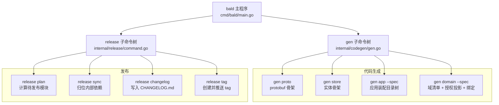
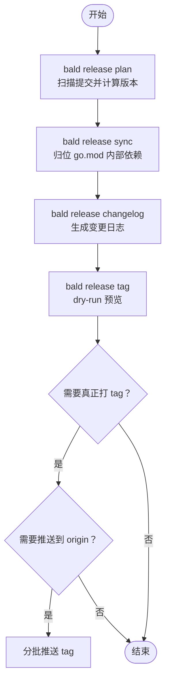
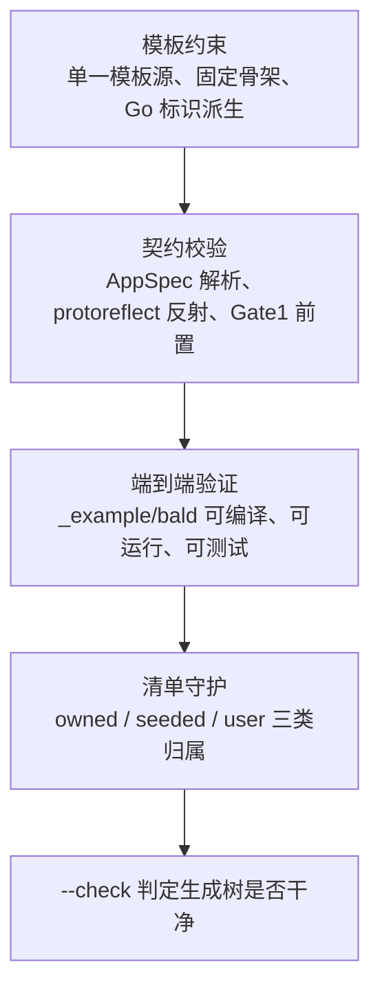
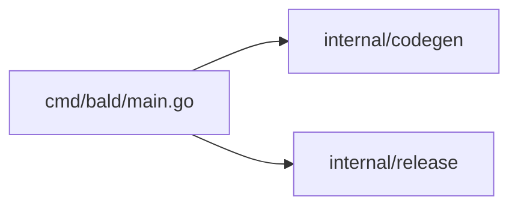

# CLI 工具链

<cite>
**本文引用的文件**   
- [cmd/bald/main.go](file://cmd/bald/main.go)
- [internal/codegen/gen.go](file://internal/codegen/gen.go)
- [internal/codegen/appspec_gen.go](file://internal/codegen/appspec_gen.go)
- [internal/codegen/manifest.go](file://internal/codegen/manifest.go)
- [_example/bald/appspec.json](file://_example/bald/appspec.json)
- [_example/bald/domains.manifest.json](file://_example/bald/domains.manifest.json)
- [_example/bald/taskfile.yml](file://_example/bald/taskfile.yml)
- [internal/release/command.go](file://internal/release/command.go)
- [internal/release/plan.go](file://internal/release/plan.go)
- [internal/release/sync.go](file://internal/release/sync.go)
- [internal/release/changelog.go](file://internal/release/changelog.go)
- [internal/release/tag.go](file://internal/release/tag.go)
</cite>

## 目录

1. [简介](#简介)
2. [项目结构](#项目结构)
3. [核心命令总览](#核心命令总览)
4. [代码生成：bald gen](#代码生成bald-gen)
5. [发布流程：bald release](#发布流程bald-release)
6. [三段门机制](#三段门机制)
7. [配置与模板](#配置与模板)
8. [依赖与构建任务](#依赖与构建任务)
9. [常见问题排查](#常见问题排查)
10. [最佳实践](#最佳实践)
11. [结语](#结语)

## 简介

`bald` 是 Go 服务框架的官方 CLI，由 `cmd/bald` 提供两个命令节点：

- **`gen`**：面向应用开发者，生成 protobuf、实体、应用装配和域驱动产物。
- **`release`**：面向仓库维护者，从 git 提交历史推导待发布模块、版本、变更日志并打 tag。

CLI 使用 cobra 组装子命令；错误输出统一走 `CheckErr`，帮助信息默认静默，避免 flag 错误重复打印 usage。安装入口为 `go install github.com/kalandramo/bald/cmd/bald@latest`。

**章节来源**
- [cmd/bald/main.go:1-47](file://cmd/bald/main.go#L1-L47)

## 项目结构



**图表来源**
- [cmd/bald/main.go:24-47](file://cmd/bald/main.go#L24-L47)
- [internal/codegen/gen.go:134-150](file://internal/codegen/gen.go#L134-L150)
- [internal/release/command.go:33-48](file://internal/release/command.go#L33-L48)

**章节来源**
- [cmd/bald/main.go:1-47](file://cmd/bald/main.go#L1-L47)
- [internal/codegen/gen.go:1-20](file://internal/codegen/gen.go#L1-L20)
- [internal/release/command.go:1-24](file://internal/release/command.go#L1-L24)

## 核心命令总览

| 命令 | 用途 | 关键参数 | 典型场景 |
|---|---|---|---|
| `bald gen proto <name>` | 生成 protobuf 服务契约（CRUD 六件套） | `--out`、`--plural`、`--go-package`、`--module`、`--force` | 新增一个 gRPC/REST 服务 |
| `bald gen store <name>` | 生成 GORM 实体骨架 | `--out`、`--out-pkg`、`--force` | 新增数据库模型 |
| `bald gen app --spec <AppSpec.json>` | 按声明生成应用装配目录树 | `--check`、`--adopt` | 新建或重构服务角色 |
| `bald gen domain --spec <AppSpec.json>` | 按域声明重写域产物 | `--check`、`--adopt` | 修改 domain.proto 后重新绑定路由与授权 |
| `bald release plan` | 计算待发布模块与下一版本 | `--json`、`--out` | 准备多模块发版 |
| `bald release sync` | 把计划内 go.mod 内部依赖归位到下一版本 | `--plan`、`--write` | 发布前同步 require |
| `bald release changelog` | 从提交历史生成 CHANGELOG.md | `--plan`、`--write` | 确认变更日志内容 |
| `bald release tag` | 按 HEAD 打 tag | `--plan`、`--apply`、`--push` | 实际打标签并可选推送 |

**章节来源**
- [cmd/bald/main.go:11-17](file://cmd/bald/main.go#L11-L17)
- [internal/codegen/gen.go:134-150](file://internal/codegen/gen.go#L134-L150)
- [internal/release/command.go:33-48](file://internal/release/command.go#L33-L48)

## 代码生成：bald gen

### `bald gen proto`

生成 `<name>.proto`，包含：

- gRPC service：List、Get、Create、Update、Delete。
- google.api.http 注解：同一 RPC 同时暴露 REST/JSON。
- buf.validate 字段校验：作为契约的一部分。
- `bald.store.v1.FilterExpr`：结构化过滤表达式。
- `PagingRequest` / `PaginationResponseMeta`：分页三态。

默认输出路径为 `api/proto/<name>/v1/<name>.proto`，REST 资源段默认为 `<name>s`。

| 参数 | 类型 | 默认值 | 含义 |
|---|---|---:|---|
| `<name>` | 位置参数 | 必填 | 服务名，也是 proto package 前缀 |
| `--out` | 字符串 | `api/proto/<name>/v1` | 输出目录 |
| `--plural` | 字符串 | `<name>s` | REST 路径中的资源复数段 |
| `--go-package` | 字符串 | 空 | proto 的 `go_package` option |
| `--module` | 字符串 | 空 | 业务 module 路径，缺省用于派生 `go_package` |
| `--force` | 布尔 | false | 覆盖已存在文件 |

**示例**

```text
bald gen proto greet
bald gen proto org-unit --plural org-units
bald gen proto greet --go-package "github.com/example/app/api/greet/v1;greetv1"
bald gen proto greet --module "github.com/example/app"
bald gen proto greet --force
```

**语义要点**

- `--module` 缺省派生的 `go_package` 形式为 `<module>/api/gen/go/<name>/v1;<name>v1`，与 gen app 的 buf managed mode 前缀同源。
- 生成器不直接生成 Go 代码；它会提示下一步需要把文件纳入 buf 模块并运行 `buf generate`。
- 单模板源纪律：全仓只有一份 proto 模板，gen app 不再生成 proto。

**章节来源**
- [internal/codegen/gen.go:1-20](file://internal/codegen/gen.go#L1-L20)
- [internal/codegen/gen.go:200-270](file://internal/codegen/gen.go#L200-L270)
- [internal/codegen/gen.go:270-344](file://internal/codegen/gen.go#L270-L344)

### `bald gen store`

生成单个实体 `.go`，包含：

- 带 gorm tag 的结构体。
- `KeyOf` 函数，供存储 Provider 唯一定位实体。
- gofmt 格式化后的可编译源码。

| 参数 | 类型 | 默认值 | 含义 |
|---|---|---:|---|
| `<name>` | 位置参数 | 必填 | 实体名 |
| `--out` | 字符串 | `.` | 输出目录 |
| `--out-pkg` | 字符串 | `main` | 生成文件的 Go package |
| `--force` | 布尔 | false | 覆盖已存在文件 |

**示例**

```text
bald gen store User
bald gen store Order --out user --out-pkg user
bald gen store User --force
```

**注意事项**

- 实体必须可编译：渲染后会执行 gofmt，失败即报错。
- 这是“骨架”而非完整领域逻辑；手写实现仍放在业务代码中。

**章节来源**
- [internal/codegen/gen.go:270-344](file://internal/codegen/gen.go#L270-L344)

### `bald gen app --spec`

按 AppSpec 生成应用装配目录树。该命令不是简单文本替换，而是：

1. 解析 AppSpec JSON。
2. 用 protoreflect 反射派生 bootstrap 配置视图。
3. 构造 `treeView`（角色、传输面、变体、组件、API 包等）。
4. 渲染模板文件。
5. 对 `.go` 执行 gofmt。
6. 通过 manifest 管理 owned / seeded / user 三类文件。
7. 支持 `--check` 与 `--adopt`。

| 参数 | 类型 | 默认行为 | 含义 |
|---|---|---|---|
| `--spec` | 字符串 | 必填 | AppSpec 声明文件路径 |
| `--check` | 布尔 | false | 检查生成物是否干净，零写入 |
| `--adopt` | 布尔 | false | 接管 owned 文件并删除陈旧产物 |

**示例**

```text
bald gen app --spec appspec.json
bald gen app --spec appspec.json --check
bald gen app --spec appspec.json --adopt
```

**生成物特征**

- 单角色默认 15 个落盘项；多角色按 role 拆分。
- 支持 http、grpc、grpc-gateway 三种传输面。
- 支持 variants（build tags），命中时增量注入组件或补丁。
- 自定义接线通过 seeded 钩子扩展：生成物调用钩子，不覆盖用户改动。
- 装配收敛到唯一 `Options()` 入口。

**章节来源**
- [internal/codegen/appspec_gen.go:1-20](file://internal/codegen/appspec_gen.go#L1-L20)
- [internal/codegen/appspec_gen.go:200-286](file://internal/codegen/appspec_gen.go#L200-L286)

### `bald gen domain --spec`

在 `bald gen app` 之后运行，根据 `AppSpec.domains` 重写域相关生成物，包括：

- 域清单。
- 授权投影。
- gRPC/HTTP 绑定。
- 路由表。
- 转换层。

它读取 `domains.manifest.json`，判断上次生成的 spec 摘要是否变化，再决定更新哪些 owned 文件。

| 参数 | 类型 | 默认行为 | 含义 |
|---|---|---|---|
| `--spec` | 字符串 | 必填 | AppSpec 声明文件路径 |
| `--check` | 布尔 | false | 检查域产物是否与 spec 一致 |
| `--adopt` | 布尔 | false | 接管并重建 owned 域产物 |

**示例**

```text
bald gen domain --spec appspec.json
bald gen domain --spec appspec.json --check
bald gen domain --spec appspec.json --adopt
```

**章节来源**
- [internal/codegen/gen.go:1-20](file://internal/codegen/gen.go#L1-L20)
- [_example/bald/domains.manifest.json:1-32](file://_example/bald/domains.manifest.json#L1-L32)

## 发布流程：bald release

`release` 是维护者命令，负责多模块仓库的版本规划与打标。



**图表来源**
- [internal/release/command.go:33-176](file://internal/release/command.go#L33-L176)
- [internal/release/plan.go:105-152](file://internal/release/plan.go#L105-L152)
- [internal/release/tag.go:24-122](file://internal/release/tag.go#L24-L122)

### `bald release plan`

从 git 提交历史推导每个可发布模块的下一版本，并写出计划文件。

| 参数 | 类型 | 默认值 | 含义 |
|---|---|---:|---|
| `--json` | 布尔 | false | 把计划以 JSON 输出到 stdout |
| `--out` | 字符串 | `.bald/release-plan.json` | 计划文件路径 |

**示例**

```text
bald release plan
bald release plan --json
bald release plan --out .bald/my-plan.json
```

**版本推导规则**

- 首次发布的模块：`initial` → `v0.1.0`。
- Conventional Commits：
  - `feat` → minor。
  - `!` 或 BREAKING CHANGE → major（0.x 降级为 minor）。
  - 非 Conventional 提交 → patch。
  - `docs`、`chore`、`test`、`ci`、`style`、`build` → 不触发发布。
- 多个提交取最高 bump 等级。

**章节来源**
- [internal/release/command.go:52-85](file://internal/release/command.go#L52-L85)
- [internal/release/plan.go:200-310](file://internal/release/plan.go#L200-L310)

### `bald release sync`

把计划内模块以及消费者模块中对待发模块的 require 升级到下一版本。

| 参数 | 类型 | 默认值 | 含义 |
|---|---|---:|---|
| `--plan` | 字符串 | `.bald/release-plan.json` | 计划文件路径 |
| `--write` | 布尔 | false | 真正写入 go.mod（默认只打印） |

**示例**

```text
bald release sync
bald release sync --write
bald release sync --plan .bald/my-plan.json
```

**安全语义**

- 默认 dry-run：只打印将要改动的行。
- 目标限定：仅计划内的模块与消费者，不会无限扩散到无关模块。
- 幂等：已经是目标版本时不改写。
- 若 go.mod 中找不到旧版本或目标版本不一致，会报错并建议重新跑 plan。

**章节来源**
- [internal/release/command.go:87-113](file://internal/release/command.go#L87-L113)
- [internal/release/sync.go:1-126](file://internal/release/sync.go#L1-L126)

### `bald release changelog`

把发布计划中的提交标题写入 `CHANGELOG.md`。

| 参数 | 类型 | 默认值 | 含义 |
|---|---|---:|---|
| `--plan` | 字符串 | `.bald/release-plan.json` | 计划文件路径 |
| `--write` | 布尔 | false | 真正写入 CHANGELOG.md（默认只打印） |

**示例**

```text
bald release changelog
bald release changelog --write
```

**行为**

- 新版本节插入现有日期节之前。
- 同一天多次发布会合并到同一个日期节。
- 如果某版本标题已存在，拒绝写入，防止重复发布。

**章节来源**
- [internal/release/command.go:115-140](file://internal/release/command.go#L115-L140)
- [internal/release/changelog.go:1-124](file://internal/release/changelog.go#L1-L124)

### `bald release tag`

在 HEAD 上为每个计划内模块打 tag。

| 参数 | 类型 | 默认值 | 含义 |
|---|---|---:|---|
| `--plan` | 字符串 | `.bald/release-plan.json` | 计划文件路径 |
| `--apply` | 布尔 | false | 真正创建 tag（默认只打印） |
| `--push` | 布尔 | false | 创建后推送到 origin（必须配合 `--apply`） |

**示例**

```text
bald release tag
bald release tag --apply
bald release tag --apply --push
bald release tag --plan .bald/my-plan.json --apply --push
```

**保护机制**

- 工作区必须干净。
- HEAD 相对计划记录只能多出发布提交（go.mod 与 CHANGELOG）。
- 同名 tag 已存在时拒绝。
- 批量 push 时按 3 个 tag 分批，避免 GitHub 一次推送过多 tag 不触发事件。

**章节来源**
- [internal/release/command.go:142-176](file://internal/release/command.go#L142-L176)
- [internal/release/tag.go:1-122](file://internal/release/tag.go#L1-L122)

## 三段门机制

Bald 的代码生成不是“模板直接落盘”，而是由三层约束共同保证质量：



**图表来源**
- [internal/codegen/gen.go:1-20](file://internal/codegen/gen.go#L1-L20)
- [internal/codegen/appspec_gen.go:1-20](file://internal/codegen/appspec_gen.go#L1-L20)
- [internal/codegen/manifest.go:1-40](file://internal/codegen/manifest.go#L1-L40)

### 第一道门：模板约束

- proto 模板是唯一 CRUD 六件套来源，不随 gen app 双轨生成。
- 实体模板强制 gofmt，确保输出可编译。
- 角色名、传输面、变体、组件等全部从 AppSpec 派生，不在模板里手写裸键名。
- Go 标识派生使用统一 `title` 与 `goName` 函数，避免大小写与非法字符问题。

### 第二道门：契约校验

- AppSpec 通过 bconf 的 protoreflect 反射解析，模板不出现裸配置键。
- gen app 的 `treeView` 把原始 Spec 转成派生视图：HasHTTP、HasGRPC、HasGateway、MultiRole、HasVariants 等。
- gen domain 通过 domains.manifest 对比 spec 摘要，避免无变化的全量重建。

### 第三道门：端到端验证

- `_example/bald` 作为真实消费者模块，被用作生成器的编译与运行上下文。
- 生成器文档明确说明：生成物是可编译骨架，业务路由/handler/service 注册留填充点。
- Taskfile 中 `verify` 任务执行 build、vet、test，构成 CI 侧基础防线。

**章节来源**
- [internal/codegen/gen.go:1-20](file://internal/codegen/gen.go#L1-L20)
- [internal/codegen/appspec_gen.go:1-20](file://internal/codegen/appspec_gen.go#L1-L20)
- [_example/bald/taskfile.yml:1-23](file://_example/bald/taskfile.yml#L1-L23)

## 配置与模板

### AppSpec 配置

`appspec.json` 是声明真相源，描述：

- 应用元信息：name、module、desc、roles。
- bootstrap 配置：app、logger、database、registry。
- domains：protoPackage、service、goPackage。
- variants：build tag 条件与增量组件/补丁。

**示例文件**

- [_example/bald/appspec.json](file://_example/bald/appspec.json)

**关键字段**

| 路径 | 含义 |
|---|---|
| `meta.name` | 应用名，也影响 cmd 名与配置文件名 |
| `meta.module` | Go module 路径，用于 import 前缀 |
| `meta.roles` | 多角色定义；为空时合成默认单角色 |
| `bootstrap.app.version` | 应用版本 |
| `bootstrap.server.http/grpc` | 开启 HTTP 或 gRPC |
| `domains[].protoPackage` | proto package |
| `domains[].service` | gRPC service 全名 |
| `domains[].goPackage` | 域 Go 包导入路径 |
| `variants[].when` | 构建条件 |
| `variants[].effects.components` | 命中时注入的组件 |

**章节来源**
- [_example/bald/appspec.json:1-81](file://_example/bald/appspec.json#L1-L81)
- [internal/codegen/appspec_gen.go:200-286](file://internal/codegen/appspec_gen.go#L200-L286)

### Domains Manifest

`domains.manifest.json` 由 `bald gen domain` 维护，记录：

- 清单版本。
- 工具名。
- 对应 AppSpec 内容的 sha256。
- 所有 owned 生成物的 path、ownership、hash。

**示例文件**

- [_example/bald/domains.manifest.json](file://_example/bald/domains.manifest.json)

**字段含义**

| 字段 | 含义 |
|---|---|
| `version` | 清单格式版本 |
| `tool` | 生成工具名称 |
| `spec` | AppSpec 文件摘要 |
| `files.path` | 生成物相对路径 |
| `files.ownership` | `owned` 或 `seeded` |
| `files.hash` | 落盘字节摘要（seeded 恒为标记值） |

**章节来源**
- [_example/bald/domains.manifest.json:1-32](file://_example/bald/domains.manifest.json#L1-L32)
- [internal/codegen/manifest.go:40-120](file://internal/codegen/manifest.go#L40-L120)

### 模板自定义方法

Bald 的自定义策略是“生成物调用钩子，不覆盖用户代码”：

1. 使用 `--adopt` 让生成器播种 seeded 文件。
2. 在 seeded 文件中实现业务接线。
3. 后续 `gen app` 或 `gen domain` 不再覆盖这些文件。
4. 如需恢复生成器控制权，需手动移除对应 seeded 文件后再 `--adopt`。

**章节来源**
- [internal/codegen/appspec_gen.go:1-20](file://internal/codegen/appspec_gen.go#L1-L20)
- [internal/codegen/manifest.go:40-80](file://internal/codegen/manifest.go#L40-L80)

## 依赖与构建任务

### 根 CLI 依赖

- cobra：命令解析。
- internal/codegen：代码生成器。
- internal/release：发布工具。



**图表来源**
- [cmd/bald/main.go:24-47](file://cmd/bald/main.go#L24-L47)

**章节来源**
- [cmd/bald/main.go:24-47](file://cmd/bald/main.go#L24-L47)

### _example/bald 构建任务

_example 的 Taskfile 定义了示例项目的本地构建入口：

| 任务 | 行为 |
|---|---|
| `proto` | 进入 `api` 目录执行 `buf generate` |
| `run-api` | 运行 api 角色 |
| `run-worker` | 运行 worker 角色 |
| `verify` | `go build ./...`、`go vet ./...`、`go test ./...` |

这体现了 CLI 生成的目标：不只是产生文件，还要能进入真实 Go 模块参与编译与测试。

**章节来源**
- [_example/bald/taskfile.yml:1-23](file://_example/bald/taskfile.yml#L1-L23)

## 常见问题排查

### 生成器拒绝覆盖已有文件

**现象**：`bald gen proto/store` 报告目标文件已存在。

**原因**：默认禁止覆盖，防止误删手写骨架。

**处理**

- 确认文件确实由生成器产出。
- 加 `--force` 强制覆盖。
- 对于 gen app/domain，优先使用 `--adopt`，让 manifest 接管 owned 文件。

**章节来源**
- [internal/codegen/gen.go:200-270](file://internal/codegen/gen.go#L200-L270)
- [internal/codegen/gen.go:300-344](file://internal/codegen/gen.go#L300-L344)

### `bald gen app --check` 报生成树不干净

**现象**：提示 missing、out-of-date、stale 或 manifest out-of-date。

**原因**

- 生成物与当前 AppSpec 不一致。
- 生成器模板升级导致 owned 文件变化。
- 清单本身过期或被篡改。
- 上次 owned 文件本次不再生成，但还留在磁盘。

**处理**

- 先用 `--check` 查看差异路径。
- 确认后运行 `--adopt` 接管并重建。
- 不要手工编辑 owned 文件；如需扩展，改用 seeded 钩子。

**章节来源**
- [internal/codegen/manifest.go:80-160](file://internal/codegen/manifest.go#L80-L160)
- [internal/codegen/manifest.go:160-237](file://internal/codegen/manifest.go#L160-L237)

### `buf generate` 后仍未生成 Go 代码

**现象**：proto 已生成，但没有对应的 Go 文件。

**原因**：gen proto 只生成 proto 契约；Go 代码由 buf 生态插件生成。

**处理**

- 把生成的 proto 加入 buf 模块。
- 确保依赖 `googleapis`、`protovalidate`、bald store 模块。
- 在业务 module 中运行 `buf generate`。

**章节来源**
- [internal/codegen/gen.go:200-270](file://internal/codegen/gen.go#L200-L270)

### `bald release sync` 报 require 不存在

**现象**：sync 指出某个模块的 require 既不是 from 也不是 to。

**原因**：计划过期，或 go.mod 已被其他操作修改。

**处理**

- 重新运行 `bald release plan`。
- 再次运行 `bald release sync`。
- 如果不需要自动修改，先不加 `--write` 确认 diff。

**章节来源**
- [internal/release/sync.go:80-126](file://internal/release/sync.go#L80-L126)

### `bald release tag` 报工作区不干净

**现象**：tag 阶段拒绝执行。

**原因**：tag 的内容必须等于已提交内容；go.mod 归位与 CHANGELOG 必须先提交。

**处理**

```text
bald release plan
bald release sync --write
bald release changelog --write
git add .
git commit -m "release: sync and changelog"
bald release tag --apply
```

**章节来源**
- [internal/release/tag.go:24-80](file://internal/release/tag.go#L24-L80)

### `bald release changelog` 报版本标题已存在

**现象**：提示 CHANGELOG.md 已包含某版本标题。

**原因**：计划已应用过，或重复执行了发布流程。

**处理**

- 重新运行 `bald release plan` 获取新计划。
- 不要手工调整顺序；变更日志应由工具生成。

**章节来源**
- [internal/release/changelog.go:40-80](file://internal/release/changelog.go#L40-L80)

## 最佳实践

1. **先 proto，再 app，最后 domain**  
   典型顺序：`bald gen proto` → `bald gen app --spec` → `bald gen domain --spec`。

2. **始终保留生成物可判定性**  
   使用 `--check` 把生成树一致性纳入 CI；`--adopt` 只在确认差异后使用。

3. **不要把业务逻辑写进模板**  
   生成物是骨架；业务路由、handler、service 注册应放在种子文件或手写实现中。

4. **多角色服务用 AppSpec roles 声明**  
   避免为 api 和 worker 维护两套手动装配代码。

5. **发布前先看 dry-run**  
   `sync`、`changelog`、`tag` 默认都不写磁盘，先确认 diff 再加 `--write` 或 `--apply`。

6. **Conventional Commits 决定版本**  
   feat 升 minor，breaking 升 major，普通改动升 patch；docs/chore/test/ci/style/build 不触发发布。

7. **不要跳过 sync 直接 tag**  
   否则下游 `go get A@新版本` 可能因内部依赖仍指向旧 B 而编译失败。

8. **_example 作为生成器质量基线**  
   任何模板或契约变化都应能通过示例模块的构建与测试。

**章节来源**
- [internal/codegen/gen.go:1-20](file://internal/codegen/gen.go#L1-L20)
- [internal/release/plan.go:200-310](file://internal/release/plan.go#L200-L310)
- [internal/release/sync.go:1-40](file://internal/release/sync.go#L1-L40)

## 结语

Bald CLI 的核心价值在于把“手写脚手架”变成“可验证的生成管线”：

- `gen` 用模板约束、契约解析和示例模块端到端验证兜底骨架质量。
- `release` 用 plan/sync/changelog/tag 四步闭环管理多模块仓库的版本。
- manifest 把“生成物最新”从主观判断变成可检测状态。
- `_example/bald` 充当真实消费者，防止生成器脱离业务上下文。

对于使用者，最稳妥的工作流是：**声明驱动 AppSpec → 生成骨架 → 手写业务 → 用 check 锁定生成树 → 用 Conventional Commits 驱动发布**。