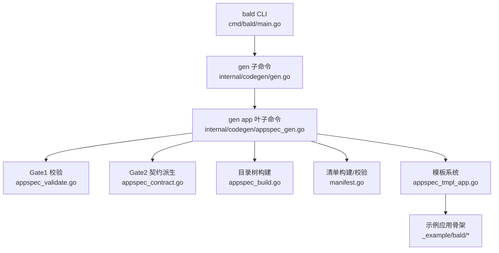
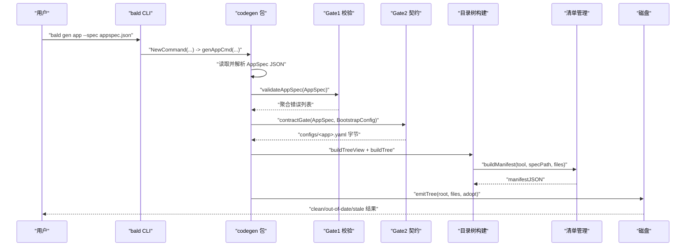
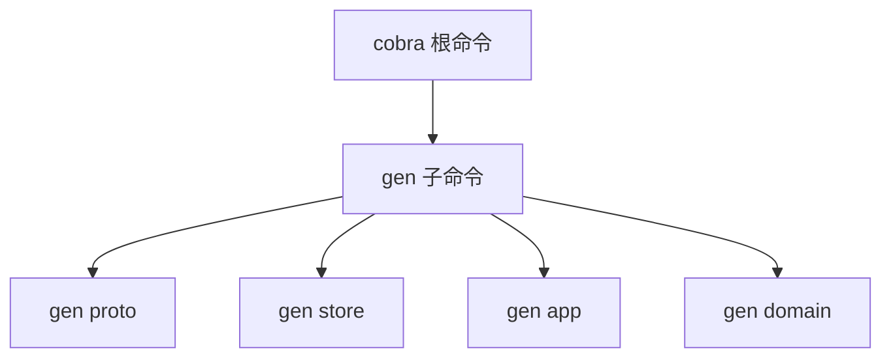
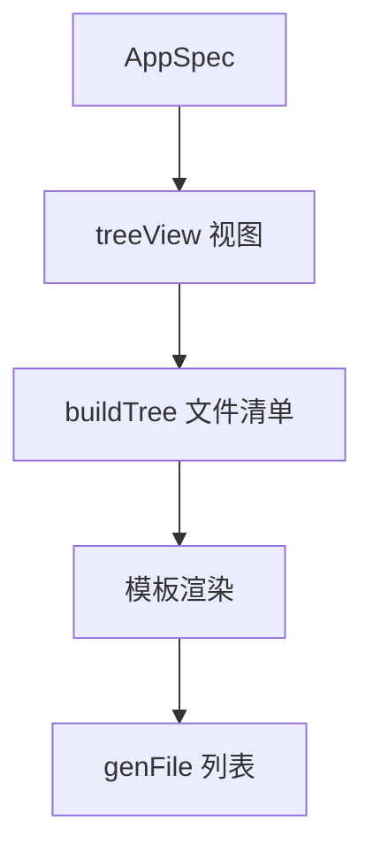
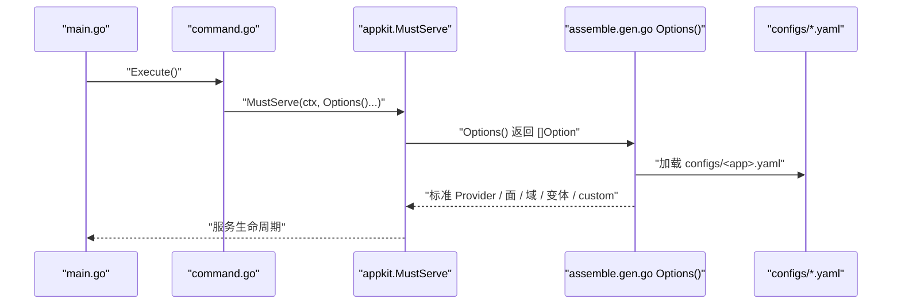
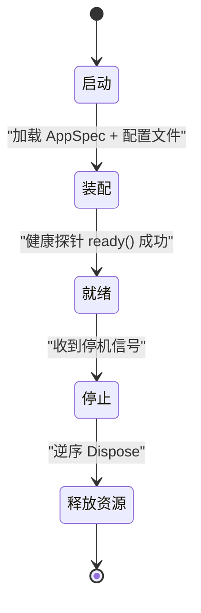
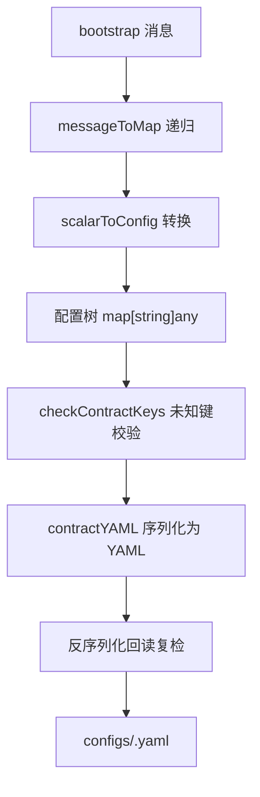
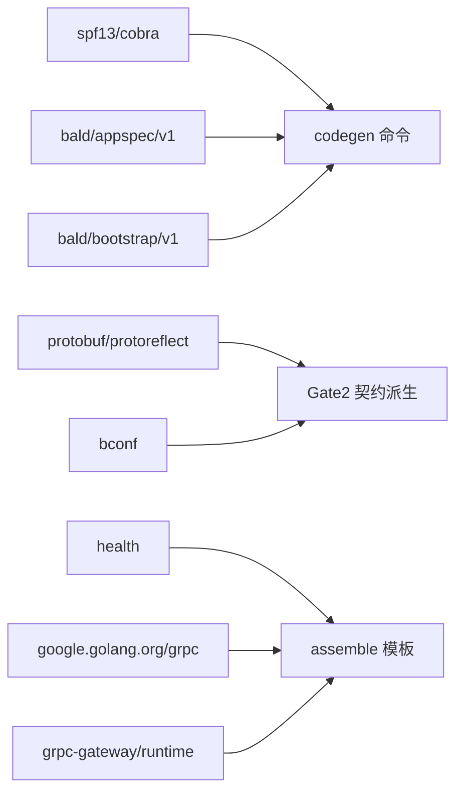

# bald gen app 命令

<cite>
**本文引用的文件 **
- [main.go](file://cmd/bald/main.go)
- [gen.go](file://internal/codegen/gen.go)
- [appspec_gen.go](file://internal/codegen/appspec_gen.go)
- [appspec_build.go](file://internal/codegen/appspec_build.go)
- [appspec_validate.go](file://internal/codegen/appspec_validate.go)
- [appspec_contract.go](file://internal/codegen/appspec_contract.go)
- [manifest.go](file://internal/codegen/manifest.go)
- [appspec_tmpl_app.go](file://internal/codegen/appspec_tmpl_app.go)
- [assemble.gen.go](file://_example/bald/internal/bootstrap/assemble.gen.go)
- [main.go（示例）](file://_example/bald/cmd/bald-demo-api/main.go)
- [appspec.json（示例）](file://_example/bald/appspec.json)
- [bald-demo-api.yaml（示例）](file://_example/bald/configs/bald-demo-api.yaml)
- [bald-demo-worker.yaml（示例）](file://_example/bald/configs/bald-demo-worker.yaml)
- [domains.manifest.json（示例）](file://_example/bald/domains.manifest.json)
</cite>

## 目录
1. [引言](#引言)
2. [项目结构](#项目结构)
3. [核心组件](#核心组件)
4. [架构总览](#架构总览)
5. [详细组件分析](#详细组件分析)
6. [依赖关系分析](#依赖关系分析)
7. [性能与生成成本](#性能与生成成本)
8. [故障排查指南](#故障排查指南)
9. [结论](#结论)
10. [附录：配置格式参考](#附录配置格式参考)

## 引言
`bald gen app` 是 `bald` CLI 的代码生成子命令，用于根据 `AppSpec`（`appspec.json`）生成完整应用程序骨架。它负责产出：
- 每个角色的 `cmd/<应用名>-<角色>/main.go` 和装配入口；
- `internal/bootstrap/assemble.gen.go` 等生成装配代码；
- 按 `AppSpec.bootstrap` 派生的配置文件 `configs/<应用>.yaml`；
- 域清单、变体实现、buf/taskfile 脚手架等辅助产物；
- `appspec.manifest.json` 清单，用于校验或覆盖生成物。

本命令不替代手写业务逻辑，而是提供可编译的起点：路由、gRPC service 注册、Provider 装配钩子都保留 TODO 填充点。

## 项目结构
CLI 入口位于 `cmd/bald/main.go`，`gen` 子命令由 `internal/codegen` 提供。`bald gen app` 的具体实现集中在以下文件：
- 命令组装与叶子命令注册：`internal/codegen/gen.go`
- AppSpec 解析、视图构建、模板渲染入口：`internal/codegen/appspec_gen.go`
- 落盘清单与归属三态（owned / seeded / user）：`internal/codegen/appspec_build.go`
- Gate1（声明 schema 门）与字段消费守卫：`internal/codegen/appspec_validate.go`
- Gate2（契约派生 + YAML 发射 + 回读校验）：`internal/codegen/appspec_contract.go`
- 清单版本、哈希、脏污检测与清理：`internal/codegen/manifest.go`
- 应用装配模板（main/command/assemble/custom/health/gateway 等）：`internal/codegen/appspec_tmpl_app.go`
- 示例消费者模块：`_example/bald`

**图示来源**
- [main.go:25-47](file://cmd/bald/main.go#L25-L47)
- [gen.go:1-30](file://internal/codegen/gen.go#L1-L30)
- [appspec_gen.go:1-40](file://internal/codegen/appspec_gen.go#L1-L40)

**章节来源**
- [main.go:1-47](file://cmd/bald/main.go#L1-L47)
- [gen.go:1-30](file://internal/codegen/gen.go#L1-L30)

## 核心组件
| 组件 | 职责 | 关键行为 |
|---|---|---|
| `gen.go` | 挂载 `gen proto/store/app/domain` 子命令 | 设置错误输出流，把 `gen` 作为 cobra 中间节点 |
| `appspec_gen.go` | 把 `AppSpec` 转为 `treeView`，驱动模板渲染 | 处理单/多角色、HTTP/gRPC/gateway、variants、components |
| `appspec_validate.go` | Gate1 校验 AppSpec | kind 白名单、name 唯一、capability 子集、domain 形态互斥、roles 并集、variant 表达式 |
| `appspec_contract.go` | Gate2 从 bootstrap 段派生 YAML | 通过 protoreflect 遍历消息，转 Duration/Timestamp/枚举，再反序列化回读 |
| `appspec_build.go` | 组装待落盘文件清单 | 按 owned/seeded/user 分类，gofmt `.go`，写入 taskfile/buf/seed 等 |
| `manifest.go` | 维护 `appspec.manifest.json` | sha256 比对、--check 零写入、--adopt 覆盖与清理陈旧 owned |
| `appspec_tmpl_app.go` | 应用装配模板 | main/command/assemble/custom/health/gateway/heartbeat 等 |

**章节来源**
- [gen.go:120-180](file://internal/codegen/gen.go#L120-L180)
- [appspec_gen.go:1-40](file://internal/codegen/appspec_gen.go#L1-L40)
- [appspec_validate.go:1-40](file://internal/codegen/appspec_validate.go#L1-L40)
- [appspec_contract.go:1-30](file://internal/codegen/appspec_contract.go#L1-L30)
- [appspec_build.go:1-25](file://internal/codegen/appspec_build.go#L1-L25)
- [manifest.go:1-40](file://internal/codegen/manifest.go#L1-L40)
- [appspec_tmpl_app.go:1-20](file://internal/codegen/appspec_tmpl_app.go#L1-L20)

## 架构总览
`bald gen app --spec <AppSpec.json>` 的执行路径如下：

**图示来源**
- [main.go:33-47](file://cmd/bald/main.go#L33-L47)
- [gen.go:120-180](file://internal/codegen/gen.go#L120-L180)
- [appspec_gen.go:120-200](file://internal/codegen/appspec_gen.go#L120-L200)
- [appspec_validate.go:60-120](file://internal/codegen/appspec_validate.go#L60-L120)
- [appspec_contract.go:160-200](file://internal/codegen/appspec_contract.go#L160-L200)
- [appspec_build.go:26-128](file://internal/codegen/appspec_build.go#L26-L128)
- [manifest.go:100-200](file://internal/codegen/manifest.go#L100-L200)

## 详细组件分析

### 一、命令入口与子命令装配
`cmd/bald/main.go` 创建根 cobra 命令，并把 `codegen.NewCommand` 作为 `gen` 子命令挂载。`gen` 内部再挂载 `proto/store/app/domain`。`gen app` 的叶子命令在 `internal/codegen/gen.go` 中注册。

**图示来源**
- [main.go:33-47](file://cmd/bald/main.go#L33-L47)
- [gen.go:120-180](file://internal/codegen/gen.go#L120-L180)

**章节来源**
- [main.go:1-47](file://cmd/bald/main.go#L1-L47)
- [gen.go:120-180](file://internal/codegen/gen.go#L120-L180)

### 二、AppSpec 与 domains.manifest.json 配置格式

#### 2.1 AppSpec（`appspec.json`）
AppSpec 是 `bald gen app` 的唯一声明真相源。示例见 `_example/bald/appspec.json`，其关键字段包括：

| 字段 | 类型 | 含义 | 约束 |
|---|---|---|---|
| `meta.name` | string | 应用名 | 必填；驱动 `cmd/<name>` 与默认配置文件名 |
| `meta.module` | string | Go module 路径 | 必填；生成文件 import `<module>/internal/...` |
| `meta.desc` | string | 应用描述 | 注入到命令帮助文本 |
| `meta.roles` | array | 角色列表 | 空数组表示单角色；非空时 name 必须全应用唯一 |
| `bootstrap` | message | 框架引导配置 | 可选；由 Gate2 派生 `configs/<app>.yaml` |
| `components` | array | 托管组件 | kind 在白名单内；name 全局唯一 |
| `capability.provides` | array | 本进程提供的能力 | 被 requires 的子集校验 |
| `capability.requires.component` | string | 依赖方组件名 | 配合 caps 做 S1 能力声明 |
| `capability.requires.caps` | array[string] | 要求的能力集合 | 必须是 provides 子集 |
| `layout.apiserver_dir` | string | API 目录名 | 默认 `apiserver` |
| `layout.strict_contract` | bool | 是否启用运行期严格契约 | 默认 true |
| `domains[]` | object | 领域声明 | name 唯一；service/services/http_only 三选一 |
| `domains[].protoPackage` | string | proto package | http_only 域可省略 |
| `domains[].service` | string | 单 gRPC service | 与 services 互斥 |
| `domains[].services` | array[string] | 多 gRPC service | 与 service 互斥；短名在域内唯一 |
| `domains[].goPackage` | string | 导出 appkit.Domain 的 Go 包 | 必填；别名不能冲突 |
| `variants[]` | object | 构建期变体 | name 小写标识符；when 与 build_tags 互斥 |
| `variants[].effects.components` | array | 变体增量组件 | 跨全局与所有变体 name 唯一 |
| `variants[].effects.patches` | array | 补丁路径 | path 非空、无空白、单行 |

示例中的双角色 `api` 与 `worker`、`greet` 域、以及 `grpcgw`/`nacos` 两个变体，展示了 roles/domains/variants 的组合用法。

**章节来源**
- [appspec.json:1-81](file://_example/bald/appspec.json#L1-L81)
- [appspec_validate.go:60-180](file://internal/codegen/appspec_validate.go#L60-L180)
- [appspec_validate.go:300-502](file://internal/codegen/appspec_validate.go#L300-L502)

#### 2.2 domains.manifest.json
`domains.manifest.json` 是 `bald gen domain` 的清单，不是 `gen app` 的直接输入。它记录一次 `gen domain` 生成的域相关文件的 hash，供 `--check` 判定是否干净。其结构与 `appspec.manifest.json` 一致：version、tool、spec、files。

| 字段 | 含义 |
|---|---|
| `version` | 清单格式版本 |
| `tool` | 生成工具名，如 `bald gen domain` |
| `spec` | 输入 AppSpec 的 sha256 |
| `files.path` | 斜杠路径，跨平台可比 |
| `files.ownership` | `owned` 或 `seeded` |
| `files.hash` | 已 gofmt 内容的 sha256；seeded 固定为标记值 |

示例显示 `authz/alias.gen.go`、`handler/convert/greet.gen.go`、`routes/greet.gen.go` 等由 `gen domain` 产生的 owned 文件。

**章节来源**
- [manifest.go:60-120](file://internal/codegen/manifest.go#L60-L120)
- [domains.manifest.json:1-32](file://_example/bald/domains.manifest.json#L1-L32)

### 三、模板系统与自定义扩展

#### 3.1 模板渲染流程
`appspec_gen.go` 把原始 `*appspecv1.AppSpec` 与归一化的 `*bootstrapv1.BootstrapConfig` 组合成 `treeView`。模板直接消费该视图，而不是手工映射字段。关键派生字段包括：
- `HasHTTP`、`HasGRPC`、`HasGateway`、`AnyFace`：由 bootstrap server 段决定；
- `Strict`：由 `layout.strict_contract` 决定；
- `Roles`：单角色合成默认角色，多角色按 `meta.roles` 切分；
- `Variants`：把 when/build_tags 归一为单一 Go 构建约束表达式；
- `HasComponents`：全局组件或任一变体声明了 components 即启用。

**图示来源**
- [appspec_gen.go:120-200](file://internal/codegen/appspec_gen.go#L120-L200)
- [appspec_build.go:26-60](file://internal/codegen/appspec_build.go#L26-L60)

#### 3.2 生成的主要模板
| 模板 | 生成位置 | 作用 |
|---|---|---|
| `mainTmpl` | `cmd/<应用名>-<角色>/main.go` | 最小入口，调用 `app.Execute()` |
| `commandTmpl` | `cmd/<应用名>-<role>/app/command.go` | cobra 根命令、插件、doctor、默认 serve |
| `assembleTmpl` | `internal/bootstrap/assemble.gen.go` | Options() 装配投影 |
| `appCustomTmpl` | `cmd/<应用名>-<role>/app/custom.go` | 业务自定义子命令与选项扩展 |
| `bootstrapCustomTmpl` | `internal/bootstrap/custom.go` | 业务 Provider/Registrar 等扩展 |
| `seedTmpl` | `internal/bootstrap/seed/seed.go` | 种子数据（seeded，首次后归用户） |
| `seedPoliciesTmpl` | `internal/bootstrap/seed/policies.go` | 授权策略种子 |
| `variantsTmpl` | `internal/bootstrap/variants.gen.go` | 变体声明 |
| `variantImplTmpl` | `internal/bootstrap/variant_<name>.gen.go` | 带 `//go:build` 的增量实现 |
| `bootstrapDomainsTmpl` | `internal/bootstrap/domains.gen.go` | 域清单 |
| `layeringTestTmpl` | `internal/apiserver/layering_invariant_test.go` | 分层不变量测试 |
| `apiserverTmpl` | `internal/apiserver/apiserver.go` | HTTP 装配钩子（仅 HTTP 面） |
| `bufYamlTmpl` / `bufGenYamlTmpl` | `api/buf.yaml`、`api/buf.gen.yaml` | buf 流水线脚手架 |
| `taskfileTmpl` | `taskfile.yml` | 任务脚本脚手架 |

#### 3.3 自定义扩展方法
生成器明确区分三类归属：
- `owned`：生成器拥有，`--adopt` 会覆盖；
- `seeded`：首次播种后归用户，`--check` 只判存在性；
- `user`：完全由用户维护，不参与清单。

业务扩展点包括：
- `customSubcommands()`：在 `cmd/<应用名>-<role>/app/custom.go` 中追加 cobra 子命令；
- `customOptions(role)`：在 `internal/bootstrap/custom.go` 中追加 `appkit.Option`；
- `registerGRPCService`：在 `assemble.gen.go` 中注册业务 gRPC service；
- `registerGateway`：在 gateway 模式下注册 REST 转码；
- `ready`：就绪探针钩子；
- `buildComponent`：按 kind 构造托管组件。

这些扩展点在模板中以 TODO 注释暴露，生成一次后归用户维护，不被重生成覆盖。

**章节来源**
- [appspec_tmpl_app.go:1-200](file://internal/codegen/appspec_tmpl_app.go#L1-L200)
- [appspec_tmpl_app.go:200-303](file://internal/codegen/appspec_tmpl_app.go#L200-L303)
- [appspec_build.go:60-128](file://internal/codegen/appspec_build.go#L60-L128)

### 四、应用程序初始化流程

#### 4.1 启动链路
示例应用的生成入口如下：
1. `cmd/bald-demo-api/main.go` 调用 `app.Execute()`；
2. `command.go` 使用 `appcli.Main` 创建 cobra 根命令；
3. 默认行为是 serve，调用 `appkit.MustServe(context.Background(), bootstrap.Options()...)`；
4. `assemble.gen.go` 的 `Options()` 返回装配选项，包括 std provider、配置文件、能力声明、传输面、健康检查、域清单、计划缓存、变体选项、自定义扩展。

**图示来源**
- [main.go（示例）:1-14](file://_example/bald/cmd/bald-demo-api/main.go#L1-L14)
- [assemble.gen.go:1-92](file://_example/bald/internal/bootstrap/assemble.gen.go#L1-L92)

#### 4.2 依赖注入
装配以 `appkit.Option` 链式叠加：
- `std.Standard()`：注入框架自有后端（HTTP/gRPC/日志/审计等 Provider）；
- `appkit.ConfigFile(...)`：指定配置文件路径；
- `appkit.WatchConfigFile(true)`：监听配置变更；
- `appkit.StrictContract()`：运行时拒绝未知契约键；
- `appkit.WithGRPC(registerGRPCService)`：注册 gRPC service；
- `appkit.WithHTTP(apiserver.NewRouter())`：注册 HTTP router；
- `gatewaycontract.HTTPProvider(registerGateway)`：gateway 模式接管 HTTP 面；
- `appkit.WithHealth(healthChecker)`：注册健康探针；
- `domainOptionsForRole(role)...`：按角色注入域；
- `appkit.WithPlanCache(".bald/plan-cache.json")`：保存装配基线；
- `variantOptions()...`：注入命中变体的增量；
- `customOptions(role)...`：业务最终扩展点。

#### 4.3 生命周期管理
模板注释明确指出：托管组件的生命周期由五阶段停机管理，停机逆序执行 `Dispose`。`buildComponent` 目前只实现了 `heartbeat` 示例，其余 kind 由 Gate1 白名单阻止进入生成物。

#### 4.4 优雅停机机制
优雅停机由 `bootstrap.app.stopTimeout` 驱动。示例配置中设置为 `15s`。该字段属于 `bootstrap.app`，由 Gate2 派生进 YAML，再由框架运行时读取。

**图示来源**
- [appspec_tmpl_app.go:200-303](file://internal/codegen/appspec_tmpl_app.go#L200-L303)
- [bald-demo-api.yaml:1-29](file://_example/bald/configs/bald-demo-api.yaml#L1-L29)
- [bald-demo-worker.yaml:1-27](file://_example/bald/configs/bald-demo-worker.yaml#L1-L27)

**章节来源**
- [main.go（示例）:1-14](file://_example/bald/cmd/bald-demo-api/main.go#L1-L14)
- [assemble.gen.go:1-92](file://_example/bald/internal/bootstrap/assemble.gen.go#L1-L92)
- [appspec_tmpl_app.go:200-303](file://internal/codegen/appspec_tmpl_app.go#L200-L303)
- [bald-demo-api.yaml:1-29](file://_example/bald/configs/bald-demo-api.yaml#L1-L29)
- [bald-demo-worker.yaml:1-27](file://_example/bald/configs/bald-demo-worker.yaml#L1-L27)

### 五、Gate1：AppSpec 声明校验
Gate1 在任何文件落盘前执行，聚合全部违例并一次性报错。核心规则包括：

| 规则 | 说明 |
|---|---|
| `meta.name` 必填 | 驱动 cmd 目录与默认配置名 |
| `meta.module` 必填 | 生成文件 import 前缀 |
| `components.kind` 白名单 | 当前只允许 `heartbeat` |
| `components.name` 全局唯一 | 重复报红 |
| `capability.requires[].caps ⊆ capability.provides` | 能力依赖必须是自身提供集合的子集 |
| `domains[].name` 非空且唯一 | 重复报红 |
| `domains` 声明形态三选一 | service / services / http_only 互斥 |
| `http_only` 不得声明 service/services/proto_package | 纯 HTTP 域无 proto 契约 |
| `services` 短名在域内唯一 | 绑定 Go 接口按短名命名 |
| `domains[].goPackage` 必填 | 且包别名不冲突 |
| `meta.roles` 非空时 | name 唯一、domains 引用合法、并集等于 domains 全集 |
| `variants[].name` | 小写标识符、唯一 |
| `variants.when` 与 `build_tags` | 互斥；when 必须能通过 `go/build/constraint` 解析 |
| `variants.effects.components` | kind 白名单 + 跨全局/变体 name 唯一 |
| `variants.effects.patches.path` | 非空、无空白、单行 |
| `bootstrap.app.name` 与 `meta.name` | 最多一处显式声明 |

此外还有机器守卫：遍历 AppSpec 描述符，确保每个本地字段要么有生成物标记，要么登记为 builderConsumed。这能防止新增字段上线却无人消费。

**章节来源**
- [appspec_validate.go:60-200](file://internal/codegen/appspec_validate.go#L60-L200)
- [appspec_validate.go:201-502](file://internal/codegen/appspec_validate.go#L201-L502)

### 六、Gate2：契约派生与 YAML 发射
Gate2 负责把 `AppSpec.bootstrap` 转换为 `configs/<app>.yaml`。流程如下：

1. 用 `messageToMap` 递归遍历 bootstrap proto 消息；
2. 标量、list、map、消息分别处理；
3. `google.protobuf.Duration` 转 `"15s"`，`Timestamp` 转 RFC3339Nano；
4. 枚举按名称序列化；
5. 空消息段保持空对象 `{}`，避免被装载器丢弃；
6. `app.name` 缺省时回填 `meta.name`；
7. `checkContractKeys` 用 bconf 已知键集合校验；
8. 序列化为 YAML；
9. 反序列化回读，再次校验未知键。

这一设计保证“加一个 bconf 段 = 模板无需改动”，因为键来自字段描述符而非手写字符串。

**图示来源**
- [appspec_contract.go:30-120](file://internal/codegen/appspec_contract.go#L30-L120)
- [appspec_contract.go:120-200](file://internal/codegen/appspec_contract.go#L120-L200)

**章节来源**
- [appspec_contract.go:1-200](file://internal/codegen/appspec_contract.go#L1-L200)

### 七、目录树构建与清单管理

#### 7.1 文件归属三态
| 归属 | 语义 | `--check` | `--adopt` |
|---|---|---|---|
| `owned` | 生成器拥有 | 逐字节比对 | 覆盖 |
| `seeded` | 首次播种后归用户 | 只判存在性 | 不覆盖 |
| `user` | 完全用户维护 | 跳过 | 不处理 |

#### 7.2 清单结构
`appspec.manifest.json` 记录：
- `version`：清单格式版本；
- `tool`：生成工具名；
- `spec`：AppSpec 文件内容的 sha256；
- `files`：每个非 user 文件的 path、ownership、hash。

`.go` 内容先经 `go/format.Source` 格式化，再以格式化后的字节计算 hash，保证清单与磁盘同源。

#### 7.3 `--check` 与 `--adopt`
- `--check`：零写入，比较当前声明重新渲染的整棵树与磁盘；列出 missing、out-of-date、stale、manifest 差异；
- `--adopt`：覆盖 owned 文件，删除上次清单记为 owned 但本次不再生成的陈旧文件；seeded/user 不动。

**章节来源**
- [appspec_build.go:26-128](file://internal/codegen/appspec_build.go#L26-L128)
- [manifest.go:60-237](file://internal/codegen/manifest.go#L60-L237)

## 依赖关系分析
`bald gen app` 的关键依赖方向如下：

**图示来源**
- [gen.go:1-30](file://internal/codegen/gen.go#L1-L30)
- [appspec_contract.go:1-20](file://internal/codegen/appspec_contract.go#L1-L20)
- [appspec_tmpl_app.go:120-200](file://internal/codegen/appspec_tmpl_app.go#L120-L200)

**章节来源**
- [gen.go:1-30](file://internal/codegen/gen.go#L1-L30)
- [appspec_contract.go:1-20](file://internal/codegen/appspec_contract.go#L1-L20)
- [appspec_tmpl_app.go:120-200](file://internal/codegen/appspec_tmpl_app.go#L120-L200)

## 性能与生成成本
- 生成过程是同步模板渲染 + gofmt + JSON 清单序列化，不涉及网络或外部服务；
- 清单基于 sha256，比较复杂度与文件数量线性相关；
- `--check` 会重新渲染整棵树，因此对大型 AppSpec 或多角色场景的成本高于仅比对磁盘；
- `--adopt` 可能触发文件系统删除与重写，应仅在确认生成物需要更新时执行；
- 示例模块包含双角色与两个变体，可作为评估真实项目生成成本的基准。

[本节为通用指导，不直接分析具体源码，故无章节来源]

## 故障排查指南

| 现象 | 可能原因 | 排查建议 |
|---|---|---|
| `meta.name is required` | AppSpec 缺少 meta.name | 补充应用名 |
| `meta.module is required` | 未声明 Go module | 补充 module 路径 |
| `kind ... is not supported` | component kind 不在白名单 | 当前只支持 `heartbeat` |
| `capabilities requires ... not in provides` | 依赖了未提供的能力 | 在 provides 中添加或使用现有能力 |
| `service and services are mutually exclusive` | domain 同时声明 service 与 services | 只选其一 |
| `http_only domains must not declare service` | http_only 域写了 proto 字段 | 移除 service/services/proto_package |
| `meta.roles ... 重复` | 角色名重复 | 调整 role.name |
| `variants when/build_tags 两者都有` | 条件写法冲突 | 只留 when 或 build_tags |
| `generated tree is not clean` | 生成物与声明不一致 | 先 `--check`，再 `--adopt` |
| `stale: xxx.gen.go` | 旧 owned 文件未删除 | `--adopt` 会自动清理 |
| `contract keys unknown to bconf` | 派生 YAML 含未知键 | 检查 bootstrap 段拼写 |
| `config file missing` | 配置文件路径不存在 | 检查 `configs/<app>.yaml` |

**章节来源**
- [appspec_validate.go:60-200](file://internal/codegen/appspec_validate.go#L60-L200)
- [manifest.go:120-237](file://internal/codegen/manifest.go#L120-L237)
- [appspec_contract.go:80-120](file://internal/codegen/appspec_contract.go#L80-L120)

## 结论
`bald gen app` 的核心价值是把应用装配从「手写散落的启动代码」收敛为「AppSpec + 少量 seed 钩子」的可验证声明。Gate1 提前发现声明错误，Gate2 保证配置键与 bconf 契约同源，清单机制让生成物状态可判。业务扩展点通过 `custom.go` 与 `assemble.gen.go` 中的 TODO 钩子暴露，既保持生成骨架稳定，又留出足够扩展空间。

对于生产使用，建议：
- 把 AppSpec 当作应用装配的唯一真相源；
- 优先通过 `--check` 加入 CI，再用 `--adopt` 更新生成物；
- 在 `customOptions` 中追加第三方 Provider，在 `registerGRPCService`/`registerGateway` 中注册业务服务；
- 用 `ready` 钩子表达真正就绪条件，使健康探针与优雅停机协同。

[本节为总结性内容，不直接分析具体源码，故无章节来源]

## 附录：配置格式参考

### A. 示例 AppSpec
参考 `_example/bald/appspec.json`，重点字段已在第二章展开。

**章节来源**
- [appspec.json:1-81](file://_example/bald/appspec.json#L1-L81)

### B. 示例配置文件
示例应用生成两份契约配置：
- `configs/bald-demo-api.yaml`：API 角色，开启 HTTP `:8080` 与 gRPC `:9090`；
- `configs/bald-demo-worker.yaml`：Worker 角色，只开启 gRPC `:9091`。

两者共享 `app.version`、`stop_timeout`、logger、database、registry 段，体现 AppSpec.bootstrap 派生契约的统一性。

**章节来源**
- [bald-demo-api.yaml:1-29](file://_example/bald/configs/bald-demo-api.yaml#L1-L29)
- [bald-demo-worker.yaml:1-27](file://_example/bald/configs/bald-demo-worker.yaml#L1-L27)

### C. 示例生成装配入口
示例生成的 `assemble.gen.go` 展示了多角色分支、健康探针、gRPC 注册回调、domainOptions 注入的实际落地形态。

**章节来源**
- [assemble.gen.go:1-92](file://_example/bald/internal/bootstrap/assemble.gen.go#L1-L92)