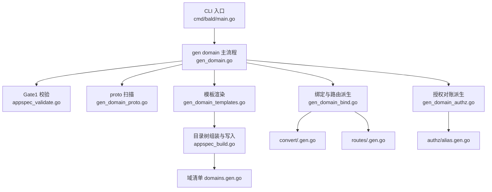
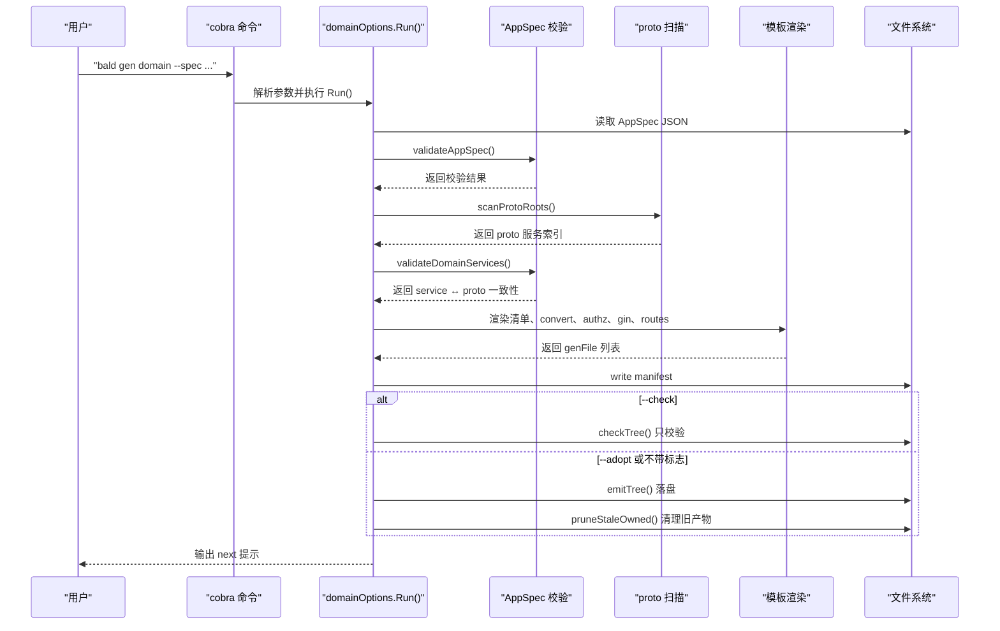
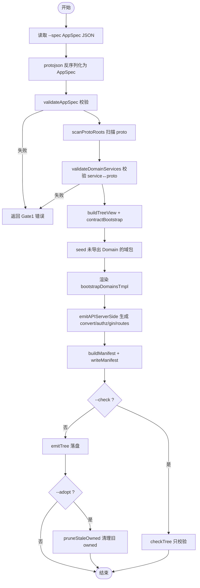
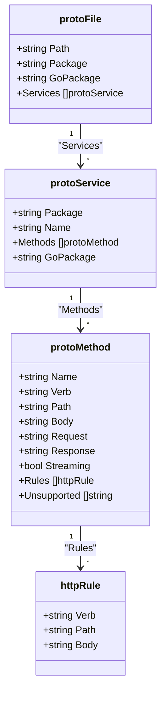
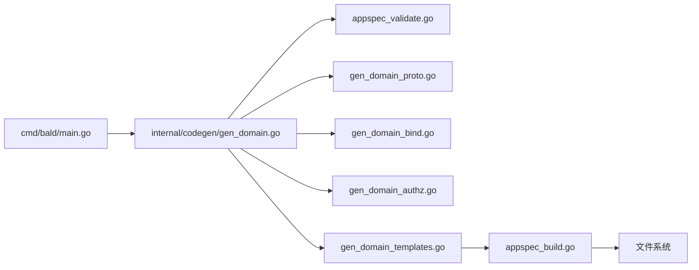

# bald gen domain 命令

<cite>
**本文引用的文件**   
- [cmd/bald/main.go](file://cmd/bald/main.go)
- [internal/codegen/gen_domain.go](file://internal/codegen/gen_domain.go)
- [internal/codegen/gen_domain_proto.go](file://internal/codegen/gen_domain_proto.go)
- [internal/codegen/gen_domain_bind.go](file://internal/codegen/gen_domain_bind.go)
- [internal/codegen/gen_domain_authz.go](file://internal/codegen/gen_domain_authz.go)
- [internal/codegen/gen_domain_templates.go](file://internal/codegen/gen_domain_templates.go)
- [internal/codegen/appspec_validate.go](file://internal/codegen/appspec_validate.go)
- [internal/codegen/appspec_build.go](file://internal/codegen/appspec_build.go)
- [internal/codegen/appspec_gen.go](file://internal/codegen/appspec_gen.go)
- [internal/codegen/gen_domain_test.go](file://internal/codegen/gen_domain_test.go)
</cite>

## 目录
1. [引言](#引言)
2. [项目结构](#项目结构)
3. [核心组件](#核心组件)
4. [架构总览](#架构总览)
5. [三段门机制详解](#三段门机制详解)
6. [详细组件分析](#详细组件分析)
7. [依赖关系分析](#依赖关系分析)
8. [性能与可维护性](#性能与可维护性)
9. [领域驱动设计最佳实践](#领域驱动设计最佳实践)
10. [扩发生成器指南](#扩发生成器指南)
11. [故障排查](#故障排查)
12. [结论](#结论)

## 引言
`bald gen domain` 是 bald CLI 的代码生成子命令，用于根据 `AppSpec.domains[]` 声明和既有 proto/域包，再生成或同步业务域代码骨架。它不是手写业务逻辑的替代物：生成的产物是可编译骨架，业务路由、handler、gRPC service 注册都保留填充点，由调用方在模板注释位置补充。

该命令的典型用途包括：
- 从 AppSpec 校验并消费域声明。
- 扫描域 proto，把 `google.api.http` 注解派生为 gin 绑定、REST 路由清单和授权动作投影。
- 生成域清单（`domains.gen.go`）、授权别名表（`authz/alias.gen.go`）和域声明值骨架（`domain.gen.go`）。
- 通过 `--check` 做只读校验、通过 `--adopt` 覆盖已 owned 的生成文件。

入口位于 `cmd/bald/main.go`，由 cobra 注册 `codegen.NewCommand`；`gen domain` 的具体执行入口在 `internal/codegen/gen_domain.go`。

**章节来源**
- [cmd/bald/main.go:1-47](file://cmd/bald/main.go#L1-L47)
- [internal/codegen/gen_domain.go:1-40](file://internal/codegen/gen_domain.go#L1-L40)

## 项目结构
`bald gen domain` 的实现集中在 `internal/codegen`，按职责拆分为命令配置、proto 扫描、绑定派生、授权对账、模板渲染和 AppSpec 构建：

| 文件 | 职责 |
|---|---|
| `gen_domain.go` | 叶子命令配置、参数解析、Gate1 校验、proto 扫描、落盘主流程 |
| `gen_domain_proto.go` | 正则扫描 proto 源码中的 package、service、rpc、`google.api.http` 注解 |
| `gen_domain_bind.go` | 把 HTTP 注解派生为 gin 绑定、接口、路由清单，并保证 proto Go 类型前置 |
| `gen_domain_authz.go` | 派生授权动作投影、object 归一化别名、默认动作聚合 |
| `gen_domain_templates.go` | 域清单、convert、gin 绑定、routes、authz alias 等模板 |
| `appspec_validate.go` | Gate1：AppSpec schema 校验、域声明形态约束 |
| `appspec_build.go` | 组装目标目录树、owned/seeded 三态写入 |
| `appspec_gen.go` | `gen app` 视图构造、模板数据装配（与 `gen domain` 共用清单模板） |
| `gen_domain_test.go` | 端到端验收测试，固化 owned 通道、产物清单和报错语义 |

**图示来源**
- [cmd/bald/main.go:33-47](file://cmd/bald/main.go#L33-L47)
- [internal/codegen/gen_domain.go:1-40](file://internal/codegen/gen_domain.go#L1-L40)
- [internal/codegen/appspec_validate.go:1-40](file://internal/codegen/appspec_validate.go#L1-L40)
- [internal/codegen/gen_domain_proto.go:1-40](file://internal/codegen/gen_domain_proto.go#L1-L40)
- [internal/codegen/gen_domain_bind.go:1-40](file://internal/codegen/gen_domain_bind.go#L1-L40)
- [internal/codegen/gen_domain_authz.go:1-30](file://internal/codegen/gen_domain_authz.go#L1-L30)
- [internal/codegen/gen_domain_templates.go:1-30](file://internal/codegen/gen_domain_templates.go#L1-L30)
- [internal/codegen/appspec_build.go:1-30](file://internal/codegen/appspec_build.go#L1-L30)

**章节来源**
- [internal/codegen/gen_domain.go:1-40](file://internal/codegen/gen_domain.go#L1-L40)
- [internal/codegen/gen_domain_test.go:1-40](file://internal/codegen/gen_domain_test.go#L1-L40)

## 核心组件
### 命令选项
`domainOptions` 是 `gen domain` 的叶子配置对象，关键字段如下：

| 字段 | 对应标志 | 含义 |
|---|---|---|
| `Spec` | `--spec` | AppSpec JSON 路径，必填；域清单的唯一真相源 |
| `OutDir` | `--out` | 产出根目录，默认为当前目录 |
| `Manifest` | `--manifest` | 域清单落盘路径，默认 `internal/bootstrap/domains.gen.go` |
| `APIServerDir` | 内部推导 | apiserver 目录名，传 `-` 跳过 apiserver 侧产物 |
| `Adopt` | `--adopt` | 覆盖已存在的 owned 生成文件 |
| `Check` | `--check` | 只校验不落盘，有差异即失败 |
| `NoBind` | `--no-bind` | 关闭 REST 绑定与路由清单生成 |
| `NoRoutes` | `--no-routes` | 只产 handler 绑定，跳过 `appkit.Route` 清单 |
| `ProtoCmd` | `--proto-cmd` | proto Go 类型缺失时执行的生成命令，默认 `buf generate` |

`Validate()` 强制互斥组合：`--adopt` 与 `--check` 不能同时出现；`--rest-bind` 与 `--no-bind` 冲突；`--no-routes` 必须在绑定生成时才有效。

**章节来源**
- [internal/codegen/gen_domain.go:41-104](file://internal/codegen/gen_domain.go#L41-L104)

### 生成物全集
`Run()` 输出的生成物全部走 owned 三态通道，避免意外覆盖手写实现：

| 产物 | 路径模式 | 说明 |
|---|---|---|
| 域清单 | `internal/bootstrap/domains.gen.go` | 聚合各域 `appkit.Domain` 声明值 |
| 授权动作投影 | `internal/<apiserver>/handler/convert/<d>.gen.go` | 逐 RPC 到 gRPC action 的映射 |
| 授权别名表 | `internal/<apiserver>/authz/alias.gen.go` | gRPC/HTTP object 不一致时的归一化别名 + 默认动作聚合 |
| REST 绑定 | `internal/<apiserver>/handler/gin/<d>.bind.gen.go` | 从 `google.api.http` 派生的 gin 绑定（默认生成） |
| REST 路由清单 | `internal/<apiserver>/routes/<d>.gen.go` | `appkit.Route` 列表，供计划可见性使用 |
| 域声明值骨架 | `<go_package>/domain.gen.go` | 仅当域包尚未导出 `Domain` 时 seed |

其中，`bootstrapDomainsTmpl` 与 `gen app` 共用同一模板源，保证两个命令生成的清单字节一致。

**章节来源**
- [internal/codegen/gen_domain.go:1-40](file://internal/codegen/gen_domain.go#L1-L40)
- [internal/codegen/gen_domain_templates.go:1-30](file://internal/codegen/gen_domain_templates.go#L1-L30)
- [internal/codegen/appspec_build.go:100-128](file://internal/codegen/appspec_build.go#L100-L128)

## 架构总览
`gen domain` 的执行顺序可以概括为：**读取 AppSpec → Gate1 校验 → 扫描 proto → 校验 service ↔ proto → 构建视图 → 生成模板 → 写 manifest → 落盘**。

**图示来源**
- [internal/codegen/gen_domain.go:105-201](file://internal/codegen/gen_domain.go#L105-L201)
- [internal/codegen/appspec_validate.go:120-200](file://internal/codegen/appspec_validate.go#L120-L200)
- [internal/codegen/gen_domain_proto.go:1-40](file://internal/codegen/gen_domain_proto.go#L1-L40)
- [internal/codegen/appspec_build.go:100-128](file://internal/codegen/appspec_build.go#L100-L128)

**章节来源**
- [internal/codegen/gen_domain.go:105-201](file://internal/codegen/gen_domain.go#L105-L201)

## 三段门机制详解
“三段门”是 `bald gen domain` 的核心质量保障思路：

| 阶段 | 名称 | 责任 | 失败后果 |
|---|---|---|---|
| 第一段 | 模板约束 | 模板只消费强类型视图，不直接拼接字符串；Go 源码经格式化后落盘 | 模板渲染错误 |
| 第二段 | 契约校验 | Gate1 先验 AppSpec schema 与 service ↔ proto 一致性 | 生成期拒绝落盘 |
| 第三段 | 端到端验证 | `_example/bald` 作为消费者模块，固化可装载性与产物形态 | CI 端到端测试失败 |

### 第一段：模板约束
模板以 `text/template` 渲染 `treeView`、`bindView` 等视图对象，而不是拼字符串。例如：
- `domainValueTmpl` 生成 `<go_package>/domain.gen.go`。
- `handlerConvertTmpl` 生成授权动作投影。
- `handlerBindTmpl` 生成 gin 绑定。
- `routesTableTmpl` 生成 `appkit.Route` 清单。
- `authzAliasTmpl` 生成授权别名表和默认动作聚合。

所有 `.go` 源码通过 `writeFileFormatted` 走 gofmt，失败时写 `.rej` 而不污染目标文件；非 Go 文件走 `writeGuarded` 保护 owned 文件。

**章节来源**
- [internal/codegen/gen_domain_templates.go:1-185](file://internal/codegen/gen_domain_templates.go#L1-L185)
- [internal/codegen/appspec_build.go:100-128](file://internal/codegen/appspec_build.go#L100-L128)

### 第二段：契约校验
Gate1 在 `validateAppSpec` 中完成以下检查：
- `meta.name` 与 `meta.module` 必填。
- `components.kind` 在白名单内且 name 唯一。
- `capability.requires[].caps ⊆ capability.provides`。
- 域的 `name` 唯一，`service`、`services`、`http_only` 三选一。
- `http_only` 域不得声明 `service`、`services`、`proto_package`。
- 非 `http_only` 域必须至少有一个 service。
- `services[]` 元素去空白、域内短名唯一。
- `go_package` 必填，且域间 import alias 不冲突。
- role 维度下，role name 唯一、引用域存在且并集恰好等于域全集。

随后 `validateDomainServices` 把 `domains[].service(s)` 与扫描到的 proto service 对齐，缺失时会指出哪个域的哪个 service 在哪个 proto 里缺失，以及该 proto 实际声明了什么。

**章节来源**
- [internal/codegen/appspec_validate.go:1-120](file://internal/codegen/appspec_validate.go#L1-L120)
- [internal/codegen/appspec_validate.go:120-200](file://internal/codegen/appspec_validate.go#L120-L200)
- [internal/codegen/gen_domain.go:130-160](file://internal/codegen/gen_domain.go#L130-L160)

### 第三段：端到端验证
`gen_domain_test.go` 用临时目录模拟完整流水线：先 `runGenAppInTemp`，再 `runGenDomain`，断言：
- 重生成产生 5 个 owned 文件。
- `domains.gen.go` 包含预期 import 和 `appkit.Domain` 变参直传。
- `convert/greet.gen.go` 包含 FullMethod → action 映射。
- `authz/alias.gen.go` 包含 gRPC/HTTP object 不一致时的别名。
- `domain.gen.go` seed 了正确的包名和 Domain 值。
- 无 `--adopt` 重新生成被拒绝。
- 带 `--adopt` 重生成字节完全一致。

这保证了生成器不只是单元测试，而是以真实消费者模块为回归防线。

**章节来源**
- [internal/codegen/gen_domain_test.go:1-120](file://internal/codegen/gen_domain_test.go#L1-L120)

## 详细组件分析

### 命令执行流程
`domainOptions.Run()` 是单一职责的主流程：

**图示来源**
- [internal/codegen/gen_domain.go:105-201](file://internal/codegen/gen_domain.go#L105-L201)
- [internal/codegen/appspec_build.go:100-128](file://internal/codegen/appspec_build.go#L100-L128)

**章节来源**
- [internal/codegen/gen_domain.go:105-201](file://internal/codegen/gen_domain.go#L105-L201)

### Proto 扫描与 HTTP 注解解析
`gen_domain_proto.go` 用一组确定性正则扫描 proto 源码，提取：
- package 与 go_package。
- service 与 rpc 方法。
- 请求/响应消息类型。
- `google.api.http` 主规则与 additional_bindings。
- streaming 标记。
- 未实现的注解字段：`custom`、`response_body`。

扫描结果以 `protoScan` 提供 Files、Packages、Services 三类信息，供 Gate1 校验和绑定生成共用。

**图示来源**
- [internal/codegen/gen_domain_proto.go:41-120](file://internal/codegen/gen_domain_proto.go#L41-L120)

**章节来源**
- [internal/codegen/gen_domain_proto.go:1-200](file://internal/codegen/gen_domain_proto.go#L1-L200)

### REST 绑定与路由派生
`gen_domain_bind.go` 负责把 `google.api.http` 注解转化为 gin 绑定与路由清单。关键约束包括：

| 约束 | 行为 |
|---|---|
| 流式 RPC | 若方法携带 HTTP 注解，生成期报错，因为流式无法转码为 REST |
| 重复路由形状 | 将 gin 路径变量统一为 `:` 后判重，冲突时报错而非运行期 panic |
| go_package 缺失 | 绑定需要 proto Go 类型，缺失则报错 |
| 多 alias 冲突 | 同一 proto path 被多个 service 导入为不同 alias 时报错 |
| binder 冲突 | 多个 service 短名去掉 `Service` 后缀后相同，导致绑定函数同名时报错 |
| 未实现注解 | `custom`、`response_body` 静默忽略会偏离注解契约，因此生成期报错 |

默认行为是生成 REST 绑定；`--no-bind` 是显式逃生口，留给 REST 面完全手写的场景。

**章节来源**
- [internal/codegen/gen_domain_bind.go:1-200](file://internal/codegen/gen_domain_bind.go#L1-L200)

### 授权对账与别名
`gen_domain_authz.go` 与 `pkg/authz` 同源地派生授权语义：

| 维度 | 派生规则 |
|---|---|
| action | `Delete`→delete、`List`→list、`Create/Update/Set/Put`→write、其余→get |
| gRPC object | 取 service 全名最后一段，去 `Service` 后缀并小写 |
| HTTP object | 从 `google.api.http` 路径首段抽取，跳过空段与 `v1` |
| alias | 仅记录 gRPC 与 HTTP object 不一致的情况 |
| DefaultActions | 合并每个域 `convert.<Name>Actions` 的 FullMethod→action 映射 |

这个设计避免了冗余映射掩盖命名问题，也确保 seed 策略行与生成物可编译期对账。

**章节来源**
- [internal/codegen/gen_domain_authz.go:1-145](file://internal/codegen/gen_domain_authz.go#L1-L145)

## 依赖关系分析
`gen domain` 的依赖方向是自上而下的单向管道：

需要注意：
- `gen domain` 不直接 require 具体后端适配器；后端在 `contrib/*` 与 `transport/*`，由运行时装配。
- `gen app` 与 `gen domain` 共享 `bootstrapDomainsTmpl`，因此两者对清单文件的期望必须一致。
- `gen_domain_test.go` 是端到端契约，任何改变生成面的修改都应首先过这条测试。

**图示来源**
- [cmd/bald/main.go:33-47](file://cmd/bald/main.go#L33-L47)
- [internal/codegen/gen_domain.go:1-40](file://internal/codegen/gen_domain.go#L1-L40)
- [internal/codegen/appspec_gen.go:1-40](file://internal/codegen/appspec_gen.go#L1-L40)

**章节来源**
- [internal/codegen/gen_domain_test.go:1-40](file://internal/codegen/gen_domain_test.go#L1-L40)

## 性能与可维护性
- **单次扫描**：proto 扫描只做一次，结果按 service 全名建索引，供 service 校验、convert、authz、gin 绑定复用。
- **模板复用**：`bootstrapDomainsTmpl` 由 `gen app` 与 `gen domain` 共用，减少两份模板漂移风险。
- **确定性**：`gen_domain_test.go` 明确要求重生成字节一致；`dedupeSorted`、排序后的 action/object 聚合都是为了消除 map 遍历不确定性。
- **安全写入**：`.go` 源码先格式化再落盘；非 Go 文件走 guarded 写入；`--adopt` 才允许覆盖 owned。
- **可诊断**：Gate1 聚合错误，每条含字段路径与非法值；proto 扫描失败会指明缺失 service 所在的 proto 与实际声明。

这些特性让 `gen domain` 更适合在 CI 中以 `--check` 方式作为质量闸门。

[本节为通用指导，不直接分析特定代码片段]

## 领域驱动设计最佳实践
基于 `gen domain` 的设计意图和 `_example/bald` 的使用模式，建议遵循以下 DDD 规范：

### 业务逻辑组织
- 一个域对应 `AppSpec.domains[]` 中的一个条目。
- 非 `http_only` 域应有明确的 proto service，作为 gRPC 与 REST 的契约真相源。
- `http_only` 域适合纯 HTTP 业务面，不提供 proto 契约，由域包自持 REST 面。
- 业务装配放在域包的 `domain.go` 或同包文件中，`domain.gen.go` 仅作为首次骨架。

### 接口设计原则
- gRPC method 命名应体现 CRUD 语义：`Get/List/Create/Update/Delete`，这样 action 投影能自然映射为 get/list/write/delete。
- `google.api.http` 路径应反映资源语义，首个非空非 `v1` 段会成为 gRPC/HTTP 两侧 object 的归一化结果。
- 如果 gRPC object 与 HTTP object 不一致，应主动保持 `authz/alias.gen.go` 中的别名清晰，不要堆砌冗余映射。
- 多 service 的域应确保 service 短名去 `Service` 后缀后仍唯一，否则绑定函数名冲突。

### 代码结构规范
- 域包导出 `appkit.Domain` 值，由引擎在既定时点消费。
- REST 面优先由 `google.api.http` 注解驱动；如需手写 handler，应使用 `--no-bind` 明确退出默认行为。
- 路由清单推荐引入生成的 `routes.<Name>`，以便进入 `Plan.Routes`，获得计划可见性与跨域冲突检测。
- 授权策略默认行与 `convert.<Name>Actions`、`authz/alias.gen.go` 三者必须保持一致。

**章节来源**
- [internal/codegen/gen_domain_templates.go:1-185](file://internal/codegen/gen_domain_templates.go#L1-L185)
- [internal/codegen/gen_domain_authz.go:60-145](file://internal/codegen/gen_domain_authz.go#L60-L145)
- [internal/codegen/gen_domain_test.go:40-120](file://internal/codegen/gen_domain_test.go#L40-L120)

## 扩发生成器指南
如果要扩发生成器支持自定义业务模式和代码风格，建议遵循现有拆分方式：

### 新增模板
1. 在 `gen_domain_templates.go` 中添加新模板常量。
2. 在 `bindView` 或 `treeView` 中增加派生视图字段。
3. 在 `emitAPIServerSide` 或 `Run` 中渲染并加入 `files` 列表。
4. 给模板添加头部注释，说明是否 owned、是否 seeded、何时重新生成。

### 新增 proto 语义
1. 在 `gen_domain_proto.go` 的正则或解析逻辑中扩展 proto 字段。
2. 在 `unsupportedAnnotationFields` 中显式列出暂未支持的注解字段，避免静默偏离契约。
3. 在 `bindViewOf` 中对新字段做生成期校验，不要等到运行期失败。

### 新增 Gate1 约束
1. 在 `appspec_validate.go` 中增加 AppSpec 字段校验。
2. 使用 `add` 收集错误，保持聚合报错。
3. 为新字段编写 `gen_domain_test.go` 正反例。

### 新增生成物归属
1. 使用 `owned` 表示生成器有权覆盖的文件。
2. 使用 `Seeded` 表示只生成一次、之后由用户维护。
3. 使用 `writeGuarded` / `writeFileFormatted` 保证写入安全。
4. 如新增产物影响清单，更新 `buildManifest` 与 `pruneStaleOwned` 的清理范围。

### 扩充分支建议
- 如果扩展的是 REST 层：优先考虑在 `gen_domain_bind.go` 中扩展 `bindRouteView`、`bindMethodView`。
- 如果扩展的是授权语义：优先考虑在 `gen_domain_authz.go` 中扩展 action/object 派生。
- 如果扩展的是应用装配：优先考虑 `appspec_build.go` 与 `appspec_gen.go`，并保持与 `gen app` 的模板一致性。

**章节来源**
- [internal/codegen/gen_domain_templates.go:1-185](file://internal/codegen/gen_domain_templates.go#L1-L185)
- [internal/codegen/gen_domain_proto.go:120-200](file://internal/codegen/gen_domain_proto.go#L120-L200)
- [internal/codegen/gen_domain_bind.go:120-200](file://internal/codegen/gen_domain_bind.go#L120-L200)
- [internal/codegen/appspec_validate.go:120-200](file://internal/codegen/appspec_validate.go#L120-L200)
- [internal/codegen/appspec_build.go:100-128](file://internal/codegen/appspec_build.go#L100-L128)

## 故障排查
### 常见错误及处理
| 现象 | 可能原因 | 处理方式 |
|---|---|---|
| `--spec` 未提供 | 忘记传入 AppSpec 路径 | 补上 `--spec <AppSpec.json>` |
| `--adopt` 与 `--check` 同时出现 | 互斥标志冲突 | 二选一 |
| `--rest-bind` 与 `--no-bind` 同时出现 | 默认已生成绑定，二者矛盾 | 删除 `--rest-bind` |
| `--no-routes` 与 `--no-bind` 同时出现 | routes 只在绑定生成时产出 | 删除其中一个 |
| proto 没有 package | proto 文件缺少 package 声明 | 补全 package |
| `google.api.http` 注解在流式 RPC 上 | 流式无法转码为 REST | 移除注解或改用 gRPC streaming |
| 路由形状重复 | 多条注解映射到相同 gin 路径形状 | 调整路径或动词 |
| proto 没有 `option go_package` | 绑定需要 proto Go 类型 | 补全 go_package |
| 多个 service 导入同一 proto 但 alias 不同 | 生成器无法确定 import 别名 | 统一 go_package alias 或拆分域 |
| gRPC object 与 HTTP object 不一致 | 命名空间不同，需别名 | 接受别名或统一命名 |
| 重生成被拒绝 | 文件属 owned 但未加 `--adopt` | 加 `--adopt` 或恢复生成前状态 |
| `--check` 报脏 | 生成面变化或已有手写改动 | 用 `--adopt` 确认变更，或恢复手写文件 |

### 调试建议
- 先用 `--check` 确认生成面是否符合预期，不带 `--adopt` 不会写盘。
- 关注生成的 `generated:/kept:/skip:` 输出，判断哪些文件被识别为 owned。
- 检查 `internal/bootstrap/domains.gen.go` 是否包含预期域包 import 和 `appkit.Domain` 值。
- 检查 `convert/<d>.gen.go` 是否包含 FullMethod → action 映射。
- 检查 `authz/alias.gen.go` 是否只列出不一致的 object 别名。
- 如果是 REST 问题，检查 `handler/gin/<d>.bind.gen.go` 与 `routes/<d>.gen.go` 是否匹配。

**章节来源**
- [internal/codegen/gen_domain.go:80-104](file://internal/codegen/gen_domain.go#L80-L104)
- [internal/codegen/gen_domain_test.go:1-120](file://internal/codegen/gen_domain_test.go#L1-L120)

## 结论
`bald gen domain` 是一个围绕 AppSpec 与 proto 契约展开的代码生成器。它的核心价值不是代替手写业务，而是通过三段门机制——模板约束、契约校验、端到端验证——把业务域的 proto 契约、REST 绑定、授权语义和装配清单收敛到可重复、可回归、可诊断的生成物中。

在实际使用中，最稳妥的节奏是：
1. 先在 AppSpec 中声明域。
2. 编写 proto 与 `google.api.http` 注解。
3. 运行 `bald gen domain --check` 验证生成面。
4. 用 `--adopt` 生成或同步骨架。
5. 在模板注释指示的位置补充业务路由、handler 和 gRPC service 注册。
6. 把 `gen domain --check` 纳入 CI，作为代码生成质量闸门。

**章节来源**
- [cmd/bald/main.go:1-47](file://cmd/bald/main.go#L1-L47)
- [internal/codegen/gen_domain.go:1-201](file://internal/codegen/gen_domain.go#L1-L201)
- [internal/codegen/gen_domain_test.go:1-120](file://internal/codegen/gen_domain_test.go#L1-L120)