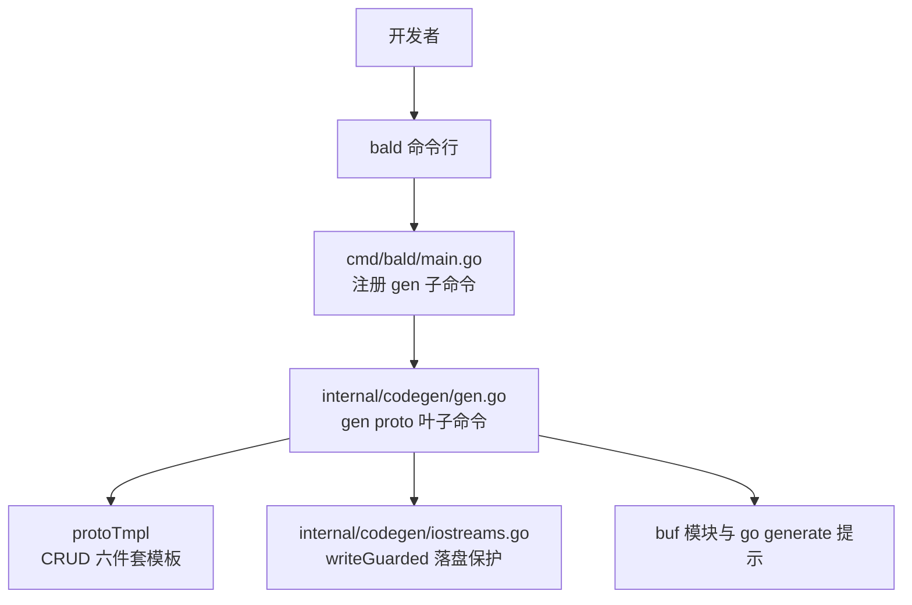
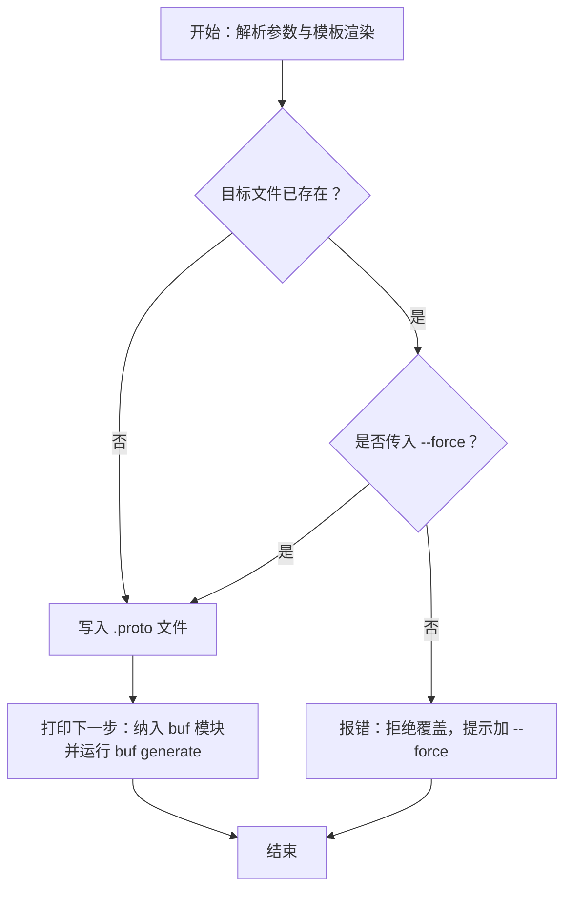
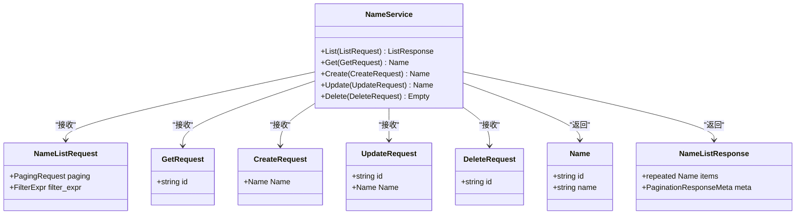
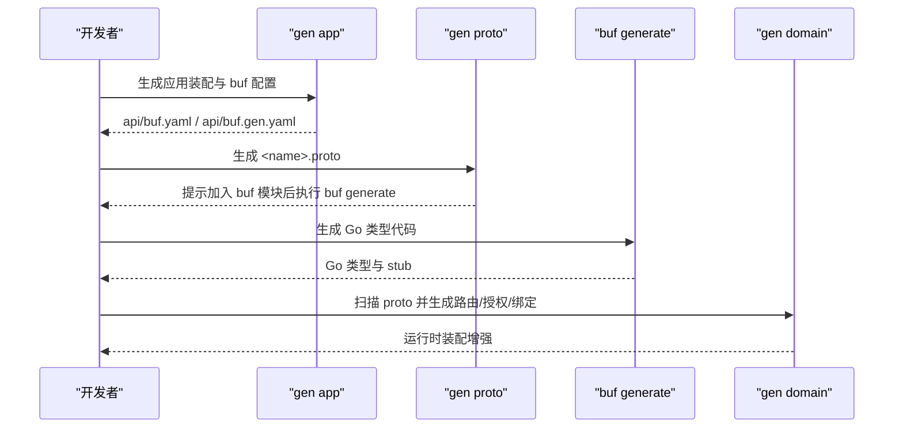

# bald gen proto 命令

<cite>
**本文引用的文件**   
- [cmd/bald/main.go](file://cmd/bald/main.go)
- [internal/codegen/gen.go](file://internal/codegen/gen.go)
- [internal/codegen/iostreams.go](file://internal/codegen/iostreams.go)
- [internal/codegen/gen_domain_proto.go](file://internal/codegen/gen_domain_proto.go)
- [docs/guide/zh-CN/用 bald CLI 起步新服务.md](file://docs/guide/zh-CN/用%20bald%20CLI%20起步%20新服务.md)
- [_example/bald/api/proto/greet.proto](file://_example/bald/api/proto/greet.proto)
</cite>

## 目录
1. [简介](#简介)
2. [项目结构中的位置](#项目结构中的位置)
3. [命令行语法与参数](#命令行语法与参数)
4. [生成规则与产物说明](#生成规则与产物说明)
5. [消息与服务接口映射](#消息与服务接口映射)
6. [与其他代码生成步骤的关系](#与其他代码生成步骤的关系)
7. [使用场景与示例](#使用场景与示例)
8. [错误处理与调试技巧](#错误处理与调试技巧)
9. [常见问题排查](#常见问题排查)
10. [结论](#结论)

## 简介
`bald gen proto` 是 `bald` 框架官方开发工具提供的代码生成子命令，用于从业务域名称生成 Protocol Buffers API 定义骨架。它不直接读取 Go 领域模型，而是以 `<name>` 为输入，输出一个包含标准 CRUD 接口的 `.proto` 文件；该文件同时声明 gRPC 接口、REST/JSON 映射以及字段校验规则，后续由 `buf generate` 生成 Go 类型代码。

在仓库中，该命令由 `cmd/bald` 入口装配到 Cobra 根命令下，实际逻辑集中在 `internal/codegen/gen.go`：模板渲染、参数补全、落盘保护以及与 buf 生态的联动提示均由该文件实现。

## 项目结构中的位置


**图示来源**   
- [cmd/bald/main.go:25-47](file://cmd/bald/main.go#L25-L47)
- [internal/codegen/gen.go:231-267](file://internal/codegen/gen.go#L231-L267)
- [internal/codegen/iostreams.go:64-106](file://internal/codegen/iostreams.go#L64-L106)

**章节来源**   
- [cmd/bald/main.go:1-47](file://cmd/bald/main.go#L1-L47)
- [internal/codegen/gen.go:1-15](file://internal/codegen/gen.go#L1-L15)

## 命令行语法与参数
`bald gen proto` 是 `bald gen` 下的叶子子命令，采用「位置参数 + 命名 flag」风格。

### 基本语法
```text
bald gen proto <name> [flags]
```

其中 `<name>` 是必填的位置参数，表示业务域或服务名，也用于决定输出文件名和 proto 包名。

### 参数表
| 参数 | 类型 | 默认值 | 含义 |
|---|---|---|---|
| `<name>` | 位置参数 | 无 | 协议名；输出文件为 `<out>/<name>.proto`，proto 包名为 `<name>.v1` |
| `--out` | 字符串 | `api/proto/<name>/v1` | 输出目录 |
| `--plural` | 字符串 | `<name>s` | REST 资源段，用于 `google.api.http` 路径中的复数资源段 |
| `--go-package` | 字符串 | 空 | 写入 proto 的 `option go_package`；未显式指定时留空 |
| `--module` | 字符串 | 空 | 业务 module 路径；当未给 `--go-package` 时，按 `<module>/api/gen/go/<name>/v1;<name>v1` 派生 |
| `--force` | 布尔 | `false` | 覆盖已存在的目标文件；默认拒绝覆盖 |

### 行为要点
- 位置参数通过 `Complete` 回填到 `protoOptions.Name`。
- `--plural` 为空时自动追加 `s`。
- `--out` 为空时使用 `api/proto/<name>/v1`。
- `--go-package` 与 `--module` 配合：只传 `--module` 时会派生 `go_package`；只传 `--go-package` 则直接使用。
- 默认不写 `go_package`，以便由 `buf managed mode` 统一管理；需要独立 protoc 调用时可显式传入。

**章节来源**   
- [internal/codegen/gen.go:170-215](file://internal/codegen/gen.go#L170-L215)
- [internal/codegen/gen.go:231-267](file://internal/codegen/gen.go#L231-L267)
- [docs/guide/zh-CN/用 bald CLI 起步新服务.md:173-182](file://docs/guide/zh-CN/用%20bald%20CLI%20起步%20新服务.md#L173-L182)

## 生成规则与产物说明
`bald gen proto` 的输出是一个独立的 Protocol Buffers 文件，位于 `--out` 目录下，文件名为 `<name>.proto`。

### 生成的 Proto 文件要素
- **语法版本**：`proto3`。
- **包名**：`<name>.v1`。
- **依赖导入**：
  - `google/api/annotations.proto`：用于 `google.api.http` REST 映射。
  - `google/protobuf/empty.proto`：用于 `Delete` 返回空响应。
  - `buf/validate/validate.proto`：用于字段校验注解。
  - `bald/store/v1/store.proto`：用于分页与结构化过滤类型。
- **可选 option**：当显式提供 `--go-package` 或派生出 `go_package` 时写入。
- **Service**：命名为 `<Name>Service`，其中首字母大写由模板内置 `title` 函数完成。
- **RPC**：固定 CRUD 六件套——`List`、`Get`、`Create`、`Update`、`Delete`。
- **消息**：
  - 资源消息 `<Name>`，含 `id` 与 `name` 两个字段。
  - 请求消息：`<Name>ListRequest`、`<Name>GetRequest`、`<Name>CreateRequest`、`<Name>UpdateRequest`、`<Name>DeleteRequest`。
  - 响应消息：`<Name>ListResponse`。
- **REST 映射**：每个 RPC 对应一条 `google.api.http` 注解，使同一 gRPC 接口同时暴露 REST/JSON 端点。
- **字段校验**：关键字段使用 `buf.validate.field` 注解声明长度等约束。

### 输出保护机制
单文件生成器遵循「不静默覆盖」原则：若目标文件已存在，命令会返回错误并提示需要添加 `--force`。这是通过统一的 `writeGuarded` 通道实现的。



**图示来源**   
- [internal/codegen/gen.go:216-230](file://internal/codegen/gen.go#L216-L230)
- [internal/codegen/iostreams.go:64-106](file://internal/codegen/iostreams.go#L64-L106)

**章节来源**   
- [internal/codegen/gen.go:28-169](file://internal/codegen/gen.go#L28-L169)
- [internal/codegen/gen.go:216-230](file://internal/codegen/gen.go#L216-L230)
- [internal/codegen/iostreams.go:64-106](file://internal/codegen/iostreams.go#L64-L106)

## 消息与服务接口映射
### Service 与 RPC 映射
`<Name>Service` 暴露五个标准 RPC，分别对应资源的生命周期操作：

| RPC | HTTP 方法 | REST 路径 | 请求消息 | 响应消息 | 说明 |
|---|---|---|---|---|---|
| `List` | GET | `/v1/<plural>` | `<Name>ListRequest` | `<Name>ListResponse` | 分页查询，支持 `PagingRequest` 与 `FilterExpr` |
| `Get` | GET | `/v1/<plural>/{id}` | `<Name>GetRequest` | `<Name>` | 按主键取单条资源 |
| `Create` | POST | `/v1/<plural>` | `<Name>CreateRequest` | `<Name>` | 创建资源，body 为整个资源对象 |
| `Update` | PUT | `/v1/<plural>/{id}` | `<Name>UpdateRequest` | `<Name>` | 更新资源，body 为整个资源对象 |
| `Delete` | DELETE | `/v1/<plural>/{id}` | `<Name>DeleteRequest` | `google.protobuf.Empty` | 删除资源 |

其中 `<plural>` 来自 `--plural`，默认是 `<name>s`。

### 消息字段映射
| 消息 | 字段 | 类型 | 校验或用途 |
|---|---|---|---|
| `<Name>` | `id` | string | 资源标识；Create 时通常留空，服务端分配 |
| `<Name>` | `name` | string | 展示名 |
| `<Name>ListRequest` | `paging` | `bald.store.v1.PagingRequest` | 页码/偏移/游标三态分页 |
| `<Name>ListRequest` | `filter_expr` | `bald.store.v1.FilterExpr` | 结构化过滤表达式 |
| `<Name>GetRequest` | `id` | string | 必须非空 |
| `<Name>CreateRequest` | `<Name>` | `<Name>` | 待创建的资源对象 |
| `<Name>UpdateRequest` | `id` | string | 必须非空 |
| `<Name>UpdateRequest` | `<Name>` | `<Name>` | 更新后的资源对象 |
| `<Name>DeleteRequest` | `id` | string | 必须非空 |
| `<Name>ListResponse` | `items` | repeated `<Name>` | 资源列表 |
| `<Name>ListResponse` | `meta` | `bald.store.v1.PaginationResponseMeta` | 分页元信息 |



**图示来源**   
- [internal/codegen/gen.go:28-169](file://internal/codegen/gen.go#L28-L169)

**章节来源**   
- [internal/codegen/gen.go:28-169](file://internal/codegen/gen.go#L28-L169)

## 与其他代码生成步骤的关系
`bald gen proto` 只是代码生成链中的一环，通常与以下步骤配合：

1. **`bald gen app`**：生成应用装配目录树，包括 `api/buf.yaml`、`api/buf.gen.yaml`、`taskfile.yml` 等 buf 与任务配置。
2. **`bald gen proto <name>`**：生成 `<name>.proto` 契约骨架。
3. **`buf generate`**：根据 buf 配置生成 Go 代码；proto 中引入的 `googleapis`、`protovalidate`、`bald store` 模块需已在 buf 模块依赖中声明。
4. **`bald gen domain`**：扫描已有 proto 源码，提取 service、rpc、`google.api.http` 注解，用于授权投影、路由清单与绑定生成。
5. **`bald gen store <name>`**：生成实体骨架（GORM tag + `keyOf`），与 proto 资源消息形成领域建模的两面。



**图示来源**   
- [docs/guide/zh-CN/用 bald CLI 起步新服务.md:173-182](file://docs/guide/zh-CN/用%20bald%20CLI%20起步%20新服务.md#L173-L182)
- [internal/codegen/gen_domain_proto.go:1-40](file://internal/codegen/gen_domain_proto.go#L1-L40)

**章节来源**   
- [docs/guide/zh-CN/用 bald CLI 起步新服务.md:173-182](file://docs/guide/zh-CN/用%20bald%20CLI%20起步%20新服务.md#L173-L182)
- [internal/codegen/gen_domain_proto.go:1-40](file://internal/codegen/gen_domain_proto.go#L1-L40)

## 使用场景与示例
### 最简用法
生成 greet 域的 proto 文件，默认输出到 `api/proto/greet/v1/greet.proto`：
```bash
bald gen proto greet
```

### 指定输出目录
将产物输出到自定义目录：
```bash
bald gen proto order --out api/proto/order/v1
```

### 指定 REST 资源段
默认资源段是 `<name>s`，可改为自定义复数形式：
```bash
bald gen proto org-unit --plural org-units
```

### 指定 go_package
当不使用 buf managed mode，或希望 proto 文件自身携带完整 go_package 时：
```bash
bald gen proto greet --go-package "example.com/my-service/api/gen/greet/v1;greetv1"
```

### 通过 module 派生 go_package
只传 `--module` 时，会自动派生 `<module>/api/gen/go/<name>/v1;<name>v1`：
```bash
bald gen proto greet --module "example.com/my-service"
```

### 覆盖已存在文件
目标文件已存在时必须显式加 `--force`：
```bash
bald gen proto greet --force
```

### 生成后继续流程
生成完成后，把文件加入 buf 模块并执行生成：
```bash
buf generate
```

**章节来源**   
- [docs/guide/zh-CN/用 bald CLI 起步新服务.md:173-182](file://docs/guide/zh-CN/用%20bald%20CLI%20起步%20新服务.md#L173-L182)
- [internal/codegen/gen.go:216-267](file://internal/codegen/gen.go#L216-L267)

## 错误处理与调试技巧
### 常见错误
1. **缺少位置参数**  
   未传 `<name>` 时，`Validate` 会返回必填错误。
2. **目标文件已存在**  
   默认拒绝覆盖；错误信息会提示单文件生成器应加 `--force`。
3. **未纳入 buf 模块**  
   命令成功生成 `.proto` 后会打印下一步提示：需要将文件加入 buf 模块，并安装 googleapis、protovalidate、bald store 依赖后运行 `buf generate`。
4. **Go 代码未生成**  
   `bald gen proto` 只生成 proto 文本；真正的 Go 类型由 buf 生成。如果 Go 侧无法编译，应检查 buf 配置与依赖，而不是重复执行 `gen proto`。

### 调试建议
- 先确认 `--out` 下确实生成了 `<name>.proto`。
- 检查 `api/buf.yaml` 与 `api/buf.gen.yaml` 是否已由 `gen app` 生成。
- 确认 proto 依赖是否在 buf 模块声明中可用。
- 如果只需要查看生成内容而不想写文件，可以先调整 `--out` 到一个临时目录验证路径和命名。
- 如果目标是让 proto 自带 `go_package`，优先使用 `--go-package`；仅使用 `--module` 时注意派生格式。

**章节来源**   
- [internal/codegen/gen.go:201-230](file://internal/codegen/gen.go#L201-L230)
- [internal/codegen/gen.go:216-230](file://internal/codegen/gen.go#L216-L230)
- [internal/codegen/iostreams.go:64-106](file://internal/codegen/iostreams.go#L64-L106)

## 常见问题排查
### 为什么默认不写 `go_package`？
因为 bald 生态的 proto 生成统一走 buf managed mode，模板写死 `go_package` 会与 managed mode 冲突。需要独立 protoc 的调用方应显式使用 `--go-package`。

### 生成的 REST 路径是什么？
REST 路径由 `--plural` 控制，默认是 `/v1/<name>s`。例如：
- `List` → `GET /v1/<plural>`
- `Get` → `GET /v1/<plural>/{id}`
- `Create` → `POST /v1/<plural>`
- `Update` → `PUT /v1/<plural>/{id}`
- `Delete` → `DELETE /v1/<plural>/{id}`

### 如何验证生成的 proto 是否正确？
- 检查生成的 `<name>.proto` 是否存在。
- 检查 `package` 是否为 `<name>.v1`。
- 检查 service 是否包含 `List`、`Get`、`Create`、`Update`、`Delete`。
- 检查 `google.api.http` 注解是否与预期 REST 路径一致。
- 检查是否引入了 `bald/store/v1/store.proto`，因为 `ListRequest` 依赖分页与过滤类型。

### 示例参考
仓库示例 `_example/bald/api/proto/greet.proto` 展示了手写扩展后的 proto 形态，可作为注解、HTTP 映射和 buf.validate 规则的对照参考。

**章节来源**   
- [internal/codegen/gen.go:28-169](file://internal/codegen/gen.go#L28-L169)
- [_example/bald/api/proto/greet.proto:1-57](file://_example/bald/api/proto/greet.proto#L1-L57)

## 结论
`bald gen proto` 的定位是快速产出标准化 Protocol Buffers CRUD 契约骨架，而不是完整业务实现。它通过固定模板保证 service、RPC、消息、REST 映射和字段校验的一致性，再通过 `buf generate` 与 `gen domain` 进入更大的代码生成与装配流程。

使用时应记住三条核心边界：
1. 它生成的是 proto 文本，不是 Go 类型。
2. 默认不覆盖已存在文件，单文件生成器必须显式传 `--force`。
3. 真正可用的 Go 代码需要通过 buf 生态生成，且 proto 依赖需要在 buf 模块中正确声明。