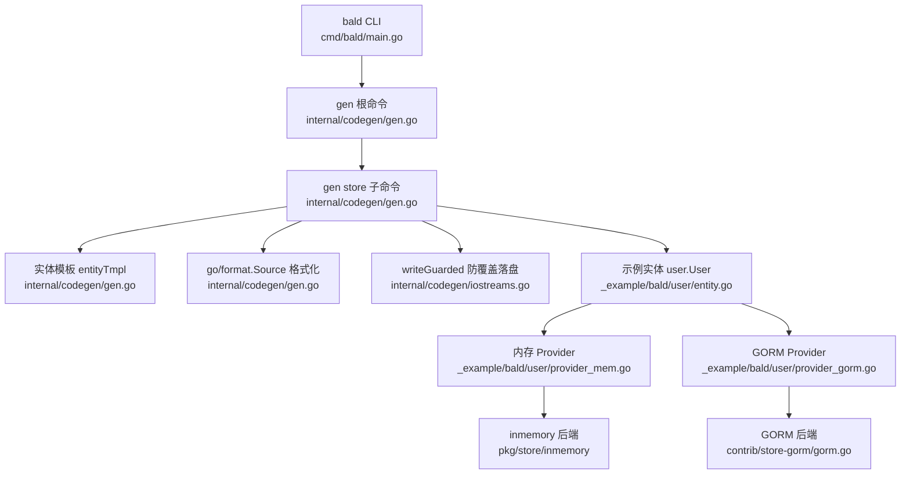
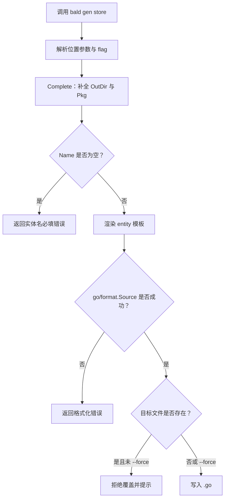
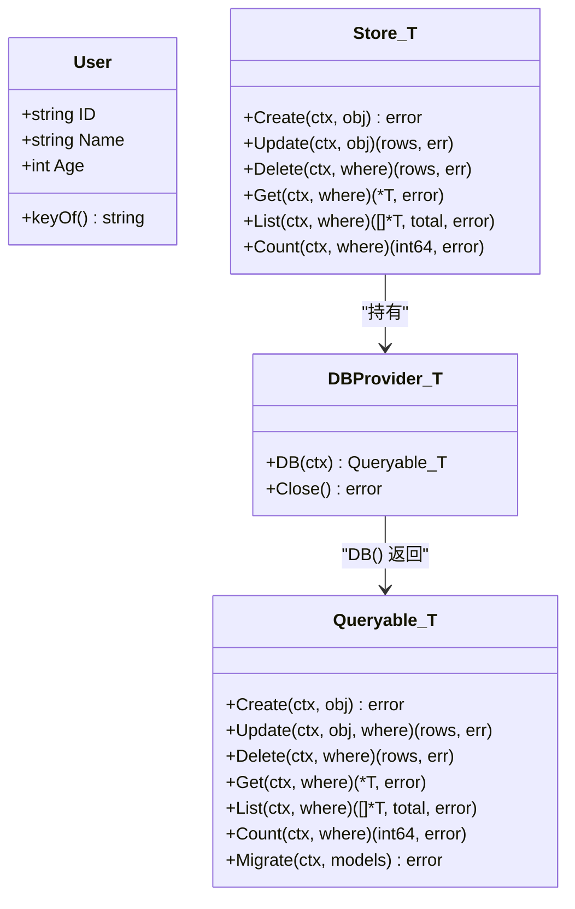
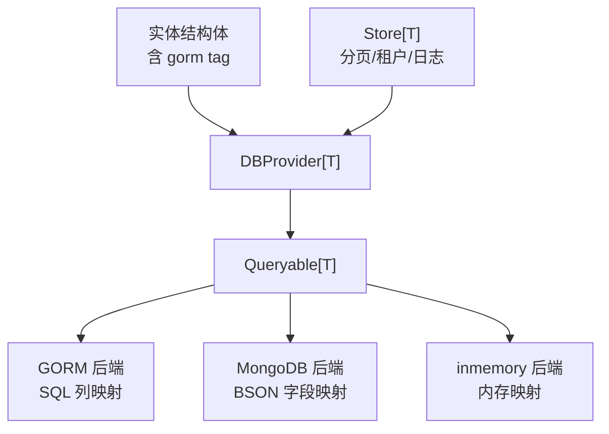
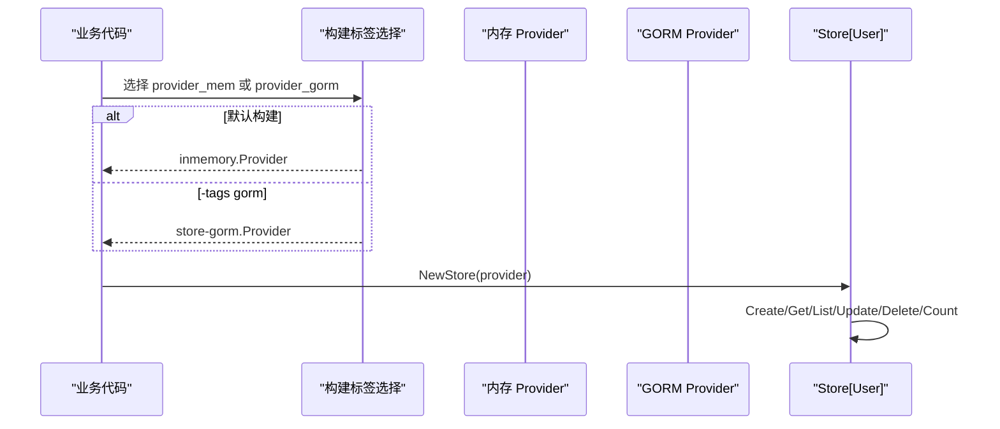
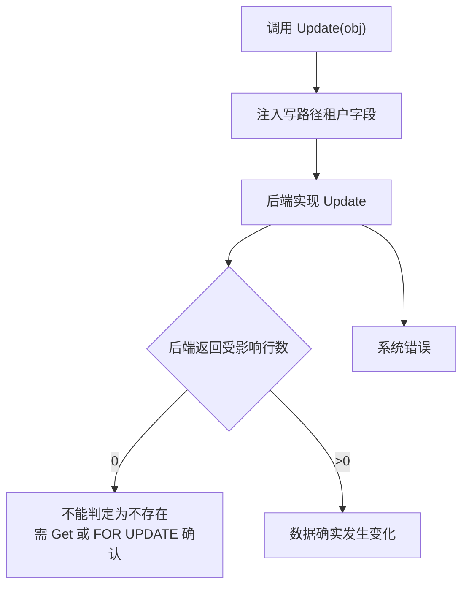
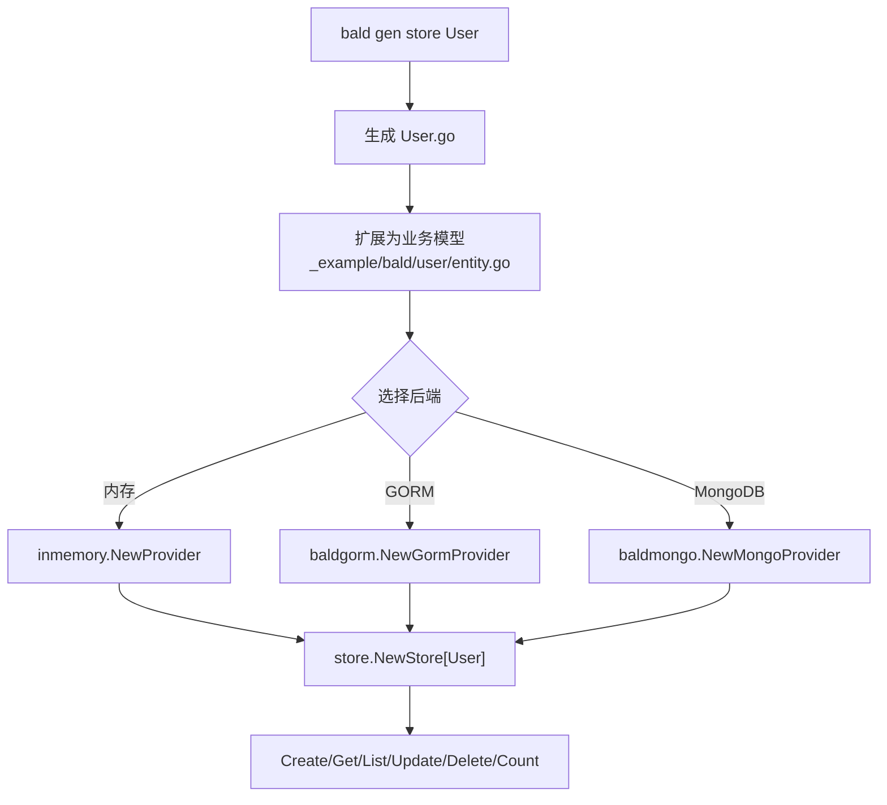
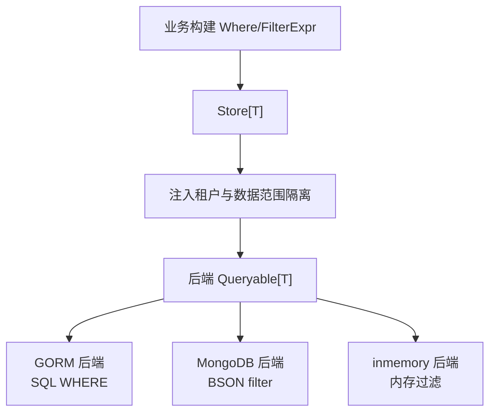

# bald gen store 命令

<cite>
**本文引用的文件 **
- [cmd/bald/main.go](file://cmd/bald/main.go)
- [internal/codegen/gen.go](file://internal/codegen/gen.go)
- [internal/codegen/iostreams.go](file://internal/codegen/iostreams.go)
- [_example/bald/user/entity.go](file://_example/bald/user/entity.go)
- [_example/bald/user/provider_gorm.go](file://_example/bald/user/provider_gorm.go)
- [_example/bald/user/provider_mem.go](file://_example/bald/user/provider_mem.go)
- [pkg/store/store.go](file://pkg/store/store.go)
- [contrib/store-gorm/gorm.go](file://contrib/store-gorm/gorm.go)
- [contrib/store-mongo/mongo.go](file://contrib/store-mongo/mongo.go)
</cite>

## 目录

1. [简介](#简介)
2. [项目结构定位](#项目结构定位)
3. [命令语法与参数](#命令语法与参数)
4. [生成产物说明](#生成产物说明)
5. [存储接口与 ORM 映射规则](#存储接口与 orm 映射规则)
6. [多后端支持机制](#多后端支持机制)
7. [CRUD 操作语义](#crud 操作语义)
8. [使用示例：GORM 与 MongoDB](#使用示例gorm-与-mongodb)
9. [连接配置与事务处理](#连接配置与事务处理)
10. [查询构建器与过滤表达式](#查询构建器与过滤表达式)
11. [故障排查](#故障排查)
12. [结论](#结论)

## 简介

`bald gen store <name>` 是 bald CLI 提供的代码生成子命令，用于根据实体名生成一个可编译的 Go 源文件。该文件包含两部分内容：

- 一个业务实体结构体；
- 一个 `KeyOf` 主键提取函数。

需要特别明确：**`bald gen store` 只生成实体骨架，不生成完整的数据库访问层实现、不生成 CRUD 服务、也不直接创建数据库表。** 真正对数据库执行操作的逻辑由 `pkg/store` 的泛型门面和具体后端（GORM / MongoDB / inmemory）提供。模板中的实体结构体只是「同时充当 GORM 模型」的最小样板，实际持久化契约由 `store.DBProvider[T]` 与 `store.Queryable[T]` 定义。

CLI 入口在 `cmd/bald/main.go`，其中把 `codegen.NewCommand` 挂载为 `gen` 根命令；`gen` 再注册 `proto`、`store`、`app`、`domain` 四个叶子子命令。`gen store` 的完整生命周期是：解析位置参数 → 补全默认值 → 校验必填项 → 渲染模板 → `go/format.Source` 格式化 → 通过 `writeGuarded` 落盘。

**章节来源**
- [cmd/bald/main.go:1-47](file://cmd/bald/main.go#L1-L47)
- [internal/codegen/gen.go:1-20](file://internal/codegen/gen.go#L1-L20)
- [internal/codegen/gen.go:258-318](file://internal/codegen/gen.go#L258-L318)

## 项目结构定位

`bald gen store` 属于 bald 框架的代码生成工具链，位于仓库的 `internal/codegen` 包中。它不是运行时组件，也不随业务应用被依赖；业务模块通过 `go install github.com/kalandramo/bald/cmd/bald@latest` 安装 CLI 后独立调用。



**图表来源**
- [cmd/bald/main.go:32-47](file://cmd/bald/main.go#L32-L47)
- [internal/codegen/gen.go:258-318](file://internal/codegen/gen.go#L258-L318)
- [internal/codegen/iostreams.go:41-46](file://internal/codegen/iostreams.go#L41-L46)
- [_example/bald/user/entity.go:1-90](file://_example/bald/user/entity.go#L1-L90)
- [_example/bald/user/provider_gorm.go:1-34](file://_example/bald/user/provider_gorm.go#L1-L34)
- [_example/bald/user/provider_mem.go:1-16](file://_example/bald/user/provider_mem.go#L1-L16)
- [contrib/store-gorm/gorm.go:1-30](file://contrib/store-gorm/gorm.go#L1-L30)

**章节来源**
- [cmd/bald/main.go:1-47](file://cmd/bald/main.go#L1-L47)
- [internal/codegen/gen.go:1-20](file://internal/codegen/gen.go#L1-L20)

## 命令语法与参数

### 基本语法

```bash
bald gen store <name> [选项]
```

- `<name>` 是位置参数，表示实体名。
- 生成文件名是 `<name>.go`。
- 默认输出到当前工作目录。
- 默认生成的 Go 包名为 `main`。

### 参数清单

| 参数 | 类型 | 默认值 | 含义 |
|---|---|---|---|
| 位置参数 `<name>` | 字符串 | 必填 | 实体名，也是输出文件名 |
| `--out` | 字符串 | `.` | 输出目录 |
| `--out-pkg` | 字符串 | `main` | 生成文件的 Go package |
| `--force` | 布尔 | `false` | 允许覆盖已存在的目标文件 |

### 行为约束

1. **必填校验**：未传 `<name>` 时返回错误，提示实体名必填。
2. **默认目录**：`--out` 为空时落在当前目录。
3. **默认包名**：`--out-pkg` 为空时使用 `main`。
4. **格式检查**：模板渲染结果必须能通过 `go/format.Source`；否则生成失败，而不是写出不可编译的文件。
5. **不静默覆盖**：目标文件已存在时拒绝写入；必须显式加 `--force` 才放行。
6. **归属标记**：生成物按 `owned` 所有权标记管理，与 `gen app`、`gen domain` 共享同一套落盘通道。



**图表来源**
- [internal/codegen/gen.go:268-318](file://internal/codegen/gen.go#L268-L318)
- [internal/codegen/iostreams.go:41-46](file://internal/codegen/iostreams.go#L41-L46)

**章节来源**
- [internal/codegen/gen.go:258-318](file://internal/codegen/gen.go#L258-L318)
- [internal/codegen/iostreams.go:41-46](file://internal/codegen/iostreams.go#L41-L46)

## 生成产物说明

`bald gen store greet` 会生成 `greet.go`，内容包含：

1. 一个以 `<Name>` 大驼峰命名的结构体；
2. 结构体内嵌 `gorm` tag 的主键字段和默认字段；
3. 一个 `KeyOf<Name>` 函数，从实体指针中提取主键字符串。

模板注释明确说明：该结构体「同时充当 GORM 模型」。这意味着它既可作为业务实体，也可被 GORM 后端直接用作模型进行迁移和映射。但需要注意：

- 模板本身只包含最小字段，不代表完整的领域模型；
- 真正的 CRUD 能力来自 `pkg/store.Store[T]` 与后端实现的 `Queryable[T]`；
- `KeyOf` 是后端 Provider 唯一定位实体的关键输入，缺失会导致 Get/Update/Delete 无法正确构造主键条件。

示例中 `_example/bald/user/entity.go` 展示了更贴近真实业务的形态：实体增加 `Age` 字段，并提供 `keyOf` 小写导出函数供 Provider 使用。



**图表来源**
- [_example/bald/user/entity.go:1-90](file://_example/bald/user/entity.go#L1-L90)
- [pkg/store/store.go:23-60](file://pkg/store/store.go#L23-L60)
- [pkg/store/store.go:62-108](file://pkg/store/store.go#L62-L108)

**章节来源**
- [internal/codegen/gen.go:1-20](file://internal/codegen/gen.go#L1-L20)
- [internal/codegen/gen.go:136-170](file://internal/codegen/gen.go#L136-L170)
- [_example/bald/user/entity.go:1-90](file://_example/bald/user/entity.go#L1-L90)

## 存储接口与 ORM 映射规则

bald 的数据访问层采用「核心定契约、后端做实现」的设计。`pkg/store` 包不包含任何具体数据库依赖，而是定义两个关键接口：

| 接口 | 职责 | 关键点 |
|---|---|---|
| `DBProvider[T]` | 提供底层存储句柄 | 每个请求通过 `DB(ctx)` 获取会话级 `Queryable[T]` |
| `Queryable[T]` | 具体 CRUD 实现 | Create、Update、Delete、Get、List、Count、Migrate |

`Store[T]` 是面向业务的上层门面，负责分页上限、租户注入、日志等横切逻辑；真正的 SQL/BSON 操作委托给后端。

### ORM 映射规则

1. **主键约定**：模板生成的实体使用 `ID` 字段作为主键，并通过 `KeyOf` 返回其字符串值。
2. **GORM tag**：实体结构体自带 `gorm:"primaryKey"` tag，使 GORM 后端可直接识别主键列。
3. **字段名映射**：
   - GORM 后端优先按 Go 字段名解析，支持 `gorm:"column:..."` 自定义列名；
   - 未命中时按 snake_case 约定翻译；
   - MongoDB 后端使用 BSON 字段名，默认也是 snake_case，保证 Where 在三后端表现一致。
4. **更新语义**：GORM 后端用 map 形式更新，排除主键列，避免主键被改写；MongoDB 后端用 `$set` 更新全部非主键字段。
5. **冲突与不存在**：唯一约束冲突统一转为 `store.ErrConflict`；找不到记录转为 `store.ErrNotFound`。



**图表来源**
- [pkg/store/store.go:23-60](file://pkg/store/store.go#L23-L60)
- [contrib/store-gorm/gorm.go:1-30](file://contrib/store-gorm/gorm.go#L1-L30)
- [contrib/store-mongo/mongo.go:1-30](file://contrib/store-mongo/mongo.go#L1-L30)

**章节来源**
- [pkg/store/store.go:1-60](file://pkg/store/store.go#L1-L60)
- [contrib/store-gorm/gorm.go:1-30](file://contrib/store-gorm/gorm.go#L1-L30)
- [contrib/store-mongo/mongo.go:1-30](file://contrib/store-mongo/mongo.go#L1-L30)

## 多后端支持机制

bald 的多后端通过 Provider 模式解耦。示例模块 `_example/bald/user` 展示了同一份业务代码在内存和 GORM 之间切换的方式：

- `provider_mem.go`：默认构建标签下使用 `pkg/store/inmemory`；
- `provider_gorm.go`：带 `-tags gorm` 构建标签下使用 `contrib/store-gorm`；
- 两者都实现 `buildProvider()` 返回 `store.DBProvider[User]`；
- 业务侧通过 `store.NewStore[User](p)` 构造通用 Store。

这种设计让上层业务不必感知底层是 SQLite、MySQL、PostgreSQL 还是 MongoDB。



**图表来源**
- [_example/bald/user/provider_mem.go:1-16](file://_example/bald/user/provider_mem.go#L1-L16)
- [_example/bald/user/provider_gorm.go:1-34](file://_example/bald/user/provider_gorm.go#L1-L34)
- [_example/bald/user/entity.go:55-90](file://_example/bald/user/entity.go#L55-L90)

**章节来源**
- [_example/bald/user/provider_mem.go:1-16](file://_example/bald/user/provider_mem.go#L1-L16)
- [_example/bald/user/provider_gorm.go:1-34](file://_example/bald/user/provider_gorm.go#L1-L34)
- [_example/bald/user/entity.go:1-90](file://_example/bald/user/entity.go#L1-L90)

## CRUD 操作语义

`Store[T]` 暴露的 CRUD 方法由后端实现，但其语义由核心层约束。

| 操作 | 返回值 | 语义要点 |
|---|---|---|
| `Create` | `error` | 插入一条记录；唯一冲突转 `ErrConflict` |
| `Update` | `(int64, error)` | 幂等：目标不存在返回 `(0, nil)`；影响行数跨后端不一致，不能作为「不存在」判据 |
| `Delete` | `(int64, error)` | 幂等：删除不存在返回 `(0, nil)` |
| `Get` | `(*T, error)` | 不存在返回 `ErrNotFound` |
| `List` | `([]*T, int64, error)` | 返回条目列表与总数 |
| `Count` | `(int64, error)` | 按条件计数 |
| `Migrate` | `error` | 可选；建立表结构或集合 |

### Update 的关键注意事项

文档明确指出：**`rows == 0` 不是「记录不存在」的可靠代理**。原因是不同后端语义不同：

- GORM 后端返回的是受影响行数，MySQL 对「更新到相同值」可能返回 0；
- MongoDB 后端返回的是 `MatchedCount`，匹配 0 文档才算不存在；
- 因此精确判断「必须存在才能更新」应先 `Get` 判存在，或使用 `SELECT ... FOR UPDATE` 加锁更新。

此外，写路径会自动注入租户字段（`injectWriteTenant`），读路径会自动注入租户隔离谓词，形成读写闭环。



**图表来源**
- [pkg/store/store.go:108-168](file://pkg/store/store.go#L108-L168)
- [contrib/store-gorm/gorm.go:120-180](file://contrib/store-gorm/gorm.go#L120-L180)
- [contrib/store-mongo/mongo.go:120-180](file://contrib/store-mongo/mongo.go#L120-L180)

**章节来源**
- [pkg/store/store.go:62-168](file://pkg/store/store.go#L62-L168)
- [contrib/store-gorm/gorm.go:100-200](file://contrib/store-gorm/gorm.go#L100-L200)
- [contrib/store-mongo/mongo.go:100-200](file://contrib/store-mongo/mongo.go#L100-L200)

## 使用示例：GORM 与 MongoDB

### 生成实体

```bash
bald gen store User
```

这会生成 `User.go`，包含最小实体结构与 `KeyOfUser`。

### 在示例中使用

示例模块 `_example/bald/user/entity.go` 展示了如何把生成的实体扩展为完整业务模型，并用 `store.NewStore[User](p)` 驱动 CRUD。典型流程包括：

1. 预置数据；
2. `Create` 插入；
3. `Get` 按条件读取；
4. `ListWithPaging` 结合过滤、排序与分页；
5. `Update` 更新；
6. `Delete` 删除；
7. `Count` 统计总数。

### 切换 GORM 后端

GORM Provider 需要 `-tags gorm` 构建，内部使用 SQLite 进程内库演示，调用 `baldgorm.NewGormProvider[User](db, keyOf)` 并执行 `Migrate`。

### 切换 MongoDB 后端

MongoDB Provider 通过 `contrib/store-mongo` 提供，构造函数签名与 GORM 类似，额外支持 `WithKeyField` 指定 BSON 主键字段名。



**图表来源**
- [_example/bald/user/entity.go:1-90](file://_example/bald/user/entity.go#L1-L90)
- [_example/bald/user/provider_gorm.go:1-34](file://_example/bald/user/provider_gorm.go#L1-L34)
- [_example/bald/user/provider_mem.go:1-16](file://_example/bald/user/provider_mem.go#L1-L16)
- [contrib/store-mongo/mongo.go:30-70](file://contrib/store-mongo/mongo.go#L30-L70)

**章节来源**
- [_example/bald/user/entity.go:1-90](file://_example/bald/user/entity.go#L1-L90)
- [_example/bald/user/provider_gorm.go:1-34](file://_example/bald/user/provider_gorm.go#L1-L34)
- [_example/bald/user/provider_mem.go:1-16](file://_example/bald/user/provider_mem.go#L1-L16)
- [contrib/store-mongo/mongo.go:1-100](file://contrib/store-mongo/mongo.go#L1-L100)

## 连接配置与事务处理

### 连接配置

`bald gen store` 本身不处理数据库连接配置。连接对象由业务代码构造后交给 Provider：

- GORM 示例中，业务先打开 `gorm.Open(sqlite.Open(...), &gorm.Config{})`，再通过 `NewGormProvider[User](db, keyOf)` 传入；
- MongoDB 示例中，业务先连接 `mongo.Database`，再通过 `NewMongoProvider[User](client.Database("demo"), "users", keyOf)` 传入；
- 内存 Provider 不需要外部连接。

### 事务处理

`bald gen store` 不生成事务封装。事务应由业务代码基于底层连接管理：

- GORM 后端可通过 `db.Begin()` 获取事务对象，并在 Provider 层或业务层包装；
- MongoDB 后端使用 mongo-driver 的事务 API；
- `Store[T]` 不提供事务方法，因为它是对后端 `Queryable[T]` 的无引擎抽象。

### 生命周期管理

Provider 的 `Close()` 是可选释放点。GORM 与 MongoDB 实现中 `Close()` 为空，因为连接池生命周期由调用方管理。示例中 GORM Provider 设置单连接最大打开数为 1，避免 SQLite 内存库跨连接不可见。

**章节来源**
- [_example/bald/user/provider_gorm.go:1-34](file://_example/bald/user/provider_gorm.go#L1-L34)
- [contrib/store-gorm/gorm.go:60-90](file://contrib/store-gorm/gorm.go#L60-L90)
- [contrib/store-mongo/mongo.go:60-90](file://contrib/store-mongo/mongo.go#L60-L90)

## 查询构建器与过滤表达式

bald 的查询构建器不是手写 SQL 或 BSON，而是通过 `pkg/store` 的 `Where` 与 `bald.store.v1.FilterExpr` 表达结构化条件。

### Where 结构

`Where` 承载：

- 过滤条件列表；
- 排序；
- 偏移量；
- 限制条数。

### FilterExpr 结构

FilterExpr 支持 AND/OR 布尔代数，并可嵌套。它是安全的结构化过滤表达式，服务端须严格校验与参数化，不能直接拼接用户输入。

### 示例用法

示例中展示了：

- `store.Eq("id", "1")` 精确相等；
- `store.Gte("age", "25")` 大于等于；
- `store.Contains("name", "a")` 包含匹配；
- `store.SortDesc("age")` 降序；
- `PagingRequest` 携带分页参数。

这些条件由后端翻译成各自方言：GORM 生成 WHERE 子句，MongoDB 生成 BSON filter，inmemory 在内存中过滤。



**图表来源**
- [_example/bald/user/entity.go:40-90](file://_example/bald/user/entity.go#L40-L90)
- [pkg/store/store.go:1-25](file://pkg/store/store.go#L1-L25)

**章节来源**
- [_example/bald/user/entity.go:40-90](file://_example/bald/user/entity.go#L40-L90)
- [pkg/store/store.go:1-25](file://pkg/store/store.go#L1-L25)

## 故障排查

### 未传实体名

**现象**：运行时报错实体名必填。  
**原因**：`storeOptions.Validate()` 要求位置参数不为空。  
**解决**：传入有效的实体名，例如 `bald gen store User`。

**章节来源**
- [internal/codegen/gen.go:281-286](file://internal/codegen/gen.go#L281-L286)

### 目标文件已存在

**现象**：生成器拒绝写入，提示不要静默覆盖。  
**原因**：`writeGuarded` 保护已有文件，防止冲掉手改生成物。  
**解决**：如需覆盖，加 `--force`；推荐保留旧文件并手动合并差异。

**章节来源**
- [internal/codegen/iostreams.go:41-46](file://internal/codegen/iostreams.go#L41-L46)
- [internal/codegen/gen.go:297-300](file://internal/codegen/gen.go#L297-L300)

### 生成文件不可编译

**现象**：模板渲染后 gofmt 失败。  
**原因**：模板渲染结果不符合 Go 语法。  
**现状**：当前模板非常小且固定，主要风险来自后续业务对生成物的修改；生成器本身会在落盘前执行 `go/format.Source` 保证可编译。

**章节来源**
- [internal/codegen/gen.go:289-300](file://internal/codegen/gen.go#L289-L300)

### 更新返回 0 行但记录仍存在

**现象**：调用 `Update` 返回 0，误以为记录不存在。  
**原因**：不同后端对「受影响行数」语义不同，不能作为「不存在」判据。  
**解决**：先 `Get` 判断存在，或使用事务加锁更新。

**章节来源**
- [pkg/store/store.go:108-168](file://pkg/store/store.go#L108-L168)
- [contrib/store-gorm/gorm.go:120-180](file://contrib/store-gorm/gorm.go#L120-L180)
- [contrib/store-mongo/mongo.go:120-180](file://contrib/store-mongo/mongo.go#L120-L180)

### 租户隔离报错 no such column

**现象**：对没有租户列的表执行 Get/List/Count/Delete 时报列不存在。  
**原因**：默认启租户隔离，会注入 `tenant_id` 谓词。  
**解决**：对平台级实体使用 `WithPlatformLevel[User]()` 显式豁免。

**章节来源**
- [pkg/store/store.go:62-108](file://pkg/store/store.go#L62-L108)

## 结论

`bald gen store` 是一个轻量、明确的代码生成命令：它不负责数据库连接、事务、完整 DAO 层或服务装配，而是生成「实体 + KeyOf」这一最小锚点。真正的数据访问能力由 `pkg/store` 的泛型门面与后端 Provider 提供。

使用建议如下：

1. 先用 `bald gen store <Entity>` 生成实体骨架；
2. 在示例基础上扩展字段，保持 `KeyOf` 能稳定返回主键；
3. 根据部署环境选择内存、GORM 或 MongoDB Provider；
4. 通过 `store.NewStore[T](provider)` 获得统一的 CRUD 门面；
5. 使用 `Where` 与 `FilterExpr` 表达结构化查询，不拼接原始 SQL；
6. 对幂等更新场景不要依赖 `rows == 0` 判断记录是否存在；
7. 对没有租户列的平台级实体显式声明 `WithPlatformLevel`；
8. 对生成物遵循「不静默覆盖」原则，必要时用 `--force`。

**章节来源**
- [cmd/bald/main.go:1-47](file://cmd/bald/main.go#L1-L47)
- [internal/codegen/gen.go:258-318](file://internal/codegen/gen.go#L258-L318)
- [pkg/store/store.go:1-168](file://pkg/store/store.go#L1-L168)
- [_example/bald/user/entity.go:1-90](file://_example/bald/user/entity.go#L1-L90)