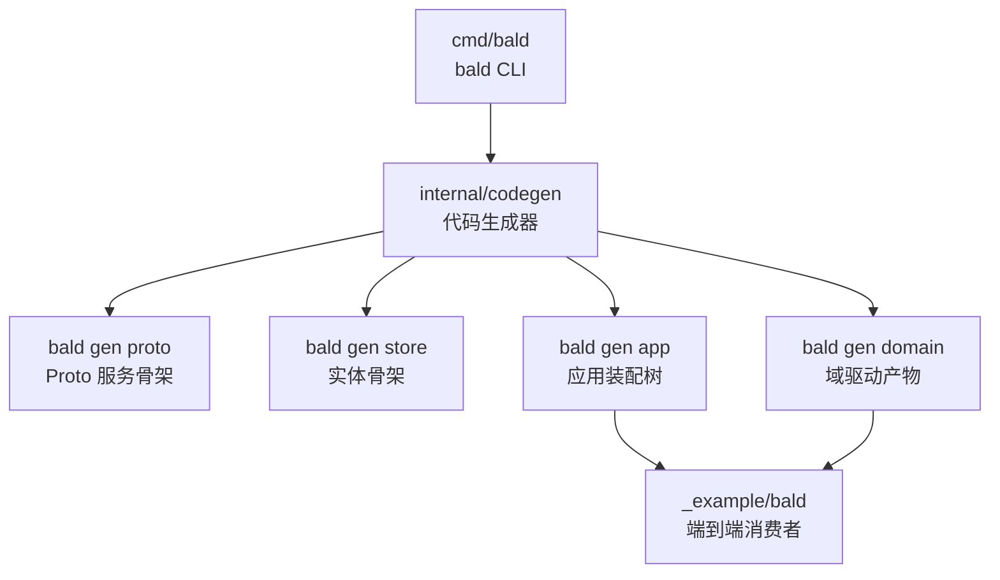
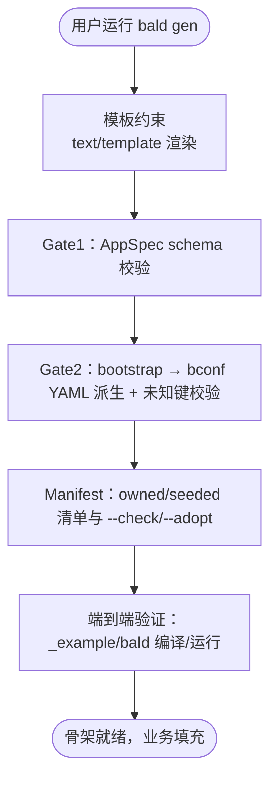
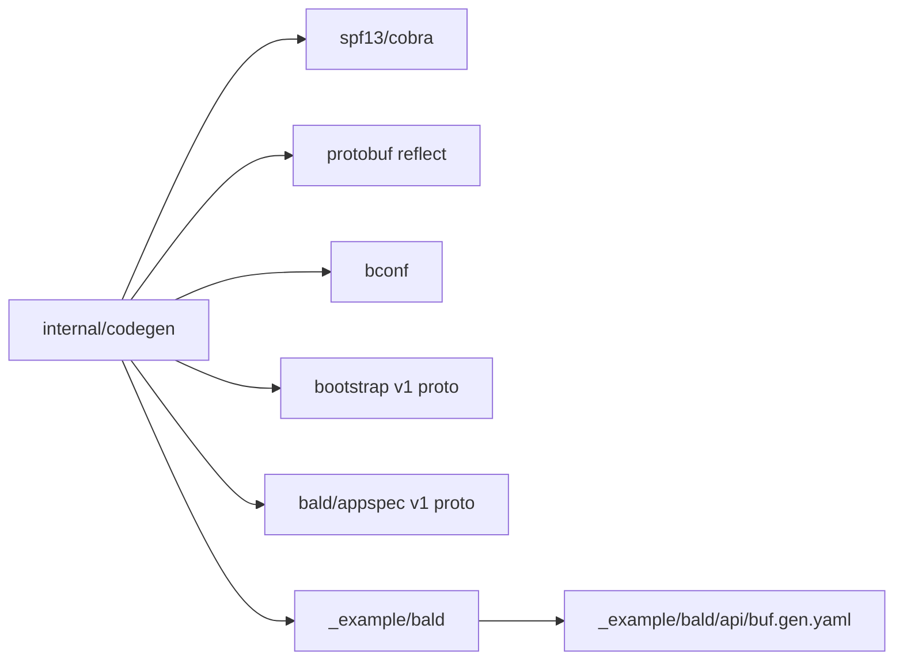

# 代码生成命令

<cite>
**本文引用的文件**   
- [cmd/bald/main.go](file://cmd/bald/main.go)
- [internal/codegen/gen.go](file://internal/codegen/gen.go)
- [internal/codegen/appspec_build.go](file://internal/codegen/appspec_build.go)
- [internal/codegen/appspec_contract.go](file://internal/codegen/appspec_contract.go)
- [internal/codegen/appspec_validate.go](file://internal/codegen/appspec_validate.go)
- [internal/codegen/manifest.go](file://internal/codegen/manifest.go)
- [internal/codegen/gen_domain.go](file://internal/codegen/gen_domain.go)
- [_example/bald/appspec.json](file://_example/bald/appspec.json)
- [_example/bald/domains.manifest.json](file://_example/bald/domains.manifest.json)
- [_example/bald/api/buf.gen.yaml](file://_example/bald/api/buf.gen.yaml)
</cite>

## 目录
1. [简介](#简介)
2. [项目结构](#项目结构)
3. [核心命令总览](#核心命令总览)
4. [模板与三段门机制](#模板与三段门机制)
5. [命令详解](#命令详解)
6. [配置与清单](#配置与清单)
7. [依赖关系分析](#依赖关系分析)
8. [性能与可维护性](#性能与可维护性)
9. [故障排查](#故障排查)
10. [结论](#结论)

## 简介
`bald` CLI 是 Bald 框架的官方开发工具，提供四类代码生成子命令以及面向维护者的发布子命令。代码生成只产出「可编译骨架」：业务路由、处理器、gRPC Service 实现等留填充点，由开发者手写。根仓库不是单一模块，而是 93 个 Go module；CLI 本身位于 `cmd/bald`，核心生成逻辑在 `internal/codegen`，示例工程在 `_example/bald`。

**图表来源**
- [cmd/bald/main.go:1-47](file://cmd/bald/main.go#L1-L47)
- [internal/codegen/gen.go:1-30](file://internal/codegen/gen.go#L1-L30)

**章节来源**
- [cmd/bald/main.go:1-47](file://cmd/bald/main.go#L1-L47)

## 项目结构
| 路径 | 职责 |
|---|---|
| `cmd/bald/main.go` | Cobra 根命令入口，挂载 `codegen` 和 `release` 子命令 |
| `internal/codegen/gen.go` | `gen` 中间节点及 `proto` / `store` 叶子命令、模板渲染、Go 格式化 |
| `internal/codegen/appspec_build.go` | `gen app` 目标目录树构建与落盘策略 |
| `internal/codegen/appspec_contract.go` | AppSpec.bootstrap → bconf YAML 契约发射器（Gate2） |
| `internal/codegen/appspec_validate.go` | AppSpec schema 校验（Gate1） |
| `internal/codegen/manifest.go` | 生成清单、`--check` / `--adopt` 一致性判定 |
| `internal/codegen/gen_domain.go` | `gen domain` 命令流程、参数与执行入口 |
| `_example/bald/appspec.json` | 示例 AppSpec：双角色 + greet 域 + 变体 |
| `_example/bald/domains.manifest.json` | 示例 `gen domain` 清单：版本、工具名、声明摘要与受控文件 |
| `_example/bald/api/buf.gen.yaml` | buf managed mode 插件与输出前缀 |

**章节来源**
- [cmd/bald/main.go:1-47](file://cmd/bald/main.go#L1-L47)
- [internal/codegen/gen.go:1-30](file://internal/codegen/gen.go#L1-L30)
- [internal/codegen/appspec_build.go:1-20](file://internal/codegen/appspec_build.go#L1-L20)
- [internal/codegen/appspec_contract.go:1-20](file://internal/codegen/appspec_contract.go#L1-L20)
- [internal/codegen/appspec_validate.go:1-20](file://internal/codegen/appspec_validate.go#L1-L20)
- [internal/codegen/manifest.go:1-20](file://internal/codegen/manifest.go#L1-L20)
- [internal/codegen/gen_domain.go:1-20](file://internal/codegen/gen_domain.go#L1-L20)
- [_example/bald/appspec.json:1-81](file://_example/bald/appspec.json#L1-L81)
- [_example/bald/domains.manifest.json:1-32](file://_example/bald/domains.manifest.json#L1-L32)
- [_example/bald/api/buf.gen.yaml:1-21](file://_example/bald/api/buf.gen.yaml#L1-L21)

## 核心命令总览
CLI 入口将 `codegen.NewCommand` 作为 `gen` 子命令挂载，并调用 `codegen.CheckErr` 统一错误出口。`gen` 内部再注册四个叶子命令：`proto`、`store`、`app`、`domain`。

| 命令 | 主要输入 | 主要输出 | 关键约束 |
|---|---|---|---|
| `bald gen proto <name>` | 位置参数 `<name>`、可选 `--out` / `--plural` / `--go-package` / `--module` / `--force` | `api/proto/<name>/v1/<name>.proto` | 必须运行 buf 生成 Go 代码；默认拒绝覆盖已存在文件 |
| `bald gen store <name>` | 位置参数 `<name>`、可选 `--out` / `--out-pkg` / `--force` | `<name>.go`（含 gorm tag 与 `KeyOf`） | 输出 .go 先 gofmt，保证可编译骨架 |
| `bald gen app --spec <AppSpec.json>` | AppSpec JSON | cmd 装配、bootstrap、configs、buf/taskfile 种子文件 | 按角色扇出，受 Gate1/Gate2 与 manifest 保护 |
| `bald gen domain --spec <AppSpec.json>` | AppSpec JSON、可选 `--out` / `--apiserver-dir` / `--no-bind` / `--no-routes` / `--proto-cmd` / `--check` / `--adopt` | domains.gen.go、授权别名、gin 绑定、route 清单、域包骨架 | 以 AppSpec.domains 为真相源，扫描实际 proto 对账 |

**章节来源**
- [cmd/bald/main.go:22-47](file://cmd/bald/main.go#L22-L47)
- [internal/codegen/gen.go:1-30](file://internal/codegen/gen.go#L1-L30)

## 模板与三段门机制
代码生成不只是模板替换，而是「模板约束 + 契约校验 + 端到端验证」三段门体系：

| 阶段 | 名称 | 负责文件 | 行为 |
|---|---|---|---|
| 1 | 模板约束 | `internal/codegen/gen.go` | 用内嵌 `text/template` 渲染 proto / 实体 / 应用装配 / 域产物，仅暴露有限字段；Go 源经 `go/format.Source` 格式化 |
| 2 | 契约校验 | `internal/codegen/appspec_validate.go`、`internal/codegen/appspec_contract.go` | Gate1 校验 AppSpec schema（kind 白名单、name 唯一、requires ⊆ provides、service/http_only 三态、roles 覆盖全集等）；Gate2 从 bootstrap 段派生 YAML 并用 bconf 未知键检查做回归锁 |
| 3 | 端到端验证 | `internal/codegen/app_test.go`（测试层）、`_example/bald`（消费者模块） | 生成物以示例工程为编译/运行上下文，核心 go.mod 不引入 gin/grpc，确保骨架真实可编译 |

**图表来源**
- [internal/codegen/gen.go:280-344](file://internal/codegen/gen.go#L280-L344)
- [internal/codegen/appspec_validate.go:1-30](file://internal/codegen/appspec_validate.go#L1-L30)
- [internal/codegen/appspec_contract.go:1-30](file://internal/codegen/appspec_contract.go#L1-L30)
- [internal/codegen/manifest.go:1-30](file://internal/codegen/manifest.go#L1-L30)

**章节来源**
- [internal/codegen/gen.go:280-344](file://internal/codegen/gen.go#L280-L344)
- [internal/codegen/appspec_validate.go:1-30](file://internal/codegen/appspec_validate.go#L1-L30)
- [internal/codegen/appspec_contract.go:1-30](file://internal/codegen/appspec_contract.go#L1-L30)
- [internal/codegen/manifest.go:1-30](file://internal/codegen/manifest.go#L1-L30)

## 命令详解

### `bald gen proto <name>`
生成 protobuf 服务骨架，包含 CRUD 六件套（List、Get、Create、Update、Delete）、google.api.http REST 注解、buf.validate 字段规则与 `bald.store.v1.FilterExpr` 结构化过滤。

| 参数 | 类型 | 默认值 | 说明 |
|---|---|---|---|
| `<name>` | 位置参数 | 必填 | 服务名，也决定 package `<name>.v1` 与文件名 |
| `--out` | 字符串 | `api/proto/<name>/v1` | 输出目录 |
| `--plural` | 字符串 | `<name>s` | REST 资源段，如 `/v1/<plural>` |
| `--go-package` | 字符串 | 空 | proto 的 `go_package` option；未显式给且提供 `--module` 时派生 `<module>/api/gen/go/<name>/v1;<name>v1` |
| `--module` | 字符串 | 空 | 业务 module 路径，用于派生 go_package |
| `--force` | 布尔 | false | 覆盖已存在的 `.proto` 文件（默认拒绝） |

典型用法：
- 生成 greet 域 proto：`bald gen proto greet`
- 指定自定义 REST 复数形式：`bald gen proto org-unit --plural org-units`
- 指定 go_package 与 module：`bald gen proto greet --module github.com/kalandramo/bald/example/bald --go-package "github.com/kalandramo/bald/example/bald/api/gen/greet/v1;greetv1"`

注意事项：
- 该命令只写 `.proto`；Go 代码需把文件纳入 buf module 后运行 `buf generate`。
- 注解依赖（googleapis、protovalidate、bald store）由 buf 模块依赖解析，参见示例 `api/buf.gen.yaml`。

**章节来源**
- [internal/codegen/gen.go:1-30](file://internal/codegen/gen.go#L1-L30)
- [internal/codegen/gen.go:201-279](file://internal/codegen/gen.go#L201-L279)
- [_example/bald/api/buf.gen.yaml:1-21](file://_example/bald/api/buf.gen.yaml#L1-L21)

### `bald gen store <name>`
生成实体骨架，包含 GORM tag 与 `KeyOf` 提取函数，输出 .go 文件并先执行 gofmt。

| 参数 | 类型 | 默认值 | 说明 |
|---|---|---|---|
| `<name>` | 位置参数 | 必填 | 实体名，决定 struct 名与文件名 |
| `--out` | 字符串 | `.` | 输出目录 |
| `--out-pkg` | 字符串 | `main` | 生成文件的 package |
| `--force` | 布尔 | false | 覆盖已存在的 `.go` 文件（默认拒绝） |

典型用法：
- 在当前目录生成 `User.go`：`bald gen store User`
- 指定包名：`bald gen store User --out-pkg user`

注意：输出经过 `go/format.Source`，若模板渲染结果无法通过 gofmt 会直接失败。

**章节来源**
- [internal/codegen/gen.go:280-344](file://internal/codegen/gen.go#L280-L344)

### `bald gen app --spec <AppSpec.json>`
按 AppSpec 生成应用装配目录树：每个角色一份 `cmd/<CmdName>/main.go` 与 `cmd/<CmdName>/app/command.go`，`internal/bootstrap` 装配文件，configs YAML，buf/taskfile 种子，以及可选变体实现。

核心输出（按归属三态）：
- `owned`：生成器拥有，`--check` 要求逐字节一致，`--adopt` 可覆盖。
- `seeded`：播种后归用户，`--check` 只判存在性，内容差异合法。
- `user`：用户文件，不参与清单。

典型用途：
- 生成示例工程的 API 与 worker 双角色装配：`bald gen app --spec _example/bald/appspec.json`
- CI 中保持生成物同步：`bald gen app --spec appspec.json --check`
- 接管生成物并清理陈旧产物：`bald gen app --spec appspec.json --adopt`

**章节来源**
- [internal/codegen/appspec_build.go:1-128](file://internal/codegen/appspec_build.go#L1-L128)
- [internal/codegen/appspec_contract.go:1-200](file://internal/codegen/appspec_contract.go#L1-L200)
- [internal/codegen/appspec_validate.go:1-200](file://internal/codegen/appspec_validate.go#L1-L200)

### `bald gen domain --spec <AppSpec.json>`
按 AppSpec.domains 重写域驱动产物，包括：
- `internal/bootstrap/domains.gen.go`：域清单聚合
- `handler/convert/<d>.gen.go`：授权动作投影
- `authz/alias.gen.go`：授权别名表 + 默认动作
- `handler/gin/<d>.bind.gen.go` 与 `routes/<d>.gen.go`：google.api.http 注解派生的 gin 绑定与 route 清单（默认生成）
- `<go_package>/domain.gen.go`：域声明值骨架（仅当包尚无导出 Domain 时 seed）

| 参数 | 类型 | 默认值 | 说明 |
|---|---|---|---|
| `--spec` | 字符串 | 必填 | AppSpec JSON 路径 |
| `--out` | 字符串 | `.` | 产出根 |
| `--manifest` | 字符串 | `internal/bootstrap/domains.gen.go` | 域清单落盘路径 |
| `--apiserver-dir` | 字符串 | 取 layout.apiserver_dir 或 `apiserver`；传 `-` 跳过 | apiserver 目录名 |
| `--no-bind` | 布尔 | false | 关闭 gin 绑定与 route 清单生成 |
| `--no-routes` | 布尔 | false | 只产绑定，跳过 route 清单（需绑定开启） |
| `--proto-cmd` | 字符串 | `buf generate` | 绑定前置缺失时执行的 proto 生成命令 |
| `--check` | 布尔 | false | 只校验不落盘 |
| `--adopt` | 布尔 | false | 覆盖 owned 文件并删除陈旧产物 |

典型用法：
- 基于示例 AppSpec 重新生成域产物：`bald gen domain --spec _example/bald/appspec.json`
- CI 检查域清单是否最新：`bald gen domain --spec appspec.json --check`
- 接管受控文件并清理旧产物：`bald gen domain --spec appspec.json --adopt`

**章节来源**
- [internal/codegen/gen_domain.go:1-200](file://internal/codegen/gen_domain.go#L1-L200)

## 配置与清单

### AppSpec 结构要点
示例 `appspec.json` 展示了 AppSpec 的关键段：

| 段 | 含义 |
|---|---|
| `meta.name` | 应用名，决定 cmd 目录与 configs 文件名 |
| `meta.module` | 业务 Go module 路径 |
| `meta.roles` | 角色列表；为空表示单角色；非空时各角色 domains 并集须等于 domains 全集 |
| `bootstrap.app.version` | 应用版本 |
| `bootstrap.logger.backends` | 日志后端配置 |
| `bootstrap.database.sql` | 数据库连接配置 |
| `bootstrap.registry` | 注册中心配置（示例使用 nacos） |
| `domains[]` | 域声明，含 name、protoPackage、service、goPackage |
| `variants[]` | 可选变体，with `when` 标签 |

**章节来源**
- [_example/bald/appspec.json:1-81](file://_example/bald/appspec.json#L1-L81)

### 生成清单格式
`domains.manifest.json` 记录一次生成的元信息与受控文件摘要：

| 字段 | 含义 |
|---|---|
| `version` | 清单格式版本，当前为 1 |
| `tool` | 工具名，如 `bald gen domain` |
| `spec` | AppSpec JSON 内容的 sha256 |
| `files[].path` | 斜杠形态路径，跨平台可比 |
| `files[].ownership` | `owned` 或 `seeded` |
| `files[].hash` | 落盘字节摘要；seeded 固定为标记值 |

`--check` 的行为：
- 内存重算整棵树，与磁盘逐字节比对，零写入。
- seeded 文件只判存在性。
- 列出 missing/out-of-date/stale 差异。
- 清单自身也必须与「重新渲染的清单字节」一致。

`--adopt` 的行为：
- 覆盖 owned 文件。
- 删除上次清单记为 owned、本次不再生成的陈旧文件。
- 重写清单。

**章节来源**
- [_example/bald/domains.manifest.json:1-32](file://_example/bald/domains.manifest.json#L1-L32)
- [internal/codegen/manifest.go:1-200](file://internal/codegen/manifest.go#L1-L200)

## 依赖关系分析
`internal/codegen` 依赖外部库与生成产物：

**图表来源**
- [internal/codegen/gen.go:1-30](file://internal/codegen/gen.go#L1-L30)
- [internal/codegen/appspec_contract.go:1-20](file://internal/codegen/appspec_contract.go#L1-L20)
- [_example/bald/api/buf.gen.yaml:1-21](file://_example/bald/api/buf.gen.yaml#L1-L21)

**章节来源**
- [internal/codegen/gen.go:1-30](file://internal/codegen/gen.go#L1-L30)
- [internal/codegen/appspec_contract.go:1-20](file://internal/codegen/appspec_contract.go#L1-L20)

## 性能与可维护性
- 模板渲染集中在 `renderTmpl`，仅构造必要数据，避免重复 IO。
- Go 源统一走 `writeFileFormatted`，非 Go 文件走 `writeGuarded`，减少格式不一致导致的 diff。
- `--check` 是零写入的一致性闸门，适合 CI；`--adopt` 是显式接管语义，适合本地收敛。
- 清单路径恒为斜杠形态，避免 Windows 分隔符造成的误报。
- AppSpec 校验聚合多条错误，便于一次性修复多处问题。

[本节为通用建议，不直接分析具体源码行]

## 故障排查

| 现象 | 可能原因 | 处理建议 |
|---|---|---|
| `the proto name is required` | 未传入 `<name>` | 补上位置参数 |
| `the entity name is required` | `gen store` 未传入 `<name>` | 补上位置参数 |
| `the --spec <AppSpec.json> is required` | `gen domain` 未传 `--spec` | 传入 AppSpec 路径 |
| `--adopt and --check are mutually exclusive` | 同时启用冲突开关 | 二选一 |
| `--rest-bind and --no-bind are mutually exclusive` | 旧兼容开关与新默认行为冲突 | 移除 `--rest-bind` |
| `--no-routes only applies when bindings are generated` | 同时 `--no-bind` 与 `--no-routes` | 保留绑定或去掉 `--no-routes` |
| `generated tree is not clean` | 生成物与 spec 不同步 | 运行 `--check` 查看差异，必要时 `--adopt` |
| `contract keys unknown to bconf` | AppSpec.bootstrap 包含未知键 | 检查拼写或确认是否需要加入允许段 |
| `scan domain protos` 失败 | proto 根下缺少匹配的 service | 确认 `domains[].service` 与实际 proto 一致 |
| buf 生成 Go 代码失败 | proto 未纳入 buf module 或缺少依赖 | 参考示例 `api/buf.gen.yaml`，运行 `buf generate` |

**章节来源**
- [internal/codegen/gen.go:201-344](file://internal/codegen/gen.go#L201-L344)
- [internal/codegen/gen_domain.go:120-200](file://internal/codegen/gen_domain.go#L120-L200)
- [internal/codegen/appspec_contract.go:120-200](file://internal/codegen/appspec_contract.go#L120-L200)
- [internal/codegen/manifest.go:120-200](file://internal/codegen/manifest.go#L120-L200)

## 结论
`bald gen` 系列命令围绕 AppSpec 这一声明真相源工作：`proto` 定义契约、`store` 生成实体骨架、`app` 装配应用目录树、`domain` 从契约派生授权、绑定与路由清单。模板约束保证生成物形态稳定，Gate1/Gate2 在落盘前拦截不可运行的声明，manifest 让「生成物最新」可判定，`_example/bald` 则承担端到端编译/运行验证。生产实践中应优先使用 `--check` 守护 CI，仅在本地需要接管生成物时使用 `--adopt`，并把业务逻辑写在模板预留的手写区域，避免被下次生成覆盖。

[本节为总结性内容，不直接分析具体源码行]