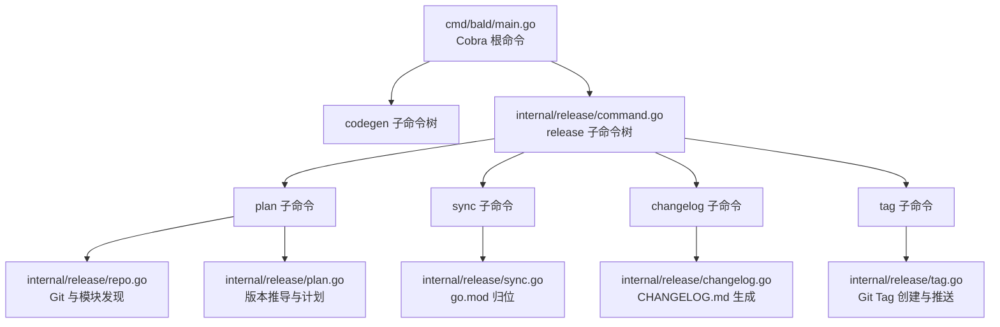
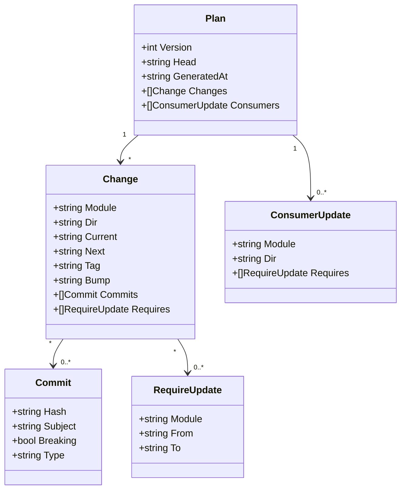
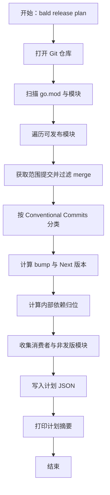
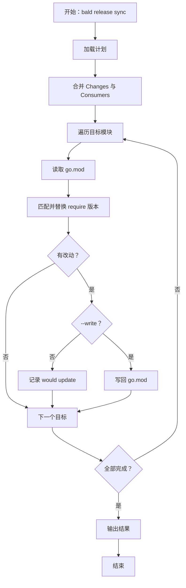
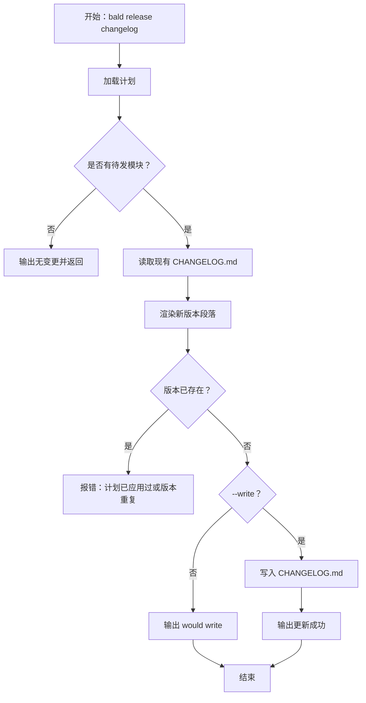
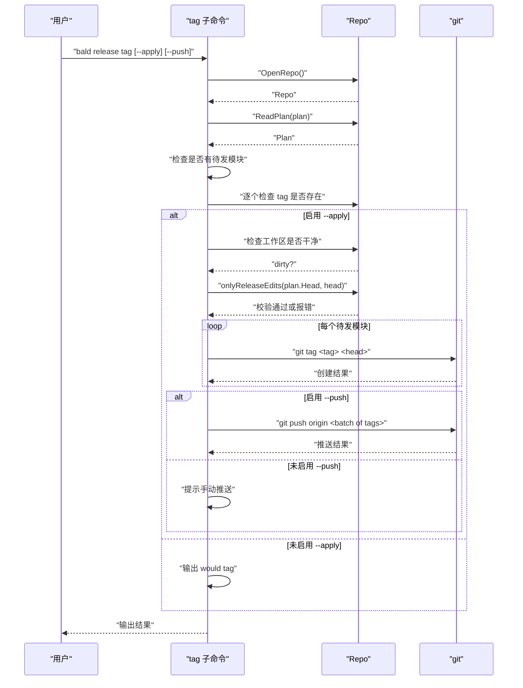

# 版本发布命令

<cite>
**本文引用的文件**   
- [cmd/bald/main.go](file://cmd/bald/main.go)
- [internal/release/command.go](file://internal/release/command.go)
- [internal/release/plan.go](file://internal/release/plan.go)
- [internal/release/sync.go](file://internal/release/sync.go)
- [internal/release/changelog.go](file://internal/release/changelog.go)
- [internal/release/tag.go](file://internal/release/tag.go)
- [internal/release/repo.go](file://internal/release/repo.go)
- [internal/release/release_test.go](file://internal/release/release_test.go)
</cite>

## 目录
1. [简介](#简介)
2. [项目结构与入口](#项目结构与入口)
3. [核心概念与数据模型](#核心概念与数据模型)
4. [命令总览](#命令总览)
5. [bald release plan](#bald-release-plan)
6. [bald release sync](#bald-release-sync)
7. [bald release changelog](#bald-release-changelog)
8. [bald release tag](#bald-release-tag)
9. [执行顺序与依赖关系](#执行顺序与依赖关系)
10. [实际发布流程示例](#实际发布流程示例)
11. [配置选项与环境要求](#配置选项与环境要求)
12. [错误处理与日志输出](#错误处理与日志输出)
13. [版本管理最佳实践](#版本管理最佳实践)
14. [回滚策略与故障恢复](#回滚策略与故障恢复)
15. [CI/CD 集成建议](#cicd-集成建议)
16. [结论](#结论)

## 简介
`bald release` 是面向多模块 Go 仓库维护者的发布工具，负责从 Git 提交历史推导待发布模块、计算下一版本、归位内部依赖、生成变更日志并打上模块级 Git Tag。它把一次完整发布拆成四个可单独重放的步骤：计划、同步、变更记录、打标签。

该工具默认在本地工作区操作，不直接访问远端仓库；只有显式启用推送时才调用 `git push origin`。计划文件是单次发布的中间产物，默认写入 `.bald/release-plan.json`，且已在仓库忽略规则中排除版本库。

## 项目结构与入口
Bald CLI 的根命令由 `cmd/bald/main.go` 注册，使用 Cobra 组装 `gen` 与 `release` 两个子命令树。`release.NewCommand` 再注册 `plan`、`sync`、`changelog`、`tag` 四个子命令，并把标准错误流交给各命令统一打印。



**图示来源**
- [cmd/bald/main.go:23-47](file://cmd/bald/main.go#L23-L47)
- [internal/release/command.go:23-51](file://internal/release/command.go#L23-L51)

**章节来源**
- [cmd/bald/main.go:1-47](file://cmd/bald/main.go#L1-L47)
- [internal/release/command.go:1-51](file://internal/release/command.go#L1-L51)

## 核心概念与数据模型
发布流程围绕一个 JSON 计划对象展开。计划记录当前 HEAD、生成时间、每个待发模块的变更信息，以及需要随发布归位的消费者模块信息。

| 字段或结构 | 含义 | 关键行为 |
|---|---|---|
| `Plan.Version` | 计划 schema 版本 | 与常量 `PlanVersion`（值为 2）比较，旧版本计划拒绝使用 |
| `Plan.Head` | 计算计划时的 Git 提交哈希 | 打 tag 时校验 HEAD 是否只多出发布提交 |
| `Plan.GeneratedAt` | 计划生成时间（RFC3339 UTC） | 变更日志日期节取前 10 位作为日期标题 |
| `Plan.Changes` | 本次待发模块列表 | 按模块目录独立计算 bump 和下一个版本号 |
| `Change.Module` | go.mod 中的 module 路径 | 用于识别内部依赖归属 |
| `Change.Dir` | 相对仓库根的 slash 路径，根模块为 `.` | 决定 tag 前缀和变更日志标题 |
| `Change.Current` | 最近正式 tag，空表示从未发布 | 首次发版固定为 `v0.1.0` |
| `Change.Next` | 推导出的下一个版本 | 遵循 Conventional Commits 规则 |
| `Change.Tag` | 最终 Git Tag 名称 | 根模块用版本号，子模块加目录前缀 |
| `Change.Bump` | `initial` / `patch` / `minor` / `major` | 由最高等级提交决定 |
| `Change.Commits` | 进入该模块范围的提交 | 过滤 merge、按最深模块归属、解析 breaking |
| `Change.Requires` | 本模块需归位的内部依赖 | 仅指向同批待发模块 |
| `Plan.Consumers` | 不进 Changes 但需跟随归位的模块 | `_example`、`examples` 及本轮不发版的可发布模块 |



**图示来源**
- [internal/release/plan.go:12-65](file://internal/release/plan.go#L12-L65)

**章节来源**
- [internal/release/plan.go:12-65](file://internal/release/plan.go#L12-L65)
- [internal/release/plan.go:503-534](file://internal/release/plan.go#L503-L534)

## 命令总览
所有发布命令共享同一个父命令 `bald release`。除 `plan` 外，其余命令都依赖 `plan` 产出的计划文件。

| 命令 | 作用 | 主要参数 | 默认行为 |
|---|---|---|---|
| `bald release plan` | 计算待发布模块与下一版本 | `--json`、`--out` | 写计划文件并打印人类可读摘要 |
| `bald release sync` | 将计划内模块的内部依赖归位到下一版本 | `--plan`、`--write` | 只打印将要修改的内容 |
| `bald release changelog` | 按计划写入 `CHANGELOG.md` | `--plan`、`--write` | 只打印将要写入的内容 |
| `bald release tag` | 在 HEAD 上打 Git Tag | `--plan`、`--apply`、`--push` | 只打印将要创建的 tag |

**章节来源**
- [internal/release/command.go:23-176](file://internal/release/command.go#L23-L176)

## bald release plan
### 语法
```
bald release plan [--json] [--out <计划文件路径>]
```

### 参数说明
| 参数 | 类型 | 默认值 | 说明 |
|---|---|---|---|
| `--json` | 布尔 | `false` | 以缩进 JSON 输出计划到标准输出，同时仍写入计划文件 |
| `--out` | 字符串 | `.bald/release-plan.json` | 计划文件路径；父目录不存在时会创建 |

### 执行流程
1. 打开当前工作目录所在的 Git 仓库。
2. 递归扫描 `go.mod`，排除隐藏目录、`vendor`、`node_modules`。
3. 标记 `examples` 与 `_example` 下的模块为不可发布，但仍纳入模块表。
4. 对每个可发布模块，查找自最近正式 tag 以来的提交，并按最深模块归属过滤。
5. 根据 Conventional Commits 计算 bump：
   - `feat` → `minor`
   - `fix`、`perf`、`refactor`、`revert` 等未明确列出不触发特殊 bump 时按 `patch`
   - `!` 或正文含 `BREAKING CHANGE:` / `BREAKING-CHANGE:`：
     - 当前版本 ≥ 1.x → `major`
     - 0.x → `minor`
   - `docs`、`chore`、`test`、`tests`、`ci`、`style`、`build` → 不触发发布
   - 从未发布过且有提交 → `initial`，下一版本固定为 `v0.1.0`
6. 为每个待发模块列出需要同步的 `require`，目标版本为被依赖模块的 `Next`。
7. 收集消费者与非发版模块的依赖归位需求。
8. 写出计划 JSON，并打印人类可读的计划表。



**图示来源**
- [internal/release/command.go:53-94](file://internal/release/command.go#L53-L94)
- [internal/release/plan.go:83-130](file://internal/release/plan.go#L83-L130)
- [internal/release/plan.go:142-200](file://internal/release/plan.go#L142-L200)

### 关键规则
- 根模块 tag 等于版本号，如 `v0.1.1`。
- 子模块 tag 加目录前缀，如 `sub/v0.2.0`。
- 如果自上次 tag 以来没有触发发布的提交，计划为空。
- 消费者模块不会泄漏到外层模块的变更集合中。

**章节来源**
- [internal/release/command.go:53-94](file://internal/release/command.go#L53-L94)
- [internal/release/plan.go:83-200](file://internal/release/plan.go#L83-L200)
- [internal/release/plan.go:201-354](file://internal/release/plan.go#L201-L354)
- [internal/release/plan.go:356-502](file://internal/release/plan.go#L356-L502)
- [internal/release/release_test.go:219-315](file://internal/release/release_test.go#L219-L315)

## bald release sync
### 语法
```
bald release sync [--plan <计划文件路径>] [--write]
```

### 参数说明
| 参数 | 类型 | 默认值 | 说明 |
|---|---|---|---|
| `--plan` | 字符串 | `.bald/release-plan.json` | 读取计划文件的路径 |
| `--write` | 布尔 | `false` | 真正写入 `go.mod`；默认只打印将要修改的内容 |

### 执行流程
1. 打开 Git 仓库并读取计划文件。
2. 合并两类目标：`Changes` 中的待发模块，以及 `Consumers` 中的消费者与非发版模块。
3. 对每个目标模块的 `go.mod`，把计划内模块的 `require` 更新到其 `Next` 版本。
4. 若目标已是期望版本，视为幂等跳过。
5. 若文件中找不到预期旧版本，报错提示计划可能过期，需重新运行 `bald release plan`。
6. 未改动任何文件时输出“依赖已是最新，无需归位”。
7. 非 `--write` 模式下输出“未写入文件；确认后加 --write”。



**图示来源**
- [internal/release/command.go:96-124](file://internal/release/command.go#L96-L124)
- [internal/release/sync.go:14-52](file://internal/release/sync.go#L14-L52)
- [internal/release/sync.go:54-126](file://internal/release/sync.go#L54-L126)

### 为什么必须做
如果模块 A 在本轮使用了模块 B 的新 API，而 A 的 `go.mod` 仍指向 B 的旧版本，下游 `go get A@新版本` 会按旧 B 编译失败。因此同步只处理计划内模块及其消费者，避免把发布范围扩散到无关模块。

**章节来源**
- [internal/release/command.go:96-124](file://internal/release/command.go#L96-L124)
- [internal/release/sync.go:14-126](file://internal/release/sync.go#L14-L126)
- [internal/release/release_test.go:317-370](file://internal/release/release_test.go#L317-L370)

## bald release changelog
### 语法
```
bald release changelog [--plan <计划文件路径>] [--write]
```

### 参数说明
| 参数 | 类型 | 默认值 | 说明 |
|---|---|---|---|
| `--plan` | 字符串 | `.bald/release-plan.json` | 读取计划文件的路径 |
| `--write` | 布尔 | `false` | 真正写入 `CHANGELOG.md`；默认只打印将要写入的内容 |

### 执行流程
1. 打开 Git 仓库并读取计划。
2. 若无待发模块，直接输出“变更日志不变”并返回。
3. 读取现有 `CHANGELOG.md`。
4. 渲染新版本的 Markdown 段落：
   - 顶层日期节 `## YYYY-MM-DD`
   - 每个模块一节 `### 模块名 版本号`
   - 每条提交一行，breaking 提交标注 `**(breaking)**`
5. 检查同一模块的同一版本是否已存在，存在则拒绝写入。
6. 非 `--write` 模式输出预览；`--write` 模式覆盖写入。



**图示来源**
- [internal/release/command.go:126-153](file://internal/release/command.go#L126-L153)
- [internal/release/changelog.go:16-60](file://internal/release/changelog.go#L16-L60)
- [internal/release/changelog.go:62-124](file://internal/release/changelog.go#L62-L124)

### 输出格式要点
- 文件头包含说明文字，表明变更日志由命令自动生成。
- 新版本插入在最早历史版本之前。
- 同一天多次发布会合并到同一个日期标题下，新版本排在前面。
- 重复写入同一模块版本会报错。

**章节来源**
- [internal/release/command.go:126-153](file://internal/release/command.go#L126-L153)
- [internal/release/changelog.go:1-124](file://internal/release/changelog.go#L1-L124)
- [internal/release/release_test.go:446-513](file://internal/release/release_test.go#L446-L513)

## bald release tag
### 语法
```
bald release tag [--plan <计划文件路径>] [--apply] [--push]
```

### 参数说明
| 参数 | 类型 | 默认值 | 说明 |
|---|---|---|---|
| `--plan` | 字符串 | `.bald/release-plan.json` | 读取计划文件的路径 |
| `--apply` | 布尔 | `false` | 真正创建 Git Tag；默认只打印 |
| `--push` | 布尔 | `false` | 创建后推送到 `origin`；必须与 `--apply` 一起使用 |

### 执行流程
1. 打开 Git 仓库并读取计划。
2. 若无待发模块，输出“未打 tag”并返回。
3. 对每个计划中的 tag，检查是否已存在；存在则报错。
4. 若启用 `--apply`：
   - 检查工作区是否干净；不干净则报错。
   - 校验 HEAD 相对于计划记录的 `Head` 是否只多了发布相关改动。
   - 对每个模块创建 tag。
5. 若启用 `--push`：
   - 强制要求 `--apply`。
   - 按最多三个 tag 分批推送，避免 GitHub 一次性推送过多 tag 不产生事件。
6. 未启用 `--push` 但启用了 `--apply`，提示用户手动推送。



**图示来源**
- [internal/release/command.go:155-176](file://internal/release/command.go#L155-L176)
- [internal/release/tag.go:12-122](file://internal/release/tag.go#L12-L122)

### 保护机制
- 已存在 tag → 拒绝重复应用。
- 工作区不干净 → 先提交依赖归位与变更日志。
- HEAD 比计划多出非发布改动 → 要求重新计算计划。
- `--push` 未配合 `--apply` → 直接报错。
- 批量推送限制为每次最多三个 tag。

**章节来源**
- [internal/release/command.go:155-176](file://internal/release/command.go#L155-L176)
- [internal/release/tag.go:12-122](file://internal/release/tag.go#L12-L122)
- [internal/release/release_test.go:515-573](file://internal/release/release_test.go#L515-L573)

## 执行顺序与依赖关系
推荐的标准发布顺序如下：

| 步骤 | 命令 | 前置条件 | 产出 | 风险点 |
|---|---|---|---|---|
| 1 | `bald release plan` | 可访问的 Git 仓库 | `.bald/release-plan.json` | 计划过期或 schema 版本不一致 |
| 2 | `bald release sync` | 已有计划 | 已更新的 `go.mod` | 旧版本不匹配时报错 |
| 3 | `bald release changelog` | 已有计划 | `CHANGELOG.md` | 重复版本拒绝写入 |
| 4 | `bald release tag --apply` | 工作区干净、HEAD 符合计划 | 本地 Git Tag | 已存在 tag 或 HEAD 多出非发布改动 |
| 5 | `bald release tag --apply --push` | 上一步成功 | 远端 `origin` 上的 tag | 网络或权限问题 |


**图示来源**
- [internal/release/command.go:53-176](file://internal/release/command.go#L53-L176)
- [internal/release/tag.go:12-60](file://internal/release/tag.go#L12-L60)

**章节来源**
- [internal/release/command.go:53-176](file://internal/release/command.go#L53-L176)
- [internal/release/tag.go:12-60](file://internal/release/tag.go#L12-L60)

## 实际发布流程示例
以下示例基于测试用例构造的最小多模块仓库语义，描述一次真实可用的发布过程。

### 场景一：根模块修复、子模块功能更新
1. 仓库已有根模块 `example.com/m` 与子模块 `example.com/m/sub`，都已打过 `v0.1.0` 与 `sub/v0.1.0`。
2. 根模块提交 `fix: root bug`，子模块提交 `feat: sub feature`。
3. 执行计划：
   - 根模块 bump 为 `patch`，下一版本 `v0.1.1`。
   - 子模块 bump 为 `minor`，下一版本 `v0.2.0`。
   - 两模块互相需要归位内部依赖。
4. 执行同步：
   - 根模块 `go.mod` 中 `example.com/m/sub` 升到 `v0.2.0`。
   - 子模块 `go.mod` 中 `example.com/m` 升到 `v0.1.1`。
5. 执行变更日志：
   - 写入两个模块的版本条目。
6. 执行打 tag：
   - 创建 `v0.1.1` 与 `sub/v0.2.0`。
   - 可选推送到 `origin`。

**章节来源**
- [internal/release/release_test.go:17-74](file://internal/release/release_test.go#L17-L74)
- [internal/release/release_test.go:219-315](file://internal/release/release_test.go#L219-L315)

### 场景二：消费者与非发版模块依赖归位
1. 新增 `_example/demo` 消费者模块和 `lib` 可发布但未触发布局的模块。
2. 根模块与子模块发版，`_example/demo` 和 `lib` 自身不发版。
3. 计划会把它们放入 `Consumers`，并在同步阶段更新其对计划内模块的 `require`。
4. 外部第三方依赖如 `other.example/x` 不会被改动。

**章节来源**
- [internal/release/release_test.go:372-444](file://internal/release/release_test.go#L372-L444)

## 配置选项与环境要求
### 环境要求
- 本机安装 Git，并能访问 `origin`（仅在 `--push` 时需要）。
- 工作目录必须是 Git 仓库根。
- 仓库中存在至少一个 `go.mod`。
- 推荐使用 Conventional Commits 提交消息。
- 计划文件默认写入 `.bald/release-plan.json`，该目录应在 `.gitignore` 中。

### 全局与命令级选项
| 范围 | 选项 | 默认值 | 说明 |
|---|---|---|---|
| 根命令 | 无额外选项 | — | 标准错误由 Cobra 绑定到命令流的 `ErrOut` |
| `plan` | `--json` | `false` | 向标准输出打印 JSON 计划 |
| `plan` | `--out` | `.bald/release-plan.json` | 计划文件路径 |
| `sync` | `--plan` | `.bald/release-plan.json` | 计划文件路径 |
| `sync` | `--write` | `false` | 真正写入 `go.mod` |
| `changelog` | `--plan` | `.bald/release-plan.json` | 计划文件路径 |
| `changelog` | `--write` | `false` | 真正写入 `CHANGELOG.md` |
| `tag` | `--plan` | `.bald/release-plan.json` | 计划文件路径 |
| `tag` | `--apply` | `false` | 真正创建 tag |
| `tag` | `--push` | `false` | 创建后推送 `origin` |

**章节来源**
- [internal/release/command.go:23-176](file://internal/release/command.go#L23-L176)
- [internal/release/plan.go:470-502](file://internal/release/plan.go#L470-L502)

## 错误处理与日志输出
### 常见错误
| 错误场景 | 来源 | 典型错误信息语义 | 处理方式 |
|---|---|---|---|
| 不是 Git 仓库 | `OpenRepo` | “not a git repository” | 切换到有效仓库根 |
| 未发现 `go.mod` | `Discover` | “no go.mod found under ...” | 检查当前目录 |
| 计划文件读取失败 | `ReadPlan` | “read plan: ...” | 确认 `--out`/`--plan` 路径 |
| 计划 schema 版本不匹配 | `ReadPlan` | “plan has schema version ..., want 2; rerun `bald release plan`” | 重新执行 `bald release plan` |
| 消费者 `go.mod` 中 require 不存在 | `setRequireVersion` | “require ... not found” | 检查模块路径 |
| 消费者 `go.mod` 中 require 版本既不是 from 也不是 to | `setRequireVersion` | “require ... is neither ... nor ...; rerun `bald release plan`” | 重新执行计划 |
| 变更日志重复版本 | `WriteChangelog` | “CHANGELOG.md 已包含 ...；计划已应用过或版本重复” | 删除重复内容或重新规划 |
| 工作区不干净 | `Tag` | “工作区不干净；先提交依赖归位与 CHANGELOG，再打 tag” | 提交或暂存后再执行 |
| HEAD 多出非发布改动 | `onlyReleaseEdits` | “HEAD 比计划多出非发布改动 ...；请重新运行 `bald release plan`” | 重新计算计划 |
| tag 已存在 | `Tag` | “tag ... 已存在；计划已应用过或版本重复” | 清理远端 tag 或更换版本 |
| `--push` 未配合 `--apply` | `Tag` | “--push 需要同时传 --apply” | 补上 `--apply` |

### 日志输出特征
- 标准输出用于人类可读摘要、JSON 计划和 dry-run 预览。
- 标准错误用于统一错误出口。
- `plan` 命令结束时会在标准错误输出计划落点。
- `sync` 在 dry-run 输出 `would update`，成功后输出“无需归位”或已更新的文件行。
- `changelog` 在未写入时输出 `would write CHANGELOG.md`，写入成功输出更新数量。
- `tag` 在 dry-run 输出 `would tag`，apply 后输出 `tagged`，push 后按批次输出 `pushed`。

**章节来源**
- [internal/release/repo.go:41-58](file://internal/release/repo.go#L41-L58)
- [internal/release/repo.go:60-110](file://internal/release/repo.go#L60-L110)
- [internal/release/plan.go:470-502](file://internal/release/plan.go#L470-L502)
- [internal/release/sync.go:54-126](file://internal/release/sync.go#L54-L126)
- [internal/release/changelog.go:16-60](file://internal/release/changelog.go#L16-L60)
- [internal/release/tag.go:12-122](file://internal/release/tag.go#L12-L122)

## 版本管理最佳实践
### 提交规范
- 新功能使用 `feat`，触发 minor 升级。
- 缺陷修复使用 `fix`，触发 patch 升级。
- 破坏性变更使用 `!` 或在正文添加 `BREAKING CHANGE:` / `BREAKING-CHANGE:`：
  - 0.x 版本升 minor。
  - 1.x 及以上升 major。
- 文档、样式、构建脚本、测试、CI 等不单独触发发布。

### 模块边界
- 每个 Go module 独立打 tag。
- 根模块 tag 为 `vX.Y.Z`。
- 子模块 tag 为 `<dir>/vX.Y.Z`。
- `_example` 与 `examples` 下的模块不参与发布判断，但会参与依赖归位。

### 依赖治理
- 发布前先运行 `bald release plan`，确认 `Requires` 与 `Consumers`。
- 用 `bald release sync` 的 dry-run 预览 `go.mod` 改动。
- 确认后再加 `--write`。
- 不要手工随意改内部依赖版本，否则同步会报“版本既不是 from 也不是 to”。

### 变更日志
- 以 `bald release changelog` 为主，不要手工调整提交顺序。
- 同一模块同一版本只能写入一次。
- 同一天多次发布会自动合并到同一个日期标题下。

**章节来源**
- [internal/release/repo.go:1-26](file://internal/release/repo.go#L1-L26)
- [internal/release/plan.go:83-200](file://internal/release/plan.go#L83-L200)
- [internal/release/plan.go:306-354](file://internal/release/plan.go#L306-L354)
- [internal/release/changelog.go:16-60](file://internal/release/changelog.go#L16-L60)

## 回滚策略与故障恢复
### 回滚维度
| 维度 | 回滚方式 | 注意事项 |
|---|---|---|
| 计划文件 | 重新执行 `bald release plan` | 若 HEAD 移动，原计划会被拒绝或不再代表当前状态 |
| `go.mod` | 撤销 `bald release sync --write` 产生的提交 | 同步是幂等的，再次执行不会继续改目标版本 |
| `CHANGELOG.md` | 编辑或删除重复版本条目后重试 | 重复版本会阻止再次写入 |
| Git Tag | 删除本地与远端 tag 后重新发布 | 工具检测到已存在 tag 会拒绝重复创建 |
| 远端推送 | 撤销远端推送或使用远端回滚流程 | 工具本身只负责创建 tag，不负责业务部署回滚 |

### 常见故障恢复
1. **计划过期**  
   现象：`setRequireVersion` 报 require 版本不在 from/to 之间。  
   恢复：重新执行 `bald release plan`，再生成新的计划。

2. **计划 schema 版本不兼容**  
   现象：`ReadPlan` 报期望版本与实际版本不一致。  
   恢复：删除旧计划并重新执行 `bald release plan`。

3. **HEAD 被污染**  
   现象：`Tag` 报 HEAD 比计划多出非发布改动。  
   恢复：重新执行 `bald release plan`，让计划重新捕获当前 HEAD。

4. **重复 tag**  
   现象：`Tag` 报 tag 已存在。  
   恢复：确认是否需要删除远端 tag；若只是本地重复应用，清理本地 tag 后重试。

5. **忘记写 `--write`**  
   现象：`sync` 输出“未写入文件；确认后加 --write”。  
   恢复：再次执行相同命令并加上 `--write`。

**章节来源**
- [internal/release/sync.go:98-126](file://internal/release/sync.go#L98-L126)
- [internal/release/plan.go:485-502](file://internal/release/plan.go#L485-L502)
- [internal/release/tag.go:62-122](file://internal/release/tag.go#L62-L122)

## CI/CD 集成建议
### 推荐流水线阶段
1. **计划阶段**  
   执行 `bald release plan --json`，把计划输出到 CI 工件或缓存。
2. **依赖归位阶段**  
   执行 `bald release sync --write`，提交生成的 `go.mod` 变更。
3. **变更日志阶段**  
   执行 `bald release changelog --write`，提交 `CHANGELOG.md`。
4. **打标签阶段**  
   在受控环境中执行 `bald release tag --apply --push`，由人工审批触发。

### 自动化脚本建议
- 在计划阶段失败时停止流水线，因为后续步骤依赖计划。
- 在 `sync` 和 `changelog` 阶段检测工作区是否有变更；若有，提交后再继续。
- 在 `tag` 阶段使用环境变量控制 `--apply` 与 `--push`，避免普通分支误推。
- 使用 CI 缓存 `.bald/release-plan.json`，减少重复计算。
- 对远端 tag 推送增加权限保护，例如只在 main 分支或发布分支执行。

### 与构建系统的协作
- 如果 CI 使用 `go mod tidy -diff`，应确保 `sync` 已运行，使消费者与非发版模块的 `go.mod` 与计划一致。
- 如果 CI 监听 Git Tag 触发发布任务，应注意工具内部对 tag 推送做了每批最多三个的限制；大量模块发布时应分批验证远端事件。

**章节来源**
- [internal/release/tag.go:12-24](file://internal/release/tag.go#L12-L24)
- [internal/release/plan.go:356-469](file://internal/release/plan.go#L356-L469)
- [internal/release/release_test.go:515-573](file://internal/release/release_test.go#L515-L573)

## 结论
`bald release` 把多模块 Go 仓库的版本发布收敛到四个明确步骤：先用提交历史推导版本，再用计划驱动 `go.mod` 归位，然后生成可审计的变更日志，最后在干净 HEAD 上打 tag。它的强项是可重放、可预览、有保护校验；它的约束是严格依赖 Git 状态、Conventional Commits 和计划文件。正确使用时，它能显著降低手工维护多模块版本与内部依赖的成本，并为 CI/CD 提供稳定输入。