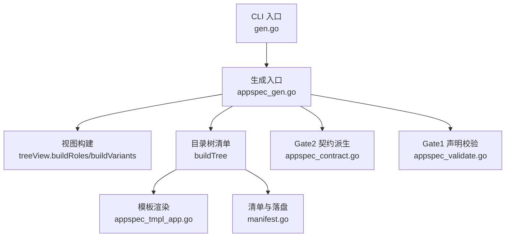
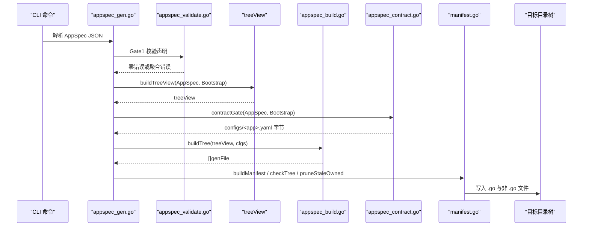
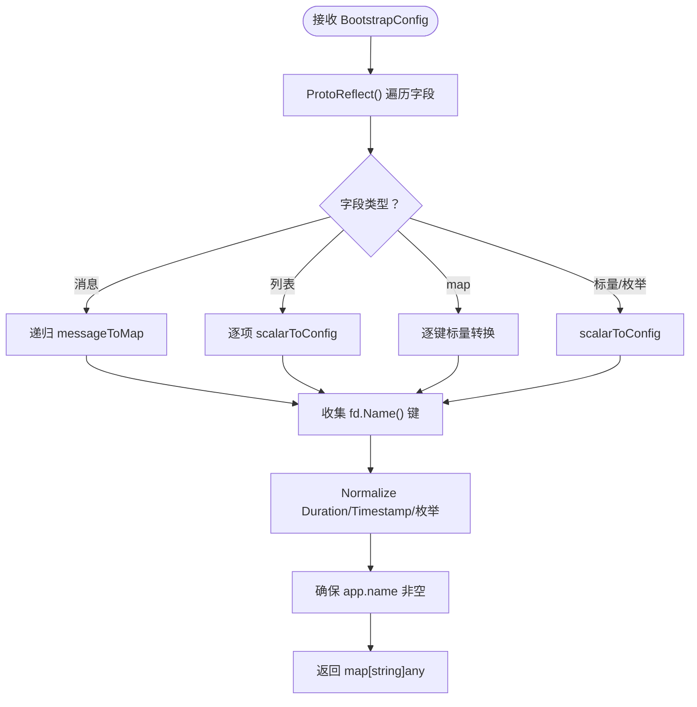
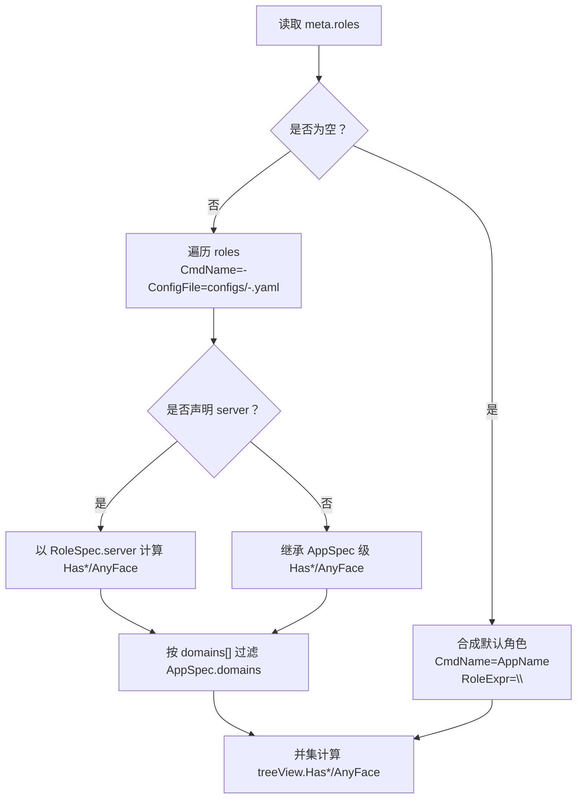
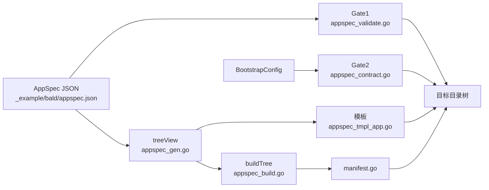

# AppSpec 生成

<cite>
**本文引用的文件**   
- [appspec_gen.go](file://internal/codegen/appspec_gen.go)
- [appspec_build.go](file://internal/codegen/appspec_build.go)
- [appspec_contract.go](file://internal/codegen/appspec_contract.go)
- [appspec_tmpl_app.go](file://internal/codegen/appspec_tmpl_app.go)
- [manifest.go](file://internal/codegen/manifest.go)
- [appspec_validate.go](file://internal/codegen/appspec_validate.go)
- [gen.go](file://internal/codegen/gen.go)
- [appspec.json](file://_example/bald/appspec.json)
- [bald-demo-api.yaml](file://_example/bald/configs/bald-demo-api.yaml)
</cite>

## 目录
1. [简介](#简介)
2. [项目结构](#项目结构)
3. [核心组件](#核心组件)
4. [架构总览](#架构总览)
5. [详细组件分析](#详细组件分析)
6. [依赖分析](#依赖分析)
7. [性能考虑](#性能考虑)
8. [故障排查指南](#故障排查指南)
9. [结论](#结论)

## 简介
`bald gen app --spec` 的目标是：以 `AppSpec`（`bconf` 下的 `bald/appspec/v1`）为唯一声明真相源，生成应用骨架目录树，并派生 Gate2 契约配置 `configs/<app>.yaml`。单角色场景下，生成器产出 **15 个落盘项**：10 个由模板渲染的生成物 + 5 个“生成一次”的种子文件；`configs/<app>.yaml` 由 `AppSpec.bootstrap` 经协议反射派生追加，不在模板中硬编码任何配置键。

本仓库是 93 个 Go module 的多模块工程，`internal/codegen` 仅承载生成期逻辑，不引入业务后端；真正的传输面实现位于 `transport/*`、注册中心位于 `registry/*`，由运行时通过 `appkit` 与 `bootstrap` 装配。

## 项目结构
`internal/codegen` 内围绕 `--spec` 的职责拆分如下：

| 文件 | 职责 |
|---|---|
| `appspec_gen.go` | `treeView` 视图构建、变体与角色派生、模板函数集 |
| `appspec_build.go` | 目标目录树清单组装与落盘分发 |
| `appspec_contract.go` | Gate2：`AppSpec.bootstrap` → YAML 配置树校验与渲染 |
| `appspec_tmpl_app.go` | 应用层模板（main / command / assemble / health / gateway） |
| `manifest.go` | 生成清单、脏净判定、陈旧产物清理 |
| `appspec_validate.go` | Gate1：schema、kind 白名单、能力子集、域与角色校验 |
| `gen.go` | CLI 脚手架入口，挂载 `gen app` 等子命令 |



**图示来源**
- [gen.go:1-30](file://internal/codegen/gen.go#L1-L30)
- [appspec_gen.go:1-40](file://internal/codegen/appspec_gen.go#L1-L40)
- [appspec_build.go:1-30](file://internal/codegen/appspec_build.go#L1-L30)
- [appspec_contract.go:1-25](file://internal/codegen/appspec_contract.go#L1-L25)
- [appspec_validate.go:1-20](file://internal/codegen/appspec_validate.go#L1-L20)

**章节来源**
- [gen.go:1-30](file://internal/codegen/gen.go#L1-L30)
- [appspec_gen.go:1-40](file://internal/codegen/appspec_gen.go#L1-L40)

## 核心组件

### treeView：原始声明与派生值的分界
`treeView` 是模板共享数据，其字段明确区分两类值：

| 类别 | 字段 | 含义 |
|---|---|---|
| 原始声明 | `Spec` | `*appspecv1.AppSpec`，模板直接消费，无手工转写层 |
| 派生值 | `Bootstrap` | `*bootstrapv1.BootstrapConfig`，作为 Gate2 的唯一真相源 |
| 元信息 | `Module`、`AppName`、`Desc`、`APIDir`、`APIPkg`、`ConfigFile` | 来自 `meta` 与 `layout` |
| 布尔标志 | `HasHTTP`、`HasGRPC`、`HasGateway`、`AnyFace`、`Strict` | 由 `server.http`/`server.grpc`/`driver=grpc-gateway` 与 `layout.strict_contract` 推导 |
| 变体维度 | `Variants`、`HasVariants`、`Variant` | 由 `AppSpec.variants` 归一化 |
| 角色维度 | `Roles`、`MultiRole`、`CmdName`、`RoleName`、`RoleExpr` | 由 `meta.roles` 或默认单角色合成 |
| 构建期标志 | `HasComponents` | 全局组件或任一变体有组件增量时启用 |

`buildTreeView` 在构造视图时完成三件事：
1. 从 `layout.apiserver_dir` 派生 `APIDir`/`APIPkg`，缺省 `apiserver`。
2. 基于 `Bootstrap.Server` 计算 `HasHTTP`、`HasGRPC`、`HasGateway`、`AnyFace`，其中网关是 HTTP 的一个 driver 取值，二者互斥。
3. 调用 `buildVariants` 与 `buildRoles` 填充变体与角色维度。

**章节来源**
- [appspec_gen.go:41-118](file://internal/codegen/appspec_gen.go#L41-L118)

### 目标目录树与 15 个落盘项
`buildTree` 按 `treeView` 组装 `genFile` 列表，再经 `emitTree` 写入磁盘。单角色（且未声明变体）的典型输出如下：

| 序号 | 路径 | 归属 | 说明 |
|---|---|---|---|
| 1 | `cmd/<app>/main.go` | owned | 唯一 `package main`，转发到 `app.Execute` |
| 2 | `cmd/<app>/app/command.go` | owned | 根命令装配入口 |
| 3 | `cmd/<app>/app/custom.go` | seeded | 自定义接线扩展点，生成一次 |
| 4 | `internal/bootstrap/assemble.gen.go` | owned | 唯一 `Options()` 装配投影 |
| 5 | `internal/bootstrap/domains.gen.go` | owned | 域清单装配（与 `gen domain` 共写） |
| 6 | `internal/bootstrap/custom.go` | seeded | Bootstrap 钩子扩展点，生成一次 |
| 7 | `internal/bootstrap/seed/seed.go` | seeded | 种子数据入口，生成一次 |
| 8 | `internal/bootstrap/seed/policies.go` | seeded | 种子策略，生成一次 |
| 9 | `internal/apiserver/layering_invariant_test.go` | owned | 分层不变量测试 |
| 10 | `api/buf.yaml` | seeded | buf 流水线起点，生成一次 |
| 11 | `api/buf.gen.yaml` | seeded | buf 代码生成起点，生成一次 |
| 12 | `taskfile.yml` | owned | 任务定义 |
| 13–15 | `configs/<app>.yaml` | owned | Gate2 派生契约配置（每角色一份） |

可变项：
- 若声明 `variants`，额外生成 `internal/bootstrap/variants.gen.go` 与每个变体的 `variant_<name>.gen.go`。
- 若 `HasHTTP`，额外 seed `internal/apiserver/apiserver.go`。
- 多角色时每角色重复 cmd 目录项与 configs 项。

**章节来源**
- [appspec_build.go:12-128](file://internal/codegen/appspec_build.go#L12-L128)

## 架构总览
`gen app --spec` 的端到端流程如下：



**图示来源**
- [appspec_gen.go:119-180](file://internal/codegen/appspec_gen.go#L119-L180)
- [appspec_validate.go:130-180](file://internal/codegen/appspec_validate.go#L130-L180)
- [appspec_contract.go:120-200](file://internal/codegen/appspec_contract.go#L120-L200)
- [appspec_build.go:12-128](file://internal/codegen/appspec_build.go#L12-L128)
- [manifest.go:80-150](file://internal/codegen/manifest.go#L80-L150)

## 详细组件分析

### 1. treeView 构建过程

#### 1.1 原始声明与派生值的分离
模板直接消费 `*appspecv1.AppSpec`，避免“proto 字段名 ↔ 模板字段名”的双写；而 `Bootstrap` 字段只用于 Gate2 和布尔标志计算，模板本身不直接读取它。这样新增一个 `bootstrap` 段时，只需保证 `messageToMap` 能遍历该消息类型，无需改模板。

#### 1.2 Bootstrap 配置的反射访问
`contractTree` 对 `bootstrapv1.BootstrapConfig` 调用 `ProtoReflect()`，递归遍历所有已出现字段：
- 键取 `fd.Name()`（proto 字段名），不是 JSON 驼峰。
- 消息型字段递归；`Duration`/`Timestamp` 转为字符串字面量；枚举按名称序列化。
- 未设置字段跳过，空消息对象保留为空对象而非 `null`，以表达“段存在即开通”。
- 最后补上 `app.name`：优先用 `AppSpec.meta.name`，否则回退到 `Bootstrap.app.name`。



**图示来源**
- [appspec_contract.go:26-118](file://internal/codegen/appspec_contract.go#L26-L118)

**章节来源**
- [appspec_contract.go:1-118](file://internal/codegen/appspec_contract.go#L1-L118)

#### 1.3 HasHTTP / HasGRPC / HasGateway 计算
规则如下：
- 若 `server.http.driver == "grpc-gateway"`，则 `HasGateway = true`，`HasHTTP = false`。
- 若 `server.http` 非 nil 且不是网关驱动，则 `HasHTTP = true`。
- 若 `server.grpc` 非 nil，则 `HasGRPC = true`。
- `AnyFace = HasHTTP || HasGRPC || HasGateway`。
- 多角色时，每个角色的 `server` 覆盖 AppSpec 级投影；最终 `treeView` 的三标志是各角色标志的并集，用于决定共享文件是否需要导入 HTTP/gRPC 相关包。

**章节来源**
- [appspec_gen.go:96-118](file://internal/codegen/appspec_gen.go#L96-L118)
- [appspec_gen.go:201-250](file://internal/codegen/appspec_gen.go#L201-L250)

### 2. 变体系统

#### 2.1 variantSlot 结构与 when 表达式
每个 `AppSpec.variants` 条目被映射为 `variantSlot`：
- `Name`：变体标识，正则限制为小写字母开头、含字母数字下划线。
- `When`：Go 构建约束表达式。若显式 `when` 为空，则把 `build_tags` 列表用 ` && ` 连接。
- `BuildLine`：`//go:build ` + `When`，直接写入变体实现文件头。
- `Detail`：人读诊断，未提供描述时自动生成包含 when 的说明。
- `Components`、`Patches`：命中时才生效的增量声明。

```mermaid
flowchart TD
    VStart["遍历 AppSpec.variants"] --> WhenCheck{"when 是否为空？"}
    WhenCheck -->|是| UseTags["when = build_tags 用 && 连接"]
    WhenCheck -->|否| KeepWhen["使用显式 when"]
    UseTags --> BuildLine["BuildLine = \"//go:build \" + when"]
    KeepWhen --> BuildLine
    BuildLine --> Effects["提取 Components/Patches"]
    Effects --> VEnd["追加 variantSlot"]
```

**图示来源**
- [appspec_gen.go:119-150](file://internal/codegen/appspec_gen.go#L119-L150)
- [appspec_validate.go:50-80](file://internal/codegen/appspec_validate.go#L50-L80)

#### 2.2 //go:build 指令与实现文件
当 `HasVariants` 为真时：
- 生成 `internal/bootstrap/variants.gen.go`，汇总各变体的 `variantOptions`。
- 每个变体生成 `internal/bootstrap/variant_<name>.gen.go`，头部带 `//go:build <when>`。
- 变体声明恒进计划，但只有命中时编译进实现，从而做到“声明与命中增量同源”。

**章节来源**
- [appspec_gen.go:119-150](file://internal/codegen/appspec_gen.go#L119-L150)
- [appspec_build.go:40-70](file://internal/codegen/appspec_build.go#L40-L70)

### 3. 角色系统

#### 3.1 roleSlot 结构
| 字段 | 含义 |
|---|---|
| `Name` | `meta.roles[].name` |
| `GoName` | 角色名转 Go 标识片段，如 `api` → `Api`，用于 `domainOptions<GoName>` |
| `CmdName` | 多角色为 `<app>-<role>`，单角色为 `<app>` |
| `ConfigFile` | 多角色为 `configs/<app>-<role>.yaml`，单角色为 `configs/<app>.yaml` |
| `Domains` | 从 `AppSpec.domains` 按角色 `domains[]` 过滤后的声明序切片 |
| `HasHTTP` / `HasGRPC` / `HasGateway` / `AnyFace` | 以角色 `server` 为准，未声明则继承 AppSpec 级投影 |

#### 3.2 单角色与多角色分支
- 若 `meta.roles` 为空：合成一个默认角色，`CmdName == AppName`，`RoleExpr = ""`，`Domains` 为全部域。这是为了保持单角色生成物与引入角色前的字节一致性。
- 若 `meta.roles` 非空：`MultiRole = true`，`RoleExpr = "role"`，每个角色一份 cmd 目录与契约文件。
- `Assemble` 模板根据 `MultiRole` 选择 `Options()` 或 `Options(role string)`，并在多角色分支里按角色注入传输面、健康检查与域清单。



**图示来源**
- [appspec_gen.go:151-250](file://internal/codegen/appspec_gen.go#L151-L250)

**章节来源**
- [appspec_gen.go:151-250](file://internal/codegen/appspec_gen.go#L151-L250)

### 4. 钩子扩展点与 customOptions

#### 4.1 seeded 钩子
生成器维护两类 seeded 钩子：
- `internal/bootstrap/custom.go`：Bootstrap 阶段的扩展点。
- `cmd/<app>/app/custom.go`：应用命令层的扩展点。

它们都是 seeded 归属：生成一次后归用户维护，后续 `--check` 只判存在性，内容差异不被视为脏。

#### 4.2 customOptions 的实参表达式
`RoleExpr` 在多角色时为变量名 `role`，单角色时空串字面量。模板在 `assemble.gen.go` 末尾追加：
```text
opts = append(opts, customOptions({{ .RoleExpr }})...)
```
这使得两种形态共用同一签名：用户手写 `customOptions(role string)` 即可同时兼容单角色与多角色，生成器只做拼装，不解释业务装配语义。

**章节来源**
- [appspec_build.go:30-40](file://internal/codegen/appspec_build.go#L30-L40)
- [appspec_tmpl_app.go:240-303](file://internal/codegen/appspec_tmpl_app.go#L240-L303)

### 5. 生成物所有权与依赖解析

#### 5.1 所有权三态
| 状态 | 行为 |
|---|---|
| `owned` | 严格受控：`--check` 要求字节一致，`--adopt` 覆盖 |
| `seeded` | 播种一次后归用户：`--check` 只判存在性，`--adopt` 不覆盖 |
| `user` | 完全由用户管理，不参与生成清单 |

`manifest.go` 记录每次生成的 spec 摘要、每个非 user 文件的归属与哈希；`--check` 会列出 missing/out-of-date/stale 三类差异，`--adopt` 还会删除上次记为 owned 但本次不再产出的旧文件。

#### 5.2 依赖解析
- 域 import 别名由 `domainAlias` 取包基名清洗得到，冲突由 Gate1 拒绝。
- 域服务全名由 `domainServices` 按 `services[]` 优先、`service` 次之、`http_only` 为空的原则解析。
- 组件 kind 由 `componentKinds` 白名单控制，目前仅 `heartbeat`，其余在运行期 panic 兜底。

**章节来源**
- [manifest.go:1-120](file://internal/codegen/manifest.go#L1-L120)
- [appspec_gen.go:251-286](file://internal/codegen/appspec_gen.go#L251-L286)
- [appspec_validate.go:20-48](file://internal/codegen/appspec_validate.go#L20-L48)
- [appspec_validate.go:80-129](file://internal/codegen/appspec_validate.go#L80-L129)

### 6. 与 bootstrap 配置的同步机制

#### 6.1 Gate2 全流程
`contractGate` 执行四步：
1. 从 `BootstrapConfig` 反射派生配置树。
2. 用 `FindUnknownKeys` 校验键属于 bconf 契约。
3. YAML 序列化。
4. 反序列化回读并重验键——作为回归锁，防止生成器绕过描述符写出未知键。

#### 6.2 示例对照
`_example/bald/appspec.json` 中的 `bootstrap` 段包括 `app`、`logger`、`database.sql`、`registry.nacos`；生成的 `bald-demo-api.yaml` 与之同构，键由 proto 字段名派生，`stop_timeout` 由 `Duration` 转为字符串。

**章节来源**
- [appspec_contract.go:120-200](file://internal/codegen/appspec_contract.go#L120-L200)
- [appspec.json:1-81](file://_example/bald/appspec.json#L1-L81)
- [bald-demo-api.yaml:1-29](file://_example/bald/configs/bald-demo-api.yaml#L1-L29)

## 依赖分析



**图示来源**
- [appspec_validate.go:130-200](file://internal/codegen/appspec_validate.go#L130-L200)
- [appspec_contract.go:120-200](file://internal/codegen/appspec_contract.go#L120-L200)
- [appspec_gen.go:119-250](file://internal/codegen/appspec_gen.go#L119-L250)
- [appspec_build.go:12-128](file://internal/codegen/appspec_build.go#L12-L128)
- [appspec_tmpl_app.go:1-303](file://internal/codegen/appspec_tmpl_app.go#L1-L303)
- [manifest.go:80-200](file://internal/codegen/manifest.go#L80-L200)

**章节来源**
- [appspec_gen.go:119-250](file://internal/codegen/appspec_gen.go#L119-L250)
- [appspec_build.go:12-128](file://internal/codegen/appspec_build.go#L12-L128)
- [manifest.go:80-200](file://internal/codegen/manifest.go#L80-L200)

## 性能考虑
- 生成期主要开销在模板解析与 Protobuf 反射遍历；`messageToMap` 仅遍历已设置字段，proto3 零值不会进入配置树。
- `--check` 走内存重算路径，零写入，适合 CI 门禁；`--adopt` 才做磁盘覆盖与删除。
- `.go` 文件先 `go/format.Source`，失败时写 `.rej` 不触碰目标，避免污染工作区。
- 清单按路径排序，保证跨平台稳定；`staleOwned` 仅在 manifest 版本匹配时比较，版本不一致整体跳过以避免误删。

[本节为通用指导，不直接分析具体文件]

## 故障排查指南

| 现象 | 可能原因 | 排查建议 |
|---|---|---|
| `gen app --spec` 报 unknown component kind | `components[*].kind` 不在白名单 | 检查 `appspec_validate.go` 中 `componentKinds` |
| capability requires 未满足 | `capability.requires[].caps` 不是 `provides` 的子集 | 检查 Gate1 的能力子集校验 |
| 多角色时报未知角色 | `Options(role)` default 分支返回 nil | 确认传入角色名与 `meta.roles[].name` 一致 |
| `--check` 报 stale owned 文件 | 某次生成后删除了受控文件但未 `--adopt` | 重新生成或运行 `--adopt` 清理 |
| `--check` 报 seeded 文件缺失 | `custom.go`/`seed.go` 等种子文件被删除 | 重新运行 `gen app --spec` 播种 |
| 契约配置键报错 | 生成器绕过了描述符写了裸键 | 检查是否新增配置写入路径，应走 `messageToMap` |
| 单角色生成物与引入前不一致 | 未保留默认单角色分支 | 检查 `buildRoles` 默认角色合成逻辑 |
| 变体实现未编译 | `when` 表达式语法错误或 tag 不匹配 | 检查 `build_tags` 与 `when` 归一结果 |

**章节来源**
- [appspec_validate.go:130-200](file://internal/codegen/appspec_validate.go#L130-L200)
- [manifest.go:120-200](file://internal/codegen/manifest.go#L120-L200)
- [appspec_gen.go:151-250](file://internal/codegen/appspec_gen.go#L151-L250)

## 结论
`bald gen app --spec` 的核心设计是“声明驱动、反射派生、模板装配、清单守护”：
- `AppSpec` 是唯一声明真相源，模板直接消费原始结构，避免双写。
- `BootstrapConfig` 通过 Protobuf 反射派生 Gate2 契约配置，键错不了、漏不了。
- `treeView` 把原始声明与派生布尔标志、变体槽位、角色槽位清晰分离。
- 变体系统用 `when`/`build_tags` 归一为单一 `//go:build` 表达式，实现声明与命中增量同源。
- 角色系统以默认单角色分支保证向后兼容，多角色按 cmd 与 configs 扇出。
- 钩子扩展点（bootstrap/custom.go、cmd/*/app/custom.go）采用 seeded 机制，生成器不覆盖用户接线。
- 清单系统使“生成物最新”可判定，支持 `--check` 与 `--adopt` 两档运维动作。