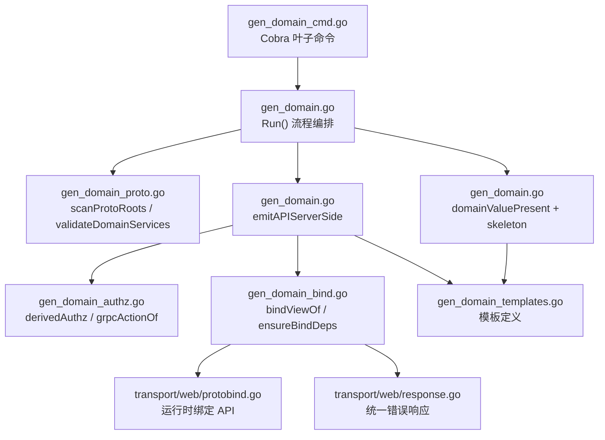
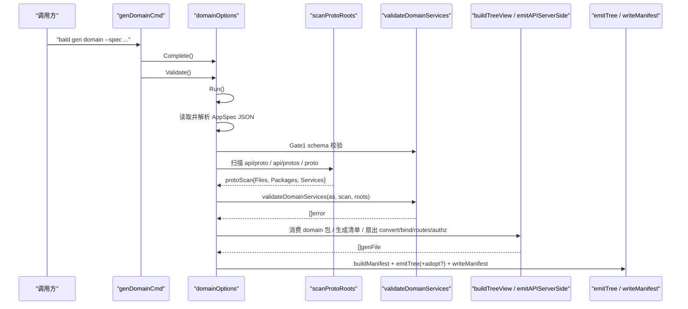
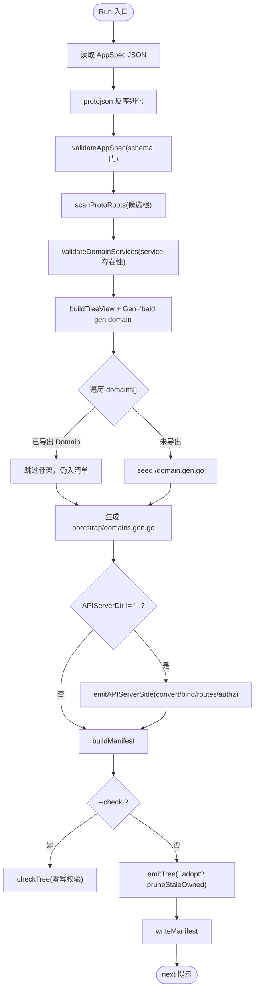
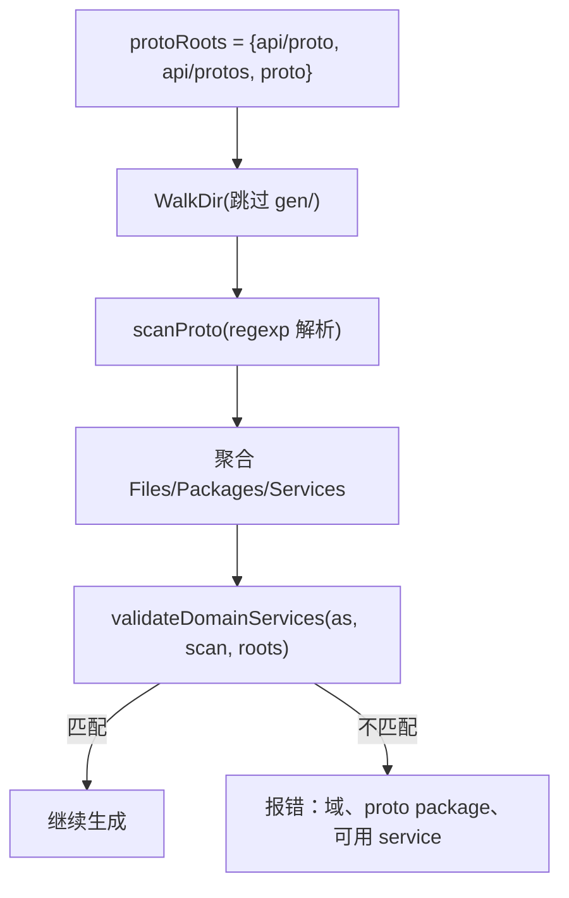
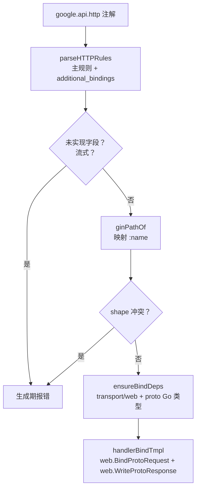
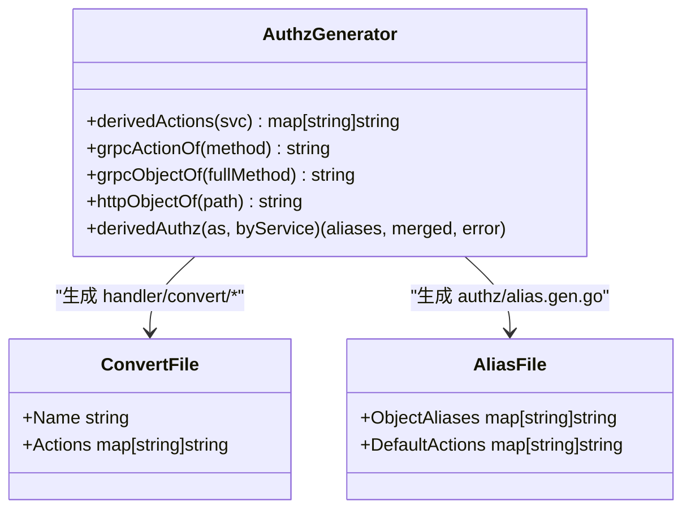
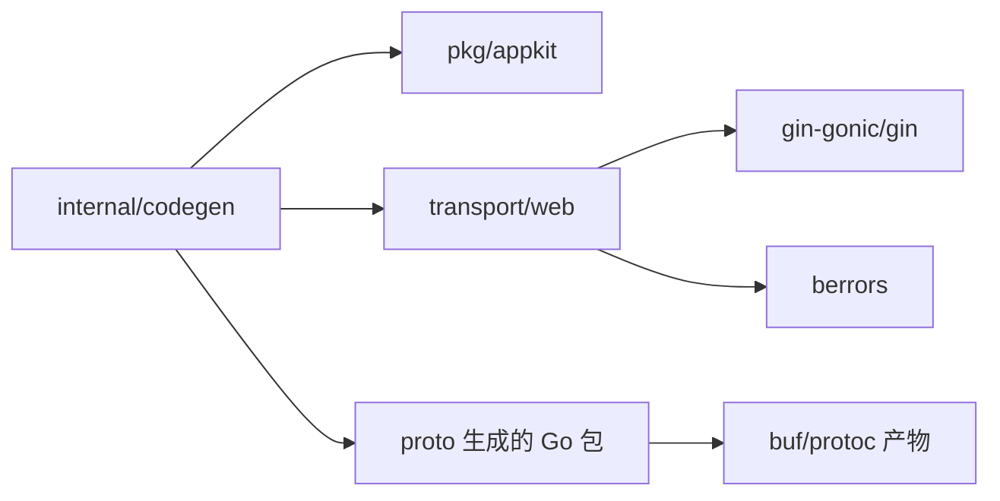

# Domain 生成

<cite>
**本文引用的文件**   
- [gen_domain_cmd.go](file://internal/codegen/gen_domain_cmd.go)
- [gen_domain.go](file://internal/codegen/gen_domain.go)
- [gen_domain_proto.go](file://internal/codegen/gen_domain_proto.go)
- [gen_domain_bind.go](file://internal/codegen/gen_domain_bind.go)
- [gen_domain_authz.go](file://internal/codegen/gen_domain_authz.go)
- [gen_domain_templates.go](file://internal/codegen/gen_domain_templates.go)
- [appspec_build.go](file://internal/codegen/appspec_build.go)
- [appspec_tmpl_domain.go](file://internal/codegen/appspec_tmpl_domain.go)
- [protobind.go](file://transport/web/protobind.go)
- [response.go](file://transport/web/response.go)
- [authz.go](file://pkg/authz/authz.go)
</cite>

## 目录

1. [引言](#引言)
2. [项目结构](#项目结构)
3. [核心组件](#核心组件)
4. [架构总览](#架构总览)
5. [详细组件分析](#详细组件分析)
6. [依赖关系分析](#依赖关系分析)
7. [性能与确定性](#性能与确定性)
8. [故障排查指南](#故障排查指南)
9. [结论](#结论)
10. [附录：选项行为对照](#附录选项行为对照)

## 引言

`bald gen domain` 是 Bald 框架的领域驱动代码生成器。它不直接装配业务逻辑，而是以 `AppSpec.domains[]` 为唯一声明真相源，消费既有 proto 契约与域包，重写一套“生成即被引擎消费”的文件：

- **domains.gen.go**：域清单聚合，把各域 `go_package` 引入并把 `Domain` 值变参传给 `appkit.MustServe`。
- **handler/convert/<d>.gen.go**：按 RPC 名投影授权动作（Delete→delete、List→list、Create/Update/Set/Put→write、其余→get）。
- **authz/alias.gen.go**：gRPC 与 HTTP 面 object 归一化别名表，以及逐域动作聚合入口。
- **<go_package>/domain.gen.go**：域声明值骨架，仅当域包尚未导出 `Domain` 时生成一次。
- **handler/gin/<d>.bind.gen.go**：从 `google.api.http` 注解派生的 gin 绑定，使用 `web.BindProtoRequest` 与 `web.WriteProtoResponse`。
- **routes/<d>.gen.go**：同批注解的 `appkit.Route` 清单，供域通过 `RouteTable: routes.<Name>` 获得计划可见性。

该命令默认开启绑定与路由清单；`--no-bind` 跳过 REST 面派生，`--no-routes` 保留手写 `RouteTable`，`--adopt` 覆盖已标记 owned 的旧产物，`--check` 只校验不写盘。

**本节来源**
- [gen_domain_cmd.go:8-68](file://internal/codegen/gen_domain_cmd.go#L8-L68)
- [gen_domain.go:1-120](file://internal/codegen/gen_domain.go#L1-L120)

## 项目结构

`gen domain` 的实现集中在 `internal/codegen` 下，按职责拆分：

**图表来源**
- [gen_domain_cmd.go:8-68](file://internal/codegen/gen_domain_cmd.go#L8-L68)
- [gen_domain.go:120-201](file://internal/codegen/gen_domain.go#L120-L201)
- [gen_domain_proto.go:240-360](file://internal/codegen/gen_domain_proto.go#L240-L360)
- [gen_domain_bind.go:1-180](file://internal/codegen/gen_domain_bind.go#L1-L180)
- [gen_domain_authz.go:1-145](file://internal/codegen/gen_domain_authz.go#L1-L145)
- [gen_domain_templates.go:1-185](file://internal/codegen/gen_domain_templates.go#L1-L185)

**本节来源**
- [gen_domain.go:1-120](file://internal/codegen/gen_domain.go#L1-L120)
- [gen_domain_templates.go:1-185](file://internal/codegen/gen_domain_templates.go#L1-L185)

## 核心组件

| 组件 | 职责 | 关键输出或接口 |
|---|---|---|
| `domainOptions` | 解析 `--spec/--out/--manifest/--apiserver-dir/--adopt/--check/--no-bind/--no-routes/--proto-cmd`，完成、校验并执行 | `Complete()` → `Validate()` → `Run()` |
| 扫描器 | 正则解析 `.proto` 源码，提取 package/go_package/service/rpc/http 注解 | `scanProtoRoots()`、`validateDomainServices()` |
| 绑定视图构建器 | 从 service/method 推导 Gin 路由、请求类型、路径变量、冲突检测 | `bindViewOf()`、`ginPathOf()` |
| 授权投影器 | 与 `pkg/authz.DefaultGRPCAction` 同源规则投影 action，合并 object 别名 | `grpcActionOf()`、`grpcObjectOf()`、`httpObjectOf()` |
| 模板渲染器 | 输出 domains.gen.go、convert/*.gen.go、gin/*.bind.gen.go、routes/*.gen.go、authz/alias.gen.go | `bootstrapDomainsTmpl`、`handlerConvertTmpl`、`handlerBindTmpl`、`routesTableTmpl`、`authzAliasTmpl` |
| 前置保障器 | 确保 `transport/web` 依赖存在且 proto Go 类型已生成 | `ensureBindDeps()`、`runProtoStage()` |

**本节来源**
- [gen_domain.go:34-120](file://internal/codegen/gen_domain.go#L34-L120)
- [gen_domain_proto.go:240-481](file://internal/codegen/gen_domain_proto.go#L240-L481)
- [gen_domain_bind.go:1-180](file://internal/codegen/gen_domain_bind.go#L1-L180)
- [gen_domain_authz.go:1-145](file://internal/codegen/gen_domain_authz.go#L1-L145)

## 架构总览

`gen domain` 的执行流是门控式流水线：先读 AppSpec，再做 Gate1 schema 校验，再扫描 proto 并校验 service 存在性，然后生成骨架与清单，最后扇出 apiserver 侧产物并写入 manifest。

**图表来源**
- [gen_domain_cmd.go:24-68](file://internal/codegen/gen_domain_cmd.go#L24-L68)
- [gen_domain.go:120-201](file://internal/codegen/gen_domain.go#L120-L201)
- [gen_domain_proto.go:240-360](file://internal/codegen/gen_domain_proto.go#L240-L360)

**本节来源**
- [gen_domain_cmd.go:8-68](file://internal/codegen/gen_domain_cmd.go#L8-L68)
- [gen_domain.go:120-201](file://internal/codegen/gen_domain.go#L120-L201)

## 详细组件分析

### 子命令与选项语义

`gen domain` 是一个 Cobra 叶子命令，其 Long 说明本身即用户手册：domains[] 是唯一真相源，新增域不改变已有装配文件的 import 树。

| 选项 | 默认值 | 行为 |
|---|---:|---|
| `--spec` | 无（必填） | AppSpec JSON 路径，protojson 解析 |
| `--out` | `.` | 产出根 |
| `--manifest` | `internal/bootstrap/domains.gen.go` | 域清单落盘路径 |
| `--apiserver-dir` | layout.apiserver_dir 或 `apiserver`；传 `-` 跳过 apiserver 侧产物 | 控制 convert/gin/routes/authz 是否生成 |
| `--adopt` | false | 覆盖已存在的 owned 文件并清理陈旧 owned 产物 |
| `--check` | false | 零写入校验：生成物与清单必须与当前声明一致 |
| `--no-bind` | false | 跳过 google.api.http 注解派生的 gin 绑定与路由清单 |
| `--rest-bind` | false（已废弃） | 等价于不给；与 `--no-bind` 互斥 |
| `--no-routes` | false | 仅在绑定生成时生效；跳过 routes/<d>.gen.go，保留手写 RouteTable |
| `--proto-cmd` | `buf generate` | 缺失 proto Go 类型时在 `--out` 根执行的 shell 命令 |

`Validate()` 强制以下互斥与约束：

- `--adopt` 与 `--check` 互斥。
- `--rest-bind` 与 `--no-bind` 互斥。
- `--no-routes` 不能与 `--no-bind` 同时出现（因为路由清单只在绑定生成时产出）。

**本节来源**
- [gen_domain_cmd.go:8-68](file://internal/codegen/gen_domain_cmd.go#L8-L68)
- [gen_domain.go:34-119](file://internal/codegen/gen_domain.go#L34-L119)

### 运行主流程

`Run()` 的顺序是文档中最重要的事实线：

1. 读取 `--spec` 并用 protojson 反序列化为 `appspecv1.AppSpec`。
2. 执行 `validateAppSpec(as)`，Gate1 失败会带上字段定位信息。
3. 调用 `scanProtoRoots(o.OutDir)`，遍历候选根下的 `.proto` 源码。
4. 调用 `validateDomainServices(as, scan, roots)`，对每个非 http_only 域的 service/services 做存在性断言。
5. 用 `buildTreeView(as, contractBootstrap(as))` 构造模板视图，设置 `Gen = "bald gen domain"`。
6. 遍历 `as.GetDomains()`：若目标包已导出 `Domain` 则跳过骨架，否则在 `<go_package>/domain.gen.go` 中 seeded 一份骨架。
7. 生成清单 `internal/bootstrap/domains.gen.go`，与 `gen app` 共用同一模板与生成器标识。
8. 若 `APIServerDir != "-"`，调用 `emitAPIServerSide` 生成 convert、bind、routes、authz。
9. `buildManifest` 计算当前声明对应的清单哈希；`--check` 走 `checkTree`，否则 `emitTree` + 可选 `pruneStaleOwned` + `writeManifest`。

**图表来源**
- [gen_domain.go:120-201](file://internal/codegen/gen_domain.go#L120-L201)

**本节来源**
- [gen_domain.go:120-201](file://internal/codegen/gen_domain.go#L120-L201)

### Proto 扫描机制

`scanProtoRoots` 固定候选根为 `api/proto`、`api/protos`、`proto`；仅当目录存在时才扫描。递归时跳过名为 `gen` 的子目录，只处理 `.proto` 文件。单个 proto 由 `scanProto` 用正则解析：

- `package` 声明。
- `option go_package`。
- `service` 块。
- `rpc` 签名及 `stream` 方向。
- `google.api.http` braced 注解或点式注解 `(google.api.http).get/post/...`。
- `additional_bindings` 别名路径。
- 未实现注解字段 `custom`、`response_body`。

扫描结果 `protoScan` 包含：

| 字段 | 含义 | 复杂度 |
|---|---|---|
| `Files` | 解析后的 proto 文件列表 | O(N 文件) |
| `Packages` | 去重包名（保持声明序） | O(P) |
| `Services` | 扁平化的 service+method 列表 | O(M 方法) |

`validateDomainServices` 进一步要求：

- 非 http_only 域必须有 service/services。
- 每个 service 全名必须落在某个扫描到的 proto package 中。
- 报错需指明：哪个域、哪个 proto package、哪些 proto 文件、该 package 实际声明了哪些 service。

**图表来源**
- [gen_domain_proto.go:240-481](file://internal/codegen/gen_domain_proto.go#L240-L481)

**本节来源**
- [gen_domain_proto.go:240-481](file://internal/codegen/gen_domain_proto.go#L240-L481)

### REST 绑定生成

`bindViewOf` 是 REST 绑定的核心转换器。它对每个 service 的每个 method 执行：

1. 如果 method 带有 `Unsupported` 注解字段（`custom`、`response_body`），直接报错——避免生成的 REST 面与注解契约静默不一致。
2. 如果 method 是流式（任一方向含 `stream`），报错：gRPC 流无法转码为 REST。
3. 对每条 `google.api.http` 规则调用 `ginPathOf`，把 `{name}` 转为 gin 的 `:name`。
4. 将路径中的变量名去 `.`（如 `user.id` → `user_id`），并检测重复 gin 参数。
5. 对整域的路由 key 做 shape 冲突检查：`METHOD + 路径变量形状` 必须唯一，例如 `GET /v1/users/:id` 与 `GET /v1/users/:userId` 视为同一 shape。
6. 如果 service 没有 `option go_package`，报错：绑定需要导入 proto Go 类型。
7. 收集 proto Go 包 import，禁止同一 path 对应不同 alias。
8. 为 service 生成接口名（短名）和 Bind 函数名（去掉末尾 `Service` 后加 `Bind`），并防止多个 service 推导出同名 Binder。
9. 最终聚合出 `bindView.Services` 与 `bindView.Routes`。

生成的 gin 绑定模板调用：

- `web.BindProtoRequest(c, req, body, pathVars)`：按 `google.api.http` 语义把请求体、路径变量、查询参数注入 proto 消息。
- `svc.RPC(ctx, req)`：调用业务实现的 gRPC 风格接口。
- `web.WriteProtoResponse(c, resp, err)`：成功时用 protojson 编码，失败时走统一错误响应体。

`web.BindProtoRequest` 的关键行为：

- body 为空字符串表示无请求体。
- body 为 `*` 表示整个请求体作为消息根。
- 其他值表示嵌套字段路径（如 `user.name`），原始 JSON 会被包裹成 `{field:{...}}`。
- 路径变量优先于查询参数；body 覆盖的字段不再从查询参数回填。
- 未知查询参数忽略，已知字段转换失败返回 `berrors.BadRequest`。

`web.WriteProtoResponse` 的行为：

- 非 nil error 走 `ErrorResponse`，输出与 grpc-gateway 一致的 `google.rpc.Status` JSON 形状。
- 空响应（nil 或无效 proto message）只置 200。
- 正常响应使用 protojson 编码，Content-Type 为 `application/json; charset=utf-8`。

**图表来源**
- [gen_domain_bind.go:60-180](file://internal/codegen/gen_domain_bind.go#L60-L180)
- [gen_domain_templates.go:90-170](file://internal/codegen/gen_domain_templates.go#L90-L170)
- [protobind.go:20-120](file://transport/web/protobind.go#L20-L120)
- [response.go:1-107](file://transport/web/response.go#L1-L107)

**本节来源**
- [gen_domain_bind.go:1-180](file://internal/codegen/gen_domain_bind.go#L1-L180)
- [gen_domain_templates.go:90-170](file://internal/codegen/gen_domain_templates.go#L90-L170)
- [protobind.go:20-120](file://transport/web/protobind.go#L20-L120)
- [response.go:1-107](file://transport/web/response.go#L1-L107)

### 授权动作投影

授权投影分为两条线：

#### 1. handler/convert/<d>.gen.go：逐 RPC 动作

`derivedActions` 对每个 service 的每个 method 产生一个条目：

- Key：FullMethod，即 `package.Service/Method`，去首斜杠。
- Value：`grpcActionOf(method)`。

`grpcActionOf` 的规则与 `pkg/authz.DefaultGRPCAction` 同源：

| 方法前缀 | 投影动作 |
|---|---|
| `Delete` | `delete` |
| `List` | `list` |
| `Create`、`Update`、`Set`、`Put` | `write` |
| 其他 | `get` |

#### 2. authz/alias.gen.go：object 归一化别名

`grpcObjectOf(fullMethod)` 取 service 段，去掉末尾 `Service` 后小写。  
`httpObjectOf(path)` 取注解路径的首个资源段，跳过空段和 `v1`。

如果 gRPC 面与 HTTP 面的 object 名称不同，则写入 `ObjectAliases`；相同则不入表——这是为了避免冗余映射掩盖真实命名问题。

`DefaultActions` 是所有带 proto service 的域的 convert 动作表合并结果，供默认策略行与策略加载器对账。

**图表来源**
- [gen_domain_authz.go:1-145](file://internal/codegen/gen_domain_authz.go#L1-L145)
- [gen_domain_templates.go:150-185](file://internal/codegen/gen_domain_templates.go#L150-L185)

**本节来源**
- [gen_domain_authz.go:1-145](file://internal/codegen/gen_domain_authz.go#L1-L145)
- [gen_domain_templates.go:120-185](file://internal/codegen/gen_domain_templates.go#L120-L185)
- [authz.go:1-38](file://pkg/authz/authz.go#L1-L38)

### 生成的文件全集

| 文件 | 位置 | 生成条件 | 作用 |
|---|---|---|---|
| `internal/bootstrap/domains.gen.go` | 清单 | 所有非 http_only 域 | 聚合各域 `go_package.Domain`，与 `gen app` 共用模板 |
| `internal/<apiserver>/handler/convert/<d>.gen.go` | 授权投影 | 有 proto service 的域 | 逐 RPC 动作表，key=FullMethod 去首斜杠 |
| `internal/<apiserver>/authz/alias.gen.go` | 授权别名 | 有 proto service 的域 | object 别名表 + DefaultActions 聚合 |
| `<go_package>/domain.gen.go` | 域包 | 首次发现未导出 `Domain` | 骨架文件，生成一次后归用户维护 |
| `internal/<apiserver>/handler/gin/<d>.bind.gen.go` | REST 绑定 | 有 google.api.http 注解且未 `--no-bind` | gin 路由 + 请求绑定 + 响应编码 |
| `internal/<apiserver>/routes/<d>.gen.go` | 路由清单 | 有 google.api.http 注解且未 `--no-routes` | `appkit.Route` 数组，供 `RouteTable` 引用 |

清单模板 `bootstrapDomainsTmpl` 与 `gen app` 共用，因此生成器标识必须是 `"bald gen app, gen domain"`，保证两命令写出的字节一致，`--check` 不会互相判脏。

**本节来源**
- [gen_domain.go:1-120](file://internal/codegen/gen_domain.go#L1-L120)
- [appspec_tmpl_domain.go:1-200](file://internal/codegen/appspec_tmpl_domain.go#L1-L200)
- [gen_domain_templates.go:1-185](file://internal/codegen/gen_domain_templates.go#L1-L185)

### 选项差异对照

| 场景 | 行为 |
|---|---|
| 默认 | 生成骨架、清单、convert、gin 绑定、routes 清单、authz 别名 |
| `--no-bind` | 不生成 gin 绑定与 routes 清单；REST 面完全手写或由 proto 阶段负责 |
| `--no-routes` | 仅当绑定生成时生效；生成 bind 但不生成 routes 清单，保留手写 `RouteTable` |
| `--adopt` | 覆盖已标记 owned 的旧文件；删除上次生成但现在不在清单中的 owned 产物 |
| `--check` | 零写入；比较当前声明衍生的 manifest 与磁盘文件，差异即失败 |
| `--apiserver-dir=-` | 跳过 internal/apiserver 侧全部产物，适合非标准目录树宿主 |
| `--proto-cmd` | 替换缺失 proto Go 类型时的外部命令；shell 语义执行，不拆参数 |

**本节来源**
- [gen_domain_cmd.go:24-68](file://internal/codegen/gen_domain_cmd.go#L24-L68)
- [gen_domain.go:34-119](file://internal/codegen/gen_domain.go#L34-L119)
- [gen_domain_bind.go:200-334](file://internal/codegen/gen_domain_bind.go#L200-L334)

## 依赖关系分析

`gen domain` 自身只依赖 `internal/codegen` 内部模块；对外部产物的依赖是“约定 + 校验”，而不是编译期硬耦合：

- 清单模板引用 `github.com/kalandramo/bald/pkg/appkit`。
- gin 绑定模板引用 `github.com/gin-gonic/gin`、`github.com/kalandramo/bald/transport/web` 与各 proto Go 包。
- `--no-bind` 时不引入 transport/web。
- proto Go 类型包由 `--proto-cmd` 生成，生成器只在本地 module 下探测 `.go` 产物。

**图表来源**
- [gen_domain_templates.go:90-170](file://internal/codegen/gen_domain_templates.go#L90-L170)
- [gen_domain_bind.go:200-334](file://internal/codegen/gen_domain_bind.go#L200-L334)

**本节来源**
- [gen_domain_bind.go:200-334](file://internal/codegen/gen_domain_bind.go#L200-L334)
- [gen_domain_templates.go:90-170](file://internal/codegen/gen_domain_templates.go#L90-L170)

## 性能与确定性

- 扫描器使用正则而非 protobuf 编译器，时间复杂度近似 O(所有 proto 文本长度)，适合增量重构时快速反馈。
- `scanProtoRoots` 跳过 `gen/` 目录，避免重复解析 protoc 产物。
- `unsupportedAnnotationFields`、`dedupeSorted`、`seenRoute`、`seenBinder`、`imports` 等集合保证输出稳定，不依赖 map 遍历顺序。
- 清单模板生成器标识与 `gen app` 共享常量，避免同一文件在两命令下字节漂移。
- `--check` 不执行 `--proto-cmd`，满足零写承诺。
- `emitTree` 对 .go 文件先格式化，非 .go 文件走 guarded writer，减少不必要的覆盖。

**本节来源**
- [gen_domain_proto.go:240-481](file://internal/codegen/gen_domain_proto.go#L240-L481)
- [appspec_build.go:1-128](file://internal/codegen/appspec_build.go#L1-L128)
- [appspec_tmpl_domain.go:1-60](file://internal/codegen/appspec_tmpl_domain.go#L1-L60)

## 故障排查指南

| 现象 | 可能原因 | 排查步骤 |
|---|---|---|
| `--adopt and --check are mutually exclusive` | 同时传入两个互斥标志 | 二选一：`--adopt` 重写，`--check` 校验 |
| `--rest-bind and --no-bind are mutually exclusive` | 旧脚本同时打开兼容开关与逃生口 | 改用 `--no-bind`，不再使用 `--rest-bind` |
| `--no-routes only applies when bindings are generated` | 同时传 `--no-bind` 与 `--no-routes` | 删掉 `--no-bind`，或接受 no-routes 无效果 |
| `service is required` | 非 http_only 域没填 service/services | 填写 `service` 或 `services[]` |
| `proto package not found` | `domains[].service` 指向的 proto package 不在 `api/proto`/`api/protos`/`proto` | 确认 service 全名落在扫描根内 |
| `service ... not found in proto package` | service 名拼错或 package 切错 | 对照 proto 中实际 `package.Service` |
| `google.api.http field(s) custom,response_body` | 使用了绑定未实现的注解字段 | 手写这条 REST 路由，或改用已实现形态 |
| `streaming cannot be transcoded to REST` | 流式 RPC 配了 `google.api.http` | 移除注解，REST 面交给 SSE/WebSocket 等其他方案 |
| `gin cannot register two identical shapes` | 多条注解映射到同一 gin shape | 调整路径变量名或动词，使 shape 唯一 |
| `bindings import ... but ... does not require it` | module 未依赖 `transport/web` | 执行 `go get github.com/kalandramo/bald/transport/web` |
| `proto Go package ... missing` | proto 类型未生成 | 执行 `--proto-cmd` 或手动跑 proto 生成阶段 |
| `--check` 报差异 | 生成物与当前 AppSpec 不一致 | 先用 `--adopt` 重写，再用 `--check` 验证 |
| 清单字节不稳定 | 模板生成器标识或模板变更 | 确认使用共享 `domainsGenTag` |

**本节来源**
- [gen_domain.go:80-119](file://internal/codegen/gen_domain.go#L80-L119)
- [gen_domain_proto.go:300-481](file://internal/codegen/gen_domain_proto.go#L300-L481)
- [gen_domain_bind.go:60-180](file://internal/codegen/gen_domain_bind.go#L60-L180)
- [gen_domain_bind.go:200-334](file://internal/codegen/gen_domain_bind.go#L200-L334)

## 结论

`bald gen domain` 的设计重心不是“替你写业务”，而是“让 AppSpec.domains[] 成为可审计、可校验、可恢复的唯一真相源”。它把 proto 契约、授权动作、REST 绑定、路由清单和域清单解耦为多份生成物，每份都有明确的所有权标记（owned/seeded/skip）、明确的生成条件和明确的失效路径。

对于使用者而言，最关键的实践是：

1. 先在 proto 里写 service、rpc、`google.api.http` 注解。
2. 在 AppSpec 的 `domains[]` 登记 service 与 go_package。
3. 首次运行生成骨架；骨架生成后由你维护 `Domain` 的实际装配。
4. 默认保留 `--no-bind` 关闭状态，让注解成为 REST 面真相源。
5. 用 `--check` 锁定生成物一致性，用 `--adopt` 安全重写。
6. 需要计划可见性时，在域声明值里挂上 `RouteTable: routes.<Name>`。

**本节来源**
- [gen_domain_cmd.go:8-68](file://internal/codegen/gen_domain_cmd.go#L8-L68)
- [gen_domain.go:1-120](file://internal/codegen/gen_domain.go#L1-L120)

## 附录：选项行为对照

| 选项组合 | 生成清单 | 生成骨架 | 生成 convert | 生成 gin 绑定 | 生成 routes | 生成 authz |
|---|---:|---:|---:|---:|---:|---:|
| 默认 | ✅ | ✅（首次） | ✅ | ✅ | ✅ | ✅ |
| `--no-bind` | ✅ | ✅（首次） | ✅ | ❌ | ❌ | ✅ |
| `--no-routes` | ✅ | ✅（首次） | ✅ | ✅ | ❌ | ✅ |
| `--apiserver-dir=-` | ✅ | ✅（首次） | ❌ | ❌ | ❌ | ❌ |
| `--check` | 校验 | 校验 | 校验 | 校验 | 校验 | 校验 |
| `--adopt` | 覆盖 | 覆盖 | 覆盖 | 覆盖 | 覆盖 | 覆盖 |

**本节来源**
- [gen_domain_cmd.go:24-68](file://internal/codegen/gen_domain_cmd.go#L24-L68)
- [gen_domain.go:120-201](file://internal/codegen/gen_domain.go#L120-L201)
- [gen_domain_bind.go:200-334](file://internal/codegen/gen_domain_bind.go#L200-L334)