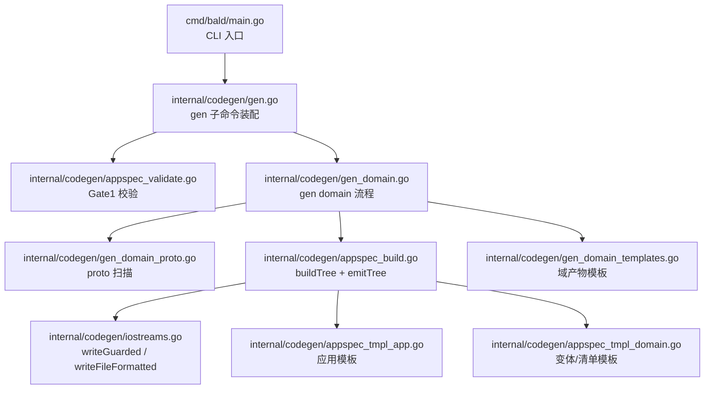
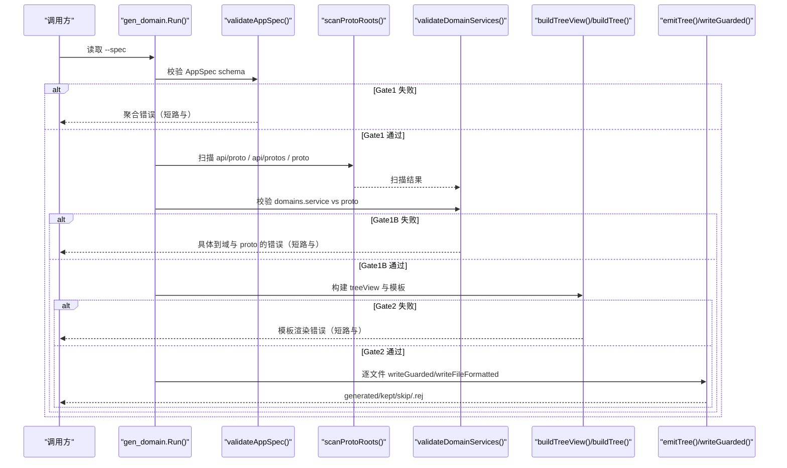
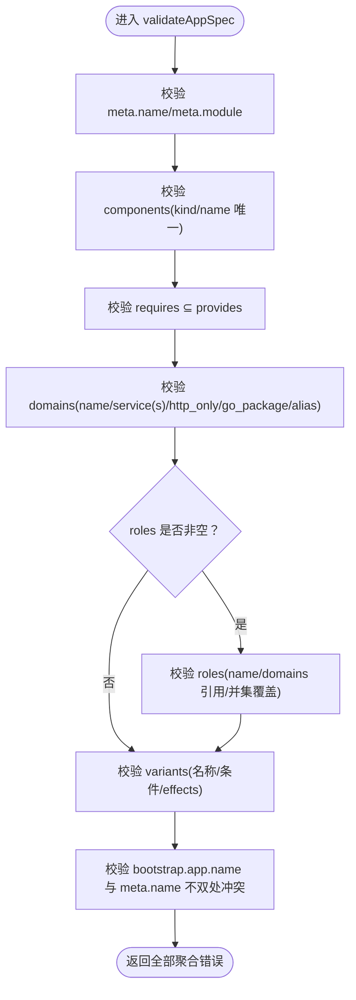
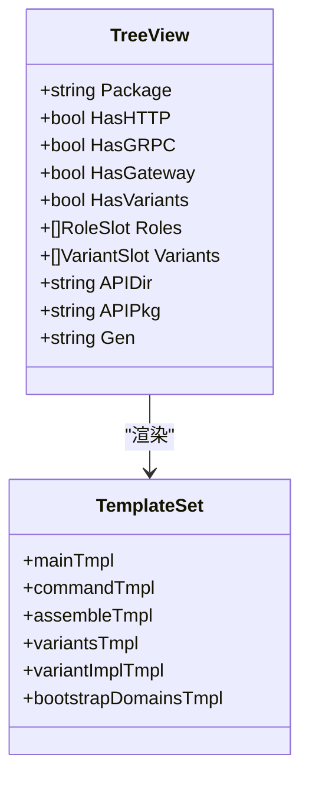
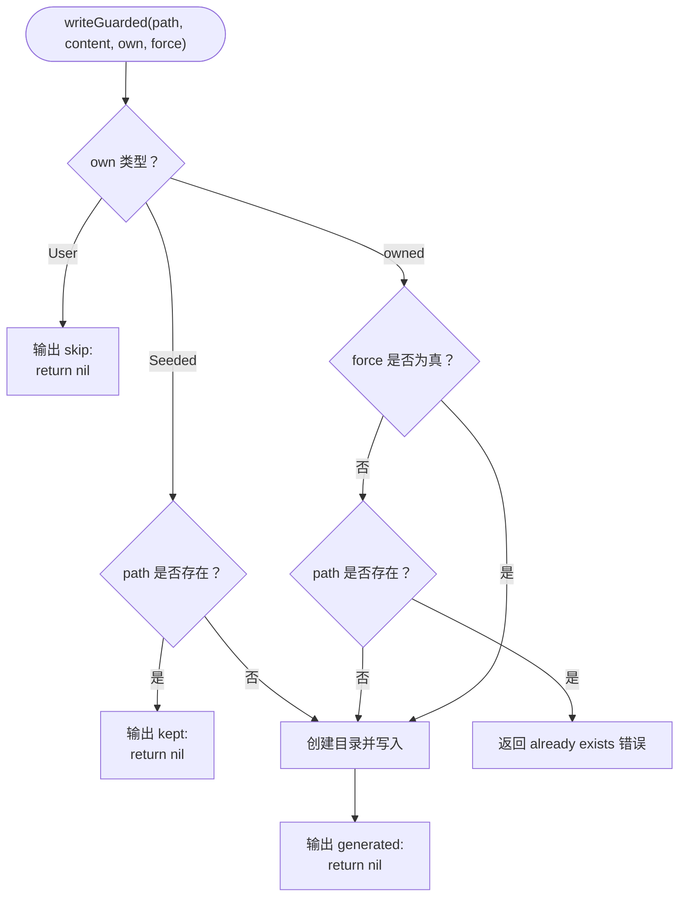
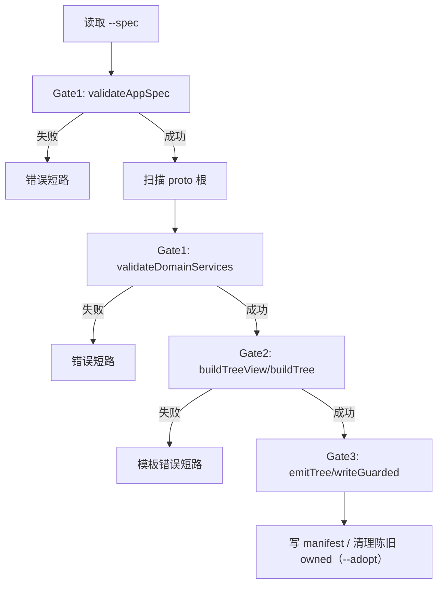
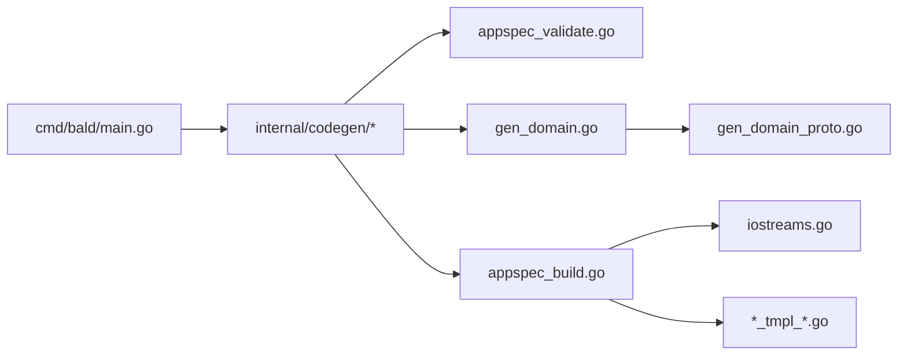

# 三段门机制

<cite>
**本文引用的文件**   
- [cmd/bald/main.go](file://cmd/bald/main.go)
- [internal/codegen/gen.go](file://internal/codegen/gen.go)
- [internal/codegen/appspec_validate.go](file://internal/codegen/appspec_validate.go)
- [internal/codegen/gen_domain.go](file://internal/codegen/gen_domain.go)
- [internal/codegen/gen_domain_proto.go](file://internal/codegen/gen_domain_proto.go)
- [internal/codegen/appspec_build.go](file://internal/codegen/appspec_build.go)
- [internal/codegen/iostreams.go](file://internal/codegen/iostreams.go)
- [internal/codegen/appspec_tmpl_app.go](file://internal/codegen/appspec_tmpl_app.go)
- [internal/codegen/appspec_tmpl_domain.go](file://internal/codegen/appspec_tmpl_domain.go)
- [internal/codegen/gen_domain_templates.go](file://internal/codegen/gen_domain_templates.go)
- [internal/codegen/guard_test.go](file://internal/codegen/guard_test.go)
</cite>

## 目录
1. [引言](#引言)
2. [项目结构](#项目结构)
3. [核心组件](#核心组件)
4. [架构总览](#架构总览)
5. [详细组件分析](#详细组件分析)
6. [依赖关系分析](#依赖关系分析)
7. [性能与可维护性](#性能与可维护性)
8. [故障排查指南](#故障排查指南)
9. [结论](#结论)

## 引言
本仓的 `bald` CLI 通过代码生成把「声明式 AppSpec」转成可编译的服务装配骨架。围绕这一过程，内部实现了三道门（Gate）：

- Gate1（AppSpec schema 校验）：在落盘前对 AppSpec 做结构化校验，并把 `domains[].service(s)` 与产出根下的实际 proto 文件进行存在性对账。
- Gate2（模板渲染阶段）：构建 `treeView`、反射派生 bootstrap 配置段、按变体与角色组装视图。
- Gate3（落盘阶段）：通过 `writeGuarded` 三态通道（Owned / Seeded / Skipped）保护用户文件，失败时输出 `.rej` 回退文件。

这三道门串行执行、失败短路；每层错误信息都指向具体的问题域——schema 字段、proto 服务、模板或磁盘写入。

## 项目结构
`bald` CLI 入口挂载 codegen 子命令，codegen 提供 `gen proto/store/app/domain` 四个叶子。三段门集中在 `internal/codegen` 中：

**图示来源**
- [cmd/bald/main.go:1-47](file://cmd/bald/main.go#L1-L47)
- [internal/codegen/gen.go:100-160](file://internal/codegen/gen.go#L100-L160)
- [internal/codegen/appspec_validate.go:1-40](file://internal/codegen/appspec_validate.go#L1-L40)
- [internal/codegen/gen_domain.go:1-40](file://internal/codegen/gen_domain.go#L1-L40)
- [internal/codegen/appspec_build.go:1-20](file://internal/codegen/appspec_build.go#L1-L20)
- [internal/codegen/iostreams.go:1-20](file://internal/codegen/iostreams.go#L1-L20)

**章节来源**
- [cmd/bald/main.go:1-47](file://cmd/bald/main.go#L1-L47)
- [internal/codegen/gen.go:1-40](file://internal/codegen/gen.go#L1-L40)

## 核心组件
- `validateAppSpec`：Gate1 主函数，聚合所有 AppSpec 违例并返回切片。
- `scanProtoRoots` / `validateDomainServices`：Gate1 强化部分，扫描候选 proto 根并对 `domains[].service(s)` 做存在性验证。
- `buildTreeView` / `buildTree`：Gate2 视图构建与目标树组装。
- `emitTree` / `writeGuarded` / `writeFileFormatted`：Gate3 落盘通道与归属守卫。
- 模板集合：应用装配模板、变体模板、域清单模板、域绑定/路由/授权模板。

**章节来源**
- [internal/codegen/appspec_validate.go:1-40](file://internal/codegen/appspec_validate.go#L1-L40)
- [internal/codegen/gen_domain.go:1-40](file://internal/codegen/gen_domain.go#L1-L40)
- [internal/codegen/appspec_build.go:1-20](file://internal/codegen/appspec_build.go#L1-L20)
- [internal/codegen/iostreams.go:30-106](file://internal/codegen/iostreams.go#L30-L106)

## 架构总览
三段门的执行顺序是严格的“先校验、再渲染、后落盘”：

**图示来源**
- [internal/codegen/gen_domain.go:120-201](file://internal/codegen/gen_domain.go#L120-L201)
- [internal/codegen/appspec_validate.go:80-160](file://internal/codegen/appspec_validate.go#L80-L160)
- [internal/codegen/gen_domain_proto.go:1-40](file://internal/codegen/gen_domain_proto.go#L1-L40)
- [internal/codegen/appspec_build.go:100-128](file://internal/codegen/appspec_build.go#L100-L128)
- [internal/codegen/iostreams.go:57-106](file://internal/codegen/iostreams.go#L57-L106)

## 详细组件分析

### Gate1：AppSpec schema 校验与 proto 存在性对账
Gate1 的职责是在任何文件落盘之前发现声明层面的问题。它由两部分组成：

1. **通用 schema 校验**（`validateAppSpec`）
   - 校验 `meta.name` / `meta.module` 必填。
   - 校验 `components[].kind` 在白名单内，且 name 全局唯一。
   - 校验 `capability.requires[].caps ⊆ capability.provides`。
   - 校验 `domains[]`：
     - name 非空且唯一。
     - service（单数）、services（复数）、http_only 三者互斥且至少满足其一。
     - services 每项非空、无首尾空白、去重，且短名（去掉 package 后缀）在同一域内唯一。
     - go_package 必填，且导入别名不冲突。
   - 校验 `meta.roles`（若非空）：
     - name 非空且唯一。
     - 每个 role.domains 引用已声明的域。
     - 各角色 domains 并集恰好等于 domains 全集。
   - 校验 `variants[]`：
     - name 合法正则、唯一。
     - when 与 build_tags 二选一；when 必须是单行 `go/build/constraint` 表达式；build_tags 每项是单个 tag。
     - variants.effects.components.kind 白名单与全局 components 共享；name 跨全局与变体唯一。
     - variants.effects.patches.path 非空、无空白、单行。
   - 校验 `bootstrap.app.name` 与 `meta.name` 不能两处同时声明不同值。

2. **domain.service 与 proto 文件的匹配校验**（`validateDomainServices`，配合 `scanProtoRoots`）
   - 候选根目录固定为 `api/proto`、`api/protos`、`proto`（相对产出根）。
   - 正则解析 proto 源码中的 package、service、rpc、google.api.http 注解与 go_package。
   - 对每个 domain 的有效 service 全名进行存在性检查；报错会指明哪个域的 service 在哪个 proto 里缺失，以及该 proto 实际声明了什么。

**图示来源**
- [internal/codegen/appspec_validate.go:80-502](file://internal/codegen/appspec_validate.go#L80-L502)

**章节来源**
- [internal/codegen/appspec_validate.go:1-40](file://internal/codegen/appspec_validate.go#L1-L40)
- [internal/codegen/appspec_validate.go:80-502](file://internal/codegen/appspec_validate.go#L80-L502)
- [internal/codegen/gen_domain_proto.go:1-40](file://internal/codegen/gen_domain_proto.go#L1-L40)
- [internal/codegen/gen_domain_proto.go:40-120](file://internal/codegen/gen_domain_proto.go#L40-L120)

### Gate2：模板渲染阶段
Gate2 的核心是 `treeView` 构建与模板渲染。

#### treeView 构建
- `buildTreeView` 从 AppSpec 与 contractBootstrap 投影构建视图对象，填充 `PackageName`、`HasHTTP`、`HasGRPC`、`HasGateway`、`HasVariants`、`Roles`、`Variants` 等标记。
- `contractBootstrap` 以 AppSpec.bootstrap 为唯一真相源；未声明时返回空配置，保证 Gate2 仍能派生默认键。

#### bootstrap 配置段的反射派生
- assemble 模板在 `appspec_tmpl_app.go` 中声明了 Options 装配链，包含标准 Provider、配置文件、StrictContract、gRPC/HTTP/Gateway 能力、健康检查、Capability、Components 等。
- 多角色分支通过 `Options(role string)` 选择传输面与域清单，未知角色启动期拒绝。
- 变体装配通过 `variants.gen.go` 与 `variant_<name>.gen.go` 实现：声明进计划，命中判断由 appkit 在运行期按构建约束求值。

#### 变体与角色的视图组装
- 每个角色一份 `cmd/<CmdName>/main.go` 与 `command.go`，以及 seed 的 `custom.go`。
- 每个变体一份 `variant_<name>.gen.go`，其 `//go:build` 与声明 When 同源。
- 域名清单 `bootstrapDomainsTmpl` 由 gen app 与 gen domain 共用同一模板，避免漂移。

**图示来源**
- [internal/codegen/appspec_build.go:1-40](file://internal/codegen/appspec_build.go#L1-L40)
- [internal/codegen/appspec_tmpl_app.go:1-60](file://internal/codegen/appspec_tmpl_app.go#L1-L60)
- [internal/codegen/appspec_tmpl_domain.go:1-60](file://internal/codegen/appspec_tmpl_domain.go#L1-L60)

**章节来源**
- [internal/codegen/appspec_build.go:1-128](file://internal/codegen/appspec_build.go#L1-L128)
- [internal/codegen/appspec_tmpl_app.go:1-200](file://internal/codegen/appspec_tmpl_app.go#L1-L200)
- [internal/codegen/appspec_tmpl_domain.go:1-120](file://internal/codegen/appspec_tmpl_domain.go#L1-L120)
- [internal/codegen/gen_domain_templates.go:1-60](file://internal/codegen/gen_domain_templates.go#L1-L60)

### Gate3：落盘阶段的保护机制
Gate3 通过 `writeGuarded` 和 `writeFileFormatted` 提供文件级保护。

#### 三态归属
- **Owned**：每次 gen 重写；已存在且无显式放行则拒绝。
- **Seeded**：生成一次；不存在则写，已存在则跳过并输出 `kept:`，即使加 `--force` 也不覆盖。
- **Skipped（User）**：永不落盘，仅输出 `skip:`。

#### 文件覆盖防护
- owned 路径已存在且未传 force/adopt 时返回错误，消息包含 `already exists` 与对应命令的放行参数指引。
- Seeded 已存在时不算错误，直接返回 nil 并记录 `kept:`。
- User 路径从不创建。

#### .rej 回退文件生成
- Go 源文件走 `writeFileFormatted`：先格式化，失败时**绝不触碰目标路径**，而是把原始模板输出写入 `<path>.rej`，并在错误中包含该路径。
- 测试用例钉死了 gofmt 失败场景下原文件不变、`.rej` 存在、错误消息含 `.rej` 路径。

**图示来源**
- [internal/codegen/iostreams.go:57-106](file://internal/codegen/iostreams.go#L57-L106)
- [internal/codegen/guard_test.go:25-140](file://internal/codegen/guard_test.go#L25-L140)

**章节来源**
- [internal/codegen/iostreams.go:30-106](file://internal/codegen/iostreams.go#L30-L106)
- [internal/codegen/guard_test.go:25-140](file://internal/codegen/guard_test.go#L25-L140)

### 三段门执行顺序与失败短路
`gen_domain.Options.Run` 展示了完整流水线：

1. 读取并解析 AppSpec。
2. 调用 `guardErrs(validateAppSpec(as))` —— Gate1 聚合错误。
3. 扫描 proto 根。
4. 调用 `guardErrs(validateDomainServices(...))` —— Gate1 强化。
5. 构建 `treeView` 与模板。
6. 调用 `emitTree` → `writeGuarded` / `writeFileFormatted` —— Gate3。
7. 可选 `--check` 只比对清单，`--adopt` 清理上次 owned 但本次不再生成的文件。

任一阶段返回错误都会短路退出，不会进入后续阶段。

**图示来源**
- [internal/codegen/gen_domain.go:120-201](file://internal/codegen/gen_domain.go#L120-L201)

**章节来源**
- [internal/codegen/gen_domain.go:120-201](file://internal/codegen/gen_domain.go#L120-L201)

## 依赖关系分析
codegen 模块的依赖方向清晰：CLI 入口 → 子命令 → Gate1 → Gate2 → Gate3。adapter 与后端不在根 module 依赖范围内；本仓库作为工具链不引入业务适配器。

**图示来源**
- [cmd/bald/main.go:1-47](file://cmd/bald/main.go#L1-L47)
- [internal/codegen/gen.go:100-160](file://internal/codegen/gen.go#L100-L160)
- [internal/codegen/appspec_validate.go:1-40](file://internal/codegen/appspec_validate.go#L1-L40)
- [internal/codegen/appspec_build.go:100-128](file://internal/codegen/appspec_build.go#L100-L128)

**章节来源**
- [internal/codegen/gen.go:1-40](file://internal/codegen/gen.go#L1-L40)
- [internal/codegen/appspec_validate.go:1-40](file://internal/codegen/appspec_validate.go#L1-L40)

## 性能与可维护性
- Gate1 是纯内存校验，复杂度主要取决于 AppSpec 规模与 proto 文件数量；proto 扫描使用正则解析，适合开发期快速反馈。
- Gate2 模板渲染是顺序构建，视图表项与角色/变体数量线性增长。
- Gate3 落盘逐文件处理，Go 源额外走格式化步骤；失败时不触碰目标文件，保障安全。
- 模板统一在 `appspec_tmpl_*` 与 `gen_domain_templates.go` 集中管理，避免 drift。

[本节为通用指导，不直接分析具体文件]

## 故障排查指南

### 典型错误案例

1. **domains.service 与实际 proto 不匹配**
   - 现象：Gate1 强化阶段报错，指出某个域声明的 service 在候选 proto 根中找不到。
   - 排查：确认 proto 文件位于 `api/proto`、`api/protos` 或 `proto` 之一；检查 service 全名与 `domains[].service(s)` 一致。
   - 相关实现：`scanProtoRoots` 与 `validateDomainServices`。

2. **AppSpec 中 http_only 与其他字段混用**
   - 现象：Gate1 报 http_only 域不得声明 service/services/proto_package。
   - 排查：纯 HTTP 域不应有 proto 契约；若需要 gRPC 派生物，应改用 service/services。
   - 相关实现：`validateAppSpec` 的 domains 三态互斥分支。

3. **owned 文件被拒绝覆盖**
   - 现象：`writeGuarded` 返回 `already exists`，并提示对应命令的放行参数。
   - 排查：确认是否确实要覆盖；gen app/domain 用 `--adopt`，gen proto/store 用 `--force`。
   - 相关实现：`ownership` 枚举与 `writeGuarded`。

4. **Seeded 文件未被重新生成**
   - 现象：输出 `kept:`，内容保持用户修改版本。
   - 排查：这是预期行为；seed 文件生成一次后归用户维护，即使加 `--force` 也不覆盖。
   - 相关实现：`Seeded` 分支。

5. **gofmt 失败导致目标文件未改动**
   - 现象：错误消息包含 `.rej` 路径，目标文件内容与修改前一致。
   - 排查：查看 `<path>.rej` 中的原始模板输出，修复模板或语法后再重试。
   - 相关实现：`writeFileFormatted` 与 `.rej` 回退逻辑。

### 调试技巧
- 优先看 Gate1 错误：它会把多个违例聚合成一条，方便一次性修复。
- 若 proto 扫描失败，检查候选根是否存在以及 proto 是否包含 package/service/rpc 声明。
- 若模板渲染失败，确认 `treeView` 的字段（如 HasHTTP、HasVariants、Roles）是否符合 AppSpec。
- 若落盘失败，先看输出中的 `generated:/kept:/skip:`，再根据 ownership 决定是否需要 `--adopt` 或 `--force`。
- 使用 `--check` 只做差异比对，不写入磁盘，适合 CI 中验证生成物一致性。

**章节来源**
- [internal/codegen/appspec_validate.go:80-502](file://internal/codegen/appspec_validate.go#L80-L502)
- [internal/codegen/gen_domain_proto.go:1-120](file://internal/codegen/gen_domain_proto.go#L1-L120)
- [internal/codegen/iostreams.go:57-106](file://internal/codegen/iostreams.go#L57-L106)
- [internal/codegen/guard_test.go:25-140](file://internal/codegen/guard_test.go#L25-L140)

## 结论
三段门机制把 AppSpec 的生命周期分为三个明确阶段：

- Gate1 确保声明正确并与 proto 契约对齐，避免把错误推到运行期。
- Gate2 把 AppSpec 转换为模板视图，支持多角色、多变体与 bootstrap 配置的反射派生。
- Gate3 通过三态归属守护磁盘，防止误覆盖用户文件，并提供 `.rej` 诊断回退。

这种设计让生成器既能驱动大量骨架代码，又能把边界责任交给开发者：schema 错在 Gate1 报，proto 不对在 Gate1 强化报，模板问题在 Gate2 报，磁盘保护在 Gate3 报。每一层错误信息都指向具体领域，便于定位与修复。