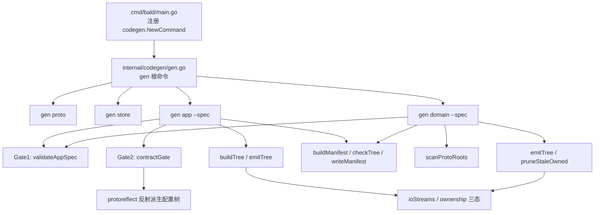
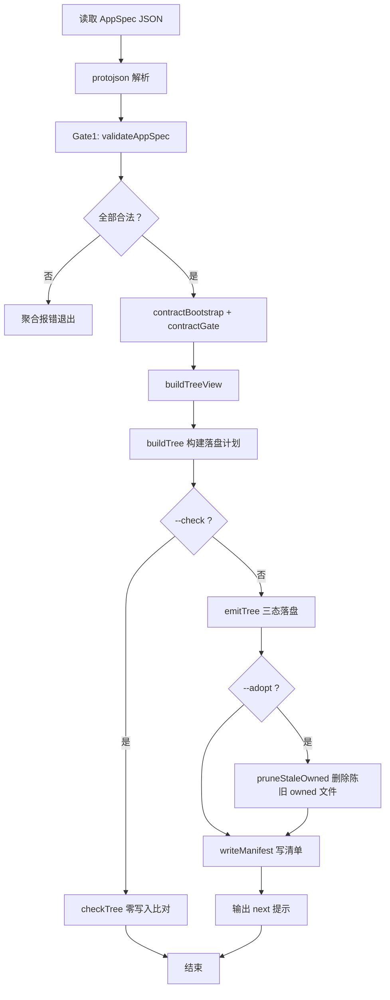
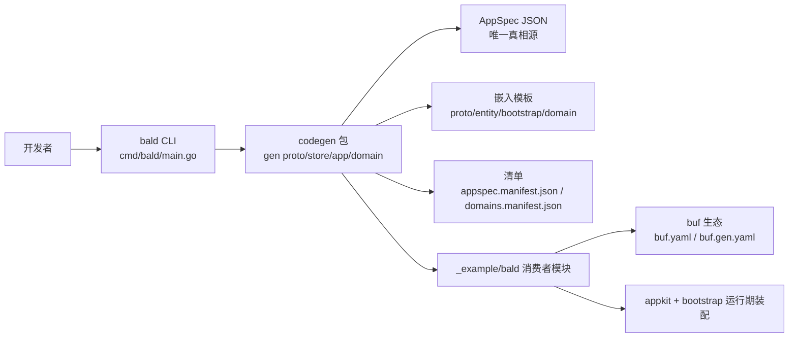
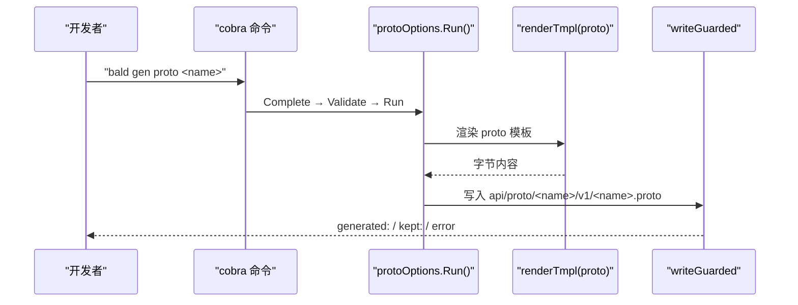
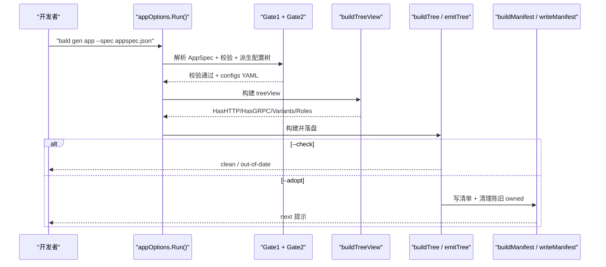
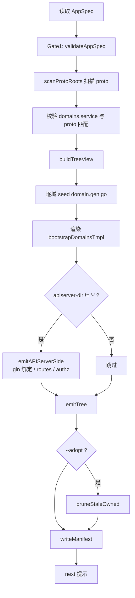
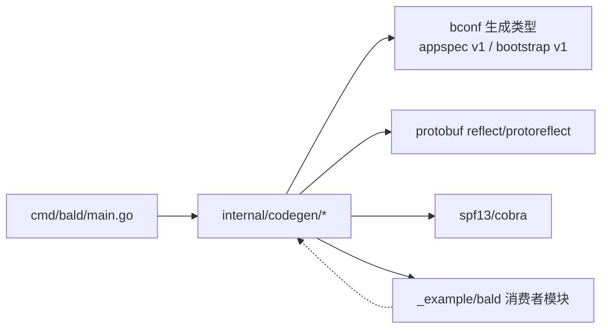

# 代码生成概览

<cite>
**本文引用的文件**   
- [cmd/bald/main.go](file://cmd/bald/main.go)
- [internal/codegen/gen.go](file://internal/codegen/gen.go)
- [internal/codegen/app.go](file://internal/codegen/app.go)
- [internal/codegen/gen_domain.go](file://internal/codegen/gen_domain.go)
- [internal/codegen/appspec_gen.go](file://internal/codegen/appspec_gen.go)
- [internal/codegen/appspec_build.go](file://internal/codegen/appspec_build.go)
- [internal/codegen/appspec_validate.go](file://internal/codegen/appspec_validate.go)
- [internal/codegen/appspec_contract.go](file://internal/codegen/appspec_contract.go)
- [internal/codegen/manifest.go](file://internal/codegen/manifest.go)
- [internal/codegen/iostreams.go](file://internal/codegen/iostreams.go)
- [_example/bald/go.mod](file://_example/bald/go.mod)
</cite>

## 目录
1. [引言](#引言)
2. [项目结构](#项目结构)
3. [核心组件](#核心组件)
4. [架构总览](#架构总览)
5. [详细组件分析](#详细组件分析)
6. [依赖关系分析](#依赖关系分析)
7. [性能与健壮性考量](#性能与健壮性考量)
8. [故障排查指南](#故障排查指南)
9. [结论](#结论)

## 引言
本仓的 `internal/codegen` 包是 `bald` CLI（`cmd/bald`）的轻量代码生成脚手架，围绕「配置驱动 + 嵌入模板」范式提供四个子命令：`gen proto`、`gen store`、`gen app --spec`、`gen domain --spec`。它不是业务框架运行时，而是用于产出可编译骨架的开发工具；真正的服务装配逻辑由 `appkit` 与 `bootstrap` 在运行期消费。

该包的设计目标有三条：
- **单模板源不漂移**：proto、entity、domain manifest 等模板集中在 `internal/codegen`，`gen app` 与 `gen domain` 共享同一份领域清单模板，避免双轨实现导致差异。
- **契约配置树由反射派生**：`configs/<app>.yaml` 整棵树从 `AppSpec.bootstrap` 经 `protoreflect` 遍历导出，键来自字段描述符；模板与生成器中不出现裸配置键。
- **端到端验证以消费者模块为上下文**：生成物以 `_example/bald` 作为编译/运行宿主，CLI 注释明确声明模板质量由其固化，而非仅靠单元测试。

生成流程的中心是 `AppSpec`：它是应用名、module、layout、domains、components、variants、roles 等所有生成项的唯一真相源。`gen app --spec` 从 `AppSpec` 渲染完整应用装配目录树；`gen domain --spec` 则只重写域驱动产物（域清单、授权投影、gin 绑定与路由、域包骨架）。两者共享 Gate1 schema 校验与模板渲染机制，但输出范围不同。

## 项目结构
`internal/codegen` 按职责拆分为命令组装、AppSpec 解析与校验、契约配置发射、目录树构建与落盘、清单管理与 I/O 流抽象等文件：

**图表来源**
- [cmd/bald/main.go:20-47](file://cmd/bald/main.go#L20-L47)
- [internal/codegen/gen.go:1-30](file://internal/codegen/gen.go#L1-L30)
- [internal/codegen/app.go:20-80](file://internal/codegen/app.go#L20-L80)
- [internal/codegen/gen_domain.go:1-60](file://internal/codegen/gen_domain.go#L1-L60)
- [internal/codegen/appspec_contract.go:1-30](file://internal/codegen/appspec_contract.go#L1-L30)

**章节来源**
- [cmd/bald/main.go:1-47](file://cmd/bald/main.go#L1-L47)
- [internal/codegen/gen.go:1-30](file://internal/codegen/gen.go#L1-L30)

## 核心组件
本节聚焦代码生成器的五个关键设计面。

### 1. 命令入口与参数模型
`cmd/bald/main.go` 构造 cobra 根命令，把 `codegen.NewCommand(codegen.NewDefaultIOStreams())` 挂载为 `gen` 子命令，并把 `release` 维护者命令并列挂载。`SilenceUsage` 与 `SilenceErrors` 使错误统一走 `codegen.CheckErr`，避免 cobra 默认 usage 干扰。

每个叶子命令采用 Options 三阶段：`Complete(args)` → `Validate()` → `Run()`，并持有内嵌 `ioStreams`。这样命令行参数、输出流和领域选项解耦，测试可通过注入 `bytes.Buffer` 断言标准输出。

| 子命令 | 位置参数 | 关键标志 | 行为摘要 |
|---|---|---|---|
| `gen proto <name>` | `name` | `--out`、`--plural`、`--go-package`、`--module`、`--force` | 生成 `api/proto/<name>/v1/<name>.proto`；提示后续接入 buf 生态 |
| `gen store <name>` | `name` | `--out`、`--out-pkg`、`--force` | 生成实体 `.go`，含 gorm tag 与 `KeyOf` 函数 |
| `gen app` | 无 | `--spec`、`--out`、`--adopt`、`--check` | 以 AppSpec 渲染完整应用装配目录树 |
| `gen domain` | 无 | `--spec`、`--out`、`--manifest`、`--apiserver-dir`、`--no-bind`、`--rest-bind`、`--no-routes`、`--proto-cmd`、`--adopt`、`--check` | 按 `AppSpec.domains[]` 重写域驱动生成物 |

**章节来源**
- [cmd/bald/main.go:1-47](file://cmd/bald/main.go#L1-L47)
- [internal/codegen/gen.go:120-200](file://internal/codegen/gen.go#L120-L200)
- [internal/codegen/gen.go:200-344](file://internal/codegen/gen.go#L200-L344)
- [internal/codegen/app.go:12-60](file://internal/codegen/app.go#L12-L60)
- [internal/codegen/gen_domain.go:40-110](file://internal/codegen/gen_domain.go#L40-L110)

### 2. AppSpec 中心地位与双入口差异
`AppSpec` 是所有生成路径的输入：`gen app --spec` 直接消费它渲染应用装配树；`gen domain --spec` 消费其中 `domains[]` 与 module 信息，结合既有 proto 扫描结果派生域清单、授权投影、gin 绑定与路由。

两者的差异如下：

| 维度 | `gen app --spec` | `gen domain --spec` |
|---|---|---|
| 输入 | 完整 `AppSpec` | `AppSpec` + 现有 proto 扫描 |
| 输出范围 | 应用装配目录树（`cmd/<app>`、`internal/bootstrap`、`internal/apiserver`、`api`、`configs`、`taskfile.yml`） | 域驱动产物（`internal/bootstrap/domains.gen.go`、`handler/convert`、`authz/alias.gen.go`、可选 gin 绑定与路由、域包骨架） |
| 是否修改装配层 | 是（assemble.gen.go、domains.gen.go、seed、buf 配置） | 否（装配执行权在引擎，生成物只提供声明值） |
| 额外前置 | 无 | 可选执行 `--proto-cmd`（默认 `buf generate`）以补齐 proto Go 类型 |
| 清单名称 | `appspec.manifest.json` | `domains.manifest.json` |
| 典型用途 | 首次创建应用骨架 | 已有 proto 与域包后，同步授权与 REST 绑定 |

**章节来源**
- [internal/codegen/app.go:60-182](file://internal/codegen/app.go#L60-L182)
- [internal/codegen/gen_domain.go:1-60](file://internal/codegen/gen_domain.go#L1-L60)
- [internal/codegen/gen_domain.go:110-201](file://internal/codegen/gen_domain.go#L110-L201)

### 3. 生成期三道门
生成过程不是直接渲染模板，而是先过三层检查，再进入落盘：

1. **Gate1（schema 门）**：`validateAppSpec` 校验 `meta.name`、`meta.module`、components kind 白名单、capability requires/provides 子集关系、domains 三态声明互斥、service 短名唯一、go_package 必填、别名不冲突、roles 覆盖全量域等。
2. **Gate2（契约键门）**：`contractGate` 把 `AppSpec.bootstrap` 经 `protoreflect` 转为配置树，再用 `bconf.FindUnknownKeys` 做未知键校验，最后反序列化回读复检。
3. **Gate3（运行期 StrictContract）**：由 `treeView.Strict` 与 `runGenAppSpec` 的注释说明；`gen app` 输出会提示通过 `--check` 验证、`--adopt` 重新生成 owned 文件。

**图表来源**
- [internal/codegen/app.go:100-182](file://internal/codegen/app.go#L100-L182)
- [internal/codegen/appspec_validate.go:1-60](file://internal/codegen/appspec_validate.go#L1-L60)
- [internal/codegen/appspec_contract.go:150-200](file://internal/codegen/appspec_contract.go#L150-L200)

**章节来源**
- [internal/codegen/appspec_validate.go:1-120](file://internal/codegen/appspec_validate.go#L1-L120)
- [internal/codegen/appspec_contract.go:1-200](file://internal/codegen/appspec_contract.go#L1-L200)
- [internal/codegen/app.go:80-182](file://internal/codegen/app.go#L80-L182)

### 4. 配置驱动与 protoreflect 派生
`appspec_contract.go` 的核心思想是：**模板中不出现裸配置键**。`contractTree` 递归遍历 `bootstrapv1.BootstrapConfig` 的 `protoreflect.Message`，对每个已出现的字段用 `fd.Name()` 作为键；标量值原样保留，消息型字段递归展开，`Duration` 与 `Timestamp` 转成 bconf 装载器期望的字符串形式，枚举按名字序列化为字符串。

`checkContractKeys` 使用 `bconf.FindUnknownKeys` 对生成的 map 做严格校验，`contractGate` 还做一次 YAML 反序列化回读，确保“声明面”和“生成物”都过同一道键门。其代价是：新增一个 bootstrap 段时，只要它出现在 `bootstrap` 协议定义里，就会被自动带进配置树；若模板仍硬编码旧字段名，就会立刻暴露不一致。

**章节来源**
- [internal/codegen/appspec_contract.go:1-200](file://internal/codegen/appspec_contract.go#L1-L200)

### 5. 所有权模型与 writeGuarded
生成物的归属被建模为三态 `ownership`：

| 状态 | 语义 | 覆盖策略 |
|---|---|---|
| `owned` | 每次生成应更新 | 不存在则写；已存在默认拒绝，需显式放行（`gen app/domain` 用 `--adopt`，`gen proto/store` 用 `--force`） |
| `Seeded` | 首次生成一次，之后归用户 | 不存在则写；已存在输出 `kept:` 并返回成功，`--force` 也不覆盖 |
| `User` | 生成器永不读写 | 输出 `skip:`，不产生副作用 |

`writeGuarded` 是统一落盘通道：根据归属决定拒绝、跳过或写入；`writeFileFormatted` 是 `.go` 专用通道，先 `gofmt` 再走 `writeGuarded`。当 `gofmt` 失败时，它会尝试写 `<path>.rej` 保存原始模板输出，但**绝不触碰目标路径**，从而避免在无 `--force` 情况下截断用户文件。

清单系统（`manifest.go`）记录每次生成的 spec 摘要、每个非 user 文件的归属与字节摘要，支持 `--check` 零写入比对、`--adopt` 覆盖 owned 并删除陈旧 owned 文件、以及 `staleOwned` 报告上次清单记为 owned 但本次不再生成的残留文件。

**章节来源**
- [internal/codegen/iostreams.go:20-106](file://internal/codegen/iostreams.go#L20-L106)
- [internal/codegen/manifest.go:1-237](file://internal/codegen/manifest.go#L1-L237)
- [internal/codegen/appspec_build.go:1-128](file://internal/codegen/appspec_build.go#L1-L128)

## 架构总览
下图展示 `bald` CLI 到 codegen 包再到 `_example/bald` 消费者的端到端关系：

**图表来源**
- [cmd/bald/main.go:1-47](file://cmd/bald/main.go#L1-L47)
- [internal/codegen/gen.go:1-30](file://internal/codegen/gen.go#L1-L30)
- [_example/bald/go.mod:1-20](file://_example/bald/go.mod#L1-L20)

## 详细组件分析

### 一、`gen proto` 与 `gen store`
`gen proto` 渲染 `protoTmpl`，生成包含 CRUD 六件套、`google.api.http` REST 映射、`buf.validate` 字段规则以及 `bald.store.v1.FilterExpr` 的 proto 文件。它不直接调用 buf，而是在成功后打印下一步提示：把文件加入 buf 模块后运行 `buf generate`。

`gen store` 渲染 `entityTmpl`，生成带 gorm tag 与 `KeyOf` 函数的实体骨架，并在落盘前直接 `format.Source` 校验 Go 语法。

两个命令都遵循 Complete → Validate → Run 模式，并通过 `writeGuarded` 保护目标文件。

**图表来源**
- [internal/codegen/gen.go:120-200](file://internal/codegen/gen.go#L120-L200)
- [internal/codegen/gen.go:200-344](file://internal/codegen/gen.go#L200-L344)

**章节来源**
- [internal/codegen/gen.go:1-30](file://internal/codegen/gen.go#L1-L30)
- [internal/codegen/gen.go:120-200](file://internal/codegen/gen.go#L120-L200)
- [internal/codegen/gen.go:200-344](file://internal/codegen/gen.go#L200-L344)

### 二、`gen app --spec`
`gen app` 是面向应用装配的入口。它的 `appOptions` 只有三个关键标志：`--spec`、`--out`、`--adopt`、`--check`，并禁止 `--adopt` 与 `--check` 同时使用。

执行管线如下：
1. 读取并解析 AppSpec。
2. Gate1 校验。
3. `contractBootstrap` 定位 bootstrap 段，`contractGate` 派生配置 YAML。
4. `buildTreeView` 从 AppSpec 与 bootstrap 推导 `HasHTTP`、`HasGRPC`、`HasGateway`、`Strict`、变体、角色等视图字段。
5. `roleContracts` 为每个角色派生一份 configs YAML（单角色复用 base，多角色按 `RoleSpec.server` 覆盖）。
6. `buildTree` 生成目录树计划，`emitTree` 按三态落盘。
7. 如果 `--check`，只比对；如果 `--adopt`，删除陈旧 owned 文件并重写清单。

**图表来源**
- [internal/codegen/app.go:12-60](file://internal/codegen/app.go#L12-L60)
- [internal/codegen/app.go:100-182](file://internal/codegen/app.go#L100-L182)
- [internal/codegen/appspec_gen.go:1-120](file://internal/codegen/appspec_gen.go#L1-L120)
- [internal/codegen/appspec_build.go:1-128](file://internal/codegen/appspec_build.go#L1-L128)

**章节来源**
- [internal/codegen/app.go:12-182](file://internal/codegen/app.go#L12-L182)
- [internal/codegen/appspec_gen.go:1-120](file://internal/codegen/appspec_gen.go#L1-L120)
- [internal/codegen/appspec_build.go:1-128](file://internal/codegen/appspec_build.go#L1-L128)

### 三、`gen domain --spec`
`gen domain` 的消费对象是 `AppSpec.domains[]`。它扫描 `OutDir` 下的 proto 候选根（`api/proto`、`api/protos`、`proto`），校验声明的 service 是否实际存在于 proto，然后按以下顺序处理：

1. 对每个域，判断其 go_package 是否已有导出的 Domain 值；有则 skip，没有则 seed `domain.gen.go`。
2. 渲染与 `gen app` 共享的 `bootstrapDomainsTmpl`，生成 `internal/bootstrap/domains.gen.go`。
3. 根据 `--apiserver-dir` 扇出 apiserver 侧产物（传 `-` 跳过）。
4. 根据 `--no-bind` 决定是否生成 gin 绑定与路由清单；默认生成。
5. 写清单，并在 `--adopt` 时清理陈旧 owned 文件。

它与 `gen app` 的关键区别是：**不重写应用装配层**，只同步域相关生成物；因此适合在已有 `gen app` 产物的仓库中单独增量更新域。

**图表来源**
- [internal/codegen/gen_domain.go:1-60](file://internal/codegen/gen_domain.go#L1-L60)
- [internal/codegen/gen_domain.go:110-201](file://internal/codegen/gen_domain.go#L110-L201)

**章节来源**
- [internal/codegen/gen_domain.go:1-201](file://internal/codegen/gen_domain.go#L1-L201)

### 四、I/O 流与错误出口
`ioStreams` 是 kubectl `genericiooptions.IOStreams` 的轻量复刻：`In`、`Out`、`ErrOut`。命令生产路径绑定 `os.Stdin`/`os.Stdout`/`os.Stderr`，测试路径可注入 buffer。

错误出口集中在 `CheckErr`：非 nil 错误统一以 `error:` 前缀打印到 stderr 并以退出码 1 退出。cobra 子命令的 `SetErr(streams.ErrOut)` 让 cobra 自己的错误也走 streams，而不是直连 os.Stderr。

这种设计的优点是：
- 正常日志（generated/kept/skip/next）走 `streams.Out`。
- 诊断错误走 `streams.ErrOut`。
- 测试可以分别断言 stdout 与 stderr，而不必捕获进程级 stderr。
- `cmd/bald/main.go` 的 `SilenceUsage` 与 `SilenceErrors` 保持 cobra 行为稳定。

**章节来源**
- [internal/codegen/iostreams.go:1-106](file://internal/codegen/iostreams.go#L1-L106)
- [cmd/bald/main.go:20-47](file://cmd/bald/main.go#L20-L47)
- [internal/codegen/gen.go:80-120](file://internal/codegen/gen.go#L80-L120)

## 依赖关系分析
codegen 包的依赖方向清晰：外部消费方通过 `cmd/bald` 调用，codegen 内部依赖 `bconf` 的生成类型、`protoreflect` 与 cobra，但不反向依赖具体后端或业务模块。

**图表来源**
- [cmd/bald/main.go:20-47](file://cmd/bald/main.go#L20-L47)
- [internal/codegen/appspec_contract.go:1-20](file://internal/codegen/appspec_contract.go#L1-L20)
- [_example/bald/go.mod:1-20](file://_example/bald/go.mod#L1-L20)

需要注意两点作者约束：
- 根 module 不得 require 适配器；codegen 本身也不 import 具体后端实现，后端在独立适配器包。
- `_example/bald` 在 CI 的可装载性并非由主仓 CI 直接保证——它的 go.mod 把两个 kratos contrib 模块 replace 到仓库外同级检出，因此不能把它当作主仓可编译闭包的证据。

**章节来源**
- [internal/codegen/appspec_contract.go:1-20](file://internal/codegen/appspec_contract.go#L1-L20)
- [_example/bald/go.mod:1-20](file://_example/bald/go.mod#L1-L20)

## 性能与健壮性考量
- **模板渲染开销低**：`renderTmpl` 每次调用重建 template，但模板数量少且数据简单，不构成瓶颈；主要成本在文件系统 I/O。
- **gofmt 失败不破坏目标文件**：`writeFileFormatted` 先格式化再落盘，失败时写 `.rej` 并返回错误，这是生成器健壮性的关键设计。
- **清单使“生成物是否干净”可判定**：通过 sha256 比较 .go 格式化后的字节，`--check` 零写入即可发现 missing/out-of-date/stale。
- **三态归属降低误写风险**：`Seeded` 文件一旦存在即视为用户资产，`--force` 也不覆盖；`User` 文件从不写入。
- **配置键由描述符派生**：`contractGate` 的回读复检是回归锁，任何绕过 `protoreflect` 的键路径都会暴露。
- **模板质量以消费者模块为防线**：proto 模板、entity 模板、domain 清单模板都以 `_example/bald` 的实际可编译性作为最终约束。

[本节为通用设计讨论，不直接分析具体代码片段]

## 故障排查指南

### 1. 生成物未更新或被拒绝
现象：`already exists, refusing to overwrite`。

原因：目标文件已是 `owned` 状态且未传入放行标志。

处理：
- `gen app` / `gen domain`：加 `--adopt`。
- `gen proto` / `gen store`：加 `--force`。
- 如果文件是 `Seeded`，即使 `--force` 也不会覆盖；需要手动编辑或删除后重新生成。

**章节来源**
- [internal/codegen/iostreams.go:40-106](file://internal/codegen/iostreams.go#L40-L106)

### 2. gofmt 失败但目标文件未被截断
现象：错误信息附带 raw template output saved to `<path>.rej`。

原因：模板渲染出的 Go 源码不可格式化。

处理：
- 检查 `.rej` 中的原始输出。
- 修复模板或 AppSpec 派生数据。
- 确认目标文件未被写入。

**章节来源**
- [internal/codegen/iostreams.go:80-106](file://internal/codegen/iostreams.go#L80-L106)

### 3. `--check` 报 generated tree is not clean
常见差异类别：
- `missing: <path>`：预期文件缺失。
- `out-of-date: <path>`：磁盘字节与当前声明重新渲染的结果不一致。
- `stale: <path>`：上次清单记为 owned，但本次计划不再生成。
- `out-of-date: appspec.manifest.json / domains.manifest.json`：清单自身过期。

处理：
- 先 `--adopt` 重新生成 owned 文件。
- 确认 seeded 文件差异属于用户改动，不应判脏。
- 如果声明变了，陈旧 owned 文件会在 `--adopt` 后被删除。

**章节来源**
- [internal/codegen/manifest.go:120-237](file://internal/codegen/manifest.go#L120-L237)

### 4. Gate1 报错 components.kind / capability.requires / domains.service
这类错误发生在任何文件落盘之前，属于“声明即失败”。

处理：
- 检查 `components[].kind` 是否在白名单。
- 检查 `capability.requires[].caps` 是否为 `provides` 的子集。
- 检查 domains 是否满足 service/services/http_only 三选一，且 go_package 非空。
- `gen domain` 还会校验 domains.service 是否与 proto 实际匹配。

**章节来源**
- [internal/codegen/appspec_validate.go:1-120](file://internal/codegen/appspec_validate.go#L1-L120)
- [internal/codegen/gen_domain.go:110-201](file://internal/codegen/gen_domain.go#L110-L201)

### 5. Gate2 报 contract keys unknown to bconf
原因：配置树中出现 bconf 不认识的键。

虽然正常情况下键由 `protoreflect` 派生，该检查被视为回归锁；若出现，说明有绕过描述符的路径。

处理：
- 检查 AppSpec.bootstrap 是否正确。
- 确认新增段已在 `bootstrap` 协议定义中声明。
- 不要手写裸配置键绕过生成器。

**章节来源**
- [internal/codegen/appspec_contract.go:80-200](file://internal/codegen/appspec_contract.go#L80-L200)

## 结论
`internal/codegen` 是一个边界清晰、面向开发者的代码生成脚手架：它以 `AppSpec` 为中心，用 `protoreflect` 派生配置键，用嵌入模板产出可编译骨架，用 `ownership` 三态和清单系统守护生成物一致性，并用 `_example/bald` 作为端到端验证上下文。

对于使用者而言，最实用的实践是：
- 先用 `gen app --spec` 生成应用装配骨架。
- 编写 proto 与域包后，用 `gen domain --spec` 同步授权、绑定与路由。
- 在 CI 中以 `--check` 校验生成物，以 `--adopt` 重新生成。
- 把 seeded 文件视为“生成一次、用户维护”的扩展点，不要把业务逻辑混入 owned 生成物。
- 新增 bootstrap 配置段时优先改协议定义，让生成器继续自动派生，而不是手写模板中的裸键。

[本节为总结性内容，不直接分析具体文件]