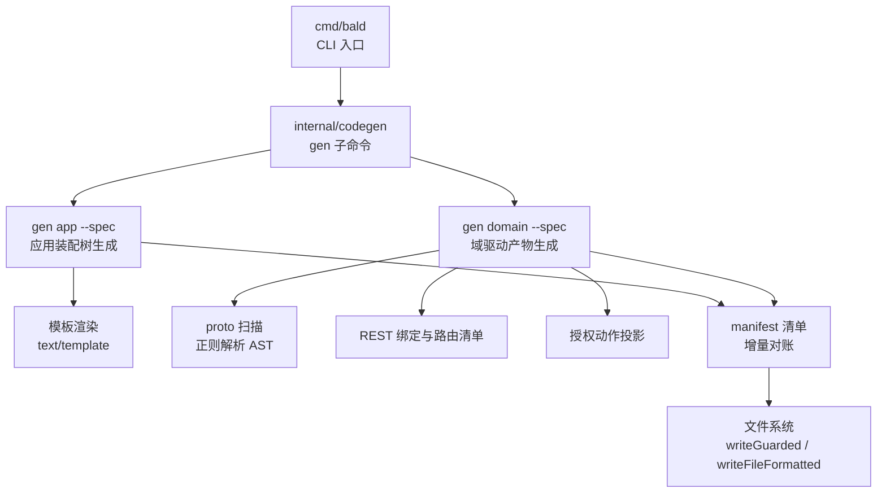
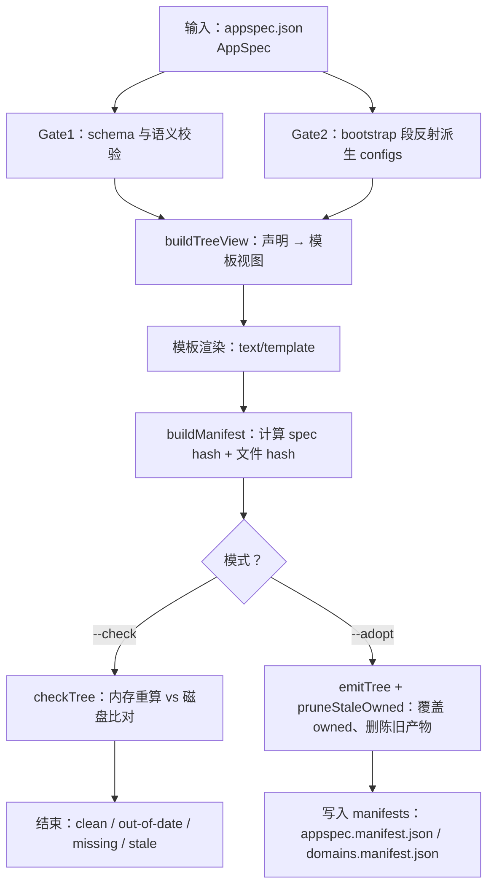
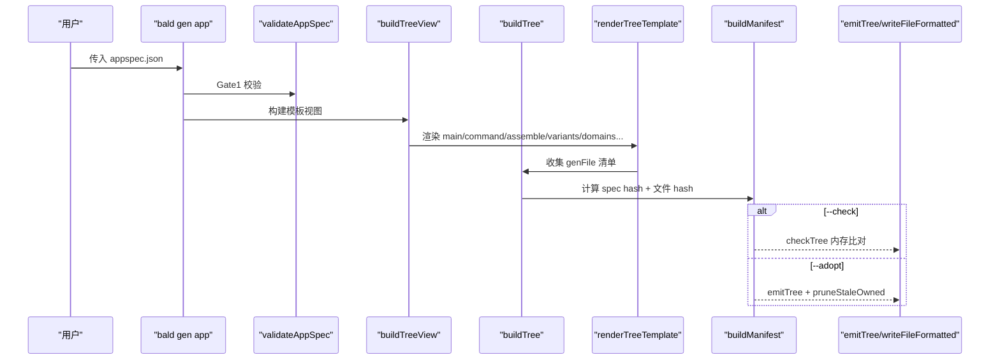
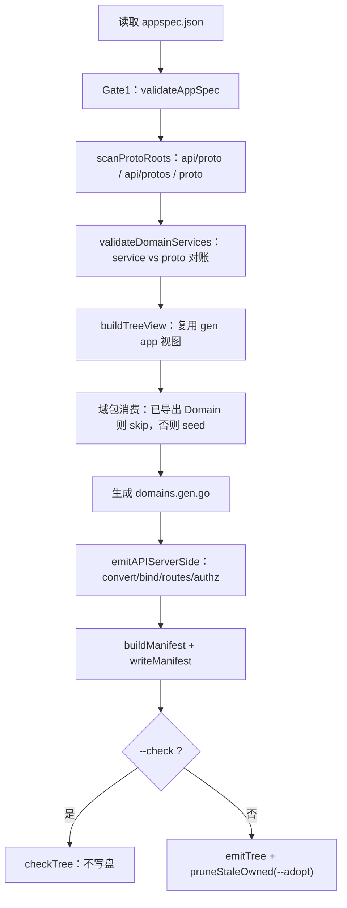
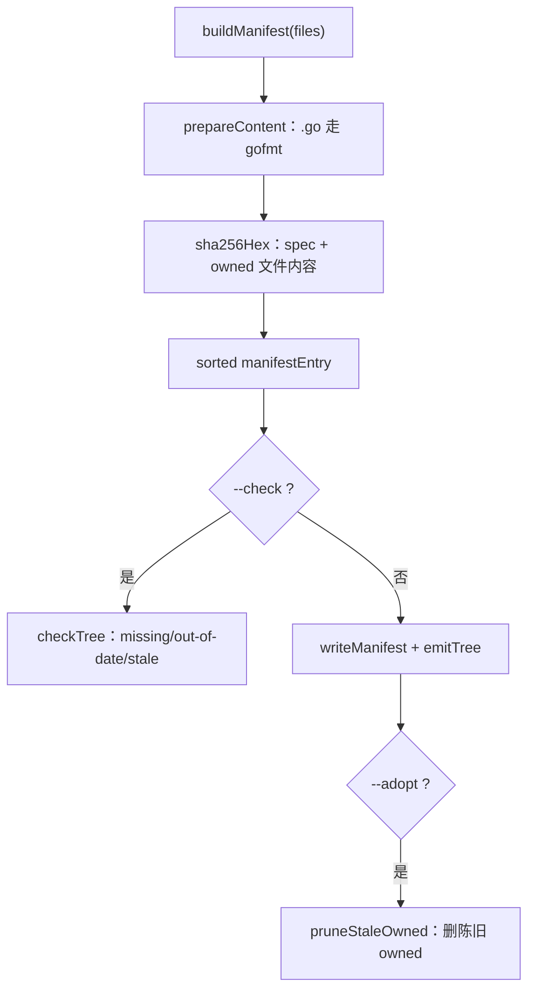
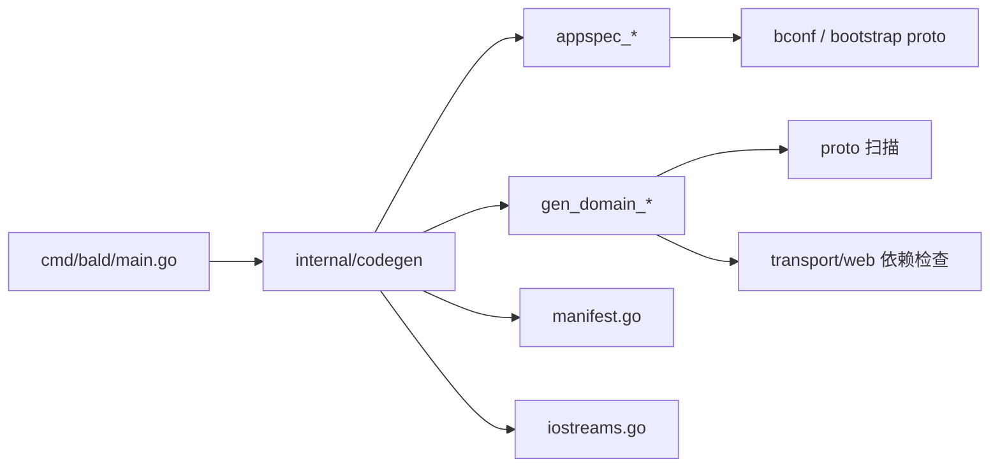
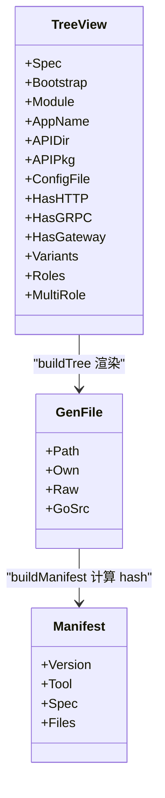

# 代码生成系统

<cite>
**本文引用的文件**   
- [main.go](file://cmd/bald/main.go)
- [gen.go](file://internal/codegen/gen.go)
- [appspec_gen.go](file://internal/codegen/appspec_gen.go)
- [appspec_build.go](file://internal/codegen/appspec_build.go)
- [appspec_contract.go](file://internal/codegen/appspec_contract.go)
- [appspec_validate.go](file://internal/codegen/appspec_validate.go)
- [appspec_tmpl_app.go](file://internal/codegen/appspec_tmpl_app.go)
- [appspec_tmpl_domain.go](file://internal/codegen/appspec_tmpl_domain.go)
- [gen_domain.go](file://internal/codegen/gen_domain.go)
- [gen_domain_proto.go](file://internal/codegen/gen_domain_proto.go)
- [gen_domain_bind.go](file://internal/codegen/gen_domain_bind.go)
- [gen_domain_authz.go](file://internal/codegen/gen_domain_authz.go)
- [manifest.go](file://internal/codegen/manifest.go)
- [iostreams.go](file://internal/codegen/iostreams.go)
- [appspec.json](file://_example/bald/appspec.json)
- [domain.go](file://_example/bald/greetv1/domain.go)
- [custom.go](file://_example/bald/internal/bootstrap/custom.go)
</cite>

## 目录
1. [引言](#引言)
2. [项目结构](#项目结构)
3. [核心组件](#核心组件)
4. [架构总览](#架构总览)
5. [三段门与端到端验证](#三段门与端到端验证)
6. [详细组件分析](#详细组件分析)
7. [依赖关系分析](#依赖关系分析)
8. [性能与可维护性](#性能与可维护性)
9. [故障排查指南](#故障排查指南)
10. [结论](#结论)
11. [附录：模板扩展与自定义生成器](#附录模板扩展与自定义生成器)

## 引言
Bald 代码生成系统由 `cmd/bald` CLI 驱动，围绕「声明即真相」展开：开发者只修改 AppSpec（`appspec.json`）和域 proto / 业务包，框架负责把应用装配、域清单、REST 绑定、授权投影、契约配置等生成物落到磁盘。生成过程不是简单文本替换，而是经过 Gate1（AppSpec schema 校验）、Gate2（bootstrap 契约派生与未知键校验）以及以 manifest 为核心的增量对账管线，最终通过 `_example/bald` 消费者模块的编译与运行来固化为端到端防线。

## 项目结构
生成器核心位于 `internal/codegen`，CLI 入口在 `cmd/bald`，示例工程在 `_example/bald`。关键职责划分如下：

**图表来源**
- [main.go:25-47](file://cmd/bald/main.go#L25-L47)
- [gen.go:118-141](file://internal/codegen/gen.go#L118-L141)
- [appspec_gen.go:20-54](file://internal/codegen/appspec_gen.go#L20-L54)
- [gen_domain.go:23-47](file://internal/codegen/gen_domain.go#L23-L47)

**章节来源**
- [main.go:1-47](file://cmd/bald/main.go#L1-L47)
- [gen.go:1-141](file://internal/codegen/gen.go#L1-L141)

## 核心组件
| 组件 | 职责 | 关键实现位置 |
|---|---|---|
| CLI 入口 | 注册 `gen` 与 `release` 子命令，统一错误出口 | [main.go](file://cmd/bald/main.go) |
| gen 命令装配 | 挂载 `proto/store/app/domain` 四个叶子 | [gen.go](file://internal/codegen/gen.go) |
| 应用生成器 | 从 AppSpec + bootstrap 段渲染装配目录树 | [appspec_gen.go](file://internal/codegen/appspec_gen.go)、[appspec_build.go](file://internal/codegen/appspec_build.go) |
| 契约配置发射器 | 把 bootstrap 段反射为 configs YAML，并做未知键校验 | [appspec_contract.go](file://internal/codegen/appspec_contract.go) |
| Gate1 校验器 | 白名单、唯一性、requires/provides、role/domains 覆盖、variant tag 合法性 | [appspec_validate.go](file://internal/codegen/appspec_validate.go) |
| 域生成器 | 扫描 proto、校验 service、seed 域包、生成清单/绑定/授权 | [gen_domain.go](file://internal/codegen/gen_domain.go) |
| proto 扫描器 | 正则解析 package/go_package/service/rpc/google.api.http | [gen_domain_proto.go](file://internal/codegen/gen_domain_proto.go) |
| REST 绑定器 | 把注解派生 gin 绑定与 appkit.Route 清单 | [gen_domain_bind.go](file://internal/codegen/gen_domain_bind.go) |
| 授权投影器 | 逐 RPC 默认动作 + object 归一化别名聚合 | [gen_domain_authz.go](file://internal/codegen/gen_domain_authz.go) |
| 清单与增量对账 | 记录 spec 摘要、owned/seeded 文件哈希，支持 `--check` / `--adopt` | [manifest.go](file://internal/codegen/manifest.go) |
| 输出流与归属控制 | stdout/stderr 抽象；owned/Seeded/User 三态落盘 | [iostreams.go](file://internal/codegen/iostreams.go) |

**章节来源**
- [main.go:25-47](file://cmd/bald/main.go#L25-L47)
- [gen.go:118-141](file://internal/codegen/gen.go#L118-L141)
- [appspec_gen.go:20-54](file://internal/codegen/appspec_gen.go#L20-L54)
- [appspec_build.go:8-55](file://internal/codegen/appspec_build.go#L8-L55)
- [appspec_contract.go:15-30](file://internal/codegen/appspec_contract.go#L15-L30)
- [appspec_validate.go:21-42](file://internal/codegen/appspec_validate.go#L21-L42)
- [gen_domain.go:23-47](file://internal/codegen/gen_domain.go#L23-L47)
- [gen_domain_proto.go:14-54](file://internal/codegen/gen_domain_proto.go#L14-L54)
- [gen_domain_bind.go:14-39](file://internal/codegen/gen_domain_bind.go#L14-L39)
- [gen_domain_authz.go:10-22](file://internal/codegen/gen_domain_authz.go#L10-L22)
- [manifest.go:11-34](file://internal/codegen/manifest.go#L11-L34)
- [iostreams.go:14-32](file://internal/codegen/iostreams.go#L14-L32)

## 架构总览
生成器整体是「声明 → 校验 → 视图 → 模板 → 清单 → 落盘」的单向管道。AppSpec JSON 是唯一真相源；bootstrap 段是运行期配置的真相源；proto 是 gRPC/HTTP 契约的真相源。

**图表来源**
- [appspec_validate.go:47-199](file://internal/codegen/appspec_validate.go#L47-L199)
- [appspec_contract.go:103-133](file://internal/codegen/appspec_contract.go#L103-L133)
- [appspec_gen.go:142-200](file://internal/codegen/appspec_gen.go#L142-L200)
- [appspec_build.go:8-55](file://internal/codegen/appspec_build.go#L8-L55)
- [manifest.go:78-113](file://internal/codegen/manifest.go#L78-L113)
- [manifest.go:115-177](file://internal/codegen/manifest.go#L115-L177)

## 三段门与端到端验证
### Gate1：AppSpec 生成期 schema 门
Gate1 在任何文件落盘之前执行，目的是把原本可能到运行期才暴露的错误提前到生成期。它覆盖以下断言面：

| 校验项 | 规则 | 失败后果 |
|---|---|---|
| meta.name / meta.module | 必填 | 生成期报错 |
| components.kind | 仅允许白名单中的 kind | unknown component kind 不进入运行期 |
| components.name | 全局唯一 | 重复名报错 |
| capability.requires.caps | 必须是 capability.provides 的子集 | S1 能力缺失提前暴露 |
| domains[].name | 非空且唯一 | 重复或缺失 |
| domains.service/services/http_only | 三者互斥；http_only 不得声明 proto 字段 | 声明形态冲突 |
| domains[].services | 逐项非空、无空白、域内唯一；短名唯一 | 绑定 Go 接口命名冲突 |
| domains[].go_package | 必填；import alias 不得冲突 | 导入歧义 |
| meta.roles | name 唯一；domains 引用已声明域；各角色 domains 并集等于全集 | 缺域/多域/未服务域 |
| variants.name | 小写标识符形状，唯一 | 计划 origin 与文件名漂移 |
| variants.when/build_tags | 二者互斥；when 必须是单行 go/build/constraint；build_tags 每项为单 tag | 构建约束非法 |
| variants.effects.components | kind 白名单 + 跨全局/变体唯一 | 计划节点重复 |
| variants.effects.patches.path | 单行字段路径，不可空白 | 补丁无法定位 |
| bootstrap.app.name 与 meta.name | 最多一处显式声明 | 双处声明报错 |

此外，`fieldConsumers` 与 `builderConsumed` 构成机器守卫：任何 AppSpec 本地叶子字段若未在生成物或构建器中被消费，都会触发测试失败，防止新增字段成为死声明。

**章节来源**
- [appspec_validate.go:47-199](file://internal/codegen/appspec_validate.go#L47-L199)
- [appspec_validate.go:253-502](file://internal/codegen/appspec_validate.go#L253-L502)

### Gate2：bootstrap 契约配置门
Gate2 不手写配置键，而是用 `protoreflect` 遍历 `bootstrapv1.BootstrapConfig`，把已出现字段映射为 YAML 树：

1. `messageToMap` 递归消息、列表、map，标量原样，消息型走 `scalarToConfig`。
2. `Duration` 转为 `"15s"`，`Timestamp` 转为 RFC3339Nano 字符串，避免装载器看到 `{seconds:15}` 而失败。
3. 枚举按名称序列化，bytes 直接拒绝。
4. `contractTree` 确保 `app.name` 存在（缺省取 `meta.name`）。
5. `checkContractKeys` 调用 `bconf.FindUnknownKeys` 校验键是否在 bconf 契约中。
6. `contractGate` 最后做一次反序列回读 + 再次未知键检查，作为回归锁。

这意味着「新增一个 bootstrap 段 = 零处模板改动」：只要新段出现在 bootstrap proto 描述符里，就会被带进配置树，键错不了，也不会漏。

**章节来源**
- [appspec_contract.go:15-30](file://internal/codegen/appspec_contract.go#L15-L30)
- [appspec_contract.go:33-74](file://internal/codegen/appspec_contract.go#L33-L74)
- [appspec_contract.go:77-101](file://internal/codegen/appspec_contract.go#L77-L101)
- [appspec_contract.go:103-133](file://internal/codegen/appspec_contract.go#L103-L133)

### Gate3：运行期契约门
生成的装配代码根据 `layout.strict_contract` 决定是否注入 `appkit.StrictContract()`。该门在启动时拒绝未知配置键，使 env/flag 来源的笔误在启动期 fail-fast，而不是静默回退默认值。

**章节来源**
- [appspec_tmpl_app.go:120-165](file://internal/codegen/appspec_tmpl_app.go#L120-L165)

### 端到端验证
`cmd/bald` 的文档说明代码生成脚手架以 `_example/bald` 消费者模块为编译/运行上下文做端到端验证。示例工程展示：

- AppSpec 声明 api/worker 双角色、greet 域、grpc-gateway 与 nacos 变体。
- greet 域的 `Domain` 在 `greetv1/domain.go` 中手写，挂入 Declare/ApplyNode/Reconcile/Services/RouteTable。
- `internal/bootstrap/custom.go` 提供生成器表达不了的第三方 Provider、Registrar、拦截器链与逃逸舱预算。

这构成了从 AppSpec → 生成骨架 → 业务填充 → 可编译运行服务的闭环。

**章节来源**
- [gen.go:10-22](file://internal/codegen/gen.go#L10-L22)
- [appspec.json:1-81](file://_example/bald/appspec.json#L1-L81)
- [domain.go:1-69](file://_example/bald/greetv1/domain.go#L1-L69)
- [custom.go:1-45](file://_example/bald/internal/bootstrap/custom.go#L1-L45)

## 详细组件分析

### 应用生成器：gen app --spec
`gen app` 读取 AppSpec，构造 `treeView`，再经 `buildTree` 产出目标目录树。每个角色一份 `cmd/<CmdName>/`，同时生成 `internal/bootstrap` 下的装配、变体、域清单、seed、层不变量测试、buf/taskfile 配置，以及每角色的 `configs/<app>.yaml`。

**图表来源**
- [appspec_gen.go:142-200](file://internal/codegen/appspec_gen.go#L142-L200)
- [appspec_build.go:8-55](file://internal/codegen/appspec_build.go#L8-L55)
- [manifest.go:78-113](file://internal/codegen/manifest.go#L78-L113)

#### 模板体系
- `mainTmpl`：最小 `package main`，只调 `app.Execute()`。
- `commandTmpl`：cobra 根命令，接入 `appcli.Main`，doctor 与插件转发。
- `assembleTmpl`：Options() 装配投影，按 HasHTTP/HasGRPC/HasGateway/Capability/Components/Roles 条件展开。
- `bootstrapDomainsTmpl`：域清单聚合，gen app 与 gen domain 共用同一模板，避免漂移。
- `variantsTmpl` / `variantImplTmpl`：变体声明与 `//go:build` 实现文件。
- `layeringTestTmpl`：AST 级分层不变量测试，biz 不得 import 装配层。

**章节来源**
- [appspec_tmpl_app.go:12-118](file://internal/codegen/appspec_tmpl_app.go#L12-L118)
- [appspec_tmpl_domain.go:13-240](file://internal/codegen/appspec_tmpl_domain.go#L13-L240)

#### 文件归属与落盘
`ownership` 定义三态：

| 归属 | 含义 | 行为 |
|---|---|---|
| owned | 生成器拥有 | 不存在则写；已存在需 `--adopt` |
| Seeded | 生成一次 | 不存在播种；已存在输出 kept，永不覆盖 |
| User | 用户文件 | 永远跳过，输出 skip |

`.go` 源码走 `writeFileFormatted`：先 `go/format.Source`，失败写 `<path>.rej`，绝不触碰目标；其余走 `writeGuarded`。

**章节来源**
- [iostreams.go:34-106](file://internal/codegen/iostreams.go#L34-L106)
- [appspec_build.go:57-128](file://internal/codegen/appspec_build.go#L57-L128)

### 域生成器：gen domain --spec
`gen domain` 面向已有 AppSpec 与既有域 proto/域包，重写域驱动产物，不改变业务装配逻辑。它产出的文件全部走 owned 通道：

- `internal/bootstrap/domains.gen.go`：域清单聚合。
- `handler/convert/<d>.gen.go`：逐 RPC 授权动作投影。
- `authz/alias.gen.go`：object 归一化别名 + 默认动作聚合。
- `<go_package>/domain.gen.go`：域声明值骨架，仅当包尚无导出 Domain 时 seed。
- `handler/gin/<d>.bind.gen.go`：google.api.http 注解派生的 gin 绑定。
- `routes/<d>.gen.go`：appkit.Route 清单，供 `Domain.RouteTable` 使用。

**图表来源**
- [gen_domain.go:49-200](file://internal/codegen/gen_domain.go#L49-L200)
- [gen_domain_bind.go:201-334](file://internal/codegen/gen_domain_bind.go#L201-L334)
- [manifest.go:115-177](file://internal/codegen/manifest.go#L115-L177)

#### proto 扫描与 AST 操作
`gen_domain_proto.go` 没有引入 proto 编译器，而是用正则扫描 `.proto` 源码，提取：

- package、go_package
- service、rpc、请求/响应类型、stream 标志
- google.api.http 主规则与 additional_bindings
- 未实现注解字段（custom、response_body）

扫描结果用于 Gate1 的 service 存在性校验与后续绑定生成。正则口径兼容 buf format 风格与 braced 注解，保证确定性。

**章节来源**
- [gen_domain_proto.go:14-54](file://internal/codegen/gen_domain_proto.go#L14-L54)
- [gen_domain_proto.go:103-189](file://internal/codegen/gen_domain_proto.go#L103-L189)

#### REST 绑定与路由清单
`bindViewOf` 把 google.api.http 注解转换为 gin 绑定视图：

- 流式 RPC 携带 http 注解直接报错。
- 不支持的注解字段（custom、response_body）报错，避免静默偏离契约。
- gin 路由 shape 冲突（`:a` 与 `:b` 视为同形）生成期报错。
- 要求 proto 有 `option go_package`，否则报 import 缺失。
- 同一域多个 service 的 binder 函数名必须不同。
- 默认生成 `routes/<d>.gen.go`，让 RouteTable 在计划期可见。

`ensureBindDeps` 会检查 `transport/web` 依赖是否就位；如果本地 proto Go 类型缺失，则按 `--proto-cmd` 执行外部 proto 阶段，直到产物出现或 `--no-bind` 退出。

**章节来源**
- [gen_domain_bind.go:14-199](file://internal/codegen/gen_domain_bind.go#L14-L199)
- [gen_domain_bind.go:201-334](file://internal/codegen/gen_domain_bind.go#L201-L334)

#### 授权投影
授权投影与 `pkg/authz` 同源：

- `grpcActionOf`：Delete→delete、List→list、Create/Update/Set/Put→write、其他→get。
- `grpcObjectOf`：service 全名去 Service 后缀转小写。
- `httpObjectOf`：注解路径首段，跳过空段与 v1。
- `derivedAuthz`：只列 gRPC/HTTP 两侧归一化不一致的 object 别名，冗余映射不入表。
- `DefaultActions` 聚合所有域 convert 表，与 seed 策略对账。

**章节来源**
- [gen_domain_authz.go:10-145](file://internal/codegen/gen_domain_authz.go#L10-L145)

### 清单与增量生成
清单是「生成物是否干净」的可判定依据：

| 清单字段 | 含义 |
|---|---|
| version | 格式版本，变化时旧清单判过期 |
| tool | 调用方工具名 |
| spec | AppSpec JSON 内容的 sha256 |
| files[] | owned/seeded 文件的 path + ownership + hash |

`checkTree` 零写盘比较当前声明重算结果与磁盘；`pruneStaleOwned` 只在 `--adopt` 下删除上次清单记为 owned、本次不再生成的旧产物。`staleOwned` 处理清单损坏或版本不符的防御分支。

**图表来源**
- [manifest.go:36-76](file://internal/codegen/manifest.go#L36-L76)
- [manifest.go:78-113](file://internal/codegen/manifest.go#L78-L113)
- [manifest.go:115-177](file://internal/codegen/manifest.go#L115-L177)
- [manifest.go:179-237](file://internal/codegen/manifest.go#L179-L237)

**章节来源**
- [manifest.go:11-34](file://internal/codegen/manifest.go#L11-L34)
- [manifest.go:78-113](file://internal/codegen/manifest.go#L78-L113)
- [manifest.go:115-177](file://internal/codegen/manifest.go#L115-L177)
- [manifest.go:179-237](file://internal/codegen/manifest.go#L179-L237)

## 依赖关系分析
生成器内部依赖呈现清晰的单向层次：

- `cmd/bald` 只依赖 `internal/codegen` 与 `internal/release`，不直接消费生成模板。
- `internal/codegen` 依赖 protobuf reflect 与 `bconf` 生成的 bootstrap 描述符，但不反向依赖运行时后端。
- 模板数据通过 `treeView` 与 `bindView` 等中间结构传递，避免模板直接访问 AppSpec 原始 proto 消息。
- 生成器本身不 import gin/grpc；gin/grpc 依赖由消费者 module 通过 transport/web 与 proto 阶段补齐。

**图表来源**
- [main.go:25-47](file://cmd/bald/main.go#L25-L47)
- [gen.go:10-22](file://internal/codegen/gen.go#L10-L22)
- [appspec_contract.go:11-16](file://internal/codegen/appspec_contract.go#L11-L16)
- [gen_domain_bind.go:201-334](file://internal/codegen/gen_domain_bind.go#L201-L334)

**章节来源**
- [main.go:1-47](file://cmd/bald/main.go#L1-L47)
- [gen.go:1-141](file://internal/codegen/gen.go#L1-L141)
- [appspec_contract.go:11-16](file://internal/codegen/appspec_contract.go#L11-L16)
- [gen_domain_bind.go:201-334](file://internal/codegen/gen_domain_bind.go#L201-L334)

## 性能与可维护性
### 性能特征
- 模板渲染使用标准库 `text/template`，按声明序线性遍历 AppSpec.domains/components/roles/variants。
- proto 扫描是正则扫描源码，时间复杂度与 proto 文件大小线性相关；扫描后建索引供绑定与授权复用。
- 清单哈希基于 sha256，比较是字节相等；gofmt 仅对 .go 生成物执行。
- `--check` 零写盘，适合 CI；`--adopt` 才会覆写与清理陈旧文件。
- 清单排序按 Path，保证跨平台稳定。

### 可维护性设计
- 模板集中在 `appspec_tmpl_app.go` 与 `appspec_tmpl_domain.go`，单模板源避免漂移。
- `domainsGenTag` 保证 gen app 与 gen domain 共用的清单模板生成标识一致。
- `fieldConsumers` / `builderConsumed` 强制每个 AppSpec 字段都有消费证据，新增字段不会静默上线。
- 生成物头注释明确标注「Code generated by... DO NOT EDIT」与种子文件「生成一次」边界。
- 分层不变量测试用 AST 而非子串匹配，精确阻止 biz 层 import 装配层。

**章节来源**
- [appspec_tmpl_domain.go:13-20](file://internal/codegen/appspec_tmpl_domain.go#L13-L20)
- [appspec_validate.go:253-502](file://internal/codegen/appspec_validate.go#L253-L502)
- [appspec_tmpl_domain.go:201-240](file://internal/codegen/appspec_tmpl_domain.go#L201-L240)
- [manifest.go:36-76](file://internal/codegen/manifest.go#L36-L76)

## 故障排查指南
| 现象 | 可能原因 | 排查建议 |
|---|---|---|
| `--check` 报告 missing/out-of-date | 生成物未按最新 AppSpec 重新生成 | 运行 `bald gen app --spec ...` 或 `bald gen domain --spec ...` |
| `--check` 报告 stale | 某次生成后删除了域或服务，但旧绑定/路由仍留在磁盘 | 加 `--adopt` 让生成器删除陈旧 owned 文件 |
| gofmt 失败 | 模板渲染出无效 Go 语法 | 查看 `<path>.rej`，修复模板或声明 |
| `binding generation does not implement custom/response_body` | proto 使用了尚未支持的 http 注解字段 | 手写 REST 路由，或改用已实现形态 |
| `streaming cannot be transcoded to REST` | 流式 RPC 上写了 google.api.http | 移除注解，流式不走 REST |
| `proto service ... has no option go_package` | proto 缺少 go_package，绑定无法 import 消息类型 | 补上 go_package，或 `--no-bind` |
| `bindings import transport/web, but ... does not require it` | 消费者 module 未依赖 transport/web | 执行 `go get github.com/kalandramo/bald/transport/web` |
| `proto stage failed` | `--proto-cmd` 指向的命令失败或 proto 配置有问题 | 检查 buf.yaml / buf.gen.yaml，或改用 `--no-bind` |
| Gate1 报 variant when 非法 | when 不是合法 go/build/constraint 表达式 | 改用单 tag build_tags，或修正表达式 |
| Gate1 报 role/domains 并集不等于全集 | 某个域无人服务，或引用了未声明域 | 检查 `meta.roles[*].domains` |
| Gate2 报 contract keys unknown | bootstrap 段键不在 bconf 契约中 | 确认键来自 proto 描述符，不要手写裸键 |
| 生成一次文件被意外覆盖 | 误用 `--force` 或把 Seeded 写成 owned | 去掉强制覆盖参数，保留 seeded 语义 |

**章节来源**
- [gen_domain_bind.go:70-199](file://internal/codegen/gen_domain_bind.go#L70-L199)
- [gen_domain_bind.go:201-334](file://internal/codegen/gen_domain_bind.go#L201-L334)
- [appspec_validate.go:47-251](file://internal/codegen/appspec_validate.go#L47-L251)
- [appspec_contract.go:103-133](file://internal/codegen/appspec_contract.go#L103-L133)
- [iostreams.go:62-106](file://internal/codegen/iostreams.go#L62-L106)
- [manifest.go:115-177](file://internal/codegen/manifest.go#L115-L177)

## 结论
Bald 代码生成系统不是“把 JSON 塞进模板”的脚本，而是一个由 AppSpec 驱动、proto 约束、bootstrap 契约共同保障的生成管线。Gate1 把声明错误前置到生成期，Gate2 用 protoreflect 派生配置并锁定未知键，manifest 让“生成物最新”从直觉判断变成可判定事实。`gen app` 负责应用装配骨架，`gen domain` 负责域驱动的 proto 绑定、授权投影与清单聚合；两者共享模板与清单机制，并通过 `_example/bald` 的编译与运行形成端到端防线。

## 附录：模板扩展与自定义生成器
### 模板扩展点
- `assemble.gen.go` 是装配的唯一 Options() 入口，业务扩展点在 `internal/bootstrap/custom.go` 的 `customOptions`。
- `cmd/<app>/app/custom.go` 是应用级自定义子命令钩子，生成一次，归用户维护。
- 变体的应用级接线由 `variantOpts[name]` 在 `init()` 中登记，`customVariantOpts` 在 Options() 调用期取出。
- `Seed` 类文件（如 seed/policies.go、apiserver.go）采用 Seeded 归属，播种后不再被覆盖。

**图表来源**
- [appspec_gen.go:56-140](file://internal/codegen/appspec_gen.go#L56-L140)
- [appspec_gen.go:20-54](file://internal/codegen/appspec_gen.go#L20-L54)
- [manifest.go:36-76](file://internal/codegen/manifest.go#L36-L76)

### 自定义生成器开发建议
1. 复用 `ioStreams` 与 `ownership`，不要把日志直接打 os.Stdout。
2. 使用 `writeGuarded` / `writeFileFormatted` 保证 owned/Seeded/User 语义一致。
3. 生成清单时使用 `buildManifest`，并在 `--check` 下走 `checkTree`。
4. 需要删除陈旧产物时用 `pruneStaleOwned`，仅在显式接管模式下调用。
5. 对外部命令（如 proto 阶段）使用 `runShellCommand`，保持 shell 语义，不要在生成器内拼接参数。
6. 对模板数据使用中间结构（如 `bindView`），不要让模板直接消费复杂 proto 消息。
7. 对不可变真相源（AppSpec、proto、bootstrap）只做读取，变更应发生在上游声明。

**章节来源**
- [iostreams.go:14-106](file://internal/codegen/iostreams.go#L14-L106)
- [manifest.go:78-113](file://internal/codegen/manifest.go#L78-L113)
- [manifest.go:179-237](file://internal/codegen/manifest.go#L179-L237)
- [gen_domain_bind.go:289-334](file://internal/codegen/gen_domain_bind.go#L289-L334)
- [gen_domain_bind.go:14-39](file://internal/codegen/gen_domain_bind.go#L14-L39)