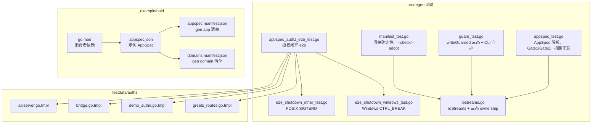
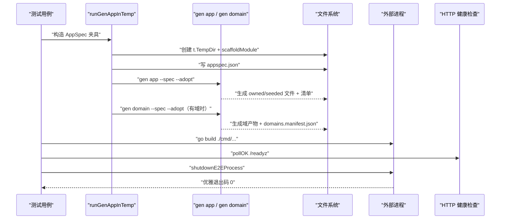
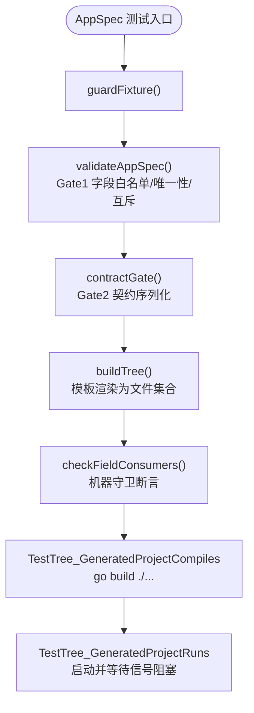
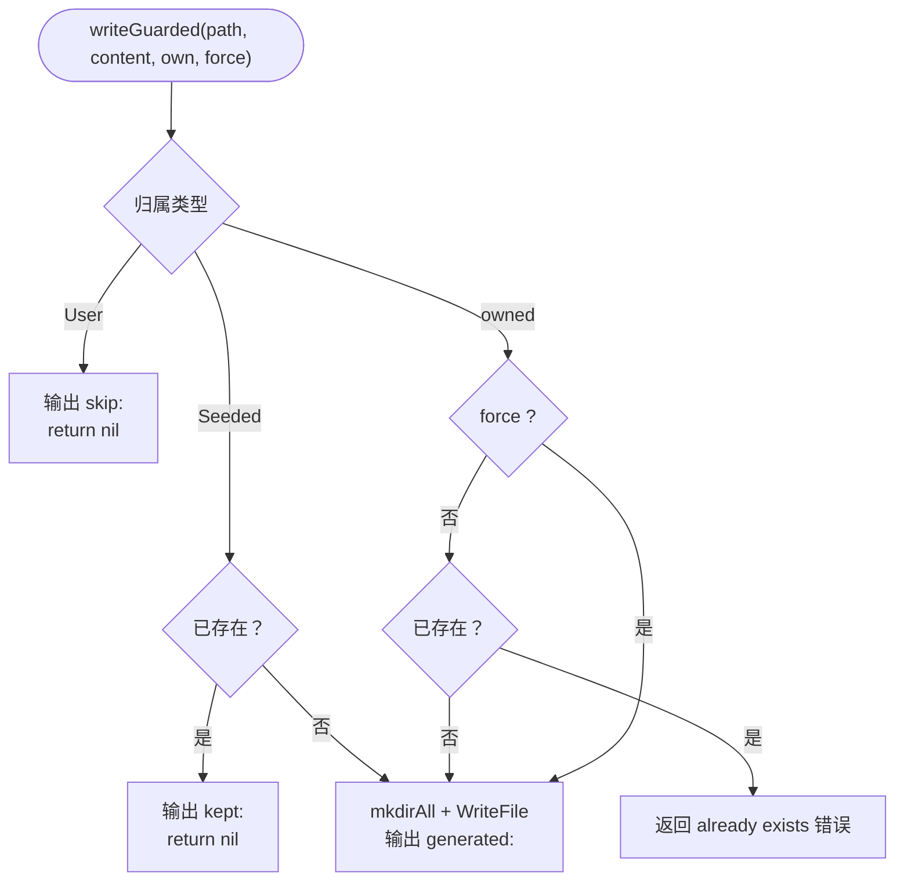
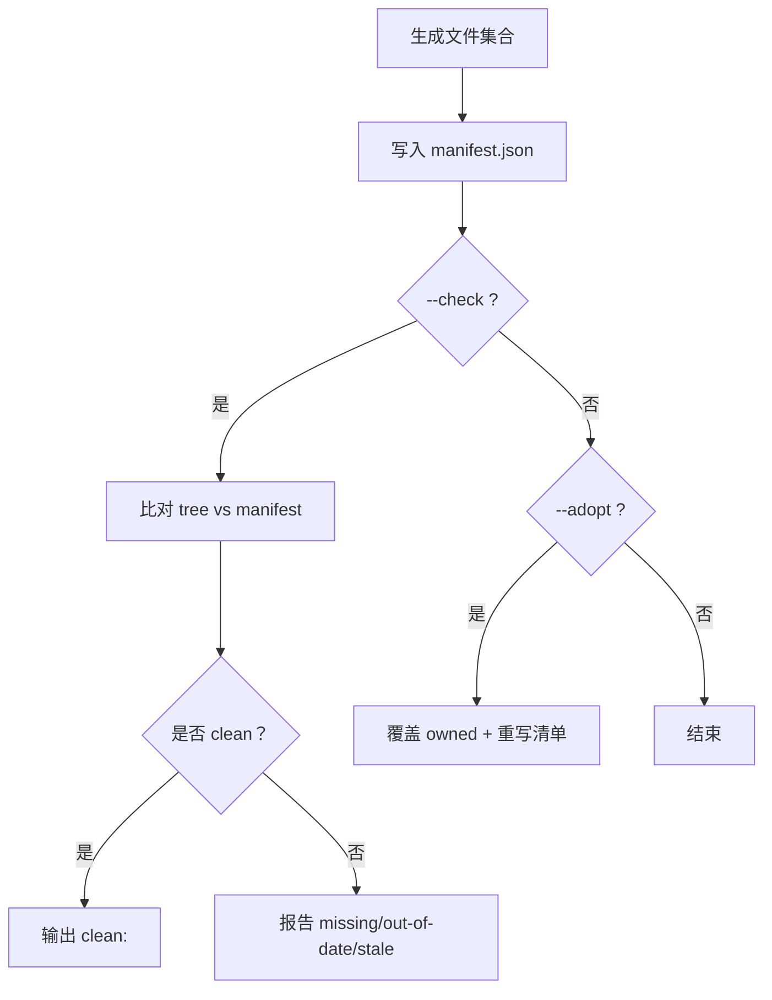
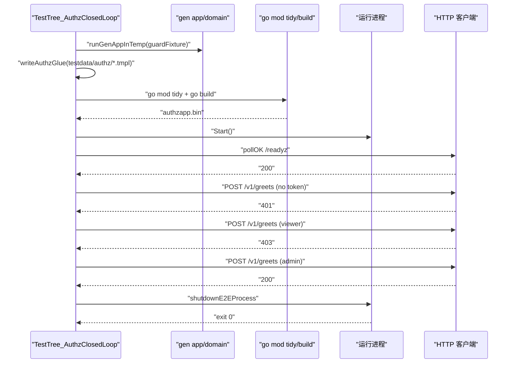
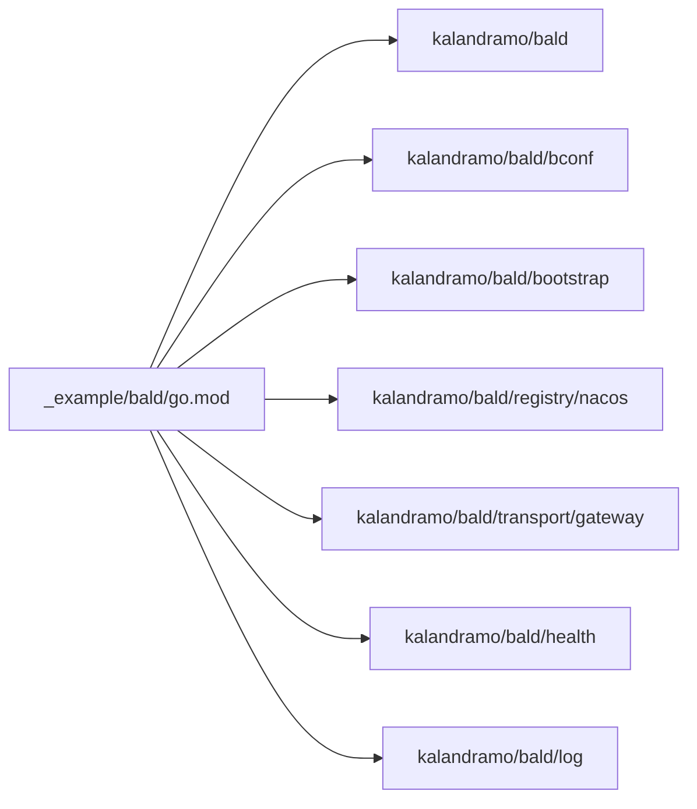

# 校验与测试

<cite>
**本文引用的文件**
- [appspec.json](file://_example/bald/appspec.json)
- [appspec.manifest.json](file://_example/bald/appspec.manifest.json)
- [domains.manifest.json](file://_example/bald/domains.manifest.json)
- [go.mod](file://_example/bald/go.mod)
- [appspec_test.go](file://internal/codegen/appspec_test.go)
- [guard_test.go](file://internal/codegen/guard_test.go)
- [manifest_test.go](file://internal/codegen/manifest_test.go)
- [e2e_shutdown_other_test.go](file://internal/codegen/e2e_shutdown_other_test.go)
- [e2e_shutdown_windows_test.go](file://internal/codegen/e2e_shutdown_windows_test.go)
- [iostreams.go](file://internal/codegen/iostreams.go)
- [appspec_authz_e2e_test.go](file://internal/codegen/appspec_authz_e2e_test.go)
- [apiserver.go.tmpl](file://internal/codegen/testdata/authz/apiserver.go.tmpl)
- [bridge.go.tmpl](file://internal/codegen/testdata/authz/bridge.go.tmpl)
- [demo_authn.go.tmpl](file://internal/codegen/testdata/authz/demo_authn.go.tmpl)
- [greets_routes.go.tmpl](file://internal/codegen/testdata/authz/greets_routes.go.tmpl)
</cite>

## 目录
1. [引言](#引言)
2. [项目结构](#项目结构)
3. [核心组件](#核心组件)
4. [架构总览](#架构总览)
5. [详细组件分析](#详细组件分析)
6. [依赖分析](#依赖分析)
7. [性能与覆盖率](#性能与覆盖率)
8. [故障排查指南](#故障排查指南)
9. [结论](#结论)

## 引言
本仓是 93 个 go.mod 的多模块仓库，代码生成子系统位于 `internal/codegen`。它通过 AppSpec 声明驱动应用与域代码的生成、清单管理与端到端验证。测试体系分为三层：

- **编译/运行上下文验证**：`_example/bald` 作为真实消费者模块，确保生成物可被实际项目消费。
- **单元测试**：覆盖 AppSpec 解析与模板渲染、写保护三态行为、清单正确性与确定性。
- **端到端集成测试**：构建并启动生成的应用，验证服务就绪、授权闭环与优雅停机。

作者提示要求本文重点覆盖三个主题：**服务发现与网关出站、CI 质量闸门、Broker 订阅者生命周期**。但当前文档目标聚焦于“校验与测试”，因此以下章节按测试维度展开；涉及 CI 闸门的部分会在“性能与覆盖率”中说明。

## 项目结构
`internal/codegen` 的测试相关组织如下：

**图表来源**
- [appspec_test.go:1079-1286](file://internal/codegen/appspec_test.go#L1079-L1286)
- [guard_test.go:1-224](file://internal/codegen/guard_test.go#L1-L224)
- [manifest_test.go:1-361](file://internal/codegen/manifest_test.go#L1-L361)
- [appspec_authz_e2e_test.go:1-192](file://internal/codegen/appspec_authz_e2e_test.go#L1-L192)
- [e2e_shutdown_other_test.go:1-18](file://internal/codegen/e2e_shutdown_other_test.go#L1-L18)
- [e2e_shutdown_windows_test.go:1-31](file://internal/codegen/e2e_shutdown_windows_test.go#L1-L31)
- [iostreams.go:1-106](file://internal/codegen/iostreams.go#L1-L106)
- [appspec.json:1-81](file://_example/bald/appspec.json#L1-L81)
- [appspec.manifest.json:1-112](file://_example/bald/appspec.manifest.json#L1-L112)
- [domains.manifest.json:1-32](file://_example/bald/domains.manifest.json#L1-L32)
- [go.mod:1-20](file://_example/bald/go.mod#L1-L20)

**章节来源**
- [appspec.json:1-81](file://_example/bald/appspec.json#L1-L81)
- [appspec.manifest.json:1-112](file://_example/bald/appspec.manifest.json#L1-L112)
- [domains.manifest.json:1-32](file://_example/bald/domains.manifest.json#L1-L32)
- [go.mod:1-20](file://_example/bald/go.mod#L1-L20)

## 核心组件
- **AppSpec 测试夹具与流水线**：`guardFixture()` 提供最小可用 AppSpec，`runGenAppInTemp()` 把夹具写入临时模块、执行 `gen app --spec`，并在存在域时追加 `gen domain --spec`。
- **写保护三态**：`ownership` 枚举定义 `owned`、`Seeded`、`User`，由 `writeGuarded()` 统一落盘决策。
- **清单系统**：`appspec.manifest.json` 与 `domains.manifest.json` 记录生成文件的 `ownership` 与哈希，供 `--check` 与 `--adopt` 使用。
- **端到端关机适配**：POSIX 用 `SIGTERM`，Windows 用 `CTRL_BREAK`，由 build tag 文件分别实现。
- **授权闭环 e2e**：通过 `testdata/authz/*.tmpl` 注入用户槽位，启动生成应用并断言无 token、viewer、admin 三种状态码。

**章节来源**
- [appspec_test.go:1079-1286](file://internal/codegen/appspec_test.go#L1079-L1286)
- [iostreams.go:1-106](file://internal/codegen/iostreams.go#L1-L106)
- [appspec.manifest.json:1-112](file://_example/bald/appspec.manifest.json#L1-L112)
- [domains.manifest.json:1-32](file://_example/bald/domains.manifest.json#L1-L32)
- [e2e_shutdown_other_test.go:1-18](file://internal/codegen/e2e_shutdown_other_test.go#L1-L18)
- [e2e_shutdown_windows_test.go:1-31](file://internal/codegen/e2e_shutdown_windows_test.go#L1-L31)
- [appspec_authz_e2e_test.go:1-192](file://internal/codegen/appspec_authz_e2e_test.go#L1-L192)

## 架构总览
代码生成测试的端到端流程如下：

**图表来源**
- [appspec_test.go:1079-1286](file://internal/codegen/appspec_test.go#L1079-L1286)
- [appspec_authz_e2e_test.go:1-192](file://internal/codegen/appspec_authz_e2e_test.go#L1-L192)
- [e2e_shutdown_other_test.go:1-18](file://internal/codegen/e2e_shutdown_other_test.go#L1-L18)
- [e2e_shutdown_windows_test.go:1-31](file://internal/codegen/e2e_shutdown_windows_test.go#L1-L31)

## 详细组件分析

### AppSpec 解析与模板渲染测试
`appspec_test.go` 是生成器语义的主回归面，覆盖三类能力：

| 类别 | 关键测试点 | 验证方式 |
|---|---|---|
| Gate1 生成期 schema 门 | 未知 component kind、重复组件名、requires/provides 子集、app.name 单处声明、域 name/go_package/import 别名互斥、service/services/http_only 三选一 | 调用 `validateAppSpec`，断言错误文本包含字段路径与约束关键字 |
| Gate2 契约门 | bootstrap → 配置树 → YAML 回读、未知键拒绝、Duration 字面量、空段保持对象 | 调用 `contractGate`，断言输出 YAML 片段 |
| 机器守卫 | AppSpec 描述符每个叶子字段都有登记的消费者，且标记出现在生成文本中 | 拼接全部生成文件文本后调用 `checkFieldConsumers` |

此外，该文件还提供测试基础设施：

- `guardFixture()`：最小 AppSpec，同时被 Gate1、Gate2、机器守卫、domain 形态夹具复用。
- `renderedFixture()`：串联 Gate1 → contractBootstrap → contractGate → buildTree，把所有生成文件拼成字符串供机器守卫断言。
- `writeSpecJSON()`：把 proto 结构序列化为 `protojson` 的 `appspec.json`。
- `runGenAppInTemp()`：完整流水线入口，自动 `scaffoldModule`、写 spec、执行 `gen app`、存在域时再执行 `gen domain`。
- `writeFixtureProto()`：在临时 module 内写出最小 greet.proto 及 protobuf Go stub，使 `gen domain` 能完成 service 校验与绑定派生。
- `TestTree_GeneratedProjectCompiles`：对 http+grpc、带 grpcgw variant、full gateway、仅域四种形态执行 `go build ./...`。
- `TestTree_GeneratedProjectRuns`：构建并启动生成的二进制，3 秒内仍存活即认为装配成功。

**图表来源**
- [appspec_test.go:1-500](file://internal/codegen/appspec_test.go#L1-L500)
- [appspec_test.go:1079-1286](file://internal/codegen/appspec_test.go#L1079-L1286)

**章节来源**
- [appspec_test.go:1-500](file://internal/codegen/appspec_test.go#L1-L500)
- [appspec_test.go:1079-1286](file://internal/codegen/appspec_test.go#L1079-L1286)

### writeGuarded 三态行为测试
`guard_test.go` 围绕 `writeGuarded()` 和 `writeFileFormatted()` 建立生成器的不可变底线：

| 场景 | 输入 | 期望行为 |
|---|---|---|
| owned + 已存在 + 无 force | 目标文件已存在 | 返回错误，错误信息含 `already exists` 与 `--force` 指引，原文件不变 |
| owned + force | 目标文件已存在 | 覆盖写入，输出 `generated:` |
| Seeded + 已存在 | 种子文件已存在 | 不报错，输出 `kept:`，保留用户修改内容 |
| User | 任何情况 | 永不落盘，输出 `skip:`，连目录都不创建 |
| writeFileFormatted + gofmt 失败 | 模板输出格式非法 | 不触碰目标文件，写 `<path>.rej` 诊断，错误附 `.rej` 路径 |
| gen proto CLI | 二次执行 | 拒绝覆盖；`--force` 放行；信息输出走 `ioStreams.Out` |

测试还证明：命令的信息性输出必须走 `streams.Out`，而不是 `os.Stderr`；负例测试故意触发错误时，通过 `ErrOut: io.Discard` 避免 Cobra 的 `Error: ...` 污染 stderr，再由 Execute 返回值逐字断言。

**图表来源**
- [guard_test.go:1-224](file://internal/codegen/guard_test.go#L1-L224)
- [iostreams.go:1-106](file://internal/codegen/iostreams.go#L1-L106)

**章节来源**
- [guard_test.go:1-224](file://internal/codegen/guard_test.go#L1-L224)
- [iostreams.go:1-106](file://internal/codegen/iostreams.go#L1-L106)

### Manifest 正确性与确定性测试
`manifest_test.go` 验证生成器的可审计性：

| 测试 | 断言要点 |
|---|---|
| `TestGen_Deterministic` | 同一份 AppSpec 双跑到不同临时目录，文件集合与字节完全一致 |
| `TestGen_CheckClean` | 首次生成后 `--check` 干净；owned 文件漂移、清单缺失、清单过期均失败，恢复后重新干净 |
| `TestGen_AdoptOverwritesOwnedOnly` | `--adopt` 覆盖 owned 文件但不覆盖 seeded 文件，之后树干净 |
| `TestGenApp_ModeFlags` | `--spec` 必填；`--adopt` 与 `--check` 互斥（gen app 与 gen domain 同口径） |
| `TestGenDomain_CheckClean` | `gen domain` 单独维护 `domains.manifest.json`，与 `appspec.manifest.json` 共存 |
| `TestCheckTree_ReportsStaleOwned` | 上次清单中有、本次不再生成的 owned 文件必须报告 stale，seeded 与越界路径不报 |
| `TestPruneStaleOwned` | `pruneStaleOwned` 删除 stale owned，保留 seed 与越界路径，并输出 removed 日志 |

清单文件本身由 `_example/bald` 提供真实样本：

- `appspec.manifest.json`：`tool` 为 `bald gen app`，每条文件记录 `ownership` 与 `hash`，区分 `owned` 与 `seeded`。
- `domains.manifest.json`：`tool` 为 `bald gen domain`，列出域生成产物。

**图表来源**
- [manifest_test.go:1-361](file://internal/codegen/manifest_test.go#L1-L361)
- [appspec.manifest.json:1-112](file://_example/bald/appspec.manifest.json#L1-L112)
- [domains.manifest.json:1-32](file://_example/bald/domains.manifest.json#L1-L32)

**章节来源**
- [manifest_test.go:1-361](file://internal/codegen/manifest_test.go#L1-L361)
- [appspec.manifest.json:1-112](file://_example/bald/appspec.manifest.json#L1-L112)
- [domains.manifest.json:1-32](file://_example/bald/domains.manifest.json#L1-L32)

### 端到端验证：生成应用启动与优雅停机
端到端测试分两类：

#### 授权闭环 e2e
`appspec_authz_e2e_test.go` 的 `TestTree_AuthzClosedLoop` 是最完整的端到端用例：

1. 跳过 `-short` 主循环，因为全链路分钟级墙钟。
2. 取仓库根，从 `internal/codegen/testdata/authz` 读取四处模板。
3. 使用 `guardFixture()` 生成应用，端口替换为空闲值。
4. 将模板写入生成树，并把 `{{MODULE}}` 替换为生成 module。
5. 执行 `go mod tidy`，追加 `contrib/authz-casbin` 的 require 与 replace。
6. `go build -o authzapp.bin ./cmd/demoapp`。
7. 启动进程，轮询 `/readyz`。
8. 发送三次请求断言：无 token→401、viewer→403、admin→200；reader 经别名反查→200。
9. 调用 `shutdownE2EProcess`，断言优雅退出码 0，超时则 kill 并失败。

**图表来源**
- [appspec_authz_e2e_test.go:1-192](file://internal/codegen/appspec_authz_e2e_test.go#L1-L192)
- [e2e_shutdown_other_test.go:1-18](file://internal/codegen/e2e_shutdown_other_test.go#L1-L18)
- [e2e_shutdown_windows_test.go:1-31](file://internal/codegen/e2e_shutdown_windows_test.go#L1-L31)

#### 平台无关的优雅停机
POSIX 与 Windows 通过 build tag 分离：

- POSIX (`e2e_shutdown_other_test.go`)：`withE2ESysProcAttr` 为空函数；`shutdownE2EProcess` 直接发送 `syscall.SIGTERM`。
- Windows (`e2e_shutdown_windows_test.go`)：`withE2ESysProcAttr` 设置 `CreationFlags = createNewProcessGroup`；`shutdownE2EProcess` 调用 `GenerateConsoleCtrlEvent(CTRL_BREAK_EVENT)`，Go 运行时将其转为 `os.Interrupt`，命中优雅停机分支。

**章节来源**
- [appspec_authz_e2e_test.go:1-192](file://internal/codegen/appspec_authz_e2e_test.go#L1-L192)
- [e2e_shutdown_other_test.go:1-18](file://internal/codegen/e2e_shutdown_other_test.go#L1-L18)
- [e2e_shutdown_windows_test.go:1-31](file://internal/codegen/e2e_shutdown_windows_test.go#L1-L31)

### 测试数据管理
测试数据集中在两处：

| 位置 | 用途 | 管理方式 |
|---|---|---|
| `internal/codegen/testdata/authz/*.tmpl` | 授权闭环的用户槽位接线源文 | 测试运行时读取、替换 `{{MODULE}}`、写入生成树 |
| `appspec_test.go` 中的 `writeFixtureProto` | 最小 greet.proto 与 protobuf Go stub | 以字符串常量形式嵌入，避免外部 fixture 依赖 |

`testdata/authz` 下的模板扮演“生成一次、归你维护”的用户槽位示范：

- `bridge.go.tmpl`：连接 `seed.Rows` 与 `ObjectAliases`。
- `demo_authn.go.tmpl`：认证桩。
- `apiserver.go.tmpl`：组装 `bundle.Authn` 与 `bundle.Authz` 链。
- `greets_routes.go.tmpl`：域自持受保护端点。

这些模板不是自动生成物，而是测试中由 `writeAuthzGlue` 复制进生成树的“种子用户文件”。

**章节来源**
- [appspec_authz_e2e_test.go:1-192](file://internal/codegen/appspec_authz_e2e_test.go#L1-L192)
- [apiserver.go.tmpl](file://internal/codegen/testdata/authz/apiserver.go.tmpl)
- [bridge.go.tmpl](file://internal/codegen/testdata/authz/bridge.go.tmpl)
- [demo_authn.go.tmpl](file://internal/codegen/testdata/authz/demo_authn.go.tmpl)
- [greets_routes.go.tmpl](file://internal/codegen/testdata/authz/greets_routes.go.tmpl)
- [appspec_test.go:1129-1185](file://internal/codegen/appspec_test.go#L1129-L1185)

### 测试环境隔离
所有测试遵循强隔离原则：

- **临时目录**：大量用例使用 `t.TempDir()`，包括 `guard_test.go` 的所有 writeGuarded 场景、`manifest_test.go` 的 deterministic/check/adopt/prune 场景、以及 `appspec_test.go` 的 `runGenAppInTemp`。
- **工作目录切换**：`runGenAppInTemp` 在 `t.Chdir(dir)` 后执行 `gen app`，保证相对产出落在临时 module 内。
- **并发安全**：每个测试拥有独立临时目录，不会共享文件；CLI 输出通过 `ioStreams` 注入 `bytes.Buffer`，避免跨测试串扰。
- **外部工具探测**：`TestTree_GeneratedProjectCompiles`、`TestTree_GeneratedProjectRuns`、`TestTree_AuthzClosedLoop` 都先探测 `go` 是否在 PATH，不存在则 `t.Skip`。
- **短测试开关**：授权闭环 e2e 显式跳过 `-short`，避免与 CI 主循环混入。

**章节来源**
- [guard_test.go:1-224](file://internal/codegen/guard_test.go#L1-L224)
- [manifest_test.go:1-361](file://internal/codegen/manifest_test.go#L1-L361)
- [appspec_test.go:1079-1286](file://internal/codegen/appspec_test.go#L1079-L1286)
- [appspec_authz_e2e_test.go:1-192](file://internal/codegen/appspec_authz_e2e_test.go#L1-L192)

## 依赖分析
`_example/bald` 作为消费者模块，其 `go.mod` 直接依赖发布后的 bald 模块族，包括 `github.com/kalandramo/bald`、`bconf`、`bootstrap`、`registry/nacos`、`transport/gateway` 等。这说明生成器产出的代码必须能被一个真实项目的依赖图装载。

**图表来源**
- [go.mod:1-20](file://_example/bald/go.mod#L1-L20)

**章节来源**
- [go.mod:1-20](file://_example/bald/go.mod#L1-L20)

## 性能与覆盖率
当前代码生成测试未发现 `Benchmark*` 函数，也没有覆盖率脚本引用。因此：

- **性能基准测试**：尚未在 `internal/codegen` 中引入；若新增耗时模板或清单比对逻辑，应补充 `Bench*` 用例。
- **覆盖率分析**：仓库未提供独立的覆盖率聚合步骤；建议后续在 Taskfile 或 CI 中增加 `go test -coverprofile=coverage.out ./internal/codegen/...`。
- **回归测试维护策略**：
  - AppSpec 字段变更必须同步更新 `guardFixture()` 与机器守卫登记，否则 `TestMachineGuard_AllFieldsConsumed` 会失败。
  - 生成确定性由 `TestGen_Deterministic` 钉住；模板输出变化会导致双跑字节不一致。
  - 清单语义由 `--check` 与 `--adopt` 用例共同维护；新增生成文件路径必须反映在清单或 `pruneStaleOwned` 行为中。
  - e2e 用例因全链路耗时，仅在非 `-short` 环境下运行，避免拖慢主回归。

关于 CI 质量闸门，作者提示指出 CI 有五个作业：test、race、integration、lint、vuln。主循环必须保留 `go test -short`；`transport/{redis,kafka,rabbitmq,rocketmq,tcp,webrtc}` 的 `TestServer`/`TestClient` 是等信号的手动用例，去掉 `-short` 会挂到 timeout。非 `-short` 的集成覆盖由 `integration` 作业按套件点名注入真 etcd/redis/mongo。

**章节来源**
- [appspec_test.go:1079-1286](file://internal/codegen/appspec_test.go#L1079-L1286)
- [manifest_test.go:1-361](file://internal/codegen/manifest_test.go#L1-L361)
- [appspec_authz_e2e_test.go:1-192](file://internal/codegen/appspec_authz_e2e_test.go#L1-L192)

## 故障排查指南
常见测试失败与定位方式：

| 现象 | 可能原因 | 排查步骤 |
|---|---|---|
| `TestMachineGuard_AllFieldsConsumed` 失败 | AppSpec 新增了未被消费者使用的字段 | 检查 `fieldConsumers` 是否登记对应字段标记，并确保生成模板确实输出该标记 |
| `TestWriteFileFormatted_GofmtFailureNeverTouchesTarget` 失败 | 生成器在 gofmt 前写入了目标文件 | 确认 `writeFileFormatted` 只在格式化成功后才调用 `writeGuarded` |
| `TestGen_CheckClean` 报告 out-of-date | 用户修改了 owned 文件，或清单缺失/过期 | 用 `--check` 查看差异路径；必要时用 `--adopt` 同步 |
| `TestGen_Deterministic` 双跑不一致 | 模板引入了时间、随机数或非确定 ID | 检查模板渲染逻辑，确保只依赖 AppSpec 与固定 seed |
| e2e 授权闭环卡住 | `/readyz` 未就绪或端口冲突 | 检查 `freePort` 分配、`configs/demoapp.yaml` 端口、以及 `pollOK` 重试窗口 |
| Windows 优雅停机超时 | 进程组未隔离或 CTRL_BREAK 投递失败 | 确认 build tag 选择了 Windows 实现，且被测进程设置了新进程组属性 |

**章节来源**
- [appspec_test.go:1-500](file://internal/codegen/appspec_test.go#L1-L500)
- [guard_test.go:1-224](file://internal/codegen/guard_test.go#L1-L224)
- [manifest_test.go:1-361](file://internal/codegen/manifest_test.go#L1-L361)
- [appspec_authz_e2e_test.go:1-192](file://internal/codegen/appspec_authz_e2e_test.go#L1-L192)
- [e2e_shutdown_windows_test.go:1-31](file://internal/codegen/e2e_shutdown_windows_test.go#L1-L31)

## 结论
`internal/codegen` 的测试体系以 AppSpec 声明为中心，形成“schema 门 → 契约门 → 模板渲染 → 清单审计 → 端到端运行”的完整回归链。`_example/bald` 作为真实消费者模块，承担编译/运行上下文验证；`appspec_test.go`、`guard_test.go`、`manifest_test.go` 分别覆盖解析语义、写保护语义与清单语义；`appspec_authz_e2e_test.go` 与平台相关的 shutdown 适配文件则验证生成应用的启动与优雅停机。

对于后续演进，建议优先补齐性能基准与覆盖率统计，并继续以现有夹具模式扩展新的 AppSpec 字段与生成场景，确保机器守卫、清单与 e2e 三者同步增长。