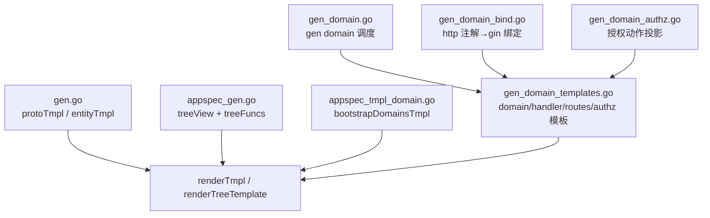
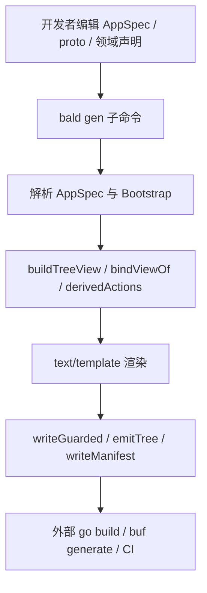
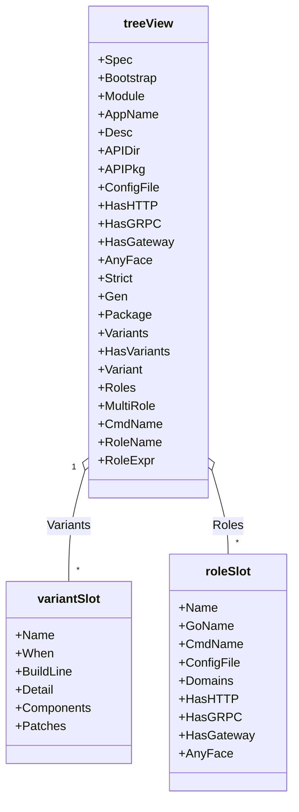
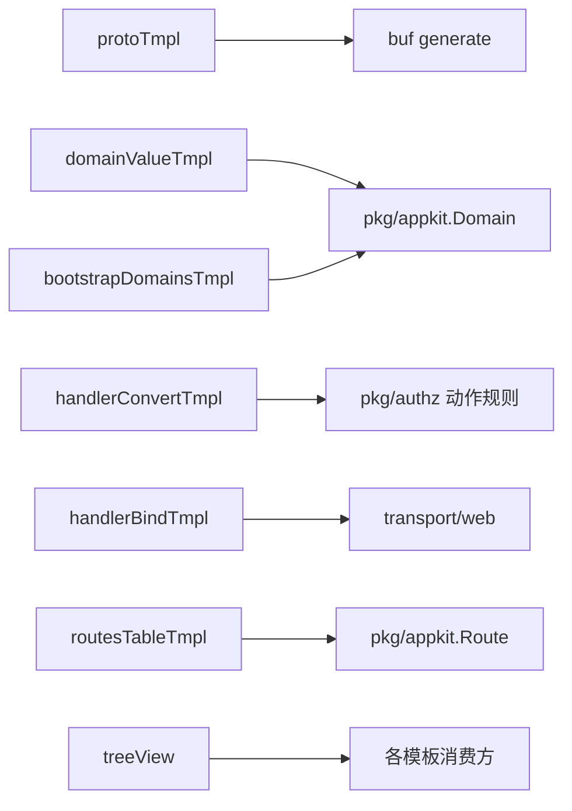

# 模板引擎

<cite>
**本文引用的文件 **
- [gen.go](file://internal/codegen/gen.go)
- [appspec_gen.go](file://internal/codegen/appspec_gen.go)
- [gen_domain_templates.go](file://internal/codegen/gen_domain_templates.go)
- [gen_domain.go](file://internal/codegen/gen_domain.go)
- [gen_domain_bind.go](file://internal/codegen/gen_domain_bind.go)
- [gen_domain_authz.go](file://internal/codegen/gen_domain_authz.go)
- [appspec_tmpl_domain.go](file://internal/codegen/appspec_tmpl_domain.go)
</cite>

## 目录
1. [简介](#简介)
2. [项目结构](#项目结构)
3. [核心组件](#核心组件)
4. [架构总览](#架构总览)
5. [详细组件分析](#详细组件分析)
6. [依赖关系分析](#依赖关系分析)
7. [性能与调试](#性能与调试)
8. [故障排查](#故障排查)
9. [结论](#结论)
10. [附录：自定义模板开发指南](#附录自定义模板开发指南)

## 简介
本仓的“代码生成系统”以 Go 标准库 `text/template` 为核心，承担两类职责：
- 命令驱动的代码骨架生成（例如 `bald gen proto`、`bald gen app --spec`、`bald gen domain`）。
- 从 AppSpec/Bootstrap/AppKit 等声明数据派生 Go 源码，包括协议定义、应用装配树、域清单、REST 绑定、授权投影和路由清单。

模板不是运行时视图层，而是“声明→可编译 Go 源码”的一次性渲染器。所有模板字符串都内嵌在 Go 源文件中，通过共享函数集 `treeFuncs` 提供格式化、转义、命名派生与反射访问能力。

## 项目结构
模板相关代码集中在 `internal/codegen`：
- `gen.go`：`protoTmpl`、`entityTmpl`、`title` 与通用渲染入口。
- `appspec_gen.go`：`treeView` 结构体、共享函数集、目录树模板渲染入口。
- `appspec_tmpl_domain.go`：`bootstrapDomainsTmpl`、变体模板、分层测试模板。
- `gen_domain_templates.go`：`domainValueTmpl`、`handlerConvertTmpl`、`handlerBindTmpl`、`routesTableTmpl`、`authzAliasTmpl`。
- `gen_domain.go`：`gen domain` 执行流程与产物调度。
- `gen_domain_bind.go`：google.api.http → gin 绑定与路由清单派生。
- `gen_domain_authz.go`：授权动作投影与 object 别名派生。

**图表来源 **
- [gen.go:25-218](file://internal/codegen/gen.go#L25-L218)
- [appspec_gen.go:1-120](file://internal/codegen/appspec_gen.go#L1-L120)
- [appspec_tmpl_domain.go:116-200](file://internal/codegen/appspec_tmpl_domain.go#L116-L200)
- [gen_domain_templates.go:12-185](file://internal/codegen/gen_domain_templates.go#L12-L185)
- [gen_domain.go:1-120](file://internal/codegen/gen_domain.go#L1-L120)
- [gen_domain_bind.go:1-80](file://internal/codegen/gen_domain_bind.go#L1-L80)
- [gen_domain_authz.go:1-40](file://internal/codegen/gen_domain_authz.go#L1-L40)

**章节来源 **
- [gen.go:25-218](file://internal/codegen/gen.go#L25-L218)
- [appspec_gen.go:1-120](file://internal/codegen/appspec_gen.go#L1-L120)
- [appspec_tmpl_domain.go:1-200](file://internal/codegen/appspec_tmpl_domain.go#L1-L200)
- [gen_domain_templates.go:12-185](file://internal/codegen/gen_domain_templates.go#L12-L185)
- [gen_domain.go:1-120](file://internal/codegen/gen_domain.go#L1-L120)
- [gen_domain_bind.go:1-80](file://internal/codegen/gen_domain_bind.go#L1-L80)
- [gen_domain_authz.go:1-40](file://internal/codegen/gen_domain_authz.go#L1-L40)

## 核心组件
### 模板分类体系
| 类别 | 变量名 | 用途 | 输出位置或语义 |
|---|---|---|---|
| 协议定义模板 | `protoTmpl` | 生成 CRUD 六件套 service，附带 google.api.http 注解、buf.validate 字段校验与 store 过滤类型 | `api/proto/<name>/v1/<name>.proto` |
| 实体骨架模板 | `entityTmpl` | 生成带 gORM tag 与 `KeyOf` 的实体结构 | 业务包实体层 |
| 域声明值模板 | `domainValueTmpl` | 生成一次后由用户维护的 `appkit.Domain` 值骨架 | `<go_package>/domain.gen.go` |
| 授权动作投影模板 | `handlerConvertTmpl` | 按 RPC 名映射默认授权动作，生成逐方法 map | `handler/convert/<d>.gen.go` |
| REST 绑定模板 | `handlerBindTmpl` | 根据 google.api.http 注解生成 gin 路由、请求绑定与响应编码 | `handler/gin/<d>.bind.gen.go` |
| 路由清单模板 | `routesTableTmpl` | 生成 `appkit.Route` 切片，供计划期可见与冲突检测 | `internal/<apiserver_dir>/routes/<d>.gen.go` |
| 应用域清单模板 | `bootstrapDomainsTmpl` | 聚合各域 `Domain` 值，支撑单角色或多角色装配 | `internal/bootstrap/domains.gen.go` |

**章节来源 **
- [gen.go:25-218](file://internal/codegen/gen.go#L25-L218)
- [gen_domain_templates.go:12-185](file://internal/codegen/gen_domain_templates.go#L12-L185)
- [appspec_tmpl_domain.go:116-200](file://internal/codegen/appspec_tmpl_domain.go#L116-L200)

### 数据驱动的视图生成
模板不直接读配置键，而是先由 Go 层把 AppSpec、Bootstrap、proto 扫描结果、role/variant 维度组装成派生视图对象，再传给 `template.Execute`：
- `buildTreeView` 把原始 `*appspecv1.AppSpec` 与 `*bootstrapv1.BootstrapConfig` 转为 `treeView`。
- `buildVariants` 把 `AppSpec.variants` 归一为 `When`、`BuildLine`、`Detail`。
- `buildRoles` 合成单角色默认槽位，并按角色覆盖传输面。
- `bindViewOf` 把 proto 方法与 google.api.http 注解转换为 `bindServiceView`、`bindRouteView`。
- `derivedActions` / `derivedAuthz` 把 proto service/method 转为授权 action/object 表。

这意味着模板中的循环与条件只表达“如何展开”，不表达“如何解析配置”。

**章节来源 **
- [appspec_gen.go:120-286](file://internal/codegen/appspec_gen.go#L120-L286)
- [gen_domain_bind.go:80-180](file://internal/codegen/gen_domain_bind.go#L80-L180)
- [gen_domain_authz.go:40-145](file://internal/codegen/gen_domain_authz.go#L40-L145)

### 函数过滤器
共享函数集 `treeFuncs` 是模板侧唯一的外部逻辑入口：
- `q`：对字符串加双引号转义，用于生成 Go 字面量。
- `title`：首字母大写，用于服务名、方法名、包名派生。
- `alias`：把 import 路径折算为合法 Go import 别名。
- `grpcObject`：service 全名 → 授权 object，规则与 `pkg/authz.DefaultGRPCObject` 同源。
- `services`：从域声明取有效 service 全名，http_only 域为空。
- `list`：模板内联列表常量。

`renderTreeTemplate` 用 `template.New(name).Funcs(treeFuncs)` 构造每个模板实例，错误包装包含模板名称。

**章节来源 **
- [appspec_gen.go:230-286](file://internal/codegen/appspec_gen.go#L230-L286)

## 架构总览

**图表来源 **
- [gen_domain.go:60-120](file://internal/codegen/gen_domain.go#L60-L120)
- [appspec_gen.go:120-200](file://internal/codegen/appspec_gen.go#L120-L200)
- [gen_domain_bind.go:180-260](file://internal/codegen/gen_domain_bind.go#L180-L260)

## 详细组件分析

### treeView 结构体设计
`treeView` 是目录树模板的共享数据载体，核心原则是“原始 Spec 与派生值分离”：
- `Spec` 保留原始 `*appspecv1.AppSpec`，避免模板直接访问 proto optional 字段带来的存在性歧义。
- `Bootstrap` 指向契约配置树的唯一真相源 `*bootstrapv1.BootstrapConfig`。
- `HasHTTP` / `HasGRPC` / `HasGateway` / `AnyFace` 由 server 段是否存在及 driver 是否等于网关驱动推导。
- `Variants` 与 `Variant` 区分“构建期变体集合”和“当前渲染槽位”。
- `Roles` 恒非空；roles 为空时合成一个 CmdName 等于 AppName 的默认角色，保证单角色与多角色分支字节一致。
- `RoleExpr` 让 customOptions 钩子在单角色和多角色下共用同一签名。

**图表来源 **
- [appspec_gen.go:20-120](file://internal/codegen/appspec_gen.go#L20-L120)
- [appspec_gen.go:120-200](file://internal/codegen/appspec_gen.go#L120-L200)

**章节来源 **
- [appspec_gen.go:20-200](file://internal/codegen/appspec_gen.go#L20-L200)

### 条件分支逻辑：HasHTTP / HasGRPC / HasGateway
模板中三类布尔控制常见形态：
- 应用级开关：`HasHTTP`、`HasGRPC`、`HasGateway`、`AnyFace` 决定是否需要 HTTP/gRPC/网关门面、是否需要组件工厂。
- 角色级开关：`roleSlot` 上的同名布尔按角色覆盖，支持不同角色暴露不同传输面。
- 功能裁剪：`HasVariants`、`HasComponents`、`HasDomains`、`HasRoutes` 控制变体实现、组件增量、授权聚合、路由清单是否出现。

这些布尔值全部由 `buildTreeView`、`buildVariants`、`buildRoles` 计算，模板只消费，不再自行判断 proto optional 的存在性。

**章节来源 **
- [appspec_gen.go:120-200](file://internal/codegen/appspec_gen.go#L120-L200)
- [appspec_tmpl_domain.go:139-168](file://internal/codegen/appspec_tmpl_domain.go#L139-L168)
- [gen_domain_templates.go:12-185](file://internal/codegen/gen_domain_templates.go#L12-L185)

### 循环渲染：domains / roles / variants / services / routes
模板循环对应不同的派生维度：
- `range .Spec.Domains`：遍历业务域，生成域清单 import 与 `Domain` 值引用。
- `range .Roles`：遍历角色，生成多角色分支与 `domainOptionsForRole`。
- `range .Variants`：遍历变体，生成 `VariantDecl` 与命中增量说明。
- `range .Services`：遍历 proto service，为每个 service 生成接口与绑定函数。
- `range .Routes`：遍历 google.api.http 注解，生成 gin 路由与 `appkit.Route` 条目。
- `range .Aliases` / `range .Actions`：生成授权别名表与动作投影。

循环顺序与去重策略在 Go 派生阶段就已确定：`seenRPC`、`seenBinder`、`seenRoute`、`imports` 防止重复注册与 import 冲突。

**章节来源 **
- [appspec_tmpl_domain.go:131-168](file://internal/codegen/appspec_tmpl_domain.go#L131-L168)
- [gen_domain_templates.go:12-185](file://internal/codegen/gen_domain_templates.go#L12-L185)
- [gen_domain_bind.go:80-180](file://internal/codegen/gen_domain_bind.go#L80-L180)

### 字符串格式化：q 与 title
- `q` 使用 Go `%q` 格式，生成安全的双引号字面量，用于包名、服务名、路径、FullMethod、授权 key/value 等。
- `title` 把域名、服务名首字母大写，用于 `MountXxx`、`XxxService`、`XxxActions` 等标识符。
- `alias` 把导入路径基名清洗为合法 Go 标识符，避免 import 别名非法或数字开头。

三者共同保证模板输出的 Go 语法合法性，而不是把格式化逻辑写进模板表达式。

**章节来源 **
- [appspec_gen.go:230-286](file://internal/codegen/appspec_gen.go#L230-L286)
- [gen.go:335-344](file://internal/codegen/gen.go#L335-L344)

### 协议定义模板 protoTmpl
`protoTmpl` 是全仓唯一的 protobuf 模板，产出 CRUD 六件套：
- Service：List、Get、Create、Update、Delete。
- 资源消息：资源本体、ListRequest、ListResponse、GetRequest、CreateRequest、UpdateRequest、DeleteRequest。
- REST 注解：每个 RPC 对应 `/v1/{plural}` 或 `/v1/{plural}/{id}`。
- 校验：`buf.validate.field` 约束 id、name 长度。
- 结构化过滤：ListRequest 使用 `bald.store.v1.FilterExpr`。

该模板由 `protoOptions.Run` 渲染并写入 guarded 文件，随后提示作者加入 buf module 并运行 `buf generate`。

**章节来源 **
- [gen.go:25-218](file://internal/codegen/gen.go#L25-L218)

### 实体骨架模板 entityTmpl
`entityTmpl` 生成最小业务实体与 GORM 主键标签，并提供 `KeyOf{Name}` 提取主键。它面向需要手写存储层的场景，与 proto 定义解耦。

**章节来源 **
- [gen.go:200-218](file://internal/codegen/gen.go#L200-L218)

### 域声明值模板 domainValueTmpl
`domainValueTmpl` 生成 `<go_package>/domain.gen.go`，内容是一个导出的 `appkit.Domain` 值。关键行为：
- 首次生成：若目标包尚未导出 `Domain`，则 seed 骨架。
- 已存在：跳过覆盖，后续由用户手动补 `Declare` 与 `ApplyNode`。
- 清单仍记录该文件，避免重新生成时因“骨架不存在”导致字节漂移。

这是“生成一次 + 用户维护”的典型模式。

**章节来源 **
- [gen_domain_templates.go:12-33](file://internal/codegen/gen_domain_templates.go#L12-L33)
- [gen_domain.go:120-170](file://internal/codegen/gen_domain.go#L120-L170)

### 授权动作投影模板 handlerConvertTmpl
`handlerConvertTmpl` 生成 `handler/convert/<d>.gen.go`，其中 `<Name>Actions` 是 FullMethod 到授权动作的映射。动作派生规则与 `pkg/authz.DefaultGRPCAction` 同源：
- Delete 前缀 → `delete`
- List 前缀 → `list`
- Create/Update/Set/Put 前缀 → `write`
- 其他 → `get`

多个 service 的动作会合并，FullMethod 键全局唯一。

**章节来源 **
- [gen_domain_templates.go:35-63](file://internal/codegen/gen_domain_templates.go#L35-L63)
- [gen_domain_authz.go:40-80](file://internal/codegen/gen_domain_authz.go#L40-L80)

### REST 绑定模板 handlerBindTmpl
`handlerBindTmpl` 生成 `handler/gin/<d>.bind.gen.go`，默认启用：
- 每个 proto service 一份 Go 接口与 `BindXxx` 函数。
- 接口方法来自 rpc 签名，请求/响应类型来自 proto 生成的 Go 包。
- 路由注册使用 `web.BindProtoRequest` 与 `web.WriteProtoResponse`。
- google.api.http 注解是唯一真相源；未实现的注解字段会拒绝生成，避免静默偏离。

前置条件：
- proto 的 Go 类型已由 `--proto-cmd` 产出。
- 消费者 module require `github.com/kalandramo/bald/transport/web`。
- 流式 RPC 携带 http 注解会报错。
- 同 method+shape 的路径冲突会在生成期报错。

**章节来源 **
- [gen_domain_templates.go:65-115](file://internal/codegen/gen_domain_templates.go#L65-L115)
- [gen_domain_bind.go:80-180](file://internal/codegen/gen_domain_bind.go#L80-L180)
- [gen_domain_bind.go:260-334](file://internal/codegen/gen_domain_bind.go#L260-L334)

### 路由清单模板 routesTableTmpl
`routesTableTmpl` 生成 `internal/<apiserver_dir>/routes/<d>.gen.go`，内容是 `[]appkit.Route`。它与 `handlerBindTmpl` 同源，但只描述路由元数据，不引入 transport/web 实现依赖。域声明值引用它即可获得计划可见性，使 `--plan`、`doctor` 与跨域冲突检测能列出注解派生的路由。

**章节来源 **
- [gen_domain_templates.go:117-160](file://internal/codegen/gen_domain_templates.go#L117-L160)
- [gen_domain_bind.go:200-240](file://internal/codegen/gen_domain_bind.go#L200-L240)

### 应用域清单模板 bootstrapDomainsTmpl
`bootstrapDomainsTmpl` 由 `gen app` 与 `gen domain` 共用，避免两份清单模板漂移。它：
- 按 `Spec.Domains` 声明序 import 各域包。
- 单角色时生成 `domainOptions`。
- 多角色时生成 `domainOptions{Role}` 与 `domainOptionsForRole(role)`。
- package 子句由清单落盘路径折算，根级清单退化为 `main`。

**章节来源 **
- [appspec_tmpl_domain.go:116-200](file://internal/codegen/appspec_tmpl_domain.go#L116-L200)

## 依赖关系分析

**图表来源 **
- [gen.go:25-218](file://internal/codegen/gen.go#L25-L218)
- [gen_domain_templates.go:12-185](file://internal/codegen/gen_domain_templates.go#L12-L185)
- [appspec_tmpl_domain.go:116-200](file://internal/codegen/appspec_tmpl_domain.go#L116-L200)
- [gen_domain_bind.go:260-334](file://internal/codegen/gen_domain_bind.go#L260-L334)

**章节来源 **
- [gen.go:25-218](file://internal/codegen/gen.go#L25-L218)
- [gen_domain_templates.go:12-185](file://internal/codegen/gen_domain_templates.go#L12-L185)
- [appspec_gen.go:120-286](file://internal/codegen/appspec_gen.go#L120-L286)

## 性能与调试
### 性能特性
- 模板渲染是一次性的内存操作，使用 `strings.Builder` 累积输出，无 IO 直到 `emitTree`。
- 模板函数都是 O(1) 字符串处理；主要成本来自循环展开的文本量。
- 模板不会缓存解析结果；每次调用 `renderTreeTemplate` 都会 `template.Parse`，但模板数量少且体积有限，对整体生成耗时影响不大。
- 真正的大对象（如 proto 扫描、AppSpec JSON）在渲染前已经构造好，模板侧只做迭代。

优化建议：
- 避免在模板里做复杂字符串拼接，改用 `title`、`q`、`alias` 等预定义函数。
- 保持派生阶段的数据有序、去重，减少模板分支爆炸。
- 对大型路由清单，优先在 Go 层排序与去重，模板只负责序列化。

### 调试技巧
- 使用 `--check` 走 `checkTree` 与 `pruneStaleOwned`，在不写盘的情况下验证差异。
- 对绑定生成失败，查看错误信息中的 domain、rpc、path shape、proto package alias 等关键字。
- 对授权不一致，检查 `authz/alias.gen.go` 的 ObjectAliases 与 DefaultActions 是否与策略行对账。
- 对清单漂移，确认 `gen app` 与 `gen domain` 是否共用同一模板与相同 manifest 路径。
- 对变体命中问题，检查 `variants.gen.go` 的 When 表达式与 `variant_<name>.gen.go` 的 `//go:build` 是否一致。

**章节来源 **
- [appspec_gen.go:260-286](file://internal/codegen/appspec_gen.go#L260-L286)
- [gen_domain.go:80-120](file://internal/codegen/gen_domain.go#L80-L120)
- [gen_domain_bind.go:260-334](file://internal/codegen/gen_domain_bind.go#L260-L334)

## 故障排查
### 绑定缺失 proto Go 类型
现象：生成器报告缺少 proto Go 包，或 `--proto-cmd` 执行后仍无产物。
原因：
- 未安装或误配 `--proto-cmd`。
- proto/buf 配置未产出 Go 文件。
- go_package 指向外部 module，生成器不探测其产物。

处理：
- 先运行 `--proto-cmd` 手动生成。
- 若不需要 REST 绑定，使用 `--no-bind`。
- 若只需清单不要绑定，使用 `--no-routes` 时必须同时开启绑定。

**章节来源 **
- [gen_domain_bind.go:260-334](file://internal/codegen/gen_domain_bind.go#L260-L334)

### 流式 RPC 无法绑定 REST
现象：proto 的流式 RPC 上写了 google.api.http 注解，生成期直接报错。
原因：grpc-gateway 不支持流式转码，gin 绑定也无法承载。
处理：移除注解，或手写 REST handler。

**章节来源 **
- [gen_domain_bind.go:120-150](file://internal/codegen/gen_domain_bind.go#L120-L150)

### 路由形状冲突
现象：两个 RPC 被转换成相同 gin path shape。
原因：路径变量名不同但形状相同，gin 无法注册两条完全一致的路由。
处理：调整 google.api.http 路径，或拆分域。

**章节来源 **
- [gen_domain_bind.go:140-170](file://internal/codegen/gen_domain_bind.go#L140-L170)

### 授权 object 别名歧义
现象：同一个 grpc object 映射到多个不同 HTTP object。
原因：多个 service 的注解路径首段归一化结果不一致。
处理：统一 resource 命名，或显式维护 `ObjectAliases`。

**章节来源 **
- [gen_domain_authz.go:100-145](file://internal/codegen/gen_domain_authz.go#L100-L145)

## 结论
该代码生成系统的模板引擎以 `text/template` 为基础，但关键价值不在模板语法本身，而在“声明→派生视图→模板渲染”的分层：
- 模板只负责展开、格式化与输出。
- 派生层负责解析 AppSpec、Bootstrap、proto、role/variant 维度。
- 命令行负责 Gate1 校验、proto 前置、guarded 写入与清单管理。
- 模板分类清晰：CRUD proto、实体骨架、域声明值、授权投影、REST 绑定、路由清单、应用域清单各司其职。

扩展新模板时，应遵循现有约定：新增模板字符串、在 `treeFuncs` 中补充必要过滤器、在 Go 层构造派生数据、通过 `renderTreeTemplate` 渲染，并由 `genFile` 与 manifest 跟踪归属。

## 附录：自定义模板开发指南
### 新增模板步骤
1. 在合适的文件中新增内嵌模板字符串变量。
2. 如果需要字符串转义、命名派生或 import 别名，先在 `treeFuncs` 中增加函数。
3. 在 Go 层构造派生数据，不要直接在模板里访问 proto optional 字段。
4. 调用 `renderTreeTemplate` 渲染，并把结果放入 `genFile`。
5. 如果是 Go 源码，设置 `GoSrc: true`，由 `emitTree` 调用 `gofmt`。
6. 更新 manifest 与守护逻辑，确保 `--adopt` 能清理旧产物。

### 模板最佳实践
- 使用 `q` 包裹所有字符串字面量。
- 使用 `title` 生成 Go 标识符，避免手写大小写转换。
- 使用 `alias` 生成 import 别名，避免非法标识符。
- 用 `HasHTTP` / `HasGRPC` / `HasGateway` 控制门面分支，不要用裸 proto optional 判断。
- 用 `range .Roles` / `range .Domains` / `range .Variants` 表达多维组合。
- 对可能冲突的路由、import、binder 在 Go 派生阶段提前报错，不把风险推到运行期。

### 性能注意事项
- 避免在模板中重复调用昂贵函数；尽量在 Go 层预计算。
- 对大型集合，先在 Go 层排序、去重、分组。
- 模板解析不缓存，但模板数量可控，不必过度优化解析路径。
- 生成阶段允许打印中间日志（例如 proto 阶段），便于定位流水线问题。

**章节来源 **
- [appspec_gen.go:230-286](file://internal/codegen/appspec_gen.go#L230-L286)
- [gen_domain.go:60-120](file://internal/codegen/gen_domain.go#L60-L120)
- [gen_domain_bind.go:80-180](file://internal/codegen/gen_domain_bind.go#L80-L180)