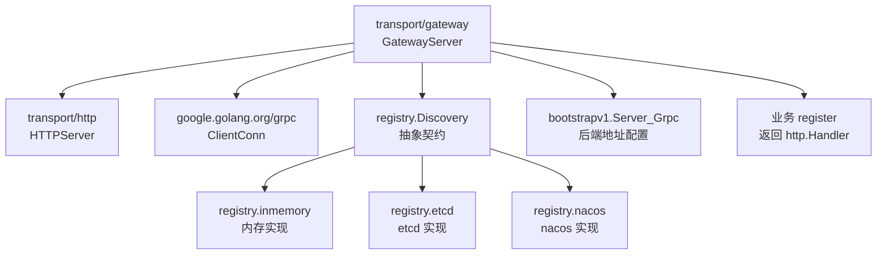
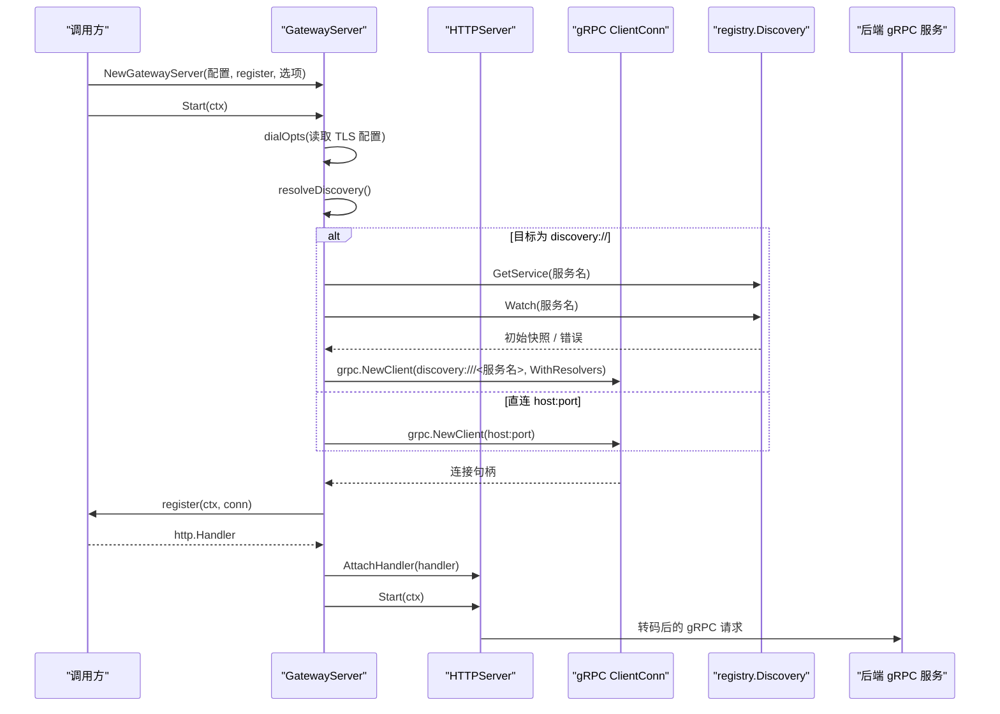
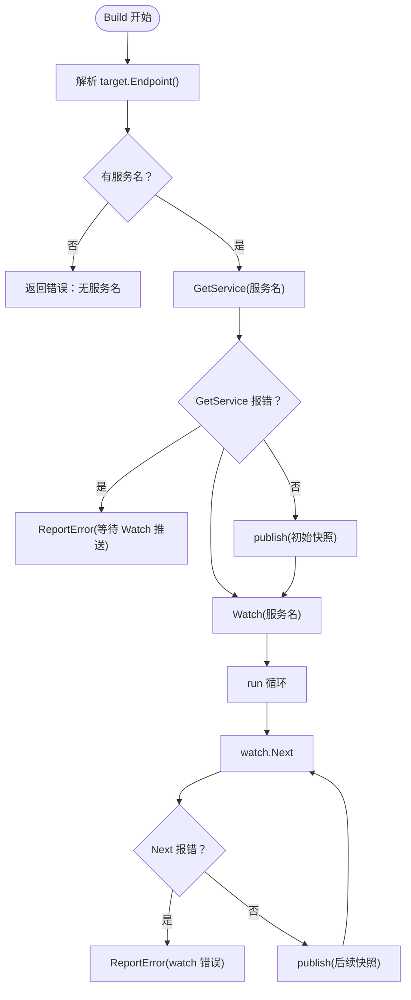
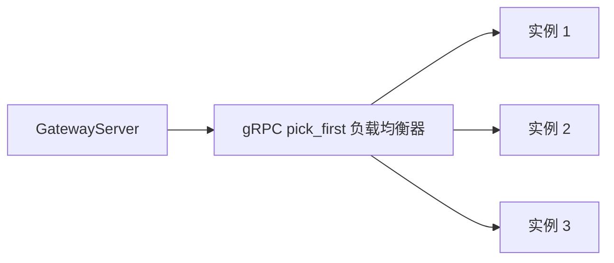
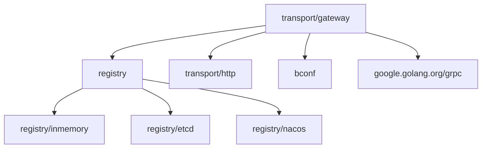

# Gateway 网关

<cite>
**本文引用的文件**   
- [gateway_server.go](file://transport/gateway/gateway_server.go)
- [discovery.go](file://transport/gateway/discovery.go)
- [discovery_test.go](file://transport/gateway/discovery_test.go)
- [go.mod](file://transport/gateway/go.mod)
- [registry.go](file://registry/registry.go)
- [inmemory.go](file://registry/inmemory/inmemory.go)
- [watcher.go](file://registry/etcd/watcher.go)
- [watcher.go](file://registry/nacos/watcher.go)
- [list-modules.sh](file://scripts/list-modules.sh)
</cite>

## 目录
1. [引言](#引言)
2. [项目结构](#项目结构)
3. [核心组件](#核心组件)
4. [架构总览](#架构总览)
5. [详细组件分析](#详细组件分析)
6. [依赖关系分析](#依赖关系分析)
7. [性能与行为特征](#性能与行为特征)
8. [故障排查指南](#故障排查指南)
9. [结论](#结论)
10. [附录：负载均衡、熔断降级、限流与灰度发布](#附录负载均衡熔断降级限流与灰度发布)

## 引言
Gateway 网关是 Bald 框架中统一暴露 HTTP 入口并转码到后端 gRPC 服务的能力。它复用 HTTPServer 承载业务提供的路由处理器，把 REST 请求转发给一个可配置的后端 gRPC 服务端点。后端地址支持两种模式：

- **直连模式（默认）**：`backend_grpc_addr` 填 `host:port`，由 gRPC 原生 DNS resolver 解析。
- **服务发现模式**：`backend_grpc_addr` 写为 `discovery:///<服务名>`，由本包注入的 `registry.Discovery` 解析实例，并通过 gRPC 自定义 resolver 推送端点快照。

文档重点覆盖三个主题：

1. **服务发现与网关出站**：`discovery:///<服务名>` 的语义、端点过滤、错误恢复。
2. **CI 质量闸门**：模块清单、测试短路策略、集成作业注入真实后端。
3. **Broker 订阅者生命周期**：致命退出后不会自动摘除订阅映射，重订阅是覆盖而非累积。

此外，本仓库是一个包含 93 个 go.mod 的多模块仓库；Gateway 只是其中之一。根 module 不得 require 适配器或具体注册中心实现，避免模块环。

**章节来源**
- [gateway_server.go:15-30](file://transport/gateway/gateway_server.go#L15-L30)
- [discovery.go:14-27](file://transport/gateway/discovery.go#L14-L27)
- [list-modules.sh:1-24](file://scripts/list-modules.sh#L1-L24)

## 项目结构
Gateway 相关代码集中在 `transport/gateway` 子模块中，对外暴露三类能力：

| 路径 | 职责 | 关键类型 |
|---|---|---|
| `transport/gateway/gateway_server.go` | HTTP 网关服务器、后端连接管理、启动/停止流程 | `GatewayServer`、`NewGatewayServer` |
| `transport/gateway/discovery.go` | gRPC 自定义 resolver，适配 `registry.Discovery` | `discoveryBuilder`、`discoveryResolver` |
| `transport/gateway/discovery_test.go` | 服务发现语义、端点过滤、错误恢复、端到端拨号 | 多组用例 |
| `transport/gateway/go.mod` | 模块声明与本地 replace 闭包 | 依赖 `registry`、`transport/http`、`bconf` |

**图示来源**
- [gateway_server.go:15-30](file://transport/gateway/gateway_server.go#L15-L30)
- [registry.go:55-81](file://registry/registry.go#L55-L81)
- [inmemory.go:18-30](file://registry/inmemory/inmemory.go#L18-L30)

**章节来源**
- [gateway_server.go:15-30](file://transport/gateway/gateway_server.go#L15-L30)
- [go.mod:1-10](file://transport/gateway/go.mod#L1-L10)

## 核心组件

### GatewayServer：统一入口与后端连接
`GatewayServer` 组合了 `httpserver.HTTPServer`，负责：

- 按 `Server_Http` 启动 HTTP 监听。
- 按 `Server_Grpc` 建立到后端 gRPC 的连接。
- 调用业务传入的 `register` 函数，用已建立的 `grpc.ClientConn` 构造转码处理器。
- 通过 `WithDiscovery` 或 `WithDiscoverySource` 决定是否启用 `discovery://` 目标。
- 在 `Start` 时延迟创建后端连接，避免构造期配置未加载导致端口被默认值锁死。
- 在 `Stop` 时关闭后端 gRPC 连接。

关键点：

- 后端 TLS 凭据由 `dialOpts` 根据 `Server_Grpc.Tls` 决定；未配置则为明文。
- `register` 返回 nil 时使用空 `http.ServeMux`；返回非 nil 时替换默认处理器。
- 健康探针不在 Gateway 内部实现，而是由装配层或业务侧在 mux 上挂载。

**章节来源**
- [gateway_server.go:15-30](file://transport/gateway/gateway_server.go#L15-L30)
- [gateway_server.go:75-115](file://transport/gateway/gateway_server.go#L75-L115)
- [gateway_server.go:117-130](file://transport/gateway/gateway_server.go#L117-L130)
- [gateway_server.go:132-185](file://transport/gateway/gateway_server.go#L132-L185)

### DiscoveryScheme：服务发现目标协议
`DiscoveryScheme = "discovery"`，目标格式为 `discovery:///<服务名>`。该 scheme 由 `usesDiscoveryTarget` 判定，唯一依据是前缀匹配，与 gRPC 选择 resolver 的方式同源，避免漂移。

语义约定：

- 写 `discovery:///<服务名>`：走注册中心。
- 写普通 `host:port`：走 gRPC 原生 dns resolver。
- 同一 Gateway 中可以并存直连与服务发现目标。

**章节来源**
- [discovery.go:14-27](file://transport/gateway/discovery.go#L14-L27)
- [discovery.go:29-34](file://transport/gateway/discovery.go#L29-L34)

## 架构总览

**图示来源**
- [gateway_server.go:117-185](file://transport/gateway/gateway_server.go#L117-L185)
- [discovery.go:57-85](file://transport/gateway/discovery.go#L57-L85)

## 详细组件分析

### 服务发现与网关出站

#### 三种既定语义

| 语义 | 行为 | 原因 |
|---|---|---|
| Build 返回错误时 gRPC 不会重试 | 仅“服务名为空”和“Watch 建不起来”会直接返回错误；首次快照失败改为上报错误并继续订阅 | gRPC 的重建 resolver 只在重连退避到期触发，最长可达两分钟，不适合用来恢复注册中心临时不可用 |
| 空快照不推 UpdateState | 实例数为 0 时只 `ReportError("no instances")`，不调用 `UpdateState` | gRPC 对空地址集返回 `ErrBadResolverState`，且会清掉已有健康地址 |
| 只取 grpc:// 端点 | `addressesOf` 只接受裸 `host:port` 或剥掉 `grpc://` 前缀的地址；其他 scheme 整体丢弃 | 真实注册端点带 scheme，gRPC 拨号器不接受带 scheme 的地址 |

**图示来源**
- [discovery.go:57-85](file://transport/gateway/discovery.go#L57-L85)
- [discovery.go:122-174](file://transport/gateway/discovery.go#L122-L174)

**章节来源**
- [discovery.go:57-85](file://transport/gateway/discovery.go#L57-L85)
- [discovery.go:122-174](file://transport/gateway/discovery.go#L122-L174)
- [discovery_test.go:201-235](file://transport/gateway/discovery_test.go#L201-L235)
- [discovery_test.go:236-256](file://transport/gateway/discovery_test.go#L236-L256)
- [discovery_test.go:333-360](file://transport/gateway/discovery_test.go#L333-L360)

#### nacos 多端点拆分与目标写法
nacos 后端把一个实例的多个端点拆成 `<服务名>.<scheme>` 形式的多个服务。例如一个实例同时暴露 HTTP 和 gRPC 面，会在 nacos 里注册为同名但带不同 scheme 后缀的服务。因此：

- 目标必须写 `discovery:///<服务名>.grpc`。
- 少写 `.grpc` 后缀可能解析到 HTTP 面或空集。
- 内存与 etcd 使用注册时填写的 `ServiceInstance.Name` 原样作为服务名。

**章节来源**
- [discovery.go:14-27](file://transport/gateway/discovery.go#L14-L27)
- [registry/nacos/registry.go:150-200](file://registry/nacos/registry.go#L150-L200)
- [registry/nacos/watcher.go:60-98](file://registry/nacos/watcher.go#L60-L98)

#### 直连模式的默认行为
当 `backend_grpc_addr` 不是 `discovery://` 开头时：

- `resolveDiscovery` 返回 nil discovery。
- 不注入自定义 resolver。
- gRPC 使用原生 dns resolver 解析 `host:port`。
- 注入 discovery 不影响直连目标。

**章节来源**
- [gateway_server.go:132-168](file://transport/gateway/gateway_server.go#L132-L168)
- [discovery_test.go:424-450](file://transport/gateway/discovery_test.go#L424-L450)

### 负载均衡策略
当前 Gateway 的 gRPC 出站使用 gRPC 默认 balancer，即 `pick_first`。这意味着：

- 它是**故障转移**，不是**负载均衡**。
- 多个实例按顺序取主备，而不是分摊流量。
- 若需要多副本分摊流量，应在拨号侧配置 `round_robin` 等服务级负载均衡策略。

**图示来源**
- [gateway_server.go:52-68](file://transport/gateway/gateway_server.go#L52-L68)

**章节来源**
- [gateway_server.go:52-68](file://transport/gateway/gateway_server.go#L52-L68)

### 错误处理与恢复

| 场景 | Gateway 行为 |
|---|---|
| 目标写 `discovery://` 但未注入 discovery | `Start` 快速失败，提示缺少 `WithDiscovery` 或 `WithDiscoverySource` |
| discovery source 返回 nil | `Start` 快速失败，防止退回默认 dns resolver |
| discovery source 返回错误 | `Start` 携带原始错误失败 |
| 首次 GetService 报错 | 不返回 Build 错误，改为 `ReportError` 并保留 Watch 订阅 |
| Watch 建不起来 | Build 返回错误，让 gRPC 重建 resolver |
| Watch.Next 报错 | `ReportError` 并退出 run 循环，交给 gRPC TransientFailure 恢复 |
| Close 导致 Next 返回 | 不视为故障，不上报错误 |
| UpdateState 失败 | 上报错误，但不重新解析；下一次变更仍会推送 |

**章节来源**
- [gateway_server.go:132-168](file://transport/gateway/gateway_server.go#L132-L168)
- [discovery.go:57-85](file://transport/gateway/discovery.go#L57-L85)
- [discovery.go:122-174](file://transport/gateway/discovery.go#L122-L174)
- [discovery_test.go:308-360](file://transport/gateway/discovery_test.go#L308-L360)
- [discovery_test.go:685-719](file://transport/gateway/discovery_test.go#L685-L719)

### Broker 订阅者生命周期
虽然 Broker 不属于 Gateway 包，但与 Gateway 同属 Bald 框架的可观测出站与事件能力。关于订阅者生命周期的重要事实：

- broker 订阅者在致命退出后**不会自行摘除** `SubscriberSyncMap` 条目。
- 摘除是调用方或 `Disconnect` 的责任。
- 重订阅是**覆盖**而非累积。
- 代价是 `Topics()/Len()/Has()` 可能高报死订阅者数量。
- 该口径由 `broker/kafka/subscriber_test.go` 钉住。

这一行为意味着：监控订阅者数量的 API 不能当作精确存活计数；需要结合外部状态或显式断开逻辑判断真实订阅数。

**章节来源**
- [registry.go:1-30](file://registry/registry.go#L1-L30)
- [list-modules.sh:1-24](file://scripts/list-modules.sh#L1-L24)

## 依赖关系分析

Gateway 模块依赖以下核心契约与实现：

**图示来源**
- [go.mod:1-10](file://transport/gateway/go.mod#L1-L10)
- [go.mod:11-22](file://transport/gateway/go.mod#L11-L22)
- [registry.go:1-30](file://registry/registry.go#L1-L30)

### 模块边界约束
- `*/contract` 包只放契约装配，不 import 具体后端。
- 根 module 不得 require 任何适配器。
- 多模块仓库的唯一派生清单由 `scripts/list-modules.sh` 提供，排除 `_example`。
- CI 与 Taskfile 都消费该清单，保证本地与 CI 覆盖范围一致。

**章节来源**
- [go.mod:1-22](file://transport/gateway/go.mod#L1-L22)
- [list-modules.sh:1-24](file://scripts/list-modules.sh#L1-L24)

## 性能与行为特征

| 维度 | 行为 |
|---|---|
| 解析开销 | discovery source 仅在目标确实是 `discovery://` 时才调用，直连配置不支付注册中心获取成本 |
| 快照传播 | watch-based 推送，每次全量快照转一次 `UpdateState` |
| 稳定性 | 空实例不上报地址，避免 gRPC 清空健康地址 |
| 恢复路径 | Watch 错误交给 gRPC TransientFailure 重建 resolver；Close 不污染状态 |
| 并发模型 | GatewayServer 使用互斥锁保护连接建立与启动，避免 Stop 与 Start 死锁 |
| 观察性 | 健康探针由装配层或业务挂载，不在 Gateway 内部硬编码 |

**章节来源**
- [gateway_server.go:117-185](file://transport/gateway/gateway_server.go#L117-L185)
- [discovery.go:122-174](file://transport/gateway/discovery.go#L122-L174)

## 故障排查指南

### 常见问题

| 现象 | 可能原因 | 排查建议 |
|---|---|---|
| 启动时报“没有 discovery” | 目标写了 `discovery://` 但没有注入 `WithDiscovery` 或 `WithDiscoverySource` | 检查 gateway 构造选项 |
| 连接无法进入 Ready | 注册中心只有 HTTP 面，或所有端点都不是 `grpc://` | 确认 nacos 目标是否带 `.grpc` 后缀 |
| 解析成功但连接不到后端 | 端点带 scheme 未被剥离，或实例已下线 | 查看 resolver 输出的地址列表 |
| 启动期后端尚未注册 | GetService 报错属于正常过渡态 | 观察是否随后通过 Watch 推送恢复 |
| Watch 异常后一直不恢复 | gRPC 重建 resolver 存在退避周期 | 检查 Watch 错误日志与后端连通性 |
| 订阅数偏高 | broker 订阅者致命退出未显式摘除 | 检查调用方 Disconnect 逻辑 |

**章节来源**
- [gateway_server.go:132-168](file://transport/gateway/gateway_server.go#L132-L168)
- [discovery_test.go:450-526](file://transport/gateway/discovery_test.go#L450-L526)
- [discovery_test.go:574-604](file://transport/gateway/discovery_test.go#L574-L604)

## 结论
Gateway 网关以最小侵入方式提供 HTTP 到 gRPC 的统一入口，并把“直连”和“注册中心”两种出站模式收敛在同一配置字段中。其设计强调：

- 明确区分 `discovery://` 与普通 host:port。
- 将“后端尚未注册”“实例为空”“Watch 错误”等状态分类处理，避免静默故障。
- 只接受 gRPC 端点，过滤 HTTP 等其他面。
- 默认使用 gRPC `pick_first`，适合主备故障转移，不适合流量分摊。
- 健康、鉴权、版本控制等横切能力由上层装配和业务层组合，Gateway 保持专注。

**章节来源**
- [gateway_server.go:15-30](file://transport/gateway/gateway_server.go#L15-L30)
- [discovery.go:14-27](file://transport/gateway/discovery.go#L14-L27)
- [discovery.go:57-85](file://transport/gateway/discovery.go#L57-L85)

## 附录：负载均衡、熔断降级、限流与灰度发布

### 负载均衡
- Gateway 出站默认使用 gRPC `pick_first`，是主备故障转移。
- 如需多副本分摊流量，需在拨号侧配置 `round_robin` 或其他 balancer。
- 当前实现不把注册中心快照交给自定义负载均衡器，而是交给 gRPC 内置 balancer。

**章节来源**
- [gateway_server.go:52-68](file://transport/gateway/gateway_server.go#L52-L68)

### 熔断降级
仓库提供 `circuitbreaker` 包，包含 hystrix、sentinel、sres、vegas 等实现。但 Gateway 自身并未内嵌熔断逻辑；熔断应放在业务 handler 或上游中间件层。注意：

- `circuitbreaker/sres` 是唯一使用随机源的 breaker。
- 概率式组件测试不应直接断言统计阈值；应先构造有界前置状态再断言放行率。

**章节来源**
- [circuitbreaker/sres/sres.go:1-200](file://circuitbreaker/sres/sres.go#L1-L200)

### 限流控制
仓库提供 `ratelimit` 包，包含 bbr、sentinel、tokenbucket 实现。Gateway 同样未内嵌限流；限流应通过 HTTP/gRPC 中间件或业务层实现。

**章节来源**
- [ratelimit/ratelimit.go:1-200](file://ratelimit/ratelimit.go#L1-L200)

### API 版本管理
API 版本管理应由业务层通过 URL 路径、Header、gRPC service/method 命名或服务发现元数据实现。Gateway 只负责转发；它不解析业务 API 语义。

### 灰度发布
灰度发布的常见方案包括：

- 在服务发现层按标签、权重或集群分流。
- 在 nacos 后端通过 metadata 中的 version、weight 字段配合客户端筛选。
- 在业务路由层按用户 ID、租户、Header 做分流。
- Gateway 本身不实现灰度策略，只把请求转发到已解析出的后端端点。

注意：consul 与 kubernetes 注册中心后端在本仓库中未被完全覆盖，不能作为已验证的生产接入证据。

**章节来源**
- [registry/nacos/watcher.go:60-98](file://registry/nacos/watcher.go#L60-L98)
- [registry.go:1-30](file://registry/registry.go#L1-L30)