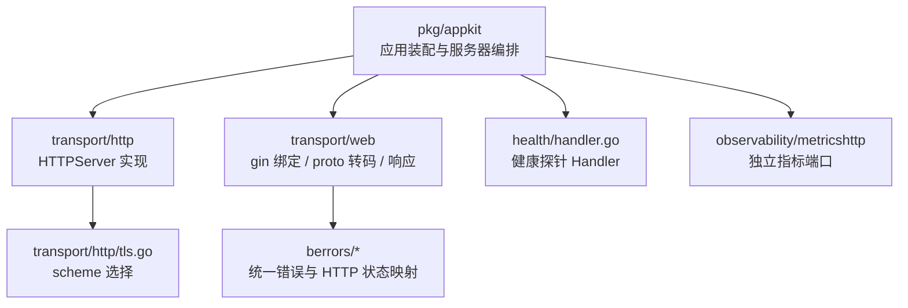
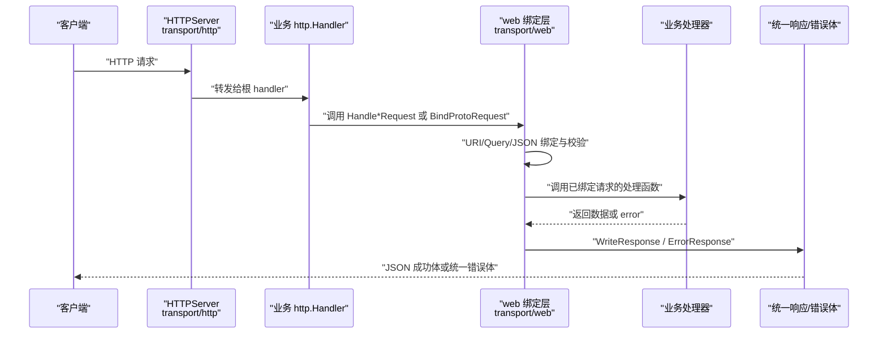
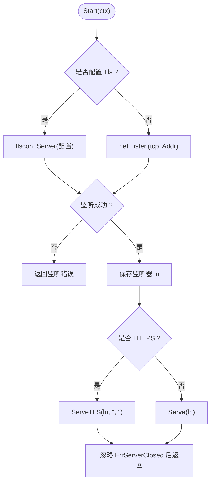
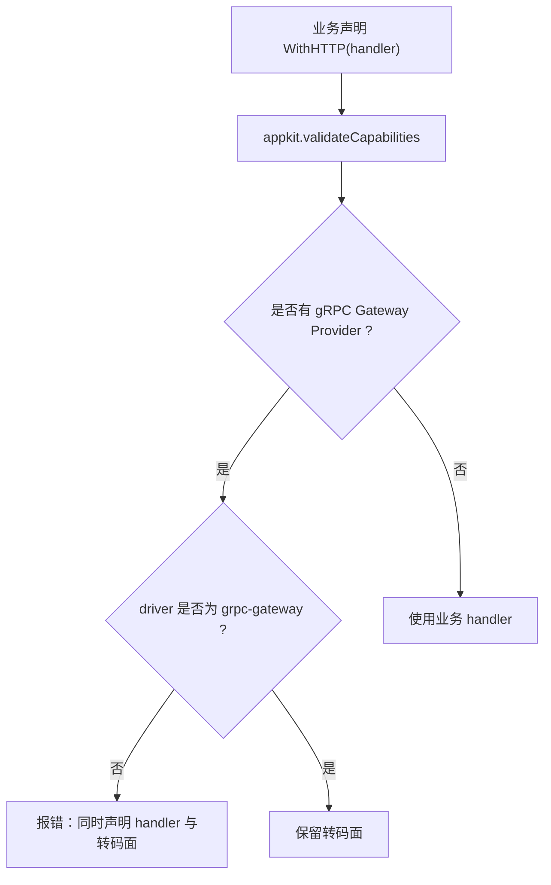
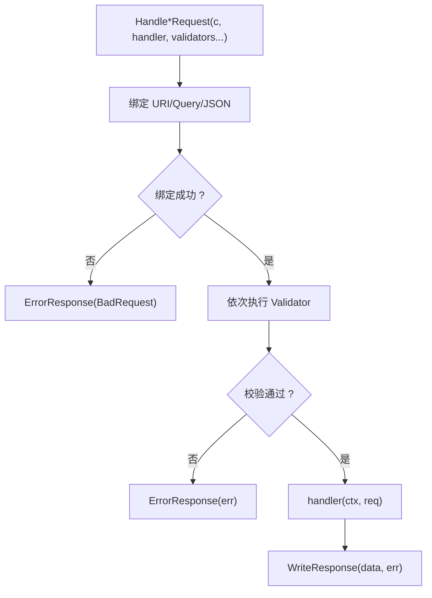
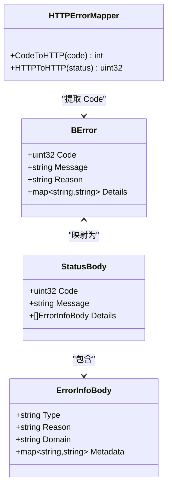
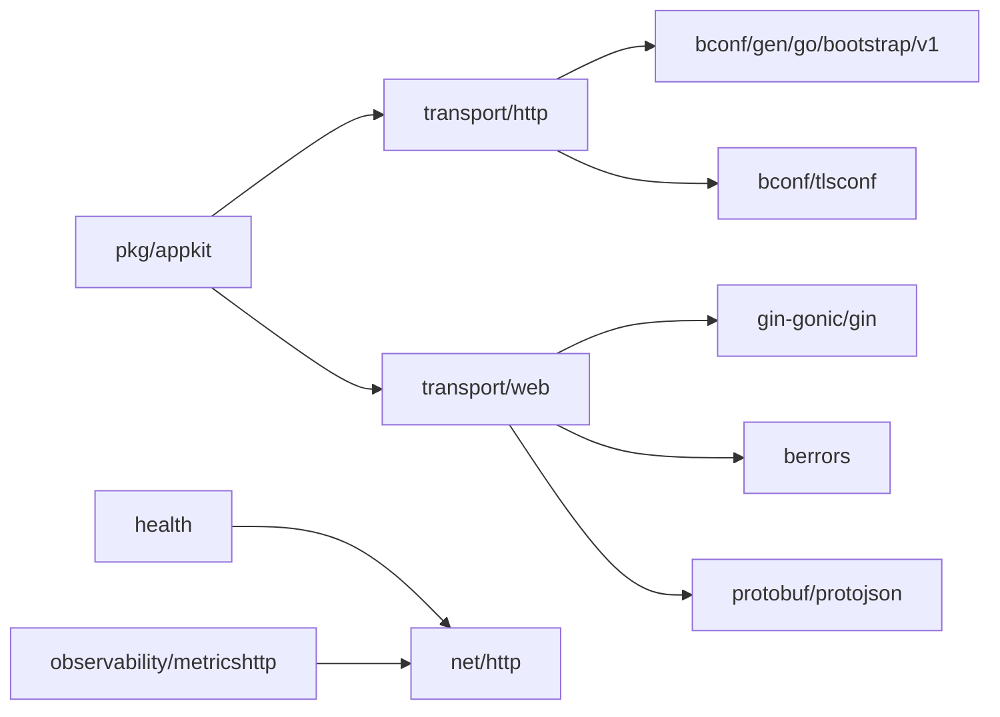

# HTTP 传输

<cite>
**本文引用的文件**   
- [transport/http/http_server.go](file://transport/http/http_server.go)
- [transport/http/tls.go](file://transport/http/tls.go)
- [transport/http/http_server_test.go](file://transport/http/http_server_test.go)
- [transport/web/binder.go](file://transport/web/binder.go)
- [transport/web/handler.go](file://transport/web/handler.go)
- [transport/web/protobind.go](file://transport/web/protobind.go)
- [transport/web/response.go](file://transport/web/response.go)
- [pkg/appkit/bootstrap.go](file://pkg/appkit/bootstrap.go)
- [berrors/code.go](file://berrors/code.go)
- [berrors/httperr/httperr_test.go](file://berrors/httperr/httperr_test.go)
- [health/handler.go](file://health/handler.go)
- [observability/metricshttp/metricshttp.go](file://observability/metricshttp/metricshttp.go)
</cite>

## 目录
1. [引言](#引言)
2. [项目结构](#项目结构)
3. [核心组件](#核心组件)
4. [架构总览](#架构总览)
5. [详细组件分析](#详细组件分析)
6. [依赖关系分析](#依赖关系分析)
7. [性能与安全配置](#性能与安全配置)
8. [监控与可观测性](#监控与可观测性)
9. [故障排查](#故障排查)
10. [结论](#结论)

## 引言
本文聚焦仓库中的 HTTP 传输层，系统性说明以下主题：
- HTTP Server 的实现、生命周期、TLS 支持、监听地址解析。
- 路由注册与中间件链的组织方式。
- 请求处理流水线：参数绑定、校验、响应格式化。
- 从 Proto 定义自动映射 REST API 的 Web 绑定层。
- 错误码统一映射、健康探针与指标暴露的集成方式。
- 安全、性能与监控实践建议。

该仓库是 93 个 Go module 的多模块工程；HTTP 相关代码主要分布在 `transport/http`（协议实现）、`transport/web`（gin/Web 绑定与 proto 转码）、`pkg/appkit`（应用装配与服务器编排）以及 `health`、`observability/metricshttp`（横切能力）。

## 项目结构
与 HTTP 传输直接相关的目录和文件如下：



**图表来源**
- [pkg/appkit/bootstrap.go:200-500](file://pkg/appkit/bootstrap.go#L200-L500)
- [transport/http/http_server.go:1-123](file://transport/http/http_server.go#L1-L123)
- [transport/http/tls.go:1-13](file://transport/http/tls.go#L1-L13)
- [transport/web/handler.go:1-116](file://transport/web/handler.go#L1-L116)
- [transport/web/protobind.go:1-290](file://transport/web/protobind.go#L1-L290)
- [transport/web/response.go:1-107](file://transport/web/response.go#L1-L107)
- [health/handler.go:1-84](file://health/handler.go#L1-L84)
- [observability/metricshttp/metricshttp.go:1-60](file://observability/metricshttp/metricshttp.go#L1-L60)

**章节来源**
- [transport/http/http_server.go:1-123](file://transport/http/http_server.go#L1-L123)
- [pkg/appkit/bootstrap.go:200-500](file://pkg/appkit/bootstrap.go#L200-L500)

## 核心组件
- `transport/http.HTTPServer`：封装标准库 `net/http.Server`，实现框架的 `transport.Server` 契约（Start/Stop/Endpoint），负责监听、TLS 启动、优雅停止、动态端口解析。
- `transport/web`：面向 gin 的请求绑定、校验、响应封装，以及按 google.api.http 语义将 HTTP 请求装载到 protobuf 消息。
- `pkg/appkit`：把业务 handler 与 server 段装配起来，决定是否启用 HTTP 面、如何处理 gRPC Gateway 转码面冲突，并管理服务器生命周期。
- `berrors` + `berrors/httperr`：统一的传输级错误码与 HTTP 状态码双向映射。
- `health`：Kubernetes liveness/readiness 探针的 HTTP Handler。
- `observability/metricshttp`：独立的 Prometheus 指标暴露端，与业务服务解耦。

**章节来源**
- [transport/http/http_server.go:1-123](file://transport/http/http_server.go#L1-L123)
- [transport/web/handler.go:1-116](file://transport/web/handler.go#L1-L116)
- [berrors/code.go:1-64](file://berrors/code.go#L1-L64)
- [health/handler.go:1-84](file://health/handler.go#L1-L84)
- [observability/metricshttp/metricshttp.go:1-60](file://observability/metricshttp/metricshttp.go#L1-L60)

## 架构总览
HTTP 请求在 Bald 中的典型路径是：



**图表来源**
- [transport/http/http_server.go:1-123](file://transport/http/http_server.go#L1-L123)
- [transport/web/handler.go:1-116](file://transport/web/handler.go#L1-L116)
- [transport/web/protobind.go:1-290](file://transport/web/protobind.go#L1-L290)
- [transport/web/response.go:1-107](file://transport/web/response.go#L1-L107)

## 详细组件分析

### HTTP Server：监听、TLS 与 Endpoint
`HTTPServer` 不是完整 Web 框架，而是一个协议适配层：
- 构造时接受一个 `http.Handler`；传 nil 时默认返回 404，便于 gateway 延迟挂载。
- `Start` 先根据 `bootstrapv1.Server_Http.Tls` 构建 TLS 配置，再创建 TCP Listener；有 TLS 时走 `ServeTLS`，否则走 `Serve`。
- `Stop` 使用 `http.Server.Shutdown` 做优雅停机。
- `Endpoint` 返回 `http://` 或 `https://` 前缀的真实地址，支持 `:0` 动态端口，并对通配符地址做本机可达 IP 解析，避免把 `0.0.0.0` 注册进服务发现。

关键设计要点：
- TLS 构建失败发生在监听之前，属于启动期失败，不会留下“已占端口但不可用”的地址。
- `ln` 字段由读写锁保护，因为 `Start` 与 `Endpoint` 可能并发访问。
- 包注释明确声明：**不注册任何框架路由**，包括健康检查与就绪探针；这些由装配层或业务自行挂载。



**图表来源**
- [transport/http/http_server.go:40-100](file://transport/http/http_server.go#L40-L100)
- [transport/http/tls.go:1-13](file://transport/http/tls.go#L1-L13)

**章节来源**
- [transport/http/http_server.go:1-123](file://transport/http/http_server.go#L1-L123)
- [transport/http/tls.go:1-13](file://transport/http/tls.go#L1-L13)
- [transport/http/http_server_test.go:1-125](file://transport/http/http_server_test.go#L1-L125)

### 路由注册与中间件链
HTTP 层的路由并不由 `HTTPServer` 提供。实际路由由业务传入的 `http.Handler` 决定，常见形态是 gin.Engine 或 gRPC Gateway 生成的标准库 mux。

`pkg/appkit` 在装配阶段处理两类入口：
- `WithHTTP(handler)`：业务显式声明 HTTP handler。
- 若同时存在 gRPC Gateway Provider 接管 `server.http`，且未显式设置 `driver = grpc-gateway`，装配会报错，要求开发者明确取舍。

这意味着：
- 中间件链应通过业务自己的 mux/gin 引擎组织。
- 框架侧只做“是否启用 HTTP 面”的能力校验与 server 生命周期编排。
- 健康检查路径不能重复注册，装配层对 `ProbeLivePath` 与 `ProbeReadyPath` 做冲突校验。



**图表来源**
- [pkg/appkit/bootstrap.go:120-180](file://pkg/appkit/bootstrap.go#L120-L180)
- [pkg/appkit/bootstrap.go:200-500](file://pkg/appkit/bootstrap.go#L200-L500)

**章节来源**
- [pkg/appkit/bootstrap.go:200-500](file://pkg/appkit/bootstrap.go#L200-L500)
- [transport/http/http_server_test.go:60-125](file://transport/http/http_server_test.go#L60-L125)

### 请求处理流程：绑定、校验、响应
`transport/web` 提供三类通用入口：

| 入口 | 适用场景 | 绑定来源 |
| --- | --- | --- |
| `HandleJSONRequest` | POST/PUT | JSON body |
| `HandleQueryRequest` | GET/列表过滤 | URL Query |
| `HandleUriRequest` | 路径资源 | gin URI tag |
| `HandleAllRequest` | 多源合并 | URI → Query → JSON |

所有入口共享以下流水线：
1. 绑定请求参数。
2. 执行可选的 `Validator[T]` 校验链。
3. 调用业务 `Handler[T,R]`。
4. 通过 `WriteResponse` 写出成功体或统一错误体。

`ShouldBindAll` 还额外支持 `Defaulter` 接口：在所有绑定完成后调用 `Default()`，适合填充默认值后再进入业务校验。



**图表来源**
- [transport/web/handler.go:1-116](file://transport/web/handler.go#L1-L116)
- [transport/web/binder.go:1-48](file://transport/web/binder.go#L1-L48)
- [transport/web/response.go:1-107](file://transport/web/response.go#L1-L107)

**章节来源**
- [transport/web/handler.go:1-116](file://transport/web/handler.go#L1-L116)
- [transport/web/binder.go:1-48](file://transport/web/binder.go#L1-L48)
- [transport/web/response.go:1-107](file://transport/web/response.go#L1-L107)

### 从 Proto 生成 REST API：Web 绑定层
`transport/web` 的核心是 `BindProtoRequest` 与 `WriteProtoResponse`，它们按 google.api.http 语义工作：
- **Body**：注解指定整个请求体 `"*"`、无 body `""`，或嵌套字段路径（如 `"user.name"`）。
- **Path variables**：路径变量写入对应字段，支持点号表示嵌套字段。
- **Query parameters**：未被 body 与 path 覆盖的字段从查询参数绑定；未知查询参数被忽略。
- **编码**：body 走 `protojson`，与 gRPC Gateway 输出同形；path/query 字符串按字段类型转换，包括枚举、WKT 时间戳等。
- **响应**：nil 响应只写 200；有效 proto 响应以 `application/json; charset=utf-8` 输出。

这使生成物可以直接复用同一套 `biz/handler` 逻辑：无论是 gin 直连还是 gRPC Gateway 转码落到的标准库 HTTP，都能得到一致的 proto 绑定行为。

```mermaid
flowchart TD
    Req["HTTP 请求"] --> ReadBody["读取并判断 body"]
    ReadBody --> BodyMode{"body 模式 ?"}
    BodyMode -->|"*"| JsonDecode["protojson.Unmarshal(整包)"]
    BodyMode -->|"字段路径"| WrapField["wrapBodyField(包装为嵌套字段)"]
    BodyMode -->|""| SkipBody["跳过 body"]
    WrapField --> JsonDecode
    JsonDecode --> PathVars["写入路径变量"]
    SkipBody --> PathVars
    PathVars --> Query["遍历查询参数"]
    Query --> Covered{"已被 body/path 覆盖 ?"}
    Covered -->|是| NextQ["下一个参数"]
    Covered -->|否| SetField["setProtoPath 类型转换"]
    SetField --> Unknown{"未知字段 ?"}
    Unknown -->|是| IgnoreQ["忽略查询参数"]
    Unknown -->|否| NextQ
    IgnoreQ --> NextQ
    NextQ --> Done["完成绑定"]
```

**图表来源**
- [transport/web/protobind.go:1-290](file://transport/web/protobind.go#L1-L290)

**章节来源**
- [transport/web/protobind.go:1-290](file://transport/web/protobind.go#L1-L290)

### 统一错误与 HTTP 状态码映射
错误体系分为三层：
- `berrors.Code`：传输级错误类别，取值与 gRPC codes 一一对应，保持错误核心包零 gRPC 依赖。
- `berrors/httperr`：`CodeToHTTP` / `HTTPToCode`，把传输码与 HTTP 状态码双向转换。
- `transport/web.response`：`StatusOf` / `ErrorResponse` / `WriteResponse`，把所有出口收敛为统一 JSON 错误体。

统一错误体 `StatusBody` 与 gRPC Gateway 转码输出的 `google.rpc.Status` JSON 同形：
- `code`：传输错误码。
- `message`：面向用户的可读消息。
- `details[0].@type`：固定为 `type.googleapis.com/google.rpc.ErrorInfo`。
- `details[0].reason`：领域错误 reason。
- `details[0].metadata`：附加元数据。



**图表来源**
- [berrors/code.go:1-64](file://berrors/code.go#L1-L64)
- [transport/web/response.go:1-107](file://transport/web/response.go#L1-L107)
- [berrors/httperr/httperr_test.go:1-68](file://berrors/httperr/httperr_test.go#L1-L68)

**章节来源**
- [berrors/code.go:1-64](file://berrors/code.go#L1-L64)
- [transport/web/response.go:1-107](file://transport/web/response.go#L1-L107)
- [berrors/httperr/httperr_test.go:1-68](file://berrors/httperr/httperr_test.go#L1-L68)

### 健康检查与静态文件
- 健康检查由 `health` 包提供 `livenessHandler` 与 readiness `Handler`，分别返回始终 200 与基于依赖检查结果的 200/503。
- `HTTPServer` 本身不注册 `/healthz`、`/readyz`；测试验证了默认 handler 下这些路径返回 404。
- 仓库中未发现通用的静态文件服务实现；如需静态文件，应由业务 mux 自行挂载（例如 gin 的 StaticFileGroup 或标准库 `http.StripPrefix`）。

**章节来源**
- [health/handler.go:1-84](file://health/handler.go#L1-L84)
- [transport/http/http_server_test.go:60-125](file://transport/http/http_server_test.go#L60-L125)

## 依赖关系分析
HTTP 相关组件的主要依赖方向如下：



**图表来源**
- [pkg/appkit/bootstrap.go:200-500](file://pkg/appkit/bootstrap.go#L200-L500)
- [transport/http/http_server.go:1-123](file://transport/http/http_server.go#L1-L123)
- [transport/web/handler.go:1-116](file://transport/web/handler.go#L1-L116)
- [transport/web/protobind.go:1-290](file://transport/web/protobind.go#L1-L290)
- [health/handler.go:1-84](file://health/handler.go#L1-L84)
- [observability/metricshttp/metricshttp.go:1-60](file://observability/metricshttp/metricshttp.go#L1-L60)

**章节来源**
- [transport/http/http_server.go:1-123](file://transport/http/http_server.go#L1-L123)
- [transport/web/handler.go:1-116](file://transport/web/handler.go#L1-L116)
- [transport/web/protobind.go:1-290](file://transport/web/protobind.go#L1-L290)
- [pkg/appkit/bootstrap.go:200-500](file://pkg/appkit/bootstrap.go#L200-L500)

## 性能与安全配置

### TLS 与 HTTPS
- 当 `bootstrapv1.Server_Http.Tls` 非 nil 时，`HTTPServer` 通过 `bconf/tlsconf.Server` 构建 TLS 配置，并使用 `ServeTLS` 启动。
- scheme 由 `tls.go` 中的 `scheme` 函数决定：有 TLS 为 `https`，否则为 `http`。
- 证书来源由 `bconf/tlsconf` 的 file/config 双模语义支撑；具体证书路径与配置项不在本包内定义。

建议：
- 生产环境务必开启 TLS，并将证书与密钥交由外部密钥管理系统或容器 secret。
- 不要在生产环境硬编码 PEM 内容；优先使用文件加载或远程配置注入。

**章节来源**
- [transport/http/http_server.go:60-100](file://transport/http/http_server.go#L60-L100)
- [transport/http/tls.go:1-13](file://transport/http/tls.go#L1-L13)

### 监听地址与动态端口
- `Addr` 来自 `bootstrapv1.Server_Http.Addr`。
- `:0` 由系统分配随机端口；`Endpoint()` 会等待监听完成并解析真实地址。
- 通配符地址（如 `0.0.0.0:8080`）会被尝试解析为本机可达 IP，避免服务发现注册不可达地址。

**章节来源**
- [transport/http/http_server.go:80-123](file://transport/http/http_server.go#L80-L123)
- [transport/http/http_server_test.go:20-58](file://transport/http/http_server_test.go#L20-L58)

### 中间件与日志
仓库中没有内置的 HTTP 中间件栈。中间件应放在业务 mux/gin 引擎中，顺序由业务控制。常见建议：
- 最外层：请求日志、trace id、超时控制。
- 认证授权层：JWT/OAuth/签名校验。
- 限流与熔断：结合 `ratelimit`、`circuitbreaker`。
- 业务路由层。
- 全局错误恢复：捕获 panic 并转为统一错误体。

### 请求体大小与超时
由于 `HTTPServer` 直接封装 `http.Server`，这些参数可通过业务自定义的 `http.Server` 配置：
- `ReadTimeout` / `WriteTimeout` / `IdleTimeout`。
- `MaxHeaderBytes`。
- `ReadBufferSize` / `WriteBufferSize`（Go 1.22+）。

注意：当前 `NewHTTPServer` 仅拷贝 `Addr` 与 `Handler`，因此业务应自行构造 `http.Server` 或使用 `AttachHandler` 替换根 handler。

**章节来源**
- [transport/http/http_server.go:20-50](file://transport/http/http_server.go#L20-L50)

### 静态文件服务
仓库未提供通用静态文件服务。推荐做法：
- 使用反向代理（Nginx/Traefik/Kong）提供前端静态资源。
- 在 gin 中使用 `StaticFS` / `StaticFile`。
- 在标准库 mux 中使用 `http.StripPrefix` + `http.FileServer`。

不建议把静态资源与业务 API 混在同一 handler 中，除非确实需要共享认证中间件。

**章节来源**
- [transport/http/http_server.go:1-123](file://transport/http/http_server.go#L1-L123)

## 监控与可观测性

### 健康探针
`health` 包提供两个 Handler：
- Liveness：始终返回 200，适用于 Kubernetes `livenessProbe`。
- Readiness：执行注册的依赖检查器，任一失败返回 503，适用于 `readinessProbe`。

注意：`HTTPServer` 不自动注册这些路径，必须由业务或装配层挂到业务 mux 上。

**章节来源**
- [health/handler.go:1-84](file://health/handler.go#L1-L84)
- [transport/http/http_server_test.go:60-125](file://transport/http/http_server_test.go#L60-L125)

### 指标暴露
`observability/metricshttp` 提供一个独立 HTTP 监听面，用于 Prometheus 抓取：
- 默认地址 `:9091`，默认路径 `/metrics`。
- 启动失败异步记日志，不 panic，遵循旁路语义。
- Stop 使用 `http.Server.Shutdown`，由 appkit 合成停机序，先停暴露端再 flush 指标。

**章节来源**
- [observability/metricshttp/metricshttp.go:1-60](file://observability/metricshttp/metricshttp.go#L1-L60)

## 故障排查

### 问题：请求总是 404
可能原因：
- 业务 handler 没有注册对应路由。
- 使用了 gRPC Gateway Provider，但未显式设置 `server.http.driver = grpc-gateway`，导致装配拒绝。
- 误以为 `HTTPServer` 自带 `/healthz`、`/readyz` 路由。

排查步骤：
1. 确认 `WithHTTP` 或 gRPC Gateway Provider 是否启用。
2. 如果两者同时存在，必须显式设置 driver。
3. 对 `/healthz`、`/readyz` 单独挂载 `health` 包的 Handler。

**章节来源**
- [pkg/appkit/bootstrap.go:120-180](file://pkg/appkit/bootstrap.go#L120-L180)
- [transport/http/http_server_test.go:60-125](file://transport/http/http_server_test.go#L60-L125)

### 问题：`:0` 端口无法访问
可能原因：
- 在 `Endpoint()` 尚未就绪时立即访问。
- 服务发现注册的是通配符地址而非本机可达 IP。

排查步骤：
- 确保等待 `Endpoint()` 返回非空且不以 `:0` 结尾。
- 检查监听地址解析逻辑，确认返回的是 `http://本机IP:端口`。

**章节来源**
- [transport/http/http_server.go:80-123](file://transport/http/http_server.go#L80-L123)
- [transport/http/http_server_test.go:20-58](file://transport/http/http_server_test.go#L20-L58)

### 问题：错误响应格式不一致
可能原因：
- 部分出口直接调用 `c.JSON`，绕过了 `ErrorResponse`。
- 业务返回普通 `error`，而不是 `berrors.Error`。

排查步骤：
- 所有 HTTP 出口统一走 `WriteResponse` / `ErrorResponse`。
- 业务层使用 `berrors.BadRequest` / `NotFound` / `Internal` 等工厂。
- 检查 `berrors/httperr` 的映射表是否符合预期。

**章节来源**
- [transport/web/response.go:1-107](file://transport/web/response.go#L1-L107)
- [berrors/code.go:1-64](file://berrors/code.go#L1-L64)
- [berrors/httperr/httperr_test.go:1-68](file://berrors/httperr/httperr_test.go#L1-L68)

### 问题：Proto 绑定失败
可能原因：
- body 字段路径与 proto 定义不一致。
- 路径变量或查询参数类型不匹配。
- 向 map/repeated message 字段绑定路径参数。

排查步骤：
- 检查 google.api.http 注解中的 body、path、query。
- 使用 `BindProtoRequest` 的错误信息定位字段。
- 对 list 字段使用多次同名 query key；对 WKT 字段使用 proto JSON 字符串。

**章节来源**
- [transport/web/protobind.go:1-290](file://transport/web/protobind.go#L1-L290)

## 结论
Bald 的 HTTP 传输层采取“协议实现与路由治理分离”的设计：
- `transport/http` 只负责协议、TLS、监听与生命周期。
- `transport/web` 提供 gin 绑定与 proto 转码，让 HTTP 与 gRPC Gateway 复用同一业务处理器。
- `pkg/appkit` 负责装配 HTTP 面、校验能力声明、编排服务器。
- `berrors` 与 `transport/web/response` 统一错误体，保证 HTTP 与 gRPC 的输出一致性。
- `health` 与 `observability/metricshttp` 作为横切能力，由业务或 Provider 接入。

最佳实践可归纳为：
- 在业务 mux 中组织中间件链，不要依赖 HTTPServer 提供路由。
- 使用 `web.Handle*Request` 与 `BindProtoRequest` 统一参数绑定。
- 所有错误经 `berrors` 构造，并由 `WriteResponse` 统一写出。
- 显式启用 TLS，并通过外部配置管理证书。
- 将健康探针与指标端口与业务 API 解耦。