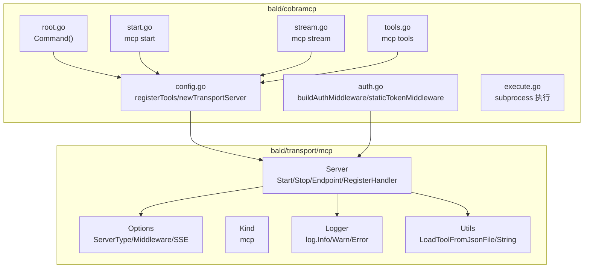
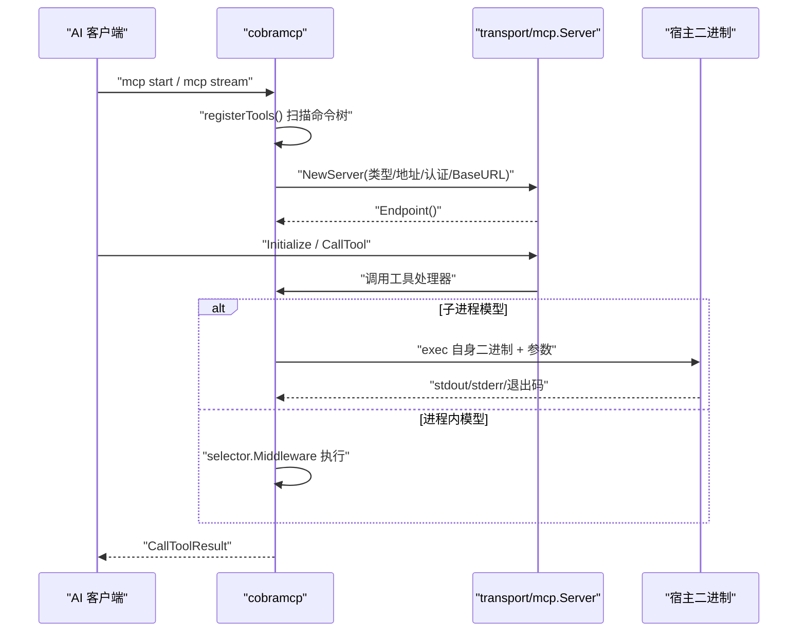
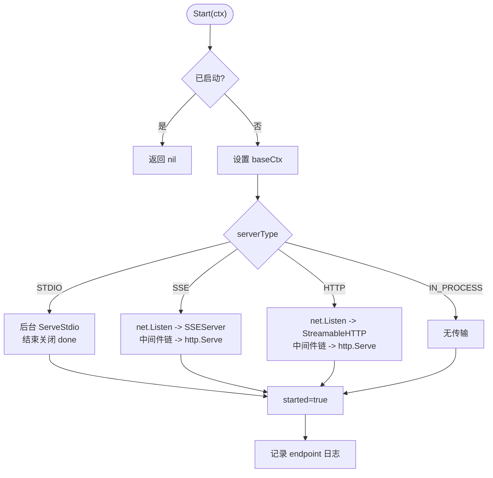
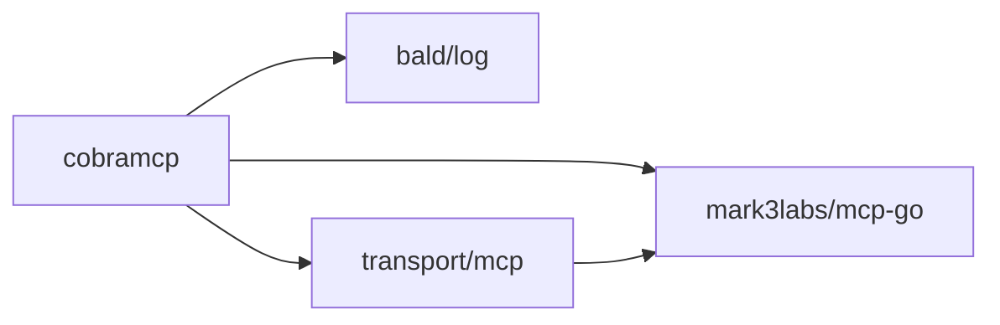
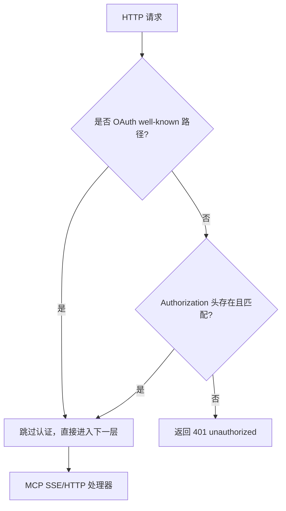

# MCP 传输

<cite>
**本文引用的文件**   
- [transport/mcp/server.go](file://transport/mcp/server.go)
- [transport/mcp/options.go](file://transport/mcp/options.go)
- [transport/mcp/kind.go](file://transport/mcp/kind.go)
- [transport/mcp/logger.go](file://transport/mcp/logger.go)
- [transport/mcp/utils.go](file://transport/mcp/utils.go)
- [transport/mcp/README.md](file://transport/mcp/README.md)
- [cobramcp/config.go](file://cobramcp/config.go)
- [cobramcp/root.go](file://cobramcp/root.go)
- [cobramcp/start.go](file://cobramcp/start.go)
- [cobramcp/stream.go](file://cobramcp/stream.go)
- [cobramcp/tools.go](file://cobramcp/tools.go)
- [cobramcp/auth.go](file://cobramcp/auth.go)
- [cobramcp/execute.go](file://cobramcp/execute.go)
- [cobramcp/README.md](file://cobramcp/README.md)
- [transport/mcp/server_test.go](file://transport/mcp/server_test.go)
- [transport/mcp/server_auth_test.go](file://transport/mcp/server_auth_test.go)
- [transport/mcp/server_lifecycle_test.go](file://transport/mcp/server_lifecycle_test.go)
</cite>

## 目录
1. [引言](#引言)
2. [项目结构](#项目结构)
3. [核心组件](#核心组件)
4. [架构总览](#架构总览)
5. [详细组件分析](#详细组件分析)
6. [依赖关系分析](#依赖关系分析)
7. [性能与扩展点](#性能与扩展点)
8. [安全与认证](#安全与认证)
9. [故障排查](#故障排查)
10. [结论](#结论)
11. [附录：集成示例](#附录集成示例)

## 引言
本仓库中的 MCP（模型上下文协议）实现由两层组成：底层 `transport/mcp` 提供 Bald 生态统一的 MCP 服务端抽象、生命周期与 HTTP/SSE/STDIO 传输；上层 `cobramcp` 把 Cobra CLI 命令自动转换成 MCP 工具，并提供 VSCode/Cursor 集成子命令。文档聚焦 MCP 消息交换、认证机制、日志记录、服务端生命周期、配置选项、扩展点、与 AI 框架的对接模式，以及安全性、性能与调试方法。

MCP 在仓库中的定位是“让外部系统可被 AI 工具调用”的标准通道：它把 LLM 或 AI Agent 的请求映射为工具调用，并返回结构化结果，从而把过去烟囱式集成收敛成多模型对多能力的标准化连接网络。

**章节来源**
- [transport/mcp/README.md:1-14](file://transport/mcp/README.md#L1-L14)

## 项目结构
MCP 相关代码分布在两个 Go 模块中：

| 路径 | 职责 |
|---|---|
| `transport/mcp` | MCP 协议服务端实现、传输绑定、中间件、资源与工具注册、RFC 9728 OAuth 元数据端点、Bald 日志与 `transport.Server` 契约 |
| `cobramcp` | Cobra 命令树 → MCP 工具转换、进程内/子进程执行、CLI 子命令（`start`、`stream`、`tools`）、编辑器配置、内置静态 Bearer 认证 |



**图表来源**
- [transport/mcp/server.go:1-331](file://transport/mcp/server.go#L1-L331)
- [transport/mcp/options.go:1-84](file://transport/mcp/options.go#L1-L84)
- [transport/mcp/kind.go:1-5](file://transport/mcp/kind.go#L1-L5)
- [transport/mcp/logger.go:1-39](file://transport/mcp/logger.go#L1-L39)
- [transport/mcp/utils.go:1-57](file://transport/mcp/utils.go#L1-L57)
- [cobramcp/root.go:1-35](file://cobramcp/root.go#L1-L35)
- [cobramcp/config.go:1-200](file://cobramcp/config.go#L1-L200)
- [cobramcp/start.go:1-36](file://cobramcp/start.go#L1-L36)
- [cobramcp/stream.go:1-49](file://cobramcp/stream.go#L1-L49)
- [cobramcp/tools.go:1-59](file://cobramcp/tools.go#L1-L59)
- [cobramcp/auth.go:1-120](file://cobramcp/auth.go#L1-L120)
- [cobramcp/execute.go:1-200](file://cobramcp/execute.go#L1-L200)

**章节来源**
- [transport/mcp/server.go:1-331](file://transport/mcp/server.go#L1-L331)
- [cobramcp/README.md:1-162](file://cobramcp/README.md#L1-L162)

## 核心组件
- `transport/mcp.Server`：统一 MCP 服务端抽象，支持 STDIO、SSE、HTTP Streamable、IN_PROCESS 四种形态，实现 `Name()`、`Start(ctx)`、`Stop(ctx)`、`Endpoint()`、`Done()`，并通过 `RegisterHandler`/`RegisterResource` 暴露工具与资源。
- `cobramcp.Config`：把 Cobra 命令转换为 MCP 工具，构造底层 `transport/mcp.Server`，管理工具发现、选择器、环境变量、BaseURL、描述、认证与优雅停机。
- `cobramcp.Command`：向现有 Cobra CLI 注入 `mcp` 子命令树，包括 `start`、`stream`、`tools`、`vscode`、`cursor`。
- `cobramcp.auth`：提供用户自定义中间件与内置静态 Bearer token 校验，并保证 RFC 9728 OAuth well-known 发现端点免认证。
- `cobramcp.execute`：以子进程方式重新执行当前二进制，把 MCP 参数还原为 Cobra 命令行参数，并把非零退出码放入 `ToolOutput.ExitCode`。

**章节来源**
- [transport/mcp/server.go:1-331](file://transport/mcp/server.go#L1-L331)
- [cobramcp/config.go:1-200](file://cobramcp/config.go#L1-L200)
- [cobramcp/root.go:1-35](file://cobramcp/root.go#L1-L35)
- [cobramcp/auth.go:1-120](file://cobramcp/auth.go#L1-L120)
- [cobramcp/execute.go:1-200](file://cobramcp/execute.go#L1-L200)

## 架构总览
MCP 在 Bald 中的调用链路分为两类：

1. **直接封装后端**：业务代码直接使用 `transport/mcp.NewServer`，注册工具处理器，并以 STDIO/SSE/HTTP 运行。
2. **Cobra 工具桥接**：通过 `cobramcp.Command` 把 CLI 命令变成 MCP 工具，再由 `cobramcp.Config.serveStdio` 或 `serveHTTP` 启动底层 MCP Server。



**图表来源**
- [cobramcp/config.go:120-240](file://cobramcp/config.go#L120-L240)
- [cobramcp/start.go:1-36](file://cobramcp/start.go#L1-L36)
- [cobramcp/stream.go:1-49](file://cobramcp/stream.go#L1-L49)
- [transport/mcp/server.go:60-180](file://transport/mcp/server.go#L60-L180)

## 详细组件分析

### transport/mcp.Server：生命周期与传输
`Server` 内部维护读写锁、原子已启动标记、基础上下文、错误累积、服务器名称与版本、底层 `mcp-go` 服务、监听器、HTTP 服务、SSE 服务、`done` 通道等字段。其关键行为如下：

- `NewServer` 初始化默认名称、版本、地址和 STDIO 形态，并按选项填充。
- `init` 根据 `ServerType` 记录日志，创建底层 `server.NewMCPServer`。
- `Start` 按形态分支：
  - `STDIO`：后台 goroutine 调用 `server.ServeStdio`，结束时关闭 `done`。
  - `SSE`/`HTTP`：同步 `net.Listen`，构建 SSE 或 Streamable HTTP handler，应用中间件链，启动 `http.Server`，并把真实监听地址推导为 `http://host:port`。
  - `IN_PROCESS`：不启动任何传输，仅承载工具注册。
- `Stop` 先关闭 SSE 会话，再优雅关闭 HTTP Server，最后清理 listener；并发错误通过 `setErr` 累积。
- `Endpoint` 在未绑定前返回空字符串，避免上层误判“未监听”。
- `RegisterHandler`/`RegisterHandlerWithJsonString`/`RegisterHandlerWithJsonSchema` 是对 `mcp-go` 的薄封装。
- `RegisterResource` 增量启用 resources 能力，不注册时不声明该能力。



**图表来源**
- [transport/mcp/server.go:60-180](file://transport/mcp/server.go#L60-L180)

**章节来源**
- [transport/mcp/server.go:1-331](file://transport/mcp/server.go#L1-L331)

### cobramcp：从 Cobra 到 MCP 的工具桥接
`cobramcp` 的核心流程是：

1. `Command(nil)` 注入顶层 `mcp` 子命令。
2. `mcp start` 使用 STDIO 传输，日志走 stderr，直到客户端断开或上下文取消。
3. `mcp stream` 使用 SSE 传输，解析 host/port/auth-token/oauth-resource 等标志位。
4. `mcp tools` 导出可用工具清单到 `mcp-tools.json`。
5. `newTransportServer` 扫描命令树，生成工具列表、元数据与选择器，然后构造 `transport/mcp.Server`。
6. 每个工具处理器解码 MCP 参数为 `ToolInput`，再通过 `executeTool` 执行 selector 对应的逻辑，最终返回 `ToolOutput` 转换的结果。

```mermaid
classDiagram
    class Config {
        +string CommandName
        +[]Selector Selectors
        +map~string,string~ DefaultEnv
        +string ToolNamePrefix
        +string BaseURL
        +func(http.Handler)http.Handler AuthMiddleware
        +string AuthToken
        +ProtectedResourceMetadataConfig* OAuthProtectedResource
        +string ServerDescription
        -[]Tool tools
        -map~string,toolMeta~ toolMetas
        -map~string,Selector~ toolSelectors
        -string toolNamePrefix
        +serveStdio(cmd) error
        +serveHTTP(cmd, addr) error
        +newTransportServer(cmd, type, addr) *Server
        +registerTools(cmd) error
        +executeTool(ctx, req, input) (*CallToolResult, ToolOutput, error)
    }

    class Root {
        +Command(config) *cobra.Command
    }

    class StartCommand {
        +RunE(cmd, args) error
    }

    class StreamCommand {
        +RunE(cmd, args) error
    }

    class ToolsCommand {
        +RunE(cmd, args) error
    }

    class Execute {
        +execute(ctx, request, input) (*CallToolResult, ToolOutput, error)
        +buildCommandArgs(input) []string
    }

    Root --> Config : "注入子命令"
    StartCommand --> Config : "serveStdio"
    StreamCommand --> Config : "serveHTTP"
    ToolsCommand --> Config : "registerTools"
    Config --> Execute : "executeTool"
    Config --> "transport/mcp.Server" : "构造并启动"
```

**图表来源**
- [cobramcp/config.go:1-200](file://cobramcp/config.go#L1-L200)
- [cobramcp/root.go:1-35](file://cobramcp/root.go#L1-L35)
- [cobramcp/start.go:1-36](file://cobramcp/start.go#L1-L36)
- [cobramcp/stream.go:1-49](file://cobramcp/stream.go#L1-L49)
- [cobramcp/tools.go:1-59](file://cobramcp/tools.go#L1-L59)
- [cobramcp/execute.go:1-200](file://cobramcp/execute.go#L1-L200)

**章节来源**
- [cobramcp/root.go:1-35](file://cobramcp/root.go#L1-L35)
- [cobramcp/config.go:1-363](file://cobramcp/config.go#L1-L363)
- [cobramcp/start.go:1-36](file://cobramcp/start.go#L1-L36)
- [cobramcp/stream.go:1-49](file://cobramcp/stream.go#L1-L49)
- [cobramcp/tools.go:1-59](file://cobramcp/tools.go#L1-L59)
- [cobramcp/execute.go:1-200](file://cobramcp/execute.go#L1-L200)

### 工具加载与输入校验
`transport/mcp/utils.go` 提供从 JSON 文件或字符串加载 `mcp.Tool` 的能力，并对 `InputSchema` 做基础校验：

- 要求 `type` 非空且必须为 `object`。
- 要求 `properties` 非空。
- 提供 `toRawMessage` 用于把字符串转为 `json.RawMessage`，配合 `NewToolWithRawSchema` 注册原始 schema。

这使开发者可以外置工具定义，并在注册阶段尽早发现 schema 写错问题。

**章节来源**
- [transport/mcp/utils.go:1-57](file://transport/mcp/utils.go#L1-L57)

### 子进程执行模型
当 cobra 命令作为 MCP 工具被调用时，`cobramcp/execute.go` 采用“重新执行当前二进制”的方式：

1. 获取当前可执行文件路径。
2. 用 `exec.CommandContext` 启动子进程。
3. 捕获 stdout/stderr。
4. 非零退出码转为 `ToolOutput.ExitCode`，而不是 Go 错误。
5. 把 MCP 扁平参数还原为 Cobra 可理解的 flag 与位置参数。
6. 返回包含标准输出、标准错误和退出码的结构。

这种模型的优势是复用已有 CLI 语义；代价是每次工具调用都会 fork 子进程，适合低频工具调用场景。

**章节来源**
- [cobramcp/execute.go:1-200](file://cobramcp/execute.go#L1-L200)

## 依赖关系分析
- `transport/mcp` 依赖 `github.com/mark3labs/mcp-go/server` 和 `github.com/mark3labs/mcp-go/mcp`，并向上暴露统一 `Server` 接口。
- `cobramcp` 依赖 `spf13/cobra`、`mark3labs/mcp-go`、`kalandramo/bald/log` 与 `kalandramo/bald/transport/mcp`。
- 认证中间件类型与 `transport/mcp` 的 `Middleware` 别名一致，都是 `func(http.Handler) http.Handler`，因此可复用其他 transport 包的中间件。
- `cobramcp` 不直接依赖具体认证引擎（如 JWT/OIDC），而是通过 `AuthMiddleware` 扩展，保持协议层与身份层解耦。



**图表来源**
- [cobramcp/config.go:1-60](file://cobramcp/config.go#L1-L60)
- [transport/mcp/options.go:1-84](file://transport/mcp/options.go#L1-L84)

**章节来源**
- [cobramcp/config.go:1-60](file://cobramcp/config.go#L1-L60)
- [transport/mcp/options.go:1-84](file://transport/mcp/options.go#L1-L84)

## 性能与扩展点

### 性能特征
- STDIO 形态适合编辑器或本地 AI 客户端，启动后阻塞等待 stdin EOF 或上下文取消。
- SSE/HTTP 形态使用 Go 标准库 `net/http`，端口绑定失败会立即返回错误，不会造成“假启动”。
- 工具注册与处理本身是薄封装，主要开销来自：
  - Cobra 命令树扫描与 schema 生成。
  - 子进程执行时的进程创建与参数重建。
  - SSE 长连接与会话管理。
- `Endpoint()` 在绑定前为空，避免上层对未监听状态产生错误推断。

### 扩展点
- `WithMCPServerOptions`：透传底层 `mcp-go` 的 server option，例如恢复、能力开关等。
- `WithSSEOptions`：追加 SSE 传输选项，例如对外 BaseURL。
- `WithMiddleware`：在 SSE/HTTP 最外层插入认证、限流、日志等中间件。
- `WithSSEProtectedResourceMetadata`：启用 RFC 9728 OAuth 资源元数据端点。
- `RegisterResource`：增量启用 resources/list 与 resources/read 能力。
- `cobramcp.Config.AuthMiddleware`：注入自定义认证逻辑。
- `cobramcp.Selector.Middleware`：针对单个工具的 selector 级中间件，可用于超时、权限、审计等。

**章节来源**
- [transport/mcp/options.go:1-84](file://transport/mcp/options.go#L1-L84)
- [transport/mcp/server.go:120-331](file://transport/mcp/server.go#L120-L331)
- [cobramcp/config.go:60-200](file://cobramcp/config.go#L60-L200)

## 安全与认证

### 中间件顺序
- 通过 `WithMiddleware` 注册的中间件按注册顺序从外到内包裹 handler。
- `cobramcp` 中，用户自定义 `AuthMiddleware` 在外层，内置静态 Bearer token 校验在内层。
- stdio 形态没有 HTTP 层，中间件不会生效，也不会 panic。

### 静态 Bearer Token
- 通过 `AuthToken` 或 `--auth-token` 启用。
- 使用 `crypto/subtle.ConstantTimeCompare` 进行常数时间比较，防御时序攻击。
- 兼容带或不带 `Bearer ` 前缀的 Authorization 头，与 `transport/sse` 的默认提取器行为一致。

### RFC 9728 OAuth 资源元数据
- 通过 `WithSSEProtectedResourceMetadata` 或 `--oauth-resource` 启用。
- 仅在 SSE 形态生效，well-known 路径由底层 `mcp-go` 分发。
- 该路径必须免认证，否则客户端无法在未取得 token 时访问发现端点，导致 OAuth 流程死锁。
- `cobramcp` 通过 `publicAuthPaths` 自动放行该路径；自定义中间件若同时启用认证，也必须放行此路径。



**图表来源**
- [cobramcp/auth.go:20-120](file://cobramcp/auth.go#L20-L120)
- [transport/mcp/server_auth_test.go:100-153](file://transport/mcp/server_auth_test.go#L100-L153)

**章节来源**
- [cobramcp/auth.go:1-120](file://cobramcp/auth.go#L1-L120)
- [transport/mcp/server_auth_test.go:1-153](file://transport/mcp/server_auth_test.go#L1-L153)
- [transport/mcp/options.go:40-84](file://transport/mcp/options.go#L40-L84)

## 故障排查

### 常见问题
- **端口占用时报“启动成功但没在听”**：新版 `Start` 会在 SSE/HTTP 形态下同步完成 `net.Listen`，端口冲突直接返回错误，并且不会把 `started` 标记为 true。
- **Endpoint 为空**：STDIO、IN_PROCESS 或未绑定时 `Endpoint()` 返回空字符串，这是预期行为，用于区分“未监听”与“已监听”。
- **OAuth 发现端点 401**：检查是否启用了认证中间件，但没有放行 `.well-known/oauth-protected-resource` 路径。
- **stdio 中间件不生效**：stdio 形态没有 HTTP 层，中间件不会执行，测试中也显式断言这一点。
- **子进程找不到外部命令**：编辑器启动 MCP 子进程时 PATH 可能很窄，应通过 `DefaultEnv` 传入当前环境的 PATH。
- **工具参数顺序不一致**：flag 名排序固定以避免 map 迭代随机性导致的参数顺序变化，便于日志与复现。

### 调试建议
- 使用 `mcp tools` 导出工具清单，确认命令是否被正确转换为 MCP 工具。
- 使用 `mcp start --log-level debug` 查看子进程调用的参数日志。
- 使用 `mcp stream --log-level info` 观察 SSE 监听地址与 endpoint。
- 通过 `transport/mcp` 的生命周期测试思路验证：
  - Start 同步绑定端口。
  - Endpoint 包含真实端口而非 `:0`。
  - 注册工具后可被客户端 Initialize 和 CallTool。
  - Stop 能优雅关闭。

**章节来源**
- [transport/mcp/server_lifecycle_test.go:1-118](file://transport/mcp/server_lifecycle_test.go#L1-L118)
- [cobramcp/tools.go:1-59](file://cobramcp/tools.go#L1-L59)
- [cobramcp/start.go:1-36](file://cobramcp/start.go#L1-L36)
- [cobramcp/stream.go:1-49](file://cobramcp/stream.go#L1-L49)
- [cobramcp/config.go:200-363](file://cobramcp/config.go#L200-L363)

## 结论
`transport/mcp` 提供与 Bald 生态一致的 MCP 服务端抽象，负责传输绑定、生命周期、中间件与资源注册；`cobramcp` 负责把 CLI 命令转化为 MCP 工具，并提供编辑器集成与轻量认证。两者分工清晰：cobramcp 回答“工具从哪来”，transport/mcp 负责“如何监听、如何握手、如何停机、如何暴露真实 endpoint”。对于需要更高吞吐或更复杂鉴权的场景，可在 `AuthMiddleware` 中接入 JWT/OIDC，或通过进程内 selector 中间件控制单工具行为，避免每次调用都 fork 子进程。

## 附录：集成示例

### 示例一：直接在应用中启动 MCP HTTP 服务端
适用场景：Go 服务内部暴露 MCP 工具，供外部 AI 客户端调用。

参考路径：
- [transport/mcp/server_test.go:20-90](file://transport/mcp/server_test.go#L20-L90)
- [transport/mcp/server_lifecycle_test.go:1-60](file://transport/mcp/server_lifecycle_test.go#L1-L60)

步骤要点：
1. 调用 `NewServer`，设置 `ServerTypeHTTP` 与监听地址。
2. 使用 `RegisterHandler` 或 `RegisterHandlerWithJsonString` 注册工具。
3. 调用 `Start` 阻塞启动，必要时通过 `Stop` 优雅停机。
4. 客户端使用 `mcp-go/client` 与 `transport.NewStreamableHTTP` 连接 `/mcp` 路径。

### 示例二：把 Cobra CLI 暴露为 MCP 工具
适用场景：已有 CLI，希望让 AI 助手直接调用。

参考路径：
- [cobramcp/root.go:1-35](file://cobramcp/root.go#L1-L35)
- [cobramcp/start.go:1-36](file://cobramcp/start.go#L1-L36)
- [cobramcp/stream.go:1-49](file://cobramcp/stream.go#L1-L49)
- [cobramcp/config.go:120-240](file://cobramcp/config.go#L120-L240)

步骤要点：
1. 在 main 中调用 `rootCmd.AddCommand(cobramcp.Command(nil))`。
2. 使用 `./my-cli mcp start` 启动 STDIO 模式。
3. 使用 `./my-cli mcp stream --host localhost --port 8080` 启动 HTTP/SSE 模式。
4. 如需认证，传入 `--auth-token` 或配置 `Config.AuthToken`。
5. 如需 OAuth 发现，传入 `--oauth-resource` 与 `--oauth-auth-server`。

### 示例三：对接 AI 框架
仓库中 `ai/eino`、`ai/langchaingo`、`ai/openai` 等模块提供不同 AI 框架的客户端封装；MCP 工具通常由这些高层客户端间接消费，而不是直接操作 `transport/mcp`。

推荐对接模式：
- 让 AI 框架调用 MCP 工具作为“外部工具集”。
- 通过 `cobramcp.Config.Selectors` 控制哪些命令暴露为工具。
- 通过 `cobramcp.Config.Middleware` 或 selector 中间件添加超时、审计、限流。
- 通过 `cobramcp.Config.DefaultEnv` 解决编辑器子进程 PATH 问题。

**章节来源**
- [transport/mcp/server_test.go:1-200](file://transport/mcp/server_test.go#L1-L200)
- [cobramcp/root.go:1-35](file://cobramcp/root.go#L1-L35)
- [cobramcp/config.go:120-240](file://cobramcp/config.go#L120-L240)