# TCP 与 WebRTC 传输

<cite>
**本文引用的文件**   
- [transport/tcp/server.go](file://transport/tcp/server.go)
- [transport/tcp/client.go](file://transport/tcp/client.go)
- [transport/tcp/session.go](file://transport/tcp/session.go)
- [transport/tcp/session_manager.go](file://transport/tcp/session_manager.go)
- [transport/tcp/message.go](file://transport/tcp/message.go)
- [transport/tcp/types.go](file://transport/tcp/types.go)
- [transport/tcp/byte_order.go](file://transport/tcp/byte_order.go)
- [transport/webrtc/server.go](file://transport/webrtc/server.go)
- [transport/webrtc/client.go](file://transport/webrtc/client.go)
- [transport/webrtc/session.go](file://transport/webrtc/session.go)
- [transport/webrtc/sfu_router.go](file://transport/webrtc/sfu_router.go)
- [transport/webrtc/media_track.go](file://transport/webrtc/media_track.go)
- [transport/webrtc/signaling.go](file://transport/webrtc/signaling.go)
- [transport/webrtc/message.go](file://transport/webrtc/message.go)
- [transport/webrtc/types.go](file://transport/webrtc/types.go)
</cite>

## 目录
1. [简介](#简介)
2. [项目结构](#项目结构)
3. [核心组件](#核心组件)
4. [架构总览](#架构总览)
5. [详细组件分析](#详细组件分析)
6. [依赖关系分析](#依赖关系分析)
7. [性能与可靠性](#性能与可靠性)
8. [实时音视频开发指南](#实时音视频开发指南)
9. [故障排查](#故障排查)
10. [结论](#结论)

## 简介
本仓库提供两类底层传输能力：面向长连接二进制消息的 TCP 传输，以及基于 WebRTC 的数据通道、信令服务器与 SFU 媒体路由器。TCP 侧实现连接接受、会话生命周期、按消息类型分发的编解码管道；WebRTC 侧封装 PeerConnection、DataChannel、ICE 候选交换、Offer/Answer 协商，并提供 SFU 模式下的轨道订阅与转发。两者都遵循可插拔编码器、度量上报、中间件扩展等统一约定，便于在业务服务中复用。

## 项目结构
传输层代码集中在 `transport` 下两个并列子包：
- `transport/tcp`：TCP Server/Client、Session、SessionManager、NetPacket 编解码、字节序配置。
- `transport/webrtc`：WebRTC Server（HTTP 信令）、Client、Session、SFU 路由器、媒体轨道、信令协议、二进制/文本两种消息格式。

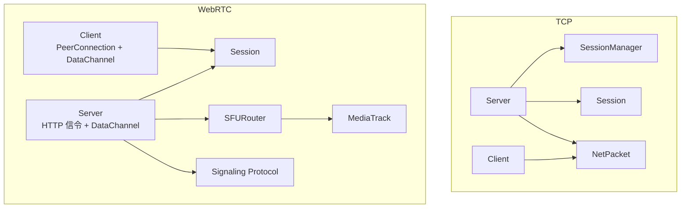

**图表来源**
- [transport/tcp/server.go:1-200](file://transport/tcp/server.go#L1-L200)
- [transport/tcp/session.go:1-173](file://transport/tcp/session.go#L1-L173)
- [transport/tcp/session_manager.go:1-145](file://transport/tcp/session_manager.go#L1-L145)
- [transport/webrtc/server.go:1-200](file://transport/webrtc/server.go#L1-L200)
- [transport/webrtc/sfu_router.go:1-204](file://transport/webrtc/sfu_router.go#L1-L204)
- [transport/webrtc/signaling.go:1-73](file://transport/webrtc/signaling.go#L1-L73)

**章节来源**
- [transport/tcp/server.go:1-200](file://transport/tcp/server.go#L1-L200)
- [transport/webrtc/server.go:1-200](file://transport/webrtc/server.go#L1-L200)

## 核心组件
- TCP Server：监听端口、TLS 可选、Accept 后创建 Session，注册消息处理器，支持单发与广播，内置 metrics 与 tracing。
- TCP Client：解析 endpoint，建立 TCP 连接，启动读循环，支持按类型注册 handler，发送二进制 NetPacket。
- TCP Session：读写 pump、唯一 ID、channel 缓冲、钩子回调，负责关闭时从 SessionManager 摘除。
- TCP SessionManager：并发安全的会话表，观察者通知，CloseAll 与 Clean 语义分离。
- WebRTC Server：HTTP 信令端点 `/signal`，CORS、Origin 校验、Token 注入，PeerConnection 管理、DataChannel 绑定、SFU 路由。
- WebRTC Client：创建 Offer、通过 HTTP 信令获取 Answer、等待 DataChannel 打开、收发应用消息、本地/远程媒体轨道。
- WebRTC Session：封装 PeerConnection 与 DataChannel，记录查询参数、写泵、最后收发时间、轨道集合。
- SFU Router：维护发布者轨道与订阅者映射，为订阅者创建本地 TrackLocalStaticRTP，触发重协商。
- MediaTrack：包装远端 TrackRemote，开启 goroutine 读取 RTP 并转发给所有订阅者。
- Signaling：JSON 协议的 Offer/Answer/Candidate 请求响应结构。

**章节来源**
- [transport/tcp/server.go:201-476](file://transport/tcp/server.go#L201-L476)
- [transport/tcp/client.go:1-243](file://transport/tcp/client.go#L1-L243)
- [transport/tcp/session.go:1-173](file://transport/tcp/session.go#L1-L173)
- [transport/tcp/session_manager.go:1-145](file://transport/tcp/session_manager.go#L1-L145)
- [transport/webrtc/server.go:201-851](file://transport/webrtc/server.go#L201-L851)
- [transport/webrtc/client.go:1-456](file://transport/webrtc/client.go#L1-L456)
- [transport/webrtc/session.go:1-217](file://transport/webrtc/session.go#L1-L217)
- [transport/webrtc/sfu_router.go:1-204](file://transport/webrtc/sfu_router.go#L1-L204)
- [transport/webrtc/media_track.go:1-144](file://transport/webrtc/media_track.go#L1-L144)
- [transport/webrtc/signaling.go:1-73](file://transport/webrtc/signaling.go#L1-L73)

## 架构总览
TCP 和 WebRTC 共享“会话 + 消息类型分发”的统一抽象，但承载网络不同：TCP 直接由 net.Conn 承载字节流；WebRTC 使用 DataChannel 承载二进制或文本帧，同时通过 HTTP 完成信令与 ICE Candidate 交换。

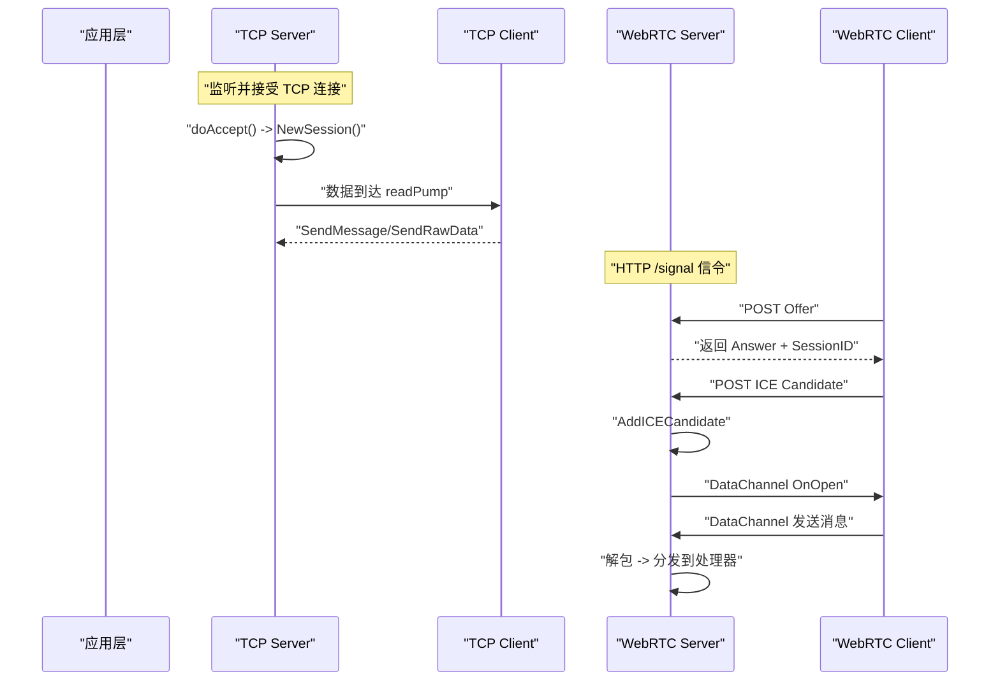

**图表来源**
- [transport/tcp/server.go:350-476](file://transport/tcp/server.go#L350-L476)
- [transport/webrtc/server.go:470-767](file://transport/webrtc/server.go#L470-L767)
- [transport/webrtc/client.go:201-456](file://transport/webrtc/client.go#L201-L456)

## 详细组件分析

### TCP 连接建立与会话管理
TCP Server 暴露 Start/Stop 生命周期：Start 中创建 Listener，必要时包裹 TLS，启动 doAccept 循环，阻塞直到上下文取消；Stop 关闭 Listener 并调用 SessionManager.CloseAll，避免空闲连接导致 goroutine 泄漏。每个 Accept 得到的 conn 被封装为 Session，加入 SessionManager，并启动 writePump 与 readPump。Session 关闭时通过钩子 removeSession，最终由 SessionManager 删除条目。

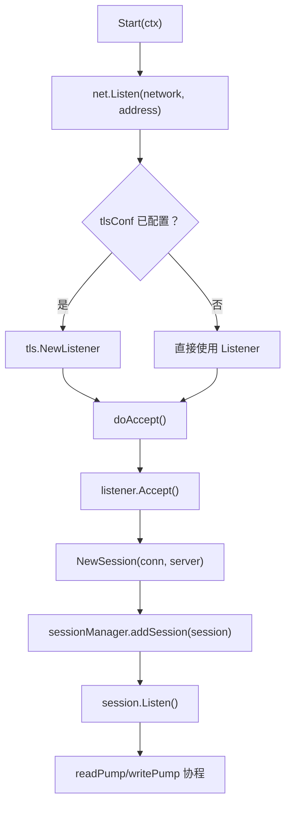

**图表来源**
- [transport/tcp/server.go:120-200](file://transport/tcp/server.go#L120-L200)
- [transport/tcp/server.go:420-476](file://transport/tcp/server.go#L420-L476)
- [transport/tcp/session.go:60-173](file://transport/tcp/session.go#L60-L173)

#### TCP 会话生命周期
Session 使用 sync.Once 保证 Listen、Close 幂等；writePump 负责从 send channel 取数据写出；readPump 不断 conn.Read，并把原始字节交给 hooks.handleSocketRawData。Close 会关闭 done channel、关闭底层连接，并通过钩子让 SessionManager 摘除自身。

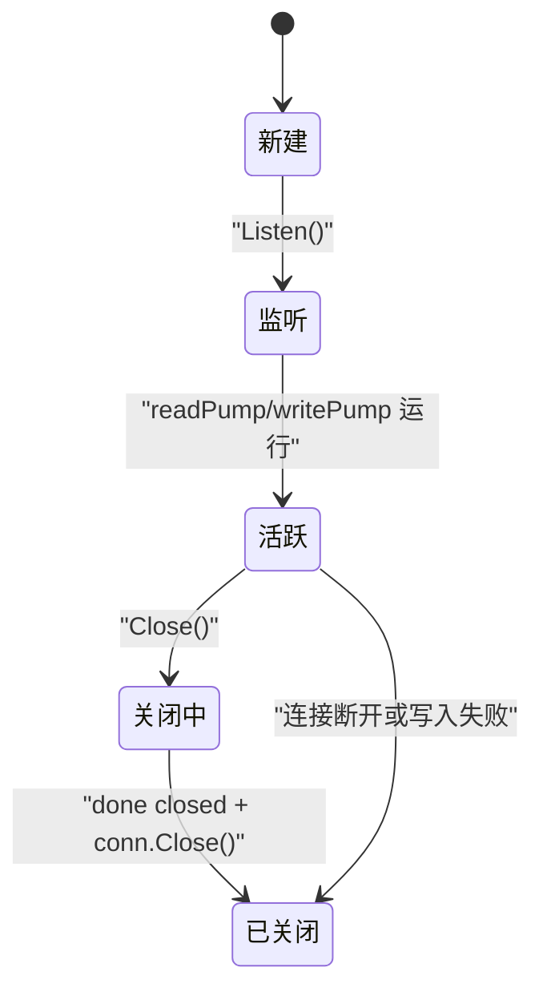

**图表来源**
- [transport/tcp/session.go:20-173](file://transport/tcp/session.go#L20-L173)

#### TCP 会话管理器
SessionManager 用 sync.Map 保存会话，并用 observerMu 保护观察者字段，避免 RegisterObserver 与 add/removeSession 竞争。CloseAll 先收集全部 Session 指针再逐条 Close，确保 goroutine 与连接真正释放；Clean 只清空 map 引用，不关连接。addSession/removeSession 均幂等，仅在实际新增或删除时触发观察者回调。

**章节来源**
- [transport/tcp/session_manager.go:1-145](file://transport/tcp/session_manager.go#L1-L145)

### TCP 消息编解码机制
TCP 使用 NetPacket：前 4 字节为消息类型，剩余字节为 payload。默认字节序为小端，可通过 WithLittleEndian/WithBigEndian 切换。Server 侧 defaultMarshalNetPacket 先用编码器的 codec.Marshal 把业务对象序列化为字节，再用 binary.Write 写入类型头；defaultUnmarshalNetPacket 则反序列化出 handler，再根据 Creator 决定直接透传 payload 或由 codec.Unmarshal 填充强类型对象。

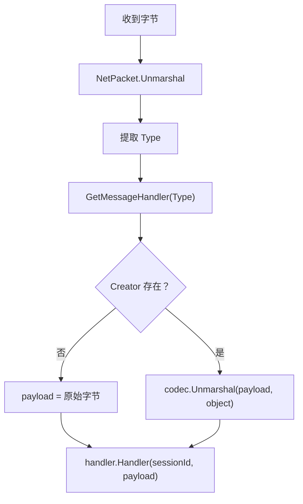

**图表来源**
- [transport/tcp/message.go:1-36](file://transport/tcp/message.go#L1-L36)
- [transport/tcp/server.go:280-360](file://transport/tcp/server.go#L280-L360)
- [transport/tcp/byte_order.go:1-16](file://transport/tcp/byte_order.go#L1-L16)

客户端发送流程：client.SendMessage 构造 NetPacket，codec.Marshal 后 Marshal 成 wire bytes，再通过 SendRawData 写出；若启用 metrics，则统计发送次数、错误数与耗时直方图。

**章节来源**
- [transport/tcp/message.go:1-36](file://transport/tcp/message.go#L1-L36)
- [transport/tcp/client.go:120-243](file://transport/tcp/client.go#L120-L243)
- [transport/tcp/server.go:280-360](file://transport/tcp/server.go#L280-L360)

### WebRTC 数据通道与会话
WebRTC Server 的 Server 内嵌 http.Server，初始化 ServeMux 挂载 `/signal`，并可叠加 transport/http/middleware 的中间件。信令处理函数负责 CORS、OPTIONS、方法校验、Origin 检查、Offer 校验、创建 PeerConnection、登记 Session、设置 ICE 候选回调、连接状态回调、DataChannel 回调与媒体轨道回调。当 DataChannel 打开后，才将 Session 加入 sessionManager 并启动 writePump。

WebRTC Client 在 Connect 中创建 PeerConnection、CreateDataChannel、注册 OnOpen/OnMessage/OnError，创建 Offer 并 Gather，通过 HTTP 把 Offer 发给信令服务器，拿到 Answer 后 SetRemoteDescription，然后等待 DataChannel 打开。

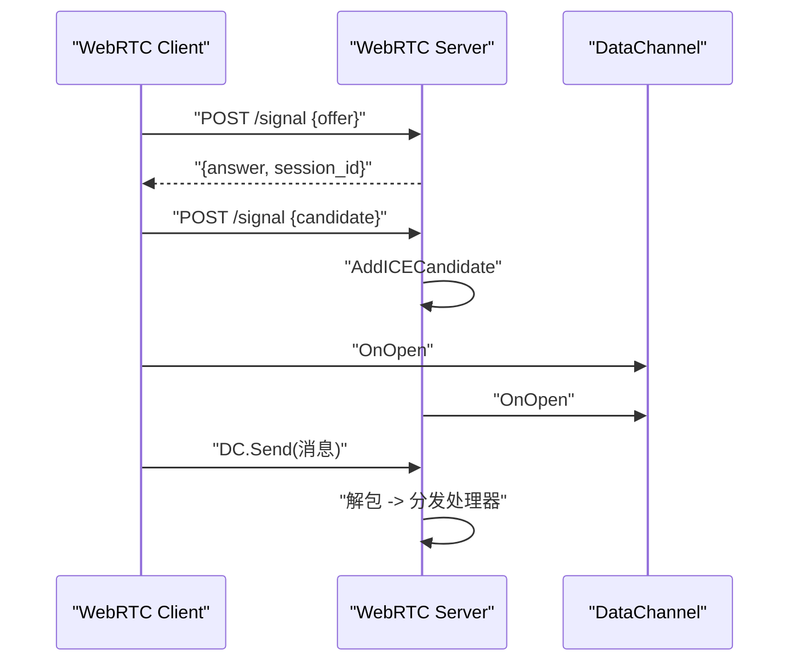

**图表来源**
- [transport/webrtc/server.go:520-767](file://transport/webrtc/server.go#L520-L767)
- [transport/webrtc/client.go:1-200](file://transport/webrtc/client.go#L1-L200)
- [transport/webrtc/signaling.go:1-73](file://transport/webrtc/signaling.go#L1-L73)

#### WebRTC 会话模型
Session 持有 PeerConnection、DataChannel、URL 查询参数、send channel、本地轨道 map 与读写时间戳。BindDataChannel 绑定 OnOpen/OnMessage/OnClose/OnError，并在 OnMessage 中更新时间戳，再把原始字节交给 hooks.handleSocketRawData。writePump 根据 PayloadType 选择 SendText 或 Send。

**章节来源**
- [transport/webrtc/session.go:1-217](file://transport/webrtc/session.go#L1-L217)
- [transport/webrtc/server.go:520-767](file://transport/webrtc/server.go#L520-L767)
- [transport/webrtc/client.go:1-200](file://transport/webrtc/client.go#L1-L200)

### WebRTC 信令服务器实现原理
信令协议定义 signalRequest/Response/Error，支持 offer、answer、candidate、message_type 字段。服务端 decodeSignalRequest 兼容带包裹结构的 JSON 与裸 SDP；encodeSignalResponse 统一输出 JSON。handleICECandidate 校验 session_id 与 candidate，查找 signalSessions 中的 Session，调用 AddICECandidate，并根据 webrtc.ErrNoRemoteDescription 返回 Conflict。

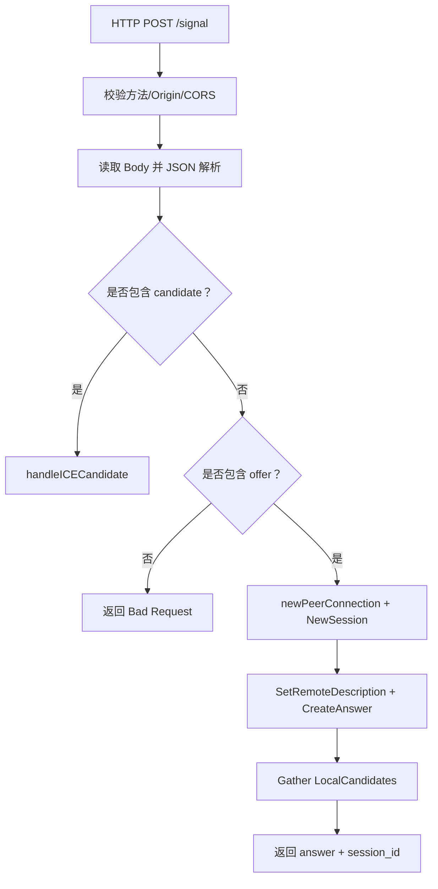

**图表来源**
- [transport/webrtc/signaling.go:1-73](file://transport/webrtc/signaling.go#L1-L73)
- [transport/webrtc/server.go:560-767](file://transport/webrtc/server.go#L560-L767)

**章节来源**
- [transport/webrtc/signaling.go:1-73](file://transport/webrtc/signaling.go#L1-L73)
- [transport/webrtc/server.go:560-767](file://transport/webrtc/server.go#L560-L767)

### SFU 路由器与媒体流转发
SFU Router 维护两个核心映射：
- tracks：sessionID → trackID → MediaTrack
- subscriptions：subscriberID → []trackID

AddTrack 创建 MediaTrack 并自动 Start，开始从远端 TrackRemote 读取 RTP 帧；RemoveTrack 关闭轨道并清理订阅；Subscribe 返回发布者所有 MediaTrack 并记录订阅关系；Unsubscribe 移除订阅并清理空条目；CreateLocalTrackForSubscriber 为订阅者 PeerConnection 创建 TrackLocalStaticRTP，添加到 PC，并注册到 MediaTrack 的订阅者列表。

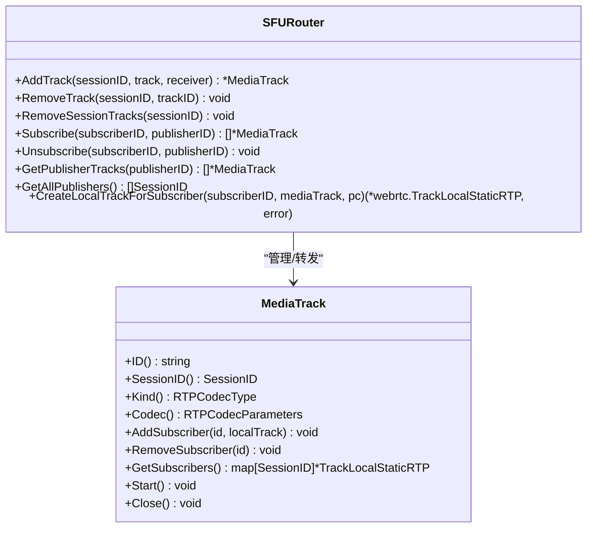

**图表来源**
- [transport/webrtc/sfu_router.go:1-204](file://transport/webrtc/sfu_router.go#L1-L204)
- [transport/webrtc/media_track.go:1-144](file://transport/webrtc/media_track.go#L1-L144)

#### 媒体转发细节
MediaTrack.forwardRTP 分配固定大小缓冲区，循环 Read 远端 RTP 帧，遇到 EOF 或管道关闭即退出；否则加读锁遍历 subscribers，向每个 TrackLocalStaticRTP Write。SFU 模式下，服务器会为每个订阅者创建新的本地轨道，并通过 SendRenegotiation 触发 PeerConnection 重协商，使新轨道生效。

**章节来源**
- [transport/webrtc/sfu_router.go:1-204](file://transport/webrtc/sfu_router.go#L1-L204)
- [transport/webrtc/media_track.go:1-144](file://transport/webrtc/media_track.go#L1-L144)
- [transport/webrtc/server.go:768-851](file://transport/webrtc/server.go#L768-L851)

### 客户端与消息编解码对比
WebRTC 客户端与服务端都支持 BinaryNetPacket 与 TextNetPacket 两种格式，由 PayloadType 控制。Binary 格式以 4 字节小端类型头 + payload 组成；Text 格式为 JSON 对象，type 与 payload 字符串。编解码委托 broker.Marshal/Unmarshal 配合可插拔 encoder。

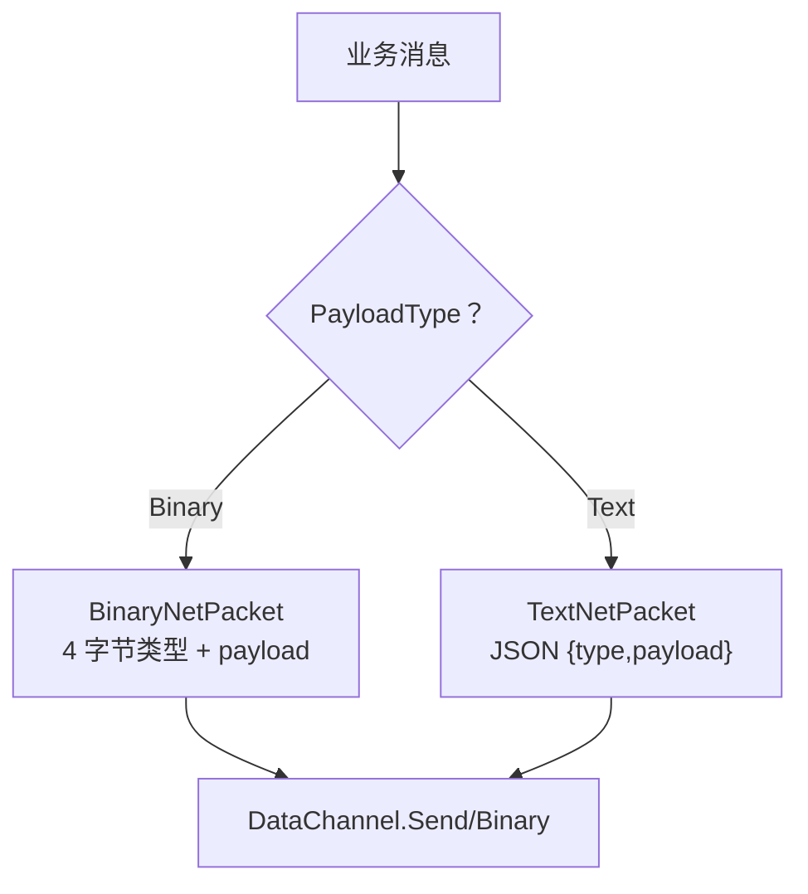

**图表来源**
- [transport/webrtc/message.go:1-50](file://transport/webrtc/message.go#L1-L50)
- [transport/webrtc/server.go:201-340](file://transport/webrtc/server.go#L201-L340)
- [transport/webrtc/client.go:300-456](file://transport/webrtc/client.go#L300-L456)

**章节来源**
- [transport/webrtc/message.go:1-50](file://transport/webrtc/message.go#L1-L50)
- [transport/webrtc/client.go:300-456](file://transport/webrtc/client.go#L300-L456)

## 依赖关系分析
TCP 与 WebRTC 都依赖：
- encoding.Codec：用于业务对象的序列化与反序列化。
- metrics.Metrics：上报计数与直方图。
- broker：WebRTC 侧统一 marshal/unmarshal。
- pkg/id：生成 SessionID。
- 日志与 tracing：TCP 侧显式使用 otel trace，WebRTC 侧通过 logInfof/logErrorf 等封装。

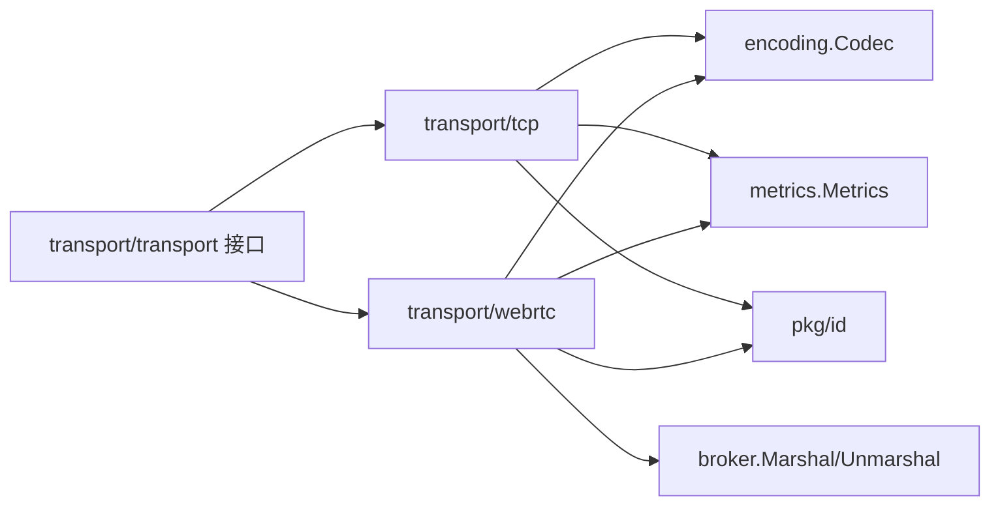

**图表来源**
- [transport/tcp/server.go:1-60](file://transport/tcp/server.go#L1-L60)
- [transport/webrtc/server.go:1-60](file://transport/webrtc/server.go#L1-L60)

**章节来源**
- [transport/tcp/server.go:1-60](file://transport/tcp/server.go#L1-L60)
- [transport/webrtc/server.go:1-60](file://transport/webrtc/server.go#L1-L60)

## 性能与可靠性
- TCP 连接池与会话：每个连接一个 Session，readPump/writePump 各占一个 goroutine；send channel 容量为 256，recv buffer 为 256KB。
- 心跳与超时：当前 TCP/WebRTC Session 未实现应用层心跳；WebRTC 会话记录 lastReadMessageTime/lastWriteMessageTime，可用于上层检测。
- 资源释放：TCP Server.Stop 与 Stop 路径都会 CloseAll，防止空闲连接泄漏；WebRTC Server.Stop 调用 Shutdown 后再 closeAllAndWait 并关闭信号阶段会话。
- 指标与追踪：TCP Client/Server 上报发送计数、错误计数、延迟直方图；TCP Server 消息处理增加成功/失败计数与耗时。
- 可靠性建议：
  - 在业务层实现应用心跳，结合 lastReadMessageTime 做超时剔除。
  - 对 DataChannel 写失败做退避重试或降级为离线队列。
  - SFU 订阅失败时回退到点对点直连或降低轨道质量。

[本节为通用优化建议，不直接分析具体文件]

## 实时音视频开发指南

### 房间管理与参与者控制
- 房间概念：可用 SessionID 作为房间标识，或使用业务层 roomName 映射到一组 SessionID。
- 参与者加入：WebRTC 客户端 Connect 后，通过 DataChannel 发送加入房间消息；服务器根据策略分配角色（发布者/订阅者）。
- 参与者离开：DataChannel 关闭或 PeerConnection 状态变为 Closed/Failed/Disconnected 时，触发 Session.Close，自动清理 SFU 轨道与订阅。

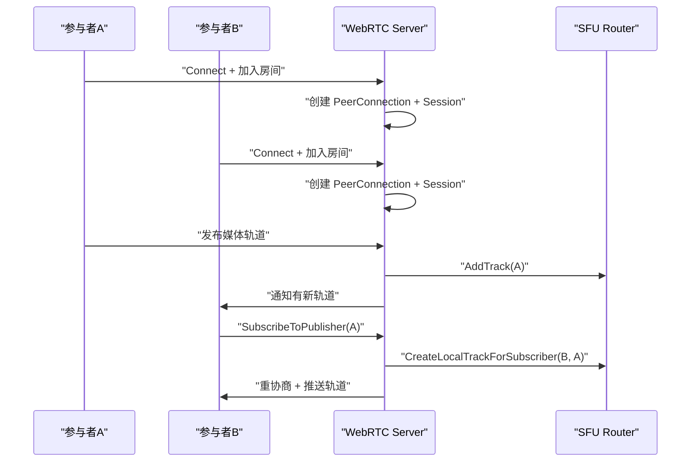

**图表来源**
- [transport/webrtc/server.go:768-851](file://transport/webrtc/server.go#L768-L851)
- [transport/webrtc/sfu_router.go:120-204](file://transport/webrtc/sfu_router.go#L120-L204)

### NAT 穿透与信令流程
- NAT 穿透由 WebRTC 内部 ICE 协商完成，开发者无需自行实现 STUN/TURN 逻辑，但需在 webrtc.Configuration 中配置合适的 ICE Servers。
- 信令服务器负责交换 Offer/Answer 与 ICE Candidate，保持最小职责：校验、转发、关联 session_id。
- 客户端需缓存候选并在后续请求中发送，避免候选丢失导致连接失败。

**章节来源**
- [transport/webrtc/signaling.go:1-73](file://transport/webrtc/signaling.go#L1-L73)
- [transport/webrtc/server.go:600-767](file://transport/webrtc/server.go#L600-L767)
- [transport/webrtc/client.go:201-300](file://transport/webrtc/client.go#L201-L300)

### 质量自适应
- 动态码率：通过 WebRTC 提供的 simulcast/rid 或上层应用层按带宽调整分辨率与帧率。
- 订阅控制：根据网络状况选择订阅低清轨道或暂停非关键轨道。
- 丢包恢复：启用 FEC/NACK 并监控丢包率，必要时切换音频优先或降低视频码率。

[本节为通用实践建议，不直接分析具体文件]

### 网络拓扑优化
- 小规模：P2P Mesh，适合 3~4 人以内，减少服务器转发包压力。
- 中大规模：SFU 集中转发，适合多人房间，便于集中控制质量与录制。
- 混合：近场 P2P + 远场 SFU，结合地理位置与网络探测选择最优路径。

[本节为通用架构建议，不直接分析具体文件]

### 带宽控制与故障转移
- 带宽估算：利用 WebRTC 统计信息（如 rtp-streams）估算上行/下行带宽，动态调整发送码率。
- 故障转移：当 DataChannel 频繁关闭或 PeerConnection 进入 Failed，切换到备用信令地址或降级为纯音频。
- 优雅降级：SFU 不可用时退回点对点，或暂时禁用视频，保留信令通道。

[本节为通用工程实践，不直接分析具体文件]

## 故障排查
- TCP 连接泄漏：确认 Server.Stop 调用了 SessionManager.CloseAll；检查自定义 hook 是否正确 removeSession。
- 消息类型不匹配：检查 client 与 server 是否注册相同 NetMessageType，且 codec 一致。
- WebRTC DataChannel 未打开：检查 connectTimeout 与信令响应状态码；确认 CORS/Origin 校验未拒绝请求。
- ICE 候选失败：检查 handleICECandidate 返回状态是否为 409 Conflict；确认 session_id 有效且 PeerConnection 仍存在。
- SFU 订阅无画面：检查 SubscribeToPublisher 是否触发 renegotiation；确认 CreateLocalTrackForSubscriber 成功添加轨道。
- 指标异常：查看 tcp_client_messages_errors_total、tcp_messages_total(status=error)、webrtc_client_messages_errors_total 等计数器。

**章节来源**
- [transport/tcp/session_manager.go:60-110](file://transport/tcp/session_manager.go#L60-L110)
- [transport/tcp/server.go:320-360](file://transport/tcp/server.go#L320-L360)
- [transport/webrtc/server.go:700-767](file://transport/webrtc/server.go#L700-L767)
- [transport/webrtc/client.go:360-456](file://transport/webrtc/client.go#L360-L456)

## 结论
TCP 与 WebRTC 传输层在本仓库中提供了稳定可扩展的长连接与实时通信基础：TCP 侧适合简单可靠的二进制消息通道，WebRTC 侧提供浏览器友好、NAT 穿透与 SFU 媒体转发的完整方案。二者均以会话为中心、以消息类型为索引、以可插拔编码器为扩展点，便于在不同业务场景中组合使用。对于实时音视频系统，建议在应用层补充房间管理、心跳、质量自适应与故障转移，以获得更健壮的端到端体验。