# WebSocket 与 SSE 传输

<cite>
**本文引用的文件**   
- [transport/websocket/server.go](file://transport/websocket/server.go)
- [transport/websocket/session_manager.go](file://transport/websocket/session_manager.go)
- [transport/websocket/session.go](file://transport/websocket/session.go)
- [transport/websocket/types.go](file://transport/websocket/types.go)
- [transport/websocket/message.go](file://transport/websocket/message.go)
- [transport/websocket/options.go](file://transport/websocket/options.go)
- [transport/sse/server.go](file://transport/sse/server.go)
- [transport/sse/stream_manager.go](file://transport/sse/stream_manager.go)
- [transport/sse/subscriber.go](file://transport/sse/subscriber.go)
- [transport/sse/stream.go](file://transport/sse/stream.go)
- [transport/sse/event.go](file://transport/sse/event.go)
- [transport/sse/http.go](file://transport/sse/http.go)
- [transport/sse/auth.go](file://transport/sse/auth.go)
</cite>

## 目录

1. [引言](#引言)
2. [项目结构](#项目结构)
3. [核心组件](#核心组件)
4. [架构总览](#架构总览)
5. [详细组件分析](#详细组件分析)
6. [依赖关系分析](#依赖关系分析)
7. [性能与资源特性](#性能与资源特性)
8. [典型实时应用开发模式](#典型实时应用开发模式)
9. [连接监控、调优与故障恢复](#连接监控调优与故障恢复)
10. [结论](#结论)

## 引言

本仓库中的 `transport/websocket` 和 `transport/sse` 是两个面向实时通信的传输组件，它们都实现统一的 `transport.Server` 接口，分别承载双向长连接（WebSocket）与单向事件流（Server-Sent Events）。

- **WebSocket 组件**：基于 `gorilla/websocket`，提供二进制/文本两种消息载荷模式、按消息类型分发的处理器注册、会话生命周期回调、广播与单点发送。
- **SSE 组件**：基于标准 HTTP 流，提供命名流、订阅者管理、事件回放（`Last-Event-ID`）、可选认证、慢客户端断开保护以及跨域头配置。

两者共同特点是：

- 通过 `http.Server` + `http.ServeMux` 暴露 HTTP 入口；
- 使用中间件链复用 `transport/http` 风格的 `Middleware`；
- 通过可插拔编解码器处理业务数据；
- 在优雅关闭时清理活跃连接或流。

## 项目结构

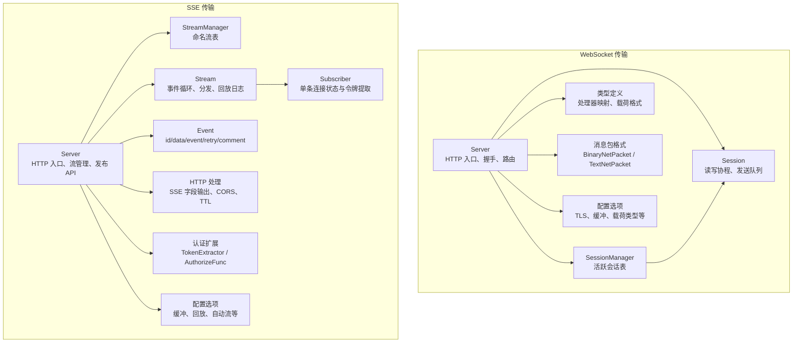

**图表来源**
- [transport/websocket/server.go:1-120](file://transport/websocket/server.go#L1-L120)
- [transport/websocket/session_manager.go:1-119](file://transport/websocket/session_manager.go#L1-L119)
- [transport/websocket/session.go:1-120](file://transport/websocket/session.go#L1-L120)
- [transport/websocket/types.go:1-39](file://transport/websocket/types.go#L1-L39)
- [transport/websocket/message.go:1-60](file://transport/websocket/message.go#L1-L60)
- [transport/websocket/options.go:1-143](file://transport/websocket/options.go#L1-L143)
- [transport/sse/server.go:1-120](file://transport/sse/server.go#L1-L120)
- [transport/sse/stream_manager.go:1-101](file://transport/sse/stream_manager.go#L1-L101)
- [transport/sse/stream.go:1-120](file://transport/sse/stream.go#L1-L120)
- [transport/sse/subscriber.go:1-76](file://transport/sse/subscriber.go#L1-L76)
- [transport/sse/event.go:1-120](file://transport/sse/event.go#L1-L120)
- [transport/sse/http.go:1-146](file://transport/sse/http.go#L1-L146)
- [transport/sse/auth.go:1-52](file://transport/sse/auth.go#L1-L52)

**章节来源**
- [transport/websocket/server.go:1-120](file://transport/websocket/server.go#L1-L120)
- [transport/sse/server.go:1-120](file://transport/sse/server.go#L1-L120)

## 核心组件

### WebSocket 核心对象

| 对象 | 职责 | 并发与安全要点 |
|---|---|---|
| `Server` | 监听 TCP/TLS、升级 WebSocket、注册 HTTP 路由、注册消息处理器、广播与单点发送、实现 `transport.Server` | 内部 `stateMu` 保护 listener/server；`handlerMu` 保护消息处理器映射；默认 JSON 编解码器；默认启用 token 注入到查询参数 |
| `SessionManager` | 以 `sync.Map` 维护所有活跃 `Session`，提供添加、移除、遍历、计数、清理 | `observerMu` 保护观察者引用；`Clean` 关闭并清空全部会话 |
| `Session` | 封装单个 WebSocket 连接的生命周期，启动读/写 goroutine，维护发送通道 | `closeOnce`/`listenOnce` 保证单次关闭与单次启动；写失败或读异常会触发关闭 |
| `NetMessageHandlerMap` | 按 `NetMessageType` 映射处理器与载荷创建器 | 由 `Server.RegisterMessageHandler` 写入，支持泛型便捷方法 |
| `BinaryNetPacket` / `TextNetPacket` | 二进制模式下 `[uint32 类型][payload]`，文本模式下 JSON `type/payload` | 由 `defaultMarshalNetPacket` / `defaultUnmarshalNetPacket` 使用 |

**章节来源**
- [transport/websocket/server.go:1-120](file://transport/websocket/server.go#L1-L120)
- [transport/websocket/server.go:201-510](file://transport/websocket/server.go#L201-L510)
- [transport/websocket/session_manager.go:1-119](file://transport/websocket/session_manager.go#L1-L119)
- [transport/websocket/session.go:1-120](file://transport/websocket/session.go#L1-L120)
- [transport/websocket/types.go:1-39](file://transport/websocket/types.go#L1-L39)
- [transport/websocket/message.go:1-60](file://transport/websocket/message.go#L1-L60)

### SSE 核心对象

| 对象 | 职责 | 并发与安全要点 |
|---|---|---|
| `Server` | 监听 HTTP/HTTPS、注册 `/events` 路径、创建/删除/查询流、发布事件、广播事件 | `stateMu` 保护 listener/server；默认 JSON 编解码器；默认启用自动回放 |
| `StreamManager` | 以 `map[StreamID]*Stream` 管理命名流，提供增删查遍历清理 | 所有操作被 `mtx` 互斥保护 |
| `Stream` | 单条流的单 goroutine 事件循环，负责订阅者注册/注销、事件分发、回放日志裁剪、慢客户端断开 | 使用原子计数器跟踪订阅数；`quit` 通道驱动退出 |
| `Subscriber` | 表示一条 SSE 连接，持有请求 URL/Header、事件 ID、去注册通道 | `close()` 同时等待流关闭与自身去注册，避免永久阻塞 |
| `Event` | 表示一个 SSE 事件，包含 id、data、event、retry、comment | 提供 `clone()` 避免广播共享可变字段影响回放日志 |
| `EventStreamReader` | 解析客户端收到的原始 SSE 事件块 | 支持双换行分隔，最大缓冲区可配置 |

**章节来源**
- [transport/sse/server.go:1-120](file://transport/sse/server.go#L1-L120)
- [transport/sse/stream_manager.go:1-101](file://transport/sse/stream_manager.go#L1-L101)
- [transport/sse/stream.go:1-120](file://transport/sse/stream.go#L1-L120)
- [transport/sse/subscriber.go:1-76](file://transport/sse/subscriber.go#L1-L76)
- [transport/sse/event.go:1-120](file://transport/sse/event.go#L1-L120)

## 架构总览

WebSocket 与 SSE 都采用“HTTP 入口 + 后台 goroutine + 连接/流状态表”的结构：

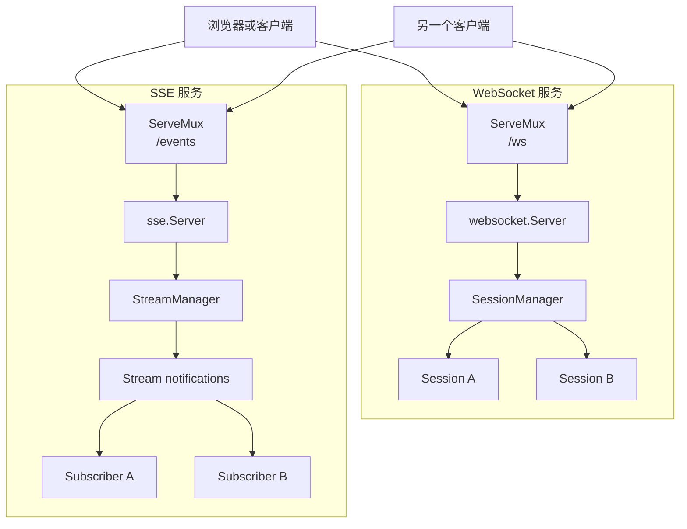

**图表来源**
- [transport/websocket/server.go:1-120](file://transport/websocket/server.go#L1-L120)
- [transport/sse/server.go:1-120](file://transport/sse/server.go#L1-L120)

**章节来源**
- [transport/websocket/server.go:1-120](file://transport/websocket/server.go#L1-L120)
- [transport/sse/server.go:1-120](file://transport/sse/server.go#L1-L120)

## 详细组件分析

### WebSocket 连接建立流程

WebSocket 连接的建立从 HTTP 请求开始，经过中间件链、路径匹配、协议升级，最终进入会话生命周期：

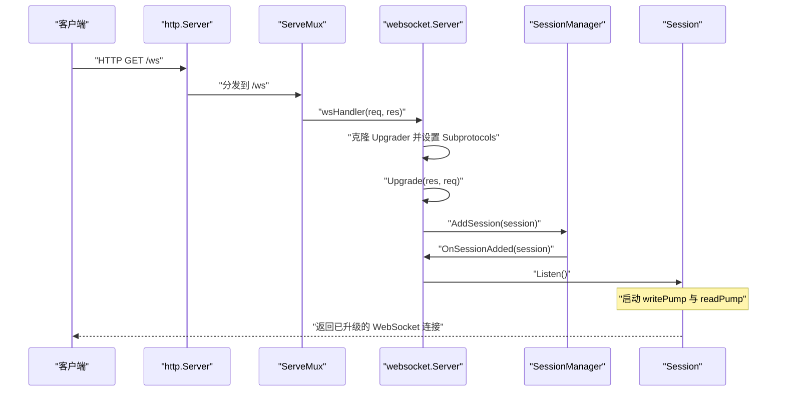

关键行为：

1. `NewServer` 创建 `http.ServeMux`，把 `wsHandler` 注册到 `path`（默认 `/ws`）。
2. `Start` 监听 TCP/TLS，包装中间件链后启动 `http.Server`。
3. `wsHandler` 读取 `Sec-Websocket-Protocol`，若启用 token 注入则写入 URL 查询参数。
4. 创建 `Session` 后调用 `SessionManager.AddSession`，再通过观察者回调触发 `OnSessionAdded`。
5. `Session.Listen` 仅执行一次，启动写协程 `writePump` 和读协程 `readPump`。

**图表来源**
- [transport/websocket/server.go:201-330](file://transport/websocket/server.go#L201-L330)
- [transport/websocket/session.go:120-200](file://transport/websocket/session.go#L120-L200)

**章节来源**
- [transport/websocket/server.go:1-120](file://transport/websocket/server.go#L1-L120)
- [transport/websocket/server.go:201-330](file://transport/websocket/server.go#L201-L330)
- [transport/websocket/session.go:120-200](file://transport/websocket/session.go#L120-L200)

### WebSocket 会话管理与生命周期

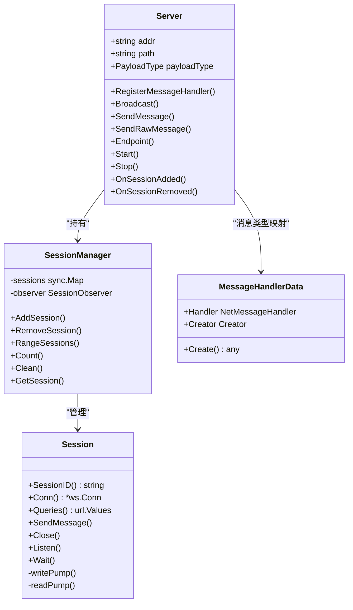

**图表来源**
- [transport/websocket/server.go:1-120](file://transport/websocket/server.go#L1-L120)
- [transport/websocket/session_manager.go:1-119](file://transport/websocket/session_manager.go#L1-L119)
- [transport/websocket/session.go:1-120](file://transport/websocket/session.go#L1-L120)
- [transport/websocket/types.go:1-39](file://transport/websocket/types.go#L1-L39)

#### 会话状态转换

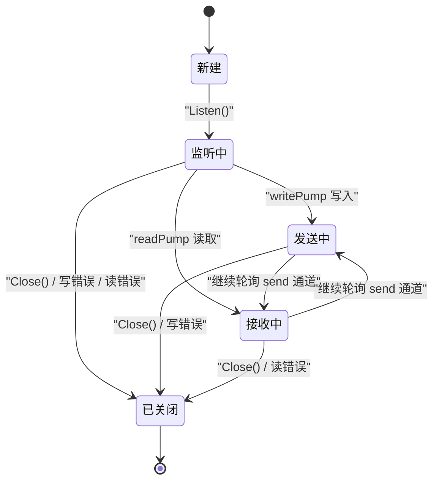

**图表来源**
- [transport/websocket/session.go:120-238](file://transport/websocket/session.go#L120-L238)

#### 消息收发流程

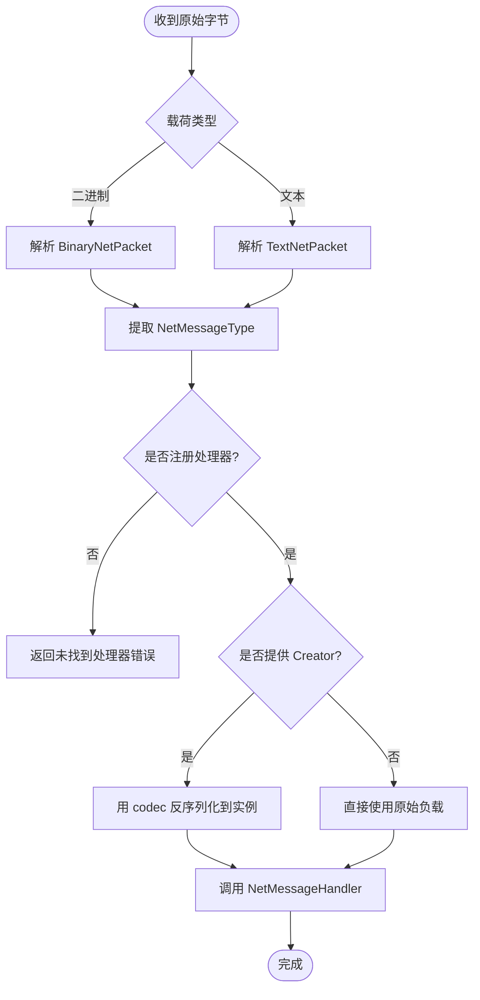

**图表来源**
- [transport/websocket/server.go:330-510](file://transport/websocket/server.go#L330-L510)
- [transport/websocket/message.go:1-60](file://transport/websocket/message.go#L1-L60)

**章节来源**
- [transport/websocket/server.go:201-510](file://transport/websocket/server.go#L201-L510)
- [transport/websocket/session_manager.go:1-119](file://transport/websocket/session_manager.go#L1-L119)
- [transport/websocket/session.go:120-238](file://transport/websocket/session.go#L120-L238)
- [transport/websocket/types.go:1-39](file://transport/websocket/types.go#L1-L39)
- [transport/websocket/message.go:1-60](file://transport/websocket/message.go#L1-L60)

### SSE 事件推送架构

SSE 不是传统意义上的“连接池”，而是由多个命名流组成的事件分发系统：

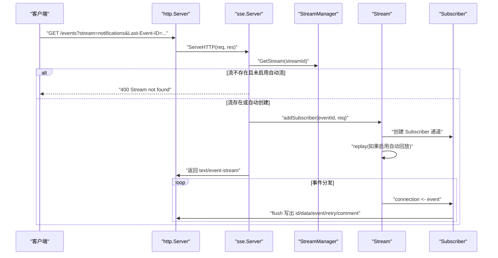

**图表来源**
- [transport/sse/server.go:201-391](file://transport/sse/server.go#L201-L391)
- [transport/sse/http.go:1-146](file://transport/sse/http.go#L1-L146)
- [transport/sse/stream.go:120-200](file://transport/sse/stream.go#L120-L200)

#### 订阅者生命周期

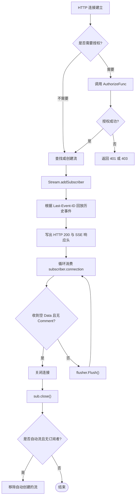

**图表来源**
- [transport/sse/http.go:1-146](file://transport/sse/http.go#L1-L146)
- [transport/sse/stream.go:200-236](file://transport/sse/stream.go#L200-L236)

**章节来源**
- [transport/sse/server.go:201-391](file://transport/sse/server.go#L201-L391)
- [transport/sse/http.go:1-146](file://transport/sse/http.go#L1-L146)
- [transport/sse/stream.go:120-236](file://transport/sse/stream.go#L120-L236)

### SSE 断线重连与回放机制

SSE 的重连语义主要由客户端决定，服务端提供以下能力：

| 能力 | 说明 |
|---|---|
| `Last-Event-ID` | 客户端通过请求头携带上次事件 ID，服务端在 `autoReplay=true` 时回放历史事件 |
| 回放日志裁剪 | 默认保留 `DefaultEventLogSize` 条事件；超出后最旧事件不再支持回放 |
| 慢客户端断开 | 单个订阅者的 `connection` 通道容量为 `defaultSubscriberBuffer`（64），写满即断开该订阅者 |
| `retry` 字段 | 可在事件中设置重连延迟提示，但实际重连策略由客户端实现 |
| 自动流清理 | 当启用 `WithAutoStream` 且关闭 `WithAutoReplay` 时，最后一个订阅者离开后会自动移除流 |

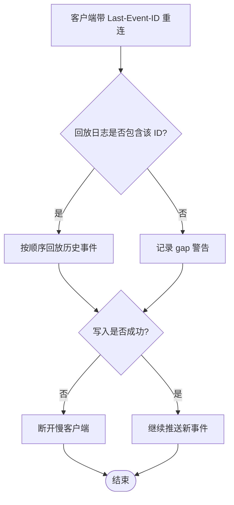

**图表来源**
- [transport/sse/stream.go:120-200](file://transport/sse/stream.go#L120-L200)

**章节来源**
- [transport/sse/stream.go:120-200](file://transport/sse/stream.go#L120-L200)
- [transport/sse/server.go:201-391](file://transport/sse/server.go#L201-L391)
- [transport/sse/event.go:1-120](file://transport/sse/event.go#L1-L120)

### 认证与令牌提取

| 组件 | 行为 |
|---|---|
| WebSocket | 默认从 `Sec-Websocket-Protocol` 读取 token，并可注入到 URL 查询参数中；也可通过自定义 `SocketRawDataHandler` 绕过默认分发逻辑 |
| SSE | 默认 token 提取顺序为 `Authorization: Bearer ...` → `X-Token` → `token` 查询参数；可通过 `WithTokenExtractor` 替换；`AuthorizeFunc` 返回 `ErrForbidden` 产生 403，其他错误产生 401 |

**章节来源**
- [transport/websocket/server.go:330-420](file://transport/websocket/server.go#L330-L420)
- [transport/websocket/options.go:90-143](file://transport/websocket/options.go#L90-L143)
- [transport/sse/auth.go:1-52](file://transport/sse/auth.go#L1-L52)
- [transport/sse/http.go:60-120](file://transport/sse/http.go#L60-L120)

## 依赖关系分析

### WebSocket 组件内部依赖

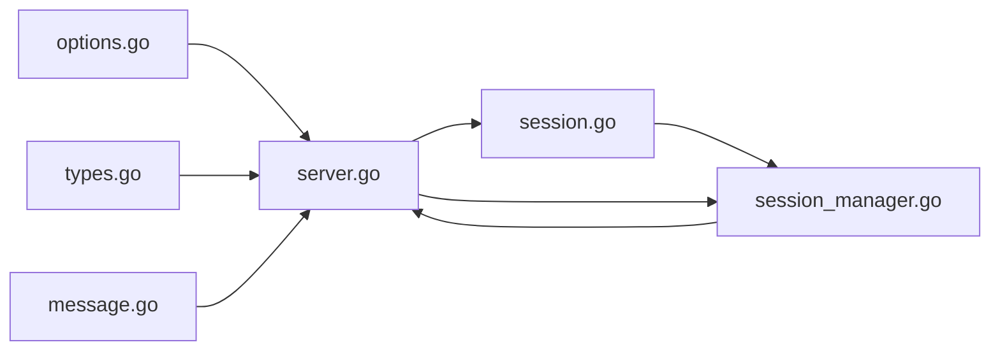

**图表来源**
- [transport/websocket/options.go:1-143](file://transport/websocket/options.go#L1-L143)
- [transport/websocket/types.go:1-39](file://transport/websocket/types.go#L1-L39)
- [transport/websocket/message.go:1-60](file://transport/websocket/message.go#L1-L60)
- [transport/websocket/session_manager.go:1-119](file://transport/websocket/session_manager.go#L1-L119)
- [transport/websocket/session.go:1-120](file://transport/websocket/session.go#L1-L120)
- [transport/websocket/server.go:1-120](file://transport/websocket/server.go#L1-L120)

### SSE 组件内部依赖

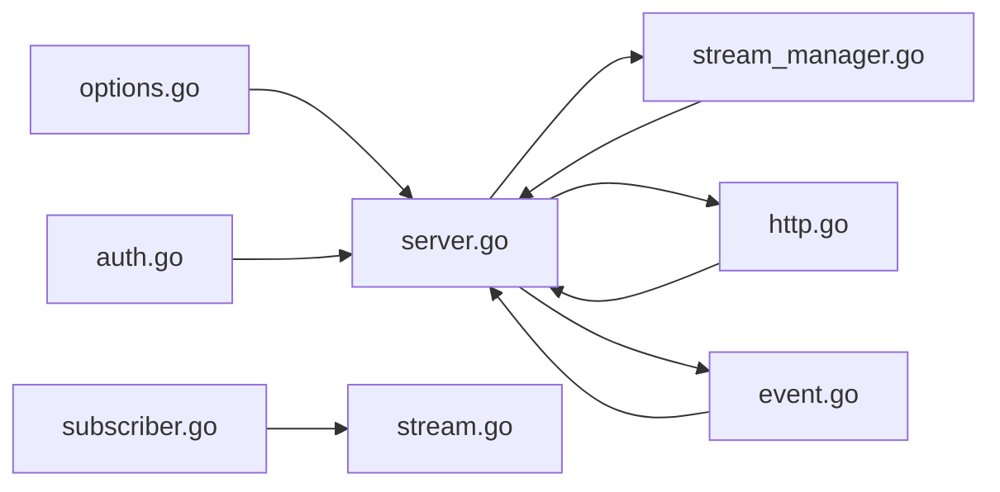

**图表来源**
- [transport/sse/options.go:1-123](file://transport/sse/options.go#L1-L123)
- [transport/sse/auth.go:1-52](file://transport/sse/auth.go#L1-L52)
- [transport/sse/event.go:1-120](file://transport/sse/event.go#L1-L120)
- [transport/sse/stream_manager.go:1-101](file://transport/sse/stream_manager.go#L1-L101)
- [transport/sse/http.go:1-146](file://transport/sse/http.go#L1-L146)
- [transport/sse/subscriber.go:1-76](file://transport/sse/subscriber.go#L1-L76)
- [transport/sse/stream.go:1-120](file://transport/sse/stream.go#L1-L120)
- [transport/sse/server.go:1-120](file://transport/sse/server.go#L1-L120)

**章节来源**
- [transport/websocket/server.go:1-120](file://transport/websocket/server.go#L1-L120)
- [transport/sse/server.go:1-120](file://transport/sse/server.go#L1-L120)

## 性能与资源特性

### 连接与内存模型

| 维度 | WebSocket | SSE |
|---|---|---|
| 连接模型 | 每个 `Session` 一个 WebSocket 连接，两个 goroutine（读/写） | 每个 `Subscriber` 一个 HTTP 流连接，由 `Stream.run` 统一分发 |
| 发送缓冲 | 每个 `Session.send` 通道默认 256 字节；可通过 `WithChannelBufferSize` 调整 | 每个 `Stream.event` 通道默认 1024；可通过 `WithBufferSize` 调整 |
| 慢客户端处理 | 写失败会直接返回并触发 `Close` | 订阅者通道写满时主动断开该订阅者，避免阻塞整条流 |
| 广播方式 | `RangeSessions` 拷贝所有会话指针后逐个调用 `SendMessage` | `Notify` 遍历所有流并向其 `event` 通道投递 |
| 会话/流统计 | `SessionManager.Count` 遍历 `sync.Map` | `StreamManager.Count` 直接取 `len(streams)` |
| 清理时机 | `Start` 取消上下文后调用 `sessionManager.Clean` | `Start` 取消上下文后调用 `streamMgr.Clean` |

### 并发控制要点

1. **WebSocket**
   - `Session.Close` 使用 `sync.Once`，确保只关闭一次底层连接。
   - `Session.Listen` 使用 `sync.Once`，确保只启动一对读写 goroutine。
   - `SessionManager.AddSession` / `RemoveSession` 对观察者回调做幂等保护。
   - `Server.OnSessionAdded` / `OnSessionRemoved` 在观察者为空时不报错。

2. **SSE**
   - `StreamManager` 所有访问被 `sync.RWMutex` 保护。
   - `Stream.subscriberCount` 使用 `atomic.Int32`。
   - `Stream.dispatch` 对慢客户端立即移除，不阻塞后续订阅者。
   - `Subscriber.close()` 同时等待 `streamQuit`，防止流关闭后去注册永远无人接收。

**章节来源**
- [transport/websocket/session.go:120-238](file://transport/websocket/session.go#L120-L238)
- [transport/websocket/session_manager.go:1-119](file://transport/websocket/session_manager.go#L1-L119)
- [transport/sse/stream_manager.go:1-101](file://transport/sse/stream_manager.go#L1-L101)
- [transport/sse/stream.go:120-236](file://transport/sse/stream.go#L120-L236)
- [transport/sse/subscriber.go:1-76](file://transport/sse/subscriber.go#L1-L76)

## 典型实时应用开发模式

### 聊天室

推荐方案：

- 使用 WebSocket 作为主要通道，因为聊天通常需要双向交互：用户发消息、服务器转发给其他在线用户。
- 将聊天消息定义为 `NetMessageType`，并通过 `RegisterMessageHandler` 注册处理器。
- 使用 `Broadcast` 向所有会话广播消息，或使用 `SessionManager.RangeSessions` 按房间/频道过滤。
- 如需身份识别，可使用 `Sec-Websocket-Protocol` 注入 token，或在查询参数中携带用户标识。

注意：

- 如果聊天室规模很大，应避免对所有会话进行昂贵序列化；优先广播预序列化的字节数组。
- 如果后端有分区或进程，应结合 broker（如 Redis、Kafka）做跨进程广播，而不是只依赖单进程内 `SessionManager`。

**章节来源**
- [transport/websocket/server.go:201-330](file://transport/websocket/server.go#L201-L330)
- [transport/websocket/server.go:330-510](file://transport/websocket/server.go#L330-L510)

### 通知系统

推荐方案：

- 使用 SSE 推送系统通知，因为通知通常是服务器到客户端的单向事件流。
- 为不同通知类别创建不同流，例如 `notifications`、`alerts`、`system-status`。
- 使用 `PublishData` 或 `PublishDataWithMeta` 编码业务数据并发布到指定流。
- 启用 `WithAutoStream` 允许前端动态订阅尚未显式创建的流。
- 如需重放最近通知，启用 `WithAutoReplay` 并配合客户端的 `Last-Event-ID`。

注意事项：

- 通知量极大时，应关注 `WithEventLogSize`，避免回放日志无限增长。
- 对于瞬时告警，建议设置 `WithEventTTL`，跳过过期事件。

**章节来源**
- [transport/sse/server.go:201-391](file://transport/sse/server.go#L201-L391)
- [transport/sse/stream.go:120-200](file://transport/sse/stream.go#L120-L200)

### 实时监控

推荐方案：

- 实时监控通常适合 SSE，因为监控面板主要是“拉取最新状态”，不需要频繁上行。
- 使用 `NotifyData` 向所有流广播全局指标。
- 使用 `PublishData` 向特定设备/租户流推送细粒度指标。
- 开启 `WithEncodeBase64` 可降低 base64 特殊字符带来的解析问题，但会增加体积。
- 开启 `WithSplitData` 可将多行数据拆成多条 `data:` 行，便于逐行消费。

注意事项：

- 监控频率高时，应限制事件大小与频率，避免慢客户端拖垮整条流。
- 监控历史查询不应依赖 SSE 回放日志，应走独立存储；回放日志更适合“最近 N 条”场景。

**章节来源**
- [transport/sse/server.go:201-391](file://transport/sse/server.go#L201-L391)
- [transport/sse/event.go:1-120](file://transport/sse/event.go#L1-L120)
- [transport/sse/http.go:1-146](file://transport/sse/http.go#L1-L146)

### 命令与控制

推荐方案：

- 使用 WebSocket，因为控制面通常需要可靠的双向确认：客户端下发指令，服务端返回执行结果。
- 使用二进制载荷模式提升吞吐，或使用文本载荷模式便于调试。
- 为不同命令类型注册处理器，例如 `1` 表示重启、`2` 表示配置更新。
- 对失败写入进行监控，因为写失败会触发会话关闭。

**章节来源**
- [transport/websocket/message.go:1-60](file://transport/websocket/message.go#L1-L60)
- [transport/websocket/server.go:330-510](file://transport/websocket/server.go#L330-L510)

## 连接监控、调优与故障恢复

### 连接监控

| 指标 | WebSocket | SSE |
|---|---|---|
| 活跃连接数 | `Server.SessionCount()` | `Server.StreamCount()` |
| 单连接详情 | 通过 `SessionManager.GetSession` 获取 `Session` | 通过 `Server.GetStream` 获取 `Stream`，再观察订阅者 |
| 连接生命周期 | 通过 `WithSocketConnectHandler` 捕获 connect/disconnect | 通过 `WithSubscriberFunction` / `WithUnSubscriberFunction` 捕获加入/离开 |
| 健康检查 | 可复用 `transport/http` 中间件暴露健康端点 | 同上 |
| 指标上报 | 建议在连接回调中上报 Prometheus 指标 | 建议在订阅回调中上报订阅者数量指标 |

**章节来源**
- [transport/websocket/server.go:201-330](file://transport/websocket/server.go#L201-L330)
- [transport/websocket/options.go:100-143](file://transport/websocket/options.go#L100-L143)
- [transport/sse/server.go:201-330](file://transport/sse/server.go#L201-L330)
- [transport/sse/options.go:80-123](file://transport/sse/options.go#L80-L123)

### 性能调优

1. **缓冲区配置**
   - WebSocket：`WithReadBufferSize`、`WithWriteBufferSize`、`WithChannelBufferSize`。
   - SSE：`WithBufferSize`、`WithEventLogSize`。
2. **压缩**
   - WebSocket：`WithEnableCompression` 可减少带宽，但增加 CPU 消耗。
3. **载荷格式**
   - WebSocket：二进制模式适合高频小消息；文本模式适合可读性强的调试场景。
   - SSE：`WithEncodeBase64` 适合含二进制的 data；`WithSplitData` 适合多行数据。
4. **事件过期**
   - SSE：`WithEventTTL` 可跳过过期事件，减少无效网络开销。
5. **自动流管理**
   - SSE：`WithAutoStream` 简化动态订阅，但需评估流数量增长风险。

**章节来源**
- [transport/websocket/options.go:1-143](file://transport/websocket/options.go#L1-L143)
- [transport/sse/options.go:1-123](file://transport/sse/options.go#L1-L123)
- [transport/sse/server.go:201-391](file://transport/sse/server.go#L201-L391)

### 故障恢复最佳实践

| 场景 | 建议 |
|---|---|
| WebSocket 写失败 | 写失败会触发 `Close`，调用方应监控连接断开并尝试重建；对重要消息应在上层实现持久化与重试 |
| WebSocket 读异常 | `readPump` 忽略非预期关闭错误以外的异常，但仍会关闭会话；上游应区分正常断开与异常断开 |
| SSE 慢客户端 | 订阅者缓冲写满会被断开；客户端应按 `Last-Event-ID` 重连，服务端应设置合理的回放窗口 |
| SSE 回放缺口 | 当 `Last-Event-ID` 早于保留日志中最旧事件时，会记录 gap 警告；应用层应降级为全量加载 |
| 服务重启 | WebSocket 的 `Clean` 关闭所有会话；SSE 的 `Clean` 关闭所有流；客户端应实现指数退避重连 |
| 认证失败 | SSE 明确区分 401 与 403；WebSocket 可通过自定义 `SocketRawDataHandler` 或中间件实现鉴权 |
| 大流量广播 | 避免在热点路径上重复序列化；先序列化一次，再广播字节切片 |

**章节来源**
- [transport/websocket/session.go:201-238](file://transport/websocket/session.go#L201-L238)
- [transport/websocket/server.go:201-330](file://transport/websocket/server.go#L201-L330)
- [transport/sse/stream.go:120-200](file://transport/sse/stream.go#L120-L200)
- [transport/sse/http.go:60-146](file://transport/sse/http.go#L60-L146)
- [transport/sse/auth.go:1-52](file://transport/sse/auth.go#L1-L52)

## 结论

WebSocket 与 SSE 在本仓库中是两个互补的实时传输能力：

- **WebSocket** 更适合双向、低延迟、强一致的控制面和聊天场景，核心是 `Server` + `SessionManager` + `Session`。
- **SSE** 更适合单向、可扩展的通知和监控场景，核心是 `Server` + `StreamManager` + `Stream` + `Subscriber`。

二者都遵循相同的工程约定：基于 HTTP 服务、支持中间件、支持 TLS、支持可插拔编解码器、支持优雅关闭。实际使用时应根据消息方向、可靠性要求、回放需求、客户端兼容性选择合适协议，并在上层实现连接监控、重连策略与背压保护。