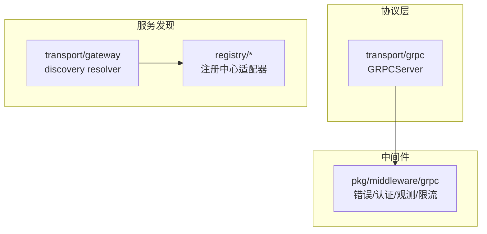
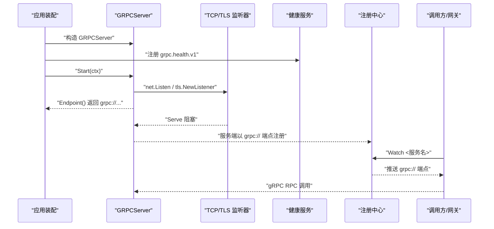
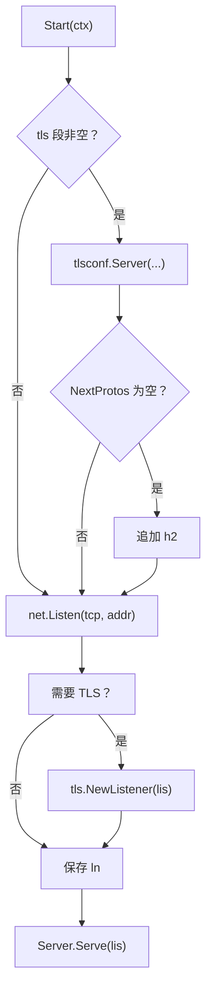
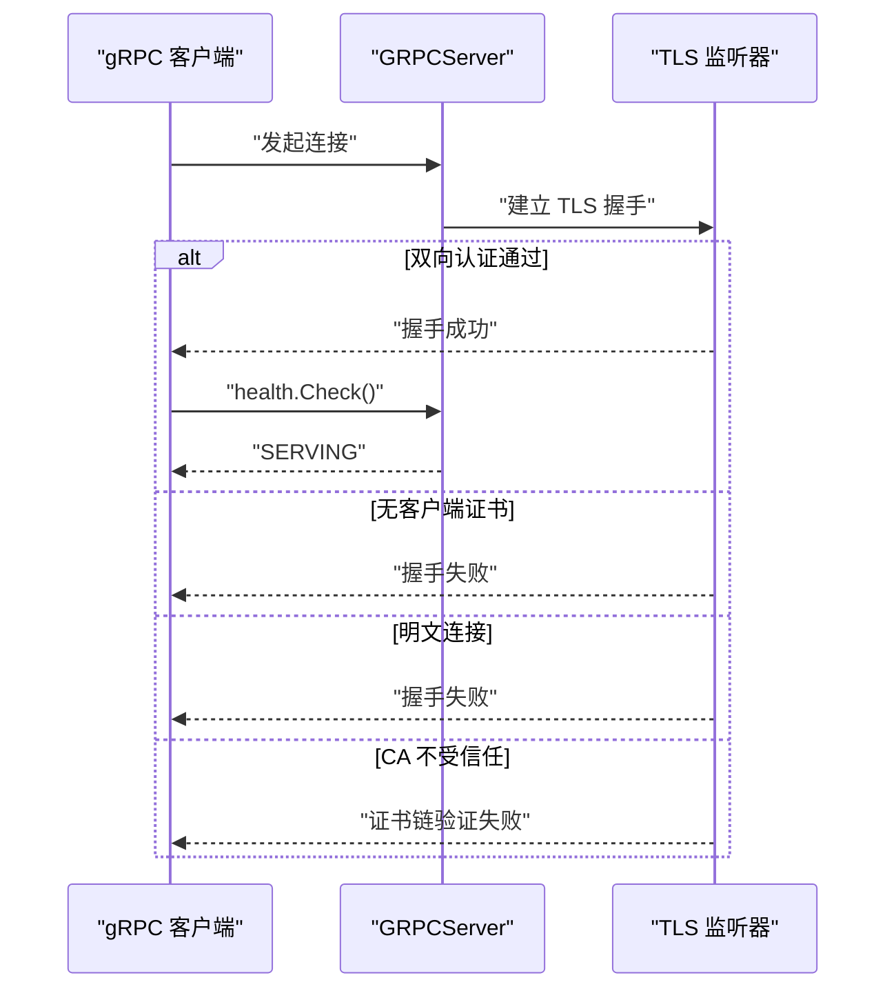
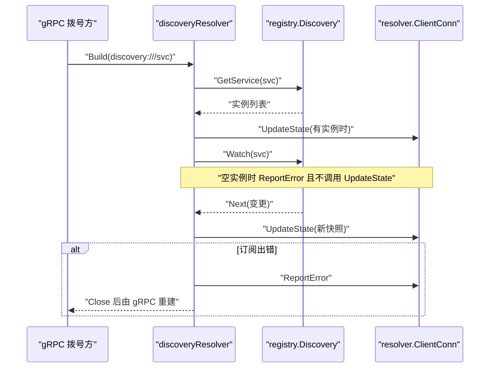
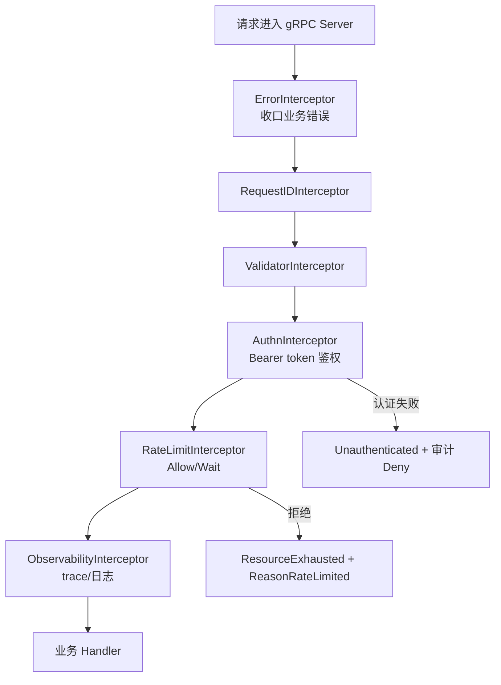
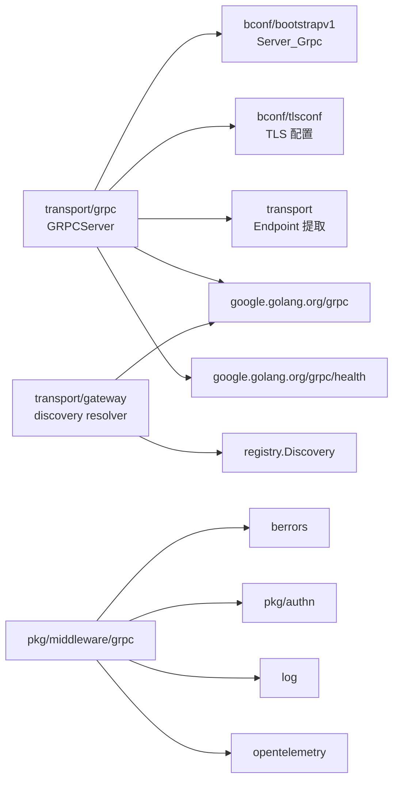

# gRPC 传输

<cite>
**本文引用的文件**   
- [transport/grpc/grpc_server.go](file://transport/grpc/grpc_server.go)
- [transport/grpc/grpc_server_test.go](file://transport/grpc/grpc_server_test.go)
- [transport/grpc/grpc_tls_test.go](file://transport/grpc/grpc_tls_test.go)
- [transport/gateway/discovery.go](file://transport/gateway/discovery.go)
- [transport/gateway/discovery_test.go](file://transport/gateway/discovery_test.go)
- [pkg/middleware/grpc/error.go](file://pkg/middleware/grpc/error.go)
- [pkg/middleware/grpc/authn.go](file://pkg/middleware/grpc/authn.go)
- [pkg/middleware/grpc/observability.go](file://pkg/middleware/grpc/observability.go)
- [pkg/middleware/grpc/ratelimit_test.go](file://pkg/middleware/grpc/ratelimit_test.go)
- [registry/etcd/service.go](file://registry/etcd/service.go)
- [registry/nacos/options.go](file://registry/nacos/options.go)
</cite>

## 目录

1. [简介](#简介)
2. [项目结构](#项目结构)
3. [核心组件](#核心组件)
4. [架构总览](#架构总览)
5. [详细组件分析](#详细组件分析)
6. [依赖关系分析](#依赖关系分析)
7. [性能与负载均衡](#性能与负载均衡)
8. [故障排查指南](#故障排查指南)
9. [结论](#结论)

## 简介

本仓库的 gRPC 传输组件由两层组成：

- **gRPC 服务器层**：`transport/grpc` 把 `google.golang.org/grpc` 封装成框架可启动、可停止、可暴露监听端点的 Server，负责 TLS 监听、标准健康服务注册、优雅停机。
- **服务发现解析层**：`transport/gateway` 提供 `discovery:///<服务名>` 目标格式，把注册中心中的 `ServiceInstance` 转换为 gRPC Resolver 地址列表，供网关或调用方按服务名拨号。

该实现不直接承担业务鉴权、限流、链路追踪等横切逻辑；这些通过 `pkg/middleware/grpc` 下的拦截器链注入到 gRPC Server 中。

## 项目结构

与 gRPC 传输直接相关的代码分布在三个模块：

**图表来源**
- [transport/grpc/grpc_server.go:1-149](file://transport/grpc/grpc_server.go#L1-L149)
- [transport/gateway/discovery.go:1-174](file://transport/gateway/discovery.go#L1-L174)
- [pkg/middleware/grpc/error.go:1-43](file://pkg/middleware/grpc/error.go#L1-L43)

**章节来源**
- [transport/grpc/grpc_server.go:1-149](file://transport/grpc/grpc_server.go#L1-L149)
- [transport/gateway/discovery.go:1-174](file://transport/gateway/discovery.go#L1-L174)

## 核心组件

| 组件 | 职责 | 关键行为 |
|---|---|---|
| `GRPCServer` | 封装 gRPC Server，实现传输契约 | 构建 TLS、监听 TCP、暴露 `Start`/`Stop`/`Endpoint` |
| 标准健康服务 | 提供 `grpc.health.v1` 探针 | 默认初始状态为 SERVING，就绪状态由装配层写入 |
| discovery resolver | 把注册中心实例转为 gRPC 地址 | 只接受 `grpc://` 端点，空集上报错误但不推空快照 |
| 错误拦截器 | 把业务错误转成 gRPC status | 放在拦截器链最外层，保证 Code/Reason/Details 透传 |
| 认证拦截器 | 从 metadata 取 Bearer token | 失败返回 Unauthenticated 并记录审计事件 |
| 观测拦截器 | 注入 trace、记录请求日志 | 支持 unary 和 stream，默认跳过 `/metrics` |

**章节来源**
- [transport/grpc/grpc_server.go:20-149](file://transport/grpc/grpc_server.go#L20-L149)
- [transport/gateway/discovery.go:14-174](file://transport/gateway/discovery.go#L14-L174)
- [pkg/middleware/grpc/error.go:1-43](file://pkg/middleware/grpc/error.go#L1-L43)
- [pkg/middleware/grpc/authn.go:1-131](file://pkg/middleware/grpc/authn.go#L1-L131)
- [pkg/middleware/grpc/observability.go:1-200](file://pkg/middleware/grpc/observability.go#L1-L200)

## 架构总览

下图展示一个典型 gRPC 服务在 Bald 框架中的生命周期：配置 → 构建 Server → 注册健康检查 → 启动监听 → 对外暴露 `grpc://host:port` → 被注册中心采集 → 下游用 `discovery:///<服务名>.grpc` 解析。

**图表来源**
- [transport/grpc/grpc_server.go:63-149](file://transport/grpc/grpc_server.go#L63-L149)
- [transport/gateway/discovery.go:78-174](file://transport/gateway/discovery.go#L78-L174)

## 详细组件分析

### gRPC 服务器实现

`GRPCServer` 嵌入 `*grpc.Server`，并通过两种构造方式区分是否由框架托管：

- `NewGRPCServerWithRegister`：创建内部 `grpc.Server`，同时注册标准健康服务并把业务 register 回调挂进去。
- `NewGRPCServer`：复用业务已构建的 `*grpc.Server`，此时不注册健康服务，`HealthServer()` 返回 nil。

`Start` 的执行顺序是：先根据配置构建 TLS 配置，再绑定 TCP 端口，最后调用底层 `Server.Serve`。TLS 未配置时保持明文；配置了 TLS 且 `NextProtos` 为空时会补上 `h2`，因为较新版本 gRPC 要求服务端声明 ALPN。

`Stop` 优先使用 `GracefulStop`；如果上下文超时则退化为强制 `Stop`。`Endpoint` 会解析动态端口（`:0`）并统一输出 `grpc://host:port`，未监听时返回空字符串，用于等待 Start 真正执行。

**图表来源**
- [transport/grpc/grpc_server.go:63-113](file://transport/grpc/grpc_server.go#L63-L113)

**章节来源**
- [transport/grpc/grpc_server.go:20-149](file://transport/grpc/grpc_server.go#L20-L149)
- [transport/grpc/grpc_server_test.go:1-139](file://transport/grpc/grpc_server_test.go#L1-L139)

### 服务注册与健康检查

健康检查采用 gRPC 生态的标准服务 `grpc.health.v1`，而不是业务自定义探针。`NewGRPCServerWithRegister` 初始化后默认返回 SERVING；业务就绪状态通过 `HealthServer().SetServingStatus` 写入。测试覆盖了以下语义：

- 动态端口能解析为非 `:0` 的可达地址。
- 健康服务默认存在且初始状态为 SERVING。
- 外部通过 `HealthServer()` 推入 NOT_SERVING 后能被探测到。
- 传输层不自动注册 reflection 服务。
- Stop 与 Start 并发不会 panic 或触发 race。

**章节来源**
- [transport/grpc/grpc_server.go:35-62](file://transport/grpc/grpc_server.go#L35-L62)
- [transport/grpc/grpc_server_test.go:48-139](file://transport/grpc/grpc_server_test.go#L48-L139)

### TLS 双向认证

TLS 配置来自 `bootstrapv1.Server_Grpc.Tls`，由 `bconf/tlsconf` 统一构建。测试断言三类场景：

| 客户端类型 | 预期结果 |
|---|---|
| 持有 CA + 客户端证书的双向 TLS 客户端 | 握手成功，健康检查返回 SERVING |
| 仅信任 CA、不提供客户端证书的 TLS 客户端 | 被拒绝 |
| 明文 gRPC 客户端 | 被拒绝 |
| 使用另一套 CA 的客户端 | 握手失败 |
| 配置了 TLS 但证书不可用 | `Start` 直接报错且不留下监听地址 |

注意：TLS 配置构建失败发生在监听之前，避免占端口后静默失败。

**图表来源**
- [transport/grpc/grpc_tls_test.go:61-162](file://transport/grpc/grpc_tls_test.go#L61-L162)
- [transport/grpc/grpc_server.go:87-113](file://transport/grpc/grpc_server.go#L87-L113)

**章节来源**
- [transport/grpc/grpc_tls_test.go:1-162](file://transport/grpc/grpc_tls_test.go#L1-L162)
- [transport/grpc/grpc_server.go:87-113](file://transport/grpc/grpc_server.go#L87-L113)

### 服务发现与 `discovery:///<服务名>.grpc`

当后端地址写成 `discovery:///<服务名>` 时，gateway 不再直连 host:port，而是通过 `registry.Discovery` 解析服务实例。解析器是 gRPC Resolver 的一个自定义实现：

1. `Build` 同步拉取一次快照，并启动 Watch。
2. 首次拉取失败不会返回 Build 错误，而是 `ReportError` 并保留订阅，等 Watch 推送。
3. 空实例集不调用 `UpdateState`，只上报“无实例”错误，避免 gRPC 清理已有健康地址。
4. 只接受端点中以 `grpc://` 开头的地址；其他 scheme 或裸带 scheme 的地址被丢弃。
5. Watch 出错时上报一次错误并退出循环，让 gRPC 按 TransientFailure 重建 resolver。

重要约定：

- 只有 target 写成 `discovery:///<服务名>` 才走注册中心；普通 `host:port` 仍走 gRPC 原生 dns resolver。
- nacos 把一个实例的多个端点拆成 `<Name>.<scheme>` 形式，因此必须写 `discovery:///<服务名>.grpc`；少 `.grpc` 后缀通常解析到 HTTP 面或空集。
- memory 与 etcd 使用注册时的 `ServiceInstance.Name` 原样匹配。
- `Build` 返回错误 gRPC 不会重试；空快照不推 `UpdateState`；只取 `grpc://` 端点。

**图表来源**
- [transport/gateway/discovery.go:45-174](file://transport/gateway/discovery.go#L45-L174)
- [transport/gateway/discovery_test.go:128-200](file://transport/gateway/discovery_test.go#L128-L200)

**章节来源**
- [transport/gateway/discovery.go:14-174](file://transport/gateway/discovery.go#L14-L174)
- [transport/gateway/discovery_test.go:1-200](file://transport/gateway/discovery_test.go#L1-L200)
- [registry/etcd/service.go:1-22](file://registry/etcd/service.go#L1-L22)
- [registry/nacos/options.go:1-84](file://registry/nacos/options.go#L1-L84)

### 拦截器链与错误处理

gRPC 拦截器链由多个中间件组合而成，常见顺序如下：

1. **错误拦截器**：必须放在最外层，把业务 `*berrors.Error` 转成 gRPC status，使 Code、Reason、Details 跨服务透传。
2. **请求 ID 拦截器**：生成或传播请求标识。
3. **校验拦截器**：对入参做结构化校验。
4. **鉴权拦截器**：从 metadata 抽取 Authorization Bearer token，调用 Authenticator，并把租户、角色、权限写入 context。
5. **限流拦截器**：允许请求进入或排队；拒绝时返回 ResourceExhausted。
6. **观测拦截器**：创建 span、注入 trace header、记录请求耗时与状态码。
7. **业务 handler**。

错误处理的关键规则：

- 认证失败返回 Unauthenticated，并旁路记录一条 ResultDeny 审计事件。
- 限流拒绝统一返回 RESOURCE_EXHAUSTED，Reason 固定为 `ReasonRateLimited`，接收方可用 `grpcerr.FromStatus` 还原。
- 业务错误经 `grpcerr.ToStatus` 转换后，不应直接返回裸 error。

**图表来源**
- [pkg/middleware/grpc/error.go:1-43](file://pkg/middleware/grpc/error.go#L1-L43)
- [pkg/middleware/grpc/authn.go:33-100](file://pkg/middleware/grpc/authn.go#L33-L100)
- [pkg/middleware/grpc/observability.go:68-200](file://pkg/middleware/grpc/observability.go#L68-L200)
- [pkg/middleware/grpc/ratelimit_test.go:1-186](file://pkg/middleware/grpc/ratelimit_test.go#L1-L186)

**章节来源**
- [pkg/middleware/grpc/error.go:1-43](file://pkg/middleware/grpc/error.go#L1-L43)
- [pkg/middleware/grpc/authn.go:1-131](file://pkg/middleware/grpc/authn.go#L1-L131)
- [pkg/middleware/grpc/observability.go:1-200](file://pkg/middleware/grpc/observability.go#L1-L200)
- [pkg/middleware/grpc/ratelimit_test.go:1-186](file://pkg/middleware/grpc/ratelimit_test.go#L1-L186)

### 流式通信支持

观测拦截器同时提供 unary 与 stream 两个拦截器，说明 gRPC 流式 RPC 同样会被纳入 trace 和日志通道。具体业务流式方法由用户实现的 gRPC service handler 定义；本传输层不限制流式能力。

**章节来源**
- [pkg/middleware/grpc/observability.go:170-200](file://pkg/middleware/grpc/observability.go#L170-L200)

## 依赖关系分析

**图表来源**
- [transport/grpc/grpc_server.go:1-24](file://transport/grpc/grpc_server.go#L1-L24)
- [transport/gateway/discovery.go:1-20](file://transport/gateway/discovery.go#L1-L20)
- [pkg/middleware/grpc/observability.go:1-30](file://pkg/middleware/grpc/observability.go#L1-L30)

**章节来源**
- [transport/grpc/grpc_server.go:1-24](file://transport/grpc/grpc_server.go#L1-L24)
- [transport/gateway/discovery.go:1-20](file://transport/gateway/discovery.go#L1-L20)

## 性能与负载均衡

### gRPC 配置选项

当前 `GRPCServer` 消费的配置字段集中在 `Server_Grpc`，包括监听地址、TLS、reflection 开关等。反射服务不由传输层注册，测试确认即使配置 Reflection 为 true，传输层也不会把 reflection 服务挂到 Server 上。

gRPC 侧的其他选项（如最大消息大小、KeepAlive、MaxConcurrentStreams、LoadBalancingPolicy 等）应通过 `grpc.NewServer(unary...)` 传入的 `grpc.ServerOption` 配置。`NewGRPCServerWithRegister` 接收 unary 拦截器切片，适合把通用拦截器作为全局 Server 选项挂载。

### 负载均衡策略

- 直连模式：目标为普通 host:port 时，使用 gRPC 内置 DNS resolver。
- 服务发现模式：目标为 `discovery:///<服务名>` 时，使用本仓库的 discovery resolver，把 `ServiceInstance.Endpoints` 中所有 `grpc://` 地址放入 resolver State。
- 多端点负载：同一服务多个实例会以地址列表形式下发，gRPC 侧选择策略取决于拨号端的 LoadBalancingPolicy；本实现不负责加权或区域路由。

### 流式通信

stream 方法与 unary 共享同一 gRPC Server 和拦截器链。观测拦截器提供了 stream 版本，因此流式调用也会产生 span 和日志。

**章节来源**
- [transport/grpc/grpc_server_test.go:96-111](file://transport/grpc/grpc_server_test.go#L96-L111)
- [transport/gateway/discovery.go:116-145](file://transport/gateway/discovery.go#L116-L145)
- [pkg/middleware/grpc/observability.go:170-200](file://pkg/middleware/grpc/observability.go#L170-L200)

## 故障排查指南

| 现象 | 可能原因 | 排查步骤 |
|---|---|---|
| `discovery:///<服务名>` 解析不到 gRPC 端点 | 注册的是 HTTP 端点或未加 `.grpc` 后缀 | 检查 nacos 下服务名是否为 `<名字>.grpc`；确认 `ServiceInstance.Endpoints` 包含 `grpc://` |
| 空实例时下游一直报解析错误 | 首次快照为空时只 `ReportError` 不推 `UpdateState` | 确认注册中心已推送实例；不要期望空集也能更新地址 |
| TLS 端口不接受明文连接 | 已启用 server.grpc.tls | 客户端必须使用相同 CA 及双向证书；禁用 insecure 凭据 |
| TLS 握手报 ALPN 缺失 | gRPC ≥1.67 要求服务端 NextProtos 含 h2 | 检查 TLS 配置是否自动补全 h2 |
| 认证失败但没有审计记录 | 未注入 Auditor | 通过 `AuthnWithAuditor` 显式注入审计后端 |
| 限流返回 Unknown 而非 ResourceExhausted | 错误拦截器不在链首 | 确保 `ErrorInterceptor` 最先注册 |
| 动态端口 Endpoint 仍是 `:0` | Start 尚未真正绑定 | 轮询 `Endpoint()` 直到非空且不以 `:0` 结尾 |
| gateway 启动时报没有发现来源 | backend_grpc_addr 用了 `discovery://` 但未注入 Discovery | 通过 `WithDiscovery` 或 `WithDiscoverySource` 提供注册中心 |

**章节来源**
- [transport/gateway/discovery.go:60-174](file://transport/gateway/discovery.go#L60-L174)
- [transport/grpc/grpc_tls_test.go:61-162](file://transport/grpc/grpc_tls_test.go#L61-L162)
- [pkg/middleware/grpc/error.go:1-43](file://pkg/middleware/grpc/error.go#L1-L43)
- [pkg/middleware/grpc/authn.go:33-100](file://pkg/middleware/grpc/authn.go#L33-L100)

## 结论

`transport/grpc` 提供的是最小而明确的 gRPC 传输契约：监听、TLS、健康检查、优雅停机与端点暴露。业务服务注册、鉴权、限流、链路追踪分别交给 gRPC 原生 API 和 `pkg/middleware/grpc` 拦截器。服务发现通过 `transport/gateway` 的 discovery resolver 把注册中心中的 `grpc://` 端点映射到 gRPC 地址列表，并以 `discovery:///<服务名>.grpc` 作为稳定入口。

开发时应遵循以下原则：

- 用 `NewGRPCServerWithRegister` 托管健康检查，或用 `NewGRPCServer` 接入业务自建 Server。
- 认证失败、限流拒绝和业务错误分别由对应拦截器处理，并由 `ErrorInterceptor` 统一转成 gRPC status。
- 生产环境务必启用 server.grpc.tls，客户端使用双向 TLS。
- 使用注册中心时，目标必须写 `discovery:///<服务名>.grpc`，并确保实例中包含 `grpc://` 端点。
- 不要把 reflection 当作生产功能，它不由传输层注册。