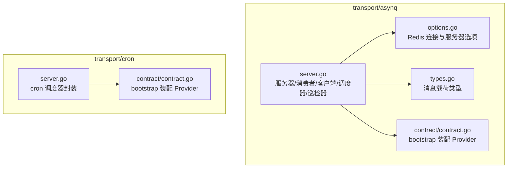
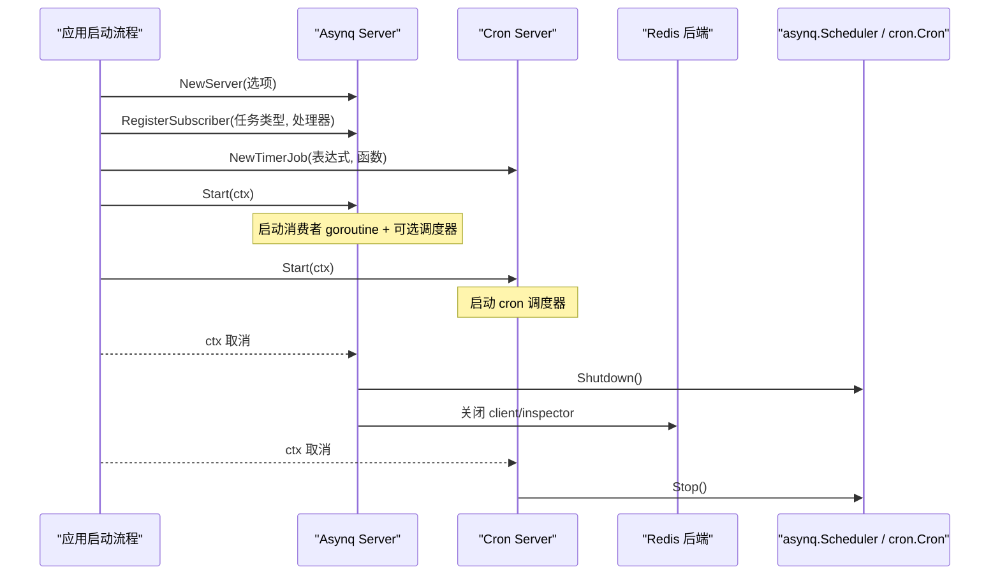
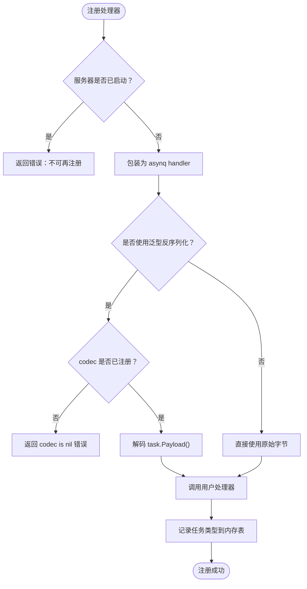
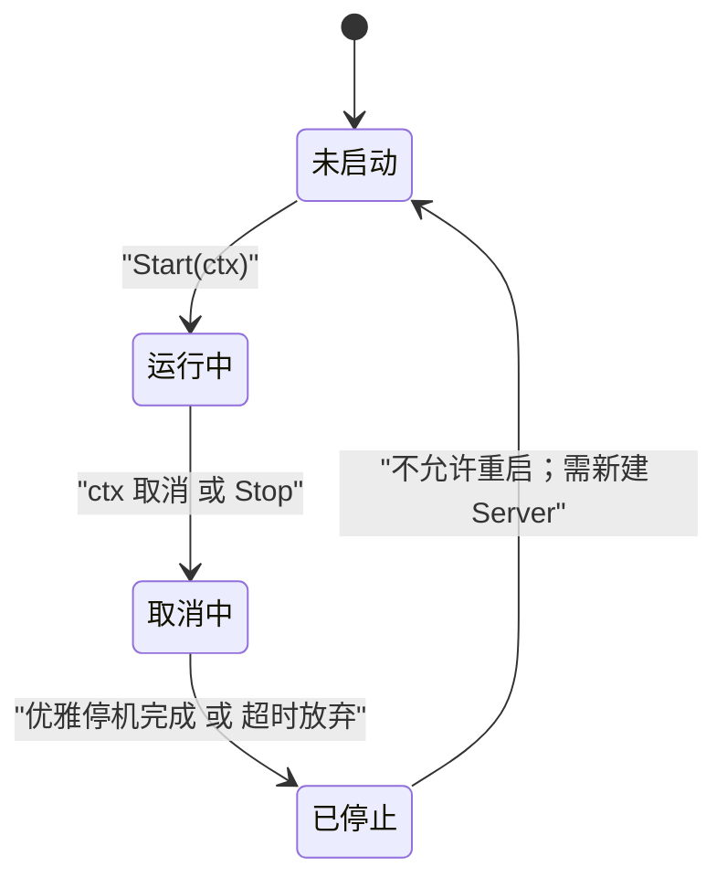
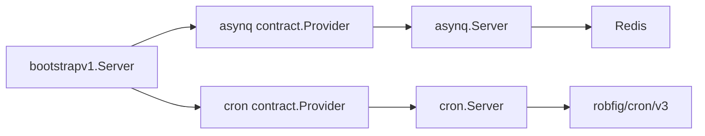

# 任务队列传输

<cite>
**本文引用的文件**   
- [transport/asynq/server.go](file://transport/asynq/server.go)
- [transport/asynq/types.go](file://transport/asynq/types.go)
- [transport/asynq/options.go](file://transport/asynq/options.go)
- [transport/asynq/contract/contract.go](file://transport/asynq/contract/contract.go)
- [transport/cron/server.go](file://transport/cron/server.go)
- [transport/cron/contract/contract.go](file://transport/cron/contract/contract.go)
</cite>

## 目录
1. [引言](#引言)
2. [项目结构](#项目结构)
3. [核心组件](#核心组件)
4. [架构总览](#架构总览)
5. [详细组件分析](#详细组件分析)
6. [依赖关系分析](#依赖关系分析)
7. [性能与资源调度](#性能与资源调度)
8. [故障排查指南](#故障排查指南)
9. [结论](#结论)
10. [附录：配置项速查](#附录配置项速查)

## 引言
本仓库的“任务队列传输”由两个独立但互补的组件组成：

- **Asynq 异步任务队列**：基于 Redis 的任务入队、消费、定时调度与结果等待，实现 `transport.Server`，可嵌入统一服务生命周期。
- **Cron 定时任务**：基于进程内 `robfig/cron/v3` 的秒级表达式调度器，提供轻量周期作业能力。

二者均面向“生产者—后端存储/调度器—消费者”的典型模式；区别在于 Asynq 是分布式任务队列，Cron 是单机进程内调度器。本文围绕任务调度、执行引擎、失败重试策略、优先级、批处理与周期性任务的开发模式展开，并给出配置方法、监控定位与排障建议。

## 项目结构
任务队列相关代码集中在 `transport/asynq` 与 `transport/cron` 两个子模块中，各自包含实现与契约装配包：

**图表来源**
- [transport/asynq/server.go:1-955](file://transport/asynq/server.go#L1-L955)
- [transport/asynq/types.go:1-7](file://transport/asynq/types.go#L1-L7)
- [transport/asynq/options.go:1-426](file://transport/asynq/options.go#L1-L426)
- [transport/asynq/contract/contract.go:1-196](file://transport/asynq/contract/contract.go#L1-L196)
- [transport/cron/server.go:1-283](file://transport/cron/server.go#L1-L283)
- [transport/cron/contract/contract.go:1-119](file://transport/cron/contract/contract.go#L1-L119)

**章节来源**
- [transport/asynq/server.go:1-955](file://transport/asynq/server.go#L1-L955)
- [transport/cron/server.go:1-283](file://transport/cron/server.go#L1-L283)

## 核心组件
- **Asynq Server**：聚合 asynq.Server（消费者）、asynq.Client（生产者）、asynq.Scheduler（内置周期任务）、asynq.Inspector（等待结果）四件套，统一 Start/Stop。
- **Asynq 选项层**：封装 Redis 单节点/集群/哨兵三种部署模式及大量连接参数。
- **Asynq 契约装配**：把 bootstrapv1.Server.asynq 段映射为 asynq.Option，并在构造后挂载处理器。
- **Cron Server**：封装 cron.Cron，支持秒级表达式与描述符，提供任务注册/移除/统计。
- **Cron 契约装配**：把 bootstrapv1.Server.cron 段映射为 cron.Option，并提供 Job 注册回调。

**章节来源**
- [transport/asynq/server.go:1-200](file://transport/asynq/server.go#L1-L200)
- [transport/asynq/options.go:1-120](file://transport/asynq/options.go#L1-L120)
- [transport/asynq/contract/contract.go:1-196](file://transport/asynq/contract/contract.go#L1-L196)
- [transport/cron/server.go:1-120](file://transport/cron/server.go#L1-L120)
- [transport/cron/contract/contract.go:1-119](file://transport/cron/contract/contract.go#L1-L119)

## 架构总览
Asynq 与 Cron 都遵循统一的 `transport.Server` 生命周期：先构造、再注册处理器/任务，最后调用 Start 阻塞运行，Stop 优雅停机。

**图表来源**
- [transport/asynq/server.go:201-450](file://transport/asynq/server.go#L201-L450)
- [transport/cron/server.go:1-200](file://transport/cron/server.go#L1-L200)

## 详细组件分析

### Asynq 异步任务队列

#### 服务器与生命周期
Asynq Server 内部持有四个关键对象：

| 组件 | 职责 | 生命周期行为 |
|---|---|---|
| `asynq.Server` | 拉取队列任务并交给注册的 handler 执行 | 在 Start 中以 goroutine 启动，Stop 时优雅或强制停止 |
| `asynq.Client` | 向 Redis 入队任务 | 惰性创建，首次 NewTask 或 WaitResult 时构造 |
| `asynq.Scheduler` | 按 cron 表达式周期入队 | 可由配置启用，Start 时启动，Stop 时 shutdown |
| `asynq.Inspector` | 查询任务状态以等待完成 | 仅在 WaitResult 路径按需创建 |

Start 的核心流程是：校验未重复启动 → 确保 server/scheduler 已构造 → 启动 scheduler（若启用）→ 启动 consumer → 阻塞等待 ctx 取消 → 使用有界超时停机。Stop 则通过 CAS 保证仅一次实际停机，其他调用方共享 stopDone 通道。

**章节来源**
- [transport/asynq/server.go:201-450](file://transport/asynq/server.go#L201-L450)

#### 任务处理器注册
处理器注册必须在 Start 之前完成；一旦服务器已启动，RegisterSubscriber 会直接返回错误。注册过程会把任务类型名存入内存表，用于 TaskTypeExists 和诊断输出。

**图表来源**
- [transport/asynq/server.go:451-700](file://transport/asynq/server.go#L451-L700)

**章节来源**
- [transport/asynq/server.go:451-700](file://transport/asynq/server.go#L451-L700)

#### 任务发布与等待结果
NewTask 负责编码 payload、构造 asynq.Task 并调用 Client.Enqueue；NewWaitResultTask 在此基础上额外创建 Inspector 并轮询任务状态直到完成、归档、重试或超时。waitResult 的终止条件包括：

- 状态为已完成：返回成功
- 状态为归档或重试：返回对应错误
- ctx 取消：返回 ctx.Err()
- 固定等待超时：默认 5 分钟

**章节来源**
- [transport/asynq/server.go:701-955](file://transport/asynq/server.go#L701-L955)

#### 周期任务管理
NewPeriodicTask 接受 cronSpec 与任务类型，将任务注册到 asynq.Scheduler，并把 taskId → entryID 的反查关系保存在内存表中。RemovePeriodicTask 按 taskId 反查 entryID 后注销；RemovePeriodicTaskByEntryID 按 entryID 注销并清理反查表。RemoveAllPeriodicTask 在停机前被调用，逐条检查 ctx，避免 Redis 不可达导致停机拖慢。

需要注意：**RemovePeriodicTask 的参数是 taskId，不是 NewPeriodicTask 返回的 entryID**。文档明确提示两者语义不对称，应优先使用 RemovePeriodicTaskByEntryID。

**章节来源**
- [transport/asynq/server.go:701-955](file://transport/asynq/server.go#L701-L955)

#### Redis 连接与部署模式
Asynq 支持三种 Redis 部署：

| 部署模式 | 典型 URI | 适用场景 |
|---|---|---|
| 单节点 | `redis://[:password@]host:port[/db]` | 本地开发或小规模部署 |
| 集群 | `redis+cluster://[:password@]host1:port1,host2:port2,...[/db]` | 水平扩展、分片 |
| 哨兵 | `redis+sentinel://[:password@]host1:port1,.../mastername[/db]` | 主从高可用 |

Option 提供 WithRedisURI、WithRedisType、WithRedisAddress(es)、WithRedisAuth、WithTLSConfig、WithMaxRedirects、WithMasterName 等数十个配置项；契约装配层只暴露高频字段，其余通过 WithServerOptions 补齐。

**章节来源**
- [transport/asynq/options.go:1-200](file://transport/asynq/options.go#L1-L200)
- [transport/asynq/options.go:201-426](file://transport/asynq/options.go#L201-L426)

#### 契约装配与处理器挂载时序
asynq contract.Provider 的构造顺序非常关键：

1. 解析 bootstrapv1.Server.asynq 段
2. 可选执行 codec 全局注册回调
3. 构建 Option 序列（含地址/密码/DB/并发/队列/codec/严格优先级/超时/优雅关闭/调度器开关）
4. 若 redis_address 为空且业务提供了地址解析器，回退注入
5. 若 codec 为空且业务提供了 codec 解析器，回退注入
6. 追加 extraOpts（可覆盖前面的值）
7. 构造 asynq.NewServer
8. 依次执行 WithHandlers 回调挂载处理器
9. 返回 transport.Server

这一时序保证了“处理器必须在 Start 前注册”的硬约束，也保留了向后兼容的降级路径。

**章节来源**
- [transport/asynq/contract/contract.go:1-196](file://transport/asynq/contract/contract.go#L1-L196)

### Cron 定时任务

#### 调度器与生命周期
Cron Server 封装 robfig/cron/v3，默认开启秒级表达式与优雅停机。Start 会立即启动调度器，然后阻塞等待 ctx 取消；ctx 取消后使用 shutdownTimeout（默认 10 秒）进行优雅停机，不无限等待正在运行的任务。Stop 走相同路径，但传入调用方的 ctx。

**图表来源**
- [transport/cron/server.go:1-200](file://transport/cron/server.go#L1-L200)

**章节来源**
- [transport/cron/server.go:1-200](file://transport/cron/server.go#L1-L200)

#### 任务注册与移除
NewTimerJob 接收 cron 表达式或描述符，如 `*/10 * * * * *` 或 `@every 5s`。内部使用 AddFunc 注册，并将 entryID → spec 存入 sync.Map。RemoveTimerJob 和 RemoveAllJobs 分别按 ID 或全量清理，GetJobCount 和 GetEntries 提供观测能力。

**章节来源**
- [transport/cron/server.go:201-283](file://transport/cron/server.go#L201-L283)

#### 契约装配
cron contract.Provider 的行为比 asynq 更简单：如果 bootstrap 段中没有 cron 配置，Provider 直接返回 nil server；否则解析 seconds/gracefullyShutdown/location 等选项，构造 Cron Server，再执行 WithJobs 回调注册业务周期任务。location 解析失败视为配置错误，因为时区拼错会导致任务在意外时间触发。

**章节来源**
- [transport/cron/contract/contract.go:1-119](file://transport/cron/contract/contract.go#L1-L119)

## 依赖关系分析
- transport/asynq 依赖外部 Redis，并通过 asynq SDK 提供任务队列能力。
- transport/cron 是纯进程内调度器，无外部中间件依赖。
- 两个 contract 包引入 bconf 生成类型，以便被上层 bootstrap 装配；transport 实现本身保持零契约依赖。
- asynq 的 queueWeights 把有序队列列表映射为递减权重，首项权重最高，体现声明式优先级。

**图表来源**
- [transport/asynq/contract/contract.go:1-196](file://transport/asynq/contract/contract.go#L1-L196)
- [transport/cron/contract/contract.go:1-119](file://transport/cron/contract/contract.go#L1-L119)
- [transport/asynq/server.go:1-955](file://transport/asynq/server.go#L1-L955)
- [transport/cron/server.go:1-283](file://transport/cron/server.go#L1-L283)

**章节来源**
- [transport/asynq/contract/contract.go:1-196](file://transport/asynq/contract/contract.go#L1-L196)
- [transport/cron/contract/contract.go:1-119](file://transport/cron/contract/contract.go#L1-L119)

## 性能与资源调度

### 任务优先级
- 通过 bootstrap 段的 queues 列表声明优先级：第 0 项优先级最高。
- 实现将其映射为 asynq 的权重 map，首项权重最大、末项最小。
- 如果等权（例如全部为 1），asynq 会退化为轮询，丢失声明式优先级信息。
- StrictPriority 可通过契约字段控制是否启用严格优先级。

**章节来源**
- [transport/asynq/contract/contract.go:140-196](file://transport/asynq/contract/contract.go#L140-L196)

### 并发与吞吐
- 默认并发度为 20，可通过 WithConcurrency 调整。
- 消费者在 Start 中以 goroutine 启动，调度器启动与否可配置。
- 多 worker 下任务分发由 asynq 决定；本封装不改变其调度语义。

**章节来源**
- [transport/asynq/server.go:1-120](file://transport/asynq/server.go#L1-L120)
- [transport/asynq/server.go:201-450](file://transport/asynq/server.go#L201-L450)

### 失败重试策略
- 默认 ErrorHandler 会把 asynq.ErrHandlerNotFound 提升为 WARN 日志，便于发现“有任务类型但无处理器”的场景。
- 业务处理器返回 error 时，是否重试取决于底层 asynq 的重试策略；本封装没有自定义指数退避或死信队列。
- waitResult 对重试态视为失败，即“等待结果”语义不会自动等待下一次重试成功。

**章节来源**
- [transport/asynq/server.go:1-120](file://transport/asynq/server.go#L1-L120)
- [transport/asynq/server.go:701-955](file://transport/asynq/server.go#L701-L955)

### 分布式锁
当前 Asynq 与 Cron 封装中**没有显式实现分布式锁抽象**。任务幂等应由业务侧通过 Redis/数据库唯一键实现；asynq 的周期任务去重、原子性等行为由底层 asynq 与 Redis 协议保证，不属于本封装新增能力。

### 监控与可观测性
- Asynq 默认错误处理器输出任务类型和处理错误日志。
- Cron 使用 Recover chain 捕获 panic，并通过 PrintfLogger 输出。
- Cron 提供 GetJobCount、GetEntries 观察任务条目。
- Asynq 提供 TaskTypeExists、GetRegisteredTaskTypes、QueryPeriodicTaskEntryID 等诊断方法。
- Endpoint 返回服务端点描述，便于日志与配置展示。

**章节来源**
- [transport/asynq/server.go:451-700](file://transport/asynq/server.go#L451-L700)
- [transport/cron/server.go:201-283](file://transport/cron/server.go#L201-L283)

## 故障排查指南

### 已注册任务类型却无人消费
现象：任务入队成功但从未执行，也没有明显报错。  
原因：handler 未在 Start 前注册，asynq 抛出 ErrHandlerNotFound。  
定位：查看默认 ErrorHandler 输出的 `[asynq] WARN: no handler registered for task type ...` 日志。  
解决：在 Provider 的 WithHandlers 回调中注册处理器，或在 NewServer 之后、Start 之前调用 RegisterSubscriber。

**章节来源**
- [transport/asynq/server.go:1-120](file://transport/asynq/server.go#L1-L120)
- [transport/asynq/contract/contract.go:60-120](file://transport/asynq/contract/contract.go#L60-L120)

### 反序列化失败或 codec 未注册
现象：入队成功，但消费时报 codec is nil 或 unmarshal payload failed。  
原因：encoding 全局未注册对应 codec，或协程间共享的 codec 指针未初始化。  
解决：在构造 server 之前调用编码器的 MustRegister，或使用 contract 的 WithCodecRegistration。

**章节来源**
- [transport/asynq/server.go:451-700](file://transport/asynq/server.go#L451-L700)
- [transport/asynq/contract/contract.go:80-120](file://transport/asynq/contract/contract.go#L80-L120)

### 周期任务无法移除
现象：调用 RemovePeriodicTask 报 periodic task not found。  
原因：该方法参数是 taskId，而 NewPeriodicTask 返回的是 entryID。  
解决：优先使用 RemovePeriodicTaskByEntryID；若确实只有 taskId，请先用 QueryPeriodicTaskEntryID 反查。

**章节来源**
- [transport/asynq/server.go:701-955](file://transport/asynq/server.go#L701-L955)

### 等待结果永远超时
现象：NewWaitResultTaskWithContext 一直等到 ctx 或默认 5 分钟超时。  
可能原因：
- 处理器未注册，任务不被消费
- 处理器返回 error，任务进入重试态，waitResult 不认为“完成”
- 处理器执行时间超过 5 分钟
- Redis 不可达导致 Inspector 查询失败

**章节来源**
- [transport/asynq/server.go:701-955](file://transport/asynq/server.go#L701-L955)

### Cron 任务时区异常
现象：任务在预期之外时间触发。  
原因：location 配置错误或解析失败。  
处理：cron 契约装配对无效 location 采用 fail-fast；检查 cron: location 字段是否为合法 IANA 时区名。

**章节来源**
- [transport/cron/contract/contract.go:80-119](file://transport/cron/contract/contract.go#L80-L119)

## 结论
- Asynq 封装把 Redis 驱动的任务队列、周期调度、结果等待和优雅停机整合为单一 Server，适合分布式异步任务、延迟任务和批量作业。
- Cron 封装提供轻量进程内周期调度，适合不需要跨实例协调的定时任务。
- 优先级由队列权重表达，失败重试主要由底层 asynq 决定，本封装侧重可观测性和生命周期安全。
- 分布式锁不在封装范围内，应通过业务幂等设计实现。
- 在生产环境应结合 Redis 健康检查、任务日志、错误告警以及 Worker 数量调优，形成完整的任务系统可观测性闭环。

## 附录：配置项速查

### Asynq 常用配置
- Redis 连接：WithRedisURI / WithRedisType / WithRedisAddress(es)
- 认证与安全：WithRedisAuth / WithRedisUsername / WithRedisPassword / WithTLSConfig
- 连接参数：WithRedisDB / WithRedisPoolSize / WithDialTimeout / WithReadTimeout / WithWriteTimeout / WithNetwork
- 集群与哨兵：WithMaxRedirects / WithMasterName / WithSentinelUsername / WithSentinelPassword
- 服务器行为：WithConcurrency / WithQueues / WithCodec / WithStrictPriority / WithGracefullyShutdown / WithShutdownTimeout / WithSchedulerEnabled
- 契约装配：server.asynq 段字段 + WithHandlers + WithServerOptions + WithAddressResolver + WithCodecResolver + WithCodecRegistration

**章节来源**
- [transport/asynq/options.go:1-426](file://transport/asynq/options.go#L1-L426)
- [transport/asynq/contract/contract.go:1-196](file://transport/asynq/contract/contract.go#L1-L196)

### Cron 常用配置
- 表达式与时区：seconds / gracefullyShutdown / location
- 任务管理：NewTimerJob / RemoveTimerJob / RemoveAllJobs / GetJobCount / GetEntries
- 契约装配：server.cron 段字段 + WithJobs + WithServerOptions

**章节来源**
- [transport/cron/server.go:1-283](file://transport/cron/server.go#L1-L283)
- [transport/cron/contract/contract.go:1-119](file://transport/cron/contract/contract.go#L1-L119)