# 传输层

<cite>
**本文引用的文件**   
- [endpoint.go](file://transport/endpoint.go)
- [server_test.go](file://transport/server_test.go)
- [gateway_server.go](file://transport/gateway/gateway_server.go)
- [discovery.go](file://transport/gateway/contract/discovery.go)
- [grpc_server.go](file://transport/grpc/grpc_server.go)
- [http_server.go](file://transport/http/http_server.go)
- [server.go](file://transport/websocket/server.go)
- [server.go](file://transport/sse/server.go)
- [server.go](file://transport/mcp/server.go)
- [server.go](file://transport/tcp/server.go)
- [server.go](file://transport/webrtc/server.go)
</cite>

## 目录
1. [引言](#引言)
2. [项目结构](#项目结构)
3. [核心组件](#核心组件)
4. [架构总览](#架构总览)
5. [详细组件分析](#详细组件分析)
6. [依赖关系分析](#依赖关系分析)
7. [性能与可靠性](#性能与可靠性)
8. [故障排查指南](#故障排查指南)
9. [结论](#结论)
10. [附录：自定义协议适配器实现指南](#附录自定义协议适配器实现指南)

## 引言
本仓库的传输层围绕一个统一的 `Endpoint` 抽象和 `Server` 生命周期契约，把 gRPC、HTTP、Gateway、WebSocket、SSE、MCP、TCP、WebRTC 等协议统一暴露为可被服务发现、负载均衡和可观测性框架消费的服务。其设计目标有三点：

- **协议无关的服务暴露**：所有协议都通过监听地址 + `Endpoint()` 返回带 scheme 的可达地址参与注册中心。
- **可达性优先**：通配符或动态端口必须解析为对调用方真正可直连的 IP:port。
- **插件化协议扩展**：新增协议只需实现 `Server` 接口，复用中间件管道、TLS、编解码、会话管理即可接入 Bald 启动管线。

## 项目结构
传输层位于 `transport/`，根包提供 `Endpoint` 解析工具；各协议以子包形式独立存在，并各自维护 go.mod，属于多模块仓库中的“适配器包”。关键组织方式如下：

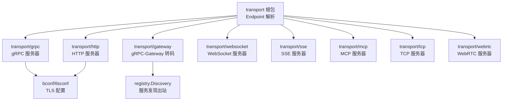

**图表来源**
- [endpoint.go:1-105](file://transport/endpoint.go#L1-L105)
- [grpc_server.go:1-149](file://transport/grpc/grpc_server.go#L1-L149)
- [http_server.go:1-123](file://transport/http/http_server.go#L1-L123)
- [gateway_server.go:1-204](file://transport/gateway/gateway_server.go#L1-L204)
- [server.go](file://transport/websocket/server.go)
- [server.go](file://transport/sse/server.go)
- [server.go](file://transport/mcp/server.go)
- [server.go](file://transport/tcp/server.go)
- [server.go](file://transport/webrtc/server.go)

**章节来源**
- [endpoint.go:1-105](file://transport/endpoint.go#L1-L105)

## 核心组件
传输层的核心不是某个具体协议服务器，而是两个抽象：

| 抽象 | 职责 | 关键行为 |
|---|---|---|
| `Endpoint` | 从配置监听地址和真实监听器提取对外可达地址 | 动态端口替换、通配符 host 替换为全局单播 IP、保留显式 host |
| `Server` | 定义协议服务器的统一生命周期 | `Start(ctx)`、`Stop(ctx)`、`Endpoint() string`，部分实现还提供 `Name()`、`Options()`、`Use(...)` |

### Endpoint 可达性规则
`Extract(hostPort, listener)` 是服务注册正确性的关键：

- 若配置端口为 `0`，用 `net.Listener.Addr()` 的真实端口覆盖。
- 若 host 显式且非 `0.0.0.0` / `[::]` / `::`，原样保留。
- 否则枚举网卡，取首个全局单播 IP（优先 IPv4），排除环回和接口本地多播。
- 未找到可达 IP 时不静默降级为裸监听地址，由调用方决定是否回退。

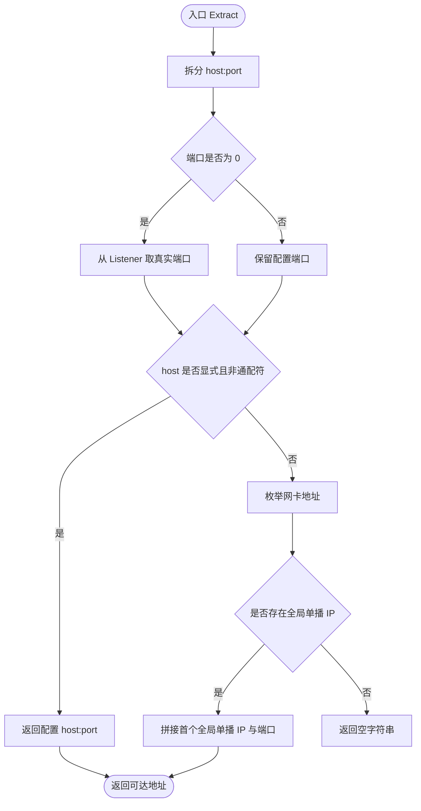

**图表来源**
- [endpoint.go:10-105](file://transport/endpoint.go#L10-L105)

**章节来源**
- [endpoint.go:10-105](file://transport/endpoint.go#L10-L105)
- [server_test.go:1-22](file://transport/server_test.go#L1-L22)

## 架构总览
传输层在 Bald 中处于“协议适配层”：业务逻辑通过 gRPC、HTTP、WebSocket、SSE、MCP、TCP 或 WebRTC 暴露能力，再由装配层把 `Endpoint()` 写入服务发现，供 Gateway 或其他消费者解析。

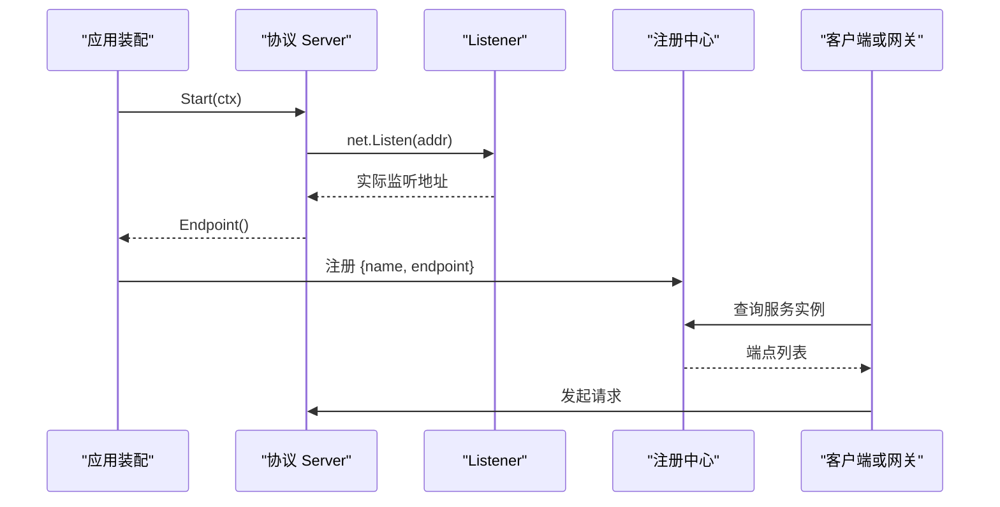

**图表来源**
- [grpc_server.go:92-149](file://transport/grpc/grpc_server.go#L92-L149)
- [http_server.go:72-123](file://transport/http/http_server.go#L72-L123)

## 详细组件分析

### gRPC 服务器
gRPC 服务器封装 `google.golang.org/grpc.Server`，实现 `transport.Server` 契约：

- 构造支持传入已有 `*grpc.Server`，也支持自建 server 并注册标准健康服务。
- TLS 配置在监听前构建，失败直接退出，避免占端口后报错。
- ALPN 强制补全 `h2`，满足新版 gRPC 握手要求。
- `Endpoint()` 返回 `grpc://host:port`，动态端口和通配符 host 由 `transport.Extract` 处理。
- `HealthServer()` 暴露 gRPC 标准健康检查实例，业务就绪状态由装配层同步。

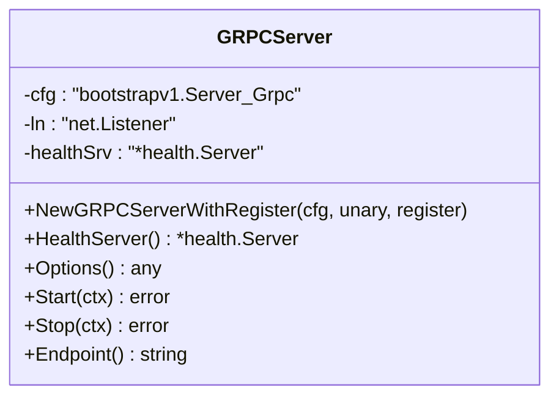

**图表来源**
- [grpc_server.go:17-149](file://transport/grpc/grpc_server.go#L17-L149)

**章节来源**
- [grpc_server.go:17-149](file://transport/grpc/grpc_server.go#L17-L149)

### HTTP 服务器
HTTP 服务器基于标准库 `net/http.Server`，实现 `transport.Server`：

- 默认 handler 为 404，路由完全由业务控制。
- 提供 `AttachHandler` 供 Gateway 延迟挂载转码 handler。
- `Endpoint()` 根据 TLS 配置选择 `http://` 或 `https://`。
- 并发安全：`ln` 字段由读写锁保护，避免 `Start`、`Endpoint`、`Stop` 竞争。

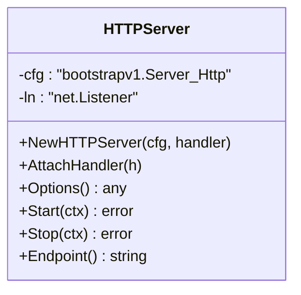

**图表来源**
- [http_server.go:17-123](file://transport/http/http_server.go#L17-L123)

**章节来源**
- [http_server.go:17-123](file://transport/http/http_server.go#L17-L123)

### Gateway 转码与服务发现集成
Gateway 是 REST 到 gRPC 的反向代理，复用 `HTTPServer` 承载 mux，并通过 `registry.Discovery` 解析后端地址。

关键点：

- 后端地址可以是普通 `host:port`，也可以是 `discovery:///<服务名>`。
- 使用 `discovery://` 时必须注入 `registry.Discovery`，否则 `Start` 直接报错。
- 解析出的多实例走 gRPC 默认 `pick_first` 负载均衡器，是主备故障转移，不是流量分摊。
- 段驱动装配通过 `transport/gateway/contract` 把已装配的注册中心作为“延迟来源”注入。
- 如果地址写了 discovery scheme 但没有可用发现来源，错误发生在拨号前，不会被静默退回 DNS。

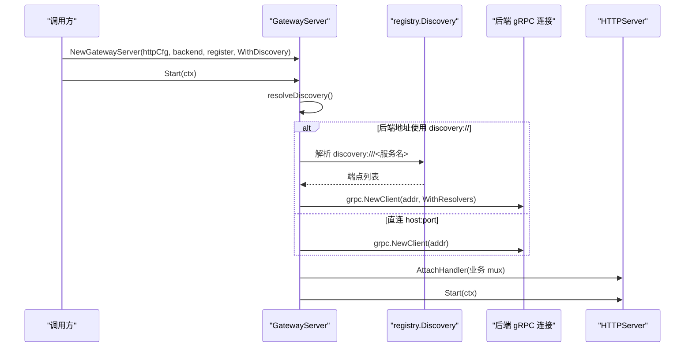

**图表来源**
- [gateway_server.go:23-204](file://transport/gateway/gateway_server.go#L23-L204)
- [discovery.go:1-62](file://transport/gateway/contract/discovery.go#L1-L62)

**章节来源**
- [gateway_server.go:23-204](file://transport/gateway/gateway_server.go#L23-L204)
- [discovery.go:1-62](file://transport/gateway/contract/discovery.go#L1-L62)

### WebSocket 服务器
WebSocket 服务器基于 `gorilla/websocket`，实现 `transport.Server`：

- 内部封装 `http.Server` + `ServeMux`，支持二进制和文本载荷模式。
- 消息按类型分发，支持泛型注册便捷方法。
- 会话由 `SessionManager` 管理，支持广播、定向发送、连接回调。
- 中间件链复用标准 `func(http.Handler) http.Handler`，可与 `transport/http/middleware` 兼容。
- `Endpoint()` 返回 `ws://` 或 `wss://`，通配 host 替换为 `localhost`。

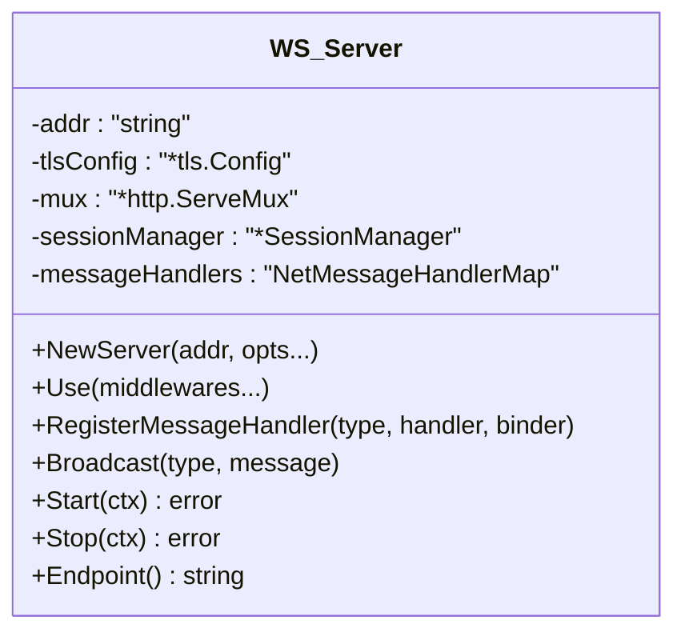

**图表来源**
- [server.go:1-510](file://transport/websocket/server.go#L1-L510)

**章节来源**
- [server.go:1-510](file://transport/websocket/server.go#L1-L510)

### SSE 服务器
SSE 服务器基于 HTTP 长连接推送事件，实现 `transport.Server`：

- 支持命名流、事件回放、Last-Event-ID、可选认证。
- 每个流有事件通道和日志缓冲，默认保留条数上限防止内存无限增长。
- 支持 `Publish`、`TryPublish`、`PublishData`、`Notify` 等发布 API。
- 中间件链与 HTTP 中间件同构，可直接复用。
- `Endpoint()` 返回 `http://` 或 `https://`。

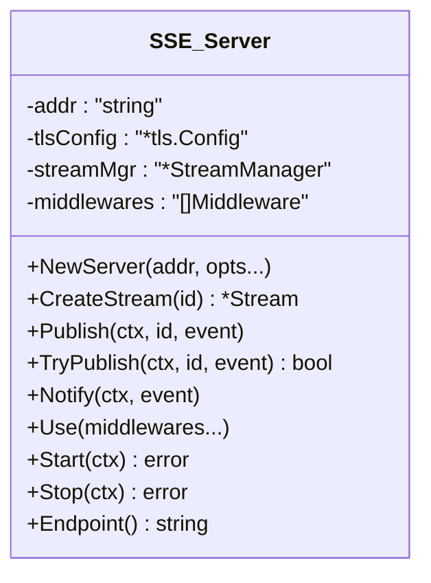

**图表来源**
- [server.go:1-391](file://transport/sse/server.go#L1-L391)

**章节来源**
- [server.go:1-391](file://transport/sse/server.go#L1-L391)

### MCP 服务器
MCP 服务器封装 `mark3labs/mcp-go`，支持多种运行形态：

- `Stdio`：标准输入输出，适合 CLI 场景。
- `InProcess`：进程内调用，无网络监听。
- `SSE`：基于 SSE 的 MCP 协议传输。
- `HTTP`：基于 Streamable HTTP 的 MCP 协议传输。
- SSE 形态下可启用 RFC 9728 OAuth 受保护资源元数据端点。
- `Endpoint()` 仅在绑定成功后返回 URL，未监听时为空。

```mermaid
classDiagram
    class MCP_Server {
        -serverType : "ServerType"
        -mcpServer : "*MCPServer"
        -httpSrv : "*http.Server"
        -sseServer : "*SSEServer"
        -endpoint : "*url.URL"
        +NewServer(opts...)
        +Start(ctx) error
        +Stop(ctx) error
        +Endpoint() string
        +Done() <-chan struct{}
        +RegisterHandler(tool, handler) error
        +RegisterResource(resource, handler) error
    }
```

**图表来源**
- [server.go:1-331](file://transport/mcp/server.go#L1-L331)

**章节来源**
- [server.go:1-331](file://transport/mcp/server.go#L1-L331)

### TCP 服务器
TCP 服务器实现原生 socket 通信，实现 `transport.Server`：

- 基于 session 生命周期管理，支持类型化消息注册和广播。
- 支持 TLS、codec、tracer、metrics 集成。
- 收到消息后自动埋点：成功/失败计数、耗时直方图、活跃连接数。
- `Endpoint()` 对空 host 或 `0.0.0.0` 回退为 `localhost`，避免注册不可达地址。

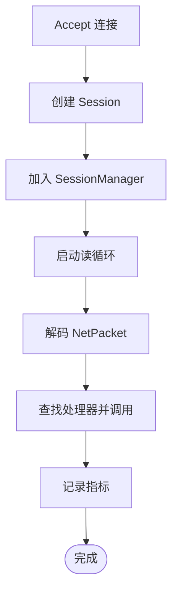

**图表来源**
- [server.go:103-476](file://transport/tcp/server.go#L103-L476)

**章节来源**
- [server.go:103-476](file://transport/tcp/server.go#L103-L476)

### WebRTC 服务器
WebRTC 服务器提供信令和数据通道，支持 SFU 媒体路由：

- 信令通过 HTTP POST 交换 Offer/Answer/ICE Candidate。
- DataChannel 打开后进入会话管理器，支持消息收发和广播。
- 支持轨道订阅，将发布者轨道转发给订阅者。
- 内置 CORS、CORS 头校验、Origin 校验。
- `Endpoint()` 在首次监听时推导 URL，包含路径。

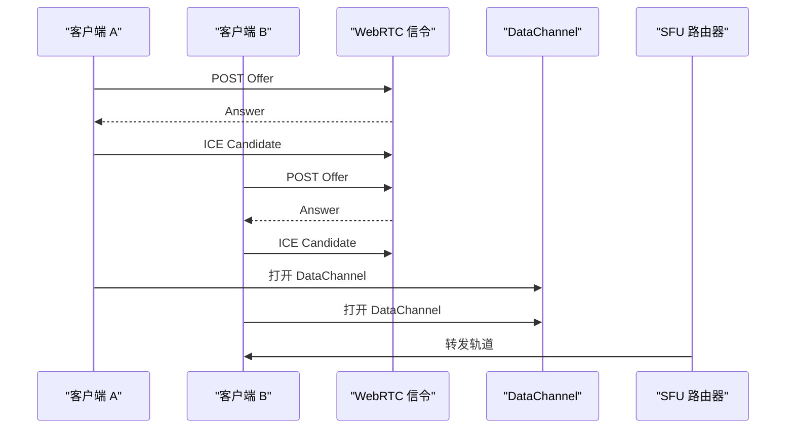

**图表来源**
- [server.go:1-851](file://transport/webrtc/server.go#L1-L851)

**章节来源**
- [server.go:1-851](file://transport/webrtc/server.go#L1-L851)

## 依赖关系分析
传输层的依赖方向清晰：

- 根 `transport` 包只依赖标准库和网络库，并提供 `Extract`。
- 各协议适配器依赖 `encoding`、`bconf/tlsconf`、`broker`、`metrics` 等横向能力。
- Gateway 是唯一需要依赖 `registry.Discovery` 的传输适配器。
- gRPC 和 HTTP 服务器直接实现 `transport.Server`；其他协议服务器大多自行声明该接口约束。

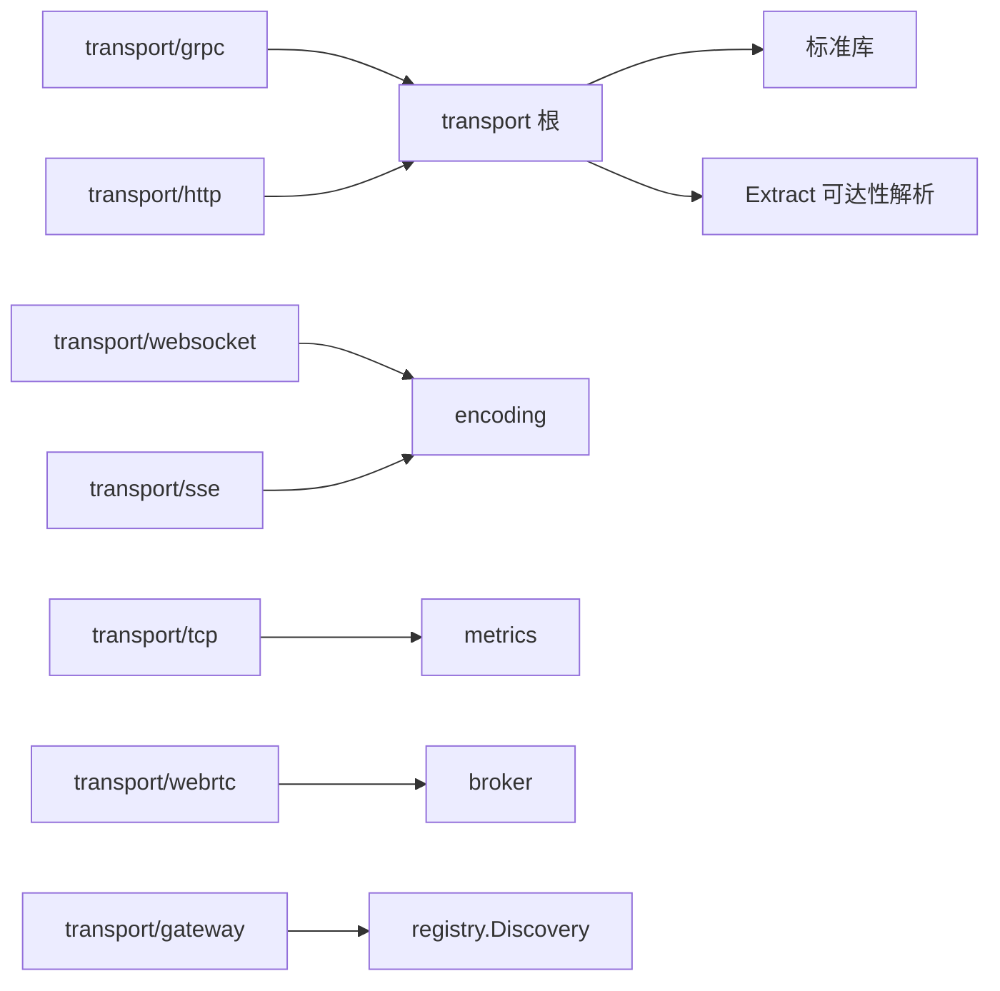

**图表来源**
- [endpoint.go:1-105](file://transport/endpoint.go#L1-L105)
- [grpc_server.go:1-149](file://transport/grpc/grpc_server.go#L1-L149)
- [http_server.go:1-123](file://transport/http/http_server.go#L1-L123)
- [gateway_server.go:1-204](file://transport/gateway/gateway_server.go#L1-L204)

**章节来源**
- [endpoint.go:1-105](file://transport/endpoint.go#L1-L105)
- [gateway_server.go:1-204](file://transport/gateway/gateway_server.go#L1-L204)

## 性能与可靠性
### 性能特征
- **gRPC/HTTP**：直接复用底层 `grpc.Server` 和 `http.Server`，性能瓶颈主要在业务 handler 和 TLS 加解密。
- **WebSocket/SSE/TCP/WebRTC**：都有会话管理器，长连接数量、消息广播和编解码成为主要成本。
- **TCP**：内置 metrics 计数器、直方图和活跃连接 gauge，便于观察吞吐和延迟。
- **SSE**：事件日志大小有上限，避免长期运行后回放日志膨胀。
- **Gateway**：每次 Start 才建立后端 gRPC 连接，避免构造期快照导致配置覆盖失效。

### 可靠性要点
- 所有服务器都实现 `Start/Stop` 优雅停机模式。
- gRPC 使用 `GracefulStop`，超时则降级为 `Stop`。
- HTTP 使用 `Shutdown`，忽略 `ErrServerClosed`。
- WebSocket/SSE 在停止时清理会话或流。
- WebRTC 同时关闭信号会话和数据通道会话。
- MCP 区分 stdio/in-process 与 SSE/HTTP 的生命周期，避免误关监听。

### 安全配置
- gRPC/HTTP/TCP/WebRTC/SSE 均支持 TLS，证书语义来自 `bconf/tlsconf`。
- Gateway 根据后端 gRPC 段的 TLS 配置选择明文或 TLS 连接。
- WebRTC 支持 Origin 校验、CORS 头、严格 DataChannel label 控制。
- WebSocket/SSE 支持 token 注入和认证钩子。

**章节来源**
- [grpc_server.go:92-149](file://transport/grpc/grpc_server.go#L92-L149)
- [http_server.go:72-123](file://transport/http/http_server.go#L72-L123)
- [server.go:103-476](file://transport/tcp/server.go#L103-L476)
- [server.go:1-851](file://transport/webrtc/server.go#L1-L851)

## 故障排查指南
### Endpoint 不可达
症状：服务注册到注册中心后，其他节点无法直连。

排查步骤：

1. 检查监听地址是否为 `:0` 或 `0.0.0.0`。
2. 确认 `Endpoint()` 返回的是 `grpc://`、`http://`、`ws://` 等带 scheme 的地址。
3. 验证 `transport.Extract` 是否能找到全局单播 IP。
4. 如果是 TCP/WebRTC/SSE，注意其对空 host 或通配 host 做了 `localhost` 或 URL host 回退，可能不符合生产环境期望。

**章节来源**
- [endpoint.go:10-105](file://transport/endpoint.go#L10-L105)
- [server_test.go:1-22](file://transport/server_test.go#L1-L22)
- [server.go:200-260](file://transport/websocket/server.go#L200-L260)
- [server.go:200-260](file://transport/sse/server.go#L200-L260)
- [server.go:240-310](file://transport/tcp/server.go#L240-L310)

### Gateway 无法解析 discovery 目标
症状：后端地址写成 `discovery:///<服务名>`，但启动失败。

原因：

- 未注入 `registry.Discovery`。
- 延迟来源返回 nil。
- 地址使用了 discovery scheme，但装配层没有装配注册中心。

修复：

- 显式调用 `WithDiscovery(d)`。
- 或通过 `transport/gateway/contract.discoveryScopeOption` 让装配层自动注入。
- 确保返回的 `registry.Registrar` 实现了 `registry.Discovery`。

**章节来源**
- [gateway_server.go:80-150](file://transport/gateway/gateway_server.go#L80-L150)
- [discovery.go:1-62](file://transport/gateway/contract/discovery.go#L1-L62)

### gRPC 健康探针不生效
症状：外部健康检查认为服务未就绪。

说明：

- gRPC 服务器注册的是生态标准健康服务，初始状态为 SERVING。
- 业务就绪状态需由装配层或业务代码调用 `HealthServer()` 设置。
- 传输层不负责判断业务依赖是否就绪。

**章节来源**
- [grpc_server.go:17-65](file://transport/grpc/grpc_server.go#L17-L65)

### 中间件未生效
症状：日志、追踪、鉴权中间件未执行。

排查：

- WebSocket/SSE/MCP/WebRTC 的中间件需在 `Start` 之前注册。
- 中间件顺序是从后往前包裹，注册顺序等于执行顺序。
- HTTP/Gateway 的 handler 可能由业务或 Gateway 延迟挂载，需确认挂载点。

**章节来源**
- [server.go:120-180](file://transport/websocket/server.go#L120-L180)
- [server.go:120-180](file://transport/sse/server.go#L120-L180)
- [server.go:60-120](file://transport/mcp/server.go#L60-L120)
- [server.go:120-180](file://transport/webrtc/server.go#L120-L180)

## 结论
Bald 传输层通过 `Endpoint` 可达性解析和 `Server` 生命周期契约，把多种协议统一到同一服务暴露模型中。gRPC 和 HTTP 提供基础协议能力，Gateway 承担 REST 到 gRPC 的转码和服务发现出站，WebSocket、SSE、MCP、TCP、WebRTC 则分别面向实时、流式、工具协议、原始 socket 和音视频场景。

对于使用者而言，最关键的原则是：

- 不要假设监听地址就是对外可达地址。
- 使用 `Endpoint()` 作为注册中心入口。
- 对 Gateway，明确 `discovery://` 与直连的区别。
- 对实时协议，关注会话生命周期、广播成本和中间件顺序。
- 对 MCP，区分 stdio、in-process、SSE、HTTP 四种运行形态。

## 附录：自定义协议适配器实现指南

### 最小实现要求
要成为 Bald 传输层的一个协议适配器，至少实现：

| 方法 | 必需 | 行为要求 |
|---|---:|---|
| `Start(ctx context.Context) error` | 是 | 阻塞直到上下文取消或监听失败 |
| `Stop(ctx context.Context) error` | 是 | 优雅停止，释放监听器和会话资源 |
| `Endpoint() string` | 是 | 返回带 scheme 的可访问地址，未监听时返回空字符串 |

可选增强：

- `Name() string`：标识协议名称。
- `Options() any`：暴露 proto 配置供宿主 introspection。
- `Use(...Middleware)`：注册 HTTP 风格中间件。
- 会话管理：适用于 WebSocket、TCP、WebRTC。
- 编解码：复用 `encoding` 或 `broker`。

### 开发模式建议
1. **先写 `Endpoint()` 测试**：覆盖 `:0`、`0.0.0.0`、显式 IP、空 host。
2. **再写 Start/Stop 测试**：保证 Stop 能中断 Start 阻塞，且不泄漏 goroutine。
3. **中间件顺序**：从后往前包裹，使注册顺序等于执行顺序。
4. **TLS 配置**：在监听前构建，失败直接返回错误。
5. **可达性**：不要把 `0.0.0.0` 注册进服务发现，应解析为全局单播 IP 或至少 `localhost`。
6. **错误处理**：监听失败、编码失败、会话不存在都应返回明确错误，不应静吞。

### 测试策略
- **短用例**：仅测试解析、编解码、中间件顺序。
- **集成用例**：需要真实监听端口，适合 CI 的 integration 作业。
- **并发用例**：覆盖 `Start`、`Endpoint`、`Stop` 并发调用。
- **可达性用例**：断言 `Endpoint()` 返回的 host 能被本机或模拟客户端连接。
- **禁用模式**：不要把统计量阈值当作确定性断言；对概率组件应先构造前置状态。

**章节来源**
- [endpoint.go:10-105](file://transport/endpoint.go#L10-L105)
- [server_test.go:1-22](file://transport/server_test.go#L1-L22)
- [server.go:1-510](file://transport/websocket/server.go#L1-L510)
- [server.go:1-391](file://transport/sse/server.go#L1-L391)
- [server.go:1-331](file://transport/mcp/server.go#L1-L331)
- [server.go:103-476](file://transport/tcp/server.go#L103-L476)
- [server.go:1-851](file://transport/webrtc/server.go#L1-L851)