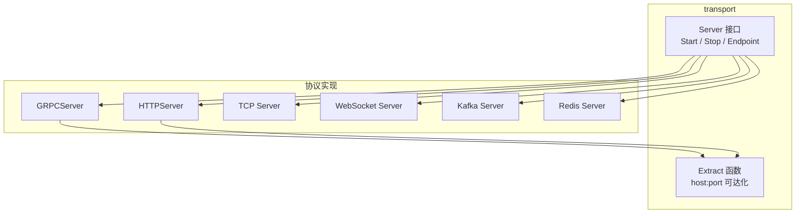
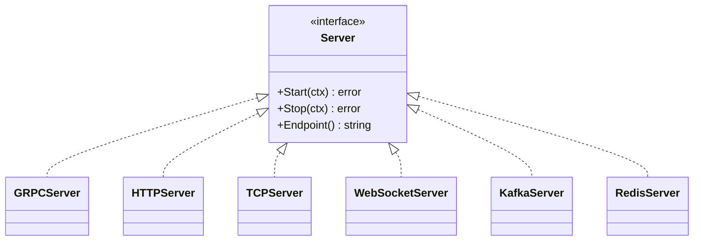
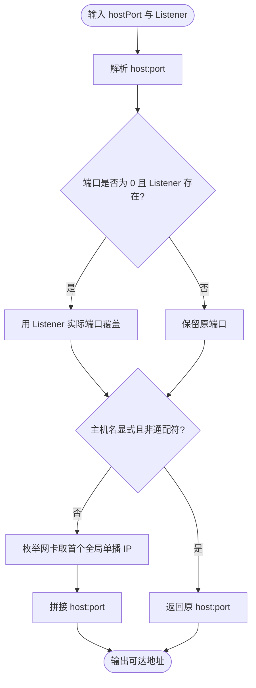
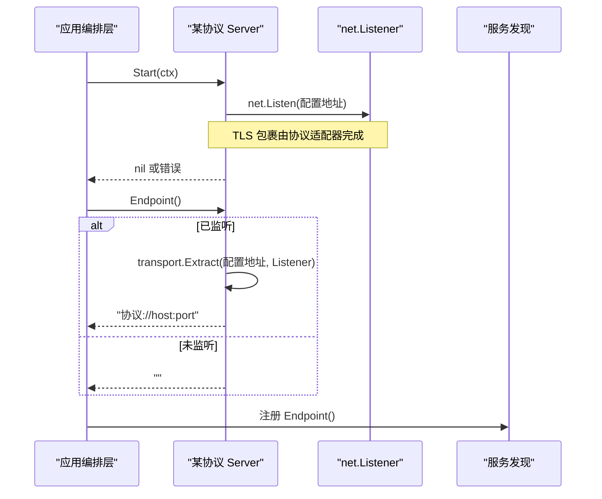
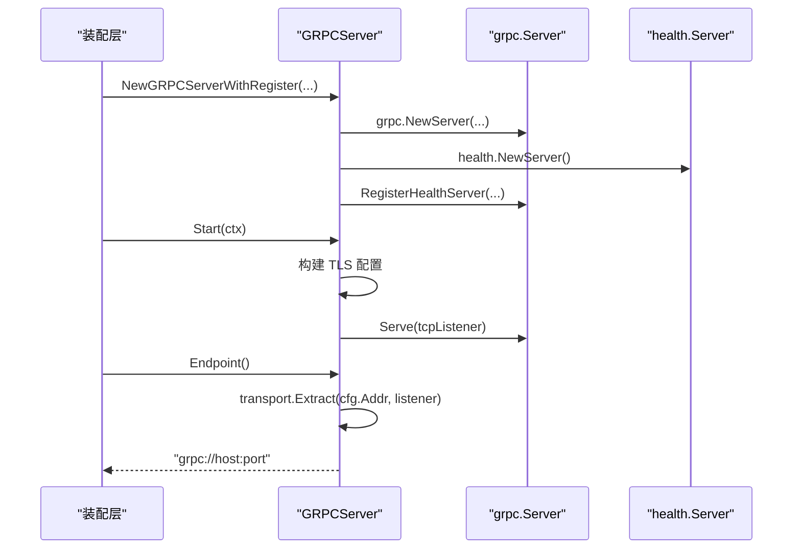
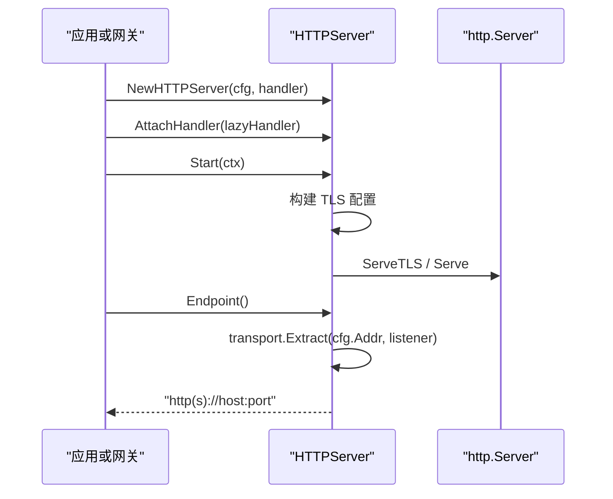
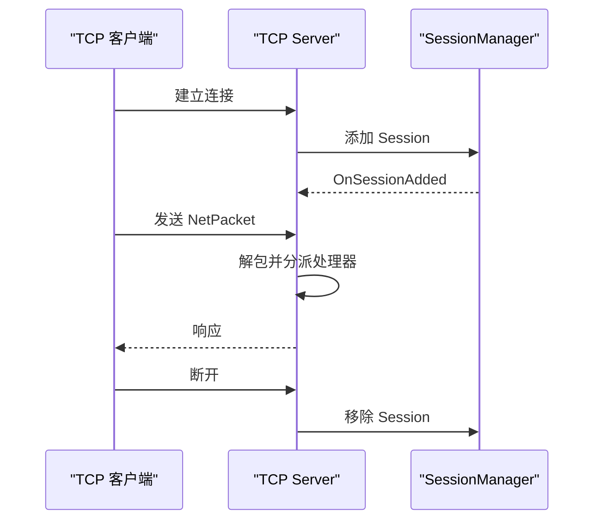
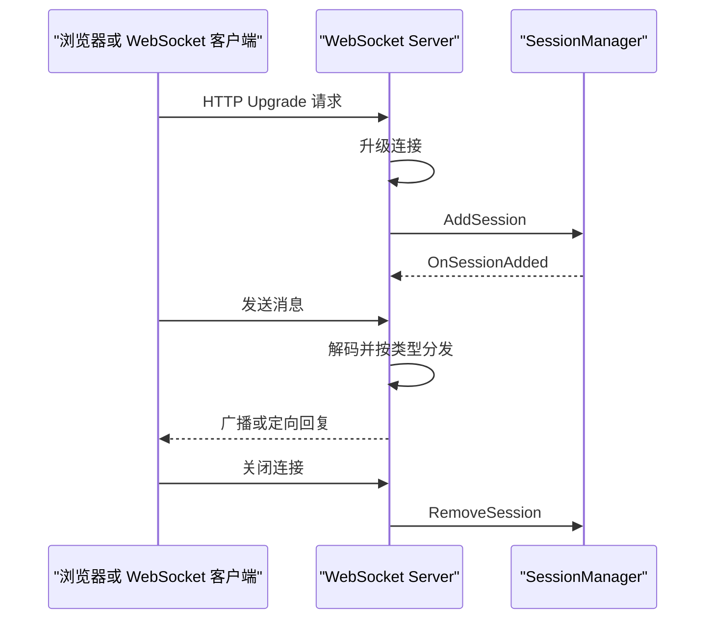
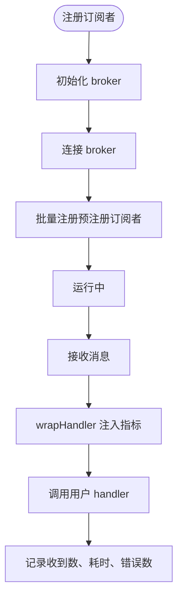
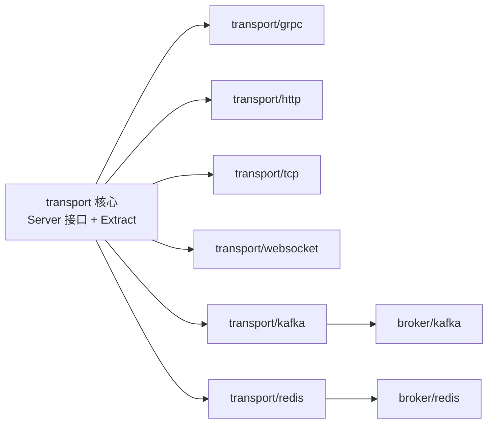

# 核心抽象与 Endpoint

<cite>
**本文引用的文件**   
- [transport/server.go](file://transport/server.go)
- [transport/endpoint.go](file://transport/endpoint.go)
- [transport/server_test.go](file://transport/server_test.go)
- [transport/grpc/grpc_server.go](file://transport/grpc/grpc_server.go)
- [transport/http/http_server.go](file://transport/http/http_server.go)
- [transport/tcp/server.go](file://transport/tcp/server.go)
- [transport/websocket/server.go](file://transport/websocket/server.go)
- [transport/kafka/server.go](file://transport/kafka/server.go)
- [transport/redis/server.go](file://transport/redis/server.go)
</cite>

## 目录
1. [引言](#引言)
2. [项目结构](#项目结构)
3. [核心组件](#核心组件)
4. [架构总览](#架构总览)
5. [详细组件分析](#详细组件分析)
6. [依赖关系分析](#依赖关系分析)
7. [性能与可扩展性](#性能与可扩展性)
8. [故障排查指南](#故障排查指南)
9. [结论](#结论)

## 引言
本文件聚焦传输层的核心抽象：`Server` 接口、`Endpoint` 地址解析，以及各协议实现如何围绕该契约暴露服务。目标是帮助读者理解以下问题：
- `Server` 接口为什么只定义 `Start` / `Stop` / `Endpoint`？
- `Extract` 如何解决通配符绑定和动态端口场景下的可达性问题？
- gRPC、HTTP、TCP、WebSocket、Kafka、Redis 等传输如何复用同一套生命周期与端点语义？
- 如何基于该抽象开发自定义传输协议，并保证测试策略正确。

## 项目结构
传输层以“最小契约 + 多协议实现”的方式组织：
- 顶层 `transport` 包定义统一契约与通用地址解析逻辑。
- 每个子目录是一个协议适配器（如 `grpc`、`http`、`tcp`、`websocket`）。
- 消息总线类传输（`kafka`、`redis`）通过 broker 适配，不监听网络端口，因此 `Endpoint()` 返回空字符串。

**图表来源**
- [transport/server.go:10-22](file://transport/server.go#L10-L22)
- [transport/endpoint.go:1-105](file://transport/endpoint.go#L1-L105)
- [transport/grpc/grpc_server.go:133-149](file://transport/grpc/grpc_server.go#L133-L149)
- [transport/http/http_server.go:104-123](file://transport/http/http_server.go#L104-L123)
- [transport/tcp/server.go:184-200](file://transport/tcp/server.go#L184-L200)
- [transport/websocket/server.go:210-220](file://transport/websocket/server.go#L210-L220)
- [transport/kafka/server.go:197-202](file://transport/kafka/server.go#L197-L202)
- [transport/redis/server.go:178-183](file://transport/redis/server.go#L178-L183)

**章节来源**
- [transport/server.go:1-22](file://transport/server.go#L1-L22)
- [transport/endpoint.go:1-105](file://transport/endpoint.go#L1-L105)

## 核心组件
本节从三个维度说明核心抽象：
- **Server 接口**：统一生命周期与端点语义。
- **Endpoint 提取器**：把监听地址转换为对调用方真正可达的地址。
- **协议适配器**：gRPC、HTTP、TCP、WebSocket、Kafka、Redis 的具体实现。

### Server 接口
`Server` 是传输层的统一契约，仅包含：
- `Start(ctx context.Context) error`：阻塞启动，直到上下文取消或出错。
- `Stop(ctx context.Context) error`：优雅停机；上下文必须未取消，用于承载停机超时。
- `Endpoint() string`：返回实际监听地址；对动态端口（`:0`）必须在真正开始接受连接后返回可用地址。

该设计的关键在于：**契约不关心具体协议**。编排层（例如 `pkg/appkit`）负责并发启停、优雅停机，并在 `Endpoint()` 非空时注册到服务发现。

**图表来源**
- [transport/server.go:14-22](file://transport/server.go#L14-L22)
- [transport/grpc/grpc_server.go:1-20](file://transport/grpc/grpc_server.go#L1-L20)
- [transport/http/http_server.go:1-20](file://transport/http/http_server.go#L1-L20)
- [transport/tcp/server.go:1-40](file://transport/tcp/server.go#L1-L40)
- [transport/websocket/server.go:1-40](file://transport/websocket/server.go#L1-L40)
- [transport/kafka/server.go:1-25](file://transport/kafka/server.go#L1-L25)
- [transport/redis/server.go:1-25](file://transport/redis/server.go#L1-L25)

**章节来源**
- [transport/server.go:10-22](file://transport/server.go#L10-L22)

### Endpoint 提取器
`Extract(hostPort string, ln net.Listener)` 解决两个关键问题：
1. **动态端口**：当配置端口为 `0` 时，使用 `net.Listener.Addr()` 的实际端口替换。
2. **通配符主机名**：当主机名为空、`0.0.0.0`、`[::]`、`::` 时，枚举本机网卡，取首个全局单播 IP（优先 IPv4），拼接成可直连地址。

内部辅助逻辑包括：
- `portOf(ln)`：从 `*net.TCPAddr` 提取真实端口。
- `isValidIP(addr)`：判断是否为全局单播且非接口本地多播。
- `extractReachableIP(port)`：枚举网卡，按接口索引顺序取第一个有效 IP。

**图表来源**
- [transport/endpoint.go:10-105](file://transport/endpoint.go#L10-L105)

**章节来源**
- [transport/endpoint.go:1-105](file://transport/endpoint.go#L1-L105)
- [transport/server_test.go:1-22](file://transport/server_test.go#L1-L22)

## 架构总览
下图展示协议适配器如何通过 `Server` 接口与 `Extract` 协作，形成统一的“服务暴露”模型：

**图表来源**
- [transport/server.go:14-22](file://transport/server.go#L14-L22)
- [transport/endpoint.go:10-60](file://transport/endpoint.go#L10-L60)
- [transport/grpc/grpc_server.go:88-149](file://transport/grpc/grpc_server.go#L88-L149)
- [transport/http/http_server.go:70-123](file://transport/http/http_server.go#L70-L123)

## 详细组件分析

### gRPC 传输
`GRPCServer` 封装 `google.golang.org/grpc.Server`，并提供：
- 标准健康检查服务注入入口。
- 基于 proto 配置的 TLS 构建与 ALPN 校验。
- 统一 `Start` / `Stop` / `Endpoint` 行为。

关键特性：
- TLS 配置在监听前构造，证书错误直接返回，避免占用无效端口。
- `NextProtos` 缺省时补填 `h2`，满足 gRPC 的 ALPN 要求。
- `ln` 字段被读写锁保护，避免 `Start`、`Endpoint`、`Stop` 并发竞争。
- `Endpoint()` 优先走 `transport.Extract`，失败时回退到 `ln.Addr().String()`，并以 `grpc://` 前缀返回。

**图表来源**
- [transport/grpc/grpc_server.go:22-86](file://transport/grpc/grpc_server.go#L22-L86)
- [transport/grpc/grpc_server.go:88-149](file://transport/grpc/grpc_server.go#L88-L149)

**章节来源**
- [transport/grpc/grpc_server.go:1-149](file://transport/grpc/grpc_server.go#L1-L149)

### HTTP 传输
`HTTPServer` 封装标准库 `net/http`，提供：
- 基于 `bootstrapv1.Server_Http` 的配置读取。
- 可选 HTTPS，TLS 配置与 gRPC 同源。
- 延迟挂载 handler 的 `AttachHandler`。
- `Endpoint()` 根据是否启用 TLS 选择 `http://` 或 `https://` 前缀。

注意：该包“只做协议”，不注册任何框架路由；健康探针由装配层或业务自行挂载。

**图表来源**
- [transport/http/http_server.go:18-69](file://transport/http/http_server.go#L18-L69)
- [transport/http/http_server.go:70-123](file://transport/http/http_server.go#L70-L123)

**章节来源**
- [transport/http/http_server.go:1-123](file://transport/http/http_server.go#L1-L123)

### TCP 传输
`tcp.Server` 面向长连接会话型通信，特点包括：
- 基于 `encoding.Codec` 的消息编解码。
- 会话管理器维护连接生命周期。
- 支持中间件风格的 socket 数据处理器。
- `Endpoint()` 使用自身协议标识 `tcp://`，并对空主机或 `0.0.0.0` 回退为 `localhost`。

**图表来源**
- [transport/tcp/server.go:41-110](file://transport/tcp/server.go#L41-L110)
- [transport/tcp/server.go:112-178](file://transport/tcp/server.go#L112-L178)
- [transport/tcp/server.go:184-200](file://transport/tcp/server.go#L184-L200)

**章节来源**
- [transport/tcp/server.go:1-220](file://transport/tcp/server.go#L1-L220)

### WebSocket 传输
`websocket.Server` 基于 `gorilla/websocket`，提供：
- 文本与二进制两种载荷模式。
- 类型化消息处理器注册。
- 会话管理与连接/断开回调。
- 可选 token 注入（通过 `Sec-WebSocket-Protocol`）。
- `Endpoint()` 返回 `websocket://host:port`。

握手流程中，服务端会克隆 `Upgrader` 以避免并发写入 `Subprotocols`，并把查询参数与可选 token 注入到 Session。

**图表来源**
- [transport/websocket/server.go:42-106](file://transport/websocket/server.go#L42-L106)
- [transport/websocket/server.go:108-176](file://transport/websocket/server.go#L108-L176)
- [transport/websocket/server.go:350-388](file://transport/websocket/server.go#L350-L388)

**章节来源**
- [transport/websocket/server.go:1-410](file://transport/websocket/server.go#L1-L410)

### Kafka 与 Redis 传输
Kafka 和 Redis 传输不是传统网络监听服务器，而是 broker 订阅者包装：
- 通过 `broker.Broker` 初始化、连接、订阅主题。
- 支持启动前注册订阅者，启动后批量回填。
- 统一 wrap 用户 handler，注入指标统计。
- `Endpoint()` 返回空字符串，因为它们没有“可直连的网络地址”。

**图表来源**
- [transport/kafka/server.go:26-116](file://transport/kafka/server.go#L26-L116)
- [transport/kafka/server.go:118-227](file://transport/kafka/server.go#L118-L227)
- [transport/redis/server.go:26-116](file://transport/redis/server.go#L26-L116)
- [transport/redis/server.go:118-208](file://transport/redis/server.go#L118-L208)

**章节来源**
- [transport/kafka/server.go:1-227](file://transport/kafka/server.go#L1-L227)
- [transport/redis/server.go:1-208](file://transport/redis/server.go#L1-L208)

## 依赖关系分析
传输层依赖关系呈现“契约在上、协议在下”的分层：

**图表来源**
- [transport/server.go:1-22](file://transport/server.go#L1-L22)
- [transport/endpoint.go:1-105](file://transport/endpoint.go#L1-L105)
- [transport/kafka/server.go:1-25](file://transport/kafka/server.go#L1-L25)
- [transport/redis/server.go:1-25](file://transport/redis/server.go#L1-L25)

**章节来源**
- [transport/server.go:1-22](file://transport/server.go#L1-L22)
- [transport/endpoint.go:1-105](file://transport/endpoint.go#L1-L105)

## 性能与可扩展性

### 性能要点
- `Extract` 内部会枚举本机网卡并调用 `net.Interfaces()`，属于相对耗时的系统调用。因此 gRPC 与 HTTP 的 `Endpoint()` 都先复制 `ln` 快照再解锁，避免在读锁内执行枚举。
- 对于动态端口 `:0`，必须先成功 `Listen` 后再调用 `Endpoint()`，否则返回空字符串，供编排层等待真正就绪。
- Kafka 与 Redis 的 `wrapHandler` 在每个消息处理路径上增加计数器、直方图和错误计数，适合监控但不适合无指标场景下过度放大开销——若不需要指标，应确保 metrics 为空或按需注入。

### 可扩展性建议
- 自定义协议应实现 `Server` 接口，并在 `Start` 成功后设置监听器，使 `Endpoint()` 能稳定返回 `协议://host:port`。
- 如果协议本身无法提供可直连地址（例如纯异步消息通道），`Endpoint()` 应返回空字符串，避免被误注册到服务发现。
- 如果需要类似 gRPC/HTTP 的 TLS 能力，应在监听前构建 TLS 配置并返回错误，而不是先占端口再失败。

### 最佳实践
- 不要把 `Server` 接口理解为“网络监听器”：它是“带生命周期的可注册服务”的最小交集。
- 不要在 `Endpoint()` 持锁期间做系统级枚举；应先释放锁，再调用 `transport.Extract`。
- 对动态端口服务，编排层应轮询 `Endpoint()`，仅在非空时注册。
- 对 broker 类传输，不要期望 `Endpoint()` 有网络地址值。

## 故障排查指南

### 症状：服务发现拿到 `0.0.0.0:8080` 或不可达地址
可能原因：
- 直接使用了 `ln.Addr().String()`，没有经过 `transport.Extract`。
- 配置了通配符主机名，但协议适配器未正确调用 `Extract`。

排查步骤：
1. 确认协议适配器 `Endpoint()` 返回格式为 `协议://host:port`。
2. 确认 `Extract` 被调用，且传入的是原始配置地址与真实 `net.Listener`。
3. 检查本机是否存在全局单播 IP；若无，`extractReachableIP` 会返回空。

相关位置：
- [transport/endpoint.go:10-60](file://transport/endpoint.go#L10-L60)
- [transport/endpoint.go:62-105](file://transport/endpoint.go#L62-L105)
- [transport/grpc/grpc_server.go:133-149](file://transport/grpc/grpc_server.go#L133-L149)
- [transport/http/http_server.go:104-123](file://transport/http/http_server.go#L104-L123)

### 症状：gRPC 连接报 ALPN 或 TLS 握手失败
可能原因：
- TLS 配置缺少 `NextProtos`，而较新 gRPC 版本要求服务端声明 `h2`。

排查步骤：
1. 检查 `GRPCServer.Start` 中是否自动补全 `NextProtos = ["h2"]`。
2. 确认 TLS 配置来源于 `tlsconf.Server`，证书合法。

相关位置：
- [transport/grpc/grpc_server.go:88-112](file://transport/grpc/grpc_server.go#L88-L112)

### 症状：HTTP 服务返回 404 或路由未生效
可能原因：
- `HTTPServer` 不自动注册业务路由；handler 需要由业务或 gateway 层挂载。
- 使用了 `AttachHandler` 延迟挂载，但挂载时机晚于首次访问。

排查步骤：
1. 确认构造时传入的 handler 是否为 `http.NotFoundHandler()`。
2. 确认 `AttachHandler` 在请求到达前已完成。

相关位置：
- [transport/http/http_server.go:37-69](file://transport/http/http_server.go#L37-L69)
- [transport/http/http_server.go:70-103](file://transport/http/http_server.go#L70-L103)

### 症状：TCP/WebSocket 连接建立后 goroutine 泄漏
可能原因：
- 停止流程未关闭所有 session。
- `Start` 退出路径与 `Stop` 对称性不足。

排查步骤：
1. 检查 TCP server 是否在 ctx 取消后关闭 listener 并清理 session。
2. 检查 WebSocket server 是否在 ctx 取消后调用 httpServer.Shutdown 并清理 session。

相关位置：
- [transport/tcp/server.go:112-178](file://transport/tcp/server.go#L112-L178)
- [transport/websocket/server.go:140-176](file://transport/websocket/server.go#L140-L176)

### 症状：Kafka/Redis 订阅者在启动前注册失效
可能原因：
- 启动前注册的订阅者会暂存到 `subscriberOpts`，启动后才批量回填。
- 若 `Init` / `Connect` 失败，不会进入运行态，也不会回填。

排查步骤：
1. 检查 `Start` 中是否调用 `doRegisterSubscriberMap`。
2. 检查 broker 初始化与连接是否成功。

相关位置：
- [transport/kafka/server.go:60-116](file://transport/kafka/server.go#L60-L116)
- [transport/kafka/server.go:170-195](file://transport/kafka/server.go#L170-L195)
- [transport/redis/server.go:60-116](file://transport/redis/server.go#L60-L116)
- [transport/redis/server.go:170-177](file://transport/redis/server.go#L170-L177)

## 结论
传输层通过极简的 `Server` 接口与通用的 `Extract` 机制，把不同协议的生命周期与端点语义统一起来：
- gRPC 与 HTTP 使用 `transport.Extract` 生成可直连地址，便于服务发现。
- TCP 与 WebSocket 提供会话与消息分发能力，同时遵循同一生命周期。
- Kafka 与 Redis 作为 broker 订阅者，不暴露网络端点，但复用订阅者注册与指标包装模式。

扩展新协议时，应优先回答三个问题：
1. 是否有可监听的网络地址？
2. `Endpoint()` 能否在启动后返回稳定地址？
3. 是否需要 TLS、中间件、会话或指标包装？

答案决定你应继承现有适配器风格，还是实现一个全新的 `Server` 实现。