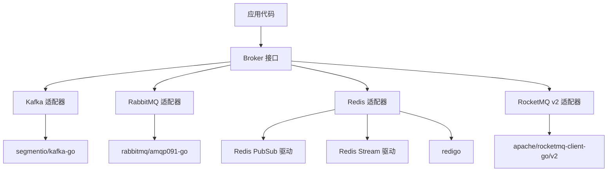
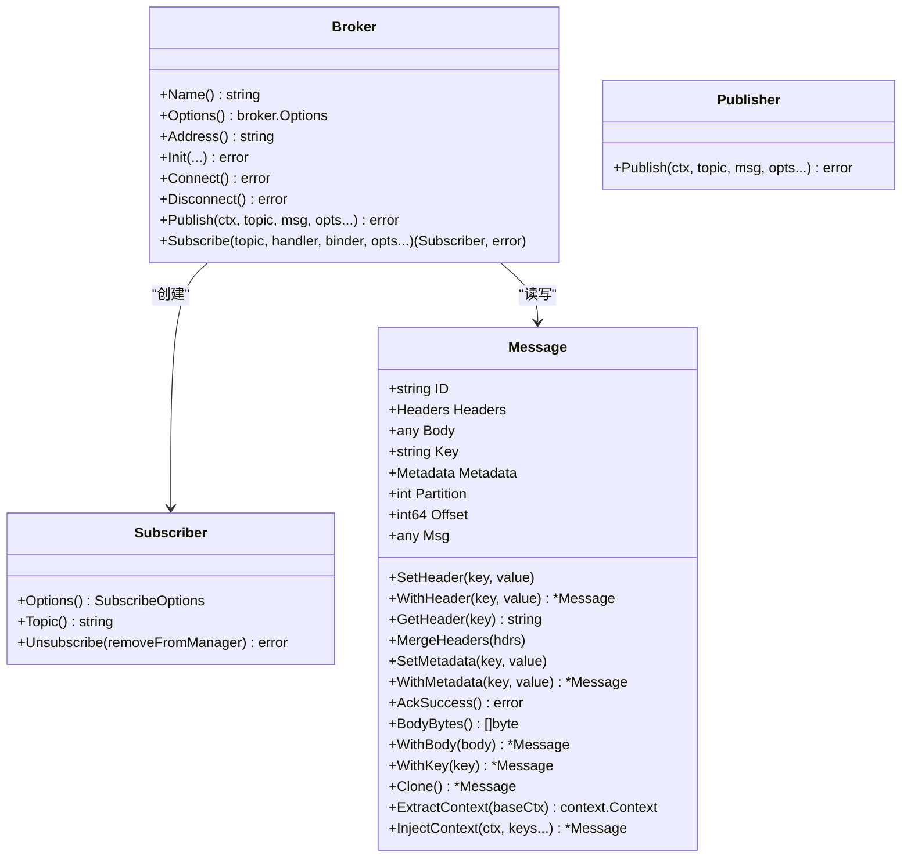
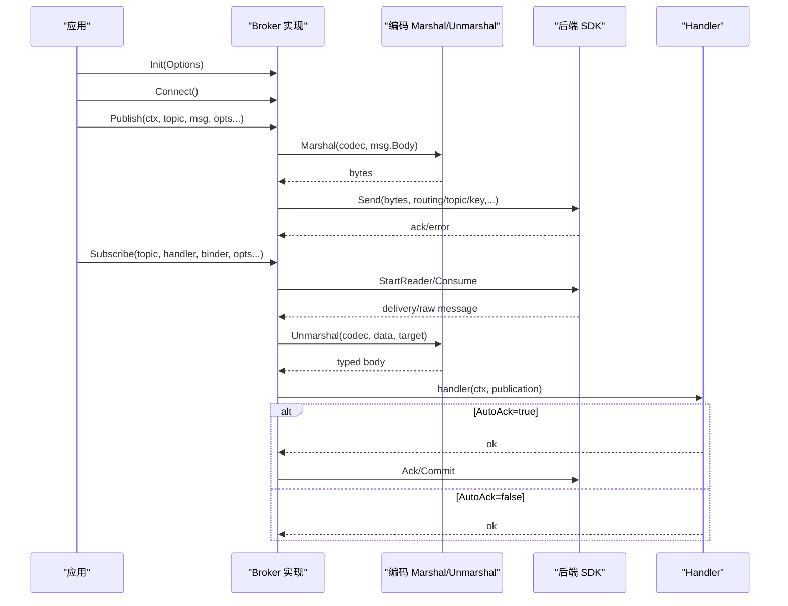
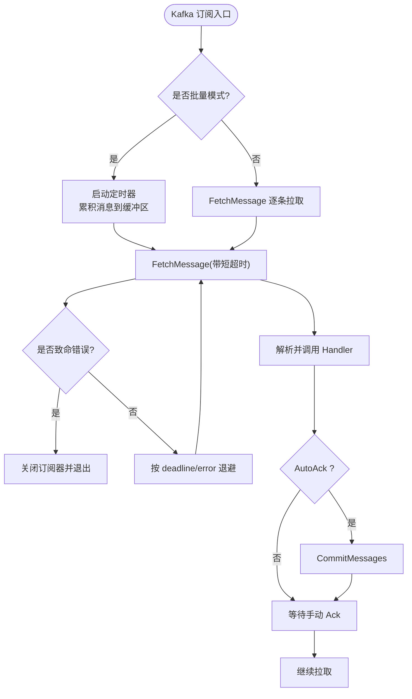
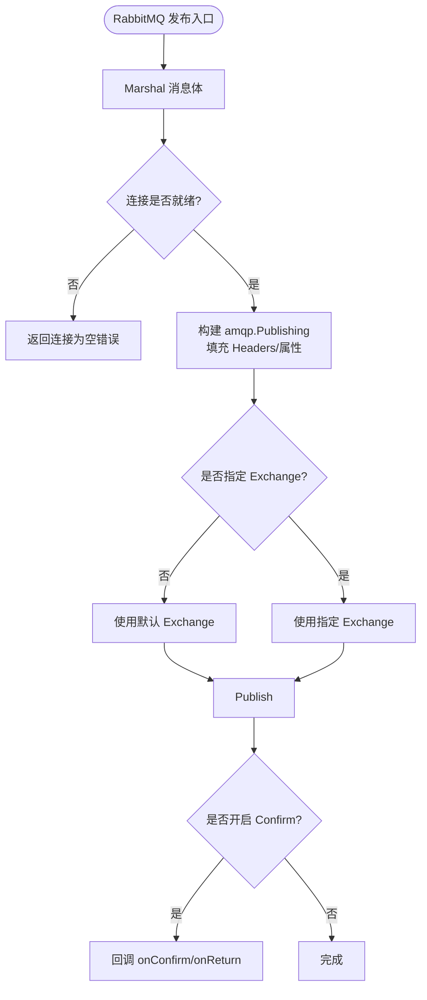
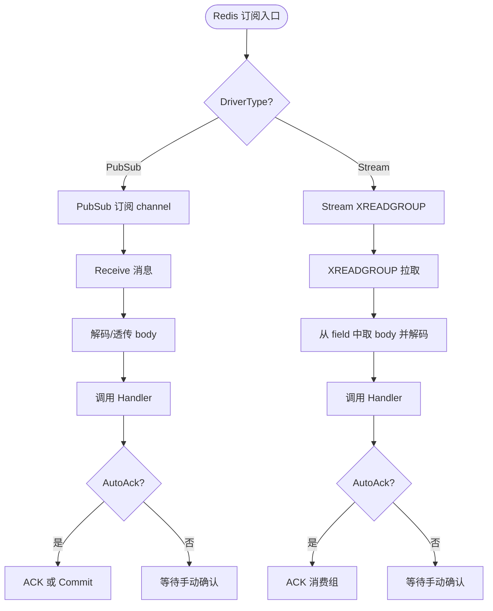
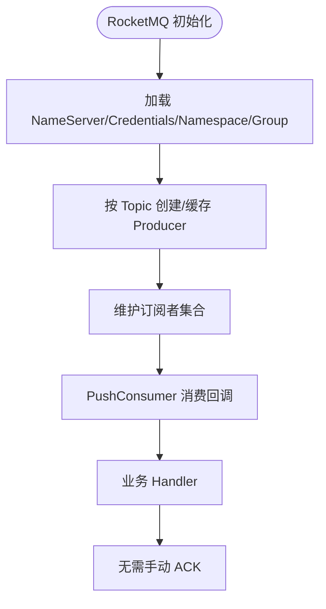
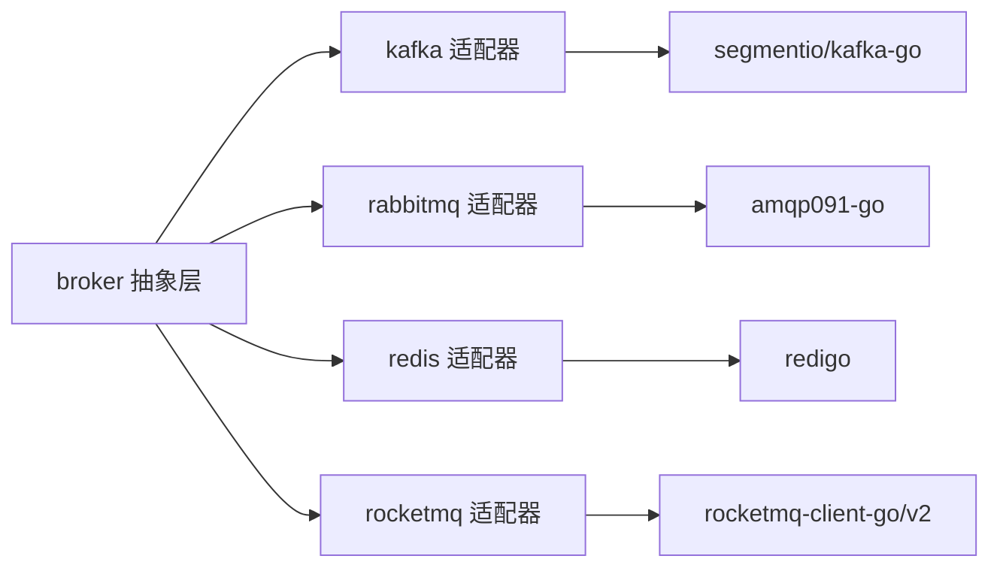

# 消息队列传输

<cite>
**本文引用的文件**   
- [broker/broker.go](file://broker/broker.go)
- [broker/message.go](file://broker/message.go)
- [broker/publish.go](file://broker/publish.go)
- [broker/subscribe_options.go](file://broker/subscribe_options.go)
- [broker/subscriber.go](file://broker/subscriber.go)
- [broker/encoding.go](file://broker/encoding.go)
- [broker/kafka/kafka.go](file://broker/kafka/kafka.go)
- [broker/kafka/options.go](file://broker/kafka/options.go)
- [broker/kafka/publication.go](file://broker/kafka/publication.go)
- [broker/kafka/subscriber.go](file://broker/kafka/subscriber.go)
- [broker/kafka/writer.go](file://broker/kafka/writer.go)
- [broker/rabbitmq/rabbitmq.go](file://broker/rabbitmq/rabbitmq.go)
- [broker/rabbitmq/options.go](file://broker/rabbitmq/options.go)
- [broker/rabbitmq/publication.go](file://broker/rabbitmq/publication.go)
- [broker/rabbitmq/subscriber.go](file://broker/rabbitmq/subscriber.go)
- [broker/redis/redis.go](file://broker/redis/redis.go)
- [broker/redis/options.go](file://broker/redis/options.go)
- [broker/redis/pubsub/subscriber.go](file://broker/redis/pubsub/subscriber.go)
- [broker/redis/stream/subscriber.go](file://broker/redis/stream/subscriber.go)
- [broker/rocketmq/v2/rocketmq.go](file://broker/rocketmq/v2/rocketmq.go)
- [broker/rocketmq/v2/publication.go](file://broker/rocketmq/v2/publication.go)
- [broker/rocketmq/v2/subscriber.go](file://broker/rocketmq/v2/subscriber.go)
- [broker/rocketmq/option/options.go](file://broker/rocketmq/option/options.go)
</cite>

## 目录
1. [简介](#简介)
2. [项目结构](#项目结构)
3. [核心组件](#核心组件)
4. [架构总览](#架构总览)
5. [详细组件分析](#详细组件分析)
6. [依赖关系分析](#依赖关系分析)
7. [性能与吞吐优化](#性能与吞吐优化)
8. [集群部署与可靠性](#集群部署与可靠性)
9. [监控与告警](#监控与告警)
10. [迁移指南](#迁移指南)
11. [故障排查](#故障排查)
12. [结论](#结论)

## 简介
本仓库的 broker 层为统一的消息中间件抽象，对外暴露 Broker、Subscriber、Message 等接口，并实现 Kafka、RabbitMQ、Redis（PubSub 与 Stream 两种驱动）、RocketMQ v2 四种后端。其目标是让上层业务以一致的方式完成连接管理、消息发布、订阅消费、重试、确认和生命周期控制，同时保留各后端的特有语义：Kafka 分区与偏移量、RabbitMQ Exchange/Queue/Prefetch、Redis Stream 消费组与 ACK、RocketMQ NameServer/Producer/Consumer。

## 项目结构
broker 模块按“抽象 + 适配器”组织：
- 抽象层：Broker/Subscriber/Message/PublishOption/SubscribeOption 等接口与通用数据结构。
- 适配器层：kafka、rabbitmq、redis、rocketmq 四个子包各自实现上述接口，并封装底层 SDK。
- Redis 适配器再拆分为 pubsub 与 stream 两个驱动，由 redis.NewBroker 根据 DriverType 路由。

**图示来源**
- [broker/broker.go:1-70](file://broker/broker.go#L1-L70)
- [broker/redis/redis.go:1-20](file://broker/redis/redis.go#L1-L20)

**章节来源**
- [broker/broker.go:1-70](file://broker/broker.go#L1-L70)
- [broker/redis/redis.go:1-20](file://broker/redis/redis.go#L1-L20)

## 核心组件
- Broker 接口：定义 Name、Address、Init、Connect、Disconnect、Publish、Subscribe。
- Message：承载 ID、Headers、Body、Key、Metadata、Partition、Offset、Msg，并提供 Header/Metadata 访问、AckSuccess、Clone、Context 注入提取等能力。
- Subscriber 接口：提供 Options、Topic、Unsubscribe。
- Publish/Subscribe 选项体系：通过函数式 Option 配置编码、并发、重试、分组、负载均衡等。
- 编码器：Marshal/Unmarshal 在 codec 未注册时 fail-fast，避免跨语言误用 gob。

**图示来源**
- [broker/broker.go:1-70](file://broker/broker.go#L1-L70)
- [broker/message.go:1-200](file://broker/message.go#L1-L200)
- [broker/subscriber.go:1-200](file://broker/subscriber.go#L1-L200)

**章节来源**
- [broker/broker.go:1-70](file://broker/broker.go#L1-L70)
- [broker/message.go:1-200](file://broker/message.go#L1-L200)
- [broker/subscriber.go:1-200](file://broker/subscriber.go#L1-L200)
- [broker/encoding.go:1-95](file://broker/encoding.go#L1-L95)

## 架构总览
所有后端均遵循同一调用链：
1. 初始化：调用 Init 装配 Addrs、TLS、Codec、Middlewares、各后端特有参数。
2. 连接：Connect 建立或复用连接；Disconnect 关闭资源并清理订阅者。
3. 发布：Marshal 消息体，走 PublishMiddleware 链路，最终调用后端 SDK 发送。
4. 订阅：创建 Subscriber，内部循环读取消息，构造 Publication，交给 Handler，并按 AutoAck 决定是否提交偏移/ACK。

**图示来源**
- [broker/publish.go:1-38](file://broker/publish.go#L1-L38)
- [broker/encoding.go:1-95](file://broker/encoding.go#L1-L95)
- [broker/kafka/subscriber.go:1-200](file://broker/kafka/subscriber.go#L1-L200)
- [broker/rabbitmq/subscriber.go:1-126](file://broker/rabbitmq/subscriber.go#L1-L126)
- [broker/redis/pubsub/subscriber.go:1-200](file://broker/redis/pubsub/subscriber.go#L1-L200)
- [broker/redis/stream/subscriber.go:1-200](file://broker/redis/stream/subscriber.go#L1-L200)

## 详细组件分析

### Kafka 后端
- 连接与写入
  - ReaderConfig 与 WriterConfig 分别控制消费与生产；默认同步发送，避免 kafka-go 异步写不返回错误导致“假成功”。
  - SASL/PLAIN/SCRAM、TLS、Logger/ErrorLogger、Completion 回调均可通过 Context 注入。
  - Writer 支持 one-topic-one-writer 模式，按 Topic 缓存 writer，并在 Close 时复位 map，防止 Disconnect→Connect 后 nil map panic。
- 分区策略
  - 内置 LeastBytes、RoundRobin、Hash、ReferenceHash、CRC32、Murmur2 多种 Balancer，可通过 With*Balancer 选择。
  - 也可通过 WithPartition 强制指定分区。
- 订阅与重试
  - 单条与批量两种处理模式；批量由 batchSize 与 batchInterval 触发。
  - 退避策略：短超时使用小间隔退避，长错误使用 errorMin/errorMax；最大尝试次数受 maxAttempts 控制。
  - 支持自动创建 Topic、WatchPartitionChanges、Session/RebalanceTimeout、RetentionTime、StartOffset 等高级参数。
- 确认机制
  - 通过 reader.CommitMessages 提交偏移；AutoAck=false 时由业务显式调用 Ack。

**图示来源**
- [broker/kafka/subscriber.go:1-200](file://broker/kafka/subscriber.go#L1-L200)
- [broker/kafka/publication.go:1-57](file://broker/kafka/publication.go#L1-L57)

**章节来源**
- [broker/kafka/kafka.go:1-200](file://broker/kafka/kafka.go#L1-L200)
- [broker/kafka/options.go:1-394](file://broker/kafka/options.go#L1-L394)
- [broker/kafka/publication.go:1-57](file://broker/kafka/publication.go#L1-L57)
- [broker/kafka/subscriber.go:1-200](file://broker/kafka/subscriber.go#L1-L200)
- [broker/kafka/writer.go:1-136](file://broker/kafka/writer.go#L1-L136)

### RabbitMQ 后端
- 连接与 Channel
  - 单连接模型，连接状态集中管理；Disconnect 会 Clear 全部订阅者并等待 WaitGroup。
  - Channel 操作封装在 rabbitChannel，Consume/Declare 等由连接层调度。
- 发布与确认
  - 支持 publisher confirm 模式、ReturnHandler、OnConfirm、Mandatory 不可路由回调。
  - 可设置 DeliveryMode、Priority、ContentType、Expiration、CorrelationId、ReplyTo、MessageId、Timestamp、Type、UserId、AppId 等 AMQP 字段。
  - 支持动态声明 Queue/Exchange 并通过 WithExchanges 预注册多个 Exchange。
- 订阅与 QoS
  - PrefetchCount/Size/Global 控制消费者侧流量。
  - Durable/AutoDelete Queue、BindArguments、QueueArguments、RequeueOnError、AckOnSuccess。
  - 重订阅采用指数退避，连接断开后等待重连信号。
- 确认机制
  - 基于 amqp.Delivery.Ack；AutoAck=false 时需业务确认。

**图示来源**
- [broker/rabbitmq/rabbitmq.go:1-200](file://broker/rabbitmq/rabbitmq.go#L1-L200)
- [broker/rabbitmq/options.go:1-272](file://broker/rabbitmq/options.go#L1-L272)

**章节来源**
- [broker/rabbitmq/rabbitmq.go:1-200](file://broker/rabbitmq/rabbitmq.go#L1-L200)
- [broker/rabbitmq/options.go:1-272](file://broker/rabbitmq/options.go#L1-L272)
- [broker/rabbitmq/publication.go:1-33](file://broker/rabbitmq/publication.go#L1-L33)
- [broker/rabbitmq/subscriber.go:1-126](file://broker/rabbitmq/subscriber.go#L1-L126)

### Redis 后端（PubSub 与 Stream）
- 驱动选择
  - NewBroker 根据 DriverType 返回 pubsub 或 stream 实现；默认 PubSub。
- 连接池与超时
  - 支持 ConnectTimeout、ReadTimeout、WriteTimeout、IdleTimeout、MaxIdle、MaxActive。
- PubSub 模式
  - 基于 redigo.PubSubConn，订阅 channel；接收消息时可选 Unmarshal 到 Binder 类型，否则透传 []byte。
  - 心跳 Ping 健康检查；断线指数退避重连。
  - 无持久化语义，适合事件广播。
- Stream 模式
  - 基于 XREADGROUP，支持 Group/Consumer、Block/COUNT 拉取、MAXLEN 限长。
  - 每条消息携带 body 字段，消费成功后可 ACK；支持确保消费组存在。
  - 具备至少一次语义与顺序性保证，适合可靠任务队列。

**图示来源**
- [broker/redis/redis.go:1-20](file://broker/redis/redis.go#L1-L20)
- [broker/redis/options.go:1-84](file://broker/redis/options.go#L1-L84)
- [broker/redis/pubsub/subscriber.go:1-200](file://broker/redis/pubsub/subscriber.go#L1-L200)
- [broker/redis/stream/subscriber.go:1-200](file://broker/redis/stream/subscriber.go#L1-L200)

**章节来源**
- [broker/redis/redis.go:1-20](file://broker/redis/redis.go#L1-L20)
- [broker/redis/options.go:1-84](file://broker/redis/options.go#L1-L84)
- [broker/redis/pubsub/subscriber.go:1-200](file://broker/redis/pubsub/subscriber.go#L1-L200)
- [broker/redis/stream/subscriber.go:1-200](file://broker/redis/stream/subscriber.go#L1-L200)

### RocketMQ v2 后端
- 名称服务与认证
  - 支持 nameServers 列表或 HTTP NameServerUrl；支持 AccessKey/SecretKey/SecurityToken 及 Credentials 对象。
  - 可配置 Namespace、InstanceName、GroupName、Trace、LoggerLevel。
- Producer
  - 按 Topic 缓存 Producer；Shutdown 时逐个关闭并清空 map。
  - 支持 Compress/Batch/Properties/DelayTimeLevel/Tag/Keys/ShardingKey/DeliveryTimestamp/MessageGroup/SendAsync/SendWithTransaction。
- Consumer
  - PushConsumer 封装；Unsubscribe 时标记 closed 并从 subscribers 移除。
  - Ack 为空实现，因为推送模型由客户端库管理确认。

**图示来源**
- [broker/rocketmq/v2/rocketmq.go:1-200](file://broker/rocketmq/v2/rocketmq.go#L1-L200)
- [broker/rocketmq/option/options.go:1-131](file://broker/rocketmq/option/options.go#L1-L131)
- [broker/rocketmq/v2/publication.go:1-38](file://broker/rocketmq/v2/publication.go#L1-L38)
- [broker/rocketmq/v2/subscriber.go:1-55](file://broker/rocketmq/v2/subscriber.go#L1-L55)

**章节来源**
- [broker/rocketmq/v2/rocketmq.go:1-200](file://broker/rocketmq/v2/rocketmq.go#L1-L200)
- [broker/rocketmq/option/options.go:1-131](file://broker/rocketmq/option/options.go#L1-L131)
- [broker/rocketmq/v2/publication.go:1-38](file://broker/rocketmq/v2/publication.go#L1-L38)
- [broker/rocketmq/v2/subscriber.go:1-55](file://broker/rocketmq/v2/subscriber.go#L1-L55)

## 依赖关系分析
- 抽象层不依赖具体后端 SDK，仅依赖 encoding 编解码接口。
- 各后端适配器直接依赖对应 SDK：
  - Kafka：segmentio/kafka-go、sasl/plain/scram。
  - RabbitMQ：rabbitmq/amqp091-go。
  - Redis：redigo。
  - RocketMQ：apache/rocketmq-client-go/v2。
- broker.SubscriberSyncMap 被 Kafka/RabbitMQ/RocketMQ 共享用于订阅者生命周期管理；Redis 适配器内部未直接使用全局 SyncMap，而是自身管理连接。

**图示来源**
- [broker/broker.go:1-70](file://broker/broker.go#L1-L70)
- [broker/kafka/kafka.go:1-200](file://broker/kafka/kafka.go#L1-L200)
- [broker/rabbitmq/rabbitmq.go:1-200](file://broker/rabbitmq/rabbitmq.go#L1-L200)
- [broker/redis/redis.go:1-20](file://broker/redis/redis.go#L1-L20)
- [broker/rocketmq/v2/rocketmq.go:1-200](file://broker/rocketmq/v2/rocketmq.go#L1-L200)

**章节来源**
- [broker/broker.go:1-70](file://broker/broker.go#L1-L70)

## 性能与吞吐优化
- Kafka
  - 高吞吐建议：增大 BatchSize/BatchBytes、适度提高 BatchTimeout；按需启用 Async 但需接受“丢消息可接受”风险；使用 LeastBytes 或 Hash 平衡器提升局部热点分布稳定性；合理设置 MaxWait/min/max bytes 减少频繁拉取。
  - 订阅端可启用批量模式（WithSubscribeBatchSize/WithSubscribeBatchInterval），降低 Handler 调用开销。
- RabbitMQ
  - 调优 PrefetchCount/Size/Global 匹配业务并发；开启 Confirm 模式保障可靠性；使用 Exchange 预声明与绑定减少运行时开销；必要时使用 Priority/Expiration 实现优先级与过期队列。
- Redis
  - PubSub 适合低延迟广播；Stream 更适合可靠任务队列。
  - Stream 模式下调整 COUNT、BLOCK 时间、MAXLEN，结合消费组与 ACK 实现可靠消费；连接池参数 MaxActive/MaxIdle/IdleTimeout 与超时参数配合。
- RocketMQ
  - 使用 Batch/Compress/Properties 减少网络与序列化开销；ShardingKey 提升同键消息一致性；SendAsync 仅在可容忍失败时使用；MessageGroup 可用于分片处理。

[本节为通用指导，不涉及具体代码片段]

## 集群部署与可靠性
- Kafka
  - 多 Broker 地址通过 Addrs 注入；SASL/TLS 必须与集群安全配置一致；启用 WatchPartitionChanges 以便分区变更感知；RetentionTime 决定数据保留周期。
  - 推荐关闭 AutoTopicCreation，由运维统一创建 Topic；使用 RequiredAcks 控制副本确认策略（由 WriterConfig.RequiredAcks 暴露）。
- RabbitMQ
  - 连接 URL 支持 amqp:// 前缀补全；Exchange/Queue 建议预声明；Durable Queue 保证重启不丢失；RequeueOnError 可实现简单重试。
  - Confirm+Return 组合可捕获不可达消息并落盘至死信队列。
- Redis
  - PubSub 无持久化，不适合强可靠场景；Stream 基于 XADD/XREADGROUP，具备持久化与消费组语义。
  - 建议对 Stream 设置 MAXLEN 控制增长；通过 GROUP 与 CONSUMER 实现水平扩展。
- RocketMQ
  - NameServer 集群配置；Credentials 与 Namespace 区分环境；Producer 按 Topic 复用；Consumer 使用 Group 划分实例。
  - Trace 与 LoggerLevel 便于定位生产消费问题。

[本节为通用指导，不涉及具体代码片段]

## 监控与告警
- 日志
  - Kafka 支持 Logger/ErrorLogger 注入；RocketMQ 支持 LoggerLevel；Redis 适配器有 LogErrorf/LogDebug 输出。
- 指标
  - 建议在 Handler 前后埋点，统计吞吐、延迟、错误率；对 Ack/Commit 失败与重连次数进行计数。
- 关键告警
  - Kafka：FetchMessage 持续报错、CommitMessages 失败、分区变化频繁。
  - RabbitMQ：Confirm 返回 nack、Return 回调触发、Channel 关闭。
  - Redis：重连次数激增、XREADGROUP 长时间无响应、Stream 消费积压。
  - RocketMQ：Producer.Shutdown 失败、Consumer 长时间无消费回调。

[本节为通用指导，不涉及具体代码片段]

## 迁移指南
- 从 Kafka 迁移到其他后端
  - 注意语义差异：Kafka 的 Partition/Offset 在其他后端不一定等价；RabbitMQ 使用 RoutingKey，Redis 使用 Channel/Stream ID，RocketMQ 使用 Tag/Keys/ShardingKey。
  - 确认确认语义：Kafka 使用 CommitMessages，RabbitMQ 使用 Ack，Redis Stream 使用 ACK，RocketMQ 由客户端库管理。
- 从 RabbitMQ 迁移
  - Exchange/Queue 概念映射到 Topic/RoutingKey；Prefetch 影响消费速率；Confirm 模式必须显式启用。
- 从 Redis 迁移
  - PubSub 无持久化，迁移到 Kafka/Stream/RocketMQ 时需要考虑幂等与去重。
  - Stream 的 Group/Consumer 概念与 Kafka Group/RabbitMQ Consumer 类似。
- 从 RocketMQ 迁移
  - NameServer 与 Namespace 替换为目标后端地址/命名空间；Properties/Tags 映射为 Headers/Metadata。

[本节为通用指导，不涉及具体代码片段]

## 故障排查
- 编码问题
  - Marshal/Unmarshal 在未注册 codec 时会返回明确错误，提示需要注册编码；若期望透传，请传递 []byte/string。
- 订阅者生命周期
  - 致命错误后 Subscriber 不会自动从 SubscriberSyncMap 摘除条目；摘除是调用方或 Disconnect 的责任。因此 Topics()/Len()/Has() 可能高报已死订阅者数量，该口径由测试钉住。
- Kafka 常见问题
  - 异步发送不返回错误且缓冲无界，如需感知失败请使用同步发送或 Completion 回调。
  - 批量模式短超时退避较快，长错误退避较慢；检查 fetch.max.wait.ms 与批大小。
- RabbitMQ 常见问题
  - 未启用 Confirm 无法确认投递结果；Return 回调需在 Mandatory 下触发。
  - Prefetch 过大可能导致内存占用升高。
- Redis 常见问题
  - PubSub 断线后会指数退避重连；Stream 重连后需确保 Group 存在。
- RocketMQ 常见问题
  - NameServer 不可达或 Credentials 错误会导致 Producer/Consumer 初始化失败；Trace 有助于定位。

**章节来源**
- [broker/encoding.go:1-95](file://broker/encoding.go#L1-L95)
- [broker/subscriber.go:1-200](file://broker/subscriber.go#L1-L200)
- [broker/kafka/kafka.go:1-200](file://broker/kafka/kafka.go#L1-L200)
- [broker/rabbitmq/rabbitmq.go:1-200](file://broker/rabbitmq/rabbitmq.go#L1-L200)
- [broker/redis/pubsub/subscriber.go:1-200](file://broker/redis/pubsub/subscriber.go#L1-L200)
- [broker/redis/stream/subscriber.go:1-200](file://broker/redis/stream/subscriber.go#L1-L200)
- [broker/rocketmq/v2/rocketmq.go:1-200](file://broker/rocketmq/v2/rocketmq.go#L1-L200)

## 结论
broker 层以统一接口屏蔽了 Kafka、RabbitMQ、Redis、RocketMQ 的差异，使应用可以围绕一致的 Message/Subscriber 模型编写逻辑。实际落地时，应重点关注各后端的确认语义、持久化特性、连接池与重连策略、以及负载与吞吐参数的协同调优。对于高可靠场景，优先选择 Kafka 或 RocketMQ；对于轻量实时广播，Redis PubSub 足够；对于可靠任务队列，Redis Stream 是一个低成本替代方案。