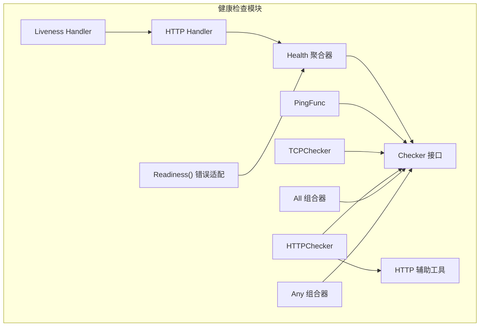
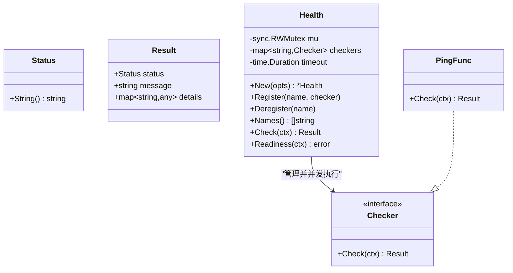
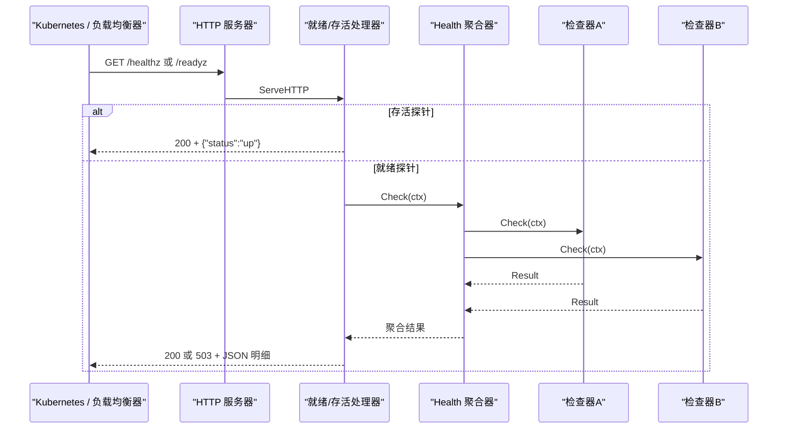
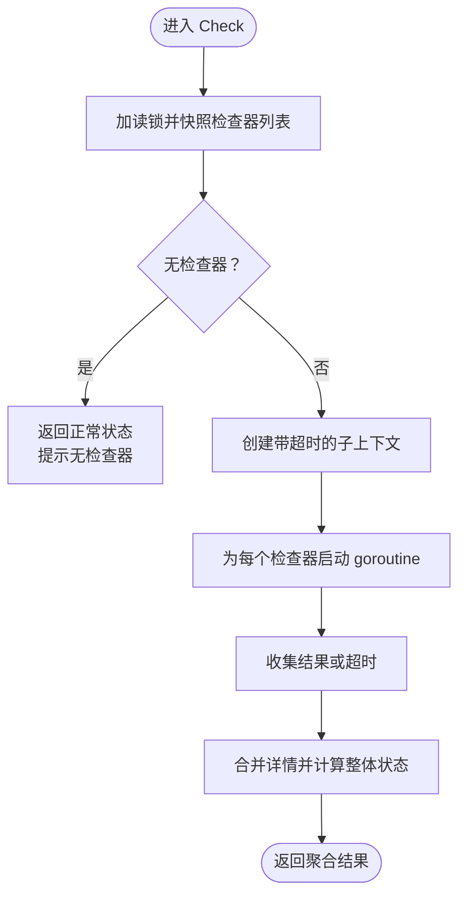
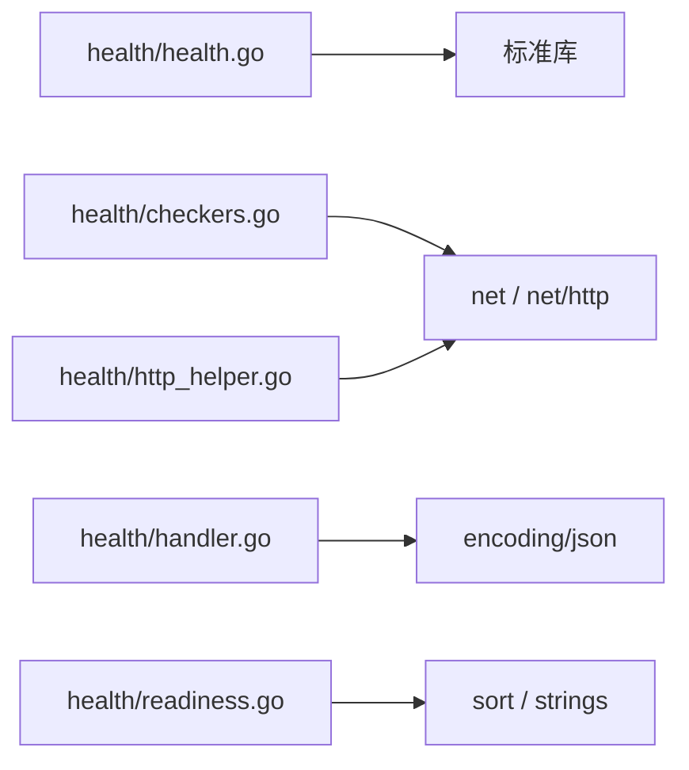

# 健康检查

<cite>
**本文引用的文件**   
- [health/health.go](file://health/health.go)
- [health/checkers.go](file://health/checkers.go)
- [health/handler.go](file://health/handler.go)
- [health/http_helper.go](file://health/http_helper.go)
- [health/readiness.go](file://health/readiness.go)
- [health/health_test.go](file://health/health_test.go)
</cite>

## 目录
1. [简介](#简介)
2. [项目结构](#项目结构)
3. [核心组件](#核心组件)
4. [架构总览](#架构总览)
5. [详细组件分析](#详细组件分析)
6. [依赖关系分析](#依赖关系分析)
7. [性能与并发特性](#性能与并发特性)
8. [生产部署指南](#生产部署指南)
9. [故障排查](#故障排查)
10. [结论](#结论)

## 简介
Bald 健康检查系统通过 `health` 包提供进程级存活探针（liveness）与服务级就绪探针（readiness），用于 Kubernetes、负载均衡器及编排平台。它把多个命名检查器的结果聚合为统一的 JSON 状态，支持全局超时、并发执行、组合逻辑，并提供错误适配方法供 gRPC 或启动门禁使用。

本仓库是 93 个 go.mod 的多模块仓库；`health` 是其中一个独立模块，不引入网关、注册中心或 Broker 等重依赖。根 module 不得 require 适配器，因此健康检查层保持轻量、可被任意上层复用。

**章节来源**
- [health/health.go:1-25](file://health/health.go#L1-L25)

## 项目结构
`health` 包由五个源文件组成，职责清晰：

| 文件 | 职责 |
|---|---|
| [health/health.go](file://health/health.go) | `Status`、`Result`、`Checker`、`PingFunc`、`Health` 聚合器、超时配置、注册/注销、并发检查、名称查询 |
| [health/checkers.go](file://health/checkers.go) | TCP 检查器、HTTP 检查器、`All`/`Any` 组合检查器 |
| [health/handler.go](file://health/handler.go) | HTTP 处理器：就绪探针 `/readyz` 与存活探针 `/healthz` |
| [health/http_helper.go](file://health/http_helper.go) | HTTP 客户端默认值、请求构建工具 |
| [health/readiness.go](file://health/readiness.go) | 将聚合结果转为 error，供非 HTTP 场景消费 |

**图表来源**
- [health/health.go:58-124](file://health/health.go#L58-L124)
- [health/checkers.go:11-181](file://health/checkers.go#L11-L181)
- [health/handler.go:12-84](file://health/handler.go#L12-L84)
- [health/http_helper.go:1-28](file://health/http_helper.go#L1-L28)
- [health/readiness.go:1-42](file://health/readiness.go#L1-L42)

**章节来源**
- [health/health.go:1-227](file://health/health.go#L1-L227)
- [health/checkers.go:1-181](file://health/checkers.go#L1-L181)
- [health/handler.go:1-84](file://health/handler.go#L1-L84)
- [health/http_helper.go:1-28](file://health/http_helper.go#L1-L28)
- [health/readiness.go:1-42](file://health/readiness.go#L1-L42)

## 核心组件
本节聚焦健康检查的抽象类型与生命周期。

### 状态与结果
- `Status` 表示组件健康状态：未知、正常、不可用。
- `Result` 封装单次检查结果的状态、消息和详情键值对。

这些类型是所有检查器和聚合器的共同语义基础，也是 HTTP 响应与错误适配的数据载体。

**章节来源**
- [health/health.go:33-65](file://health/health.go#L33-L65)

### 检查器抽象
`Checker` 接口只暴露一个 `Check(ctx)` 方法。推荐实现遵循以下约定：
- 接受上下文以支持超时取消。
- 尽快返回，避免阻塞健康检查调用方。
- 通过 `Result.Message` 传递人类可读诊断信息。
- 通过 `Result.Details` 传递结构化诊断数据。

`PingFunc` 是最轻量的适配器：零函数视为未知，成功视为正常，失败视为不可用并携带错误消息。

**章节来源**
- [health/health.go:67-97](file://health/health.go#L67-L97)

### 健康聚合器
`Health` 维护已注册的命名检查器、全局超时和并发执行策略：
- `Register(name, checker)` 注册或替换已有名称的检查器。
- `Deregister(name)` 移除检查器，不存在时为空操作。
- `Names()` 返回当前所有检查器名称。
- `WithTimeout(d)` 设置每次 `Check` 中单个检查器的超时上限，默认 5 秒。
- `Check(ctx)` 快照全部检查器，在独立 goroutine 中并发执行，并在超时后标记对应检查器为不可用。
- `Readiness(ctx)` 把聚合结果转换为 error，便于喂给 gRPC health、业务启动门禁等。

**图表来源**
- [health/health.go:33-124](file://health/health.go#L33-L124)

**章节来源**
- [health/health.go:99-227](file://health/health.go#L99-L227)
- [health/readiness.go:1-42](file://health/readiness.go#L1-L42)

## 架构总览
健康检查系统的典型调用链如下：

**图表来源**
- [health/handler.go:12-84](file://health/handler.go#L12-L84)
- [health/health.go:126-200](file://health/health.go#L126-L200)

**章节来源**
- [health/handler.go:12-84](file://health/handler.go#L12-L84)
- [health/health.go:126-200](file://health/health.go#L126-L200)

## 详细组件分析

### 内置检查器

#### TCP 检查器
TCP 检查器通过拨号确认目标地址可达，适用于数据库、缓存、消息队列等基于 TCP 的依赖。

- 默认超时 3 秒，若未显式传入则使用默认值。
- 拨号成功后立即关闭连接。
- 拨号失败返回不可用状态，消息包含目标地址和错误。

**章节来源**
- [health/checkers.go:11-64](file://health/checkers.go#L11-L64)

#### HTTP 检查器
HTTP 检查器向指定 URL 发送 GET 请求，仅当状态码在 200 到 399 之间视为正常。

- 默认 HTTP 客户端超时 5 秒。
- 请求头设置 User-Agent 为 `bald-health-checker`。
- 构造请求失败、网络错误或状态码不在 2xx/3xx 范围均视为不可用。

注意：HTTP 检查器只验证下游服务是否“能响应”，并不判断业务语义是否真正健康；若需要更严格校验，应让被测端点返回合适的状态码，或使用自定义 `PingFunc`。

**章节来源**
- [health/checkers.go:66-114](file://health/checkers.go#L66-L114)
- [health/http_helper.go:1-28](file://health/http_helper.go#L1-L28)

#### 组合检查器
- `All`：要求所有子检查器都通过；遇到第一个失败立即短路。
- `Any`：只要任一子检查器通过即视为正常；记录最后一个失败消息。

组合器适合表达复杂依赖关系，例如存储子系统需要同时满足数据库与缓存，或 Redis 高可用集群只需任意节点可达。

**章节来源**
- [health/checkers.go:116-181](file://health/checkers.go#L116-L181)

### 检查器注册机制与执行顺序

#### 注册与覆盖
- 通过 `Register(name, checker)` 添加或替换检查器。
- 重复注册同一名称会覆盖旧实现。
- `Deregister(name)` 安全移除；不存在时不报错。
- `Names()` 返回当前检查器集合，常用于调试或监控。

#### 执行顺序
`Check` 内部先读取锁下的检查器快照，再按遍历顺序依次启动 goroutine。由于 Go map 遍历顺序不确定，外部不应假设固定执行顺序；需要确定性输出时应使用组合检查器并按顺序排列子检查器。

**图表来源**
- [health/health.go:126-200](file://health/health.go#L126-L200)

**章节来源**
- [health/health.go:99-227](file://health/health.go#L99-L227)
- [health/health_test.go:74-147](file://health/health_test.go#L74-L147)

### 状态聚合逻辑
聚合规则按优先级决定整体状态：
1. 任一检查器为不可用 → 整体不可用。
2. 否则任一检查器为未知 → 整体未知。
3. 全部正常 → 整体正常。

每个检查器结果会被写入 `details[name]`，其中包含该检查器的状态字符串、消息，以及其自身 `Details` 中的键值对。因此，自定义检查器可在 `Details` 中注入结构化诊断信息，例如连接池大小、版本、延迟等。

**章节来源**
- [health/health.go:126-200](file://health/health.go#L126-L200)

### 超时控制
全局超时通过 `WithTimeout` 配置，默认 5 秒。每次 `Check` 会为所有检查器创建带超时的子上下文；某个检查器超时后，该检查器结果为不可用，消息形如“checker “name” timed out”。

建议：
- 对外部依赖检查器设置合理超时，避免拖慢整个健康检查。
- 将昂贵检查放入组合器中单独分组，以便分别控制超时。
- 长时间初始化任务不要放在就绪探针中直接同步阻塞，应改用异步初始化 + 标志位更新。

**章节来源**
- [health/health.go:104-116](file://health/health.go#L104-L116)
- [health/health.go:126-200](file://health/health.go#L126-L200)
- [health/health_test.go:138-147](file://health/health_test.go#L138-L147)

### HTTP 处理器与状态码映射

#### 就绪探针处理器
`NewHandler(h)` 返回就绪探针处理器：
- 执行 `Health.Check`。
- 正常或未知返回 HTTP 200。
- 不可用返回 HTTP 503。
- 响应体为 JSON，包含顶层状态、可选消息和检查明细。

#### 存活探针处理器
`NewLivenessHandler()` 始终返回 HTTP 200 和简单 JSON，不检查任何依赖。它适合 Kubernetes `livenessProbe`，用于检测进程是否崩溃或卡死。

#### 响应格式
就绪探针响应结构包含：
- `status`：聚合后的状态字符串。
- `message`：聚合结果的消息字段。
- `checks`：各检查器名称到细节对象的映射。

示例路径参考：[handlerResponse 定义](file://health/handler.go#L54-L62)。

**章节来源**
- [health/handler.go:12-84](file://health/handler.go#L12-L84)

### 非 HTTP 就绪适配
`Health.Readiness(ctx)` 把聚合结果转为 error：
- 整体状态不是不可用时返回 nil。
- 不可用时收集所有不可用检查器的名称和消息，按名称排序后用分号拼接。
- 没有具体失败消息时只保留名称。

这使其可直接作为 gRPC health 同步逻辑、启动门禁、优雅退出前置条件的输入。

**章节来源**
- [health/readiness.go:1-42](file://health/readiness.go#L1-L42)

### 自定义检查器实现指南

#### 基本模式
实现 `Checker` 接口即可注册到 `Health`。最简单方式是使用 `PingFunc` 包装现有返回 error 的方法。

#### 异步检查
如果底层检查本身是异步回调风格，应在 `Check` 内将其包装为基于 context 的等待逻辑；超时由 `Health` 或检查器内部 context 取消。不要在 `Check` 中无限阻塞。

#### 依赖注入
- 将数据库连接、缓存客户端、HTTP 客户端等作为检查器的字段注入。
- `http_helper.go` 中的 `httpClient()` 目前返回全局默认客户端，但导出设计允许未来扩展为可注入工厂。
- 对于测试，建议使用 `PingFunc` 或可控后端实例。

#### 错误处理
- 使用 `Result.Status` 表达宏观健康语义。
- 使用 `Message` 提供简短人类可读信息。
- 使用 `Details` 传递结构化数据，例如连接数、版本、指标摘要。
- 避免在 `Message` 中塞入过长堆栈；长堆栈更适合日志或追踪。

**章节来源**
- [health/health.go:67-97](file://health/health.go#L67-L97)
- [health/http_helper.go:1-28](file://health/http_helper.go#L1-L28)

## 依赖关系分析
`health` 包的依赖非常浅：
- 标准库：`context`、`encoding/json`、`fmt`、`net`、`net/http`、`sort`、`strings`、`sync`、`time`。
- 不依赖框架的服务发现、网关、Broker、缓存、数据库或注册中心实现。
- 上层应用负责把 `Handler` 挂载到 HTTP 路由，并把 `Readiness` 接入 gRPC 或业务流程。

**图表来源**
- [health/health.go:27-31](file://health/health.go#L27-L31)
- [health/checkers.go:3-9](file://health/checkers.go#L3-L9)
- [health/handler.go:3-8](file://health/handler.go#L3-L8)
- [health/readiness.go:3-11](file://health/readiness.go#L3-L11)
- [health/http_helper.go:3-8](file://health/http_helper.go#L3-L8)

**章节来源**
- [health/health.go:1-227](file://health/health.go#L1-L227)
- [health/checkers.go:1-181](file://health/checkers.go#L1-L181)
- [health/handler.go:1-84](file://health/handler.go#L1-L84)
- [health/readiness.go:1-42](file://health/readiness.go#L1-L42)
- [health/http_helper.go:1-28](file://health/http_helper.go#L1-L28)

## 性能与并发特性
- `Health.Check` 对每个检查器启动独立 goroutine，整体耗时近似于最慢检查器。
- 每次 `Check` 都创建新的 channel 和 context，适合高频短生命周期调用，但极高 QPS 下应注意对象分配成本。
- 全局超时限制单个检查器，不会阻止其他检查器继续运行。
- 聚合阶段按检查器数量线性扫描结果 channel，时间复杂度 O(n)。
- 组合器 `All` 可能短路，减少后续检查开销；`Any` 遇到第一个成功也会提前返回。

优化建议：
- 对昂贵依赖使用组合器分组，避免无关依赖拖慢整体健康检查。
- 使用合理的超时和重试策略，防止雪崩。
- 不要把长时间 I/O 或用户请求路径放入健康检查。

**章节来源**
- [health/health.go:126-200](file://health/health.go#L126-L200)
- [health/checkers.go:116-181](file://health/checkers.go#L116-L181)

## 生产部署指南

### 存活探针与就绪探针的区别
| 探针 | 用途 | 行为 | 典型路径 |
|---|---|---|---|
| 存活探针 | 检测进程是否崩溃或无法响应 | 始终返回 200，不检查依赖 | `/healthz` |
| 就绪探针 | 检测服务是否准备好接收流量 | 执行全部依赖检查，任一失败返回 503 | `/readyz` |

Kubernetes 中：
- `livenessProbe` 使用存活处理器，用于重启崩溃进程。
- `readinessProbe` 使用就绪处理器，用于从负载均衡器摘除尚未就绪实例。

**章节来源**
- [health/handler.go:12-84](file://health/handler.go#L12-L84)

### Kubernetes 探针配置要点
- 存活探针路径指向 `NewLivenessHandler()`。
- 就绪探针路径指向 `NewHandler(health.New(...))`。
- 初始延迟和失败阈值应根据应用启动时间和依赖启动顺序调整。
- 就绪探针失败时，Kubernetes 会从 Service Endpoint 中摘除 Pod，但不会终止容器。

### 负载均衡器健康检测
大多数云厂商负载均衡器也依赖 HTTP 健康检查：
- 将 `/healthz` 配置为负载均衡健康端点，确保基础设施层只探测进程存在性。
- 将 `/readyz` 配置为业务就绪端点，确保流量只进入真正可用的实例。
- 若后端服务有独立健康 API，可使用 `health.HTTP` 检查其可用性，但要注意状态码语义。

### 故障转移策略
- 多副本场景下，就绪探针失败会使该副本从负载均衡器摘除，流量自动转移到其他副本。
- 组合器 `Any` 适合多副本只要求一个可达的场景，例如多节点 Redis。
- 组合器 `All` 适合强一致场景，例如必须同时具备数据库和缓存。
- 对于渐进上线，可在启动完成后才将关键依赖标记为正常，避免滚动升级期间误切流。

### 注意事项
- 健康检查应幂等且快速。
- 避免在健康检查中写入状态，除非明确需要副作用。
- 对第三方依赖的错误信息要足够诊断，但不要泄露敏感数据。
- 如果依赖需要认证或 TLS，应优先使用连接池层面的健康检查，而不是裸 TCP。

**章节来源**
- [health/checkers.go:11-114](file://health/checkers.go#L11-L114)
- [health/handler.go:12-84](file://health/handler.go#L12-L84)

## 故障排查

### 常见症状与定位
| 现象 | 可能原因 | 排查步骤 |
|---|---|---|
| 就绪探针一直 503 | 某个检查器返回不可用 | 查看 `/readyz` 的 `checks` 字段，定位失败检查名 |
| 健康检查很慢 | 某个检查器阻塞或超时 | 检查全局超时和各检查器超时 |
| 进程不断重启 | 存活探针配置不当或进程卡死 | 确认存活探针未绑定业务依赖 |
| 动态注册后名称变化 | map 遍历顺序不确定 | 不要依赖固定顺序，使用组合器或排序 |
| 自定义检查器未被统计 | 未在 `Health` 中注册 | 检查 `Names()` 是否包含该名称 |

### 调试建议
- 先访问 `/readyz` 获取完整 JSON 明细。
- 对可疑检查器单独使用 `PingFunc` 或直连方式验证。
- 使用 `Names()` 确认运行时注册集合。
- 对异步检查器补充日志，记录开始、结束、错误和耗时。
- 对组合器分别验证子检查器，缩小问题范围。

**章节来源**
- [health/handler.go:24-52](file://health/handler.go#L24-L52)
- [health/health.go:126-227](file://health/health.go#L126-L227)

## 结论
`health` 包以最小接口提供了可组合、可并发、可观测的健康检查能力。`Status` 与 `Result` 统一了检查语义，`Health` 聚合器负责并发执行、超时控制和结果合并，内置检查器覆盖 TCP 与 HTTP 两类常见依赖，组合器表达复杂依赖逻辑，HTTP 处理器对接 Kubernetes 与负载均衡器，`Readiness` 适配非 HTTP 消费方。

在生产环境中，应区分存活探针与就绪探针：前者保活进程，后者保障流量只进入真正就绪的实例。结合组合检查器、合理超时和分层健康检查，可以实现可靠的负载均衡摘除、故障转移和滚动升级体验。