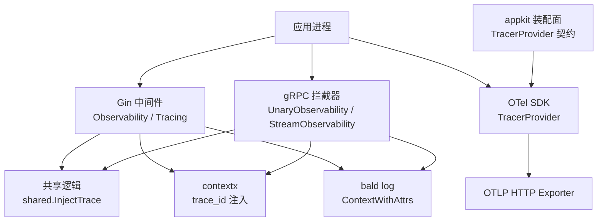
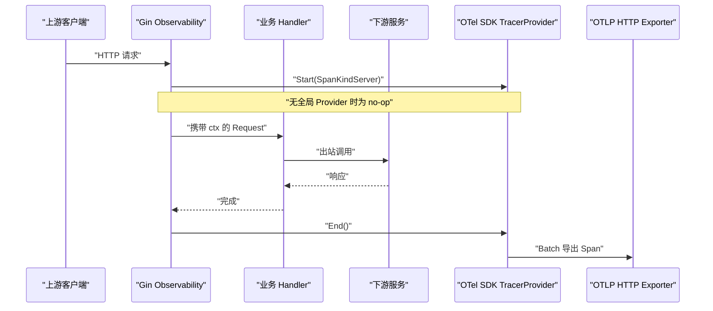
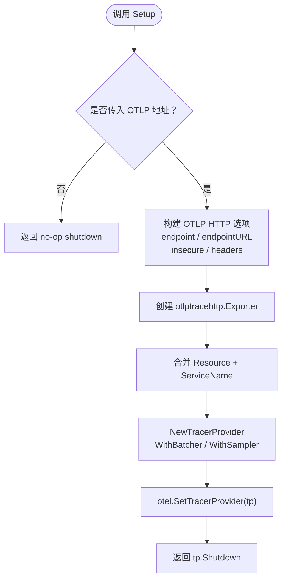
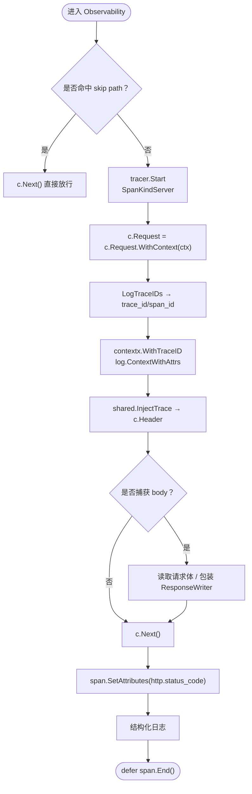
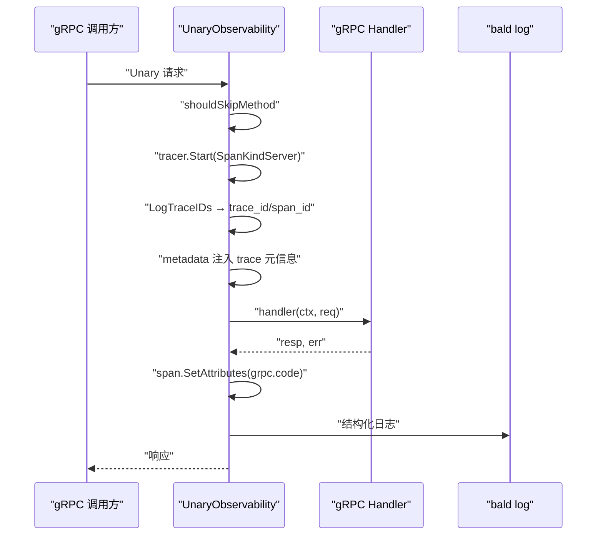
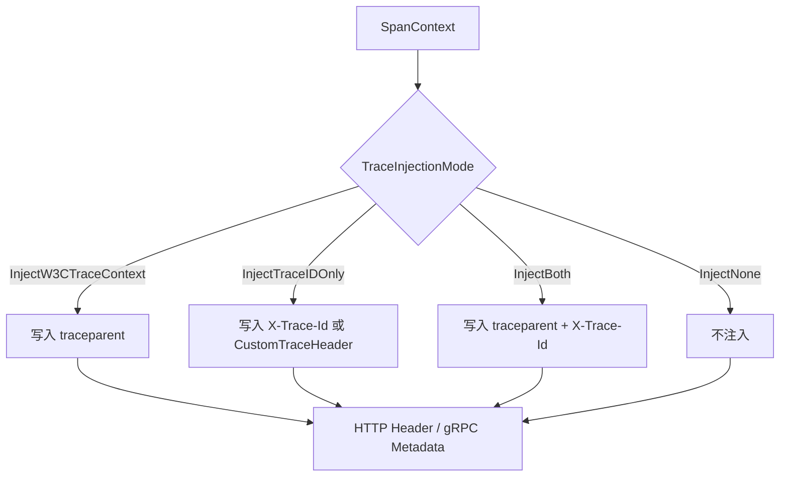
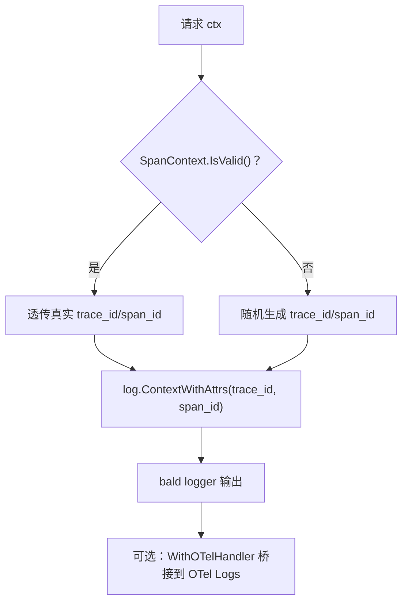
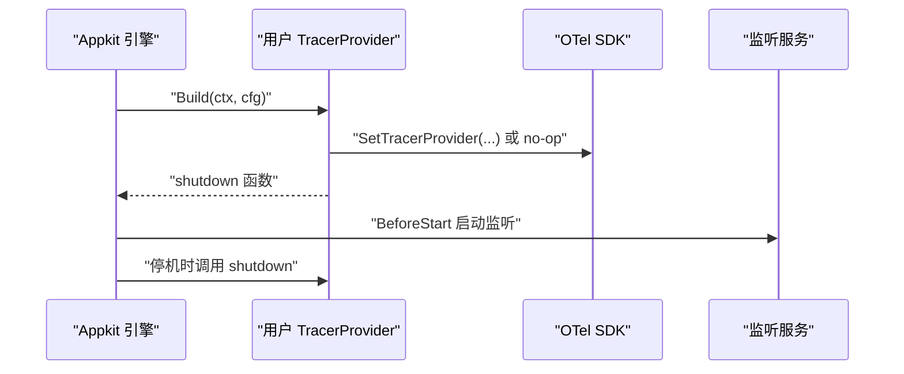
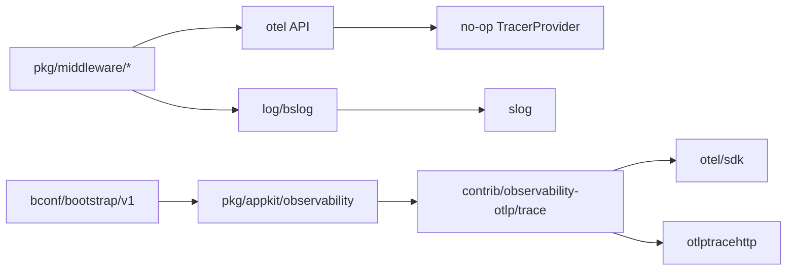

# 分布式追踪

<cite>
**本文引用的文件**   
- [contrib/observability-otlp/trace/trace.go](file://contrib/observability-otlp/trace/trace.go)
- [pkg/middleware/gin/observability.go](file://pkg/middleware/gin/observability.go)
- [pkg/middleware/gin/tracing.go](file://pkg/middleware/gin/tracing.go)
- [pkg/middleware/gin/context.go](file://pkg/middleware/gin/context.go)
- [pkg/middleware/grpc/observability.go](file://pkg/middleware/grpc/observability.go)
- [pkg/middleware/shared/shared.go](file://pkg/middleware/shared/shared.go)
- [pkg/middleware/tracing.go](file://pkg/middleware/tracing.go)
- [pkg/appkit/observability.go](file://pkg/appkit/observability.go)
- [bconf/gen/go/bootstrap/v1/tracer.pb.go](file://bconf/gen/go/bootstrap/v1/tracer.pb.go)
- [log/bslog/otel.go](file://log/bslog/otel.go)
</cite>

## 目录
1. [引言](#引言)
2. [项目结构](#项目结构)
3. [核心组件](#核心组件)
4. [架构总览](#架构总览)
5. [详细组件分析](#详细组件分析)
6. [依赖关系分析](#依赖关系分析)
7. [性能与采样](#性能与采样)
8. [故障排查指南](#故障排查指南)
9. [结论](#结论)
10. [附录：跨后端集成要点](#附录跨后端集成要点)

## 引言
本文面向 Bald 分布式追踪系统的技术读者，系统梳理 OpenTelemetry 在框架中的装配面、HTTP/gRPC 入站 span 生命周期、跨进程上下文传播、日志关联机制，以及 OTLP 远端直推后端的配置与采样策略。文档同时给出自定义埋点最佳实践、性能影响分析与常见故障排查路径。

Bald 的核心可观测性设计遵循「零配置可运行」原则：未装配全局 TracerProvider 时，`otel.Tracer` 返回 no-op tracer，中间件仍会创建 span 并注入 trace ID，但不采样、不导出；只有显式启用 OTLP 后端时才把 `TracerProvider` 写入全局，开启真实链路数据收集。

## 项目结构
OpenTelemetry 相关代码分布在以下模块：
- 远端桥接：`contrib/observability-otlp/trace`，负责把 SDK TracerProvider 挂到 OTLP HTTP exporter。
- HTTP 可观测性：`pkg/middleware/gin`，提供 Observability、Tracing、TraceContext 三个 gin 中间件。
- gRPC 可观测性：`pkg/middleware/grpc`，提供 Unary/Stream 服务端拦截器。
- 共享逻辑：`pkg/middleware/shared`，收敛 trace header 常量、W3C 注入模式与通配匹配。
- 框架装配面：`pkg/appkit/observability.go`，定义 TracerProvider 契约段。
- 配置契约：`bconf/gen/go/bootstrap/v1/tracer.pb.go`，描述 Tracer / Tracer_Otlp。
- 日志关联：`log/bslog/otel.go`，提供 OTel slog handler 的可选桥接入口。

**图示来源**
- [pkg/middleware/gin/observability.go:140-181](file://pkg/middleware/gin/observability.go#L140-L181)
- [pkg/middleware/grpc/observability.go:100-150](file://pkg/middleware/grpc/observability.go#L100-L150)
- [pkg/middleware/shared/shared.go:47-104](file://pkg/middleware/shared/shared.go#L47-L104)
- [contrib/observability-otlp/trace/trace.go:75-136](file://contrib/observability-otlp/trace/trace.go#L75-L136)
- [pkg/appkit/observability.go:1-55](file://pkg/appkit/observability.go#L1-L55)

**章节来源**
- [pkg/middleware/gin/observability.go:1-200](file://pkg/middleware/gin/observability.go#L1-L200)
- [pkg/middleware/grpc/observability.go:1-120](file://pkg/middleware/grpc/observability.go#L1-L120)
- [contrib/observability-otlp/trace/trace.go:1-136](file://contrib/observability-otlp/trace/trace.go#L1-L136)
- [pkg/appkit/observability.go:1-55](file://pkg/appkit/observability.go#L1-L55)

## 核心组件
- **OTLP 追踪桥接**：`contrib/observability-otlp/trace.Setup` 根据是否传入 OTLP 地址决定是否设置全局 `TracerProvider`；支持服务名、insecure/TLS、请求头、采样策略与采样比率。
- **HTTP 中间件**：
  - `gin.Observability`：入站 SpanKindServer span、状态码属性、trace header 注入、结构化请求日志、跳过路径。
  - `gin.Tracing`：仅追踪、不写请求日志，用于只想要链路追踪的场景。
  - `gin.TraceContext`：把当前 span 的 TraceID 注入 request context，供下游消费。
- **gRPC 中间件**：`UnaryObservability`、`StreamObservability`，语义与 HTTP 侧一致，额外通过 metadata 注入 trace 上下文。
- **共享注入器**：`shared.InjectTrace` 按 W3C traceparent、`X-Trace-Id`、`tracestate` 或组合模式输出 header/metadata。
- **日志关联**：`middleware.LogTraceIDs` 在无有效 SpanContext 时生成随机 trace_id/span_id，保证 no-op 下日志仍可关联；`log.ContextWithAttrs` 把 trace_id/span_id 挂到 slog 属性流。
- **框架契约**：`appkit.TracerProvider` 是用户 Provider 函数签名，由引擎在 BeforeStart 阶段调用，确保首个请求前全局 TracerProvider 已就绪。

**章节来源**
- [contrib/observability-otlp/trace/trace.go:1-136](file://contrib/observability-otlp/trace/trace.go#L1-L136)
- [pkg/middleware/gin/observability.go:1-200](file://pkg/middleware/gin/observability.go#L1-L200)
- [pkg/middleware/gin/tracing.go:1-43](file://pkg/middleware/gin/tracing.go#L1-L43)
- [pkg/middleware/gin/context.go:1-19](file://pkg/middleware/gin/context.go#L1-L19)
- [pkg/middleware/grpc/observability.go:1-120](file://pkg/middleware/grpc/observability.go#L1-L120)
- [pkg/middleware/shared/shared.go:1-104](file://pkg/middleware/shared/shared.go#L1-L104)
- [pkg/middleware/tracing.go:1-35](file://pkg/middleware/tracing.go#L1-L35)
- [pkg/appkit/observability.go:1-55](file://pkg/appkit/observability.go#L1-L55)

## 架构总览
下图展示一次 HTTP 入站请求在 Bald 中的完整追踪链：从 gin 中间件创建 server span，到业务 handler，再到下游 gRPC/HTTP 出站调用（由对应客户端拦截器注入 trace 上下文），最终由 OTLP exporter 批量导出。

**图示来源**
- [pkg/middleware/gin/observability.go:140-200](file://pkg/middleware/gin/observability.go#L140-L200)
- [contrib/observability-otlp/trace/trace.go:75-136](file://contrib/observability-otlp/trace/trace.go#L75-L136)

## 详细组件分析

### OTLP 追踪桥接与 TracerProvider 初始化
`contrib/observability-otlp/trace.Setup` 是 Bald 中唯一把 SDK TracerProvider 写入 `otel` 全局的位置。其关键行为如下：
- 当未传入 OTLP 地址时直接返回 no-op shutdown，保持核心 no-op tracer。
- 地址为 `http(s)://` 时使用 `WithEndpointURL`，裸 `host:port` 使用 `WithEndpoint`。
- insecure 三态：显式 `true`/`false` 优先；未显式且非 URL 时默认 insecure。
- 支持 headers、service.name、batcher、resource。
- 采样器由名称解析：`always_on`、`always_off`、`trace_id_ratio`、`parent_based`（空串也退化为 ParentBased(AlwaysSample)）。

**图示来源**
- [contrib/observability-otlp/trace/trace.go:75-136](file://contrib/observability-otlp/trace/trace.go#L75-L136)

配置契约字段来自 `bootstrapv1.Tracer` 与 `Tracer_Otlp`，包含 endpoint、insecure、headers、sampler、sample_ratio。这些字段由调用方读取后传给 `Setup`。

**章节来源**
- [contrib/observability-otlp/trace/trace.go:1-136](file://contrib/observability-otlp/trace/trace.go#L1-L136)
- [bconf/gen/go/bootstrap/v1/tracer.pb.go:1-200](file://bconf/gen/go/bootstrap/v1/tracer.pb.go#L1-L200)

### HTTP 入站 Span 生命周期
`gin.Observability` 对每个入站请求执行：
1. 检查 skip path，命中则直接放行。
2. 以 `Method+" "+Path` 作为 span name，创建 `SpanKindServer`。
3. 将新 ctx 写回 `c.Request.WithContext(ctx)`。
4. 通过 `middleware.LogTraceIDs` 取 trace_id/span_id，并注入 `contextx` 与 slog 属性流。
5. 按 `TraceInjectionMode` 注入 trace header。
6. 在 debug 模式下捕获请求/响应体。
7. 记录 `http.status_code` 属性与结构化日志。

**图示来源**
- [pkg/middleware/gin/observability.go:120-200](file://pkg/middleware/gin/observability.go#L120-L200)
- [pkg/middleware/gin/observability.go:201-320](file://pkg/middleware/gin/observability.go#L201-L320)
- [pkg/middleware/tracing.go:1-35](file://pkg/middleware/tracing.go#L1-L35)

`gin.Tracing` 是更轻量的变体：同样起 span、同样注入 trace_id 到 contextx 与属性流，但不会写请求日志，也不会捕获响应体。若同时挂载 Observability 与 Tracing，会产生两层 span；推荐根据需求二选一。

**章节来源**
- [pkg/middleware/gin/observability.go:120-320](file://pkg/middleware/gin/observability.go#L120-L320)
- [pkg/middleware/gin/tracing.go:1-43](file://pkg/middleware/gin/tracing.go#L1-L43)

### gRPC 入站 Span 生命周期
`UnaryObservability` 和 `StreamObservability` 的行为与 HTTP 侧对称：
- 使用包级 `otel.Tracer("bald/grpc")`。
- 以 `info.FullMethod` 作为 span name，标记 `SpanKindServer`。
- 注入 trace_id/span_id 到 slog 属性流与 `contextx`。
- 从 incoming metadata 中提取并改写 trace 元信息。
- 将 `grpc.code` 作为 span 属性。
- 对 stream 使用 `traceStream` 包装 ServerStream，使 handler 读到带 trace 属性的 ctx。

**图示来源**
- [pkg/middleware/grpc/observability.go:100-200](file://pkg/middleware/grpc/observability.go#L100-L200)
- [pkg/middleware/grpc/observability.go:201-325](file://pkg/middleware/grpc/observability.go#L201-L325)

**章节来源**
- [pkg/middleware/grpc/observability.go:1-325](file://pkg/middleware/grpc/observability.go#L1-L325)

### 跨进程追踪上下文传播
Bald 的跨进程上下文传播分为两个层面：

1. **HTTP 层**：通过 `shared.InjectTrace` 输出标准 header。
   - `traceparent`：W3C Trace Context，格式为 `00-traceId-spanId-flags`，flags 依据采样位。
   - `X-Trace-Id`：简单 trace ID。
   - `tracestate`：保留扩展上下文。
   - 可通过 `CustomTraceHeader` 覆盖 `X-Trace-Id` 的 key。

2. **gRPC 层**：通过 `injectTraceMetadata` 把相同语义写入 grpc metadata，key 由 `shared.InjectTrace` 驱动。

**图示来源**
- [pkg/middleware/shared/shared.go:47-104](file://pkg/middleware/shared/shared.go#L47-L104)
- [pkg/middleware/gin/observability.go:307-309](file://pkg/middleware/gin/observability.go#L307-L309)
- [pkg/middleware/grpc/observability.go:287-325](file://pkg/middleware/grpc/observability.go#L287-L325)

**章节来源**
- [pkg/middleware/shared/shared.go:1-104](file://pkg/middleware/shared/shared.go#L1-L104)

### 日志与追踪关联
Bald 的日志关联不依赖 OTel log bridge，而是通过 slog 属性流实现：
- `middleware.LogTraceIDs` 从当前 SpanContext 提取 trace_id/span_id；若 SpanContext 无效（no-op tracer），则用 `crypto/rand` 生成随机值，避免全零 ID 导致日志无法关联。
- 中间件随后调用 `log.ContextWithAttrs(ctx, slog.String("trace_id", ...), slog.String("span_id", ...))`，使后续所有经 `log.GetLogger()` 输出的日志自动附带这两个字段。
- `log/bslog.WithOTelHandler` 提供可选的 OTel slog handler 桥接，供需要 OTel Logs 的消费者自行接入。

**图示来源**
- [pkg/middleware/tracing.go:1-35](file://pkg/middleware/tracing.go#L1-L35)
- [pkg/middleware/gin/observability.go:164-177](file://pkg/middleware/gin/observability.go#L164-L177)
- [log/bslog/otel.go:1-26](file://log/bslog/otel.go#L1-L26)

**章节来源**
- [pkg/middleware/tracing.go:1-35](file://pkg/middleware/tracing.go#L1-L35)
- [pkg/middleware/gin/observability.go:160-177](file://pkg/middleware/gin/observability.go#L160-L177)
- [log/bslog/otel.go:1-26](file://log/bslog/otel.go#L1-L26)

### 自定义 Span 埋点最佳实践
在已有全局 TracerProvider 的情况下，业务代码应遵循：
- 使用 `otel.Tracer("<your-module>")` 获取 tracer，而非复用框架包级 tracer。
- 在关键业务边界创建 span，例如：
  - 外部 RPC/HTTP 调用前后。
  - 数据库查询、缓存读写。
  - 消息队列发布/消费。
- 使用 `trace.WithSpanKind` 表达角色（Client/Server/Producer/Consumer/Internal）。
- 通过 `span.SetAttributes` 添加业务键，如 service、db.statement、mq.queue、error=true。
- 错误标记：在出错分支调用 `span.RecordError(err)` 并设置 `status.Error`。
- 及时 `defer span.End()`，避免 span 泄漏。
- 不要在高频热点路径上频繁创建 span；合理结合采样与属性裁剪。

注意：Bald 自身中间件已在 HTTP/gRPC 入站处创建 span；业务埋点是「在已有 span 下继续创建子 span」，从而形成完整链路树。

[本节为通用最佳实践说明，不直接分析具体代码文件]

### 框架装配与生命周期约定
`pkg/appkit/observability.go` 定义了 `TracerProvider` 契约：用户 Provider 接收 `*bootstrapv1.Tracer`，返回 shutdown 函数，由引擎挂到停机 Effect 逆序回放，确保尾批 span flush 在暴露端关闭之后执行。

**图示来源**
- [pkg/appkit/observability.go:1-55](file://pkg/appkit/observability.go#L1-L55)

**章节来源**
- [pkg/appkit/observability.go:1-55](file://pkg/appkit/observability.go#L1-L55)

## 依赖关系分析
Bald 的可观测性依赖层次清晰：
- 核心中间件只依赖 `go.opentelemetry.io/otel` API，不引入 SDK/exporter，保持 zero-config 能力。
- OTLP 桥接是唯一引入 SDK 与 exporter 的模块。
- 配置契约由 protobuf 生成类型承载。
- 日志桥接保持可选，核心 log 模块不强制依赖 otel。

**图示来源**
- [pkg/middleware/gin/observability.go:15-28](file://pkg/middleware/gin/observability.go#L15-L28)
- [contrib/observability-otlp/trace/trace.go:10-22](file://contrib/observability-otlp/trace/trace.go#L10-L22)
- [pkg/appkit/observability.go:1-55](file://pkg/appkit/observability.go#L1-L55)
- [log/bslog/otel.go:1-26](file://log/bslog/otel.go#L1-L26)

**章节来源**
- [pkg/middleware/gin/observability.go:1-28](file://pkg/middleware/gin/observability.go#L1-L28)
- [contrib/observability-otlp/trace/trace.go:1-22](file://contrib/observability-otlp/trace/trace.go#L1-L22)
- [pkg/appkit/observability.go:1-55](file://pkg/appkit/observability.go#L1-L55)
- [log/bslog/otel.go:1-26](file://log/bslog/otel.go#L1-L26)

## 性能与采样
- **no-op 路径开销极低**：未设置全局 TracerProvider 时，otel 返回 no-op tracer，span 创建几乎无开销，但仍会注入 trace_id/span_id 到日志属性流。
- **采样策略**：
  - `always_on`：始终采样，适合调试或低流量环境。
  - `always_off`：不采样，禁用链路导出。
  - `trace_id_ratio`：按比例采样，ratio ≤ 0 时回退为 1.0。
  - `parent_based`：基于父 span 的缺省策略。
- **批量导出**：SDK 使用 batcher，减少网络调用次数。
- **属性裁剪**：建议只在必要位置设置少量属性，避免 span payload 膨胀。
- **body 捕获**：HTTP 中间件在 debug 模式下才会读取请求体和复制响应体，生产环境建议关闭该功能。
- **大规模链路存储与查询**：Bald 本身不存储链路数据，仅通过 OTLP 推送；存储与查询由后端 APM 承担。

[本节为通用性能指导，不直接分析具体代码文件]

## 故障排查指南

### 现象：日志有 trace_id，但 APM 无链路
可能原因：
- 未调用 `contrib/observability-otlp/trace.Setup`，或未传入 OTLP 地址。
- OTLP 地址格式错误，导致 exporter 创建失败。
- 采样策略为 `always_off` 或 ratio 过低。
- 网络不可达或鉴权失败（headers 未配置 Authorization 等）。

排查步骤：
1. 确认 `Setup` 已调用且返回的 shutdown 函数在进程退出时被调用。
2. 检查 OTLP endpoint 是否为 `http(s)://` 或裸 host:port。
3. 检查 sampler 配置。
4. 检查 exporter headers 是否满足远端鉴权要求。

**章节来源**
- [contrib/observability-otlp/trace/trace.go:75-136](file://contrib/observability-otlp/trace/trace.go#L75-L136)

### 现象：HTTP 链路断在中间件之间
可能原因：
- 多个中间件重复创建 span，造成嵌套层级异常。
- `gin.Tracing` 与 `gin.Observability` 同时挂载，产生双层 span。
- 上游未传递 traceparent，下游无法识别上下文。

处理建议：
- 明确中间件职责：要日志用 Observability，只要追踪用 Tracing。
- 在网关或上游确保 W3C traceparent 正确注入。
- 使用 `shared.InjectTrace` 的模式统一 header/key。

**章节来源**
- [pkg/middleware/gin/tracing.go:15-43](file://pkg/middleware/gin/tracing.go#L15-L43)
- [pkg/middleware/shared/shared.go:47-104](file://pkg/middleware/shared/shared.go#L47-L104)

### 现象：gRPC 下游拿不到 trace_id
可能原因：
- 未启用 gRPC 拦截器。
- 下游不是 gRPC 服务，而是 HTTP 服务，metadata 不会映射到 HTTP header。
- 下游未按 W3C 或 `X-Trace-Id` 解析上下文。

处理建议：
- 确认 gRPC 服务端已注册 `UnaryObservability` / `StreamObservability`。
- 如果是跨协议调用，确保下游服务能解析对应的 header。
- 检查 `TraceInjectionMode` 是否启用了期望的 mode。

**章节来源**
- [pkg/middleware/grpc/observability.go:100-200](file://pkg/middleware/grpc/observability.go#L100-L200)
- [pkg/middleware/shared/shared.go:47-104](file://pkg/middleware/shared/shared.go#L47-L104)

### 现象：no-op 下日志 trace_id 全为零
可能原因：
- 误以为 no-op tracer 会丢弃 trace_id/span_id。

解释：
- `middleware.LogTraceIDs` 在 SpanContext 无效时生成随机 ID，确保日志仍可关联。
- 如果看到全零，说明日志未走 Baldwin 的属性流注入路径，或使用了其他 logger。

**章节来源**
- [pkg/middleware/tracing.go:10-35](file://pkg/middleware/tracing.go#L10-L35)
- [pkg/middleware/gin/observability.go:164-177](file://pkg/middleware/gin/observability.go#L164-L177)

## 结论
Bald 的分布式追踪体系以「核心零耦合、可观测性由调用方接线」为原则：中间件负责创建 span、注入 trace 上下文、关联日志；`contrib/observability-otlp/trace` 负责把 OTel SDK 接入 OTLP 远端；配置契约与 appkit 装配面保证生命周期安全。通过 W3C traceparent 与 gRPC metadata，Bald 能在 HTTP 与 gRPC 服务之间传递追踪上下文；日志通过 slog 属性流嵌入 trace_id/span_id，便于离线关联。生产环境中应合理配置采样率、关闭 body 捕获、精简 span 属性，并结合后端 APM 进行大规模链路数据的存储与查询。

[本节为总结，不直接分析具体代码文件]

## 附录：跨后端集成要点

### Jaeger
Jaeger 通常通过 OTLP collector 接收链路数据。Bald 只需配置 OTLP endpoint 与 insecure/TLS，无需 Jaeger 专用 SDK。

### Zipkin
Zipkin 支持 OTLP 或通过 adapter 接收 OTLP。Bald 侧仍是 OTLP exporter 配置；若 Zipkin 不提供 OTLP 入口，需在网关层做协议转换。

### SkyWalking
SkyWalking 提供 OTLP 兼容能力，也可通过其 Java/.NET/Go agent 接入。Bald 侧仍以 OTLP exporter 为主；若使用 SkyWalking Go Agent，需按 Agent 文档额外配置，不能仅靠 OTLP exporter。

### 调试技巧
- 先用 `always_on` 采样验证链路完整性。
- 在 APM 前端按 trace_id 检索，再逐步降低采样率。
- 检查 HTTP header 中是否存在 `traceparent`，检查 gRPC metadata 中是否包含对应 trace key。
- 使用结构化日志中的 trace_id/span_id 快速定位同一条请求。

[本节为通用集成指导，不直接分析具体代码文件]