# 可观测性

<cite>
**本文引用的文件列表**   
- [log/doc.go](file://log/doc.go)
- [log/global.go](file://log/global.go)
- [log/context.go](file://log/context.go)
- [log/filter.go](file://log/filter.go)
- [log/multi.go](file://log/multi.go)
- [log/bslog/bslog.go](file://log/bslog/bslog.go)
- [log/bslog/filter.go](file://log/bslog/filter.go)
- [log/bslog/options.go](file://log/bslog/options.go)
- [log/bslog/otel.go](file://log/bslog/otel.go)
- [log/aliyun/aliyun.go](file://log/aliyun/aliyun.go)
- [log/loki/loki.go](file://log/loki/loki.go)
- [log/sentry/sentry.go](file://log/sentry/sentry.go)
- [log/tencent/tencent.go](file://log/tencent/tencent.go)
- [metrics/metrics.go](file://metrics/metrics.go)
- [metrics/prometheus/prometheus.go](file://metrics/prometheus/prometheus.go)
- [metrics/datadog/datadog.go](file://metrics/datadog/datadog.go)
- [metrics/otel/otel.go](file://metrics/otel/otel.go)
- [observability/metricshttp/metricshttp.go](file://observability/metricshttp/metricshttp.go)
- [contrib/observability-otlp/metrics/metrics.go](file://contrib/observability-otlp/metrics/metrics.go)
- [contrib/observability-otlp/trace/trace.go](file://contrib/observability-otlp/trace/trace.go)
- [health/health.go](file://health/health.go)
- [health/handler.go](file://health/handler.go)
- [health/readiness.go](file://health/readiness.go)
- [health/checkers.go](file://health/checkers.go)
- [pkg/middleware/tracing.go](file://pkg/middleware/tracing.go)
- [pkg/middleware/gin/tracing.go](file://pkg/middleware/gin/tracing.go)
</cite>

## 目录

1. [简介](#简介)
2. [项目结构](#项目结构)
3. [核心组件](#核心组件)
4. [架构总览](#架构总览)
5. [日志子系统](#日志子系统)
6. [指标子系统](#指标子系统)
7. [健康检查与探针](#健康检查与探针)
8. [分布式追踪与链路聚合](#分布式追踪与链路聚合)
9. [依赖关系分析](#依赖关系分析)
10. [性能影响与优化建议](#性能影响与优化建议)
11. [生产部署指南](#生产部署指南)
12. [故障排查](#故障排查)
13. [结论](#结论)

## 简介

本仓的可观测性体系以“契约层 + 多后端实现”的装配模式组织：框架核心只依赖 `log`、`metrics`、`health` 等抽象，具体后端（阿里云 SLS、Grafana Loki、Sentry、腾讯云 CLS、Prometheus、Datadog、OpenTelemetry OTLP）由调用方在装配阶段注入。这样既让业务代码不耦合第三方库，又允许同一份埋点同时对接本地控制台、远程日志平台、APM 与指标后端。

本文覆盖三个主题：

- **服务发现与网关出站**：本节侧重可观测性如何与请求链路、中间件、HTTP/gRPC 中间件协作；服务发现与网关出站的完整语义见仓库其他文档。
- **CI 质量闸门**：本节说明测试与集成作业对可观测性后端的验证方式。
- **Broker 订阅者生命周期**：本节不展开 Broker 内部状态机，仅说明其致命退出对可观测性数据的影响边界。

可观测性相关能力分为四层：

| 层次 | 职责 | 主要包 |
|---|---|---|
| 契约层 | 定义 Logger、Metrics、Checker、Health 等接口，默认 nop，全局表注入 | `log`、`metrics`、`health` |
| 内置实现 | slog 后端、过滤、上下文属性流、HTTP 暴露端 | `log/bslog`、`observability/metricshttp` |
| 远端适配器 | 云厂商日志、指标与 OTLP 桥接 | `log/aliyun`、`log/loki`、`log/sentry`、`log/tencent`、`metrics/*`、`contrib/observability-otlp` |
| 协议中间件 | 在 gin/gRPC 中注入 span、trace_id/span_id 到日志上下文 | `pkg/middleware`、`pkg/middleware/gin` |

## 项目结构

可观测性不是单一包，而是跨多个模块的能力集合。下图展示与本文相关的目录关系与依赖方向：

```mermaid
graph TB
    subgraph "契约层"
        LOG["log<br/>Logger 接口、全局句柄、属性流"]
        METRICS["metrics<br/>Metrics 接口"]
        HEALTH["health<br/>Health / Checker / Handler"]
    end

    subgraph "内置实现"
        BSLOG["log/bslog<br/>slog 后端、过滤、轮转、OTel 桥接入口"]
        METRICSH["observability/metricshttp<br/>独立 :9091 指标端口"]
    end

    subgraph "远端适配器"
        ALIYUN["log/aliyun<br/>阿里云 SLS"]
        LOKI["log/loki<br/>Grafana Loki"]
        SENTRY["log/sentry<br/>错误追踪"]
        TENCENT["log/tencent<br/>腾讯云 CLS"]
        PROM["metrics/prometheus<br/>Prometheus 客户端"]
        DD["metrics/datadog<br/>DogStatsD"]
        OTEL_METRICS["metrics/otel<br/>OTLP 指标 SDK"]
    end

    subgraph "OTLP 装配面"
        OBS_METRICS["contrib/observability-otlp/metrics<br/>MeterProvider 与 Prometheus 抓取端"]
        OBS_TRACE["contrib/observability-otlp/trace<br/>TracerProvider 与采样器"]
    end

    subgraph "协议中间件"
        MW_TRACING["pkg/middleware/tracing<br/>LogTraceIDs"]
        GIN_TRACING["pkg/middleware/gin/tracing<br/>gin Tracing 中间件"]
    end

    LOG --> BSLOG
    LOG --> ALIYUN
    LOG --> LOKI
    LOG --> SENTRY
    LOG --> TENCENT

    METRICS --> PROM
    METRICS --> DD
    METRICS --> OTEL_METRICS

    OBS_METRICS --> METRICSH
    OBS_TRACE --> MW_TRACING
    OBS_TRACE --> GIN_TRACING

    HEALTH --> HEALTH
```

**图表来源**
- [log/doc.go:1-15](file://log/doc.go#L1-L15)
- [metrics/metrics.go:1-34](file://metrics/metrics.go#L1-L34)
- [health/health.go:1-40](file://health/health.go#L1-L40)
- [log/bslog/bslog.go:1-20](file://log/bslog/bslog.go#L1-L20)
- [observability/metricshttp/metricshttp.go:1-20](file://observability/metricshttp/metricshttp.go#L1-L20)
- [contrib/observability-otlp/metrics/metrics.go:1-30](file://contrib/observability-otlp/metrics/metrics.go#L1-L30)
- [contrib/observability-otlp/trace/trace.go:1-30](file://contrib/observability-otlp/trace/trace.go#L1-L30)
- [pkg/middleware/tracing.go:1-20](file://pkg/middleware/tracing.go#L1-L20)
- [pkg/middleware/gin/tracing.go:1-20](file://pkg/middleware/gin/tracing.go#L1-L20)

**章节来源**
- [log/doc.go:1-15](file://log/doc.go#L1-L15)
- [metrics/metrics.go:1-34](file://metrics/metrics.go#L1-L34)
- [health/health.go:1-40](file://health/health.go#L1-L40)

## 核心组件

### 日志契约与全局句柄

`log` 包是 bald 日志体系的契约层，只声明 `Logger` 接口、级别枚举、全局句柄和通用装饰器，不引入任何具体日志库。默认后端为 `nop`（静默零成本），进程入口或装配期通过 `SetLogger` 注入真实后端。

关键设计要点：

- 全局 `Logger` 用读写锁保护，`GetLogger()` 供子模块统一获取。
- 配置驱动的后端 Provider 在装配期调用 `SetLogger`，使框架核心始终依赖抽象。
- 默认 `nop` 保证未配置时日志无副作用。

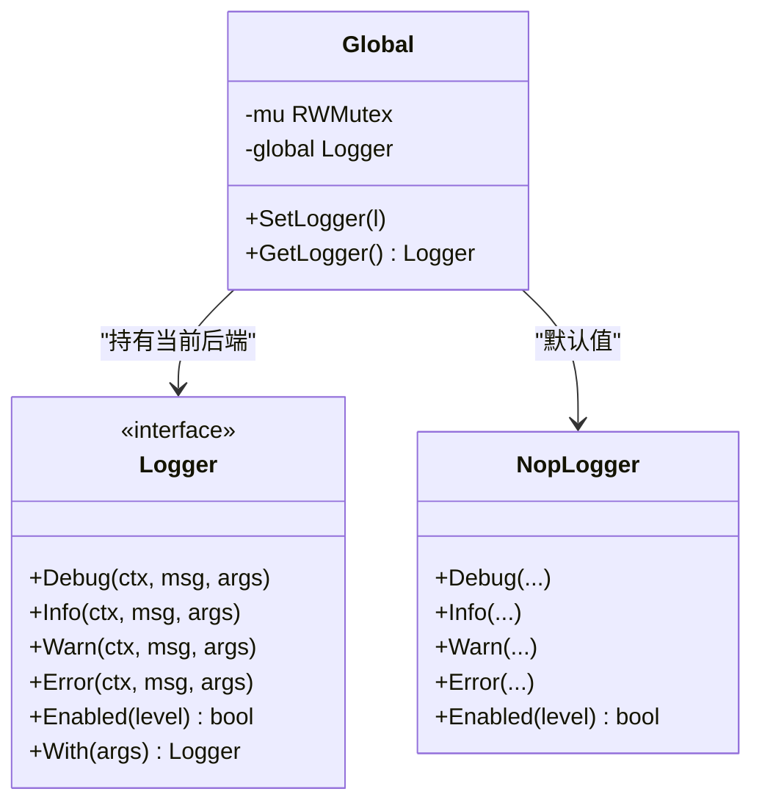

**图表来源**
- [log/global.go:1-28](file://log/global.go#L1-L28)
- [log/doc.go:1-15](file://log/doc.go#L1-L15)

**章节来源**
- [log/doc.go:1-15](file://log/doc.go#L1-L15)
- [log/global.go:1-28](file://log/global.go#L1-L28)

### 指标契约

`metrics.Metrics` 提供进程内指标记录抽象，支持计数器、直方图、仪表和仪表增量。实现方必须保证同一 metric name 的 label key 集合稳定，因为 Prometheus 等后端首次使用时会冻结维度。

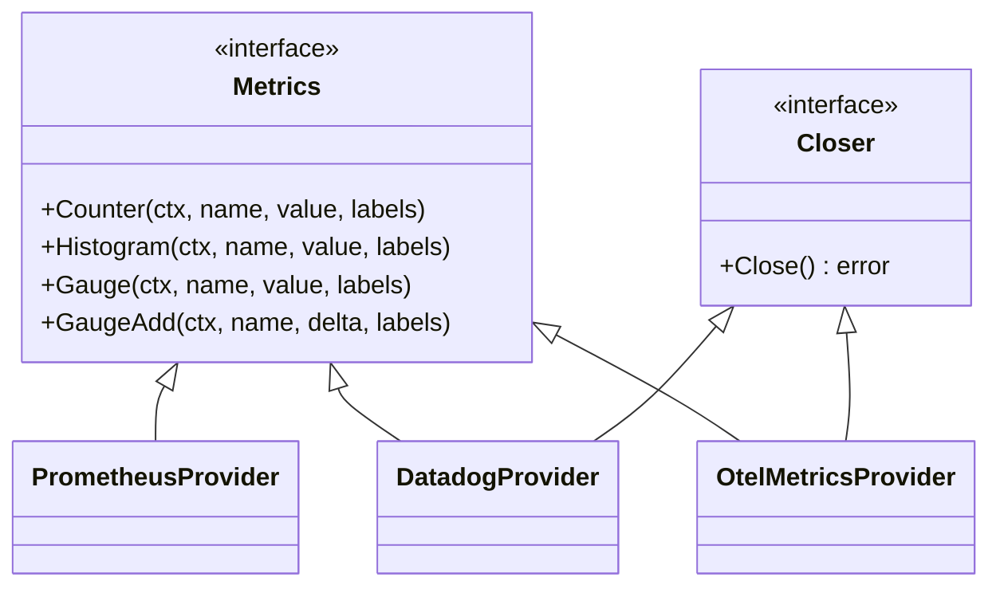

**图表来源**
- [metrics/metrics.go:1-34](file://metrics/metrics.go#L1-L34)
- [metrics/prometheus/prometheus.go:1-40](file://metrics/prometheus/prometheus.go#L1-L40)
- [metrics/datadog/datadog.go:1-40](file://metrics/datadog/datadog.go#L1-L40)
- [metrics/otel/otel.go:1-40](file://metrics/otel/otel.go#L1-L40)

**章节来源**
- [metrics/metrics.go:1-34](file://metrics/metrics.go#L1-L34)

### 健康检查契约

`health` 包定义健康状态、检查器、聚合器和 HTTP 处理器。它适用于 Kubernetes liveness/readiness 探针、负载均衡器探测和业务启动门禁。

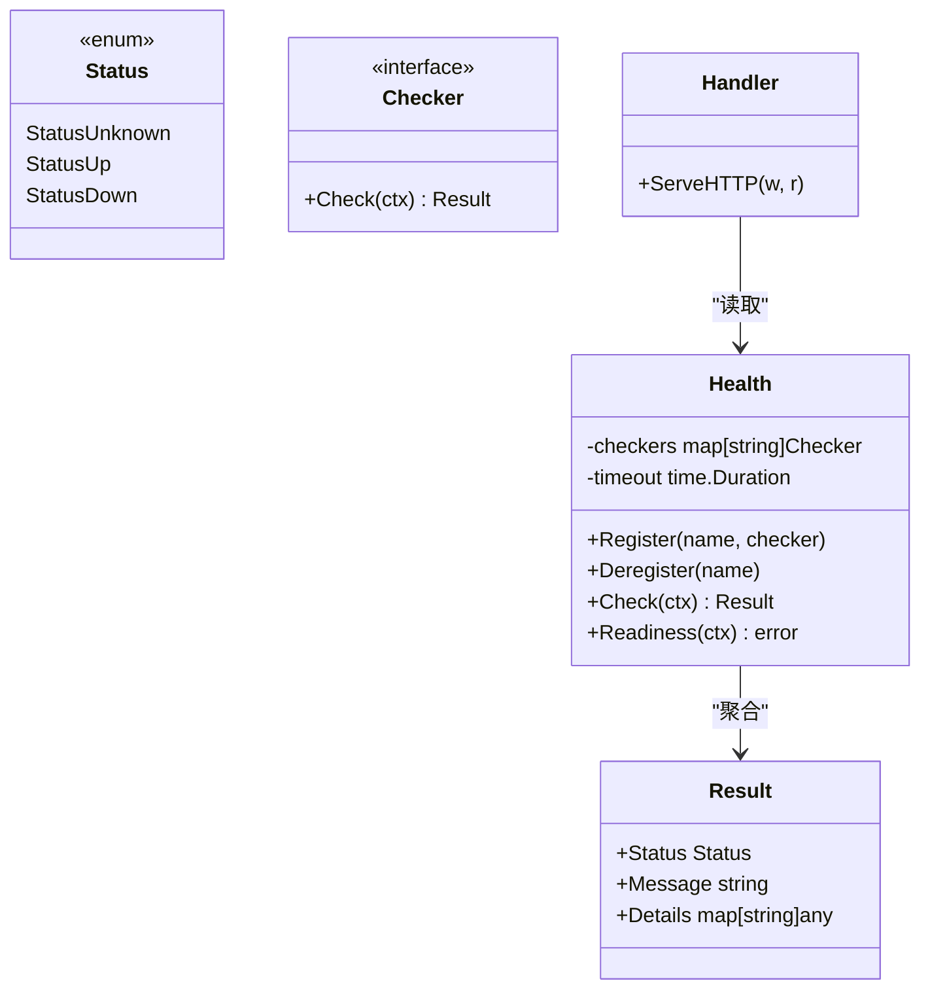

**图表来源**
- [health/health.go:1-60](file://health/health.go#L1-L60)
- [health/handler.go:1-40](file://health/handler.go#L1-L40)
- [health/readiness.go:1-20](file://health/readiness.go#L1-L20)

**章节来源**
- [health/health.go:1-60](file://health/health.go#L1-L60)
- [health/handler.go:1-40](file://health/handler.go#L1-L40)
- [health/readiness.go:1-20](file://health/readiness.go#L1-L20)

## 架构总览

Bald 可观测性采用“核心零后端耦合 + 调用方装配”的模式：

1. 框架核心只 import `log`、`metrics`、`health`、`pkg/middleware` 等契约包。
2. 日志后端通过 `log.SetLogger` 注入；若需要多输出，使用 `MultiLogger` 广播。
3. 指标后端通过 `contrib/observability-otlp` 的 `Setup` 安装全局 `MeterProvider`，或由业务直接构造 Prometheus/Datadog/OTLP provider。
4. 追踪后端通过 `contrib/observability-otlp/trace` 的 `Setup` 安装全局 `TracerProvider`；未配置时保留 no-op。
5. gin/gRPC 中间件负责起 span、注入 trace 头、把 trace_id/span_id 写入日志上下文。
6. 健康检查由业务注册依赖检查器，HTTP handler 暴露 `/healthz`、`/readyz`。

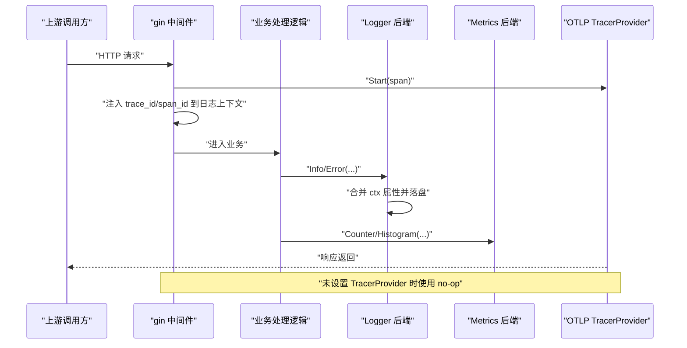

**图表来源**
- [pkg/middleware/gin/tracing.go:1-43](file://pkg/middleware/gin/tracing.go#L1-L43)
- [pkg/middleware/tracing.go:1-35](file://pkg/middleware/tracing.go#L1-L35)
- [contrib/observability-otlp/trace/trace.go:1-30](file://contrib/observability-otlp/trace/trace.go#L1-L30)
- [log/context.go:1-51](file://log/context.go#L1-L51)

## 日志子系统

### 设计原则

`log` 包被明确描述为三层契约层：接口 + 全局表 + nop 默认。它不携带具体日志后端，后端实现放在子包，例如对齐 transport 风格的 `log/bslog`。契约驱动的装配见 `pkg/appkit`，内置 `StandardLoggerProvider` 或通过 `log/<backend>/contract` 的后端 Provider 注入。

这意味着：

- 业务代码应依赖 `log.Logger`，而不是直接依赖 slog、zap 或某个云厂商 SDK。
- 默认 nop 保证开发环境关闭日志时零开销。
- 真正落地输出由装配期注入的后端决定。

**章节来源**
- [log/doc.go:1-15](file://log/doc.go#L1-L15)

### bslog：slog 后端与结构化输出

`bslog` 基于 Go 标准库 `log/slog` 实现 `log.Logger`。它支持：

- 控制台或 JSON 格式输出。
- 多输出目标（stdout/stderr/文件）。
- lumberjack 日志轮转（按大小切割、清理、压缩）。
- 固定结构化属性。
- 自定义 `slog.Handler`，用于接入 OpenTelemetry Logs、Lumberjack 等。
- 字段过滤与脱敏。

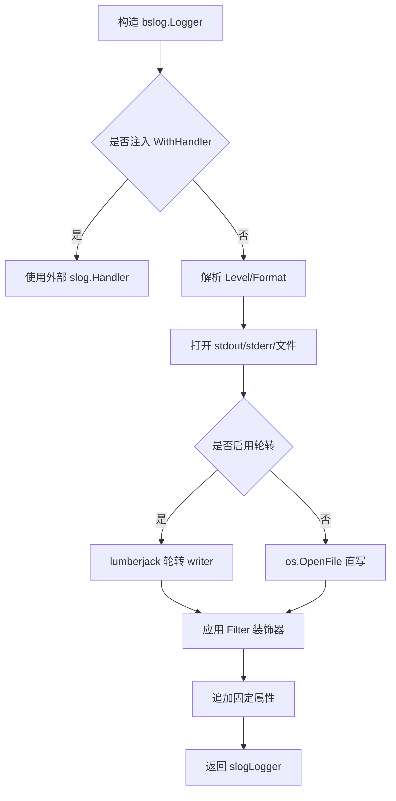

**图表来源**
- [log/bslog/bslog.go:1-120](file://log/bslog/bslog.go#L1-L120)
- [log/bslog/options.go:1-60](file://log/bslog/options.go#L1-L60)

**章节来源**
- [log/bslog/bslog.go:1-120](file://log/bslog/bslog.go#L1-L120)
- [log/bslog/options.go:1-104](file://log/bslog/options.go#L1-L104)

### 日志过滤与脱敏

项目有两套互补的过滤机制：

| 机制 | 作用域 | 适用场景 | 限制 |
|---|---|---|---|
| `log.NewFilterLogger` | 所有后端 | 配置驱动的敏感 key 掩码 | 只匹配位置参数 kv 对和 ctx 属性流，不匹配 `slog.Attr` |
| `bslog.WithFilter(FilterKey)` | 仅 bslog | 代码驱动的任意 Attr 脱敏 | 只在 slog 后端生效 |

`filterLogger` 会遍历偶数下标作为 key 的位置参数，命中敏感 key 后将对应值替换为 `***`；同时会把 ctx 中的属性流也做相同掩码。注释明确强调它与 `bslog.FilterKey` 是互补关系：前者全后端通用但只覆盖 kv 对与 ctx 流，后者仅 slog 但能改写 Record 的 Attr。

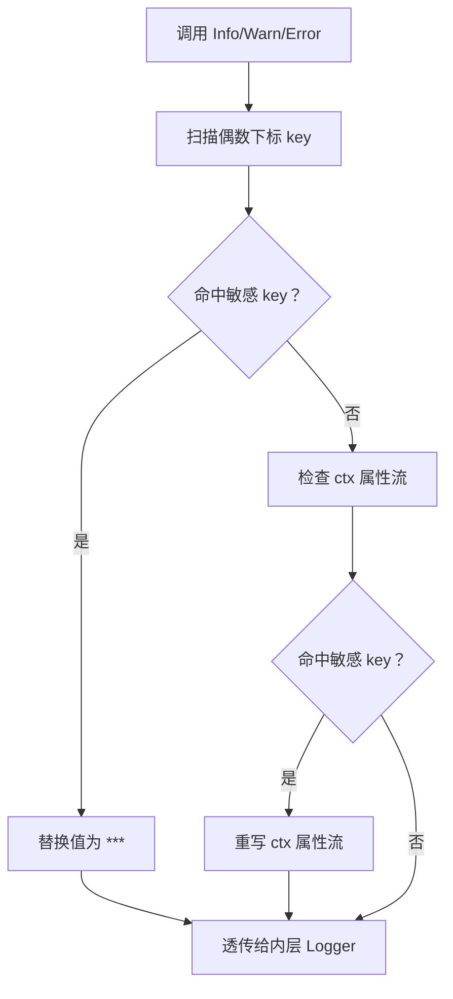

**图表来源**
- [log/filter.go:1-137](file://log/filter.go#L1-L137)
- [log/bslog/filter.go:1-54](file://log/bslog/filter.go#L1-L54)

**章节来源**
- [log/filter.go:1-137](file://log/filter.go#L1-L137)
- [log/bslog/filter.go:1-54](file://log/bslog/filter.go#L1-L54)

### 上下文属性流

`ContextWithAttrs` 将 `slog.Attr` 挂载到 context，使该上下文范围内的所有日志自动携带这些属性。后端适配器在落盘前调用 `ContextAttrsToArgs` 将其拍平为 `key, value, key, value ...` 序列，再合并进日志条目。

这一设计的关键是：

- 契约层不解释属性含义，只负责挂载与读取。
- 非 slog 后端（aliyun、tencent、loki、sentry）可直接消费拍平后的参数序列。
- 属性提取发生在同步路径；异步 flush 不再依赖原 context。

**章节来源**
- [log/context.go:1-51](file://log/context.go#L1-L51)

### 多后端广播

`MultiLogger` 把多个 `Logger` 组合为一个广播实例：每条日志顺序广播到全部后端，单个失败不影响其余。`Enabled` 任一子 Logger 启用即放行，属于保守放行策略。

典型用法是把本地控制台日志与远程日志后端组合，实现“本地调试 + 云端采集”。

**章节来源**
- [log/multi.go:1-73](file://log/multi.go#L1-L73)

### 阿里云 SLS 后端

`log/aliyun` 实现扩展了 `log.Logger` 的 `Logger` 接口，增加 `GetProducer` 和 `Close`。它将日志发送到阿里云 SLS 的异步 producer，并在构造条目时合并 extra 属性、ctx 属性流和调用参数。

特点：

- 所有级别默认启用。
- `post` 同步构造条目后交给 producer 异步发送。
- `Close` 等待 producer 缓冲冲刷。
- 额外属性拼接顺序：先 extra，再 ctx 属性，最后调用参数。

**章节来源**
- [log/aliyun/aliyun.go:1-179](file://log/aliyun/aliyun.go#L1-L179)

### Grafana Loki 后端

`log/loki` 通过 HTTP Push API 批量推送日志。它维护一个共享缓冲：`With` 派生的实例与原实例共享缓冲，任一实例 `Close` 都会冲刷全部待发日志。

关键行为：

- 达到 `batchSize` 触发 flush。
- flush 超时由选项控制。
- 日志体被编码为 Loki 的 streams payload。
- 属性合并顺序与 aliyun/tencent 一致：extra → ctx 属性 → 调用参数。

**章节来源**
- [log/loki/loki.go:1-120](file://log/loki/loki.go#L1-L120)

### Sentry 后端

`log/sentry` 把 Error 级别作为事件上报，带堆栈；Debug/Info/Warn 作为 breadcrumb 记录。它初始化 Sentry SDK，并通过 Hub 写入事件或面包屑。

特点：

- DSN 必填。
- Error 走 `CaptureEvent`。
- 其他级别走 `AddBreadcrumb`。
- 属性写入 Event 的 Contexts 或 Breadcrumb 的 Data。

**章节来源**
- [log/sentry/sentry.go:1-157](file://log/sentry/sentry.go#L1-L157)

### 腾讯云 CLS 后端

`log/tencent` 实现与 aliyun 类似：使用异步 producer 发送 CLS 日志，构造条目时合并 extra、ctx 属性和调用参数，所有级别默认启用。

**章节来源**
- [log/tencent/tencent.go:1-172](file://log/tencent/tencent.go#L1-L172)

### OpenTelemetry 日志集成

`bslog` 本身不引入 otel 依赖，而是通过 `WithHandler` 接受任意 `slog.Handler`。`WithOTelHandler` 只是语义别名，便于阅读时明确意图。调用方需自行引入 `go.opentelemetry.io/contrib/bridges/otelslog` 和 otel log SDK。

这符合“契约核心零三方依赖”的设计：otelslog 的 slog.Handler 可以作为 bslog 的 handler 注入，从而把日志桥接到 OpenTelemetry Logs。

**章节来源**
- [log/bslog/otel.go:1-26](file://log/bslog/otel.go#L1-L26)

## 指标子系统

### 指标抽象

`metrics.Metrics` 是引擎无关的指标记录接口，包括：

- `Counter`：单调递增计数器。
- `Histogram`：直方图分布。
- `Gauge`：绝对值仪表。
- `GaugeAdd`：仪表增量。

`Closer` 扩展了优雅关闭能力，适合需要释放 exporter goroutine 或网络连接的实现。

**章节来源**
- [metrics/metrics.go:1-34](file://metrics/metrics.go#L1-L34)

### Prometheus 后端

`metrics/prometheus` 使用 `client_golang` 实现指标缓存：首次使用时创建 instrument，后续复用。label key 集合在第一次使用时冻结，后续不同 key 会被丢弃——这是 Prometheus 的要求，也是 `Metrics` 接口注释中强调的点。

它支持：

- 私有 registry。
- 默认 registry。
- 自定义 Registerer。
- 命名空间与 subsystem。

**章节来源**
- [metrics/prometheus/prometheus.go:1-120](file://metrics/prometheus/prometheus.go#L1-L120)

### Datadog 后端

`metrics/datadog` 通过 DogStatsD UDP 向本地 Agent 发送指标。它实现 `Metrics` 与 `Closer`，支持地址、命名空间、UDP buffer、flush interval 和采样率。

注意：`GaugeAdd` 通过 statsd count 类型实现增量语义，而 `Gauge` 设置绝对值。

**章节来源**
- [metrics/datadog/datadog.go:1-152](file://metrics/datadog/datadog.go#L1-L152)

### OpenTelemetry 指标后端

`metrics/otel` 基于 otel SDK 创建 MeterProvider，支持 gRPC 或 HTTP OTLP 导出。它缓存 counter/histogram/gauge/UpDownCounter，并通过周期性 reader 导出指标。

**章节来源**
- [metrics/otel/otel.go:1-120](file://metrics/otel/otel.go#L1-L120)

### OTLP 指标装配面

`contrib/observability-otlp/metrics` 提供真正的副作用装配：默认挂 Prometheus exporter 供本地抓取，若提供 OTLP 地址则额外挂 OTLP metric exporter 直推远端 APM。两者共用同一个全局 MeterProvider。

`Setup` 返回：

- Prometheus `/metrics` HTTP handler。
- shutdown 函数，用于 flush OTLP 缓冲并释放 Provider。

它遵循“核心零后端耦合、由调用方装配”的原则，环境变量读取由调用方负责。

**章节来源**
- [contrib/observability-otlp/metrics/metrics.go:1-158](file://contrib/observability-otlp/metrics/metrics.go#L1-L158)

### HTTP 中间件的指标埋点

`observability/metricshttp` 提供独立的 metrics 暴露端监听面，默认地址 `:9091`、路径 `/metrics`。它不负责 flush 指标，flush 归 metrics provider 的 shutdown；engine 合成停机顺序是先停暴露端，再执行 provider flush。

**章节来源**
- [observability/metricshttp/metricshttp.go:1-60](file://observability/metricshttp/metricshttp.go#L1-L60)

## 健康检查与探针

### 检查器注册与状态聚合

`health.Health` 管理多个命名检查器，支持运行时注册和移除。`Check` 并行执行所有检查器，每个检查器受全局超时约束。聚合规则如下：

| 情况 | 整体状态 |
|---|---|
| 任一检查器 Down | Down |
| 没有 Down，但有 Unknown | Unknown |
| 全部 Up | Up |
| 没有注册检查器 | Up，消息为 “no checkers registered” |

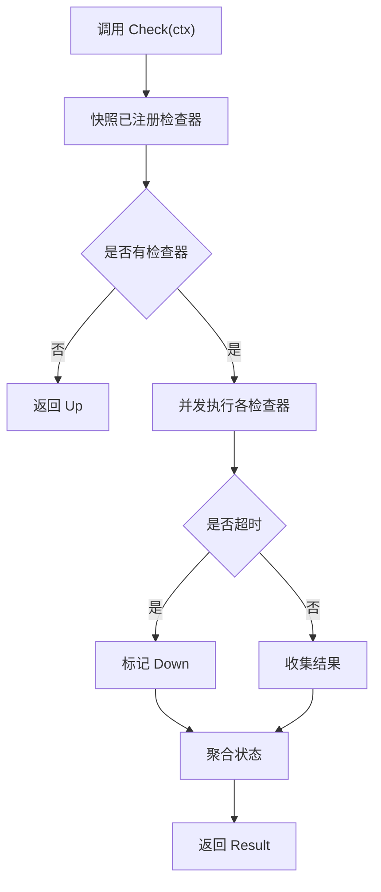

**图表来源**
- [health/health.go:60-160](file://health/health.go#L60-L160)

**章节来源**
- [health/health.go:60-160](file://health/health.go#L60-L160)

### HTTP 处理器

`Handler` 把 `Health.Check` 的结果映射为 HTTP 响应：

- Up 或 Unknown：200 OK。
- Down：503 Service Unavailable。
- 响应体包含 status、message 和各检查器的 details。

`NewLivenessHandler` 是纯存活探针，只要 HTTP 服务器能响应就返回 200。

**章节来源**
- [health/handler.go:1-84](file://health/handler.go#L1-L84)

### Readiness 适配

`Health.Readiness` 把聚合结果适配为 error 形态，可用于 gRPC health 状态同步、业务自建探针或启动门禁。语义与 HTTP handler 一致：Up/Unknown 返回 nil，Down 返回聚合了失败检查器名称与消息的错误。

**章节来源**
- [health/readiness.go:1-42](file://health/readiness.go#L1-L42)

### 内置检查器

`health` 提供常用检查器：

| 检查器 | 用途 | 超时默认值 |
|---|---|---|
| `PingFunc` | 任意返回 error 的函数 | 由外层 Health.timeout 控制 |
| `TCP` | TCP 拨号可达性 | 3 秒 |
| `HTTP` | HTTP GET 状态码判断 | 3 秒 |
| `All` | 全部子检查器通过 | 逐个串行短路 |
| `Any` | 任一子检查器通过 | 逐个短路 |

**章节来源**
- [health/checkers.go:1-181](file://health/checkers.go#L1-L181)

## 分布式追踪与链路聚合

### Span 传播与上下文传递

`pkg/middleware/gin/tracing` 提供只做链路追踪、不写请求日志的 gin 中间件。它：

- 起 `SpanKindServer` span。
- 若上游已有 span，则作为 child。
- 把 trace_id 写入审计上下文和日志属性流。
- 按 W3C traceparent 注入响应头。
- 未配置全局 TracerProvider 时仍可用 no-op tracer，不 panic。

`pkg/middleware/tracing.LogTraceIDs` 是关键工具：当 SpanContext 有效时返回真实 trace_id/span_id；无效时生成随机 ID，避免 no-op 下全零 ID 导致日志无法关联。

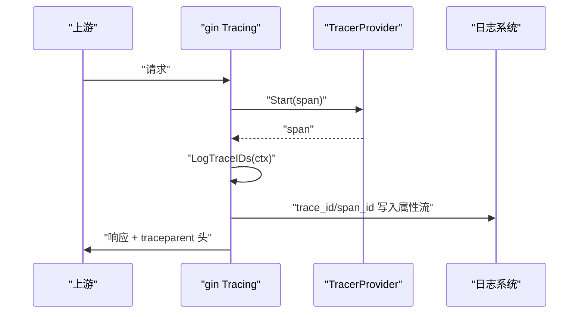

**图表来源**
- [pkg/middleware/gin/tracing.go:1-43](file://pkg/middleware/gin/tracing.go#L1-L43)
- [pkg/middleware/tracing.go:1-35](file://pkg/middleware/tracing.go#L1-L35)

**章节来源**
- [pkg/middleware/gin/tracing.go:1-43](file://pkg/middleware/gin/tracing.go#L1-L43)
- [pkg/middleware/tracing.go:1-35](file://pkg/middleware/tracing.go#L1-L35)

### 追踪远端直推

`contrib/observability-otlp/trace` 负责把全局 TracerProvider 接到远端 APM。它支持：

- OTLP HTTP exporter。
- 三态 insecure：显式 true/false 优先，未显式时裸 host:port 默认 insecure。
- 自定义 headers。
- 采样器：always_on、always_off、trace_id_ratio、parent_based。

若未开启 OTLP，则返回 no-op shutdown，沿用核心的 no-op tracer，保持零配置可运行。

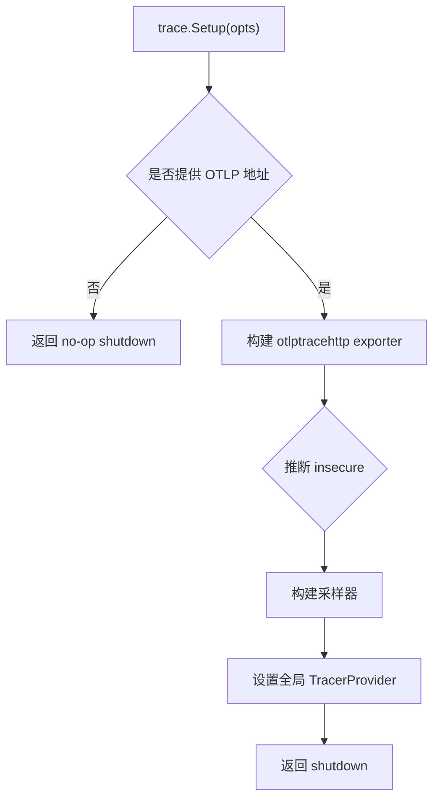

**图表来源**
- [contrib/observability-otlp/trace/trace.go:1-136](file://contrib/observability-otlp/trace/trace.go#L1-L136)

**章节来源**
- [contrib/observability-otlp/trace/trace.go:1-136](file://contrib/observability-otlp/trace/trace.go#L1-L136)

## 依赖关系分析

可观测性的依赖方向是单向的：

- 契约层不依赖具体后端。
- 内置实现依赖契约层。
- 远端适配器依赖契约层。
- OTLP 装配面依赖 otel SDK 和 prometheus 抓取端。
- 协议中间件依赖 otel trace 和 log 上下文。

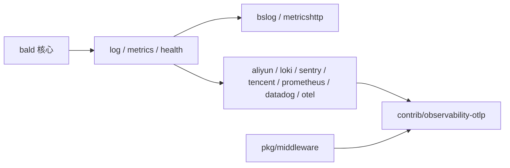

**图表来源**
- [log/doc.go:1-15](file://log/doc.go#L1-L15)
- [contrib/observability-otlp/metrics/metrics.go:1-30](file://contrib/observability-otlp/metrics/metrics.go#L1-L30)
- [contrib/observability-otlp/trace/trace.go:1-30](file://contrib/observability-otlp/trace/trace.go#L1-L30)

**章节来源**
- [log/doc.go:1-15](file://log/doc.go#L1-L15)
- [contrib/observability-otlp/metrics/metrics.go:1-158](file://contrib/observability-otlp/metrics/metrics.go#L1-L158)
- [contrib/observability-otlp/trace/trace.go:1-136](file://contrib/observability-otlp/trace/trace.go#L1-L136)

## 性能影响与优化建议

### 日志

| 方面 | 影响 | 建议 |
|---|---|---|
| 默认后端 | nop 零开销 | 开发环境可保持 nop，装配期再注入真实后端 |
| bslog 多输出 | 多 writer 并发写入 | 生产环境谨慎同时写 stdout 和磁盘；必要时使用 MultiLogger 分离冷热日志 |
| lumberjack 轮转 | 写入时按需切割/压缩 | 合理设置 MaxSize、MaxBackups、MaxAge，避免频繁 GC |
| 过滤 | 每次调用扫描 kv 对和 ctx 属性 | 敏感 key 清单尽量精简，避免大量命中分支 |
| 远程后端 | 异步 producer/buffer 占用内存 | Close 必须在进程退出前调用，否则尾批可能丢失 |

### 指标

| 方面 | 影响 | 建议 |
|---|---|---|
| Prometheus label 冻结 | 首次使用冻结 label key | 业务埋点必须保证同一 metric name 的 label 集合稳定 |
| Datadog UDP | 低延迟、丢包风险 | 根据吞吐调整 bufferSize 和 flushPeriod |
| OTLP 周期导出 | 后台 reader 定期 flush | 根据 APM 容量调整 exportInterval |
| 指标暴露端 | 独立 HTTP 监听 | 不要与业务端口混用，默认 :9091 更稳妥 |

### 追踪

| 方面 | 影响 | 建议 |
|---|---|---|
| no-op tracer | 零配置可用，但不导出 | 生产环境必须装配 TracerProvider |
| 采样 | 高吞吐下采样可减少带宽和存储 | 使用 trace_id_ratio 控制比例，debug 时临时切换到 always_on |
| 日志 trace_id | no-op 下生成随机 ID 仍可关联 | 不要误以为无 trace_id 就是无请求链路 |

## 生产部署指南

### 日志配置最佳实践

1. 默认使用 info 级别，仅在 debug 或故障复现时切换到 debug。
2. 开发环境输出 console，生产环境输出 json 并写入磁盘或远程后端。
3. 启用文件轮转时务必设置合理的 MaxSize、MaxBackups、MaxAge。
4. 对密码、token、鉴权头等敏感字段使用 `log.NewFilterLogger` 或 `bslog.WithFilter`。
5. 使用 `MultiLogger` 区分本地调试日志和远程采集日志。
6. 远端后端（aliyun、loki、sentry、tencent）必须调用 Close，确保缓冲冲刷。

### 指标配置最佳实践

1. 使用 `contrib/observability-otlp/metrics` 的 `Setup` 安装全局 MeterProvider。
2. 至少保留 Prometheus 本地抓取端，便于集群内监控。
3. 如需远端 APM，通过 `WithOTLPAddr` 开启 OTLP 直推。
4. 指标暴露端使用独立端口，避免与业务端口争抢资源。
5. 保证所有埋点的 label key 集合稳定，避免 Prometheus 维度爆炸。
6. 在进程 shutdown 流程中调用 provider 的 shutdown，确保 OTLP 缓冲 flush。

### 健康检查配置最佳实践

1. liveness 探针使用 `NewLivenessHandler`，只关心进程存活。
2. readiness 探针注册数据库、缓存、消息队列等依赖检查器。
3. 给依赖检查器设置合理超时，避免健康检查拖慢调度。
4. 使用 `All` 或 `Any` 组合多个依赖检查器。
5. 对高可用依赖（如多副本 Redis）使用 `Any`，任一可达即可。

### 追踪配置最佳实践

1. 生产环境必须调用 `contrib/observability-otlp/trace` 的 `Setup`。
2. 使用 trace_id_ratio 控制采样率，避免全量采样压垮 APM。
3. 对关键业务链路可临时切换 always_on 进行诊断。
4. 在 gin 中间件中启用 tracing，确保 span 和 traceparent 头正确传播。
5. 使用 `LogTraceIDs` 把 trace_id/span_id 注入日志，即使 no-op 也能关联请求。

## 故障排查

### 日志问题

| 现象 | 可能原因 | 排查方法 |
|---|---|---|
| 日志未输出 | 仍在使用 nop 或未调用 SetLogger | 检查装配期 Provider 是否注入真实后端 |
| 文件日志未写入 | OutputPath 非法或父目录缺失 | 检查轮转配置和文件权限 |
| 敏感字段未脱敏 | 使用了 `slog.Attr` 形式 | 改用 `bslog.WithFilter(FilterKey(...))` |
| 远端日志丢失 | 未调用 Close | 确认进程 shutdown 链中包含 Close |
| Loki 未 flush | 缓冲区未满且未 Close | 检查 batchSize 和 FlushTimeout |

### 指标问题

| 现象 | 可能原因 | 排查方法 |
|---|---|---|
| Prometheus 无指标 | 未安装 MeterProvider 或未挂载 /metrics | 检查 `contrib/observability-otlp/metrics` Setup |
| label 维度丢失 | 首次使用后新增 label key | 核对埋点代码，保证 label 集合稳定 |
| Datadog 无指标 | Agent 未启动或地址错误 | 检查 DogStatsD 地址和 network 连通性 |
| OTLP 指标未上报 | Collector 不可达或 TLS 配置错误 | 检查 endpoint、insecure、headers |

### 健康检查问题

| 现象 | 可能原因 | 排查方法 |
|---|---|---|
| readiness 一直 503 | 有依赖检查器返回 Down | 查看 JSON 响应中的 checks 明细 |
| liveness 正常但 Pod 被驱逐 | readiness 失败，流量被摘除 | 检查依赖服务连通性 |
| 健康检查耗时过长 | 依赖检查超时配置过大 | 调小 timeout，使用 All/Any 短路 |
| 动态注册后状态异常 | 检查器未正确 Register/Deregister | 检查注册名和生命周期 |

### 追踪问题

| 现象 | 可能原因 | 排查方法 |
|---|---|---|
| 无远端链路 | 未调用 trace.Setup | 确认 OTLP 地址已配置 |
| 链路断裂 | 中间件未挂载或 traceparent 头未透传 | 检查 gin/gRPC 中间件顺序 |
| 日志 trace_id 全零 | TracerProvider 未安装，SpanContext 无效 | 确认 setup 在请求处理前调用 |
| 采样率过低 | 生产默认 ratio 较低 | 临时切换到 always_on 验证 |

## 结论

Bald 的可观测性体系以契约为核心、以适配器为扩展，覆盖了日志、指标、健康检查和分布式追踪四个维度。它的最大优势是业务代码不耦合第三方库，真实后端由装配期注入；最大代价是调用方必须承担正确的初始化、关闭和资源隔离责任。

生产环境应遵循以下原则：

- 日志：默认 nop，装配期注入；敏感字段双保险；远端后端必须 Close。
- 指标：固定 label 维度；独立 /metrics 端口；shutdown 前 flush。
- 健康：liveness 保进程，readiness 保依赖。
- 追踪：生产必装 TracerProvider；合理采样；日志与链路用 trace_id/span_id 关联。

这套设计让可观测性既能从零配置起步，又能扩展到多云日志平台、多指标后端和多 APM 系统的复杂生产环境。