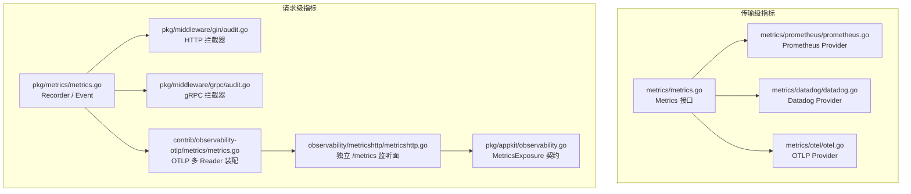
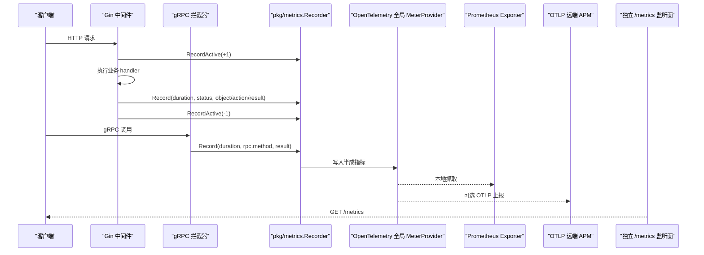
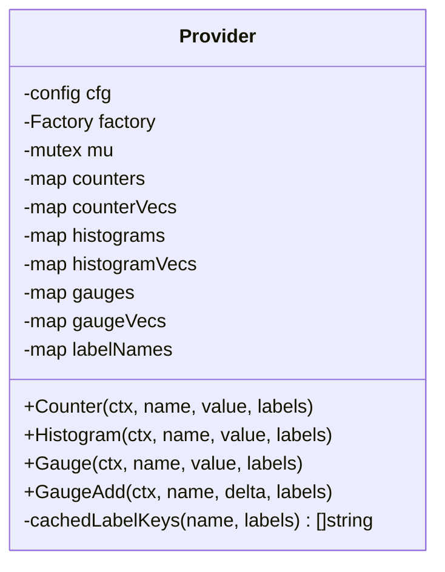
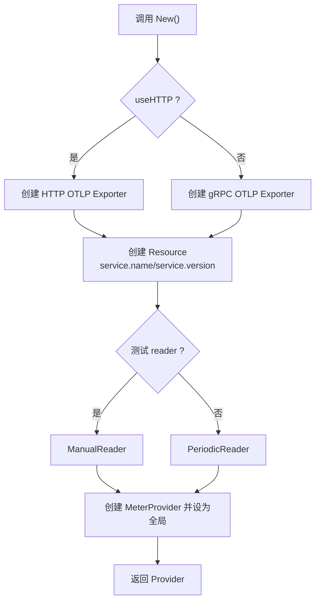
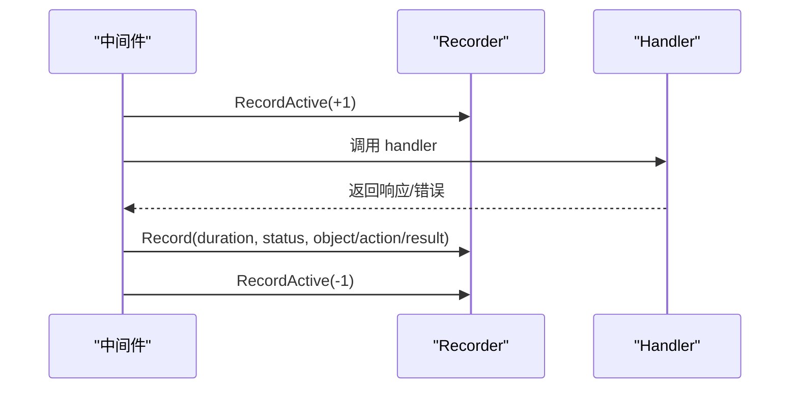
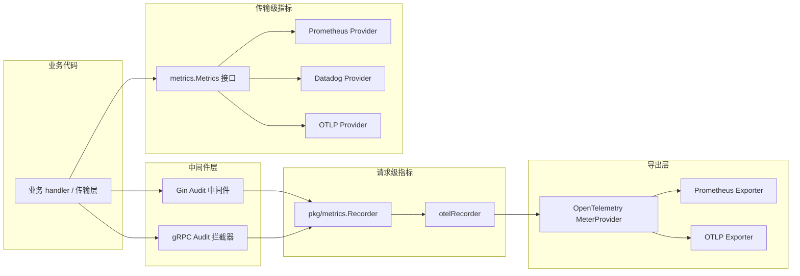

# 指标收集

<cite>
**本文引用的文件**   
- [metrics.go](file://metrics/metrics.go)
- [doc.go](file://metrics/doc.go)
- [prometheus.go](file://metrics/prometheus/prometheus.go)
- [datadog.go](file://metrics/datadog/datadog.go)
- [otel.go](file://metrics/otel/otel.go)
- [metricshttp.go](file://observability/metricshttp/metricshttp.go)
- [pkg metrics.go](file://pkg/metrics/metrics.go)
- [gin audit.go](file://pkg/middleware/gin/audit.go)
- [grpc audit.go](file://pkg/middleware/grpc/audit.go)
- [contrib otlp metrics.go](file://contrib/observability-otlp/metrics/metrics.go)
- [appkit observability.go](file://pkg/appkit/observability.go)
</cite>

## 目录
1. [引言](#引言)
2. [项目结构](#项目结构)
3. [核心组件](#核心组件)
4. [架构总览](#架构总览)
5. [详细组件分析](#详细组件分析)
6. [依赖关系分析](#依赖关系分析)
7. [性能与内存特性](#性能与内存特性)
8. [指标命名、标签与维度设计](#指标命名标签与维度设计)
9. [自定义埋点最佳实践](#自定义埋点最佳实践)
10. [存储策略、采样与内存优化](#存储策略采样与内存优化)
11. [监控平台对接与告警示例](#监控平台对接与告警示例)
12. [故障排查指南](#故障排查指南)
13. [结论](#结论)

## 引言
本仓的指标体系由两套并存但职责清晰的子系统组成：

- `metrics`（传输级）：面向 TCP 会话、消息队列消费循环、WebRTC 等没有“请求”语义的路径，提供手工埋点的 Counter/Histogram/Gauge 三原语，后端可在 Prometheus、Datadog、OpenTelemetry 之间选择。
- `pkg/metrics`（请求级）：面向 HTTP/gRPC 请求，通过中间件自动采集延迟、在途请求数、状态码及审计三元组；协议维度对齐 OTel semconv v1.43.0，默认以 OpenTelemetry 全局 MeterProvider 为桥接层。

二者可共存于同一进程，但不应混用：有“请求”语义走 `pkg/metrics`，无“请求”语义走 `metrics`。

**章节来源**
- [doc.go:1-37](file://metrics/doc.go#L1-L37)
- [pkg metrics.go:1-40](file://pkg/metrics/metrics.go#L1-L40)

## 项目结构
指标相关代码分布在以下位置：

**图表来源**
- [metrics.go:1-34](file://metrics/metrics.go#L1-L34)
- [prometheus.go:1-120](file://metrics/prometheus/prometheus.go#L1-L120)
- [datadog.go:1-152](file://metrics/datadog/datadog.go#L1-L152)
- [otel.go:1-120](file://metrics/otel/otel.go#L1-L120)
- [pkg metrics.go:1-80](file://pkg/metrics/metrics.go#L1-L80)
- [gin audit.go:1-60](file://pkg/middleware/gin/audit.go#L1-L60)
- [grpc audit.go:1-60](file://pkg/middleware/grpc/audit.go#L1-L60)
- [contrib otlp metrics.go:1-60](file://contrib/observability-otlp/metrics/metrics.go#L1-L60)
- [metricshttp.go:1-60](file://observability/metricshttp/metricshttp.go#L1-L60)
- [appkit observability.go:1-55](file://pkg/appkit/observability.go#L1-L55)

**章节来源**
- [metrics/metrics.go:1-34](file://metrics/metrics.go#L1-L34)
- [pkg/metrics/metrics.go:1-80](file://pkg/metrics/metrics.go#L1-L80)
- [observability/metricshttp/metricshttp.go:1-60](file://observability/metricshttp/metricshttp.go#L1-L60)

## 核心组件
本节聚焦指标抽象、注册机制与导出器抽象。

### 传输级指标抽象
`metrics.Metrics` 暴露四个方法：

| 方法 | 语义 | 典型用途 |
|---|---|---|
| `Counter(ctx, name, value, labels)` | 单调递增计数器 | 累计请求数、错误数、任务完成数 |
| `Histogram(ctx, name, value, labels)` | 直方图观测值 | 延迟、大小、批次数 |
| `Gauge(ctx, name, value, labels)` | 设置绝对值 | 当前队列深度、活跃连接数 |
| `GaugeAdd(ctx, name, delta, labels)` | 增量更新 | 并发窗口、正在处理的批次数 |

此外定义 `Closer` 接口，供持有后台导出 goroutine 或网络连接的实现优雅关闭。

**关键约束：** 同一 `name` 的 label key 集合必须在首次调用时确定并保持不变；Prometheus 后端会冻结维度，后续新增 key 会被静默丢弃。

**章节来源**
- [metrics.go:1-34](file://metrics/metrics.go#L1-L34)
- [doc.go:25-37](file://metrics/doc.go#L25-L37)

### 请求级 Recorder 抽象
`pkg/metrics.Recorder` 是请求级指标记录器，由中间件自动调用：

| 方法 | 参数 | 行为 |
|---|---|---|
| `Record(ctx, ev, transport, durationSeconds)` | 事件、传输类型、耗时秒数 | 按 transport 写协议延迟直方图，并写入审计事件计数器 |
| `RecordActive(ctx, ev, transport, delta)` | 事件、传输类型、±1 | 维护 `http.server.active_requests`，gRPC 侧不生效 |

`Event` 把审计三元组与协议维度解耦：对象、动作、结果、错误属于业务审计序列；`RequestInfo` 包含 Method/Scheme/Template/StatusCode/ServerAddr/ServerPort，用于 OTel semconv 协议指标。

默认返回 `NopRecorder()`，未配置具体后端时零副作用运行。

**章节来源**
- [pkg metrics.go:40-120](file://pkg/metrics/metrics.go#L40-L120)
- [pkg metrics.go:120-212](file://pkg/metrics/metrics.go#L120-L212)

### 导出器抽象与生命周期
`metrics.Closer` 抽象了需要 flush 或关闭资源的后端；`pkg/metrics` 默认基于 OpenTelemetry 全局 MeterProvider，本身不直接持有 exporter，真正的 OTLP/Prometheus 装配在 `contrib/observability-otlp/metrics` 中完成。

`observability/metricshttp.Server` 提供独立的 `/metrics` 监听面，实现 `appkit.MetricsExposure` 的 `Stop(ctx)` 契约，使指标暴露端与业务服务生命周期解耦。

**章节来源**
- [metrics.go:25-34](file://metrics/metrics.go#L25-L34)
- [contrib otlp metrics.go:90-158](file://contrib/observability-otlp/metrics/metrics.go#L90-L158)
- [metricshttp.go:1-60](file://observability/metricshttp/metricshttp.go#L1-L60)
- [appkit observability.go:25-55](file://pkg/appkit/observability.go#L25-L55)

## 架构总览
下图展示从中间件到指标导出的完整链路。

**图表来源**
- [gin audit.go:60-170](file://pkg/middleware/gin/audit.go#L60-L170)
- [grpc audit.go:60-150](file://pkg/middleware/grpc/audit.go#L60-L150)
- [pkg metrics.go:120-212](file://pkg/metrics/metrics.go#L120-L212)
- [contrib otlp metrics.go:90-158](file://contrib/observability-otlp/metrics/metrics.go#L90-L158)
- [metricshttp.go:20-60](file://observability/metricshttp/metricshttp.go#L20-L60)

## 详细组件分析

### 传输级 Prometheus Provider
Prometheus 后端使用 `client_golang`，支持两种注册方式：

- `New(opts...)`：使用私有 `prometheus.Registry`，适合隔离测试或子应用。
- `NewWithDefaultRegistry(opts...)`：使用 `prometheus.DefaultRegisterer`，配合标准 `promhttp.Handler()` 暴露 `/metrics`。

内部缓存结构如下：

| 字段 | 类型 | 作用 |
|---|---|---|
| `counters` | `map[string]prometheus.Counter` | 无 label 的计数器 |
| `counterVecs` | `map[string]*prometheus.CounterVec` | 带 label 的计数器 |
| `histograms` | `map[string]prometheus.Histogram` | 无 label 的直方图 |
| `histogramVecs` | `map[string]*prometheus.HistogramVec` | 带 label 的直方图 |
| `gauges` | `map[string]prometheus.Gauge` | 绝对值 gauge |
| `gaugeVecs` | `map[string]*prometheus.GaugeVec` | 带 label 的 gauge |
| `labelNames` | `map[string][]string` | 冻结的 label key 列表 |

首次写入某 `name` 时会根据传入 labels 构造 key 列表并缓存；后续相同 name 的调用复用已有 instrument，避免重复创建。

**图表来源**
- [prometheus.go:30-120](file://metrics/prometheus/prometheus.go#L30-L120)
- [prometheus.go:150-283](file://metrics/prometheus/prometheus.go#L150-L283)

**章节来源**
- [prometheus.go:1-120](file://metrics/prometheus/prometheus.go#L1-L120)
- [prometheus.go:150-283](file://metrics/prometheus/prometheus.go#L150-L283)

### 传输级 Datadog Provider
Datadog 后端基于 DogStatsD UDP 客户端，默认向 `127.0.0.1:8125` 发送指标。主要选项包括：

| 选项 | 默认值 | 说明 |
|---|---|---|
| `address` | `127.0.0.1:8125` | DogStatsD Agent 地址 |
| `namespace` | 空串 | 所有指标名前缀 |
| `bufferSize` | 0 | 单条发送，不聚合 |
| `flushPeriod` | 100ms | statsd 聚合间隔 |
| `sampleRate` | 1.0 | 采样率，1.0 表示全量 |

labels 被转换为 `key:value` 形式的 tags；`GaugeAdd` 通过 statsd 的 count 类型模拟增量语义。

注意：该实现不提供 Prometheus 原生直出能力，也不暴露 `/metrics`；若需 Prometheus，应改用 Prometheus Provider 或 OTLP 桥接。

**章节来源**
- [datadog.go:1-152](file://metrics/datadog/datadog.go#L1-L152)

### 传输级 OpenTelemetry Provider
OTLP Provider 通过 OTLP gRPC 或 HTTP 将指标发送到兼容 collector。它维护一个全局 `MeterProvider`，因此与 `contrib/observability-otlp/metrics.Setup` 互斥——不能同时初始化两个 OTLP Provider。

关键行为：

- 支持 gRPC 与 HTTP 两种 OTLP 传输。
- 默认 endpoint 为 `localhost:4317`，默认 export interval 为 60 秒。
- `Close()` 在超时时间内执行 `MeterProvider.Shutdown`，等待 flush。
- labels 转为 OTel attribute，作为指标维度。

**图表来源**
- [otel.go:60-160](file://metrics/otel/otel.go#L60-L160)
- [otel.go:260-274](file://metrics/otel/otel.go#L260-L274)

**章节来源**
- [otel.go:1-120](file://metrics/otel/otel.go#L1-L120)
- [otel.go:200-274](file://metrics/otel/otel.go#L200-L274)

### 请求级中间件自动采集

#### HTTP 路径
Gin 中间件在请求进入时提取 `RequestInfo`，先 `RecordActive(+1)`，再执行业务 handler，最后根据状态码推导 result，并调用 `Record` 输出协议延迟和审计事件计数。

自动采集的关键指标：

| 指标名 | 类型 | 维度 |
|---|---|---|
| `http.server.request.duration` | Histogram（单位秒） | method/scheme/template/status_code |
| `http.server.active_requests` | UpDownCounter | scheme/server.address/server.port |
| `bald_audit_events_total` | Counter | transport/object/action/result |

result 推导规则：

- 401 或 403 → `deny`
- ≥500 → `error`
- 其余 → `allow`

#### gRPC 路径
gRPC 拦截器在 handler 返回后判断 error：

- `PermissionDenied`（含 berrors 或 gRPC status）→ `deny`
- 其他 error → `error`
- nil → `allow`

自动采集的关键指标：

| 指标名 | 类型 | 维度 |
|---|---|---|
| `rpc.server.call.duration` | Histogram（单位秒） | rpc.system/rpc.method/rpc.response.status_code |
| `bald_audit_events_total` | Counter | transport/object/action/result |

gRPC 不维护 active_requests，因为 semconv 未定义该属性。

**图表来源**
- [gin audit.go:60-170](file://pkg/middleware/gin/audit.go#L60-L170)
- [grpc audit.go:60-150](file://pkg/middleware/grpc/audit.go#L60-L150)
- [pkg metrics.go:120-212](file://pkg/metrics/metrics.go#L120-L212)

**章节来源**
- [gin audit.go:1-200](file://pkg/middleware/gin/audit.go#L1-L200)
- [grpc audit.go:1-192](file://pkg/middleware/grpc/audit.go#L1-L192)
- [pkg metrics.go:120-212](file://pkg/metrics/metrics.go#L120-L212)

### OTLP 多 Reader 装配
`contrib/observability-otlp/metrics.Setup` 采用 OTel 多 Reader 模式：

1. 始终创建 Prometheus Exporter，作为本地抓取源。
2. 如果配置了 OTLP 地址，额外挂载 OTLP HTTP Exporter，直推远端 APM。
3. 合并 resource，设置 service.name。
4. 逐项追加 Reader，然后创建 `MeterProvider` 并设为全局。
5. 返回 `promhttp.Handler()` 作为 `/metrics` 处理器，以及 shutdown 函数。

这解释了为什么默认场景下 Prometheus 直出可用：即使业务只使用 `pkg/metrics`，只要经过 observability-otlp 的 Setup，就会注入 Prometheus Reader。

**章节来源**
- [contrib otlp metrics.go:1-158](file://contrib/observability-otlp/metrics/metrics.go#L1-L158)

### 指标暴露端生命周期
`observability/metricshttp.Start` 在独立端口启动 HTTP Server，默认地址 `:9091`，默认路径 `/metrics`。监听失败仅异步记日志，不会 panic，符合旁路语义。

`Stop(ctx)` 使用 `http.Server.Shutdown` 优雅停止，但不执行指标 flush；flush 归 MetricsProvider 的 shutdown 回调，由 appkit 引擎保证“先停暴露端，再 flush”。

**章节来源**
- [metricshttp.go:1-60](file://observability/metricshttp/metricshttp.go#L1-L60)
- [appkit observability.go:25-55](file://pkg/appkit/observability.go#L25-L55)

## 依赖关系分析

**图表来源**
- [gin audit.go:1-200](file://pkg/middleware/gin/audit.go#L1-L200)
- [grpc audit.go:1-192](file://pkg/middleware/grpc/audit.go#L1-L192)
- [pkg metrics.go:1-212](file://pkg/metrics/metrics.go#L1-L212)
- [metrics.go:1-34](file://metrics/metrics.go#L1-L34)
- [contrib otlp metrics.go:90-158](file://contrib/observability-otlp/metrics/metrics.go#L90-L158)

**章节来源**
- [pkg/metrics/metrics.go:1-212](file://pkg/metrics/metrics.go#L1-L212)
- [metrics/metrics.go:1-34](file://metrics/metrics.go#L1-L34)
- [contrib/observability-otlp/metrics/metrics.go:1-158](file://contrib/observability-otlp/metrics/metrics.go#L1-L158)

## 性能与内存特性

### Prometheus Provider
- 每个唯一 `(name, labelValues)` 组合对应一个 Prometheus 时间序列。
- label key 集合首次冻结，后续新增 key 被丢弃，防止维度爆炸。
- 无 label 路径直接使用单例 Counter/Histogram/Gauge，减少 map 查找与 WithLabelValues 开销。
- 并发安全通过 `sync.Mutex` 保护 instrument 缓存创建。

风险：高基数 label 值会导致 Prometheus 时序爆炸，增加 TSDB 内存和查询成本。

### Datadog Provider
- 基于 UDP 的 DogStatsD，默认不缓冲，每条指标立即发送。
- 可通过 `WithBufferSize` 和 `WithFlushPeriod` 控制 statsd 客户端聚合。
- `sampleRate` 可降采样，但需注意统计精度损失。

### OTLP Provider
- 指标由 SDK 周期性 flush，默认 60 秒一次。
- `Close()` 带 10 秒超时，避免进程退出阻塞。
- 全局 MeterProvider 只能被设置一次，后设覆盖前设。

### 请求级 Recorder
- 惰性创建 instruments，避免 main 构造期与 Provider 初始化顺序耦合。
- 指标记录是旁路：panic 被 recover 捕获，降级记日志，不阻断业务。
- gRPC 不维护 active_requests，减少无效维度。

**章节来源**
- [prometheus.go:120-283](file://metrics/prometheus/prometheus.go#L120-L283)
- [datadog.go:1-152](file://metrics/datadog/datadog.go#L1-L152)
- [otel.go:160-274](file://metrics/otel/otel.go#L160-L274)
- [pkg metrics.go:120-212](file://pkg/metrics/metrics.go#L120-L212)
- [gin audit.go:150-200](file://pkg/middleware/gin/audit.go#L150-L200)
- [grpc audit.go:150-192](file://pkg/middleware/grpc/audit.go#L150-L192)

## 指标命名、标签与维度设计

### 协议维度
请求级指标严格对齐 OTel semconv v1.43.0：

| 协议 | 指标 | 关键属性 |
|---|---|---|
| HTTP | `http.server.request.duration` | `http.request.method`、`url.scheme`、`url.template`、`http.response.status_code` |
| HTTP | `http.server.active_requests` | `url.scheme`、`server.address`、`server.port` |
| gRPC | `rpc.server.call.duration` | `rpc.system.name=grpc`、`rpc.method`、`rpc.response.status_code` |
| 审计 | `bald_audit_events_total` | `transport`、`object`、`action`、`result` |

### 传输级命名建议
- 使用有意义的英文名词短语，如 `tcp_connections_total`、`queue_depth`、`request_duration_seconds`。
- 对单调累加量使用 `_total` 后缀，便于识别计数器。
- 对延迟类指标使用 `_seconds` 或 `_milliseconds` 等单位后缀。
- label key 应稳定且低基数，例如 `status`、`topic`、`queue`、`method`、`route`。

### 维度选择对查询性能的影响
- **高基数 label**：如用户 ID、trace_id、随机请求 ID，会指数级增加时序数量。
- **不稳定 label**：动态拼接字符串作为 label 值，容易制造不可回收的时间序列。
- **过度拆分维度**：同时使用 method+template+status+version+region+shard 可能超出监控平台承载能力。
- **推荐做法**：把高基数字段放入 trace/span 或审计日志，而不是指标 label。

**章节来源**
- [pkg metrics.go:80-160](file://pkg/metrics/metrics.go#L80-L160)
- [doc.go:10-37](file://metrics/doc.go#L10-L37)

## 自定义埋点最佳实践

### 何时使用传输级 `metrics.Metrics`
适用于没有 HTTP/gRPC “请求”概念的场景：

- TCP 长连接数量与状态。
- MQ 消费者处理速率、堆积深度、重试次数。
- WebRTC 会话数、媒体流质量。
- 定时任务调度成功/失败次数。

### 计数器
适用场景：

- 累计调用次数、错误次数、支付成功笔数。
- 应该单调递增，不要回退。
- 如果需要“当前值”，优先使用 Gauge 或 GaugeAdd，而不是用计数器估算。

### 直方图
适用场景：

- 请求延迟、数据库查询耗时、外部 RPC 耗时。
- 文件大小、批量大小、重试间隔。
- 直方图支持分位数近似，适合观察尾部延迟。

### 摘要
当前仓库未暴露独立的 Summary 抽象；Prometheus Provider 使用 Histogram，OTLP Provider 使用 Histogram，Datadog Provider 也映射为 Histogram。如需分位数，应在下游监控系统或查询层计算。

### 埋点原则
- 每个指标必须有明确业务含义和单位。
- label key 集合必须固定，不能在运行时新增。
- 避免把 trace_id、user_id、tenant_id 这类高基数字段直接放入 label。
- 对并发状态使用 GaugeAdd，避免竞态下的绝对值覆盖问题。
- 对瞬时快照使用 Gauge，对趋势累计使用 Counter。

**章节来源**
- [metrics.go:1-34](file://metrics/metrics.go#L1-L34)
- [prometheus.go:150-283](file://metrics/prometheus/prometheus.go#L150-L283)
- [datadog.go:90-152](file://metrics/datadog/datadog.go#L90-L152)
- [otel.go:200-274](file://metrics/otel/otel.go#L200-L274)

## 存储策略、采样与内存优化

### Prometheus 直出模式
- 使用私有 Registry 时，需自行挂载 `promhttp.Handler()`。
- 使用默认 Registry 时，可直接接入标准 `/metrics`。
- 建议通过 namespace/subsystem 组织指标前缀，例如 `myapp_system_queue_depth`。
- 定期巡检高基数指标，发现异常 label 值及时下线或改为日志/追踪。

### Datadog Agent 集成
- 确保主机已安装并运行 Datadog Agent，DogStatsD 端口可达。
- 合理设置 buffer size 和 flush period，降低 UDP 丢包概率。
- 使用 sample rate 控制流量，但需验证业务统计是否可接受采样误差。
- 若需要分位数，应在 Datadog 查询层配置 percentile 计算。

### OpenTelemetry Metrics API 适配
- 推荐使用 `contrib/observability-otlp/metrics.Setup`，同时启用本地 Prometheus 与远端 OTLP。
- 若只使用 `metrics/otel`，注意其会独占全局 MeterProvider，与 observability-otlp 的 Setup 互斥。
- 调整 export interval，平衡延迟与吞吐。
- 进程退出前调用 `Close()`，避免尾批指标丢失。

### 内存占用优化
- 限制 label 基数：每个 name × labelValues 组合都会产生一个时间序列。
- 避免在高频路径上分配大量临时 map；必要时复用 label key/value。
- 对不需要实时可视化的指标，考虑只落审计日志或追踪，不写指标。
- 对 burst 流量，使用 batch exporter 或 statsd 聚合，避免每条指标都发网络请求。

**章节来源**
- [prometheus.go:1-120](file://metrics/prometheus/prometheus.go#L1-L120)
- [datadog.go:40-120](file://metrics/datadog/datadog.go#L40-L120)
- [otel.go:60-160](file://metrics/otel/otel.go#L60-L160)
- [contrib otlp metrics.go:90-158](file://contrib/observability-otlp/metrics/metrics.go#L90-L158)

## 监控平台对接与告警示例

### 对接 Prometheus
- 使用 Prometheus Provider 或 observability-otlp 的 Prometheus Reader。
- 暴露 `/metrics` 端点，允许 Prometheus 抓取。
- 建议将 namespace/subsystem 与业务模块对齐，便于按服务筛选。

推荐告警方向：

| 指标 | 告警条件 | 含义 |
|---|---|---|
| `http.server.request_duration_seconds_count` | 长时间段内增长异常缓慢 | 服务可能无请求或崩溃 |
| `http.server_request_duration_seconds_bucket` | p99/p95 持续升高 | 延迟退化 |
| `bald_audit_events_total` | deny 比例突然上升 | 鉴权/授权异常 |
| `rpc_server_call_duration_seconds_count` | 增长率异常 | gRPC 流量异常 |
| 自定义 queue_depth Gauge | 长期非零且持续增长 | 消费积压 |

### 对接 Datadog
- 确保 DogStatsD 可达，Agent 正常转发。
- 使用 tag 替代高基数 label。
- 结合 Datadog 的 SLO 和 dashboard 功能，按 service/tag 可视化。

推荐告警方向：

| 指标 | 告警条件 | 含义 |
|---|---|---|
| `requests_total` | 每分钟变化超过阈值 | 流量突变 |
| `request_duration_seconds` | 分布尾部持续扩大 | 慢请求增多 |
| `queue_depth` | 持续高于容量阈值 | 积压告警 |

### 对接 OpenTelemetry Collector 或 APM
- 使用 OTLP HTTP 或 gRPC 上报。
- 远端可以是 VictoriaMetrics、Grafana Cloud、Datadog OTLP receiver 或其他兼容系统。
- 通过 service.name、service.version 区分不同服务和版本。

**章节来源**
- [prometheus.go:1-60](file://metrics/prometheus/prometheus.go#L1-L60)
- [datadog.go:1-60](file://metrics/datadog/datadog.go#L1-L60)
- [otel.go:1-60](file://metrics/otel/otel.go#L1-L60)
- [contrib otlp metrics.go:60-158](file://contrib/observability-otlp/metrics/metrics.go#L60-L158)

## 故障排查指南

### 指标为空或未被抓取
- 检查是否正确挂载 `/metrics`。
- 确认 Prometheus Registry 是否为私有实例，且已传给 `promhttp.HandlerFor`。
- 确认 observability-otlp 的 Setup 是否被调用。

### Prometheus 维度缺失
- 同一 name 的 label key 集合必须恒定。
- 第一次调用时传入的 labels 决定最终维度，后续新增 key 会被丢弃。
- 排查是否在分支逻辑中动态增减 label key。

### OTLP 指标丢失
- 检查是否与 `metrics/otel.New` 和 `contrib/observability-otlp/metrics.Setup` 同时初始化，后者会覆盖前者。
- 检查 OTLP endpoint、TLS、header 配置。
- 检查进程退出时是否调用 Close/shutdown。

### 中间件未产出指标
- 确认 Gin/gRPC 中间件是否启用了 `AuditWithMetrics`。
- 确认 Recorder 不是 NopRecorder。
- 检查日志中是否有 recorder panicked 降级信息。

### 指标面启动失败不影响业务
这是预期行为：`metricshttp.Start` 监听失败仅异步记日志，不 panic。排查时查看框架日志，确认暴露端地址与路径。

**章节来源**
- [prometheus.go:120-180](file://metrics/prometheus/prometheus.go#L120-L180)
- [otel.go:160-274](file://metrics/otel/otel.go#L160-L274)
- [metricshttp.go:20-60](file://observability/metricshttp/metricshttp.go#L20-L60)
- [gin audit.go:150-200](file://pkg/middleware/gin/audit.go#L150-L200)
- [grpc audit.go:150-192](file://pkg/middleware/grpc/audit.go#L150-L192)

## 结论
Bald 指标体系通过两层抽象清晰划分职责：

- `pkg/metrics` 负责请求级自动采集，协议维度遵循 OTel semconv，审计事件与协议指标正交。
- `metrics` 负责传输级手工埋点，提供 Prometheus、Datadog、OTLP 三种后端，保持业务代码与导出实现解耦。
- `observability/metricshttp` 提供独立的指标暴露端，生命周期由 appkit 引擎管理，保证停机顺序正确。
- `contrib/observability-otlp/metrics` 提供多 Reader 装配，可同时保留本地 Prometheus 抓取与远端 OTLP 上报。

在实际工程中，应优先使用中间件自动采集协议指标，仅在无“请求”语义的路径上使用传输级埋点；严格控制 label 基数，避免把高维业务数据压进指标时序；并在进程退出前确保 exporter 和 MeterProvider 被正确 flush 和关闭。