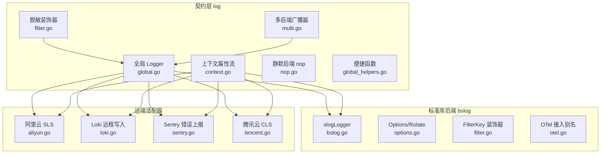
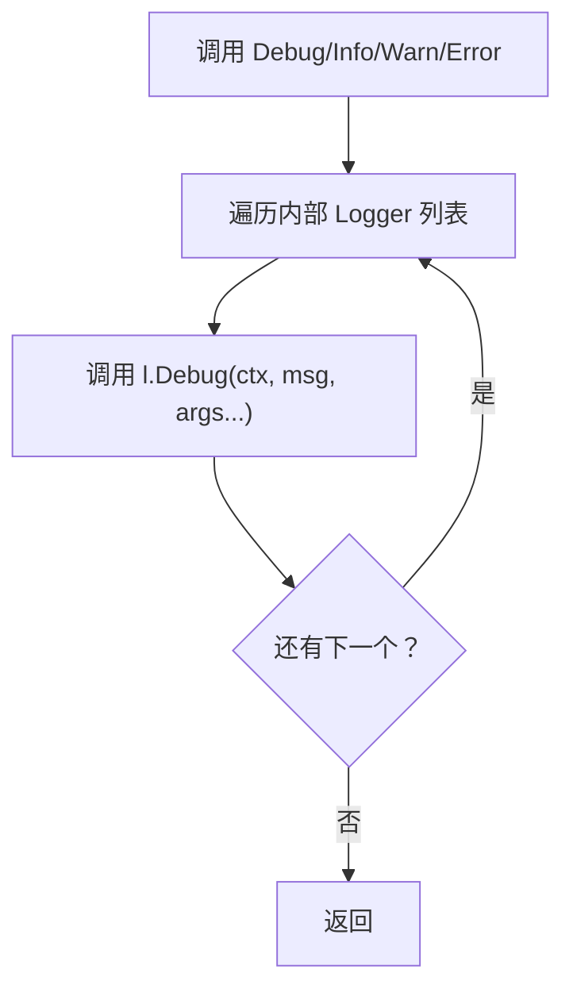
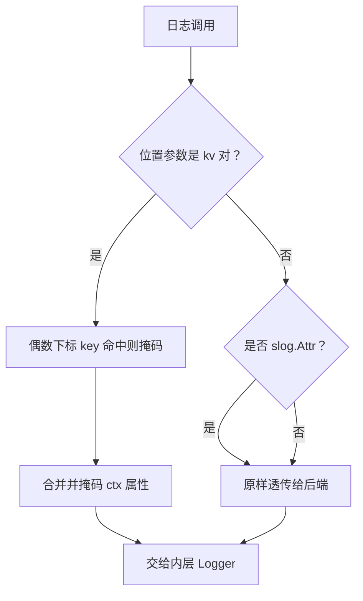
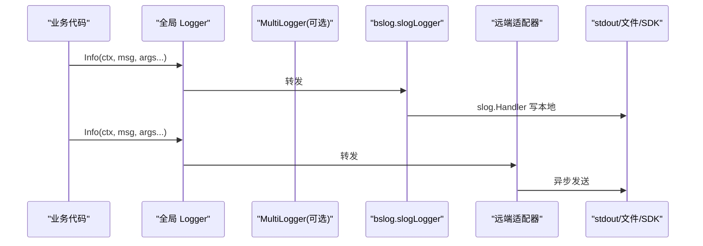
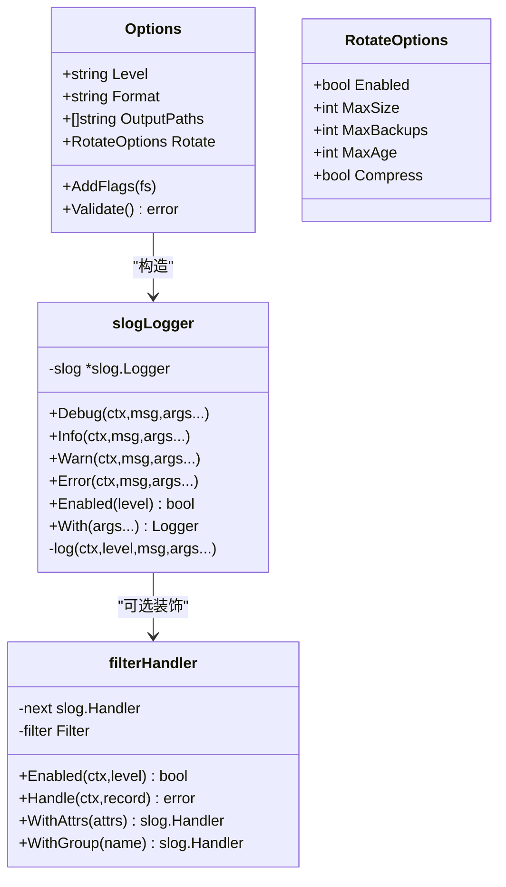
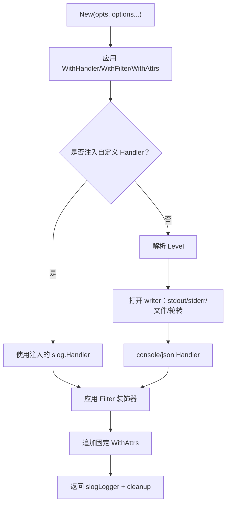
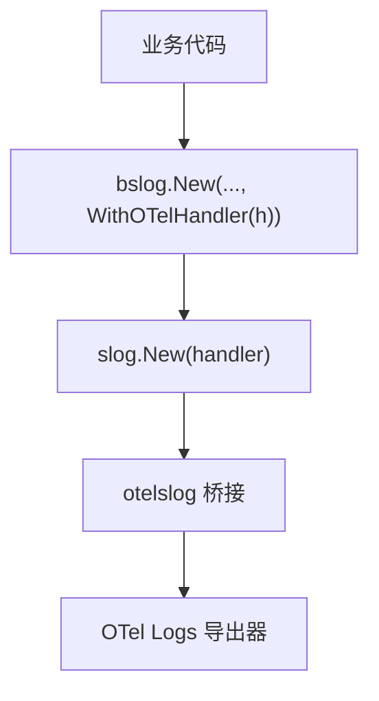
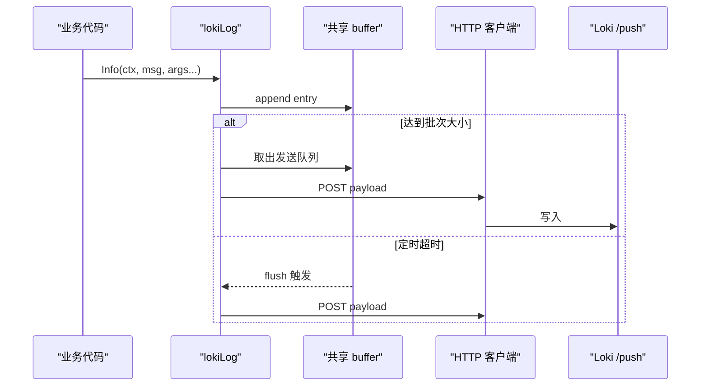
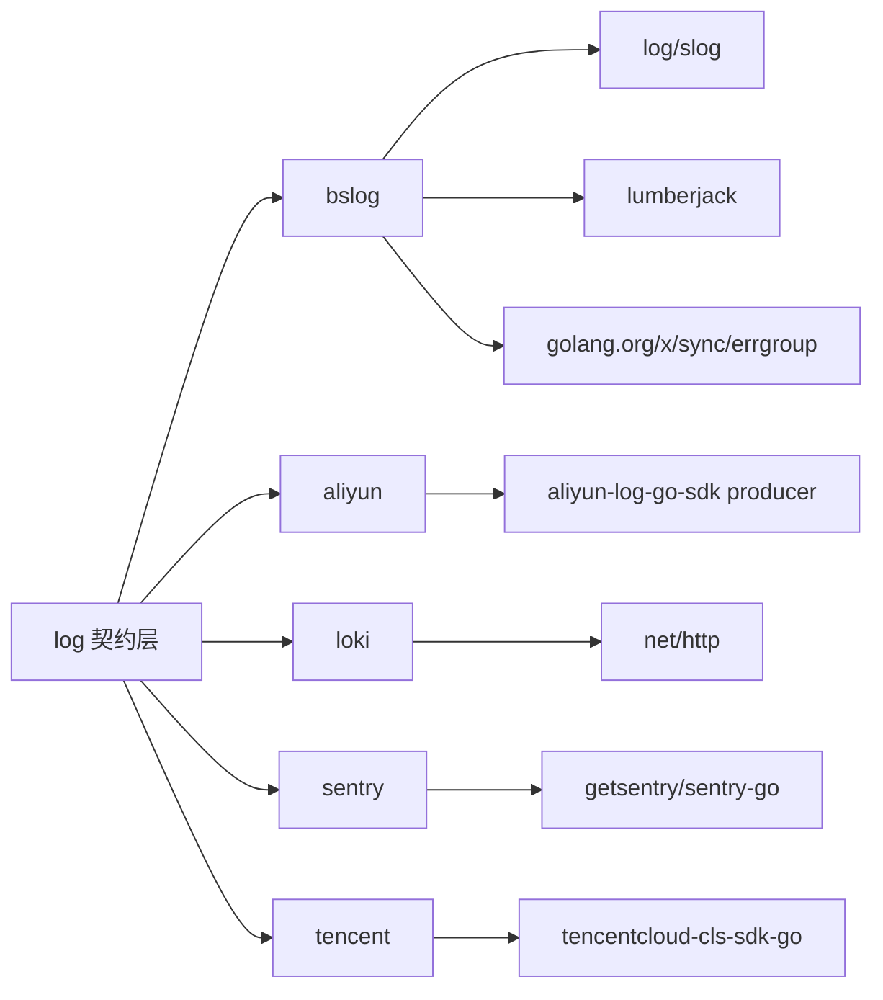
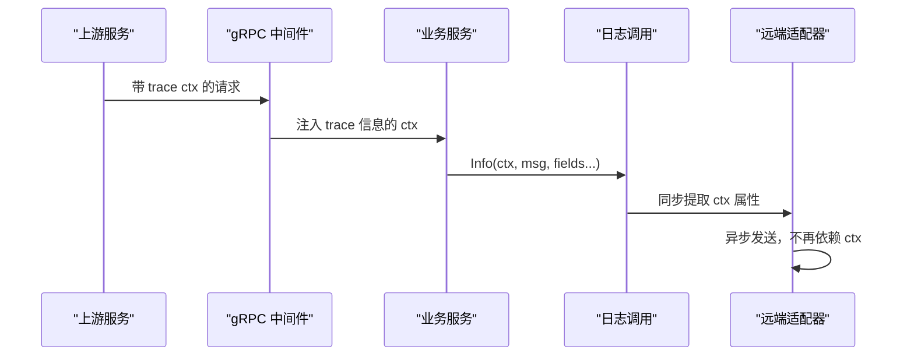

# 日志系统

<cite>
**本文引用的文件**   
- [log/doc.go](file://log/doc.go)
- [log/global.go](file://log/global.go)
- [log/context.go](file://log/context.go)
- [log/filter.go](file://log/filter.go)
- [log/multi.go](file://log/multi.go)
- [log/nop.go](file://log/nop.go)
- [log/global_helpers.go](file://log/global_helpers.go)
- [log/bslog/bslog.go](file://log/bslog/bslog.go)
- [log/bslog/options.go](file://log/bslog/options.go)
- [log/bslog/filter.go](file://log/bslog/filter.go)
- [log/bslog/otel.go](file://log/bslog/otel.go)
- [log/aliyun/aliyun.go](file://log/aliyun/aliyun.go)
- [log/aliyun/options.go](file://log/aliyun/options.go)
- [log/loki/loki.go](file://log/loki/loki.go)
- [log/loki/options.go](file://log/loki/options.go)
- [log/sentry/sentry.go](file://log/sentry/sentry.go)
- [log/sentry/options.go](file://log/sentry/options.go)
- [log/tencent/tencent.go](file://log/tencent/tencent.go)
- [log/tencent/options.go](file://log/tencent/options.go)
</cite>

## 目录
1. [引言](#引言)
2. [项目结构](#项目结构)
3. [核心组件](#核心组件)
4. [架构总览](#架构总览)
5. [详细组件分析](#详细组件分析)
6. [依赖关系分析](#依赖关系分析)
7. [性能与采样](#性能与采样)
8. [上下文与链路传播](#上下文与链路传播)
9. [故障排查指南](#故障排查指南)
10. [生产部署最佳实践](#生产部署最佳实践)
11. [结论](#结论)

## 引言
本仓库的日志子系统采用“契约层 + 具体后端”的分层设计：顶层 `log` 包仅声明接口、全局句柄、上下文属性流和多后端广播器，不引入任何具体日志库；`bslog` 是基于标准库 `log/slog` 的具体实现；`aliyun`、`loki`、`sentry`、`tencent` 是面向远端平台的适配器。默认后端为无输出的 `nopLogger`，由进程入口或框架装配期显式注入。

该设计满足三个目标：
- 可替换：业务代码只依赖 `log.Logger`，通过 `SetLogger` 切换实现。
- 可扩展：通过 `MultiLogger` 同时输出到本地与多个远端。
- 可观测：结构化字段、字段过滤、OpenTelemetry handler 接入均作为可选扩展点。

**章节来源**
- [log/doc.go:1-15](file://log/doc.go#L1-L15)

## 项目结构
`log` 包按职责拆分为六类文件：
- 契约与门面：`doc.go`、`global.go`、`global_helpers.go`、`nop.go`
- 上下文与装饰器：`context.go`、`filter.go`、`multi.go`
- 标准库后端：`bslog/*`
- 远端适配器：`aliyun/*`、`loki/*`、`sentry/*`、`tencent/*`

**图表来源**
- [log/global.go:1-28](file://log/global.go#L1-L28)
- [log/context.go:1-51](file://log/context.go#L1-L51)
- [log/filter.go:1-137](file://log/filter.go#L1-L137)
- [log/multi.go:1-73](file://log/multi.go#L1-L73)
- [log/nop.go:1-18](file://log/nop.go#L1-L18)
- [log/global_helpers.go:1-37](file://log/global_helpers.go#L1-L37)
- [log/bslog/bslog.go:1-259](file://log/bslog/bslog.go#L1-L259)
- [log/bslog/options.go:1-104](file://log/bslog/options.go#L1-L104)
- [log/bslog/filter.go:1-54](file://log/bslog/filter.go#L1-L54)
- [log/bslog/otel.go:1-26](file://log/bslog/otel.go#L1-L26)
- [log/aliyun/aliyun.go:1-179](file://log/aliyun/aliyun.go#L1-L179)
- [log/loki/loki.go:1-259](file://log/loki/loki.go#L1-L259)
- [log/sentry/sentry.go:1-157](file://log/sentry/sentry.go#L1-L157)
- [log/tencent/tencent.go:1-172](file://log/tencent/tencent.go#L1-L172)

**章节来源**
- [log/doc.go:1-15](file://log/doc.go#L1-L15)

## 核心组件
本节聚焦契约层五个关键构件：全局日志器、多后端聚合、字段过滤、上下文属性流和默认 nop。

### 全局日志器
- `SetLogger` 以读写锁保护全局 `Logger`，传入 `nil` 回退到 `nopLogger`。
- `GetLogger` 供所有子模块统一读取当前后端。
- 默认行为是零成本静默，避免在未装配时产生 I/O。

| 方法 | 作用 | 并发安全 | 副作用 |
|---|---|---|---|
| `SetLogger(l)` | 注入全局后端 | 是 | 可能改变后续调用行为 |
| `GetLogger()` | 返回当前后端 | 是 | 无 |
| `Debug/Info/Warn/Error(ctx, msg, args...)` | 便捷函数转发 | 依赖后端 | 可能落盘或网络发送 |

**章节来源**
- [log/global.go:1-28](file://log/global.go#L1-L28)
- [log/global_helpers.go:1-37](file://log/global_helpers.go#L1-L37)
- [log/nop.go:1-18](file://log/nop.go#L1-L18)

### 多后端聚合 MultiLogger
`MultiLogger` 把多条 `Logger` 组合为一个广播器：
- 每条日志顺序发给全部子后端；单个失败不影响其余。
- `Enabled(level)` 任一启用即启用，保守放行。
- `With(args...)` 对每个子后端分别 `With`，派生链独立。
- 空参数实例等价 nop，`Enabled` 恒为 false。

**图表来源**
- [log/multi.go:1-73](file://log/multi.go#L1-L73)

**章节来源**
- [log/multi.go:1-73](file://log/multi.go#L1-L73)

### 字段过滤机制
存在两套互补的过滤能力：

| 机制 | 位置 | 覆盖范围 | 适用场景 |
|---|---|---|---|
| `NewFilterLogger` | 契约层装饰器 | 位置参数 kv 对、`With` 派生 kv 对、ctx 属性流中的 slog.Attr key | 配置驱动的全后端脱敏 |
| `bslog.FilterKey` | `slog.Handler` 装饰器 | 任意 `slog.Attr`，包括 WithAttrs 固化属性 | 代码驱动的精细脱敏，仅 bslog 消费 |

注意：契约层过滤不会覆盖 `slog.Attr` 形式（例如 `Info(ctx, msg, slog.String("password", v))`），因为它是 `(string, value)` 偶数下标匹配逻辑无法识别的属性对象。需要两者叠加才能全覆盖。

**图表来源**
- [log/filter.go:1-137](file://log/filter.go#L1-L137)
- [log/bslog/filter.go:1-54](file://log/bslog/filter.go#L1-L54)

**章节来源**
- [log/filter.go:1-137](file://log/filter.go#L1-L137)
- [log/bslog/filter.go:1-54](file://log/bslog/filter.go#L1-L54)

### 上下文属性流
- `ContextWithAttrs` 将 `slog.Attr` 切片挂载到私有 `ctxKey`。
- `ContextAttrs` 从 ctx 取出属性序列。
- `ContextAttrsToArgs` 拍平为 `key, value, ...` 参数序列，供非 slog 后端低成本合并。

语义要点：
- 多次 `ContextWithAttrs` 会追加而非覆盖。
- 无属性时返回 nil，避免分配。
- 属性在构造日志条目时同步提取，之后异步 flush 不再持有 ctx。

**章节来源**
- [log/context.go:1-51](file://log/context.go#L1-L51)

## 架构总览
日志系统的调用路径分两条主线：

1. **契约层 → bslog（本地 slog）**  
   `log.Info` → `Global Logger` → `bslog.slogLogger` → `slog.Handler` → stdout/stderr/文件/lumberjack。

2. **契约层 → 远端适配器**  
   `log.Info` → `Global Logger` → `aliyun/sentry/loki/tencent` → SDK/HTTP 异步发送。

**图表来源**
- [log/global_helpers.go:1-37](file://log/global_helpers.go#L1-L37)
- [log/bslog/bslog.go:201-259](file://log/bslog/bslog.go#L201-L259)
- [log/aliyun/aliyun.go:1-179](file://log/aliyun/aliyun.go#L1-L179)
- [log/loki/loki.go:1-259](file://log/loki/loki.go#L1-L259)
- [log/sentry/sentry.go:1-157](file://log/sentry/sentry.go#L1-L157)
- [log/tencent/tencent.go:1-172](file://log/tencent/tencent.go#L1-L172)

**章节来源**
- [log/doc.go:1-15](file://log/doc.go#L1-L15)

## 详细组件分析

### bslog 核心实现
`bslog` 基于 `log/slog` 实现 `log.Logger`，并提供 Options、文件轮转、Handler 装饰器和 OTel 接入。

#### 结构与职责
| 类型/函数 | 职责 |
|---|---|
| `Options` | Level、Format、OutputPaths、Rotate 配置 |
| `RotateOptions` | lumberjack 文件大小、保留份数、保留天数、压缩 |
| `config` | New 的内部装配状态 |
| `slogLogger` | 实现 `log.Logger`，合并 ctx 属性后委派给 slog |
| `openWriter` | 解析 stdout/stderr/文件/轮转/多目标 |
| `multiWriterImpl` | 并发向多个 io.Writer 复制写入 |

**图表来源**
- [log/bslog/options.go:1-104](file://log/bslog/options.go#L1-L104)
- [log/bslog/bslog.go:1-259](file://log/bslog/bslog.go#L1-L259)
- [log/bslog/filter.go:1-54](file://log/bslog/filter.go#L1-L54)

#### 初始化流程

**图表来源**
- [log/bslog/bslog.go:1-200](file://log/bslog/bslog.go#L1-L200)

#### 输出与字段管理
`slogLogger.log` 在调用 slog 前检查 `log.ContextAttrs`，若存在则先拼接 ctx 属性再传给 slog；否则直接透传。这意味着：
- 结构化字段来自三部分：固定 `WithAttrs`、ctx 属性流、调用方 kv 参数。
- 最终顺序由 slog 处理链决定，但 ctx 属性会先于调用参数加入。

**章节来源**
- [log/bslog/bslog.go:1-259](file://log/bslog/bslog.go#L1-L259)
- [log/bslog/options.go:1-104](file://log/bslog/options.go#L1-L104)
- [log/bslog/filter.go:1-54](file://log/bslog/filter.go#L1-L54)

#### OpenTelemetry span 集成
OTel 接入遵循“契约不依赖 OTel”的原则：
- `WithOTelHandler(h)` 只是 `WithHandler(h)` 的语义别名。
- 调用方自行引入 `otelslog`，构造 `slog.Handler` 后注入。
- 级别与属性映射走 `slog.Record` → OTel log.Record 的标准桥接。

**图表来源**
- [log/bslog/otel.go:1-26](file://log/bslog/otel.go#L1-L26)

**章节来源**
- [log/bslog/otel.go:1-26](file://log/bslog/otel.go#L1-L26)

### 阿里云日志服务适配器
- 实现 `log.Logger`，并扩展 `GetProducer` 与 `Close`。
- 使用阿里云 SLS Go SDK 的 `producer.Producer` 异步发送。
- 字段组装顺序：固定 extra → ctx 属性 → 调用参数。
- `Enabled` 恒 true，级别控制不在适配器侧。

| 选项 | 说明 |
|---|---|
| `WithEndpoint(endpoint)` | SLS Producer Endpoint |
| `WithProject(project)` | 日志项目名 |
| `WithLogstore(logstore)` | 日志库名 |
| `WithAccessKey(accessKey)` | 访问密钥 ID |
| `WithAccessSecret(accessSecret)` | 访问密钥 Secret |
| `WithSecurityToken(securityToken)` | STS Token |

生命周期：
- `NewAliyunLogger` 创建并启动 Producer。
- `Close` 调用 `producer.Close(5000)` 等待缓冲刷出。

**章节来源**
- [log/aliyun/aliyun.go:1-179](file://log/aliyun/aliyun.go#L1-L179)
- [log/aliyun/options.go:1-56](file://log/aliyun/options.go#L1-L56)

### Loki 远程写入适配器
- 基于 Grafana Loki HTTP Push API `/loki/api/v1/push`。
- 共享缓冲区 + 批量推送：达到 `batchSize` 或 `flushInterval` 超时触发 flush。
- 所有 With 派生实例共享同一 `shared`，任一个 Close 都会冲刷全部待发日志。
- 字段组装顺序：固定 extra → ctx 属性 → 调用参数，最终 JSON 化存入 Loki line。

| 选项 | 默认值 | 说明 |
|---|---:|---|
| `endpoint` | 必填 | Loki Push 端点 |
| `labels` | `{app: default}` | Loki 流标签 |
| `batchSize` | 100 | 触发 flush 的条数阈值 |
| `flushInterval` | 5s | 刷新间隔 |
| `httpClient` | 内置 10s 超时客户端 | 自定义 HTTP 客户端 |

**图表来源**
- [log/loki/loki.go:1-259](file://log/loki/loki.go#L1-L259)

**章节来源**
- [log/loki/loki.go:1-259](file://log/loki/loki.go#L1-L259)
- [log/loki/options.go:1-66](file://log/loki/options.go#L1-L66)

### Sentry 错误上报适配器
- `Debug/Info/Warn` 记录为 breadcrumb。
- `Error` 上报为 Sentry Event，并附带堆栈。
- 字段合并顺序：extra → ctx 属性 → 调用参数，放入 `Event.Contexts`。
- `Close` 调用 `sentry.Flush(0)` 等待事件发送。

| 选项 | 默认值 | 说明 |
|---|---|---|
| `DSN` | 必填 | Sentry Data Source Name |
| `Environment` | development | 运行环境 |
| `Release` | 空 | 发布版本 |
| `ServerName` | 空 | 服务器名称标签 |

**章节来源**
- [log/sentry/sentry.go:1-157](file://log/sentry/sentry.go#L1-L157)
- [log/sentry/options.go:1-47](file://log/sentry/options.go#L1-L47)

### 腾讯云日志服务适配器
- 使用腾讯 CLS SDK 的 `AsyncProducerClient` 异步发送。
- 字段组装顺序：固定 extra → ctx 属性 → 调用参数。
- `Enabled` 恒 true。

| 选项 | 说明 |
|---|---|
| `WithEndpoint(endpoint)` | CLS 接入点 |
| `WithTopicID(topicID)` | 日志主题 ID |
| `WithAccessKey(accessKey)` | 访问密钥 ID |
| `WithAccessSecret(accessSecret)` | 访问密钥 Secret |

**章节来源**
- [log/tencent/tencent.go:1-172](file://log/tencent/tencent.go#L1-L172)
- [log/tencent/options.go:1-38](file://log/tencent/options.go#L1-L38)

## 依赖关系分析
契约层保持零三方依赖，具体后端各自引入生态库：

**图表来源**
- [log/bslog/bslog.go:1-259](file://log/bslog/bslog.go#L1-L259)
- [log/aliyun/aliyun.go:1-179](file://log/aliyun/aliyun.go#L1-L179)
- [log/loki/loki.go:1-259](file://log/loki/loki.go#L1-L259)
- [log/sentry/sentry.go:1-157](file://log/sentry/sentry.go#L1-L157)
- [log/tencent/tencent.go:1-172](file://log/tencent/tencent.go#L1-L172)

**章节来源**
- [log/doc.go:1-15](file://log/doc.go#L1-L15)

## 性能与采样

### 日志级别配置
bslog 的 `Options.Level` 支持 `debug|info|warn|error`，默认 `info`；非法值会回退为 `info` 以避免崩溃。`Enabled(level)` 委托给底层 slog，未达级别时短路。

建议：
- 开发环境使用 `debug`。
- 预发使用 `info`。
- 生产使用 `info` 或 `warn`，配合远端采集做降级。

**章节来源**
- [log/bslog/options.go:1-104](file://log/bslog/options.go#L1-L104)
- [log/bslog/bslog.go:201-259](file://log/bslog/bslog.go#L201-L259)

### 采样策略
当前实现没有内置概率采样器。采样应放在更上层：
- 通过 `Enabled(level)` 守卫昂贵参数构造。
- 使用 `MultiLogger` 只在高严重级别挂远端适配器。
- 使用 `NewFilterLogger` 丢弃敏感字段，降低远端体积。
- 若需概率采样，应在调用方封装一层 `Logger` 装饰器，而不是改动契约层。

### 性能优化建议
| 场景 | 建议 |
|---|---|
| 本地高频日志 | 使用 `json` 格式，减少 console 渲染开销 |
| 大文件落地 | 启用 `Rotate.Enabled=true`，合理设置 `MaxSize`、`MaxBackups`、`MaxAge` |
| 多输出 | 用 `multiWriter` 多目标写入，但注意并发写入开销 |
| 远端日志 | 使用 Loki 的 `batchSize` 与 `flushInterval` 平衡延迟与吞吐 |
| 敏感字段 | 同时使用契约层 `NewFilterLogger` 与 `bslog.WithFilter(FilterKey(...))` |
| 进程退出 | 调用远端适配器的 `Close`，确保缓冲落盘 |

**章节来源**
- [log/bslog/options.go:1-104](file://log/bslog/options.go#L1-L104)
- [log/bslog/bslog.go:1-200](file://log/bslog/bslog.go#L1-L200)
- [log/filter.go:1-137](file://log/filter.go#L1-L137)
- [log/loki/options.go:1-66](file://log/loki/options.go#L1-L66)

## 上下文与链路传播

### goroutine 间传递
通过 `ContextWithAttrs` 把结构化属性挂载到 `context.Context`，新 goroutine 继承该 ctx 后即可自动携带属性。属性在构造日志条目时同步提取，之后异步 flush 不再依赖 ctx。

### gRPC 调用中保持 trace context
契约层本身不感知 gRPC；trace context 的跨 RPC 传播由 gRPC 中间件负责把 trace 信息注入请求 ctx。只要业务把请求 ctx 传入日志调用，`bslog` 会把 ctx 属性传给 slog，远端适配器则通过 `ContextAttrsToArgs` 同步提取。

典型流程：

**图表来源**
- [log/context.go:1-51](file://log/context.go#L1-L51)
- [log/bslog/bslog.go:201-259](file://log/bslog/bslog.go#L201-L259)
- [log/aliyun/aliyun.go:1-179](file://log/aliyun/aliyun.go#L1-L179)
- [log/loki/loki.go:1-259](file://log/loki/loki.go#L1-L259)
- [log/sentry/sentry.go:1-157](file://log/sentry/sentry.go#L1-L157)
- [log/tencent/tencent.go:1-172](file://log/tencent/tencent.go#L1-L172)

### 与 OpenTelemetry 的关系
- `bslog.WithOTelHandler` 仅注入一个 `slog.Handler`；trace id、span id 等由 OTel bridge 负责序列化。
- 如果还需要 HTTP/gRPC 层自动注入 trace，应结合 observability 中间件把 trace 放入 ctx，再传给日志。

**章节来源**
- [log/bslog/otel.go:1-26](file://log/bslog/otel.go#L1-L26)
- [log/context.go:1-51](file://log/context.go#L1-L51)

## 故障排查指南

### 本地看不到日志
- 确认已调用 `SetLogger` 注入后端，或框架装配期已设置。
- 默认 `nopLogger` 永远不输出，`Enabled` 恒 false。
- 检查 `Options.Level` 是否高于实际日志级别。
- 检查 `OutputPaths` 是否为空；空时会报错，而非法路径会回退 stdout。

**章节来源**
- [log/nop.go:1-18](file://log/nop.go#L1-L18)
- [log/bslog/options.go:1-104](file://log/bslog/options.go#L1-L104)

### 远端日志缺失
- 阿里云/腾讯云：确认 `endpoint`、`project/topicID`、AK/SK 已配置，并在进程退出前调用 `Close`。
- Loki：确认 endpoint、label、`batchSize`、`flushInterval`；检查 HTTP 超时与网络连通性。
- Sentry：确认 DSN 非空，并调用 `Close` 或让主 goroutine 正常退出。

**章节来源**
- [log/aliyun/aliyun.go:1-179](file://log/aliyun/aliyun.go#L1-L179)
- [log/tencent/tencent.go:1-172](file://log/tencent/tencent.go#L1-L172)
- [log/loki/loki.go:1-259](file://log/loki/loki.go#L1-L259)
- [log/sentry/sentry.go:1-157](file://log/sentry/sentry.go#L1-L157)

### 敏感字段未被掩码
- 如果使用 `slog.Attr` 形式传参，契约层 `NewFilterLogger` 无法识别；需同时加 `bslog.WithFilter(FilterKey(key))`。
- 检查 key 是否为 string；只有偶数下标的 string key 才会被契约层过滤。

**章节来源**
- [log/filter.go:1-137](file://log/filter.go#L1-L137)
- [log/bslog/filter.go:1-54](file://log/bslog/filter.go#L1-L54)

### 文件轮转未生效
- 必须同时设置 `OutputPaths` 含文件路径且 `Rotate.Enabled=true`。
- `MaxSize` 必须大于 0。
- 父目录不存在时 bslog 会尝试 `MkdirAll`；若仍失败，文件路径打开失败会回退 stdout。

**章节来源**
- [log/bslog/options.go:1-104](file://log/bslog/options.go#L1-L104)
- [log/bslog/bslog.go:1-200](file://log/bslog/bslog.go#L1-L200)

## 生产部署最佳实践

### 推荐后端组合
| 用途 | 推荐方案 |
|---|---|
| 本地调试 | bslog，`format=json`，`output-paths=[stdout]` |
| 本地持久化 | bslog + lumberjack 轮转 |
| 集中采集 | Loki 或云厂商日志服务 |
| 错误追踪 | Sentry，Error 级别上报事件 |
| 多目的地 | `MultiLogger` 同时挂本地与远端 |

### 配置清单
- `log.level`：生产建议使用 `info` 或 `warn`。
- `log.format`：生产建议使用 `json`，便于索引。
- `log.output-paths`：至少包含 stdout；如需文件落地，指定绝对路径。
- `log.rotate.enabled`：生产建议开启。
- `log.rotate.max-size`：根据磁盘配额设置 MB。
- `log.rotate.max-backups`：保留历史数量。
- `log.rotate.max-age`：保留天数。
- `log.rotate.compress`：建议开启以节省空间。

### 生命周期管理
- 进程启动：构建 logger 并 `SetLogger`。
- 进程关闭：调用远端适配器的 `Close`，确保缓冲落盘。
- 热更新：优先使用 `NewWithCleanup`，由清理函数释放旧后端资源。

### 安全与合规
- 对密码、token、身份证等字段使用 `NewFilterLogger` 与 `FilterKey` 双重掩码。
- 不要把完整认证凭据写入日志，即使远端平台有鉴权。
- 对远端地址、DSN、AK/SK 使用环境变量或密钥管理服务注入。

**章节来源**
- [log/bslog/options.go:1-104](file://log/bslog/options.go#L1-L104)
- [log/filter.go:1-137](file://log/filter.go#L1-L137)
- [log/bslog/filter.go:1-54](file://log/bslog/filter.go#L1-L54)
- [log/aliyun/aliyun.go:1-179](file://log/aliyun/aliyun.go#L1-L179)
- [log/loki/loki.go:1-259](file://log/loki/loki.go#L1-L259)
- [log/sentry/sentry.go:1-157](file://log/sentry/sentry.go#L1-L157)
- [log/tencent/tencent.go:1-172](file://log/tencent/tencent.go#L1-L172)

## 结论
Bald 日志系统以契约层为核心，把全局日志器、多后端广播、字段过滤和上下文属性流解耦出来；`bslog` 提供开箱即用的标准库后端，四个远端适配器覆盖主流云与开源日志平台。生产环境建议以 `json` 输出、启用文件轮转，并通过 `MultiLogger` 同时保留本地可读性与远端可检索性；对敏感字段使用双轨过滤，对远端适配器保证 `Close` 调用，以兼顾性能、安全与可观测性。