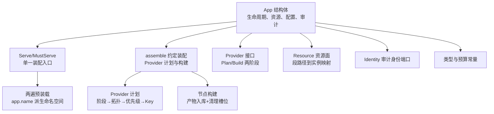
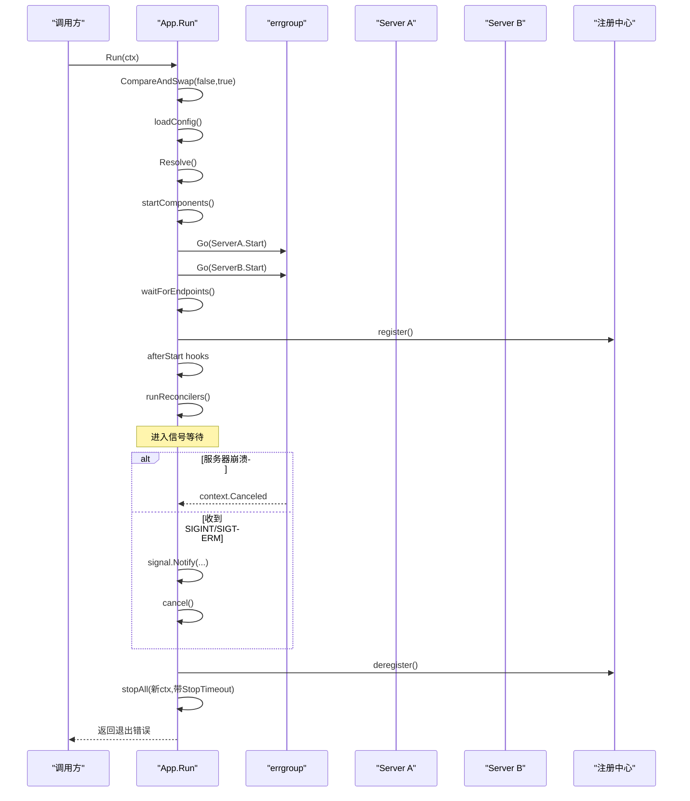
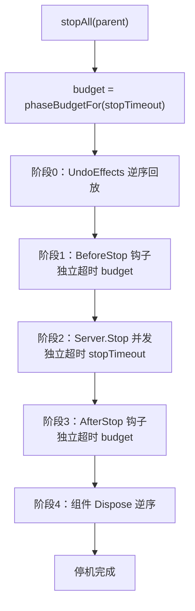
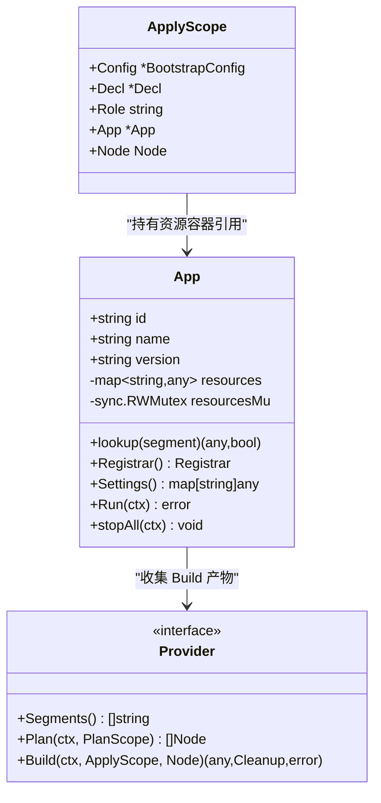
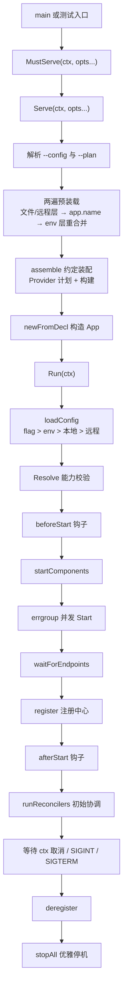
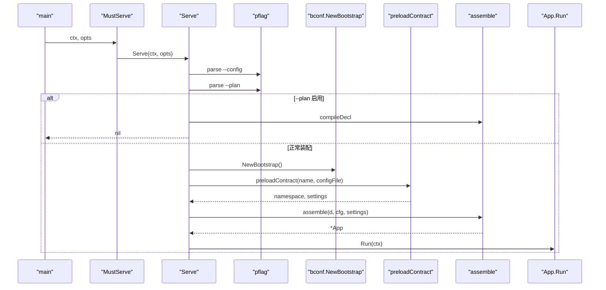
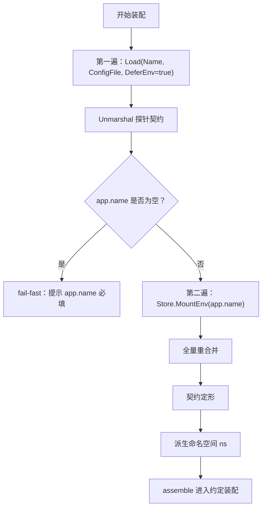
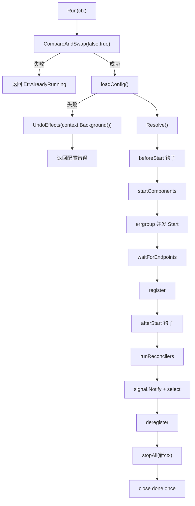
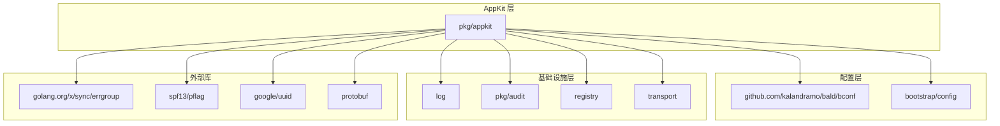

# AppKit 应用编排

<cite>
**本文引用的文件**   
- [pkg/appkit/doc.go](file://pkg/appkit/doc.go)
- [pkg/appkit/serve.go](file://pkg/appkit/serve.go)
- [pkg/appkit/bootstrap.go](file://pkg/appkit/bootstrap.go)
- [pkg/appkit/provider.go](file://pkg/appkit/provider.go)
- [pkg/appkit/resource.go](file://pkg/appkit/resource.go)
- [pkg/appkit/types.go](file://pkg/appkit/types.go)
- [pkg/appkit/appkit.go](file://pkg/appkit/appkit.go)
- [pkg/appkit/identity.go](file://pkg/appkit/identity.go)
</cite>

## 目录

1. [引言](#引言)
2. [项目结构](#项目结构)
3. [核心组件](#核心组件)
4. [架构总览](#架构总览)
5. [详细组件分析](#详细组件分析)
6. [依赖关系分析](#依赖关系分析)
7. [性能与资源特性](#性能与资源特性)
8. [故障排查指南](#故障排查指南)
9. [结论](#结论)

## 引言

AppKit 是 bald 框架的应用组合层，负责多协议服务器、注册中心、配置装载、Provider 装配、审计与可观测性的统一编排。它把「代码声明能力」和「配置驱动参数」解耦：业务通过 `Option` 与 Provider 契约描述需要哪些能力，AppKit 在启动期按段路径解析、排序并构建产物，运行期以 errgroup 并发启停，并以 StopTimeout 预算做优雅停机。

本包面向三类读者：

| 角色 | 关注点 | 建议阅读顺序 |
|---|---|---|
| 应用开发者 | `Serve` / `MustServe` 入口、命名空间、Provider 装配、错误处理 | 服务发现与网关出站 → Run 生命周期 → 示例 |
| 扩展作者 | Provider 接口、阶段划分、清理槽位、审计注入 | Provider 装配 → 资源容器 → 身份与审计 |
| 框架维护者 | App 字段语义、errgroup 级联停止、StopTimeout 派生、两遍预装载 | 核心组件 → 详细组件分析 → 依赖关系分析 |

## 项目结构

AppKit 位于 `pkg/appkit`，围绕一个核心结构体 `App` 组织：



**图示来源**   
- [pkg/appkit/appkit.go:1-100](file://pkg/appkit/appkit.go#L1-L100)
- [pkg/appkit/serve.go:1-60](file://pkg/appkit/serve.go#L1-L60)
- [pkg/appkit/bootstrap.go:1-60](file://pkg/appkit/bootstrap.go#L1-L60)
- [pkg/appkit/provider.go:1-60](file://pkg/appkit/provider.go#L1-L60)
- [pkg/appkit/resource.go:1-20](file://pkg/appkit/resource.go#L1-L20)
- [pkg/appkit/identity.go:1-30](file://pkg/appkit/identity.go#L1-L30)
- [pkg/appkit/types.go:1-22](file://pkg/appkit/types.go#L1-L22)

### 文件职责速览

| 文件 | 职责 | 关键概念 |
|---|---|---|
| `doc.go` | 包文档、生命周期钩子与扩展机制边界 | Effect、Component、Reconcile、OnKeyChange |
| `serve.go` | `Serve` / `MustServe`、`--config` 与 `--plan` 解析、两遍预装载 | 装配唯一入口、命名空间派生 |
| `bootstrap.go` | `assemble` 约定装配、Provider 计划执行、BeforeStart/AfterStop 组装 | 阶段 A/B、late、cleanup slots |
| `provider.go` | Provider 抽象、优先级、段路径工具 | Plan/Build、Segments、Override |
| `resource.go` | 统一资源查找、顶层段快照 | Key[T] 访问、RWMutex 保护 |
| `appkit.go` | App 结构体、Run、stopAll、loadConfig、Err/Done | errgroup、StopTimeout、防重入 |
| `identity.go` | 审计事件 Subject/TenantID 取值函数 | IdentityFunc、空身份 |
| `types.go` | 默认停机预算、阶段预算派生 | defaultStopTimeout、fallbackPhaseBudget |

**章节来源**   
- [pkg/appkit/doc.go:1-63](file://pkg/appkit/doc.go#L1-L63)
- [pkg/appkit/serve.go:1-180](file://pkg/appkit/serve.go#L1-L180)

## 核心组件

### App 结构体与 errgroup 生命周期

`App` 是应用编排的运行时载体，集中管理以下状态：

| 字段组 | 含义 | 并发安全策略 |
|---|---|---|
| 元数据 | id、name、version | 构造后只读 |
| 配置命名空间 | cfgNamespace，env 前缀与多环境文件名稳定标识 | 构造期写入，运行期只读 |
| 优雅停机预算 | stopTimeout，由契约 app.stop_timeout 或 StopTimeout Option 决定 | 只读 |
| 注册中心 | registrar | registrarMu 读写锁保护 |
| 服务器集合 | servers | 启动期追加，运行期只读 |
| HTTP handler | httpHandler | 构造期写入，运行期只读 |
| 资源容器 | resources map[string]any | resourcesMu RWMutex 保护 |
| 生命周期钩子 | beforeStart/afterStart/beforeStop/afterStop | 构造期追加，运行期只读 |
| 效应账本 | effects + effectsMu | 停机回放与失败回滚 |
| 能力声明 | provides/requires | 启动期 Resolve |
| 配置订阅 | keyWatchers | keyWatchMu 保护 |
| 协调器 | reconcilers/reconItems | reconMu 保护 |
| 计划与实际态 | plan/applied/nodeReconcilers | planMu RWMutex 保护 |
| 进程内组件 | components/start/disposed | startedMu 保护 |
| 审计身份 | identity | 构造后只读 |
| 审计后端 | auditor + auditorMu | 运行期可替换，RWMutex 保护 |
| 运行态标志 | running/done/doneOnce/startedCh | atomic.Bool + Once |

#### errgroup 并发启停

`Run` 使用 `errgroup.WithContext` 并发启动所有已注册的 `transport.Server`。任一服务器的 `Start` 返回非 nil 错误时，errgroup 会取消共享 gctx，从而级联触发其余服务器的停止流程。这个设计保证：

- 多个协议面（HTTP、gRPC、自定义 transport）可同时启动；
- 单个服务器初始化失败不会让其他服务器留在半启动状态；
- 启动失败路径调用 `stopAll`，按效应账本逆序回放、组件逆序 Dispose；
- 优雅停机传入未取消的新 ctx，使 StopTimeout 真正生效。



**图示来源**   
- [pkg/appkit/appkit.go:500-750](file://pkg/appkit/appkit.go#L500-L750)

**章节来源**   
- [pkg/appkit/appkit.go:1-120](file://pkg/appkit/appkit.go#L1-L120)
- [pkg/appkit/appkit.go:500-841](file://pkg/appkit/appkit.go#L500-L841)

### 优雅停机与 StopTimeout 预算分配

优雅停机由 `stopAll` 分五阶段执行：

| 阶段 | 行为 | 超时策略 |
|---|---|---|
| 0 | 效应账本逆序回放，撤销装配期全局写入 | 继承父 ctx |
| 1 | BeforeStop 钩子串行执行 | phaseBudgetFor(stopTimeout) |
| 2 | 各 Server.Stop 并发执行 | stopTimeout |
| 3 | AfterStop 钩子串行执行 | phaseBudgetFor(stopTimeout) |
| 4 | 组件 Dispose 逆序执行 | 继承父 ctx |

阶段预算由 `phaseBudgetFor` 从 stopTimeout 派生：取一半，且不低于 fallbackPhaseBudget。这样总停机时间不随阶段数线性膨胀；调大 stop_timeout 同时放大端点等待、钩子、组件启停等阶段的预算。



**图示来源**   
- [pkg/appkit/appkit.go:750-841](file://pkg/appkit/appkit.go#L750-L841)
- [pkg/appkit/types.go:1-22](file://pkg/appkit/types.go#L1-L22)

**章节来源**   
- [pkg/appkit/appkit.go:750-841](file://pkg/appkit/appkit.go#L750-L841)
- [pkg/appkit/types.go:1-22](file://pkg/appkit/types.go#L1-L22)

### Provider 产物收集与资源容器并发安全

Provider 的 Build 产物通过统一资源面存入 App.resources。资源存取遵循以下规则：

| 访问方式 | 键形式 | 返回值语义 |
|---|---|---|
| 子段精确路径 | `"database.sql"` | 该 Provider 产物的原始值 |
| 顶层段 | `"database"` | 同前缀子段的副本快照 map[string]any |
| registry/audit 整产物段 | `"registry"`、`"audit"` | 产物本身 |
| 第三方表外段 | 无 map 产物时落 `<顶层段>` | 与引擎 storeProduct 约定一致 |

资源容器的并发安全由 `resourcesMu` 保障：

- 启动期阶段 B 与热更新路径写入；
- 请求路径上的审计事件、调试查询可能读取；
- lookup 先尝试精确键，再扫描前缀聚合快照；
- 顶层段读取返回副本，避免暴露内部 map；
- tracer/metrics 等刻意不落资源面的产物，由 Provider 自持 cleanup 槽位。



**图示来源**   
- [pkg/appkit/appkit.go:1-120](file://pkg/appkit/appkit.go#L1-L120)
- [pkg/appkit/provider.go:1-120](file://pkg/appkit/provider.go#L1-L120)
- [pkg/appkit/resource.go:1-63](file://pkg/appkit/resource.go#L1-L63)

**章节来源**   
- [pkg/appkit/provider.go:1-120](file://pkg/appkit/provider.go#L1-L120)
- [pkg/appkit/resource.go:1-63](file://pkg/appkit/resource.go#L1-L63)

## 架构总览

AppKit 的装配与运行流程可概括为：



**图示来源**   
- [pkg/appkit/serve.go:1-180](file://pkg/appkit/serve.go#L1-L180)
- [pkg/appkit/bootstrap.go:200-500](file://pkg/appkit/bootstrap.go#L200-L500)
- [pkg/appkit/appkit.go:500-841](file://pkg/appkit/appkit.go#L500-L841)

**章节来源**   
- [pkg/appkit/serve.go:1-180](file://pkg/appkit/serve.go#L1-L180)
- [pkg/appkit/bootstrap.go:1-120](file://pkg/appkit/bootstrap.go#L1-L120)
- [pkg/appkit/appkit.go:500-841](file://pkg/appkit/appkit.go#L500-L841)

## 详细组件分析

### Serve 与 MustServe：单一装配入口

`Serve` 是 AppKit 唯一的装配入口，`MustServe` 是其 main 专用薄壳：失败记日志后以非零码退出。

#### 入口工作流程

| 步骤 | 行为 | 关键约束 |
|---|---|---|
| 1 | 用 `newDecl(opts...)` 汇总 Option 声明 | nil Option 跳过 |
| 2 | `parseConfigFlag` 解析 `--config` | ContinueOnError + 未知 flag 白名单 |
| 3 | `parsePlanFlag` 检查 `--plan` / `--plan-format` | 打印装配计划后返回 nil，退出码 0 |
| 4 | `preloadContract` 两遍预装载 | 第一遍 DeferEnv，第二遍 MountEnv |
| 5 | `assemble` 约定装配 | Provider 计划、阶段 A/B、cleanup slots |
| 6 | `recordPlanCache` 记录本地基线计划 | 失败只告警 |
| 7 | `a.Run(ctx)` 启动运行期 | 信号处理内建于 Run |



**图示来源**   
- [pkg/appkit/serve.go:1-180](file://pkg/appkit/serve.go#L1-L180)

**章节来源**   
- [pkg/appkit/serve.go:1-180](file://pkg/appkit/serve.go#L1-L180)

#### --config 与 --plan 解析语义

- `--config`：默认值来自 Decl.ConfigFile；解析结果写回 ConfigFile，使 Run 期的 loadConfig 与预装载命中同一文件；
- `--plan`：在任何副作用之前编译装配计划，text 或 json 输出；
- 两者都使用独立的 pflag.FlagSet，UnknownFlags 白名单允许 cobra 或其他 CLI 消费自身 flag；
- 解析失败不阻断启动，由各自消费方报错。

**章节来源**   
- [pkg/appkit/serve.go:60-180](file://pkg/appkit/serve.go#L60-L180)

### 配置命名空间的两阶段合并

配置命名空间是环境变量前缀与多环境文件名来源，由契约 app.name 派生，不再提供显式声明口。

#### 两遍预装载

| 遍次 | 装载范围 | 目的 |
|---|---|---|
| 第一遍 | 本地文件 + 远程层，DeferEnv | Unmarshal 探针契约，解析 app.name |
| 第二遍 | Store.MountEnv(app.name) 挂载 env 层 | 全量重合并，使 env 覆盖生效 |

#### 自指消解

env 前缀在 env 层挂载前已从文件层定死；配置文件里的 app.name 不再改变「能读到哪些环境变量」。现有用户的 NAME_ 前缀环境变量保持原样生效。

#### 文件与环境发现规则

- 无 `--config` 时，本地文件发现以 Name Option 为键，缺省值为 `bald-app`；
- 有 `--config` 时，按显式路径加载；
- 本地文件缺失且未显式声明路径时，discoverLocalFile 静默跳过；
- 显式路径缺失则 fail-fast；
- 无 app.name 即 fail-fast，错误明确指向必填字段；
- 多环境文件名由 `Name-Env.yaml` 规则派生，例如 `bald-demo-prod.yaml`。



**图示来源**   
- [pkg/appkit/serve.go:100-180](file://pkg/appkit/serve.go#L100-L180)

**章节来源**   
- [pkg/appkit/serve.go:100-180](file://pkg/appkit/serve.go#L100-L180)

### Run 方法：防重入、信号处理与审计注入

#### 防重入保护

Run 使用 `running.CompareAndSwap(false, true)` 作为第一道门：

- 重复调用直接返回 `ErrAlreadyRunning`；
- 防重入判断放在 loadConfig 之前，但 loadConfig 本身也受保护——若放在 CAS 之前，两个并发 Run 会并发写 pflag 绑定的 cfgFile 地址与 a.cfg.store；
- 配置加载失败时归还 running，但不 close done，避免 double close；
- done channel 由 doneOnce 保证只关闭一次，误用重试退化为无副作用操作。

#### 信号处理内建逻辑

Run 内部注册 SIGINT 与 SIGTERM：

- 收到信号时记录日志并主动 cancel 共享 ctx；
- errgroup 因服务器崩溃或 ctx 取消也会结束 select；
- 优雅停机前先 deregister，避免流量打到已停服务；
- stopAll 传入未取消的新 ctx，使 StopTimeout 生效。

#### 进程身份端口与审计事件注入

- identity 是从 ctx 提取 subject/tenant 的函数，nil 表示空身份；
- 审计后端 auditor 可由契约 audit 段兜底注入，也可由应用显式注入；
- buildInstance 聚合 server Endpoint，只收集可注册地址（host 含端口），过滤 cron 等进程内组件的描述性 endpoint；
- registrableEndpoint 提前过滤无端口地址，避免 nacos/etcd 等注册中心的 SplitHostPort 报错导致启动失败。



**图示来源**   
- [pkg/appkit/appkit.go:500-841](file://pkg/appkit/appkit.go#L500-L841)
- [pkg/appkit/identity.go:1-30](file://pkg/appkit/identity.go#L1-L30)

**章节来源**   
- [pkg/appkit/appkit.go:500-841](file://pkg/appkit/appkit.go#L500-L841)
- [pkg/appkit/identity.go:1-30](file://pkg/appkit/identity.go#L1-L30)

### 简单 main 到复杂多 Provider 装配

#### 简单示例：单协议面

典型最小用法：

```go
func main() {
    appkit.MustServe(context.Background(),
        appkit.Name("demo-api"),
        appkit.WithHTTP(handler),
    )
}
```

这里 `MustServe` 完成 `--config` 解析、两遍预装载、约定装配、Run。业务只需声明 HTTP handler；server.http 段由契约提供。

#### 多 Provider 示例：数据库、缓存、gRPC、审计

复杂场景下，业务通过 Provider 声明数据库、缓存、存储、审计、AI、工作流等能力：

```go
func main() {
    appkit.MustServe(context.Background(),
        appkit.Name("bald-demo-api"),
        appkit.Version("v1"),
        appkit.WithGRPC(registerGreet),
        appkit.WithHTTP(ginHandler),
        appkit.Providers(
            storegorm.AppProvider(),
            storemongo.AppProvider(),
            cacheRedis.AppProvider(),
            auditStream.AppProvider(),
        ),
    )
}
```

约定装配会把这些 Provider 按段路径解析、排序、构建，并把产物存入 App.resources。消费侧通过 Key[T] 或 Provider 导出的 Resource 句柄获取实例。

#### 错误处理与恢复策略

| 阶段 | 失败行为 | 恢复方式 |
|---|---|---|
| 预装载 app.name 缺失 | fail-fast | 在 `--config` 对应文件中设置 bootstrap.app.name |
| Provider Plan 冲突 | I4 裁决：唯一 Override + Reason 胜出，其余失败 | 调整 Provider 声明或优先级 |
| Provider Build 失败 | fail-fast，回滚已构建节点 | 修复 Provider 构建逻辑 |
| beforeStart 失败 | 回滚 T1 效应账本 | 修复钩子或下游依赖 |
| server Start 失败 | 级联停止其余服务器 | 修复监听地址、TLS、依赖 |
| register 失败 | deregister + stopAll | 修复注册中心连接 |
| afterStart 失败 | 反注册 + stopAll | 修复就绪后钩子 |
| 优雅停机阶段 | panic 隔离，记录错误 | 调大 StopTimeout |

**章节来源**   
- [pkg/appkit/serve.go:1-180](file://pkg/appkit/serve.go#L1-L180)
- [pkg/appkit/bootstrap.go:200-500](file://pkg/appkit/bootstrap.go#L200-L500)
- [pkg/appkit/provider.go:1-120](file://pkg/appkit/provider.go#L1-L120)

## 依赖关系分析

AppKit 的模块依赖呈现清晰的分层：



**图示来源**   
- [pkg/appkit/appkit.go:1-60](file://pkg/appkit/appkit.go#L1-L60)

### 根 module 不得 require 适配器

根 module 不 require 任何适配器；`*/contract` 包只放契约装配、不 import 具体后端，具体后端留在适配器包。AppKit 通过 transport.Server 与 registry.Registrar 的最小接口解耦具体传输与注册实现，避免模块环。

### Provider 装配依赖链


**图示来源**   
- [pkg/appkit/provider.go:1-120](file://pkg/appkit/provider.go#L1-L120)
- [pkg/appkit/bootstrap.go:200-500](file://pkg/appkit/bootstrap.go#L200-L500)

**章节来源**   
- [pkg/appkit/appkit.go:1-120](file://pkg/appkit/appkit.go#L1-L120)
- [pkg/appkit/provider.go:1-120](file://pkg/appkit/provider.go#L1-L120)

## 性能与资源特性

### 启动期开销控制

- 两遍预装载仅在 Serve 路径执行，第一次仅用于探测 app.name，第二次才挂载 env 层；
- 预装载 store 无 watch，Unmarshal 后立即释放；
- 计划缓存仅记录本地文件基线，失败只告警，不作为执行依据；
- Provider.Plan 必须是纯函数，禁止 I/O；
- --plan 复用真实装配的 compileDecl，预检错误在启动前暴露。

### 优雅停机可扩展性

StopTimeout 是唯一可调入口，stop_timeout 契约或 StopTimeout Option 同时影响：

- waitForEndpoints 轮询上界；
- beforeStop/afterStop 钩子阶段预算；
- 各 Server.Stop 的共享超时；
- 组件 Start/Dispose 的阶段预算。

这避免了此前每个阶段各自硬编码 5s 上限导致的慢 broker transport 或慢钩子无法调整的问题。

### 资源容器遍历优化

顶层段读取返回副本快照，沿用原 Databases()/Ais() 的既有取舍：调用方可安全遍历或留存快照，不暴露内部 map。对于频繁遍历的场景，建议使用 Key[T] 精确访问而非反复扫描 resources。

**章节来源**   
- [pkg/appkit/serve.go:100-180](file://pkg/appkit/serve.go#L100-L180)
- [pkg/appkit/types.go:1-22](file://pkg/appkit/types.go#L1-L22)
- [pkg/appkit/resource.go:1-63](file://pkg/appkit/resource.go#L1-L63)

## 故障排查指南

### 常见启动失败与定位

| 现象 | 可能原因 | 排查动作 |
|---|---|---|
| 启动直接报 app.name 必填 | 配置文件未设置 bootstrap.app.name | 检查 `--config` 指向的文件 |
| 环境变量前缀不对 | Name 与 app.name 不一致 | 确认命名空间由 app.name 派生 |
| WithHTTP 但 server.http 为空 | 契约缺少 server.http 段 | 在配置中声明 server.http |
| WithGRPC 但 server.grpc 为空 | 契约缺少 server.grpc 段 | 在配置中声明 server.grpc |
| health 探针路径相同 | live/ready 路径冲突 | 修改健康探针路径 |
| 同时声明 WithHTTP 与 grpc-gateway provider | driver 未显式 | 设置 server.http.driver = grpc-gateway |
| 服务发现拿到无效地址 | Endpoint 仍为 :0 | 检查 waitForEndpoints 是否超时 |
| 注册中心报 missing port in address | 进程内组件 endpoint 被注册 | 检查 buildInstance 的 registrableEndpoint 过滤 |
| 重复 Run 报错 | 同一 App 实例再次启动 | 确保每个二进制只有一个 App 实例 |
| 优雅停机过早放弃 | stopAll 传入了已取消 ctx | 确认优雅停机路径使用未取消新 ctx |
| 审计事件没有 subject/tenant | 未注入 Identity | 通过 Identity Option 提供取值函数 |

### 配置合并优先级

配置层优先级从高到低：

1. 业务 flag（必须经 Bind 注册进 App FlagSet）
2. 环境变量（NAME_* 前缀）
3. 本地文件（--config 或 Name-Env.yaml）
4. 远程配置中心（RemoteSource 基准层）

注意：Bind 不是简单注册到 pflag.CommandLine，而是进入 App 的 FlagSet，再由 loadConfig 交给配置装载器落到 flag 层。自行 AddFlags 会导致同一配置有两处注册源，语义重复。

### 集成测试与真后端

注入真后端的用例应写成「不可达即跳过」，因此集成作业需两档兜底：先 TCP 探活，末尾逐条断言判据真的出现 PASS。只跑套件那一步会静默绿，因为 skip 路径 exit=0。

**章节来源**   
- [pkg/appkit/serve.go:60-180](file://pkg/appkit/serve.go#L60-L180)
- [pkg/appkit/appkit.go:500-841](file://pkg/appkit/appkit.go#L500-L841)
- [pkg/appkit/doc.go:1-63](file://pkg/appkit/doc.go#L1-L63)

## 结论

AppKit 的应用编排以 `App` 为中心，围绕三条主线组织：

1. **装配主线**：`Serve` 统一入口 → `--config` 解析 → 两遍预装载 → 命名空间派生 → Provider 计划与构建 → `Run`；
2. **生命周期主线**：errgroup 并发启停 → 信号处理 → 反注册 → 五阶段优雅停机 → done 通道关闭；
3. **资源主线**：Provider.Build 产物 → App.resources 段路径映射 → Key[T] 安全访问 → cleanup 槽位停机回收。

对使用者而言，最重要的实践是：

- 始终通过 `appkit.MustServe` 或 `appkit.Serve` 启动；
- 在配置中声明 bootstrap.app.name，让命名空间自动派生；
- 通过 Provider 声明数据库、缓存、审计等能力，而不是手写全局初始化；
- 将业务 flag 通过 Bind 注册，使其参与配置合并最高优先级；
- 用 StopTimeout 或契约 app.stop_timeout 统一控制优雅停机预算；
- 通过 Identity 注入审计身份，使组件挂载、协调收敛等运行期事件具备业务上下文。