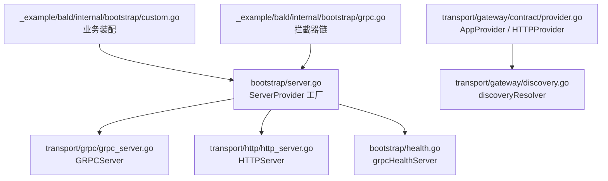
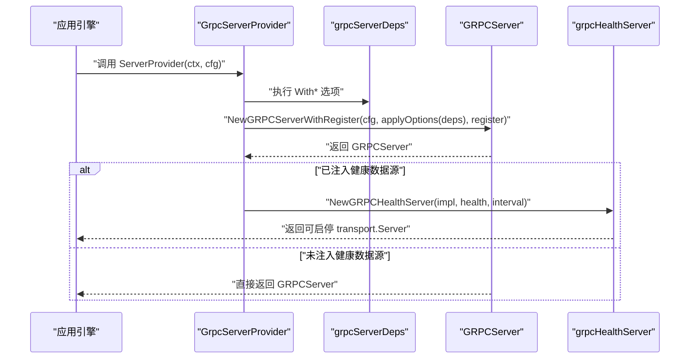
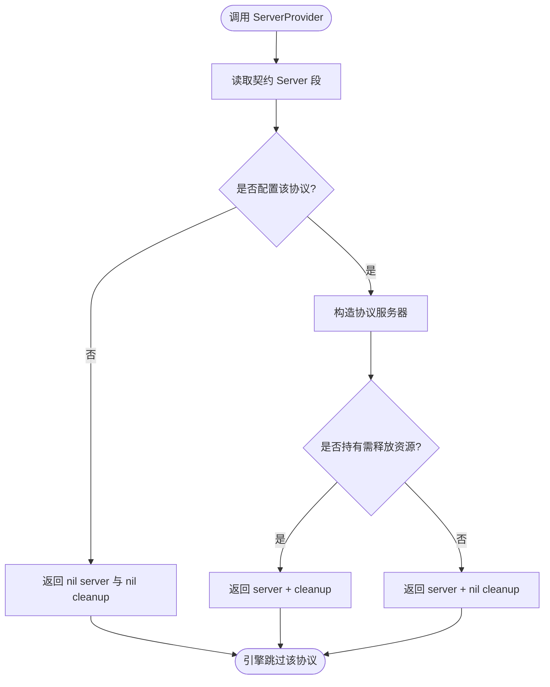
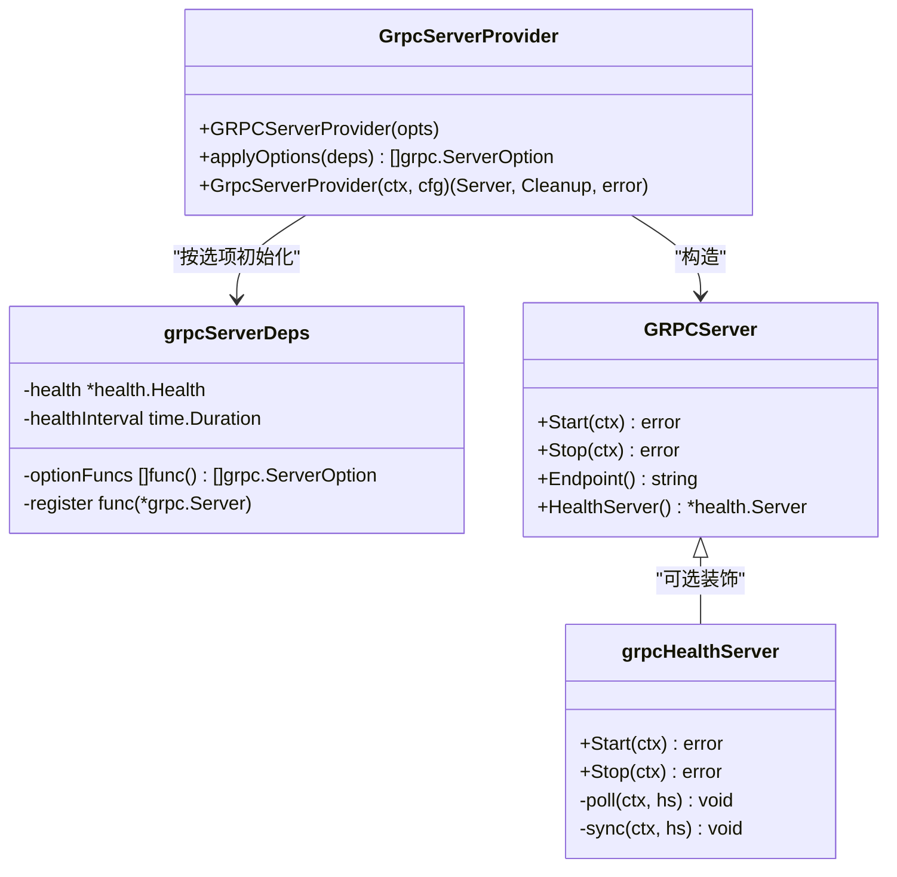
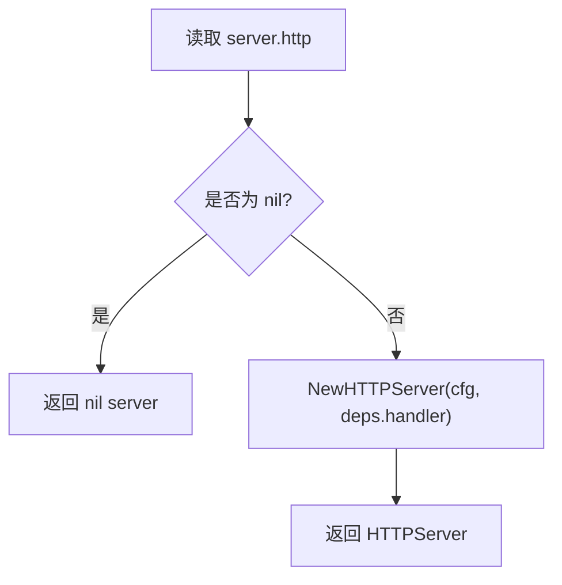
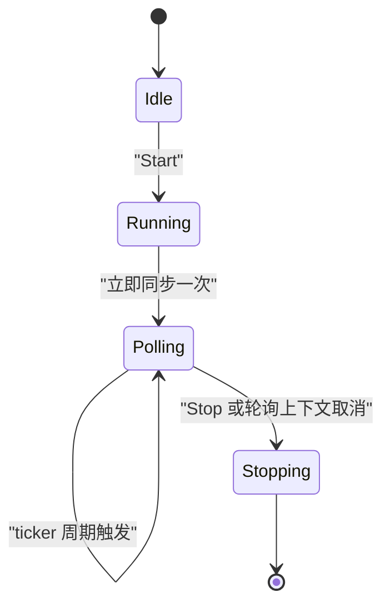
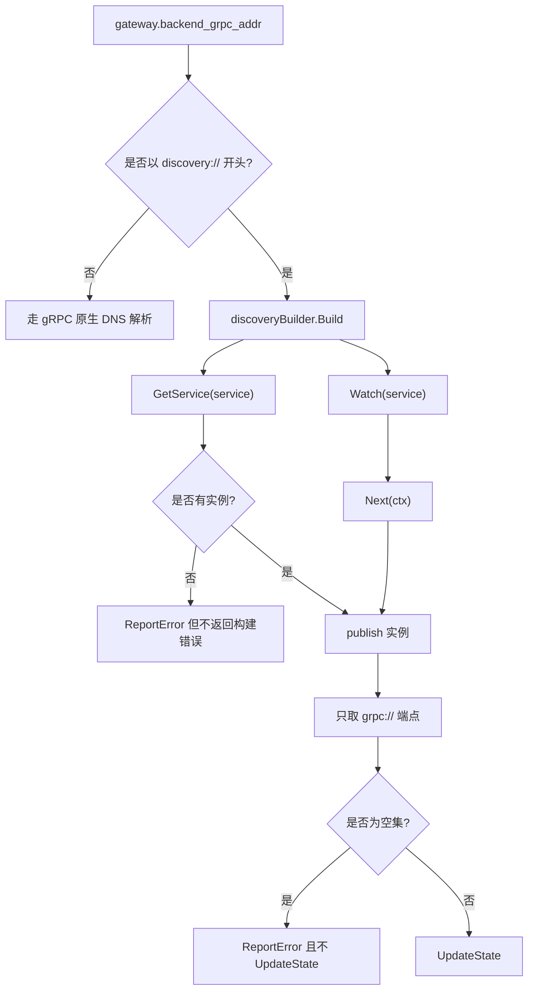
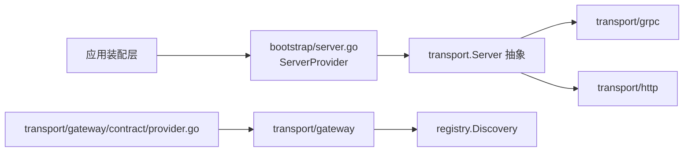

# 引导服务器工厂

<cite>
**本文引用的文件**   
- [bootstrap/server.go](file://bootstrap/server.go)
- [transport/grpc/grpc_server.go](file://transport/grpc/grpc_server.go)
- [transport/http/http_server.go](file://transport/http/http_server.go)
- [bootstrap/health.go](file://bootstrap/health.go)
- [transport/gateway/discovery.go](file://transport/gateway/discovery.go)
- [transport/gateway/contract/provider.go](file://transport/gateway/contract/provider.go)
- [_example/bald/internal/bootstrap/custom.go](file://_example/bald/internal/bootstrap/custom.go)
- [_example/bald/internal/bootstrap/grpc.go](file://_example/bald/internal/bootstrap/grpc.go)
- [_example/bald/configs/bald-demo-api.yaml](file://_example/bald/configs/bald-demo-api.yaml)
</cite>

## 目录
1. [引言](#引言)
2. [项目结构](#项目结构)
3. [核心组件](#核心组件)
4. [架构总览](#架构总览)
5. [详细组件分析](#详细组件分析)
6. [依赖关系分析](#依赖关系分析)
7. [性能与并发特性](#性能与并发特性)
8. [部署配置示例](#部署配置示例)
9. [故障排查指南](#故障排查指南)
10. [结论](#结论)

## 引言
本文围绕 Bootstrap 服务器的工厂模式展开，聚焦 `ServerProvider`、`GrpcServerProvider`、`HTTPServerProvider` 的设计语义、实现细节以及与服务发现、gRPC reflection、健康检查的集成方式。目标是帮助读者理解：

- 为什么 `ServerProvider` 返回 `(server, cleanup, error)`；
- `nil server` 表示跳过该协议而不是错误；
- gRPC 拦截器链如何由登记顺序决定；
- HTTP 面为何不注册框架路由；
- 服务发现目标 `discovery:///<服务名>` 如何透明接入；
- 健康检查数据源如何通过后台轮询同步到 gRPC 标准健康服务。

## 项目结构
Bootstrap 服务器工厂位于 `bootstrap` 包，它把契约中的 `server` 段映射为可启停的 `transport.Server`。具体协议实现位于 `transport/grpc` 和 `transport/http`；gRPC 反射与健康推送分别由装配层与独立装饰器完成；网关与转码能力在 `transport/gateway` 中通过 Provider 契约扩展。

**图表来源**
- [bootstrap/server.go:1-149](file://bootstrap/server.go#L1-L149)
- [transport/grpc/grpc_server.go:1-149](file://transport/grpc/grpc_server.go#L1-L149)
- [transport/http/http_server.go:1-123](file://transport/http/http_server.go#L1-L123)
- [bootstrap/health.go:1-101](file://bootstrap/health.go#L1-L101)
- [transport/gateway/contract/provider.go:1-194](file://transport/gateway/contract/provider.go#L1-L194)
- [transport/gateway/discovery.go:1-174](file://transport/gateway/discovery.go#L1-L174)
- [_example/bald/internal/bootstrap/custom.go:1-45](file://_example/bald/internal/bootstrap/custom.go#L1-L45)
- [_example/bald/internal/bootstrap/grpc.go:1-20](file://_example/bald/internal/bootstrap/grpc.go#L1-L20)

**章节来源**
- [bootstrap/server.go:1-149](file://bootstrap/server.go#L1-L149)
- [_example/bald/internal/bootstrap/custom.go:1-45](file://_example/bald/internal/bootstrap/custom.go#L1-L45)

## 核心组件
本节按职责拆分四个关键类型与函数：

| 组件 | 职责 | 关键语义 |
|---|---|---|
| `ServerProvider` | 协议服务器工厂 | 出错短路；`nil server` 表示契约未配置该协议，应跳过；cleanup 负责释放资源，可为 nil |
| `GrpcServerProvider` | 构造 gRPC 服务器工厂 | 按 optionFuncs 登记顺序生成拦截器链；支持 reflection；可选注入健康推送 |
| `HTTPServerProvider` | 构造 HTTP 服务器工厂 | 注入业务根 handler；不注册任何框架路由 |
| `grpcHealthServer` | gRPC 健康状态推送装饰器 | 后台轮询 `health.Health` 并同步到 gRPC 标准健康服务 |

**章节来源**
- [bootstrap/server.go:15-149](file://bootstrap/server.go#L15-L149)
- [bootstrap/health.go:1-101](file://bootstrap/health.go#L1-L101)

## 架构总览
`ServerProvider` 是引擎调用点：传入上下文与契约中的 `Server` 段，返回可被统一启动的 transport 对象。工厂本身只负责解析契约、组装依赖、创建底层实现；业务依赖通过 Option 显式注入，避免包级全局变量。

**图表来源**
- [bootstrap/server.go:61-120](file://bootstrap/server.go#L61-L120)
- [transport/grpc/grpc_server.go:43-71](file://transport/grpc/grpc_server.go#L43-L71)
- [bootstrap/health.go:26-61](file://bootstrap/health.go#L26-L61)

## 详细组件分析

### ServerProvider 函数签名与返回值语义
`ServerProvider` 的签名是 `(ctx, cfg) -> (server, cleanup, error)`。它的语义有三条：

1. **出错短路**：error 非 nil 时，引擎停止构建该协议服务器。
2. **nil server 表示跳过**：当契约中没有对应协议段（例如没有 `server.grpc`），工厂返回 `nil server`，引擎不会把它加入服务器列表。
3. **cleanup 释放资源**：若服务器持有连接池、订阅或 goroutine，应返回清理函数；若无资源则可为 nil。

这个设计让同一工厂既能表达“成功启用”，也能表达“本进程不需要该协议”。

**图表来源**
- [bootstrap/server.go:15-21](file://bootstrap/server.go#L15-L21)
- [bootstrap/server.go:103-110](file://bootstrap/server.go#L103-L110)
- [bootstrap/server.go:139-146](file://bootstrap/server.go#L139-L146)

**章节来源**
- [bootstrap/server.go:15-21](file://bootstrap/server.go#L15-L21)
- [bootstrap/server.go:103-110](file://bootstrap/server.go#L103-L110)
- [bootstrap/server.go:139-146](file://bootstrap/server.go#L139-L146)

### GrpcServerProvider：依赖注入链与拦截器顺序
`GrpcServerProvider` 接收若干 `GRPCServerOption`，每个选项修改内部 `grpcServerDeps`。关键依赖包括：

- `optionFuncs`：gRPC `ServerOption` 工厂切片。每次工厂调用返回一组选项，最终串成一条链。
- `register`：业务 service 注册回调，形如 `func(s *grpc.Server)`。
- `health`：`health.Health` 就绪检查源。
- `healthInterval`：健康推送间隔。

拦截器链的顺序完全由 `WithGRPCUnaryFunc` 的登记顺序决定。文档明确说明：**链序 = 登记顺序**，没有静态与延迟合并规则。因此安全策略类中间件（例如错误拦截器）必须放在最外层。

示例应用中，拦截器链由 `custom.go` 通过 `appkit.WithGRPCOptions(newGRPCChain)` 注入，`newGRPCChain` 组合了错误处理、请求 ID、观测性、默认值填充与参数校验。

**图表来源**
- [bootstrap/server.go:23-60](file://bootstrap/server.go#L23-L60)
- [bootstrap/server.go:61-120](file://bootstrap/server.go#L61-L120)
- [transport/grpc/grpc_server.go:23-71](file://transport/grpc/grpc_server.go#L23-L71)
- [bootstrap/health.go:26-101](file://bootstrap/health.go#L26-L101)

#### 选项求值时机
`optionFuncs` 不是在工厂闭包创建时求值，而是在 `GrpcServerProvider` 返回的工厂内部、调用 `grpcserver.NewGRPCServerWithRegister` 之前才执行 `applyOptions(deps)`。这意味着这些工厂可以读取 `beforeStart` 阶段建立的运行期资源，例如认证器、授权器或仓储。

#### Service 注册回调
`GrpcServerProvider` 会先按契约决定是否注册 gRPC reflection，再调用业务提供的 `register` 回调。业务不要在 `register` 中重复注册 reflection，否则同一服务重复注册会导致 panic。

**章节来源**
- [bootstrap/server.go:23-60](file://bootstrap/server.go#L23-L60)
- [bootstrap/server.go:61-120](file://bootstrap/server.go#L61-L120)
- [_example/bald/internal/bootstrap/custom.go:23-32](file://_example/bald/internal/bootstrap/custom.go#L23-L32)
- [_example/bald/internal/bootstrap/grpc.go:1-20](file://_example/bald/internal/bootstrap/grpc.go#L1-L20)

### HTTPServerProvider：配置选项与业务依赖注入
`HTTPServerProvider` 使用 `HTTPServerOption` 注入业务根 `http.Handler`。它的关键约定是：

- 不注册任何框架路由；
- 不注册健康或就绪探针；
- 如果 handler 为 nil，底层返回 404 占位处理器；
- TLS 由契约中的 `server.http.tls` 控制；
- 同端口单面的 gRPC-Gateway 转码能力不由本包实现，而由 `transport/gateway/contract` 的 `HTTPProvider` 接管。

因此，HTTP 面通常是业务 Web 框架（如 Gin）或网关转码面。健康探针由上层装配逻辑（例如 `appkit.WithHealth`）挂载到业务 handler 外层。

**图表来源**
- [bootstrap/server.go:122-146](file://bootstrap/server.go#L122-L146)
- [transport/http/http_server.go:24-47](file://transport/http/http_server.go#L24-L47)

**章节来源**
- [bootstrap/server.go:122-146](file://bootstrap/server.go#L122-L146)
- [transport/http/http_server.go:24-123](file://transport/http/http_server.go#L24-L123)
- [transport/gateway/contract/provider.go:1-47](file://transport/gateway/contract/provider.go#L1-L47)

### gRPC Reflection 的协议外能力处理
Reflection 属于“协议外能力”：它不是业务 service 实现，而是调试与工具能力。`GrpcServerProvider` 根据契约中的 `Grpc.reflection` 字段决定是否调用 `reflection.Register`。

重要约束：

- reflection 由装配层注册；
- 业务 `register` 回调不应再次注册 reflection；
- 同一服务重复注册会 panic。

这使 reflection 与业务 service 解耦：契约驱动开关，实现层只负责在构造时执行。

**章节来源**
- [bootstrap/server.go:86-108](file://bootstrap/server.go#L86-L108)
- [transport/grpc/grpc_server.go:43-71](file://transport/grpc/grpc_server.go#L43-L71)

### 健康检查数据源的后台轮询机制
gRPC 标准健康服务是拉模型：探针主动调用 `Check`。为了让 K8s 等外部系统看到服务就绪状态，`bootstrap/health.go` 提供 `grpcHealthServer`，它包装 `GRPCServer` 并在 `Start` 后启动后台轮询：

1. 立即同步一次就绪状态；
2. 按固定间隔轮询 `health.Health.Readiness`；
3. 将结果写入 gRPC 标准健康服务的整体服务状态；
4. `Stop` 先取消轮询 goroutine，再优雅停止 gRPC 服务。

默认间隔为 2 秒；传入 `interval <= 0` 时使用默认值。

**图表来源**
- [bootstrap/health.go:26-101](file://bootstrap/health.go#L26-L101)

**章节来源**
- [bootstrap/health.go:1-101](file://bootstrap/health.go#L1-L101)

### 服务发现的透明集成
服务发现以 URI scheme 形式接入：目标写成 `discovery:///<服务名>`。该 scheme 在 `transport/gateway/discovery.go` 中定义为常量，并通过 gRPC resolver 适配。

#### 解析语义
- 只有以 `discovery://` 开头的目标走注册中心；
- 普通 `host:port` 仍走 gRPC 原生 DNS resolver；
- 同一 gateway 中可以并存直连与发现目标；
- 服务名取自 `target.Endpoint()`，即 URL path，避免 authority 规范化影响下划线等服务名字符。

#### 三种既定行为
1. **Build 返回错误时 gRPC 不会重试**：空服务名属于配置错误，Watch 无法恢复，所以直接报错。
2. **空快照不推 UpdateState**：实例集为空时不调用 `UpdateState`，因为 gRPC 对空地址集会报 `ErrBadResolverState`，且可能清掉已有健康地址。
3. **只取 grpc:// 端点**：实例端点中只保留带 `grpc://` scheme 的地址，其他面（HTTP、WS 等）会被丢弃。

#### nacos 命名差异
nacos 会把一个实例的多个端点拆成 `<Name>.<scheme>` 形式的多个服务。因此面向 nacos 的目标必须写 `discovery:///<服务名>.grpc`，否则会解析到 HTTP 面或空集。内存与 etcd 后端则直接使用注册时填写的 `ServiceInstance.Name`。

**图表来源**
- [transport/gateway/discovery.go:18-174](file://transport/gateway/discovery.go#L18-L174)

**章节来源**
- [transport/gateway/discovery.go:18-174](file://transport/gateway/discovery.go#L18-L174)
- [transport/gateway/contract/provider.go:22-47](file://transport/gateway/contract/provider.go#L22-L47)

## 依赖关系分析
工厂层与协议实现之间的依赖是单向的：`bootstrap` 通过 `transport.Server` 抽象消费 `transport/grpc` 与 `transport/http`，而不反向 import 业务适配器。网关转码能力则通过 `transport/gateway/contract` 的 Provider 契约接入，避免把 bootstrap 与具体网关实现强耦合。

**图表来源**
- [bootstrap/server.go:1-149](file://bootstrap/server.go#L1-L149)
- [transport/gateway/contract/provider.go:1-194](file://transport/gateway/contract/provider.go#L1-L194)
- [transport/gateway/discovery.go:1-174](file://transport/gateway/discovery.go#L1-L174)

**章节来源**
- [bootstrap/server.go:1-149](file://bootstrap/server.go#L1-L149)
- [transport/gateway/contract/provider.go:1-194](file://transport/gateway/contract/provider.go#L1-L194)

## 性能与并发特性
- gRPC 与 HTTP 服务器都封装监听器，并用读写锁保护实际 `net.Listener`，避免 `Start`、`Endpoint`、`Stop` 三处并发访问。
- gRPC 健康推送使用独立 goroutine + ticker，轮询间隔可配，默认 2 秒。
- 服务发现解析器在 `Build` 时建立 Watch，并把后续变更转为 `UpdateState`；`ResolveNow` 无操作，刷新依赖 Watch 推送。
- `Endpoint()` 在监听前返回空字符串，供上层等待真正启动完成，避免向服务发现暴露未就绪地址。

这些特性意味着：

- 健康推送是轻量轮询，不是事件驱动；
- 服务发现适合长驻订阅，不适合频繁短生命周期实例；
- 动态端口（`:0`）由 `Endpoint()` 解析为真实监听地址，便于注册中心拿到可直连 endpoint。

**章节来源**
- [transport/grpc/grpc_server.go:23-149](file://transport/grpc/grpc_server.go#L23-L149)
- [transport/http/http_server.go:24-123](file://transport/http/http_server.go#L24-L123)
- [bootstrap/health.go:26-101](file://bootstrap/health.go#L26-L101)
- [transport/gateway/discovery.go:45-174](file://transport/gateway/discovery.go#L45-L174)

## 部署配置示例
以下示例描述常见部署场景的配置要点，不直接粘贴代码，而是给出路径与关键字段。

### 基础 gRPC 与 HTTP 双面
适用于本地开发或服务同时对外提供 gRPC 与 HTTP。

- gRPC 监听地址：`server.grpc.addr`
- HTTP 监听地址：`server.http.addr`
- 示例配置路径：[_example/bald/configs/bald-demo-api.yaml](file://_example/bald/configs/bald-demo-api.yaml)

**章节来源**
- [_example/bald/configs/bald-demo-api.yaml:1-29](file://_example/bald/configs/bald-demo-api.yaml#L1-L29)

### TLS 配置
gRPC 与 HTTP 的 TLS 都来自 `bconf/tlsconf`，契约中 `server.grpc.tls` 与 `server.http.tls` 非 nil 时启用 HTTPS/TLS。gRPC 服务端会在缺少 ALPN 时自动补上 `h2`，因为 gRPC 基于 HTTP/2。

部署建议：

- 证书与密钥可从文件或远程配置加载；
- TLS 配置失败应在启动期退出，而不是先占端口再失败；
- gRPC 客户端应配合对应的 TLS 配置拨号。

**章节来源**
- [transport/grpc/grpc_server.go:90-113](file://transport/grpc/grpc_server.go#L90-L113)
- [transport/http/http_server.go:69-100](file://transport/http/http_server.go#L69-L100)

### 中间件链组装
gRPC 中间件链由 `WithGRPCUnaryFunc` 注入，链序等于登记顺序。示例应用通过 `appkit.WithGRPCOptions(newGRPCChain)` 注入，`newGRPCChain` 包含错误拦截器、请求 ID、观测性、默认值填充与参数校验。

部署建议：

- 错误拦截器必须放在最外层，确保错误码在 gRPC 边界正确转换；
- 鉴权、审计、限流等横切能力应作为链的一部分而非业务 handler；
- 不要重复注册 reflection。

**章节来源**
- [_example/bald/internal/bootstrap/custom.go:23-32](file://_example/bald/internal/bootstrap/custom.go#L23-L32)
- [_example/bald/internal/bootstrap/grpc.go:1-20](file://_example/bald/internal/bootstrap/grpc.go#L1-L20)
- [bootstrap/server.go:32-45](file://bootstrap/server.go#L32-L45)

### 健康探针集成
gRPC 侧通过 `WithGRPCHealth` 注入 `health.Health`，框架启动后台轮询并将就绪状态同步到 gRPC 标准健康服务。HTTP 侧的健康与就绪探针通常由业务 handler 或上层装配逻辑挂载，而不是由 `HTTPServerProvider` 自行注册。

部署建议：

- 就绪检查应覆盖数据库、缓存、下游依赖；
- liveness 与 readiness 要区分：liveness 判断进程是否存活，readiness 判断服务是否可用；
- gRPC 探针需要服务端主动推送状态，不能仅靠拉模型推断。

**章节来源**
- [bootstrap/server.go:47-60](file://bootstrap/server.go#L47-L60)
- [bootstrap/health.go:26-101](file://bootstrap/health.go#L26-L101)
- [transport/gateway/contract/provider.go:140-194](file://transport/gateway/contract/provider.go#L140-L194)

### 服务发现与负载均衡
当 gateway 的后端地址写成 `discovery:///<服务名>` 时，框架通过 `registry.Discovery` 解析并订阅实例变更。

部署建议：

- 使用内存或 etcd 时，服务名就是注册时的 `ServiceInstance.Name`；
- 使用 nacos 时，目标必须写 `<服务名>.grpc`；
- 只期望 gRPC 流量时，不要把 HTTP 端点混入后端；
- 直连地址与发现地址可在同一 gateway 中并存。

**章节来源**
- [transport/gateway/discovery.go:18-44](file://transport/gateway/discovery.go#L18-L44)
- [transport/gateway/discovery.go:88-135](file://transport/gateway/discovery.go#L88-L135)

## 故障排查指南
| 现象 | 可能原因 | 排查方向 |
|---|---|---|
| gRPC 服务未启动 | 契约中未配置 `server.grpc` | 确认 `server.grpc` 段存在，或接受 `nil server` 的跳过语义 |
| HTTP 面全部 404 | 未注入业务 handler | 检查 `WithHTTPHandler` 或网关 Provider 是否接管 `server.http` |
| gRPC reflection 重复 panic | 业务在 `register` 中重复注册 reflection | 只在装配层按契约注册 |
| gRPC 健康状态始终 NOT_SERVING | 就绪检查失败或轮询未启动 | 检查 `WithGRPCHealth` 是否注入，以及 `health.Health.Readiness` 逻辑 |
| 服务发现解析不到实例 | nacos 目标缺少 `.grpc` 后缀 | 把目标改为 `discovery:///<服务名>.grpc` |
| 服务发现报告无实例 | 实例端点不含 `grpc://` | 检查注册端点是否只包含 HTTP 或其他 scheme |
| 空快照导致 gRPC 报错 | 首次快照为空集 | 这是预期行为：不推 `UpdateState`，保持订阅等待推送 |
| 健康推送 goroutine 残留 | 服务器 Stop 未正常取消轮询 | 使用 `NewGRPCHealthServer` 或 `GrpcServerProvider` 的 `WithGRPCHealth`，不要手动拼装 |

**章节来源**
- [bootstrap/server.go:15-21](file://bootstrap/server.go#L15-L21)
- [bootstrap/server.go:86-120](file://bootstrap/server.go#L86-L120)
- [transport/gateway/discovery.go:57-135](file://transport/gateway/discovery.go#L57-L135)
- [bootstrap/health.go:62-101](file://bootstrap/health.go#L62-L101)

## 结论
Bootstrap 服务器工厂模式的核心是把“契约驱动”和“协议实现”解耦：

- `ServerProvider` 统一入口，用 `nil server` 表达“跳过协议”，用 cleanup 表达“释放资源”；
- gRPC 面通过 `optionFuncs` 登记顺序决定拦截器链序，reflection 由装配层按契约注册；
- HTTP 面只负责协议承载，路由与探针由业务或上层装配管理；
- 健康检查通过后台轮询把业务就绪状态同步到 gRPC 标准健康服务；
- 服务发现以 `discovery://` scheme 透明接入，并严格过滤出 gRPC 端点。

这套设计让多协议服务可以在同一引导流程中声明式装配，同时保留足够的扩展点用于业务中间件、健康探针和下游服务发现。