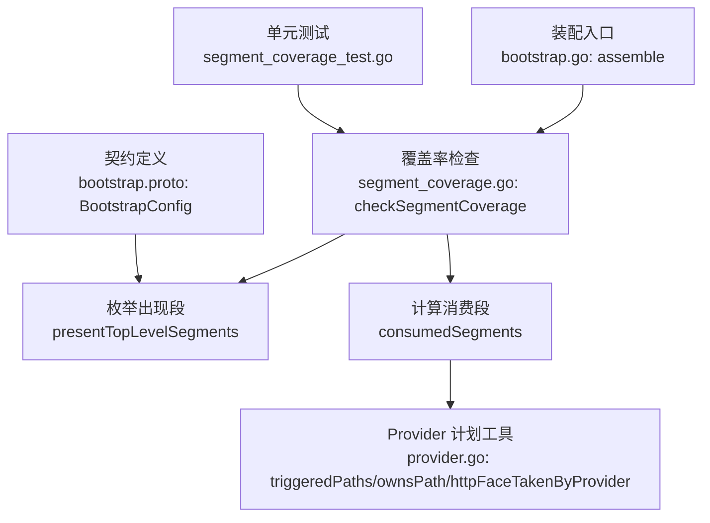
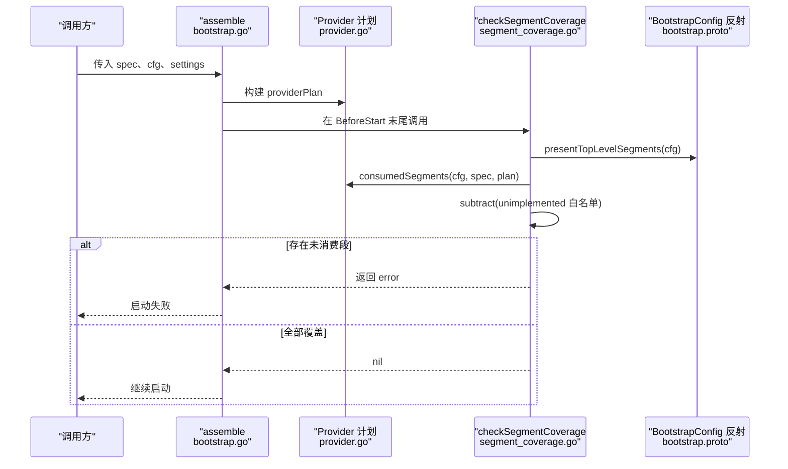
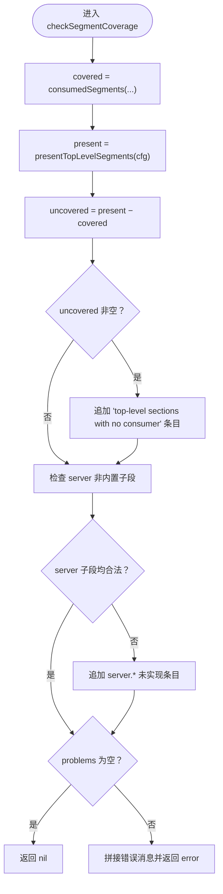
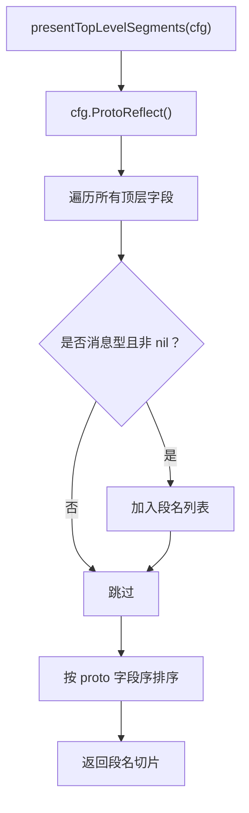
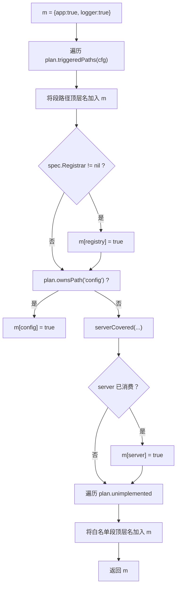
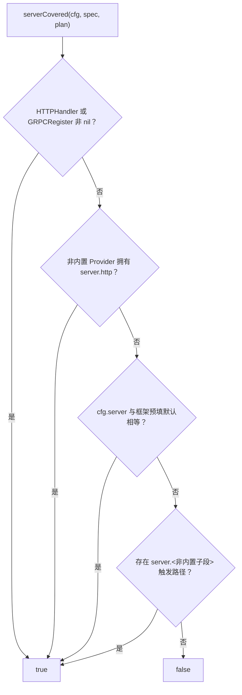
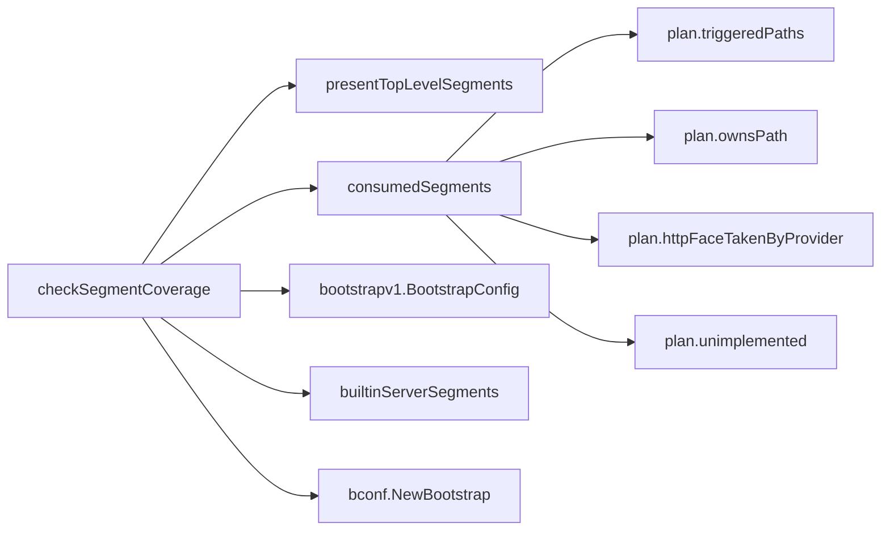

# L3 段覆盖率检查

<cite>
**本文引用的文件**   
- [segment_coverage.go](file://pkg/appkit/segment_coverage.go)
- [bootstrap.go](file://pkg/appkit/bootstrap.go)
- [provider.go](file://pkg/appkit/provider.go)
- [segment_coverage_test.go](file://pkg/appkit/segment_coverage_test.go)
- [bootstrap.proto](file://bconf/proto/bootstrap/v1/bootstrap.proto)
</cite>

## 目录
1. [引言](#引言)
2. [项目结构](#项目结构)
3. [核心组件](#核心组件)
4. [架构总览](#架构总览)
5. [详细组件分析](#详细组件分析)
6. [依赖关系分析](#依赖关系分析)
7. [性能与行为特征](#性能与行为特征)
8. [故障排查指南](#故障排查指南)
9. [测试用例全景](#测试用例全景)
10. [结论](#结论)

## 引言
L3 段覆盖率检查是 Bald 启动期 fail-fast 安全闸门之一。它的作用是：当 `BootstrapConfig` 契约中出现了某个配置段，但本次装配没有任何 Provider 消费该段时，直接拒绝启动，并列出未消费的段名。其设计目标是防止「配置段静默失效」——历史上 script 段全仓零消费者就是一个典型事故：用户写了脚本配置，却无人消费，服务照常启动，问题直到运行时才暴露。

检查在装配链的 `BeforeStart` 末尾执行，此时契约已装载定型、各 Provider 的计划与激活路径也已确定，因此可以基于反射枚举出实际出现的顶层段，并与「真实被消费段 + 白名单」做差集。未被覆盖即报错；同时把原 `validateServerSections` 中「server 非内置子段有配置却无实现」的语义并入同一检查点，统一 fail-fast 体验。

## 项目结构
本节聚焦与 L3 段覆盖率检查直接相关的代码位置：

| 文件 | 职责 |
|---|---|
| [segment_coverage.go](file://pkg/appkit/segment_coverage.go) | 定义 `checkSegmentCoverage`、`presentTopLevelSegments`、`consumedSegments`、`serverCovered`、`builtinServerSegments` |
| [bootstrap.go](file://pkg/appkit/bootstrap.go) | 装配入口 `assemble` 调用检查点，并承载能力校验等前置逻辑 |
| [provider.go](file://pkg/appkit/provider.go) | Provider 计划、路径归属、`triggeredPaths`、`ownsPath`、`httpFaceTakenByProvider`、`WithUnimplementedSegments` |
| [segment_coverage_test.go](file://pkg/appkit/segment_coverage_test.go) | 覆盖未消费、白名单、零能力 server、非内置子段等场景 |
| [bootstrap.proto](file://bconf/proto/bootstrap/v1/bootstrap.proto) | 定义 15 个顶层段字段，是 L3 枚举的真实来源 |



**图表来源**
- [bootstrap.go:344-344](file://pkg/appkit/bootstrap.go#L344-L344)
- [segment_coverage.go:1-156](file://pkg/appkit/segment_coverage.go#L1-L156)
- [provider.go:595-640](file://pkg/appkit/provider.go#L595-L640)
- [bootstrap.proto:20-71](file://bconf/proto/bootstrap/v1/bootstrap.proto#L20-L71)

**章节来源**
- [segment_coverage.go:1-156](file://pkg/appkit/segment_coverage.go#L1-L156)
- [bootstrap.go:1-200](file://pkg/appkit/bootstrap.go#L1-L200)
- [provider.go:1-200](file://pkg/appkit/provider.go#L1-L200)
- [bootstrap.proto:20-71](file://bconf/proto/bootstrap/v1/bootstrap.proto#L20-L71)

## 核心组件
L3 检查由五个协作实体构成：

| 组件 | 类型 / 常量 | 关键职责 |
|---|---|---|
| `checkSegmentCoverage` | 函数 | 主算法入口：`presentTopLevelSegments - consumedSegments - unimplemented = 未消费段` |
| `presentTopLevelSegments` | 函数 | 用 protobuf 反射枚举 `cfg` 中实际出现的顶层段 |
| `consumedSegments` | 函数 | 判定哪些顶层段在本次装配中被真实消费 |
| `serverCovered` | 函数 | server 段的专用双层判定逻辑 |
| `builtinServerSegments` | 包级变量 | 内置协议子段集合 `{http, grpc}` |

**章节来源**
- [segment_coverage.go:1-156](file://pkg/appkit/segment_coverage.go#L1-L156)

## 架构总览
L3 检查不是独立守护进程，而是装配流程中的一个错误检查步骤。整体时序如下：



**图表来源**
- [bootstrap.go:344-344](file://pkg/appkit/bootstrap.go#L344-L344)
- [segment_coverage.go:25-156](file://pkg/appkit/segment_coverage.go#L25-L156)
- [provider.go:595-640](file://pkg/appkit/provider.go#L595-L640)
- [bootstrap.proto:20-71](file://bconf/proto/bootstrap/v1/bootstrap.proto#L20-L71)

## 详细组件分析

### `checkSegmentCoverage`：三段式主算法
主函数实现非常直接的集合差运算：

1. 获取本次装配真正消费的顶层段集合：`covered := consumedSegments(cfg, spec, plan)`
2. 枚举契约中实际出现的顶层段：`presentTopLevelSegments(cfg)`
3. 对每个出现段，若不在 `covered` 中，加入未覆盖列表
4. 追加 server 非内置子段未接管的额外问题
5. 合并所有问题为单条 `appkit: bootstrap config declares sections with no consumer:` 错误
6. 空集合则返回 `nil`



**图表来源**
- [segment_coverage.go:37-104](file://pkg/appkit/segment_coverage.go#L37-L104)

**章节来源**
- [segment_coverage.go:37-104](file://pkg/appkit/segment_coverage.go#L37-L104)

### `presentTopLevelSegments`：基于契约反射的出现段枚举
该函数委托给 `presentChildSegments`，通过 `cfg.ProtoReflect()` 遍历契约消息的所有字段，仅取消息型且非 `nil` 的字段作为「实际出现的段」。其重要特性是：

- 输出顺序与 protobuf 字段声明序一致，从而保证报错清单可重现
- 新增顶层段无需修改检查代码，只要契约先扩展、没有消费者就会自动落入报错
- 它是安全缺省：未知段默认视为未消费，必须显式白名单



**图表来源**
- [segment_coverage.go:43-46](file://pkg/appkit/segment_coverage.go#L43-L46)
- [bootstrap.proto:20-71](file://bconf/proto/bootstrap/v1/bootstrap.proto#L20-L71)

**章节来源**
- [segment_coverage.go:43-46](file://pkg/appkit/segment_coverage.go#L43-L46)

### `consumedSegments`：复杂消费判定
这是整个检查最核心的部分。它维护一个以顶层段名为键的 map，初始值固定包含 `app` 和 `logger`，再叠加以下规则：

| 顶层段 | 判定条件 | 原因 |
|---|---|---|
| `app` | 无条件消费 | 元数据在装配构造期读取，不属于 Provider 循环 |
| `logger` | 无条件消费 | 阶段 A/B 日志重建由框架接管，段缺失回退默认后端 |
| `registry/tracer/metrics/database/cache/storage/ai/workflow/broker/audit` | Provider 声明了该段路径且段存在 | 构建失败会 fail-fast，能走到检查点即代表已消费 |
| `registry` | 另有 `spec.Registrar != nil` 时也视为已消费 | Registrar 实例化属于程序化接管，等同显式消费 |
| `config` | 仅当 `plan.ownsPath("config")` 为真 | config Provider 产层；`ConfigFile`/`RemoteConfig` 走本地与远程桥通道，不等同于契约 `config` 段 |
| `server` | 由 `serverCovered` 判定 | 见下一小节 |
| 白名单段 | 出现在 `plan.unimplemented` 中的段名对应顶层 | `WithUnimplementedSegments` 是唯一豁免出口 |



**图表来源**
- [segment_coverage.go:106-156](file://pkg/appkit/segment_coverage.go#L106-L156)
- [provider.go:595-640](file://pkg/appkit/provider.go#L595-L640)

**章节来源**
- [segment_coverage.go:106-156](file://pkg/appkit/segment_coverage.go#L106-L156)
- [provider.go:595-640](file://pkg/appkit/provider.go#L595-L640)

### `serverCovered`：server 段的双层判定
server 段有两个层次需要区分：

1. **顶层能力声明 vs 子段实现提供者**  
   顶层 `server` 是否已消费，取决于是否有能力声明或外部协议 Provider；而 `server.http`、`server.grpc` 之外的子段是否合法，取决于是否有 Provider 以 `"server.X"` 路径接管。

2. **内置协议与外部协议 Provider 的区别**  
   `builtinServerSegments = {"http", "grpc"}` 表示这两个子段由框架内置 server Provider 管辖；其他子段（如 `asynq`）必须由外部 Provider 显式接管，否则视为「配置了但没有实现」。

具体判定顺序：

| 条件 | 结果 |
|---|---|
| `spec.HTTPHandler != nil` 或 `spec.GRPCRegister != nil` | 已消费：能力声明意味着内置 server Provider 会构造对应面 |
| 非内置 Provider 拥有 `server.http` | 已消费：转码面 Provider 接管 HTTP 端口 |
| `cfg.GetServer()` 与 `bconf.NewBootstrap().GetServer()` 深相等 | 已消费：预填默认值属于框架自填，不应报错 |
| 存在 `server.<非内置子段>` 的触发路径 | 已消费：第三方协议面确实被接入 |
| 以上都不满足 | 未消费：零能力声明且用户改过子字段即报错 |



**图表来源**
- [segment_coverage.go:147-156](file://pkg/appkit/segment_coverage.go#L147-L156)
- [segment_coverage.go:29-33](file://pkg/appkit/segment_coverage.go#L29-L33)

**章节来源**
- [segment_coverage.go:29-33](file://pkg/appkit/segment_coverage.go#L29-L33)
- [segment_coverage.go:147-156](file://pkg/appkit/segment_coverage.go#L147-L156)

### 白名单：`WithUnimplementedSegments`
白名单是 L3 唯一豁免出口。支持两种形式：

| 白名单项 | 含义 |
|---|---|
| 顶层段名，例如 `"script"` | 承认该段暂不生效 |
| server 子段路径，例如 `"server.asynq"` | 承认该子段暂无实现 |

白名单在进入检查前会被归一到顶层段名：`plan.unimplemented` 中记录的段名对应的顶层段会加入 `consumedSegments` 结果。同时，`segmentPathKnown` 会在计划期验证白名单条目是否为 `BootstrapConfig` 的真实字段路径，避免拼错的豁免形同虚设。

**章节来源**
- [provider.go:140-188](file://pkg/appkit/provider.go#L140-L188)
- [segment_coverage.go:106-156](file://pkg/appkit/segment_coverage.go#L106-L156)

### 错误信息格式与调试建议
当存在未消费段时，错误消息以统一前缀开头：

```
appkit: bootstrap config declares sections with no consumer:
  top-level sections with no consumer: <段名列表>
    hint: 该段无消费者，配置不会生效；引入对应 Provider、经 appkit.WithUnimplementedSegments 显式豁免，或从契约移除该段
  server.<子段> is configured but has no implementation in this repo ...
```

调试建议：

1. 先确认该段是否真的应该消费：如果是历史遗留或未启用能力，优先使用 `WithUnimplementedSegments` 显式豁免。
2. 如果确实需要消费，确认 Provider 的 `Segments()` 返回值是否命中契约段路径。
3. 对 server 子段，确认是否有 Provider 以 `"server.<子段>"` 路径注册；`http` 与 `grpc` 除外。
4. 若怀疑白名单无效，检查 `WithUnimplementedSegments` 传入的是顶层段名还是完整路径，以及是否为真实字段路径。
5. 对 script 这类由配置文件贡献的段，确认装载链路确实把脚本段写入最终 `BootstrapConfig`。

**章节来源**
- [segment_coverage.go:47-104](file://pkg/appkit/segment_coverage.go#L47-L104)

## 依赖关系分析
L3 检查依赖的关键外部对象包括：



**图表来源**
- [segment_coverage.go:29-156](file://pkg/appkit/segment_coverage.go#L29-L156)
- [provider.go:595-640](file://pkg/appkit/provider.go#L595-L640)

**章节来源**
- [segment_coverage.go:29-156](file://pkg/appkit/segment_coverage.go#L29-L156)
- [provider.go:595-640](file://pkg/appkit/provider.go#L595-L640)

## 性能与行为特征
- **执行时机**：`assemble` 的 `BeforeStart` 装配链末尾，契约已装载定型。热更新路径不重跑本检查。
- **时间复杂度**：主要开销来自 protobuf 反射枚举顶层字段与遍历 Provider 计划路径，数量级很小，属于启动期一次性检查。
- **fail-closed 语义**：新增契约段若无消费者，默认启动失败；只有显式白名单才能放行。
- **确定性**：`presentTopLevelSegments` 按 proto 字段序输出段名，使错误清单稳定可重现。
- **嵌套限制**：白名单允许顶层段名和 server 子段路径，但不支持任意深层嵌套路径——深层路径会被 `segmentPathKnown` 判为未知。

**章节来源**
- [segment_coverage.go:1-24](file://pkg/appkit/segment_coverage.go#L1-L24)
- [provider.go:140-188](file://pkg/appkit/provider.go#L140-L188)

## 故障排查指南
常见故障与定位方式：

| 现象 | 可能原因 | 排查动作 |
|---|---|---|
| 启动时报 `top-level sections with no consumer` | 契约中存在某段，但无 Provider 消费 | 检查 Provider 的 `Segments()`、是否被业务 Option 覆盖、是否应加白名单 |
| script 段报错 | 配置文件层注入了 script 段，但全仓零消费者 | 引入 script Provider 或使用 `WithUnimplementedSegments("script")` |
| server 子段报错 | 配置了 `server.asynq` 之类子段，但没有 Provider 以 `server.asynq` 路径接管 | 提供对应 Provider，或白名单豁免 |
| 零能力 server 报错 | 用户修改了 server 子字段但未声明 WithHTTP/WithGRPC | 补充能力声明，或移除多余 server 配置 |
| 预填 default server 未报错 | 框架预填默认 server 与 `bconf.NewBootstrap()` 深相等 | 正常行为，属于预填豁免 |
| 白名单无效 | 白名单路径拼错或非真实字段路径 | 检查 `WithUnimplementedSegments` 参数，确保是真实字段路径 |

**章节来源**
- [segment_coverage.go:47-104](file://pkg/appkit/segment_coverage.go#L47-L104)
- [provider.go:140-188](file://pkg/appkit/provider.go#L140-L188)

## 测试用例全景
`segment_coverage_test.go` 覆盖了 L3 的主要分支：

| 测试名称 | 输入场景 | 预期结果 |
|---|---|---|
| `TestAssemble_ErrorsUnconsumedScript` | 配置含 script 段，无消费者 | 启动失败，错误包含 `no consumer`、`script`、`WithUnimplementedSegments` |
| `TestAssemble_WhitelistExemptsScript` | script 段 + `WithUnimplementedSegments("script")` | 启动成功 |
| `TestAssemble_NoErrorWhenAllConsumed` | database.sql 由自定义 Provider 消费 | 启动成功 |
| `TestAssemble_ErrorsScriptFromConfigLayer` | script 段由 config 层注入 | 启动失败，错误包含 `script` |
| `TestAssemble_ZeroCapabilityDefaultServerNoError` | 零能力声明，server 保持框架预填默认 | 启动成功 |
| `TestAssemble_ZeroCapabilityOverriddenServerServerError` | 零能力声明，但覆盖 server.http.addr | 启动失败，错误包含 `server` |
| `TestAssemble_ServerSubSegmentWithoutProvider` | 配置 `server.asynq`，无 Provider 接管 | 启动失败，错误包含 `server.asynq is configured but has no implementation` |
| `TestAssemble_WhitelistExemptsServerSubSegment` | `server.asynq` + 白名单 | 启动成功 |
| `TestAssemble_ServerSubSegmentWithCoProvider` | `server.asynq` + 同 Provider 序列中以 `server.asynq` 路径注册的 Provider | 启动成功，Build 被调用，服务器启动 |

这些用例共同证明：

- 未消费段一定失败；
- 白名单是唯一豁免出口；
- 配置文件贡献的段同样受 L3 约束；
- 零能力 server 的预填默认豁免与用户覆盖检测并存；
- server 非内置子段必须显式接管。

**章节来源**
- [segment_coverage_test.go:1-200](file://pkg/appkit/segment_coverage_test.go#L1-L200)

## 结论
L3 段覆盖率检查把「契约先行」与「实现滞后」之间的风险收敛到启动期。它通过 protobuf 反射枚举实际出现的配置段，结合 Provider 计划的激活路径、Registrar 程序化接管、config Provider 专属语义、server 双层判定和内置协议白名单，精确计算未被消费的段。配合 `WithUnimplementedSegments` 白名单，既保证新契约段默认安全，又允许渐进式接入。对于运维和开发者而言，这条检查是最直接发现「配置写了但没生效」问题的第一道防线。