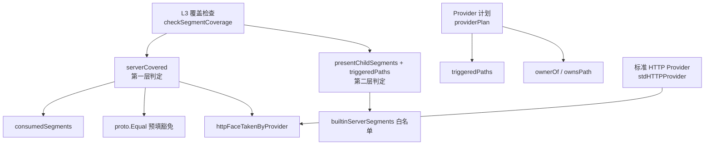
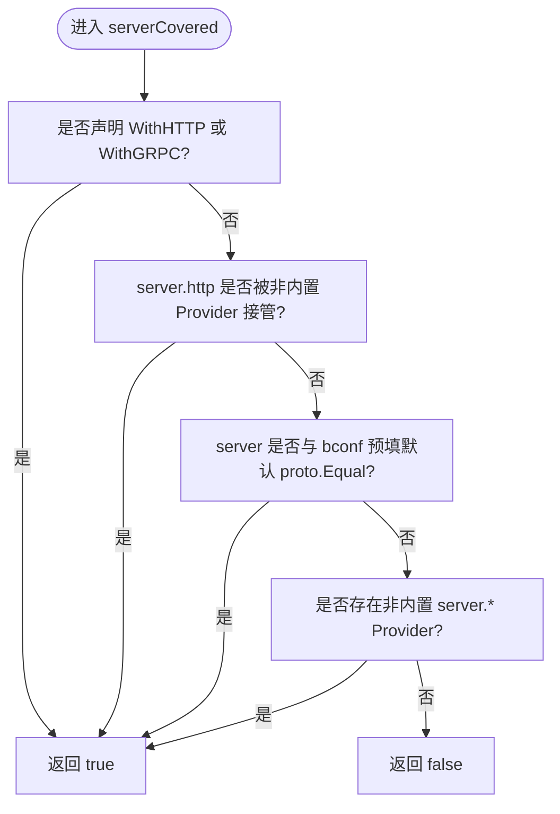
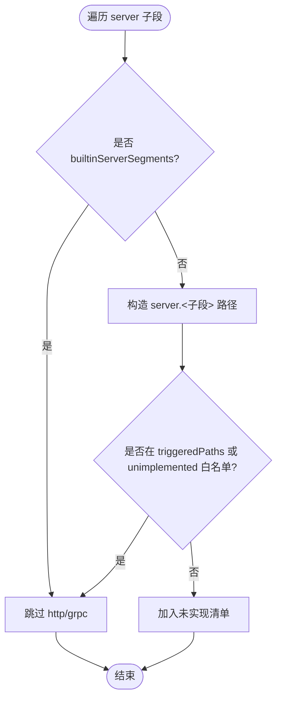
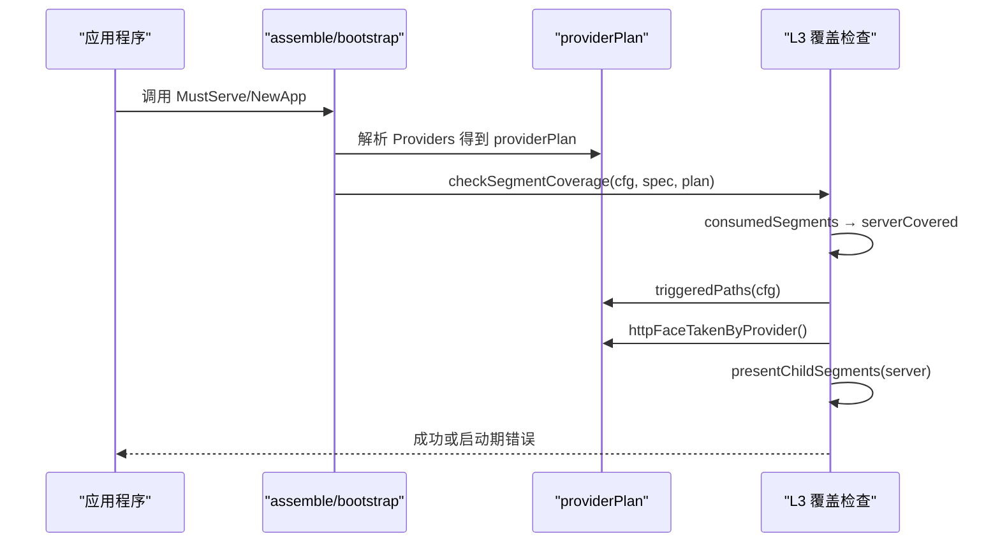
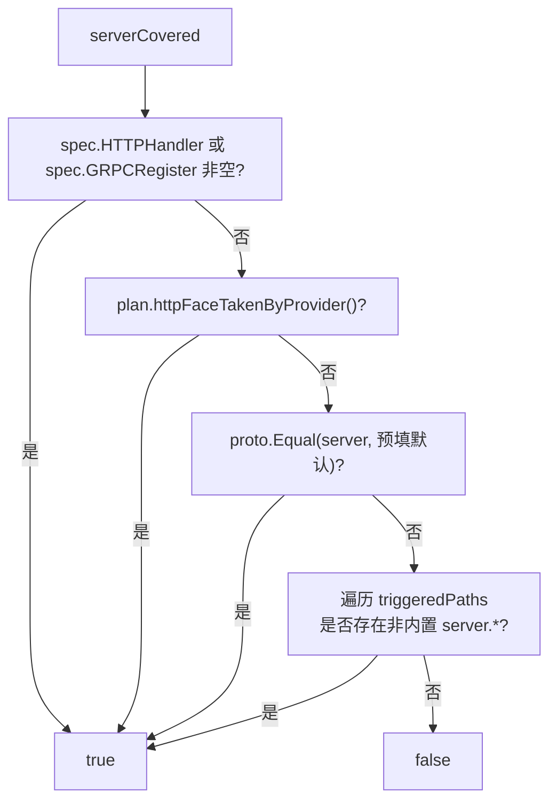
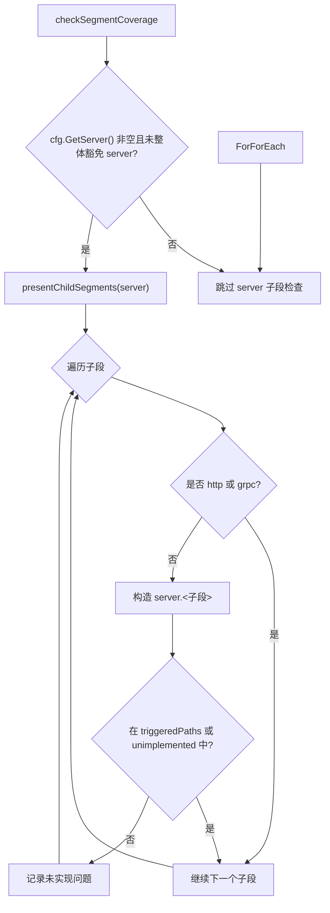
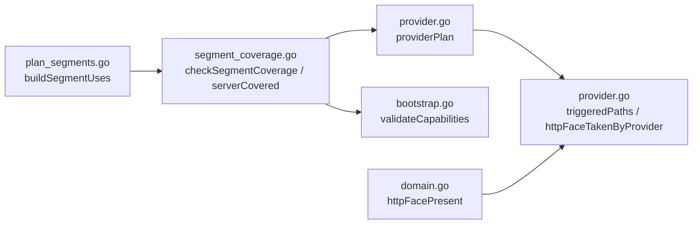

# server 段双层判定

<cite>
**本文引用的文件**   
- [segment_coverage.go](file://pkg/appkit/segment_coverage.go)
- [provider.go](file://pkg/appkit/provider.go)
- [plan_segments.go](file://pkg/appkit/plan_segments.go)
- [bootstrap.go](file://pkg/appkit/bootstrap.go)
- [domain.go](file://pkg/appkit/domain.go)
</cite>

## 目录
1. [引言](#引言)
2. [项目结构](#项目结构)
3. [核心组件](#核心组件)
4. [架构总览](#架构总览)
5. [详细组件分析](#详细组件分析)
6. [依赖关系分析](#依赖关系分析)
7. [性能考量](#性能考量)
8. [故障排除指南](#故障排除指南)
9. [结论](#结论)

## 引言
本文聚焦 Bald 应用框架中 `server` 配置段在装配期的“双层判定”机制。该机制用于回答两个关键问题：

- 第一层：顶层 `server` 段是否已消费？即当前装配是否真正启用了服务器能力，还是只是把一段空壳配置写在了契约里却无人消费。
- 第二层：`server` 子段是否合法？除内置的 `http`、`grpc` 外，其余子段必须由外部 Provider 以 `server.<子段>` 路径接管，否则视为未实现配置。

判定发生在 L3 覆盖检查阶段（启动期 fail-fast），并复用 Provider 计划中的“活跃声明路径集合”和“最终归属者”。因此，编译期 `--plan` 与真实启动对同一份装配声明给出一致结果。

## 项目结构
与 server 段双层判定直接相关的代码集中在 appkit 包内：

| 文件 | 职责 |
|---|---|
| `pkg/appkit/segment_coverage.go` | L3 覆盖检查入口；定义 `builtinServerSegments`；计算 `consumedSegments` 与 `serverCovered` |
| `pkg/appkit/provider.go` | Provider 计划解析；`triggeredPaths`、`ownsPath`、`ownerOf`、`httpFaceTakenByProvider` |
| `pkg/appkit/plan_segments.go` | 段使用汇总；按白名单与内置协议给 `Framework=true` 标记 |
| `pkg/appkit/bootstrap.go` | 能力声明校验：`WithHTTP`/`WithGRPC` 与转码面冲突诊断 |
| `pkg/appkit/domain.go` | 域路由挂载前的 HTTP 面存在性判断，复用 `httpFaceTakenByProvider` |

**图示来源**
- [segment_coverage.go:22-156](file://pkg/appkit/segment_coverage.go#L22-L156)
- [provider.go:200-263](file://pkg/appkit/provider.go#L200-L263)
- [provider.go:607-641](file://pkg/appkit/provider.go#L607-L641)

**章节来源**
- [segment_coverage.go:22-156](file://pkg/appkit/segment_coverage.go#L22-L156)
- [provider.go:200-263](file://pkg/appkit/provider.go#L200-L263)
- [provider.go:607-641](file://pkg/appkit/provider.go#L607-L641)

## 核心组件
本节按“第一层判定”和“第二层判定”拆解核心逻辑。

### 第一层判定：顶层 `server` 段是否已消费
入口是 `checkSegmentCoverage` 调用的 `consumedSegments`，其中 server 段的消费由 `serverCovered` 决定。它按以下顺序判定：

1. **能力声明**：若 `spec.HTTPHandler != nil` 或 `spec.GRPCRegister != nil`，直接认为 `server` 已消费。
2. **转码面接管**：若 `httpFaceTakenByProvider()` 为真，认为 `server.http` 已被非内置 Provider 承载，从而 `server` 已消费。
3. **预填豁免**：若用户传入的 `BootstrapConfig.GetServer()` 与 `bconf.NewBootstrap().GetServer()` 通过 `proto.Equal` 深相等，说明这段 server 配置是框架自填默认值，并非用户意图，因此豁免。
4. **非内置协议触发**：遍历 `triggeredPaths(cfg)`，只要存在 `server.*` 且子段不在 `builtinServerSegments` 中，就认为有第三方协议 Provider 接入了 `server` 段。
5. **以上全不满足**：`server` 未被消费；如果此时用户确实写了非空的 server 配置，则 L3 会报顶层无消费者。

**图示来源**
- [segment_coverage.go:132-156](file://pkg/appkit/segment_coverage.go#L132-L156)

**章节来源**
- [segment_coverage.go:108-156](file://pkg/appkit/segment_coverage.go#L108-L156)
- [bootstrap.go:158-191](file://pkg/appkit/bootstrap.go#L158-L191)

### 第二层判定：`server` 子段的合法性检查
当 `cfg.GetServer() != nil` 且未整体豁免 `server` 时，框架枚举 server 下的所有消息型子段，然后：

- 跳过 `builtinServerSegments` 中的 `http`、`grpc`：它们由内置 server Provider 管辖，不需要外部实现。
- 对于其他子段，若 `triggeredPaths` 中包含对应 `server.<子段>`，或该路径已在 `unimplemented` 白名单中，则合法。
- 否则加入问题清单，提示该子段已配置但仓库中没有实现。

**图示来源**
- [segment_coverage.go:63-107](file://pkg/appkit/segment_coverage.go#L63-L107)

**章节来源**
- [segment_coverage.go:63-107](file://pkg/appkit/segment_coverage.go#L63-L107)

### `builtinServerSegments` 白名单的设计意图
`builtinServerSegments` 是一个仅含 `http` 和 `grpc` 的布尔映射，用于区分：

- **由内置 server Provider 管辖的子段**：`http`、`grpc`。即使它们在契约中出现，也不要求外部 Provider 提供实现；它们的启用由 `WithHTTP`、`WithGRPC` 等能力声明驱动。
- **需要外部 Provider 接管的子段**：如 `asynq`、`cron`、`sse`、`mcp`、`webhook` 等。这些子段出现在契约中时，必须有 Provider 以 `server.<子段>` 路径声明消费，否则会被第二层判定报告为未实现。

设计意图是：**不要把“契约里有这个字段”等同于“框架已经支持这个协议”**。新增 server 子段后，如果框架没有内置 Provider，就必须由业务或三方扩展提供实现。

**章节来源**
- [segment_coverage.go:35-37](file://pkg/appkit/segment_coverage.go#L35-L37)
- [segment_coverage.go:63-107](file://pkg/appkit/segment_coverage.go#L63-L107)

### `httpFaceTakenByProvider` 的实现逻辑及与 `builtinServerSegments` 的区别
`httpFaceTakenByProvider` 判断的是“`server.http` 的最终归属者是否为非内置 Provider”，而不是简单看 `server.http` 是否在契约中出现。

具体逻辑：

1. 从 `providerPlan.byPath` 查 `server.http` 的最终归属 Provider。
2. 若无归属，返回 false。
3. 若归属者是 `stdHTTPProvider`，返回 false——因为这是内置 HTTP Provider，它只有在 `WithHTTP` 声明时才构面，不能算“第三方接管”。
4. 否则返回 true，表示 grpc-gateway 或其他第三方 Provider 接管了 HTTP 端口。

它与 `builtinServerSegments` 的关键区别：

| 维度 | `builtinServerSegments` | `httpFaceTakenByProvider` |
|---|---|---|
| 判断对象 | server 子段名是否属于内置协议 | `server.http` 的最终归属 Provider 是否为非内置 |
| 用途 | 第二层判定中跳过 `http`、`grpc` 的未实现检查 | 判断是否有第三方 Provider 接管 HTTP 面 |
| 返回值语义 | “该子段由内置 server Provider 管辖” | “该段由非内置 Provider 最终拥有” |
| 典型场景 | `server.grpc` 不会报未实现 | grpc-gateway 接管 `server.http` 时返回 true |

**章节来源**
- [provider.go:607-625](file://pkg/appkit/provider.go#L607-L625)
- [segment_coverage.go:138-143](file://pkg/appkit/segment_coverage.go#L138-L143)

### `triggeredPaths` 与 `unimplemented` 白名单
- `triggeredPaths`：收集所有活跃 Provider 声明的路径中，实际出现在契约里的路径集合。它是“代码侧希望消费哪些段”的投影，不是构建产物。
- `unimplemented`：由 `WithUnimplementedSegments` 显式注入的白名单，用于契约先行但尚未实现的段。例如 `script`、`server.asynq`。

在第二层判定中，`server.<子段>` 只要出现在 `triggeredPaths` 或 `unimplemented` 中，就不会被报告为未实现。

**章节来源**
- [provider.go:627-641](file://pkg/appkit/provider.go#L627-L641)
- [provider.go:239-263](file://pkg/appkit/provider.go#L239-L263)

### 与 `plan_segments.go` 的关系：`Framework` 标记
`buildSegmentUses` 在生成段使用汇总时，也会用到 `builtinServerSegments`：

- 顶层 server 子段若属于 `builtinServerSegments`，且没有消费者、不在白名单中，并且 server 段本身已被框架判定为已消费（`serverFramework`），则该子段被标记为 `Framework=true`。
- 这意味着它在段覆盖视图中被视为“框架行为”，而不是用户漏配。

这强化了约定：**http/grpc 是内置 server Provider 的责任面，其他子段必须走外部 Provider**。

**章节来源**
- [plan_segments.go:24-69](file://pkg/appkit/plan_segments.go#L24-L69)

## 架构总览
下图展示 server 段双层判定在整个装配流程中的位置：

**图示来源**
- [bootstrap.go:158-191](file://pkg/appkit/bootstrap.go#L158-L191)
- [segment_coverage.go:63-156](file://pkg/appkit/segment_coverage.go#L63-L156)
- [provider.go:607-641](file://pkg/appkit/provider.go#L607-L641)

## 详细组件分析

### 第一层判定：`serverCovered` 完整判据
`serverCovered` 的判定优先级如下：

1. **`WithHTTP` 或 `WithGRPC` 任一声明**  
   表示代码侧明确启用了 HTTP 或 gRPC 服务，内置 server Provider 会据此构造对应面。

2. **`httpFaceTakenByProvider()` 为真**  
   表示 grpc-gateway 等第三方 Provider 已声明 `server.http` 并最终拥有该路径。此时即使没有 `WithHTTP`，也认为 server 段已有消费者。

3. **`proto.Equal(cfg.GetServer(), bconf.NewBootstrap().GetServer())`**  
   表示 server 配置完全等于框架预填默认值。这是“框架自己填的，不要把它当成用户配置”的豁免。

4. **存在非内置 `server.*` Provider**  
   例如 `server.asynq`、`server.cron`。这类 Provider 通常只关心自己的子段，但接入它们意味着应用确实在消费 `server` 段。

5. **以上都不满足**  
   返回 false；如果用户确实配置了 server 子字段且没有能力声明，L3 会报顶层无消费者。

**图示来源**
- [segment_coverage.go:132-156](file://pkg/appkit/segment_coverage.go#L132-L156)

**章节来源**
- [segment_coverage.go:108-156](file://pkg/appkit/segment_coverage.go#L108-L156)

### 第二层判定：`checkSegmentCoverage` 中的 server 子段检查
该检查只在以下条件下执行：

- `cfg.GetServer() != nil`
- `plan.unimplemented["server"]` 为假（即没有对整个 server 段做白名单豁免）

然后：

1. 用 `presentChildSegments` 枚举 server 的所有消息型子段。
2. 跳过 `http`、`grpc`。
3. 构造 `server.<子段>` 路径。
4. 若该路径在 `triggeredPaths` 或 `unimplemented` 中，跳过。
5. 否则加入未实现清单。

**图示来源**
- [segment_coverage.go:63-107](file://pkg/appkit/segment_coverage.go#L63-L107)

**章节来源**
- [segment_coverage.go:63-107](file://pkg/appkit/segment_coverage.go#L63-L107)

### 能力声明与转码面的交互：`validateCapabilities`
虽然不属于“双层判定”主流程，但 `validateCapabilities` 与 server 段判定密切相关：

- `WithHTTP` 要求 `server.http` 段存在。
- `WithGRPC` 要求 `server.grpc` 段存在。
- 如果同时声明 `WithHTTP` 和一个接管 `server.http` 的转码面 Provider，且 `server.http.driver` 未显式设为 `grpc-gateway`，则报错。

这是因为“同端口单面”语义：当 grpc-gateway 接管 `server.http` 时，gin 业务路由让位；如果不显式声明取舍，后声明的 Provider 可能静默替代前者。

**章节来源**
- [bootstrap.go:158-191](file://pkg/appkit/bootstrap.go#L158-L191)

### 域路由挂载前的 HTTP 面存在性：`httpFacePresent`
`domain.go` 中的 `httpFacePresent` 复用 `pp.httpFaceTakenByProvider()`，用于判断域名 `Routes` 钩子是否可以挂载：

- 若声明了 `WithHTTP`，可挂载。
- 若第三方 Provider 接管 `server.http`，也可挂载（由该 Provider 决定后续行为）。
- 否则拒绝挂载，避免路由无处可挂。

这与 server 段判定的共同点是：**HTTP 面存在与否不仅看 `WithHTTP`，还要看 Provider 计划中谁最终拥有 `server.http`**。

**章节来源**
- [domain.go:149-161](file://pkg/appkit/domain.go#L149-L161)

## 依赖关系分析

**图示来源**
- [segment_coverage.go:63-156](file://pkg/appkit/segment_coverage.go#L63-L156)
- [provider.go:607-641](file://pkg/appkit/provider.go#L607-L641)
- [bootstrap.go:158-191](file://pkg/appkit/bootstrap.go#L158-L191)
- [plan_segments.go:24-69](file://pkg/appkit/plan_segments.go#L24-L69)
- [domain.go:149-161](file://pkg/appkit/domain.go#L149-L161)

**章节来源**
- [segment_coverage.go:63-156](file://pkg/appkit/segment_coverage.go#L63-L156)
- [provider.go:607-641](file://pkg/appkit/provider.go#L607-L641)
- [bootstrap.go:158-191](file://pkg/appkit/bootstrap.go#L158-L191)
- [plan_segments.go:24-69](file://pkg/appkit/plan_segments.go#L24-L69)
- [domain.go:149-161](file://pkg/appkit/domain.go#L149-L161)

## 性能考量
- `presentChildSegments` 每次遍历 server 的消息型字段，复杂度与 server 子段数量线性相关。
- `triggeredPaths` 遍历活跃 Provider 的声明路径，再对每条路径做 protobuf 反射下钻；总体是 Provider 数量与声明路径数量的乘积级别。
- `proto.Equal` 比较整个 server 结构体，成本取决于配置深度与嵌套数量。
- 由于这些逻辑仅在装配期执行一次，且面向的是进程启动阶段，通常不构成运行期瓶颈。

[本节为通用性能讨论，不直接分析具体代码片段]

## 故障排除指南

### 现象一：启动时报“server 段无消费者”
**可能原因**

- 配置了 `server.http` 或 `server.grpc`，但没有调用 `appkit.WithHTTP` 或 `appkit.WithGRPC`。
- 没有第三方 Provider 接管 `server.http`。
- 没有接入任何非内置 `server.*` Provider。
- 配置不是框架预填默认值，但也没有任何 Provider 消费 server 段。

**排查步骤**

1. 确认是否声明了 `WithHTTP` 或 `WithGRPC`。
2. 如果使用 grpc-gateway，确认 Provider 声明了 `server.http` 并处于最终归属。
3. 如果使用了 `server.asynq`、`server.cron` 等第三方协议，确认对应 Provider 已注册。
4. 如果只是误写 server 配置，移除相应子段。
5. 如果确实想保留配置但不启用，使用 `appkit.WithUnimplementedSegments("server")` 整体豁免。

**章节来源**
- [segment_coverage.go:108-156](file://pkg/appkit/segment_coverage.go#L108-L156)

### 现象二：启动时报“server.X 已配置但仓库中无实现”
**可能原因**

- 新增了 `server.<子段>` 配置，但没有 Provider 以 `server.<子段>` 路径声明消费。
- 拼错了白名单路径，例如写成 `server.async` 而非 `server.asynq`。
- 忘记将 `server.<子段>` 加入 `WithUnimplementedSegments`。

**排查步骤**

1. 检查 `presentChildSegments` 枚举出的 server 子段。
2. 确认是否有 Provider 的 `Segments()` 返回对应 `server.<子段>`。
3. 如果是临时未实现，先加入 `WithUnimplementedSegments("server.<子段>")`。
4. 如果是内置协议，确认不应手动接管 `server.http` 或 `server.grpc`，而应使用 `WithHTTP`/`WithGRPC`。

**章节来源**
- [segment_coverage.go:63-107](file://pkg/appkit/segment_coverage.go#L63-L107)

### 现象三：`WithHTTP` 与 grpc-gateway 同时声明导致启动失败
**可能原因**

- 同时声明了 `WithHTTP` 和一个接管 `server.http` 的 Provider。
- 未显式设置 `server.http.driver = "grpc-gateway"`。

**排查步骤**

1. 如果希望保留 grpc-gateway 转码面，显式设置 driver。
2. 如果希望使用 gin 等业务 handler，移除接管 `server.http` 的 Provider。
3. 注意：一旦 `httpFaceTakenByProvider()` 为真，域路由挂载前会感知到 HTTP 面存在，但实际挂载行为由 Provider 和 domain 约定决定。

**章节来源**
- [bootstrap.go:158-191](file://pkg/appkit/bootstrap.go#L158-L191)
- [provider.go:607-625](file://pkg/appkit/provider.go#L607-L625)

### 现象四：配置看似为空，但仍被当作用户配置
**可能原因**

- 使用了 `proto.Equal` 对比，发现 server 结构与 `bconf.NewBootstrap().GetServer()` 完全相同。
- 该情况会被框架识别为“预填默认”，从而豁免 server 段未消费错误。

**建议**

- 不要依赖“空 server 配置自动生效”；如需启用 HTTP/gRPC，仍需 `WithHTTP`/`WithGRPC` 或第三方 Provider。
- 如果确实只想保留默认结构而不启用服务器，保持配置不变即可。

**章节来源**
- [segment_coverage.go:138-143](file://pkg/appkit/segment_coverage.go#L138-L143)

### 现象五：段视图显示 server 子段为框架段，但实际未监听
**可能原因**

- 该子段属于 `builtinServerSegments`（`http`/`grpc`），因此 `buildSegmentUses` 将其标记为 `Framework=true`。
- 但这不代表它一定启动了；仍需 `WithHTTP`/`WithGRPC` 或对应 Provider 实际消费。

**建议**

- 不要仅凭 `Framework=true` 推断协议已监听。
- 结合 L3 覆盖检查、日志和端口探测确认实际状态。

**章节来源**
- [plan_segments.go:40-69](file://pkg/appkit/plan_segments.go#L40-L69)
- [segment_coverage.go:35-37](file://pkg/appkit/segment_coverage.go#L35-L37)

## 结论
server 段的双层判定是 Bald 装配系统防止“配置静默失效”的关键防线：

- 第一层确保 `server` 顶层段不是空壳：要么声明了 HTTP/gRPC 能力，要么有第三方 Provider 接管，要么接入非内置协议，要么只是框架预填默认。
- 第二层确保新增的 server 子段必须有实现：除 `http`、`grpc` 外，每个子段都需要外部 Provider 以 `server.<子段>` 路径接管，或通过 `WithUnimplementedSegments` 显式承认暂不实现。
- `builtinServerSegments` 和 `httpFaceTakenByProvider` 分别承担“协议族分类”和“最终归属判定”的职责，二者互补但不等价。
- 这套机制贯穿 `--plan` 预检、装配期校验、段使用汇总和域路由挂载判断，保证声明、计划与运行态的一致性。