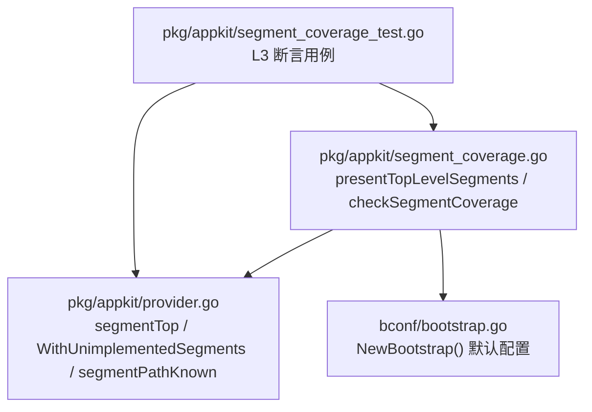
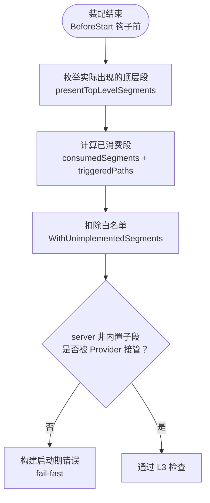
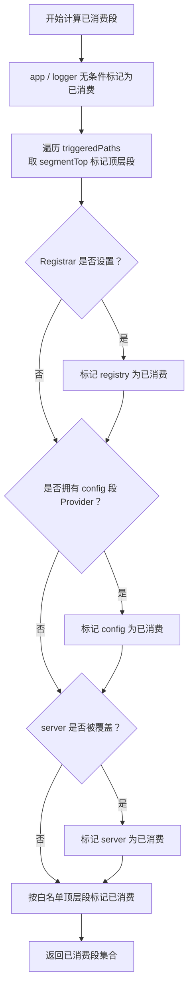
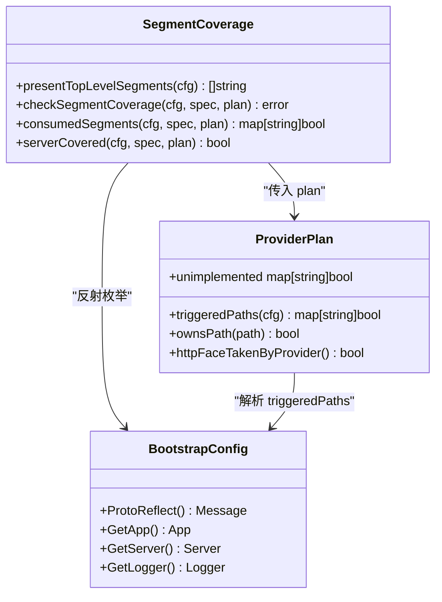

# 段枚举与白名单机制

<cite>
**本文引用的文件**   
- [segment_coverage.go](file://pkg/appkit/segment_coverage.go)
- [provider.go](file://pkg/appkit/provider.go)
- [segment_coverage_test.go](file://pkg/appkit/segment_coverage_test.go)
- [bootstrap.go](file://bconf/bootstrap.go)
</cite>

## 目录
1. [引言](#引言)
2. [项目结构](#项目结构)
3. [核心组件](#核心组件)
4. [架构总览](#架构总览)
5. [详细组件分析](#详细组件分析)
6. [依赖关系分析](#依赖关系分析)
7. [性能考量](#性能考量)
8. [故障排查指南](#故障排查指南)
9. [结论](#结论)

## 引言
本章节聚焦 L3 层「段枚举与白名单」机制，解释系统如何在启动期发现 BootstrapConfig 中实际出现的顶层配置段、判定哪些段被装配逻辑消费，并对未消费的段执行 fail-fast。同时说明 `WithUnimplementedSegments` 白名单如何允许显式豁免尚未实现的段，以及该机制与「安全缺省」设计原则的关系：新增契约段若暂无消费者，会主动暴露为错误清单，避免重蹈 script 段静默失效的历史教训。

## 项目结构
与本文直接相关的代码位于 `pkg/appkit`（L3 覆盖检查与 Provider 计划）和 `bconf`（BootstrapConfig 默认值与契约定义位置）。

**图表来源**
- [segment_coverage.go:1-156](file://pkg/appkit/segment_coverage.go#L1-L156)
- [provider.go:1-350](file://pkg/appkit/provider.go#L1-L350)
- [bootstrap.go:1-200](file://bconf/bootstrap.go#L1-L200)
- [segment_coverage_test.go:1-200](file://pkg/appkit/segment_coverage_test.go#L1-L200)

**章节来源**
- [segment_coverage.go:1-156](file://pkg/appkit/segment_coverage.go#L1-L156)
- [provider.go:1-350](file://pkg/appkit/provider.go#L1-L350)
- [bootstrap.go:1-200](file://bconf/bootstrap.go#L1-L200)

## 核心组件
- `presentTopLevelSegments(cfg)`：基于 protobuf 反射枚举 `BootstrapConfig` 中「消息型字段非 nil」的顶层段，按字段声明序返回段名。
- `checkSegmentCoverage(cfg, spec, plan)`：计算「出现段 − 已消费段 − 白名单」，剩余即构建启动期错误；同时对 `server` 的非内置子段做额外接管检查。
- `consumedSegments(cfg, spec, plan)`：计算本次装配真正消费的顶层段集合，含 `app`、`logger` 无条件消费，Provider 路径触发段，以及 `server` 能力判定等规则。
- `segmentTop(path)`：从 Provider 声明的段路径提取顶层段名，例如 `database.sql` → `database`。
- `WithUnimplementedSegments(names...)`：注册白名单，允许「契约已声明但框架尚无消费者」的段通过 L3 检查；条目必须是真实字段路径，否则计划期报错。
- `segmentPathKnown(path)`：校验白名单条目是否为 `BootstrapConfig` 的真实字段路径。

**章节来源**
- [segment_coverage.go:1-156](file://pkg/appkit/segment_coverage.go#L1-L156)
- [provider.go:1-350](file://pkg/appkit/provider.go#L1-L350)

## 架构总览
L3 段覆盖检查发生在装配链末尾、BeforeStart 阶段之后：此时契约已装载定型，各 Provider 的 Plan/Build 是否触发已经可见，配置文件贡献的段（如 config 层带入的 `script`）也已进入最终配置树。

**图表来源**
- [segment_coverage.go:28-110](file://pkg/appkit/segment_coverage.go#L28-L110)
- [provider.go:200-350](file://pkg/appkit/provider.go#L200-L350)

## 详细组件分析

### presentTopLevelSegments：按反射枚举「实际出现」的顶层段
`presentTopLevelSegments` 不遍历所有声明字段，而是对 `cfg.ProtoReflect()` 调用 `presentChildSegments`，只收集消息型字段且值为有效消息的顶层段。这样做的意义是：

- 仅报告「用户或上游层实际写入」的配置段，而非 proto 定义中的空占位字段。
- 与 `segmentPresent` 使用同一判定语义：消息型字段非 nil 才算 present。
- 返回顺序来自 `Descriptor().Fields()` 的迭代序，也就是 proto 字段声明序，因此报错清单顺序确定、与契约字段序一致，便于测试与人工核对。

新增顶层段若没有消费者，就会自动落入未消费段列表——这是「安全缺省」的关键保障：契约先行时，新增段不会静默消失，而是主动提醒实现方补齐消费者或显式豁免。

**章节来源**
- [segment_coverage.go:34-47](file://pkg/appkit/segment_coverage.go#L34-L47)
- [provider.go:200-237](file://pkg/appkit/provider.go#L200-L237)

### segmentTop：从 Provider 路径提取顶层段名
`segmentTop` 的实现非常直接：在第一个 `.` 处截断，无点则整串作为顶层段名。它用于把 Provider 声明的路径映射到 L3 检查所需的顶层段集合：

- `database.sql` → `database`
- `server.asynq` → `server`
- 顶层段如 `script`、`registry` 保持不变

这一函数是连接 Provider 级消费语义与 L3 段级检查的桥梁。

**章节来源**
- [provider.go:289-297](file://pkg/appkit/provider.go#L289-L297)

### WithUnimplementedSegments：白名单的作用与校验
`WithUnimplementedSegments` 是 L3 检查的「唯一豁免出口」。其工作机制如下：

1. 调用 `WithUnimplementedSegments("script")` 或 `WithUnimplementedSegments("server.asynq")`，将条目追加到 `Decl.UnimplementedSegments`。
2. 计划期解析时，每个白名单条目先经 `segmentPathKnown` 校验：必须是非空字符串，且逐级对应 `BootstrapConfig` 的消息型字段路径。
3. 校验失败的白名单条目会在计划期直接报错，而不是静默忽略——这防止拼错段名后白名单形同虚设。
4. 合法条目加入 `plan.unimplemented`，并在 `consumedSegments` 中按顶层段名标记为已消费，从而让 L3 检查跳过。

白名单的设计目标是「承认已知暂不生效」，而不是「隐藏未知错误」。因此：

- 顶层段名可写 `script`。
- server 子段路径可写 `server.asynq`。
- 拼错的豁免名称会失败，而不是静默失效。

**章节来源**
- [provider.go:136-188](file://pkg/appkit/provider.go#L136-L188)
- [provider.go:312-330](file://pkg/appkit/provider.go#L312-L330)

### checkSegmentCoverage：L3 失败路径与 server 子段规则
`checkSegmentCoverage` 的核心流程是：

1. 调用 `presentTopLevelSegments` 得到实际出现的顶层段。
2. 调用 `consumedSegments` 得到已消费段集合。
3. 计算差集：出现但未消费的段。
4. 若存在未消费段，构造包含段名的启动期错误，并提示引入 Provider、使用 `WithUnimplementedSegments` 或从契约移除该段。
5. 对 `server` 段进行额外检查：若 `server` 未被整体豁免，且某个非内置子段（`http`、`grpc` 之外）出现在配置中但没有 Provider 以 `server.X` 路径接管，则单独报错。

server 子段的处理保留了历史行为：原 `bootstrap.validateServerSections` 中「配了没实现」的 fail-fast 语义被并入 L3，避免用户误以为协议面已监听。

**章节来源**
- [segment_coverage.go:49-110](file://pkg/appkit/segment_coverage.go#L49-L110)

### consumedSegments：已消费段的判定规则
`consumedSegments` 不是简单按 Provider 数量判断，而是按真实消费路径建模：

- `app`、`logger`：无条件消费。它们不在 Provider 构建循环中，但装配逻辑始终读取或重建它们。
- `registry`、`tracer`、`metrics`、`database`、`cache`、`storage`、`ai`、`workflow`、`broker`、`audit`：段在且对应 Provider 声明了该段，即视为已消费。
- `config`：仅当 `config` 段 Provider 被构建时算消费；`ConfigFile`/`RemoteConfig` 走本地文件和远程桥通道，不走契约 `config` 段。
- `server`：由 `serverCovered` 判定，包括 WithHTTP/WithGRPC、转码面 Provider 接管 `server.http`、预填默认深相等价、或非内置协议 Provider 触发。
- 白名单条目：按顶层段名直接标记为已消费。
- 其他一切段名（包括未来新增段）默认无消费者，由 L3 报错。

**图表来源**
- [segment_coverage.go:112-156](file://pkg/appkit/segment_coverage.go#L112-L156)

**章节来源**
- [segment_coverage.go:112-156](file://pkg/appkit/segment_coverage.go#L112-L156)

### 与「安全缺省」设计原则的关系
脚本段 `script` 是全仓零消费者的历史案例：过去它可能静默失效，用户配置写了却没有任何效果。L3 机制把它拉回显式错误域：

- 新增契约段若无消费者 → 启动期报错。
- 想继续保留配置但不启用 → 用 `WithUnimplementedSegments` 显式承认。
- 拼错白名单段名 → 计划期报错，避免误认为已豁免。

这与「安全缺省」原则一致：默认更严格，宁可启动失败，也不让用户误以为系统正常运行。

**章节来源**
- [segment_coverage.go:1-27](file://pkg/appkit/segment_coverage.go#L1-L27)
- [provider.go:136-188](file://pkg/appkit/provider.go#L136-L188)

## 依赖关系分析

**图表来源**
- [segment_coverage.go:28-156](file://pkg/appkit/segment_coverage.go#L28-L156)
- [provider.go:200-350](file://pkg/appkit/provider.go#L200-L350)

**章节来源**
- [segment_coverage.go:28-156](file://pkg/appkit/segment_coverage.go#L28-L156)
- [provider.go:200-350](file://pkg/appkit/provider.go#L200-L350)

## 性能考量
- `presentTopLevelSegments` 使用 protobuf 反射遍历字段，时间复杂度与 `BootstrapConfig` 顶层字段数量线性相关，属于启动期一次性操作，开销很小。
- `segmentPathKnown` 每次校验白名单都会重新构造空的 `BootstrapConfig` 并逐段反射，因此应尽量避免重复调用；当前实现只在计划期解析白名单时调用一次，符合预期。
- `checkSegmentCoverage` 的主要成本在集合差集与字符串拼接，规模受限于有限数量的顶层段，不会成为运行时热点。

[本节为通用性能讨论，不直接分析具体文件]

## 故障排查指南

### 现象一：启动报错「top-level sections with no consumer」
常见原因：

- 配置中存在某顶层段，但没有 Provider 消费。
- 新增契约段尚未接入消费者。
- 忘记添加 `WithUnimplementedSegments` 豁免。

解决方式：

- 引入对应 Provider。
- 若确实暂不生效，添加 `WithUnimplementedSegments("段名")`。
- 若契约不应存在该段，从 proto 定义移除。

**章节来源**
- [segment_coverage.go:49-80](file://pkg/appkit/segment_coverage.go#L49-L80)

### 现象二：白名单未生效
可能原因：

- 白名单条目为空字符串。
- 白名单条目拼错，不是 `BootstrapConfig` 的真实字段路径。
- 使用了错误的层级，例如把 `server.asynq` 写成 `asynq`。

诊断方式：

- 计划期会直接报错，提示白名单路径未知。
- 确认路径逐级都是消息型字段。

**章节来源**
- [provider.go:136-188](file://pkg/appkit/provider.go#L136-L188)
- [provider.go:312-330](file://pkg/appkit/provider.go#L312-L330)

### 现象三：server 子段报错
常见场景：

- 配置了 `server.asynq` 等非标子段，但没有 Provider 以 `server.asynq` 路径接管。
- 使用了转码面 Provider 接管 `server.http`，但白名单仍缺少相应条目。

解决方式：

- 提供对应 Provider。
- 使用 `WithUnimplementedSegments("server.asynq")` 显式豁免。

**章节来源**
- [segment_coverage.go:82-110](file://pkg/appkit/segment_coverage.go#L82-L110)

## 结论
L3 段枚举与白名单机制通过 protobuf 反射精确识别「实际出现」的配置段，按 proto 字段声明序输出确定性报错清单，并以 fail-closed 策略强制暴露未消费段。`WithUnimplementedSegments` 是唯一显式豁免入口，且自身带有强校验，避免拼错段名导致白名单静默失效。该机制与「安全缺省」原则一致：新增契约段不会静默消失，而是主动要求实现方确认，从而延续 script 段历史教训所换来的健壮性。

[本节为总结性内容，不直接分析具体文件]