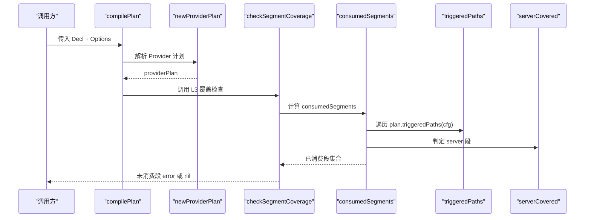
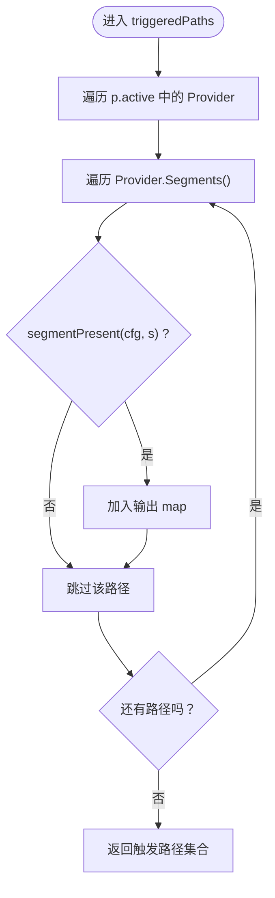
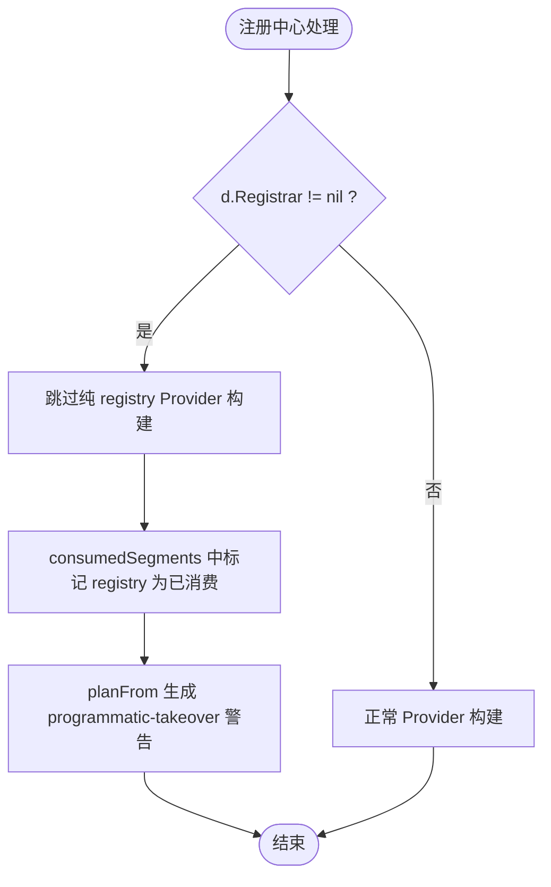
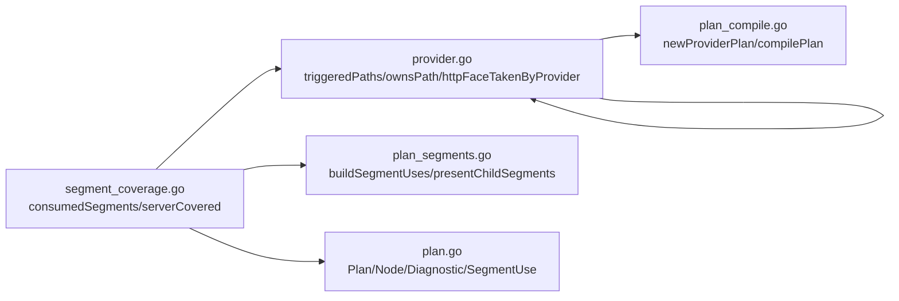

# 消费判定算法

<cite>
**本文引用的文件**   
- [pkg/appkit/segment_coverage.go](file://pkg/appkit/segment_coverage.go)
- [pkg/appkit/provider.go](file://pkg/appkit/provider.go)
- [pkg/appkit/plan_segments.go](file://pkg/appkit/plan_segments.go)
- [pkg/appkit/plan_compile.go](file://pkg/appkit/plan_compile.go)
- [pkg/appkit/plan.go](file://pkg/appkit/plan.go)
</cite>

## 目录
1. [引言](#引言)
2. [项目结构定位](#项目结构定位)
3. [核心组件](#核心组件)
4. [架构总览](#架构总览)
5. [消费判定详解](#消费判定详解)
6. [触发路径计算与 Registrar 接管](#触发路径计算与-registrar-接管)
7. [Provider 组合示例矩阵](#provider-组合示例矩阵)
8. [依赖关系分析](#依赖关系分析)
9. [性能与行为特征](#性能与行为特征)
10. [故障排查指南](#故障排查指南)
11. [结论](#结论)

## 引言
本文聚焦 Bald 框架中 `consumedSegments` 消费判定算法，解释装配期 L3 覆盖检查如何判定每个 BootstrapConfig 顶层段是否被消费。重点包括：

- `app`、`logger` 无条件消费的原因；
- `registry`、`tracer`、`metrics`、`database`、`cache`、`storage`、`ai`、`workflow`、`broker`、`audit` 通过 `plan.triggeredPaths(cfg)` 判定的原理；
- `config` 段仅经 config Provider 消费的精确语义，以及它与 ConfigFile/RemoteConfig 的区别；
- `plan.triggeredPaths(cfg)` 的触发路径计算逻辑；
- `Registrar` 实例接管 `registry` 段时的特殊处理；
- `plan.ownsPath("config")` 与 `serverCovered` 的调用时机和依赖关系；
- 不同 Provider 组合下的消费判定结果及未消费错误排查。

该算法位于装配计划编译后的 L3 覆盖检查阶段，在 assemble 的 BeforeStart 装配链末尾执行，确保「契约已装载定型、各段消费与否已见分晓」后再做 fail-fast 校验。

## 项目结构定位
消费判定算法由以下文件协作完成：

| 文件 | 职责 |
|---|---|
| [pkg/appkit/segment_coverage.go](file://pkg/appkit/segment_coverage.go) | 实现 `checkSegmentCoverage` 与 `consumedSegments`，定义各段消费语义 |
| [pkg/appkit/provider.go](file://pkg/appkit/provider.go) | 实现 Provider 计划解析、`triggeredPaths`、`ownsPath`、`httpFaceTakenByProvider`、段存在性判定 |
| [pkg/appkit/plan_segments.go](file://pkg/appkit/plan_segments.go) | 构建段消费视图 `buildSegmentUses`，用于诊断输出与白名单可见性 |
| [pkg/appkit/plan_compile.go](file://pkg/appkit/plan_compile.go) | 编译装配计划，调用 `newProviderPlan`、`validateCapabilities`、`checkSegmentCoverage` |
| [pkg/appkit/plan.go](file://pkg/appkit/plan.go) | 定义 Plan、Node、Phase、Diagnostic、SegmentUse 等计划类型 |

```mermaid
graph TB
    Compile["compilePlan<br/>编译装配计划"] --> NewPlan["newProviderPlan<br/>解析 Provider 计划"]
    NewPlan --> Triggered["triggeredPaths<br/>收集活跃 Provider 的已出现段路径"]
    Compile --> Coverage["checkSegmentCoverage<br/>L3 覆盖检查"]
    Coverage --> Consumed["consumedSegments<br/>逐段消费判定"]
    Consumed --> ServerCovered["serverCovered<br/>server 段能力判定"]
    Consumed --> OwnsConfig["ownsPath(\"config\")<br/>config Provider 归属判定"]
```

**图示来源**
- [pkg/appkit/plan_compile.go:28-68](file://pkg/appkit/plan_compile.go#L28-L68)
- [pkg/appkit/provider.go:551-630](file://pkg/appkit/provider.go#L551-L630)
- [pkg/appkit/segment_coverage.go:27-156](file://pkg/appkit/segment_coverage.go#L27-L156)

**章节来源**
- [pkg/appkit/segment_coverage.go:1-156](file://pkg/appkit/segment_coverage.go#L1-L156)
- [pkg/appkit/provider.go:1-200](file://pkg/appkit/provider.go#L1-L200)
- [pkg/appkit/plan_segments.go:1-110](file://pkg/appkit/plan_segments.go#L1-L110)
- [pkg/appkit/plan_compile.go:1-120](file://pkg/appkit/plan_compile.go#L1-L120)
- [pkg/appkit/plan.go:1-120](file://pkg/appkit/plan.go#L1-L120)

## 核心组件
- **BootstrapConfig 顶层段**：框架声明 15 个顶层段，`presentTopLevelSegments` 用 protobuf 反射枚举 cfg 中实际出现的顶层段。新增顶层段若尚无消费者会自动落入报错清单，体现安全缺省语义。
- **Provider 接口**：`Segments()` 声明消费/归属的契约段路径；`Plan` 返回节点；`Build` 是副作用入口。段路径按精确匹配做末者胜。
- **providerPlan**：记录每条声明路径的最终归属（末者胜）、活跃 Provider 集合、阶段分组、白名单、警告等。
- **触发路径**：`triggeredPaths(cfg)` 收集活跃 Provider 声明路径中实际出现于契约的路径集合。
- **L3 覆盖检查**：`checkSegmentCoverage` 计算「实际出现的顶层段 − 已消费 − 白名单」，非空即启动期报错。

**章节来源**
- [pkg/appkit/segment_coverage.go:14-26](file://pkg/appkit/segment_coverage.go#L14-L26)
- [pkg/appkit/provider.go:23-120](file://pkg/appkit/provider.go#L23-L120)
- [pkg/appkit/provider.go:230-330](file://pkg/appkit/provider.go#L230-L330)

## 架构总览
消费判定发生在装配计划编译的最后一步。完整流程如下：



**图示来源**
- [pkg/appkit/plan_compile.go:28-68](file://pkg/appkit/plan_compile.go#L28-L68)
- [pkg/appkit/segment_coverage.go:41-156](file://pkg/appkit/segment_coverage.go#L41-L156)
- [pkg/appkit/provider.go:621-630](file://pkg/appkit/provider.go#L621-L630)

**章节来源**
- [pkg/appkit/plan_compile.go:28-68](file://pkg/appkit/plan_compile.go#L28-L68)
- [pkg/appkit/segment_coverage.go:41-156](file://pkg/appkit/segment_coverage.go#L41-L156)

## 消费判定详解
`consumedSegments` 返回一个 map[string]bool，表示本次装配真实消费的顶层段。其判定规则如下：

| 段 | 消费语义 | 原因 |
|---|---|---|
| `app` | 无条件消费 | 元数据（ID/Name/Version/Env/StopTimeout）在装配构造期读入 kitOpts，不在 Provider 循环内；消费无条件，与「段在才构建」语义不同构 |
| `logger` | 无条件消费 | 阶段 A 回退默认 bslog、阶段 B/热更按契约重建；段缺失 = 默认后端而非跳过；logger Provider 覆盖经专用通道 |
| `registry` / `tracer` / `metrics` / `database` / `cache` / `storage` / `ai` / `workflow` / `broker` / `audit` | 段在而 Provider 声明了该段即消费 | 阶段 B 循环按 canonical 序构建，构建失败 fail-fast 能走到检查点即代表已消费；`registry` 段被 Registrar 显式实例接管时视为已消费 |
| `config` | 仅经 config Provider 消费 | 构造期产层；ConfigFile/RemoteConfig 走本地文件与远程桥通道，不是契约 config 段 |
| `server` | 能力声明、非内置 Provider 接管、非内置协议 Provider 触发、或与 bconf.NewBootstrap() 预填默认深相等 | 零能力声明且用户改过任一子字段即报错 |
| 其他段 | 默认无消费者 | 由调用方报错；白名单是唯一豁免出口 |

```mermaid
flowchart TD
    Start(["开始：consumedSegments"]) --> Init["初始化 map: {app:true, logger:true}"]
    Init --> Triggered["遍历 plan.triggeredPaths(cfg)<br/>将顶层段名加入 map"]
    Triggered --> Registrar{"spec.Registrar != nil ?"}
    Registrar -->|是| Registry["加入 registry"]
    Registrar -->|否| ConfigCheck
    Registry --> ConfigCheck["检查 plan.ownsPath(\"config\")"]
    ConfigCheck -->|是| Config["加入 config"]
    ConfigCheck -->|否| ServerCheck
    Config["加入 config"] --> ServerCheck["检查 serverCovered(cfg, spec, plan)"]
    ServerCheck -->|true| Server["加入 server"]
    ServerCheck -->|false| Unimpl["遍历 plan.unimplemented<br/>将其顶层段加入 map"]
    Server["加入 server"] --> Unimpl
    Unimpl --> Return["返回 consumedSegments map"]
```

**图示来源**
- [pkg/appkit/segment_coverage.go:104-156](file://pkg/appkit/segment_coverage.go#L104-L156)
- [pkg/appkit/provider.go:621-630](file://pkg/appkit/provider.go#L621-L630)

**章节来源**
- [pkg/appkit/segment_coverage.go:104-156](file://pkg/appkit/segment_coverage.go#L104-L156)

### app 与 logger 无条件消费
- `app`：框架在装配构造期读取应用元数据并写入 kitOpts，不依赖 Provider 构建循环，因此无论契约中是否出现 `app` 段，都视为已消费。
- `logger`：阶段 A 使用默认 bslog，阶段 B 和热更按契约重建；即使没有 logger Provider，框架也会注入 StandardLoggerProvider，因此 logger 始终有消费者。

**章节来源**
- [pkg/appkit/segment_coverage.go:116-122](file://pkg/appkit/segment_coverage.go#L116-L122)
- [pkg/appkit/provider.go:300-330](file://pkg/appkit/provider.go#L300-L330)

### registry/tracer/metrics/database/cache/storage/ai/workflow/broker/audit 段
这些段的消费判定统一依赖 `plan.triggeredPaths(cfg)`：只要某个 Provider 声明了该段路径，并且该路径在 BootstrapConfig 中实际出现，则该段被视为已消费。对于 `registry` 段，还有一个特殊分支：当 `spec.Registrar != nil` 时，即使纯 registry Provider 被跳过，仍标记为已消费，因为程序化接管是刻意覆盖。

**章节来源**
- [pkg/appkit/segment_coverage.go:122-132](file://pkg/appkit/segment_coverage.go#L122-L132)
- [pkg/appkit/provider.go:621-630](file://pkg/appkit/provider.go#L621-L630)

### config 段的精确语义
`config` 段仅在 `plan.ownsPath("config")` 为真时才被视为已消费。这意味着必须有一个 Provider 的 `Segments()` 返回包含 `"config"` 的路径，并且该 Provider 是末者胜后的最终归属者。

需要注意：**ConfigFile 与 RemoteConfig 不属于契约 config 段**。它们分别走本地文件加载与远程配置桥通道，是装配前的配置源，而不是由 config Provider 消费契约 `config` 段的结果。

**章节来源**
- [pkg/appkit/segment_coverage.go:128-132](file://pkg/appkit/segment_coverage.go#L128-L132)
- [pkg/appkit/provider.go:595-596](file://pkg/appkit/provider.go#L595-L596)

### server 段判定
`serverCovered` 的判断优先级如下：

1. 如果 `spec.HTTPHandler != nil` 或 `spec.GRPCRegister != nil`，说明声明了 HTTP/gRPC 能力，内置 server Provider 必然构造对应面，视为已消费。
2. 如果 `server.http` 被非内置 Provider 接管（例如 grpc-gateway 转码面），视为已消费。
3. 如果 `cfg.GetServer()` 与 `bconf.NewBootstrap().GetServer()` 深相等，说明是框架预填的默认值，视为已消费。
4. 如果有任何 Provider 触发了非内置协议子段（如 `server.asynq`），视为已消费。
5. 否则，如果用户修改过任一 server 子字段但零能力声明，则 L3 检查会报错，提示 server 段无消费者。

**章节来源**
- [pkg/appkit/segment_coverage.go:142-156](file://pkg/appkit/segment_coverage.go#L142-L156)
- [pkg/appkit/provider.go:610-617](file://pkg/appkit/provider.go#L610-L617)

## 触发路径计算与 Registrar 接管

### triggeredPaths 的计算逻辑
`triggeredPaths(cfg)` 遍历 `providerPlan.active` 中的每个 Provider，再遍历其 `Segments()` 返回的所有路径，对每条路径调用 `segmentPresent(cfg, s)` 判断是否在 BootstrapConfig 中出现。只有同时满足「Provider 声明了该路径」和「契约中存在该路径」的条件，才会加入输出集合。



**图示来源**
- [pkg/appkit/provider.go:621-630](file://pkg/appkit/provider.go#L621-L630)
- [pkg/appkit/provider.go:200-228](file://pkg/appkit/provider.go#L200-L228)

**章节来源**
- [pkg/appkit/provider.go:621-630](file://pkg/appkit/provider.go#L621-L630)
- [pkg/appkit/provider.go:200-228](file://pkg/appkit/provider.go#L200-L228)

### Registrar 实例接管 registry 段的特殊处理
当 `Decl.Registrar != nil` 时，框架会跳过所有纯 `registry` Provider 的构建，因为程序化接管意味着调用方有意绕过契约中的 registry 后端选择。尽管如此，`consumedSegments` 仍会将 `registry` 标记为已消费，避免误报。

同时，`planFrom` 会合成一个 Opaque 的 `registry` 节点，并附带诊断警告：「registry segment is taken over by a programmatic Registrar instance; registry backend selection in the contract does not take effect」。



**图示来源**
- [pkg/appkit/provider.go:280-310](file://pkg/appkit/provider.go#L280-L310)
- [pkg/appkit/plan_compile.go:120-160](file://pkg/appkit/plan_compile.go#L120-L160)
- [pkg/appkit/segment_coverage.go:122-132](file://pkg/appkit/segment_coverage.go#L122-L132)

**章节来源**
- [pkg/appkit/provider.go:280-310](file://pkg/appkit/provider.go#L280-L310)
- [pkg/appkit/plan_compile.go:120-160](file://pkg/appkit/plan_compile.go#L120-L160)
- [pkg/appkit/segment_coverage.go:122-132](file://pkg/appkit/segment_coverage.go#L122-L132)

### ownsPath 与 serverCovered 的调用时机
- `plan.ownsPath("config")` 在 `consumedSegments` 中调用，用于判定是否有 Provider 最终拥有 `config` 路径。它依赖 `providerPlan.byPath`，后者在 `newProviderPlan` 中通过「路径末者胜」规则填充。
- `serverCovered` 也在 `consumedSegments` 中调用，依赖 `spec.HTTPHandler`、`spec.GRPCRegister`、`plan.httpFaceTakenByProvider()`、`proto.Equal(cfg.GetServer(), ...)` 以及 `plan.triggeredPaths(cfg)`。

两者的调用顺序是：先处理 `app`、`logger`，再遍历 `triggeredPaths`，然后处理 `Registrar` 接管、`config` 归属、`server` 覆盖，最后合并白名单段。

**章节来源**
- [pkg/appkit/segment_coverage.go:122-156](file://pkg/appkit/segment_coverage.go#L122-L156)
- [pkg/appkit/provider.go:595-617](file://pkg/appkit/provider.go#L595-L617)

## Provider 组合示例矩阵
以下矩阵展示不同 Provider 组合下，各段的消费判定结果。假设 `cfg` 中只出现被列出的顶层段。

| Provider 组合 | app | logger | registry | tracer | metrics | database | cache | storage | ai | workflow | broker | audit | config | server |
|---|---:|---:|---:|---:|---:|---:|---:|---:|---:|---:|---:|---:|---:|---:|
| 无任何 Provider | ✓ | ✓ | ✗ | ✗ | ✗ | ✗ | ✗ | ✗ | ✗ | ✗ | ✗ | ✗ | ✗ | 可能 ✗ |
| 仅 std.Standard() | ✓ | ✓ | ✗ | ✗ | ✗ | ✗ | ✗ | ✗ | ✗ | ✗ | ✗ | ✗ | ✗ | ✓ |
| 仅数据库 Provider，声明 `database` | ✓ | ✓ | ✗ | ✗ | ✗ | ✓ | ✗ | ✗ | ✗ | ✗ | ✗ | ✗ | ✗ | 可能 ✗ |
| 仅缓存 Provider，声明 `cache` | ✓ | ✓ | ✗ | ✗ | ✗ | ✗ | ✓ | ✗ | ✗ | ✗ | ✗ | ✗ | ✗ | 可能 ✗ |
| 仅 config Provider，声明 `config` | ✓ | ✓ | ✗ | ✗ | ✗ | ✗ | ✗ | ✗ | ✗ | ✗ | ✗ | ✗ | ✓ | 可能 ✗ |
| Registrar 接管 registry | ✓ | ✓ | ✓ | ✗ | ✗ | ✗ | ✗ | ✗ | ✗ | ✗ | ✗ | ✗ | ✗ | 可能 ✗ |
| WithHTTP/WithGRPC | ✓ | ✓ | ✗ | ✗ | ✗ | ✗ | ✗ | ✗ | ✗ | ✗ | ✗ | ✗ | ✗ | ✓ |
| 非内置 server Provider 声明 `server.asynq` | ✓ | ✓ | ✗ | ✗ | ✗ | ✗ | ✗ | ✗ | ✗ | ✗ | ✗ | ✗ | ✗ | ✓ |
| 多个 Provider 声明同一路径 | ✓ | ✓ | 以末者胜为准 | 以末者胜为准 | 以末者胜为准 | 以末者胜为准 | 以末者胜为准 | 以末者胜为准 | 以末者胜为准 | 以末者胜为准 | 以末者胜为准 | 以末者胜为准 | 以末者胜为准 | 以末者胜为准 |

注意：
- `app`、`logger` 永远为 ✓。
- `config` 必须有一个 Provider 的 `Segments()` 返回包含 `"config"`，且该 Provider 是末者胜后的最终归属者。
- `server` 在无能力声明且用户修改过子字段时为 ✗，会触发 L3 报错。
- 白名单段（`WithUnimplementedSegments`）不会计入未消费列表，但仍会被报告为 whitelisted。

**章节来源**
- [pkg/appkit/segment_coverage.go:104-156](file://pkg/appkit/segment_coverage.go#L104-L156)
- [pkg/appkit/provider.go:260-330](file://pkg/appkit/provider.go#L260-L330)

## 依赖关系分析
消费判定依赖以下组件：



**图示来源**
- [pkg/appkit/segment_coverage.go:104-156](file://pkg/appkit/segment_coverage.go#L104-L156)
- [pkg/appkit/provider.go:551-630](file://pkg/appkit/provider.go#L551-L630)
- [pkg/appkit/plan_segments.go:1-110](file://pkg/appkit/plan_segments.go#L1-L110)
- [pkg/appkit/plan_compile.go:28-160](file://pkg/appkit/plan_compile.go#L28-L160)
- [pkg/appkit/plan.go:1-120](file://pkg/appkit/plan.go#L1-L120)

**章节来源**
- [pkg/appkit/segment_coverage.go:104-156](file://pkg/appkit/segment_coverage.go#L104-L156)
- [pkg/appkit/provider.go:551-630](file://pkg/appkit/provider.go#L551-L630)
- [pkg/appkit/plan_segments.go:1-110](file://pkg/appkit/plan_segments.go#L1-L110)
- [pkg/appkit/plan_compile.go:28-160](file://pkg/appkit/plan_compile.go#L28-L160)
- [pkg/appkit/plan.go:1-120](file://pkg/appkit/plan.go#L1-L120)

## 性能与行为特征
- `triggeredPaths` 的时间复杂度为 O(P × S)，其中 P 是活跃 Provider 数量，S 是每个 Provider 的声明路径数。
- `segmentPresent` 每次调用需要沿路径逐级进行 protobuf 反射查找，时间复杂度与路径深度成正比。
- `consumedSegments` 本身只做 map 插入和条件判断，开销很小。
- L3 覆盖检查是启动期一次性操作，不影响运行期性能。
- 白名单 `unimplemented` 使用 map 存储，查询为 O(1)。

**章节来源**
- [pkg/appkit/provider.go:621-630](file://pkg/appkit/provider.go#L621-L630)
- [pkg/appkit/provider.go:200-228](file://pkg/appkit/provider.go#L200-L228)
- [pkg/appkit/segment_coverage.go:104-156](file://pkg/appkit/segment_coverage.go#L104-L156)

## 故障排查指南
当某个段被判定为未消费时，可按以下步骤排查：

1. **确认段是否真的出现在 BootstrapConfig 中**  
   使用 `presentTopLevelSegments` 的同一判定逻辑：protobuf 消息型字段非 nil 才算 present。拼错段名会导致该段不被枚举，从而被判定为未消费。

2. **检查是否有 Provider 声明了该段路径**  
   查看 Provider 的 `Segments()` 返回值。如果没有 Provider 声明该段，或者声明的 Provider 没有被选为末者胜后的最终归属者，则该段不会被加入 `triggeredPaths`。

3. **检查是否为 registrar 接管场景**  
   如果使用了 `Registrar` 接管 registry，纯 registry Provider 会被跳过，但 `registry` 段仍会被标记为已消费。此时应关注 `programmatic-takeover` 警告，而不是未消费错误。

4. **检查 config 段是否正确消费**  
   必须有 Provider 的 `Segments()` 返回包含 `"config"`，且该 Provider 是末者胜后的最终归属者。ConfigFile/RemoteConfig 不等同于契约 config 段。

5. **检查 server 段是否满足能力声明**  
   如果用户修改过 server 子字段但没有声明 HTTP/gRPC 能力，也没有非内置 server Provider 接管，则会触发 L3 报错。

6. **检查白名单是否正确配置**  
   `WithUnimplementedSegments` 只能豁免已知字段路径。空路径或未知字段会在计划期直接报错。白名单条目应为顶层段名（如 `"script"`）或 server 子段路径（如 `"server.asynq"`）。

7. **查看诊断输出**  
   使用 `buildSegmentUses` 生成的段消费视图，可以查看每个段的 Consumers、Whitelisted、Framework 状态。Framework 为 true 表示该段由框架自身无条件消费，没有用户可见节点。

**章节来源**
- [pkg/appkit/segment_coverage.go:41-103](file://pkg/appkit/segment_coverage.go#L41-L103)
- [pkg/appkit/provider.go:260-330](file://pkg/appkit/provider.go#L260-L330)
- [pkg/appkit/plan_segments.go:1-110](file://pkg/appkit/plan_segments.go#L1-L110)

## 结论
`consumedSegments` 是 Bald 框架装配期 L3 覆盖检查的核心算法，它通过区分无条件消费段（app、logger）、基于 `triggeredPaths` 的动态消费段（registry、tracer、metrics、database、cache、storage、ai、workflow、broker、audit）、config Provider 专属的 config 段，以及能力驱动的 server 段，实现了精确且可诊断的消费判定。配合 `Registrar` 接管机制、白名单豁免和段消费视图输出，开发者可以在启动期及时发现配置未生效的问题，并在诊断层面理解每个段的消费来源。