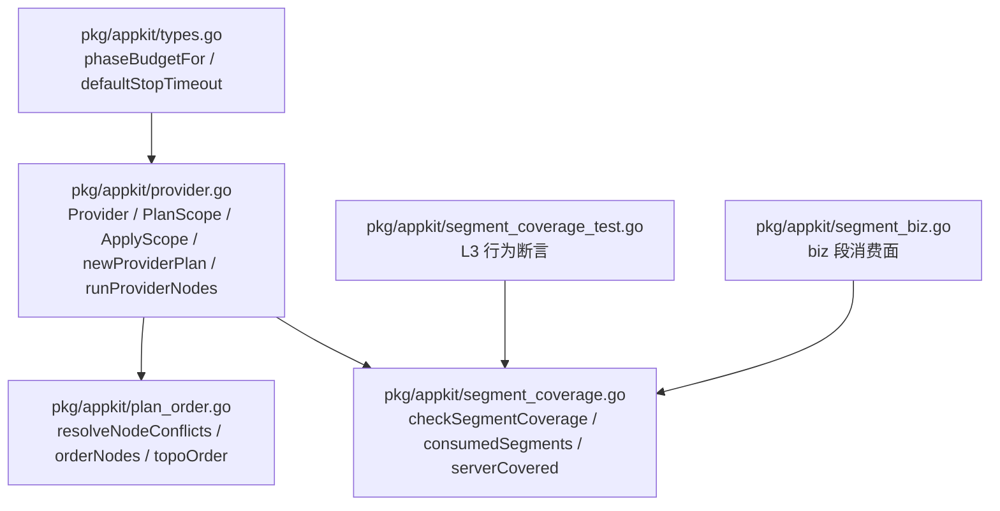
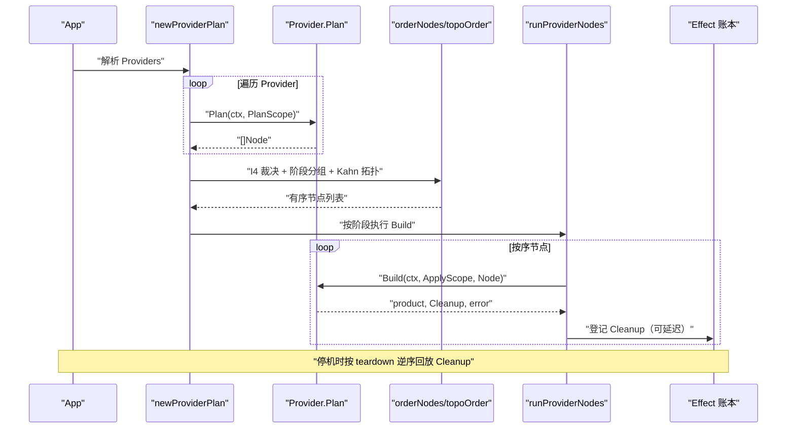
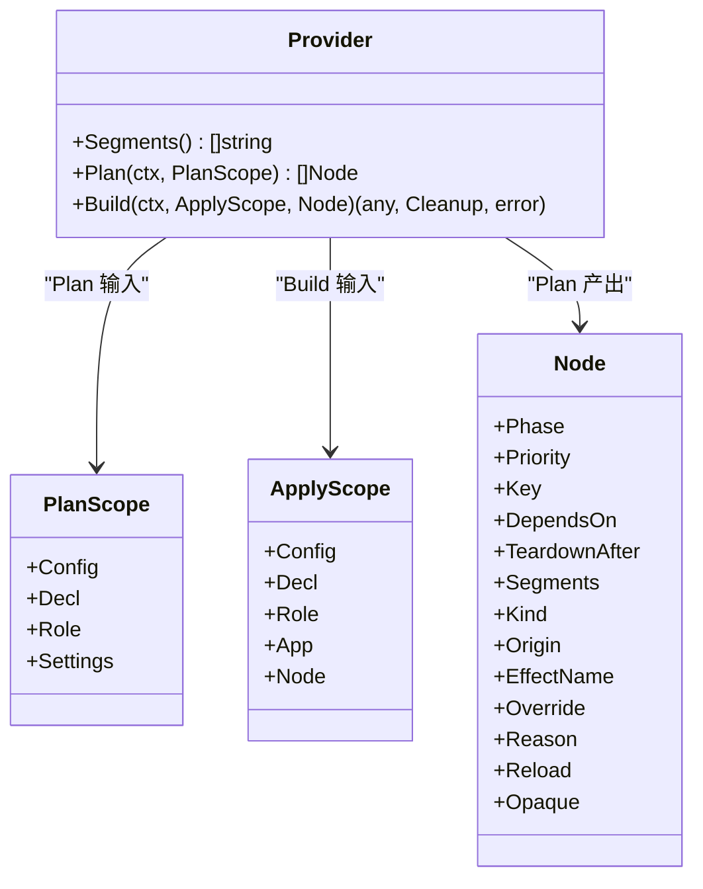
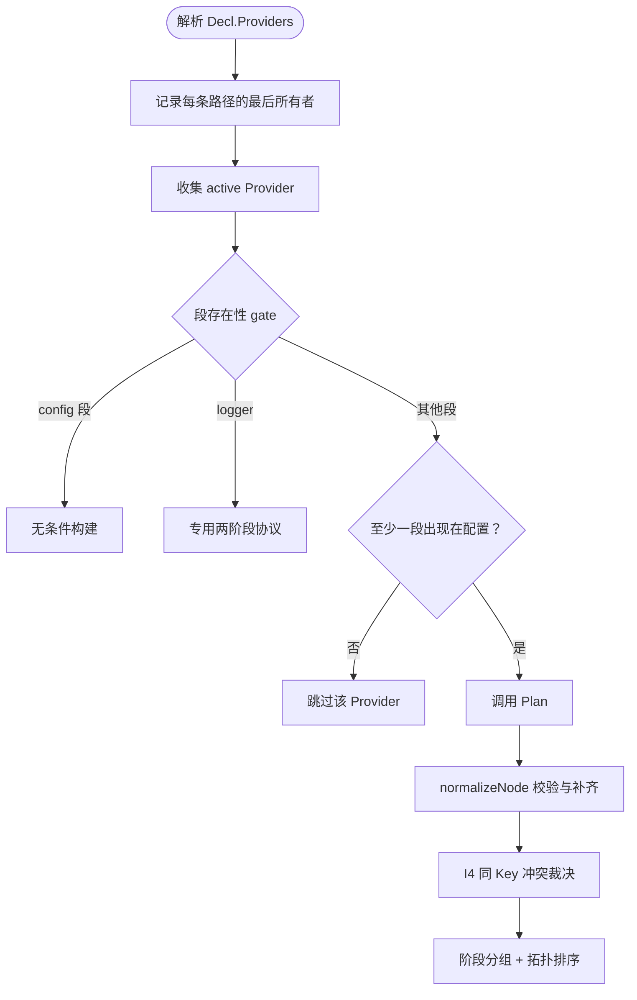
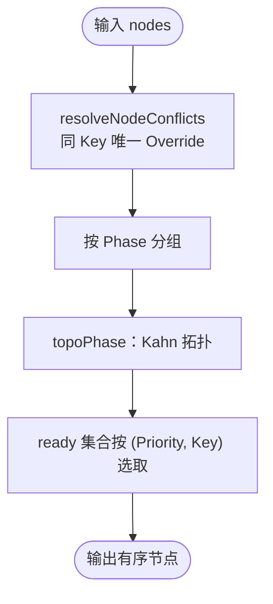
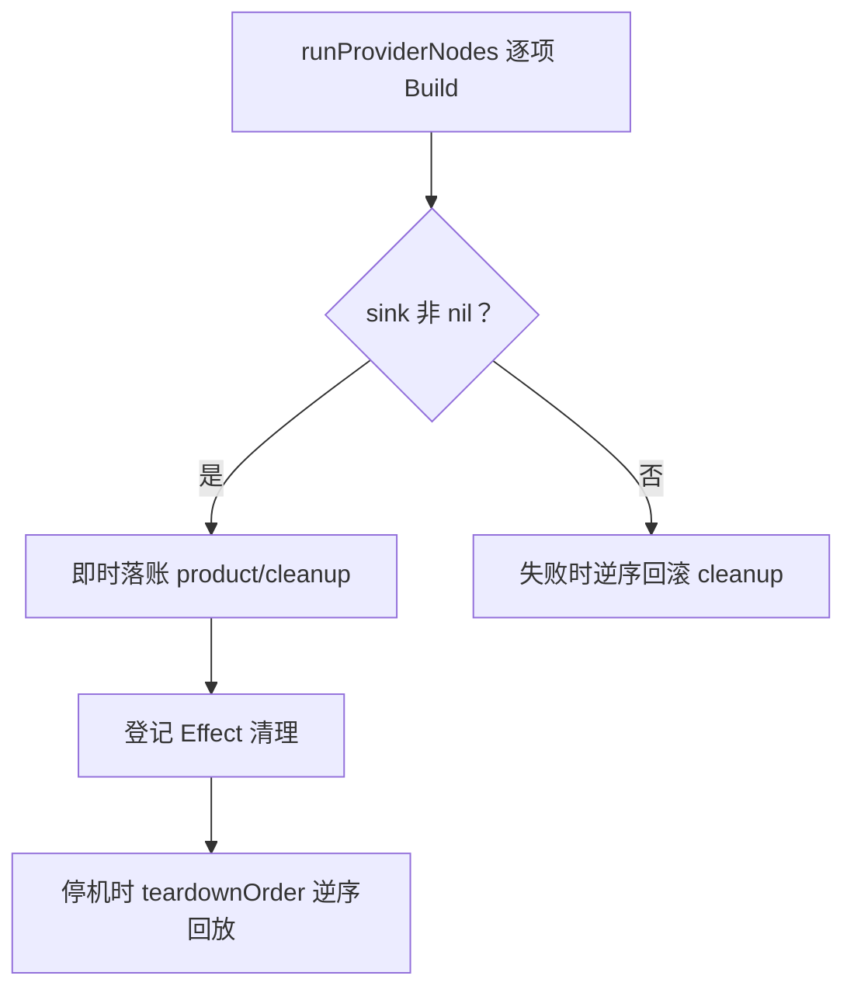
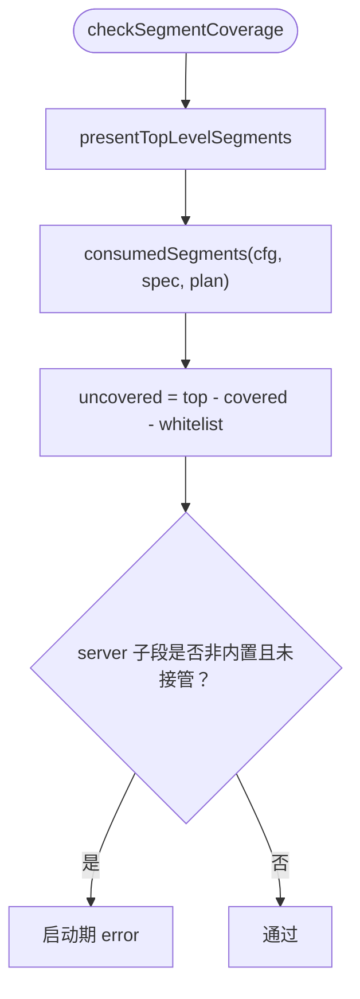
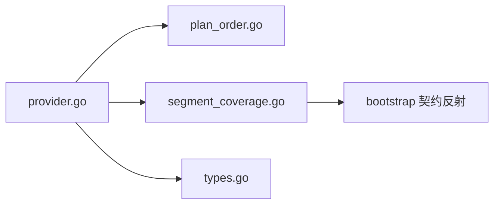

# Provider 驱动机制

<cite>
**本文引用的文件**   
- [provider.go](file://pkg/appkit/provider.go)
- [plan_order.go](file://pkg/appkit/plan_order.go)
- [segment_coverage.go](file://pkg/appkit/segment_coverage.go)
- [segment_coverage_test.go](file://pkg/appkit/segment_coverage_test.go)
- [segment_biz.go](file://pkg/appkit/segment_biz.go)
- [types.go](file://pkg/appkit/types.go)
</cite>

## 目录
1. [引言](#引言)
2. [项目结构](#项目结构)
3. [核心组件](#核心组件)
4. [架构总览](#架构总览)
5. [详细组件分析](#详细组件分析)
6. [依赖关系分析](#依赖关系分析)
7. [性能与复杂度](#性能与复杂度)
8. [故障排查指南](#故障排查指南)
9. [结论](#结论)
10. [附录：自定义 Provider 实现要点](#附录自定义-provider-实现要点)

## 引言
本仓的 Provider 驱动位于 `pkg/appkit`，是 Bald 应用装配层的核心。v2 把“计划”和“构建”严格分离：`Plan` 是纯函数，只声明阶段、优先级、依赖、停机约束；`Build` 是唯一允许副作用的入口，按节点顺序执行。段驱动的装配通过精确路径匹配、末者胜覆盖、段存在性 gate 控制是否触发 Provider；排序由 `orderNodes` 统一完成；清理通过 Effect 账本逆序回放；L3 段覆盖率在启动期检查契约中出现的段是否被消费。

## 项目结构
Provider 驱动的关键代码集中在以下文件：
- `pkg/appkit/provider.go`：Provider 接口、PlanScope/ApplyScope、节点归一化、装配计划、构建循环、清理语义。
- `pkg/appkit/plan_order.go`：同 Key 冲突裁决（I4）、阶段分组、Kahn 拓扑排序、稳定排序键。
- `pkg/appkit/segment_coverage.go`：L3 段覆盖率检查、server 子段接管判定。
- `pkg/appkit/segment_coverage_test.go`：L3 行为的测试用例集合。
- `pkg/appkit/segment_biz.go`：业务段 `biz.<path>` 的消费面。
- `pkg/appkit/types.go`：生命周期预算常量。

**图表来源** 
- [provider.go:1-200](file://pkg/appkit/provider.go#L1-L200)
- [plan_order.go:1-194](file://pkg/appkit/plan_order.go#L1-L194)
- [segment_coverage.go:43-156](file://pkg/appkit/segment_coverage.go#L43-L156)
- [segment_coverage_test.go:1-200](file://pkg/appkit/segment_coverage_test.go#L1-L200)
- [segment_biz.go:1-200](file://pkg/appkit/segment_biz.go#L1-L200)
- [types.go:1-22](file://pkg/appkit/types.go#L1-L22)

**章节来源**
- [provider.go:1-200](file://pkg/appkit/provider.go#L1-L200)
- [plan_order.go:1-194](file://pkg/appkit/plan_order.go#L1-L194)
- [segment_coverage.go:43-156](file://pkg/appkit/segment_coverage.go#L43-L156)

## 核心组件
- Provider 接口：`Segments()`、`Plan(ctx, PlanScope)`、`Build(ctx, ApplyScope, Node)`。
- PlanScope：包含只读 `Config`、`Decl`、`Role`、`Settings`，供 `Plan` 做无副作用推导。
- ApplyScope：在 `Build` 中使用，提供已构建的前序产物 `App` 与当前节点 `Node`。
- Node：描述一个资源节点，关键字段包括 `Phase`、`Priority`、`Key`、`DependsOn`、`TeardownAfter`、`Segments`、`Kind`、`Origin`、`EffectName`、`Override`、`Reason`、`Reload`、`Opaque`。
- providerPlan：解析后的装配计划，维护末者胜后的活跃 Provider、按阶段分组的 entries、logger 专用通道、teardown 序列、effectName 映射、domainNodes、白名单等。
- L3 覆盖率：`checkSegmentCoverage` 计算“实际出现段 − 已消费段 − 白名单”，非空即启动报错。

**章节来源**
- [provider.go:1-200](file://pkg/appkit/provider.go#L1-L200)
- [provider.go:201-400](file://pkg/appkit/provider.go#L201-L400)
- [provider.go:401-683](file://pkg/appkit/provider.go#L401-L683)
- [segment_coverage.go:43-156](file://pkg/appkit/segment_coverage.go#L43-L156)

## 架构总览
Provider 驱动的执行分为两段：
1. **计划阶段**：解析 `Decl.Providers`，按段路径做末者胜；对每个 Provider 调用 `Plan`；校验节点数、段族与 Phase 一致性；同 Key 冲突走 I4 裁决；按阶段分组后拓扑排序。
2. **构建阶段**：按阶段（construct → stageB → late）逐项调用 `Build`；产物入 `App`；`Cleanup` 登记到 Effect 账本；停机时按 teardown 序列逆序回放清理。

**图表来源**
- [provider.go:201-400](file://pkg/appkit/provider.go#L201-L400)
- [provider.go:401-683](file://pkg/appkit/provider.go#L401-L683)
- [plan_order.go:1-194](file://pkg/appkit/plan_order.go#L1-L194)

## 详细组件分析

### v2 Provider 两段式设计
- `Plan` 必须是纯函数：不写文件、不发网络、不改全局、不构造实例；返回的节点必须包含 `Key` 与 `Phase`，`Segments` 缺省取 `Segments()`，`Kind`/`Origin`/`EffectName` 由引擎补齐。
- `Build` 仅在“至少一条声明路径实际出现于契约”时被调用；`config` 段无条件构建。`Build` 失败为 fail-fast，启动中止。
- `PlanScope` 是只读输入，`ApplyScope` 暴露已构建的 `App` 和当前节点，二者职责清晰隔离。

**图表来源**
- [provider.go:1-200](file://pkg/appkit/provider.go#L1-L200)

**章节来源**
- [provider.go:1-200](file://pkg/appkit/provider.go#L1-L200)

### 段驱动装配：精确匹配、末者胜、段存在性 gate
- 段路径精确匹配：`database.sql`、`server.http` 等顶层或子段路径。
- 末者胜：同一 Provider 重复声明同一路径会告警；不同 Provider 之间后声明者覆盖先声明者，用于用户覆盖 std 默认后端。
- 段存在性 gate：除 `config` 段无条件构建外，其余 Provider 只有当至少一条声明路径出现在 `BootstrapConfig` 时才触发；缺失视为合法跳过。
- registry 单选：同时声明多个 registry Provider 直接报错；显式 Registrar 接管时纯 registry Provider 整体跳过。

**图表来源**
- [provider.go:201-400](file://pkg/appkit/provider.go#L201-L400)
- [provider.go:401-683](file://pkg/appkit/provider.go#L401-L683)

**章节来源**
- [provider.go:201-400](file://pkg/appkit/provider.go#L201-L400)
- [provider.go:401-683](file://pkg/appkit/provider.go#L401-L683)

### 节点排序算法：orderNodes
`orderNodes` 是唯一的计划排序实现，步骤如下：
1. **I4 冲突裁决**：同 `Key` 的节点必须有且仅有一个 `Override=true` 并带 `Reason`，否则编译错误。
2. **阶段分组**：按 `Phase` 分组，阶段顺序为 `Configure → Bootstrap → Wire → Serve → Drain → Teardown`。
3. **Kahn 拓扑排序**：对每组节点做拓扑排序，跨阶段依赖按“已应用”处理，指向未来阶段的依赖报编译错误。
4. **稳定排序键**：ready 集合按 `(Priority, Key)` 选择下一个节点，避免使用声明下标，保证稳定性。

**图表来源**
- [plan_order.go:1-194](file://pkg/appkit/plan_order.go#L1-L194)

**章节来源**
- [plan_order.go:1-194](file://pkg/appkit/plan_order.go#L1-L194)

### 清理机制与 teardown 停机序列
- `Cleanup` 是 `Build` 返回的资源释放钩子，形式统一为 `func(context.Context) error`。
- 构建阶段逐项落账：阶段 B 及之后使用 sink 即时入库，前序产物可供后续 Provider 依赖；构造期失败则逆序回滚已建项。
- teardown 序列推导：apply 序为 `[logger, stageB...]`，停机序 = apply 逆序 + `TeardownAfter` 约束（I5），确保审计等节点排在最后。
- Effect 账本：按 teardown 逆序注册并回放清理，保证反向释放。

**图表来源**
- [provider.go:401-683](file://pkg/appkit/provider.go#L401-L683)

**章节来源**
- [provider.go:401-683](file://pkg/appkit/provider.go#L401-L683)

### L3 段覆盖率检查
L3 在启动期检查：
- 计算“实际出现的顶层段”减去“本次装配被消费的段”再减去“白名单”。
- 若有剩余，返回启动期错误，列出未消费段名，并提示引入对应 Provider、使用 `WithUnimplementedSegments` 豁免，或从契约移除该段。
- server 子段额外检查：若配置了非内置子段但无 Provider 接管，也报错。
- 预填 server 段豁免：框架自填默认 server 配置不算用户意图，不报错；用户覆盖任一 server 子字段则报错。

**图表来源**
- [segment_coverage.go:43-156](file://pkg/appkit/segment_coverage.go#L43-L156)
- [segment_coverage_test.go:1-200](file://pkg/appkit/segment_coverage_test.go#L1-L200)

**章节来源**
- [segment_coverage.go:43-156](file://pkg/appkit/segment_coverage.go#L43-L156)
- [segment_coverage_test.go:1-200](file://pkg/appkit/segment_coverage_test.go#L1-L200)

### Opaque 节点与程序化扩展点
- Opaque 节点用于表达计划不可分析的扩展点：Domain Wire、程序化 Registrar、命令式组件、std server（注册回调装进去的路由/service 不可分析）。
- 可通过 `WithOpaqueBudget(n int)` 声明预算，超过预算产出警告；0 表示不设预算，但 `Plan.OpaqueCount` 仍可见，CI 可直接按计数设门。
- 日志、审计等由契约派生的节点不计入 Opaque 预算。

**章节来源**
- [provider.go:1-200](file://pkg/appkit/provider.go#L1-L200)

## 依赖关系分析
- `provider.go` 依赖 `plan_order.go` 的排序能力，依赖 `segment_coverage.go` 的覆盖率检查，依赖 `types.go` 的生命周期预算常量。
- `segment_coverage.go` 依赖 `bootstrap` 契约消息反射来枚举已出现的段。
- 根 module 不得 require 任何适配器；适配器包放在 `*/contract` 之外的具体实现中，避免模块环。

**图表来源**
- [provider.go:1-200](file://pkg/appkit/provider.go#L1-L200)
- [plan_order.go:1-194](file://pkg/appkit/plan_order.go#L1-L194)
- [segment_coverage.go:43-156](file://pkg/appkit/segment_coverage.go#L43-L156)
- [types.go:1-22](file://pkg/appkit/types.go#L1-L22)

**章节来源**
- [provider.go:1-200](file://pkg/appkit/provider.go#L1-L200)
- [plan_order.go:1-194](file://pkg/appkit/plan_order.go#L1-L194)
- [segment_coverage.go:43-156](file://pkg/appkit/segment_coverage.go#L43-L156)
- [types.go:1-22](file://pkg/appkit/types.go#L1-L22)

## 性能与复杂度
- 段存在性检查与白名单判定基于 protobuf 反射，单次路径检查为 O(段路径深度)。
- 节点排序：I4 裁决为 O(n)，拓扑排序为 O(V+E)，稳定排序键比较为 O(log n) 每轮选择。
- 构建阶段逐项落账，避免延迟入库破坏依赖链；清理回收为逆序线性扫描。
- L3 覆盖率检查为线性遍历已出现段与白名单。

[本节为通用性能讨论，不直接分析具体文件]

## 故障排查指南
- **段未消费导致启动报错**：检查是否在 `BootstrapConfig` 中声明了该段，但未引入对应 Provider；可使用 `WithUnimplementedSegments` 显式豁免。
- **registry 多 Provider 冲突**：进程内只能注册一个注册中心，需删除多余 registry Provider 或合并声明。
- **同 Key 冲突未指定 Override**：确保只有一个节点的 `Override=true` 并填写 `Reason`。
- **Phase 与段族不一致**：`config` 段应为 `PhaseConfigure`，`server` 段应为 `PhaseServe`，其余为 `PhaseBootstrap`。
- **跨阶段依赖错误**：不允许节点依赖未来阶段节点，需调整依赖方向。
- **L3 server 子段未实现**：配置了如 `server.asynq` 但无 Provider 接管，需引入对应 Provider 或整体豁免 `server`。

**章节来源**
- [segment_coverage_test.go:1-200](file://pkg/appkit/segment_coverage_test.go#L1-L200)
- [provider.go:201-400](file://pkg/appkit/provider.go#L201-L400)
- [plan_order.go:1-194](file://pkg/appkit/plan_order.go#L1-L194)

## 结论
Provider 驱动通过两段式设计与段驱动装配，实现了声明式与命令式混合的应用装配模型。`Plan` 纯函数保证计划可分析、可排序、可诊断；`Build` 副作用集中、可控、可清理。L3 覆盖率检查将契约先行理念落地为启动期硬性约束，配合白名单与预填豁免，兼顾演进灵活性与安全性。

[本节为总结性内容，不直接分析具体文件]

## 附录：自定义 Provider 实现要点
- 实现 `Segments()` 返回精确段路径，避免空路径。
- `Plan` 返回恰好一个节点，必须设置 `Key` 与 `Phase`，`DependsOn` 仅引用同阶段或更早阶段节点。
- `Build` 中通过 `ApplyScope.App` 获取前序产物，返回 `Cleanup` 以支持停机清理。
- 如需覆盖 std 默认后端，声明相同段路径并在末尾声明，利用末者胜规则。
- 若段暂不实现，使用 `WithUnimplementedSegments` 显式豁免，避免 L3 启动报错。
- 常见陷阱：
  - 在 `Plan` 中执行 I/O 或构造实例，应移到 `Build`。
  - 跨阶段依赖导致拓扑排序失败。
  - 忘记设置 `Key` 或 `Phase`，导致 normalizeNode 校验失败。
  - 多 registry Provider 同时触发。

**章节来源**
- [provider.go:1-200](file://pkg/appkit/provider.go#L1-L200)
- [provider.go:201-400](file://pkg/appkit/provider.go#L201-L400)
- [plan_order.go:1-194](file://pkg/appkit/plan_order.go#L1-L194)