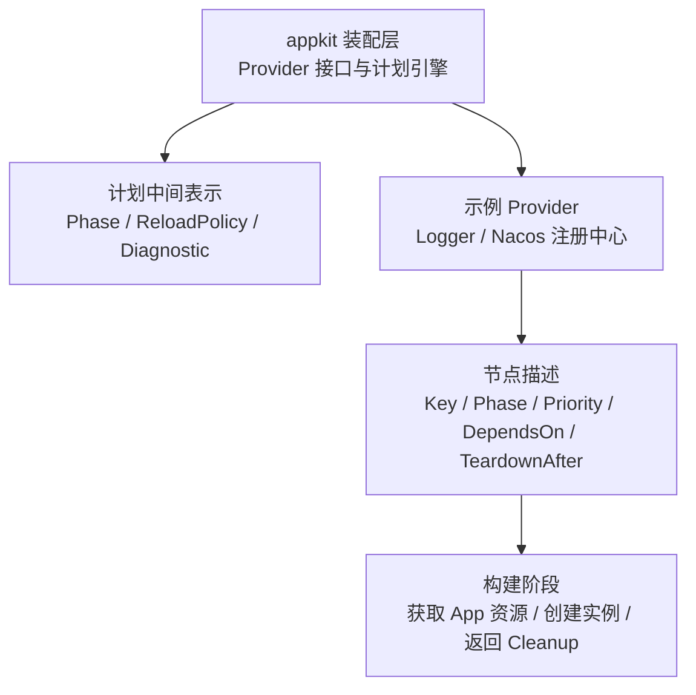
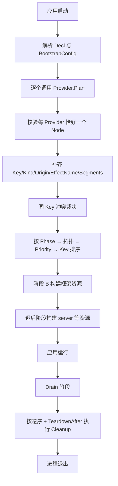
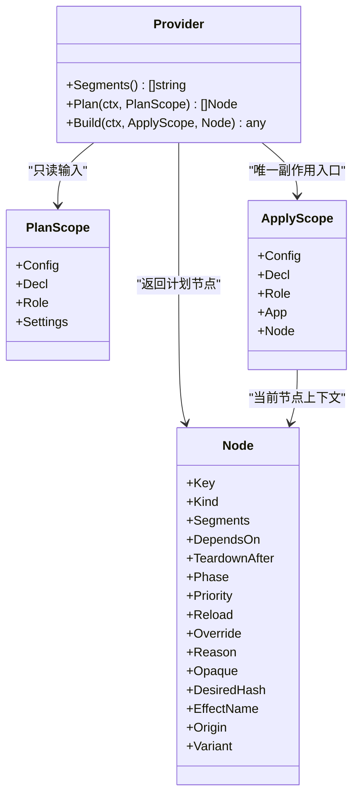
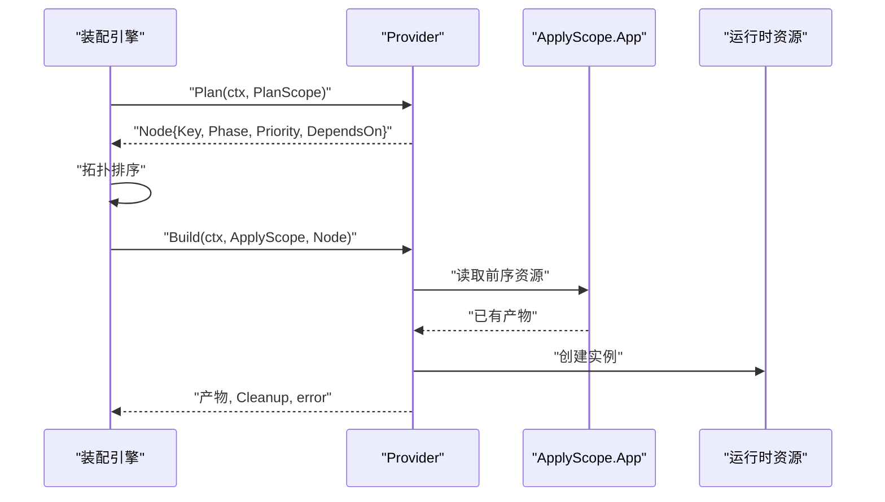
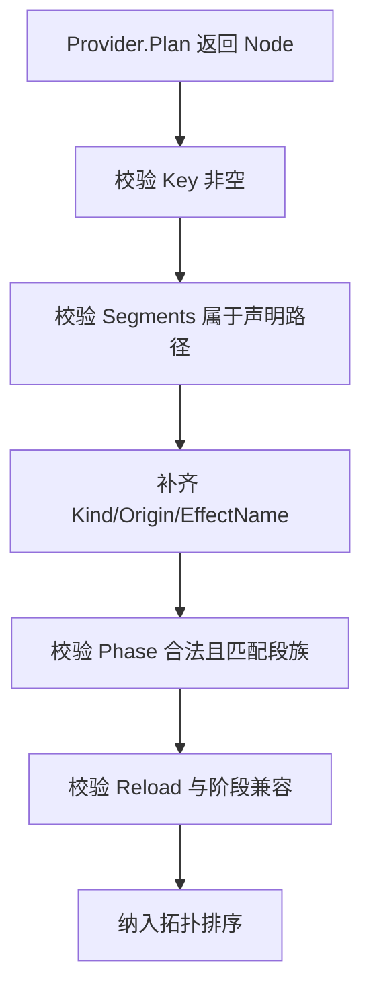
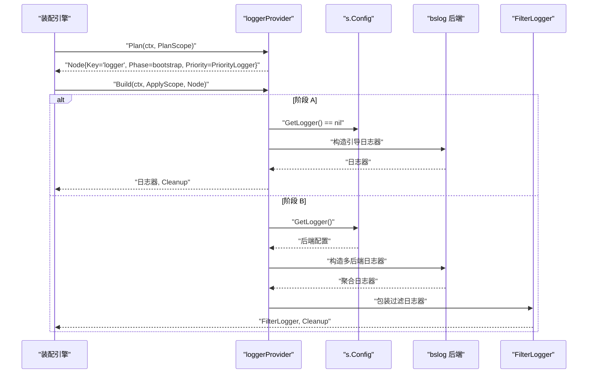
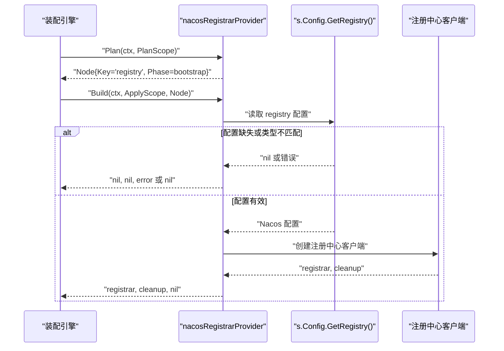
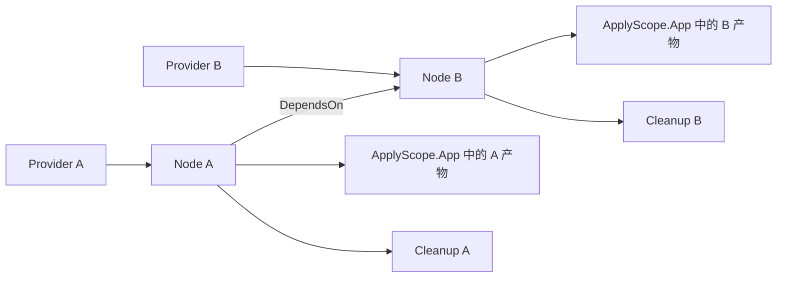

# 两段式 Provider：Plan 与 Build 分离

<cite>
**本文引用的文件**   
- [provider.go](file://pkg/appkit/provider.go)
- [plan.go](file://pkg/appkit/plan.go)
- [providers.go](file://_example/bald/internal/bootstrap/providers.go)
- [register_nacos.go](file://_example/bald/internal/bootstrap/register_nacos.go)
- [domain.go](file://_example/bald/greetv1/domain.go)
</cite>

## 目录
1. [引言](#引言)
2. [项目结构定位](#项目结构定位)
3. [核心组件](#核心组件)
4. [架构总览](#架构总览)
5. [详细组件分析](#详细组件分析)
6. [依赖关系分析](#依赖关系分析)
7. [性能与可观测性](#性能与可观测性)
8. [故障排查指南](#故障排查指南)
9. [结论](#结论)

## 引言
本文围绕 `pkg/appkit` 中的 v2 Provider 设计，解释“计划”和“构建”严格分离的两段式模型。重点说明：

- `Provider.Plan(ctx, PlanScope)` 是纯函数声明阶段：只读配置、声明和应用角色，返回一个带拓扑信息的节点，不写文件、不发网络、不改全局、不构造实例。
- `Provider.Build(ctx, ApplyScope, Node)` 是唯一允许副作用的入口：读取已构建的前序资源，创建运行时对象，并返回清理钩子。
- `PlanScope` 在计划期完全只读；`ApplyScope` 在此基础上提供 `App` 资源容器和当前 `Node` 上下文。
- 每个 Provider 必须恰好返回一个 `Node`；`Node` 通过 `Phase/Priority/DependsOn/TeardownAfter` 等字段表达执行顺序、优先级和停机约束。
- 程序化扩展点以 `Opaque` 节点形式进入计划，明确标注“不可静态分析”，包括 Domain Wire、命令式 Registrar、标准库 server 等。

本仓库是一个多模块 Go 工程，Provider 机制定义在 `pkg/appkit`，示例应用 `_example/bald` 展示了自定义 Logger Provider、Nacos 注册中心 Provider 以及领域节点的用法。

**章节来源**
- [provider.go:1-120](file://pkg/appkit/provider.go#L1-L120)
- [plan.go:1-40](file://pkg/appkit/plan.go#L1-L40)

## 项目结构定位
两段式 Provider 不是某个业务服务，而是应用装配基础设施：

| 位置 | 职责 | 关键内容 |
|---|---|---|
| `pkg/appkit/provider.go` | Provider 接口、作用域、计划解析、排序、冲突裁决、停机序推导 | `Provider`、`PlanScope`、`ApplyScope`、`Node`、`Cleanup`、`newProviderPlan`、`normalizeNode` |
| `pkg/appkit/plan.go` | 计划中间表示、阶段枚举、重载策略、诊断信息、节点元数据 | `Phase`、`ReloadPolicy`、`Diagnostic`、`Node`、`SegmentUse`、`Imperative` |
| `_example/bald/internal/bootstrap/providers.go` | 覆盖内置 logger 的两段式 Provider | `loggerProvider.Plan` / `Build` |
| `_example/bald/internal/bootstrap/register_nacos.go` | Nacos 注册中心段的 Provider，展示 Build 中获取配置并返回 Cleanup | `nacosRegistrarProvider.Plan` / `Build` |
| `_example/bald/greetv1/domain.go` | 领域声明，展示如何返回多个 `Node`，并通过 `DependsOn` 表达依赖 | `declare` 返回 biz 节点和路由节点 |

**图表来源**
- [provider.go:1-120](file://pkg/appkit/provider.go#L1-L120)
- [plan.go:1-120](file://pkg/appkit/plan.go#L1-L120)

**章节来源**
- [provider.go:1-120](file://pkg/appkit/provider.go#L1-L120)
- [plan.go:1-120](file://pkg/appkit/plan.go#L1-L120)
- [providers.go:1-73](file://_example/bald/internal/bootstrap/providers.go#L1-L73)
- [register_nacos.go:1-101](file://_example/bald/internal/bootstrap/register_nacos.go#L1-L101)
- [domain.go:1-69](file://_example/bald/greetv1/domain.go#L1-L69)

## 核心组件
v2 Provider 的核心由五类类型组成：

| 类型 | 阶段 | 语义 | 是否可修改 |
|---|---|---|---|
| `Provider` | 全生命周期 | 消费契约段，返回计划节点，构建运行时产物 | 接口实现方维护自身状态，但调用方应视作无共享可变状态 |
| `PlanScope` | 计划期 | 已定形配置、全部装配声明、应用角色、合并后 Settings | 对 Provider 只读 |
| `ApplyScope` | 构建期 | 同 `PlanScope`，外加 `App` 资源容器和当前 `Node` | `App` 由引擎填充，Provider 不应持有跨节点共享可变引用 |
| `Node` | 计划期 → 构建期 | 资源的稳定身份、阶段、优先级、依赖、停机约束、来源标记 | Provider 在 Plan 中构造，引擎校验并排序 |
| `Cleanup` | 停机期 | 释放资源，可与 Effect 回放路径统一 | 可为 nil；若忽略返回值会导致资源泄漏 |

其中，`Plan` 返回的是“节点计划”，不是最终运行对象；`Build` 才真正创建对象。

**章节来源**
- [provider.go:1-120](file://pkg/appkit/provider.go#L1-L120)
- [plan.go:1-120](file://pkg/appkit/plan.go#L1-L120)

## 架构总览
两段式 Provider 的执行流程可以概括为：先做无副作用的计划，再按拓扑顺序执行构建，最后按逆序加显式约束执行停机清理。

**图表来源**
- [provider.go:120-420](file://pkg/appkit/provider.go#L120-L420)
- [plan.go:1-120](file://pkg/appkit/plan.go#L1-L120)

该流程的关键约束如下：

1. 每个 Provider 必须恰好返回一个节点；否则计划失败。
2. 节点阶段必须与段族一致：`config` 对应 `configure`，`server` 对应 `serve`，其余对应 `bootstrap`。
3. 同 Key 节点需要显式 Override 与 Reason，否则视为冲突。
4. `DependsOn` 决定拓扑序；`TeardownAfter` 仅用于停机序偏离 Apply 逆序的情况。
5. `Opaque` 节点表示内部是命令式闭包，计划只能看到边界。

**章节来源**
- [provider.go:201-420](file://pkg/appkit/provider.go#L201-L420)
- [plan.go:1-120](file://pkg/appkit/plan.go#L1-L120)

## 详细组件分析

### Provider 接口与两段式语义
`Provider` 同时嵌入 `Option`，因此 Provider 值可以直接作为 `MustServe` / `NewApp` 的参数，也支持把自身追加到 `Decl.Providers`。这是为了让 Provider 既能被外部组装，也能自我注册。

两段式语义的核心是职责分离：

- **Plan 阶段**：读取 `Config`、`Decl`、`Role`、`Settings`，判断是否需要该 Provider，并声明它需要的资源键、阶段、优先级、重载策略和停机约束。
- **Build 阶段**：从 `ApplyScope.App` 取前序节点产物，创建具体运行时对象，并返回 `Cleanup`。

**图表来源**
- [provider.go:1-120](file://pkg/appkit/provider.go#L1-L120)
- [plan.go:120-225](file://pkg/appkit/plan.go#L120-L225)

**章节来源**
- [provider.go:1-120](file://pkg/appkit/provider.go#L1-L120)

### PlanScope：计划期的只读视图
`PlanScope` 包含四个字段：

| 字段 | 含义 | 使用约束 |
|---|---|---|
| `Config` | 已定形的 `BootstrapConfig` | 只读；可用于判断某段是否存在、读取配置项 |
| `Decl` | 全部装配期声明 | 只读；不得改写 |
| `Role` | 应用角色 | 单角色应用可能为空；用于条件分支 |
| `Settings` | 合并后的配置快照 | 只读；计划期不得据此做 I/O |

`Settings` 特别需要注意：在编译或 `--plan` 时，它是文件与环境变量的基线；在真实启动和热更时，它是完整合并结果，包含命令行 flag。因此，即使 `Settings` 看起来像运行时配置，也不能把它当成任意 I/O 的许可证。

**章节来源**
- [provider.go:60-120](file://pkg/appkit/provider.go#L60-L120)

### ApplyScope：构建期的运行时上下文
`ApplyScope` 继承 `PlanScope` 的全部字段，并增加两个关键字段：

| 字段 | 含义 | 行为 |
|---|---|---|
| `App` | 应用资源容器 | 进入构建阶段后非 nil；前序节点产物已填充 |
| `Node` | 正在应用的节点 | 来自 `Plan` 返回的那个节点 |

这意味着：

- 如果 Provider 依赖另一个 Provider 的资源，应在 `Plan` 中声明 `DependsOn`，然后在 `Build` 中从 `s.App` 取出。
- `App` 不是任意全局状态：它承载按拓扑序逐步填充的资源表。
- `Node` 提供当前节点的稳定身份和元数据，例如 Key、Phase、Origin、EffectName。

**图表来源**
- [provider.go:60-120](file://pkg/appkit/provider.go#L60-L120)
- [provider.go:201-420](file://pkg/appkit/provider.go#L201-L420)

**章节来源**
- [provider.go:60-120](file://pkg/appkit/provider.go#L60-L120)

### Node 结构与字段约束
`Node` 是计划的核心载体，也是执行顺序的唯一来源。其关键字段包括：

| 字段 | 约束与语义 |
|---|---|
| `Key` | 稳定资源键；不能为空，否则计划报错 |
| `Kind` | 资源类别，如 `database`、`server`、`logger`、`registry`、`domain`、`component`、`app`；缺省由首个段的顶层名推断 |
| `Segments` | 读取的契约段；若未填写，默认取 Provider 的 `Segments()` |
| `DependsOn` | 其他节点的 `Key`，决定 Apply 拓扑序 |
| `TeardownAfter` | 仅在停机序不同于 Apply 逆序时使用；`"*"` 表示排在所有其它节点之后 |
| `Phase` | 必须是 `configure`、`bootstrap` 或 `serve`，且与段族一致 |
| `Priority` | 同阶段 ready 集合的排序键，越小越先；默认 0，框架提供常见优先级常量 |
| `Reload` | 静态、协调重启或进程重启策略；`reconcile` 仅限阶段 B 或 logger |
| `Override` / `Reason` | 显式覆盖同 Key 节点时必须填写理由 |
| `Opaque` | 命令式扩展点标记，表示内部不可分析 |
| `DesiredHash` | 可协调节点的期望态摘要 |
| `EffectName` | 停机 Effect 名称，缺省为 `appkit:` + Key |
| `Origin` / `Variant` | 节点来源标记，区分 std、第三方 Provider、Domain、应用和变体 |

节点归一化过程会补齐缺省字段，并校验：

- `Key` 非空。
- `Segments` 必须是 Provider 实际声明的路径子集。
- `Phase` 属于受支持的三个值之一。
- `Phase` 与段族匹配。
- `ReloadReconcile` 不能用在 `config` 或 `server` 段节点。

**图表来源**
- [provider.go:350-520](file://pkg/appkit/provider.go#L350-L520)
- [plan.go:120-225](file://pkg/appkit/plan.go#L120-L225)

**章节来源**
- [plan.go:120-225](file://pkg/appkit/plan.go#L120-L225)
- [provider.go:350-520](file://pkg/appkit/provider.go#L350-L520)

### Opaque 节点：程序化扩展点
`Opaque` 节点用于承载无法用声明数据表达的运行时逻辑，典型场景包括：

- Domain Wire：领域自接线逻辑。
- 命令式 Registrar：直接调用注册中心客户端完成注册。
- std server：标准库 server 把路由和服务以回调形式注入，计划期看不到具体路由。
- 其他命令式组件：内部状态由闭包管理，而非可序列化声明。

`Opaque` 并不意味着节点无效，而是明确告诉计划系统：“我只能看到边界，不能分析内部”。因此：

- Opaque 节点不参与“期望态可由声明派生”的静态分析。
- 可以通过 `WithOpaqueBudget` 设置预算，让 CI 在计划期统计 Opaque 数量。
- 契约派生的 std logger 和 audit 节点不是 Opaque；只有真正命令式的扩展点才是。

注意：示例中的领域节点 `greetv1.Domain.declare` 返回多个 `Node`，但它属于领域声明，不是 Provider；Provider 仍然必须恰好返回一个 `Node`。

**章节来源**
- [provider.go:1-120](file://pkg/appkit/provider.go#L1-L120)
- [provider.go:120-200](file://pkg/appkit/provider.go#L120-L200)
- [domain.go:25-69](file://_example/bald/greetv1/domain.go#L25-L69)

### 自定义 Provider 示例

#### 示例一：覆盖 Logger Provider
示例 Logger Provider 演示了典型的两段式写法：

- `Segments` 声明消费 `logger` 段。
- `Plan` 返回一个 `Phase=bootstrap`、`Priority=PriorityLogger`、`Reload=ReloadReconcile` 的节点。
- `Build` 根据阶段 A/B 的不同情况构造日志器，并返回清理钩子。

关键点：

- 阶段 A（契约装载前）：返回引导日志器，保证启动期日志也有脱敏。
- 阶段 B：从 `s.Config.GetLogger()` 读取后端配置，构造多后端日志器。
- 清理钩子关闭各后端。

**图表来源**
- [providers.go:20-73](file://_example/bald/internal/bootstrap/providers.go#L20-L73)

**章节来源**
- [providers.go:1-73](file://_example/bald/internal/bootstrap/providers.go#L1-L73)

#### 示例二：Nacos 注册中心 Provider
Nacos 注册中心 Provider 展示了 Build 中获取配置、创建客户端、返回 Cleanup 的模式：

- `Plan` 声明 `registry` 段，阶段为 `bootstrap`，重载策略为 `ReloadRestart`。
- `Build` 从 `s.Config.GetRegistry()` 读取注册中心配置。
- 如果配置不存在或类型不匹配，返回 nil 或错误。
- 成功后返回 registrar 和 cleanup 函数。

**图表来源**
- [register_nacos.go:30-101](file://_example/bald/internal/bootstrap/register_nacos.go#L30-L101)

**章节来源**
- [register_nacos.go:1-101](file://_example/bald/internal/bootstrap/register_nacos.go#L1-L101)

#### 示例三：如何在 Plan 中声明依赖并在 Build 中获取
虽然示例中没有完整的数据库 Provider 代码，但 `pkg/appkit` 的设计明确要求：

1. 在 `Plan` 中通过 `DependsOn` 声明对其他资源键的依赖。
2. 在 `Build` 中从 `s.App` 读取前序节点产物。
3. 如果依赖缺失，应返回错误，因为构建失败会 fail-fast。

推荐模式：

- 如果 Provider 依赖 `database.sql`，则在 `Plan` 中写入 `DependsOn: []ResourceKey{"database.sql"}`。
- 在 `Build` 中从 `s.App` 取出数据库连接池。
- 使用 `Cleanup` 关闭连接池或其他长生命周期资源。

这种模式保证了依赖关系由节点拓扑决定，而不是由全局变量或隐式初始化顺序决定。

**章节来源**
- [plan.go:120-225](file://pkg/appkit/plan.go#L120-L225)
- [provider.go:60-120](file://pkg/appkit/provider.go#L60-L120)

### 为什么 Plan 必须返回恰好一个 Node
引擎在 `newProviderPlan` 中对每个 Provider 调用 `Plan`，然后检查返回节点长度是否为 1。如果不是，会报告类似“返回了 N 个计划节点；要求恰好一个”的错误。

这个约束的意义是：

- Provider 的职责边界清晰：一个 Provider 负责一个资源或一组强关联资源。
- 如果需要多个资源，应拆成多个 Provider。
- 领域声明可以返回多个节点，因为领域有自己的 `Declare` / `ApplyNode` 协议，不属于 Provider 接口。
- 每个 Provider 只有一个 `Key`，便于冲突裁决、日志、计划和差异对比。

**章节来源**
- [provider.go:201-420](file://pkg/appkit/provider.go#L201-L420)

## 依赖关系分析
Provider 与节点之间的关系可以分为三层：

| 层级 | 内容 | 说明 |
|---|---|---|
| Provider 层 | `Provider` 接口及其实现 | 声明段、计划节点、构建产物 |
| 计划层 | `Node`、`Phase`、`Priority`、`DependsOn` | 描述资源身份和执行顺序 |
| 运行层 | `App`、`Cleanup`、实际运行时对象 | 构建阶段创建的实例和清理逻辑 |

**图表来源**
- [provider.go:201-420](file://pkg/appkit/provider.go#L201-L420)
- [plan.go:120-225](file://pkg/appkit/plan.go#L120-L225)

引擎对依赖的处理顺序是：

1. 按 `Phase` 分组。
2. 在同一阶段内按 Kahn 拓扑排序处理 `DependsOn`。
3. 拓扑序相同的情况下，按 `Priority` 升序。
4. `Priority` 相同的情况下，按 `Key` 稳定排序。
5. 停机阶段按 Apply 逆序加上 `TeardownAfter` 约束。

**章节来源**
- [provider.go:201-420](file://pkg/appkit/provider.go#L201-L420)

## 性能与可观测性
两段式设计对性能和可观测性的主要贡献：

- **计划缓存**：`Node` 的 `DesiredHash` 与 JSON 序列化稳定的 `Phase`/`ReloadPolicy` 使计划可比较、可缓存。
- **可检视投影**：`Plan` 结果是装配的可视化视图，供 `--plan`、测试和未来诊断工具使用。
- **诊断信息**：覆盖检查、白名单、接管等逃逸舱通过 `Diagnostic` 暴露，避免静默失败。
- **Opaque 预算**：通过 `WithOpaqueBudget` 限制命令式扩展点数量，便于 CI 门控。
- **确定性排序**：不再依赖隐式钩子追加序，而是显式 `Phase/Priority/Key`，提升稳定性。

不过，这些能力的前提是 Provider 遵守两段式约定：不要在 Plan 中做 I/O，不要假设 `App` 在 Plan 期可用。

**章节来源**
- [plan.go:1-120](file://pkg/appkit/plan.go#L1-L120)
- [provider.go:120-200](file://pkg/appkit/provider.go#L120-L200)

## 故障排查指南

### 常见陷阱一：Plan 中使用 I/O
**现象**：启动缓慢、计划不稳定、并发下行为不一致。  
**原因**：Plan 必须是纯函数，不能写文件、发网络、改全局或构造实例。  
**排查**：检查 `Plan` 中是否访问数据库、远程配置、文件系统、全局 logger 或创建运行时对象。  
**修复**：把 I/O 移到 `Build`；`Plan` 只做配置存在性检查和节点声明。

**章节来源**
- [provider.go:60-120](file://pkg/appkit/provider.go#L60-L120)

### 常见陷阱二：Build 中修改共享状态
**现象**：不同节点之间相互污染、并发测试失败、重入时状态错乱。  
**原因**：`App` 由引擎填充，Provider 不应持有跨节点的全局可变引用。  
**排查**：检查是否在 Provider 字段中保存 `App`、`*DB`、HTTP server 等可变对象。  
**修复**：只在 `Build` 中局部创建对象，并通过 `Cleanup` 释放。

**章节来源**
- [provider.go:60-120](file://pkg/appkit/provider.go#L60-L120)

### 常见陷阱三：忽略 Cleanup 返回值
**现象**：连接未关闭、监听端口未释放、goroutine 泄漏。  
**原因**：`Build` 返回 `(any, Cleanup, error)`，如果调用方丢弃第二个返回值，清理钩子不会执行。  
**排查**：确认引擎是否正确接收并执行 Cleanup；自定义编排代码中不要省略清理步骤。  
**修复**：确保 `Build` 返回正确的清理函数；必要时把旧式无参清理闭包适配为带 `context.Context` 的版本。

**章节来源**
- [provider.go:1-60](file://pkg/appkit/provider.go#L1-L60)

### 常见陷阱四：Phase 与段族不匹配
**现象**：计划期报错“节点阶段与其段族不匹配”。  
**原因**：`config` 段必须用 `PhaseConfigure`，`server` 段必须用 `PhaseServe`，其余段用 `PhaseBootstrap`。  
**修复**：按段族选择正确阶段，不要把 HTTP server 放在 bootstrap 阶段。

**章节来源**
- [provider.go:350-520](file://pkg/appkit/provider.go#L350-L520)

### 常见陷阱五：未正确处理 Registry 单选
**现象**：计划期报“多个 registry provider 触发”。  
**原因**：注册中心是单选域，一个进程只能对接一个注册中心。  
**修复**：移除多余 registry 段或 Provider；或通过显式 Registrar 实例接管，跳过纯 registry Provider。

**章节来源**
- [provider.go:201-420](file://pkg/appkit/provider.go#L201-L420)

### 常见陷阱六：误把领域节点当作 Provider
**现象**：认为 Provider 也可以返回多个节点。  
**原因**：领域 `Domain.declare` 可以返回多个 `Node`，但 `Provider.Plan` 必须恰好返回一个。  
**修复**：领域节点走领域装配协议；Provider 拆分出多个小 Provider，每个负责一个资源键。

**章节来源**
- [domain.go:25-69](file://_example/bald/greetv1/domain.go#L25-L69)
- [provider.go:201-420](file://pkg/appkit/provider.go#L201-L420)

## 结论
两段式 Provider 设计的核心是把“我要什么”和“我怎么造”拆开：

- `Plan` 回答“要哪个资源、何时构建、依赖谁、怎么停机”，它是可检视、可比较、可缓存的计划。
- `Build` 回答“如何创建资源、如何释放资源”，它是唯一允许副作用的阶段。
- `PlanScope` 是计划期的只读视图；`ApplyScope` 在此基础上提供 `App` 和当前 `Node`。
- `Node` 通过 `Phase/Priority/DependsOn/TeardownAfter` 表达拓扑、优先级和停机约束。
- `Opaque` 节点诚实表达程序化扩展点的边界，避免伪装的静态分析。

遵循这个约定，装配引擎才能在不依赖隐式全局状态的情况下，提供稳定排序、可诊断计划、可靠清理和可控热更。对于自定义 Provider，最安全的实践是：**Plan 中只声明，Build 中只构建和清理**。