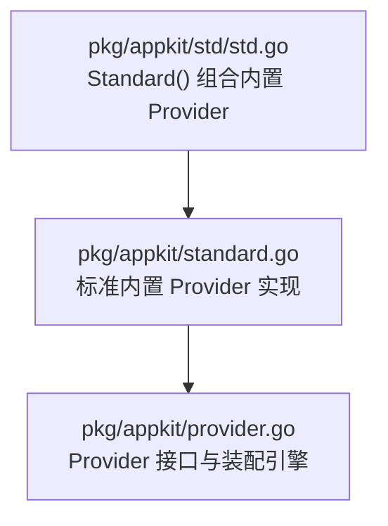
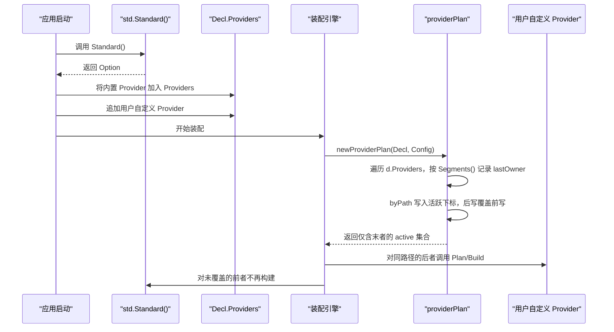
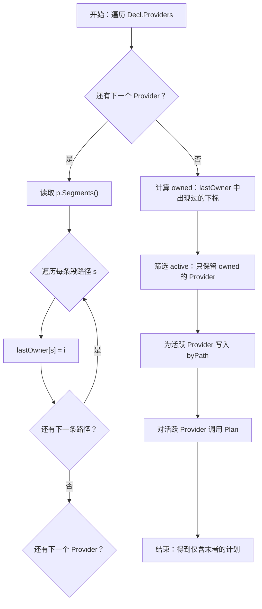
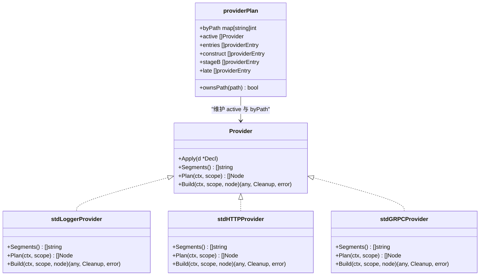
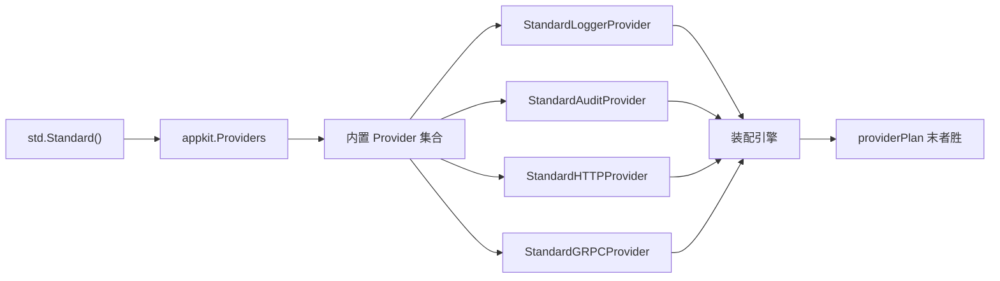

# 末者胜覆盖规则与冲突解决

<cite>
**本文引用的文件**   
- [pkg/appkit/provider.go](file://pkg/appkit/provider.go)
- [pkg/appkit/standard.go](file://pkg/appkit/standard.go)
- [pkg/appkit/std/std.go](file://pkg/appkit/std/std.go)
</cite>

## 目录
1. [引言](#引言)
2. [项目结构](#项目结构)
3. [核心组件](#核心组件)
4. [架构总览](#架构总览)
5. [详细组件分析](#详细组件分析)
6. [依赖关系分析](#依赖关系分析)
7. [性能考量](#性能考量)
8. [故障排查指南](#故障排查指南)
9. [结论](#结论)

## 引言
本文件围绕“末者胜”（last-writer-wins）覆盖规则，解释 Bald 框架中 Provider 如何按声明顺序接管同一路径、同时让不同路径的 Provider 并存。该机制是 `std.Standard()` 内置默认后端可被用户自定义 Provider 覆盖的关键：相同 `Segments()` 路径之间发生覆盖，不同路径互不影响。文档还说明覆盖发生在应用启动的计划阶段，并给出数据库与多领域 Provider 的具体用例，帮助读者理解这一设计如何同时满足框架扩展与用户定制需求。

## 项目结构
围绕末者胜覆盖规则的代码集中在三个文件：

- `pkg/appkit/provider.go`：Provider 接口、段路径解析、计划构建与末者胜逻辑；
- `pkg/appkit/standard.go`：框架自有后端（logger、audit、server.http、server.grpc）的内置 Provider 实现；
- `pkg/appkit/std/std.go`：打包标准内置 Provider 集合的 `Standard()` Option。

**图表来源**
- [pkg/appkit/std/std.go:53-60](file://pkg/appkit/std/std.go#L53-L60)
- [pkg/appkit/standard.go:1-30](file://pkg/appkit/standard.go#L1-L30)
- [pkg/appkit/provider.go:1-30](file://pkg/appkit/provider.go#L1-L30)

**章节来源**
- [pkg/appkit/std/std.go:1-60](file://pkg/appkit/std/std.go#L1-L60)
- [pkg/appkit/standard.go:1-30](file://pkg/appkit/standard.go#L1-L30)
- [pkg/appkit/provider.go:1-30](file://pkg/appkit/provider.go#L1-L30)

## 核心组件
- **Provider 接口**：每个 Provider 通过 `Segments()` 声明它消费或归属的契约段路径；通过 `Plan` 返回一个资源节点，通过 `Build` 构造实际运行时对象。
- **标准内置 Provider**：由 `std.Standard()` 提供，包含 HTTP 面、gRPC 面、日志审计和日志后端等默认实现。
- **装配计划器**：在应用启动时收集所有 Provider，按段路径执行末者胜覆盖，再进入 Plan/Build 流程。

这些组件共同保证：后声明的 Provider 能覆盖先声明的同路径 Provider，而不同路径各自独立。

**章节来源**
- [pkg/appkit/provider.go:90-120](file://pkg/appkit/provider.go#L90-L120)
- [pkg/appkit/standard.go:120-145](file://pkg/appkit/standard.go#L120-L145)
- [pkg/appkit/std/std.go:53-60](file://pkg/appkit/std/std.go#L53-L60)

## 架构总览
下图展示从调用方到覆盖决策的完整启动链路：

**图表来源**
- [pkg/appkit/std/std.go:53-60](file://pkg/appkit/std/std.go#L53-L60)
- [pkg/appkit/provider.go:280-390](file://pkg/appkit/provider.go#L280-L390)

## 详细组件分析

### Provider 接口与段路径语义
Provider 接口定义了段驱动装配的三个关键部分：

| 成员 | 作用 | 覆盖相关语义 |
|---|---|---|
| `Apply` | 把自身追加进 `Decl.Providers` | 决定 Provider 出现在声明序列中的位置 |
| `Segments()` | 声明 Provider 消费的契约段路径 | 相同路径触发末者胜，不同路径互不影响 |
| `Plan` / `Build` | 纯函数计划与实际资源构建 | 覆盖发生在计划阶段；Build 只在最终活跃的 Provider 上执行 |

Provider 本身也是 Option，因此可以像 `WithHTTP`、`WithGRPC` 一样直接传入 `MustServe` 或 `NewApp`。这使“内置默认 + 用户覆盖”在同一调用点表达。

**章节来源**
- [pkg/appkit/provider.go:90-120](file://pkg/appkit/provider.go#L90-L120)

### 标准内置 Provider
`std.Standard()` 是一个 Option，内部打包四个内置 Provider：

| 内置 Provider | 段路径 | 用途 |
|---|---|---|
| `StandardHTTPProvider` | `server.http` | 默认 HTTP 服务器面 |
| `StandardGRPCProvider` | `server.grpc` | 默认 gRPC 服务器面 |
| `StandardAuditProvider` | `audit` | 默认结构化日志审计后端 |
| `StandardLoggerProvider` | `logger` | 默认日志后端，负责引导 logger 与配置驱动的 slog 后端 |

注意：`server.http` 与 `server.grpc` 是两个独立 Provider。这样第三方转码面只接管 `server.http` 时，不会把 gRPC 面一起挤掉。

**章节来源**
- [pkg/appkit/std/std.go:53-60](file://pkg/appkit/std/std.go#L53-L60)
- [pkg/appkit/standard.go:120-200](file://pkg/appkit/standard.go#L120-L200)

### 末者胜覆盖的实现细节
末者胜覆盖的核心在 `newProviderPlan`：

1. 遍历 `Decl.Providers`，对每个 Provider 的每条 `Segments()` 路径记录 `lastOwner[路径] = 下标`；
2. 用 `owned` 标记哪些 Provider 至少拥有一条路径；
3. 只保留 `active` 中的末者 Provider；
4. 把活跃路径映射到 `byPath`，用于后续检查某段是否已被某个 Provider 拥有；
5. 对活跃 Provider 依次调用 `Plan`，再进行节点冲突裁决与排序；
6. Build 阶段只对计划生成的节点执行。

**图表来源**
- [pkg/appkit/provider.go:280-390](file://pkg/appkit/provider.go#L280-L390)

**章节来源**
- [pkg/appkit/provider.go:280-390](file://pkg/appkit/provider.go#L280-L390)

### 覆盖发生的时机与条件
覆盖不是发生在 `Build` 时，而是发生在**应用启动的计划阶段**：

- **时机**：`MustServe` / `NewApp` 调用后，装配引擎创建 `providerPlan`，执行 `newProviderPlan`。
- **条件一**：比较的是 `Segments()` 返回的路径；
- **条件二**：相同路径才会覆盖；
- **条件三**：后声明者覆盖先声明者；
- **条件四**：只有最终活跃的 Provider 会进入后续 Plan/Build 流程；
- **条件五**：`config` 段无条件构建，但覆盖规则仍按路径末者胜处理；
- **条件六**：logger 段走专用两阶段通道，但仍受末者胜影响——后声明的 logger Provider 会成为最终 logger 提供者。

这意味着“谁最后声明同一路径，谁就拥有该路径”，而不是“谁先声明谁优先”。

**章节来源**
- [pkg/appkit/provider.go:280-390](file://pkg/appkit/provider.go#L280-L390)
- [pkg/appkit/provider.go:504-556](file://pkg/appkit/provider.go#L504-L556)

### 数据库 Provider 覆盖标准库默认实现
虽然当前仓库中没有直接出现 `database/sql` 的标准 Provider，但文档目标要求以“标准库 database/sql 默认实现被用户自定义数据库 Provider 覆盖”为例说明机制。在本框架中，这个场景对应以下事实：

- `database` 段没有内置默认 Provider，因此必须用户提供；
- 如果多个模块都注册 `database` 段，则按末者胜规则，最后一个 Provider 成为最终拥有者；
- 若存在“框架默认实现”与“用户自定义实现”两个 Provider，且它们都返回 `[]string{"database"}`，那么后声明的用户 Provider 会覆盖前者；
- 其他领域 Provider 只要 `Segments()` 返回不同路径，就不会互相覆盖。

因此，要确保用户的自定义数据库 Provider 真正覆盖默认实现，需要：

1. 用户 Provider 的 `Segments()` 返回与默认实现完全相同的路径；
2. 用户 Provider 在调用链中出现在默认 Provider 之后；
3. 不引入额外中间 Provider 再次抢占同一路径。

**章节来源**
- [pkg/appkit/provider.go:90-120](file://pkg/appkit/provider.go#L90-L120)
- [pkg/appkit/standard.go:20-30](file://pkg/appkit/standard.go#L20-L30)

### 多领域 Provider 的路径隔离
典型场景包括：

| Provider | 段路径 | 是否相互覆盖 |
|---|---|---|
| 审计 Provider | `audit` | 与其他领域 Provider 不覆盖 |
| 缓存 Provider | `cache` | 与其他领域 Provider 不覆盖 |
| 数据库 Provider | `database` | 与其他领域 Provider 不覆盖 |
| HTTP 服务器 Provider | `server.http` | 与 gRPC Provider 不覆盖 |
| gRPC 服务器 Provider | `server.grpc` | 与 HTTP Provider 不覆盖 |
| 日志 Provider | `logger` | 独立于 audit/cache/database/server |

因为段路径精确匹配，所以“不同路径互不影响”。这也是框架支持多领域扩展的基础：每个领域定义自己的段路径，Provider 按领域自治，避免隐式全局替换。

**章节来源**
- [pkg/appkit/standard.go:120-200](file://pkg/appkit/standard.go#L120-L200)
- [pkg/appkit/provider.go:90-120](file://pkg/appkit/provider.go#L90-L120)

### 为什么“后声明”能保证覆盖
关键在于 `lastOwner` 与 `byPath` 的写入方式：

- `lastOwner` 每次都对同一路径赋值，因此最后一次赋值胜出；
- `owned` 只保留至少拥有一条路径的 Provider；
- `byPath` 在活跃 Provider 遍历时再次写入，保持“后写覆盖前写”；
- 最终 `active` 列表只包含被拥有的 Provider，并按声明顺序保留；
- 排序发生在 Plan 生成节点之后，不影响覆盖结果。

**图表来源**
- [pkg/appkit/provider.go:280-390](file://pkg/appkit/provider.go#L280-L390)
- [pkg/appkit/standard.go:53-105](file://pkg/appkit/standard.go#L53-L105)
- [pkg/appkit/standard.go:137-189](file://pkg/appkit/standard.go#L137-L189)
- [pkg/appkit/standard.go:189-231](file://pkg/appkit/standard.go#L189-L231)

**章节来源**
- [pkg/appkit/provider.go:280-390](file://pkg/appkit/provider.go#L280-L390)

## 依赖关系分析
- `std.Standard()` 依赖 `appkit.Providers` 与四个内置 Provider；
- 内置 Provider 依赖 `appkit.Provider` 接口与框架内部的 server、audit、logger 装配逻辑；
- 装配引擎依赖 `Decl.Providers` 的声明顺序；
- 用户自定义 Provider 通过相同接口接入，不破坏既有依赖边界。

**图表来源**
- [pkg/appkit/std/std.go:53-60](file://pkg/appkit/std/std.go#L53-L60)
- [pkg/appkit/provider.go:280-390](file://pkg/appkit/provider.go#L280-L390)

**章节来源**
- [pkg/appkit/std/std.go:1-60](file://pkg/appkit/std/std.go#L1-L60)
- [pkg/appkit/provider.go:280-390](file://pkg/appkit/provider.go#L280-L390)

## 性能考量
- 末者胜覆盖是 O(P × S) 的线性扫描，其中 P 是 Provider 数量，S 是每个 Provider 的段路径数量；
- 覆盖结果缓存在 `providerPlan` 中，Build 阶段只访问最终活跃集合；
- 由于覆盖发生在计划阶段，运行期不会因 Provider 声明顺序产生额外开销；
- 正确划分段路径可减少不必要的冲突诊断与警告。

**章节来源**
- [pkg/appkit/provider.go:280-390](file://pkg/appkit/provider.go#L280-L390)

## 故障排查指南
当发现覆盖不符合预期时，可按以下顺序排查：

| 现象 | 可能原因 | 排查要点 |
|---|---|---|
| 用户 Provider 没有覆盖默认实现 | 用户 Provider 的 `Segments()` 返回路径不同 | 检查两者路径是否完全一致 |
| 用户 Provider 覆盖了错误的领域 | 路径误写成其他领域段名 | 核对 `Segments()` 返回值 |
| 日志行为异常 | 后声明者不是期望的 logger Provider | 检查 MustServe 调用顺序 |
| HTTP 与 gRPC 同时丢失 | 单一 Provider 同时声明两段并被第三方整体接管 | 使用拆分后的 server.http 与 server.grpc |
| 编译期报错 | 白名单段路径拼写错误或缺失 | 检查 `WithUnimplementedSegments` |

常见修复方式：

- 确保用户自定义 Provider 的 `Segments()` 与目标默认 Provider 完全一致；
- 把用户 Provider 放在 `std.Standard()` 之后；
- 对于 server 面，只接管需要的子段；
- 对尚未实现的段使用 `WithUnimplementedSegments` 显式豁免。

**章节来源**
- [pkg/appkit/provider.go:150-175](file://pkg/appkit/provider.go#L150-L175)
- [pkg/appkit/standard.go:120-145](file://pkg/appkit/standard.go#L120-L145)

## 结论
末者胜覆盖规则是 Bald 框架 Provider 体系的核心约定：**相同 `Segments()` 路径的 Provider 之间按声明顺序竞争，后声明者接管；不同路径的 Provider 彼此隔离**。该规则在应用启动的计划阶段完成，由 `newProviderPlan` 通过 `lastOwner` 与 `byPath` 实现，并最终只让活跃 Provider 进入 Plan 与 Build。

这使得 `std.Standard()` 的默认后端可以被用户自定义 Provider 干净地覆盖，同时也允许 audit、cache、database、server.http、server.grpc、logger 等不同领域 Provider 共存。对框架而言，这是扩展点；对用户而言，这是可控的定制能力。正确使用段路径与声明顺序，就能在不侵入框架内部的前提下，获得清晰、可预测的覆盖行为。