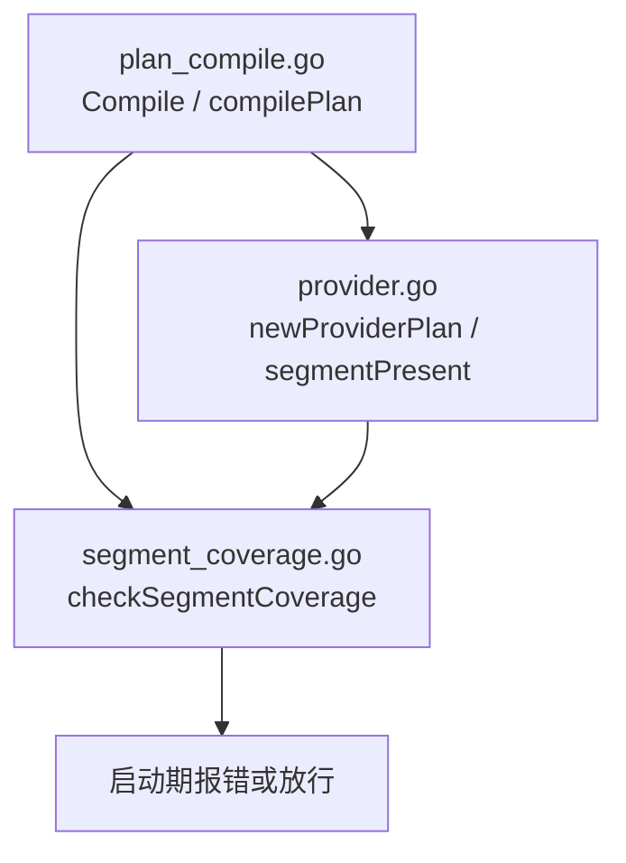
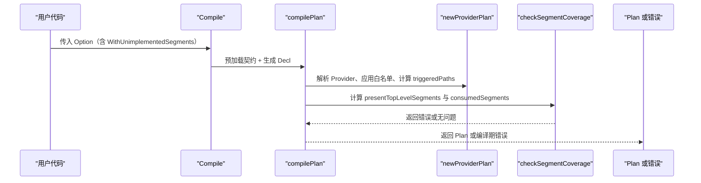
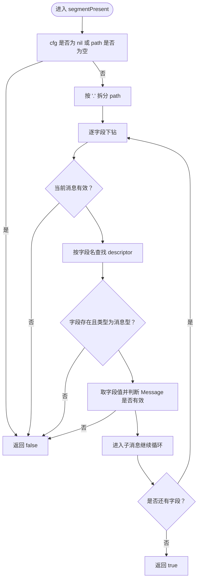
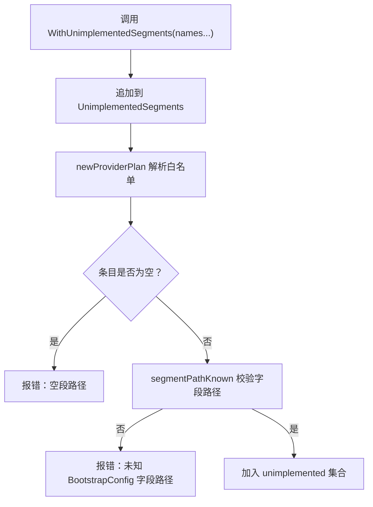
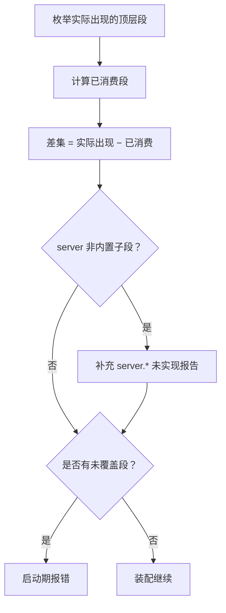
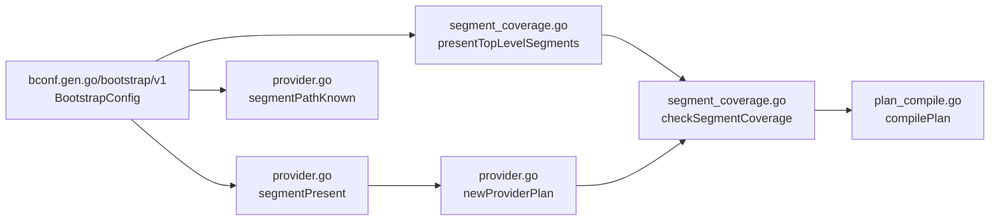

# 段存在性检查与白名单机制

<cite>
**本文引用的文件**
- [provider.go](file://pkg/appkit/provider.go)
- [segment_coverage.go](file://pkg/appkit/segment_coverage.go)
- [plan_compile.go](file://pkg/appkit/plan_compile.go)
</cite>

## 目录
1. [引言](#引言)
2. [项目结构定位](#项目结构定位)
3. [核心组件](#核心组件)
4. [架构总览](#架构总览)
5. [详细组件分析](#详细组件分析)
6. [依赖关系分析](#依赖关系分析)
7. [性能考量](#性能考量)
8. [故障排查指南](#故障排查指南)
9. [结论](#结论)

## 引言
本文聚焦 Bald 框架中「段存在性检查」与「未实现段白名单」两条关键机制，解释：
- `segmentPresent` 如何通过 protobuf 反射逐级下钻判定配置段是否存在；
- 消息型字段与标量字段在段路径中的不同语义；
- `WithUnimplementedSegments` 白名单的校验、追加与豁免语义；
- 该机制如何配合 L3 覆盖检查，让新 Provider 在不破坏现有装配流程的前提下逐步上线。

本说明面向 Provider 作者与装配维护者，重点覆盖“标准库未实现段通过白名单加入装配”和“自定义 Provider 声明白名单条目”两类实践场景。

## 项目结构定位
- 段存在性与白名单属于 appkit 包中的 Provider 装配抽象层，位于 `pkg/appkit`。
- 核心实现集中在两个文件：
  - `pkg/appkit/provider.go`：Provider 接口、段路径工具、白名单解析、段存在性判断。
  - `pkg/appkit/segment_coverage.go`：L3 启动期段覆盖检查，决定哪些顶层段被视为“已消费”。
- 计划编译入口 `pkg/appkit/plan_compile.go` 将契约预加载、Provider 计划推导与 L3 检查串联起来，是白名单生效的调用上下文。

**图示来源**
- [plan_compile.go:1-40](file://pkg/appkit/plan_compile.go#L1-L40)
- [provider.go:200-240](file://pkg/appkit/provider.go#L200-L240)
- [segment_coverage.go:1-30](file://pkg/appkit/segment_coverage.go#L1-L30)

**章节来源**
- [provider.go:1-60](file://pkg/appkit/provider.go#L1-L60)
- [segment_coverage.go:1-30](file://pkg/appkit/segment_coverage.go#L1-L30)
- [plan_compile.go:1-40](file://pkg/appkit/plan_compile.go#L1-L40)

## 核心组件
- `segmentPresent(cfg, path)`：按点号分段后，用 protobuf 反射逐层验证路径上的字段是否为消息型且非 nil。
- `segmentPathKnown(path)`：白名单前置校验，确认白名单条目确实是 `BootstrapConfig` 的真实字段路径。
- `presentTopLevelSegments(cfg)`：枚举契约中实际出现的顶层段（消息型字段非 nil）。
- `checkSegmentCoverage(cfg, spec, plan)`：L3 覆盖检查——“实际出现段 − 已消费段 − 白名单”，剩余即报错。
- `WithUnimplementedSegments(...)`：向 Decl 追加白名单条目，并在校验阶段拒绝空条目与未知路径。

**章节来源**
- [provider.go:200-240](file://pkg/appkit/provider.go#L200-L240)
- [segment_coverage.go:30-156](file://pkg/appkit/segment_coverage.go#L30-L156)

## 架构总览
段存在性检查与白名单在装配生命周期中的位置如下：

**图示来源**
- [plan_compile.go:1-40](file://pkg/appkit/plan_compile.go#L1-L40)
- [segment_coverage.go:30-156](file://pkg/appkit/segment_coverage.go#L30-L156)
- [provider.go:200-240](file://pkg/appkit/provider.go#L200-L240)

## 详细组件分析

### 一、`segmentPresent`：按 protobuf 反射逐级下钻
`segmentPresent` 的核心目标是回答：“契约配置中，某个段路径是否真实存在？”它不是简单字符串匹配，而是以 `BootstrapConfig` 的 protobuf 描述为权威 schema，逐段下钻。

#### 处理规则
- 输入为空时直接返回不存在：
  - `cfg` 为 nil；
  - `path` 为空字符串。
- 使用 `strings.Split(path, ".")` 拆成字段名序列。
- 从根消息开始循环：
  1. 若当前消息无效，立即返回 false。
  2. 按字段名查找 descriptor 字段。
  3. 若字段不存在，或字段类型不是消息型，返回 false。
     - 这意味着：**标量字段不构成段路径**，只有消息型字段才允许继续下钻。
  4. 取出字段值并判断其 message 是否有效。
     - **消息型字段非 nil 即视为 present**。
  5. 进入下一层消息，继续循环。
- 所有段都成功遍历后返回 true。

**图示来源**
- [provider.go:200-240](file://pkg/appkit/provider.go#L200-L240)

#### 关键点
- 段路径必须全部落在消息型字段上。
- 中途任一消息为 nil 或字段类型不匹配，整条路径判为不存在。
- 该函数与 `presentTopLevelSegments` 共用“消息型字段非 nil 即 present”的语义，保证“枚举实际出现段”和“判定某段是否存在”的一致性。

**章节来源**
- [provider.go:200-240](file://pkg/appkit/provider.go#L200-L240)

### 二、白名单：`WithUnimplementedSegments` 的工作方式
白名单用于显式承认某些契约段“目前确实没有消费者”，避免 L3 把静默未消费的配置当成错误。

#### 白名单校验
- 每次调用 `WithUnimplementedSegments` 会把传入的段名追加到 Decl 的 `UnimplementedSegments` 切片中。
- 在 `newProviderPlan` 中，每条白名单条目会经过两步校验：
  1. **空路径校验**：空字符串直接报错。
  2. **字段路径校验**：调用 `segmentPathKnown`，要求必须是 `BootstrapConfig` 的真实字段路径。
     - 如果路径拼写错误，校验失败并返回错误，而不是静默失效。
- 校验通过的条目会被放入 `plan.unimplemented` 映射，作为 O(1) 查询集合。

**图示来源**
- [provider.go:140-170](file://pkg/appkit/provider.go#L140-L170)
- [provider.go:200-240](file://pkg/appkit/provider.go#L200-L240)
- [provider.go:300-350](file://pkg/appkit/provider.go#L300-L350)

#### 白名单条目形态
- 可以是顶层段名，例如 `script`。
- 也可以是 server 子段路径，例如 `server.asynq`。
- 条目必须是 `BootstrapConfig` 的真实字段路径，由 `segmentPathKnown` 通过 protobuf 反射逐项验证。
- 多次调用会**追加条目**，不会覆盖。

#### 白名单在框架演进中的作用
- L3 默认 fail-closed：只要契约中出现某个顶层段，却没有被认定为“已消费”，就启动期报错。
- 当契约先行而实现尚未完成时，白名单提供一条显式豁免通道：
  - 框架知道该段暂不生效；
  - 装配流程不会被意外阻断；
  - 后续 Provider 实现该段后，可移除白名单条目，让 L3 真正约束覆盖率。

**章节来源**
- [provider.go:140-170](file://pkg/appkit/provider.go#L140-L170)
- [provider.go:300-350](file://pkg/appkit/provider.go#L300-L350)

### 三、L3 段覆盖检查：白名单如何影响装配结果
L3 检查发生在计划编译阶段，位于 Provider 计划解析之后、最终 Plan 构造之前。

#### 检查逻辑
1. 计算“实际出现的顶层段”：
   - 使用 `presentTopLevelSegments`，基于 protobuf 反射枚举 `BootstrapConfig` 中所有消息型字段非 nil 的顶层段。
2. 计算“本次装配已消费的顶层段”：
   - 通过 `consumedSegments` 汇总：
     - `app` 与 `logger` 无条件消费；
     - Provider 声明并触发的段；
     - 程序化 Registrar 接管 registry；
     - config Provider 消费 config；
     - server 能力或协议面触发；
     - 白名单中的段也被视为“已消费”，避免误报。
3. 计算差集：
   - “实际出现段 − 已消费段”即为未被覆盖的段。
4. server 子段额外检查：
   - 对非内置协议子段（如 `server.asynq`），如果没有 Provider 接管，也没有整体豁免，则单独报错。
5. 有剩余问题则返回错误；否则放行。

**图示来源**
- [segment_coverage.go:30-156](file://pkg/appkit/segment_coverage.go#L30-L156)
- [provider.go:200-240](file://pkg/appkit/provider.go#L200-L240)

**章节来源**
- [segment_coverage.go:30-156](file://pkg/appkit/segment_coverage.go#L30-L156)
- [plan_compile.go:20-40](file://pkg/appkit/plan_compile.go#L20-L40)

### 四、实际用例

#### 用例一：标准库未实现段通过白名单加入装配
典型场景：契约配置中出现了 `cache.redis` 或类似未实现的缓存后端，但业务侧暂时不需要该实现，也不希望启动时报错。

处理方式：
- 在应用初始化 Option 链中加入 `WithUnimplementedSegments("cache.redis")`。
- 白名单校验通过后，L3 会将该段视为“已消费”，不再因“配置存在但无消费者”报错。
- 后续引入 redis 缓存 Provider 实现该段后，可移除白名单条目，恢复严格检查。

注意：
- 白名单条目必须是 `BootstrapConfig` 的真实字段路径；
- 若路径拼错，会在计划期报错，而不是静默失效；
- 白名单是显式承诺，不应滥用为长期掩盖缺失实现的方案。

**章节来源**
- [provider.go:140-170](file://pkg/appkit/provider.go#L140-L170)
- [segment_coverage.go:30-156](file://pkg/appkit/segment_coverage.go#L30-L156)

#### 用例二：用户自定义 Provider 正确声明白名单条目
当业务方新增一个自定义 Provider，并希望在契约先行的开发节奏下安全接入：

步骤建议：
1. 在 Decl 中注册 Provider，并通过 `Segments()` 声明该 Provider 消费的段路径。
2. 如果该段尚无完整实现，但在契约中已经出现，使用 `WithUnimplementedSegments("your.custom.segment")` 显式豁免。
3. 确保白名单条目是 `BootstrapConfig` 的真实字段路径；
   - 可通过 `segmentPathKnown` 的校验语义理解：路径必须逐级对应消息型字段。
4. 待 Provider 实现完成后，移除白名单条目，让 L3 重新约束覆盖率。

常见错误：
- 传入空字符串：会被拒绝并报错。
- 传入拼错的段名：会被识别为未知字段路径并报错。
- 把标量字段当作段路径：白名单校验会失败，因为标量字段不是消息型。

**章节来源**
- [provider.go:140-170](file://pkg/appkit/provider.go#L140-L170)
- [provider.go:200-240](file://pkg/appkit/provider.go#L200-L240)

## 依赖关系分析

**图示来源**
- [provider.go:140-240](file://pkg/appkit/provider.go#L140-L240)
- [segment_coverage.go:30-156](file://pkg/appkit/segment_coverage.go#L30-L156)
- [plan_compile.go:20-40](file://pkg/appkit/plan_compile.go#L20-L40)

### 耦合与职责边界
- `provider.go` 负责：
  - 白名单条目解析；
  - 段路径合法性校验；
  - 单条段存在性判断；
  - Provider 计划构建。
- `segment_coverage.go` 负责：
  - 枚举实际出现的段；
  - 计算已消费段；
  - 执行 L3 覆盖检查。
- `plan_compile.go` 负责：
  - 组装契约预加载、Provider 计划与覆盖检查；
  - 对外暴露 `Compile`。

三者形成“白名单 → 计划 → 覆盖检查”的单向依赖，没有反向依赖，结构清晰。

**章节来源**
- [provider.go:140-350](file://pkg/appkit/provider.go#L140-L350)
- [segment_coverage.go:30-156](file://pkg/appkit/segment_coverage.go#L30-L156)
- [plan_compile.go:20-40](file://pkg/appkit/plan_compile.go#L20-L40)

## 性能考量
- `segmentPresent` 的时间复杂度与段路径深度线性相关，每次循环做一次字段查找与消息取值。
- `segmentPathKnown` 同样按路径长度线性扫描，但只在白名单解析时执行一次。
- `presentChildSegments` 遍历消息的所有字段，过滤出消息型字段并按声明序输出。
- 这些操作都在启动期或计划编译期执行，不属于热路径，主要成本是一次性反射开销。

优化方向：
- 对于高频重复路径，可在上层缓存结果；
- 当前实现更重视正确性与与契约同步，而非极致性能。

[本节为一般性性能讨论，不直接分析具体文件]

## 故障排查指南

### 症状一：启动时报“未实现段无消费者”
可能原因：
- 契约配置中出现了某个顶层段，但没有 Provider 消费；
- 该段没有被加入 `WithUnimplementedSegments` 白名单。

排查步骤：
1. 查看报错清单中的段名。
2. 确认是否已有 Provider 声明该段。
3. 如果确实暂无实现，使用 `WithUnimplementedSegments` 显式豁免。
4. 如果确实不需要该段，从契约配置中移除。

**章节来源**
- [segment_coverage.go:30-156](file://pkg/appkit/segment_coverage.go#L30-L156)

### 症状二：白名单报错“空段路径”
可能原因：
- 调用了 `WithUnimplementedSegments("")`；
- 外部代码动态传入了空字符串。

修复方式：
- 删除空条目；
- 在调用处增加非空校验。

**章节来源**
- [provider.go:300-350](file://pkg/appkit/provider.go#L300-L350)

### 症状三：白名单报错“未知 bootstrap 段路径”
可能原因：
- 白名单条目拼写错误；
- 路径中包含标量字段；
- 路径指向的字段不是消息型；
- 路径层级与实际 `BootstrapConfig` 结构不一致。

修复方式：
- 对照 `BootstrapConfig` 的实际字段路径修正；
- 只使用消息型字段构成段路径；
- 保持与契约一致，不要凭猜测拼接路径。

**章节来源**
- [provider.go:140-170](file://pkg/appkit/provider.go#L140-L170)
- [provider.go:200-240](file://pkg/appkit/provider.go#L200-L240)

### 症状四：server 子段未实现
可能原因：
- 配置中出现了 `server.xxx`，其中 `xxx` 不是 `http` 或 `grpc`；
- 没有 Provider 以 `server.xxx` 路径接管；
- 没有将该路径加入白名单。

修复方式：
- 提供对应 Provider；
- 或经 `WithUnimplementedSegments("server.xxx")` 显式豁免；
- 或移除对应配置。

**章节来源**
- [segment_coverage.go:30-156](file://pkg/appkit/segment_coverage.go#L30-L156)

## 结论
- `segmentPresent` 以 protobuf 反射为唯一真相源，逐级验证段路径，仅允许消息型字段参与段路径，并以“消息型字段非 nil 即 present”作为存在性判据。
- `WithUnimplementedSegments` 提供显式白名单出口：空路径与未知路径都会报错，避免静默失效；合法条目按追加方式累积。
- L3 段覆盖检查把“实际出现段 − 已消费段 − 白名单”作为启动期闸门，既保护契约不被静默忽略，又允许新 Provider 渐进实现。
- 对标准库未实现段，推荐短期用白名单过渡；对自定义 Provider，应尽早补齐实现并移除白名单，让覆盖率检查真正发挥作用。

[本节为总结性内容，不直接分析具体文件]