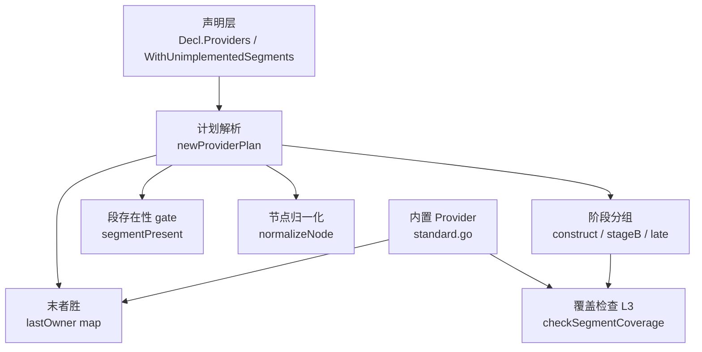
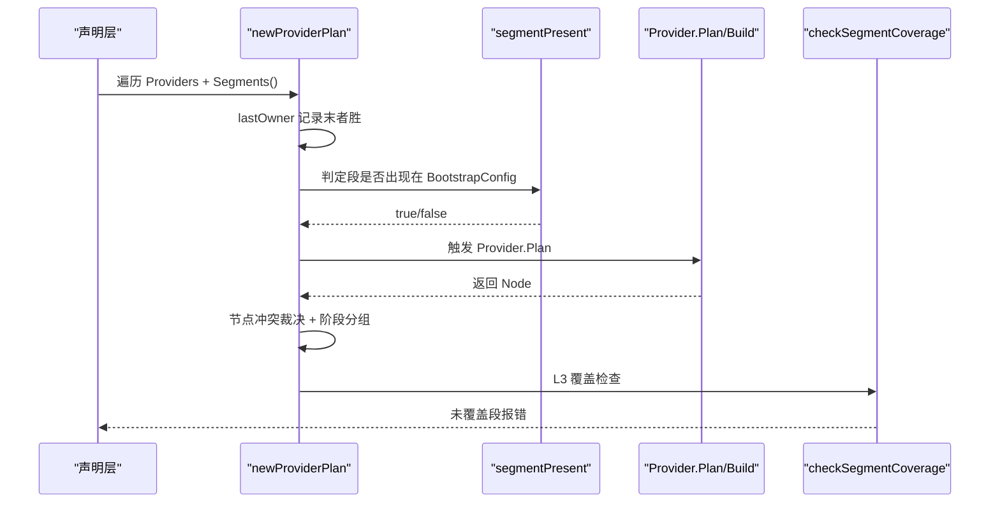
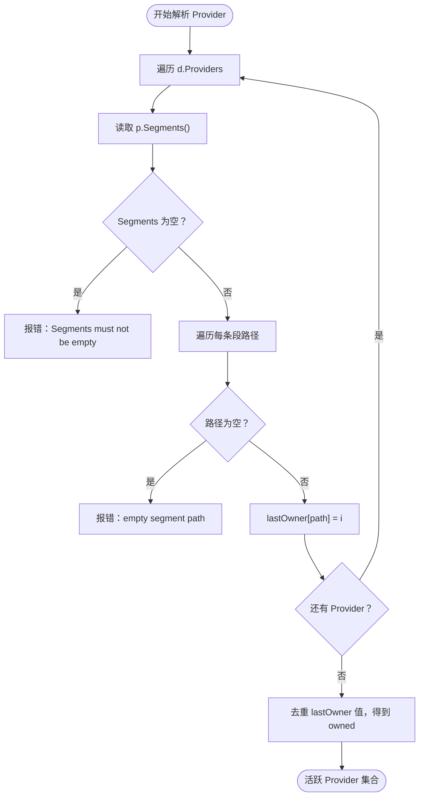
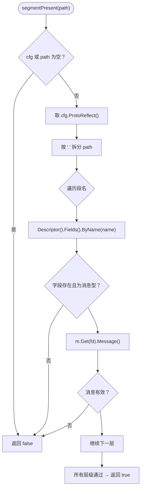
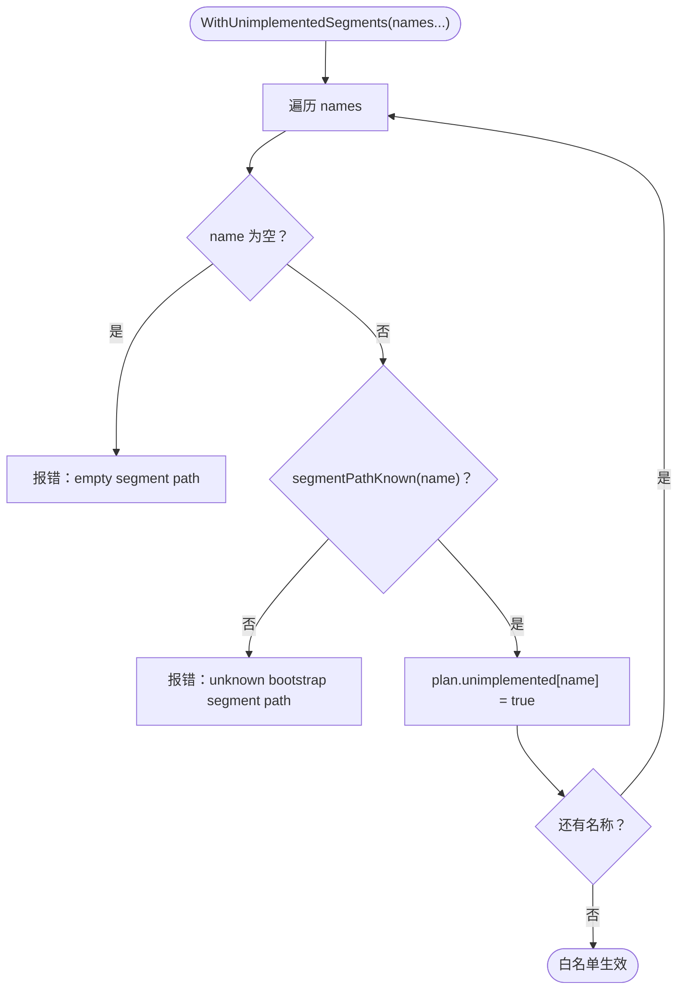
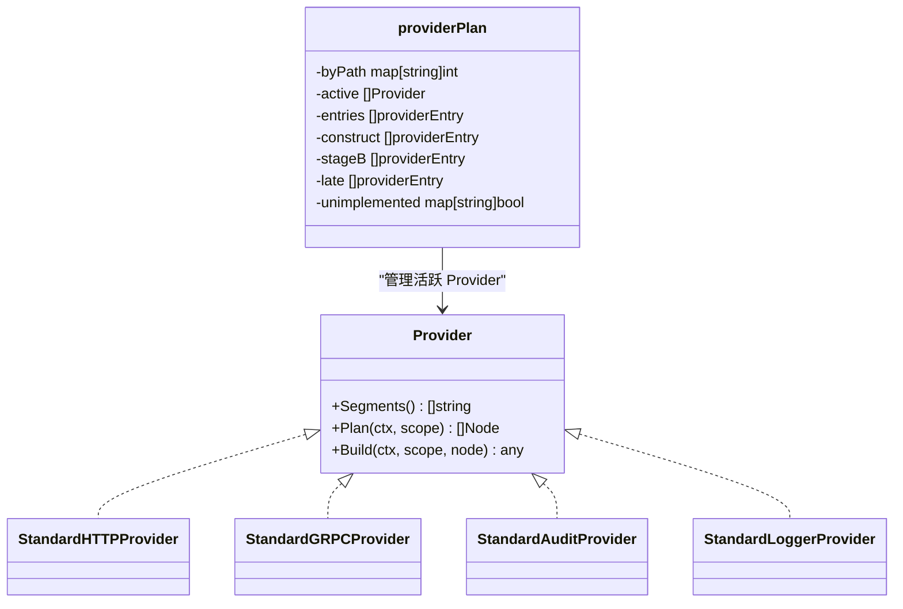

# 段路径匹配与末者胜规则

<cite>
**本文引用的文件**   
- [pkg/appkit/provider.go](file://pkg/appkit/provider.go)
- [pkg/appkit/segment_coverage.go](file://pkg/appkit/segment_coverage.go)
- [pkg/appkit/standard.go](file://pkg/appkit/standard.go)
</cite>

## 目录
1. [引言](#引言)
2. [项目结构定位](#项目结构定位)
3. [核心组件](#核心组件)
4. [架构总览](#架构总览)
5. [详细机制分析](#详细机制分析)
6. [依赖关系分析](#依赖关系分析)
7. [性能与复杂度](#性能与复杂度)
8. [故障排查指南](#故障排查指南)
9. [结论](#结论)
10. [附录：标准库 Provider 覆盖用例](#附录标准库-provider-覆盖用例)

## 引言
本文聚焦 Bald 框架中“段驱动装配”的段路径匹配机制，解释以下关键问题：
- `Segments()` 返回的路径如何被精确匹配。
- 顶层段名（如 `"database"`、`"audit"`）与子段路径（如 `"database.sql"`、`"server.http"`）如何在同一套逻辑下处理。
- “末者胜”覆盖规则的完整实现链。
- `segmentPresent` 如何通过 protobuf 反射逐级下钻判定段是否存在。
- `segmentTop` 提取顶层段名的语义。
- `presentChildSegments` 枚举直接子段的顺序保证。
- 白名单 `WithUnimplementedSegments` 的工作方式及校验约束。
- 标准库 Provider、业务 Provider 与框架内置 Provider 之间的段归属冲突解决过程。

## 项目结构定位
段路径匹配与覆盖控制的核心代码集中在 `pkg/appkit`：
- `provider.go`：Provider 接口、段路径解析、末者胜、存在性判定、计划构建与节点归一化。
- `segment_coverage.go`：L3 段覆盖检查、白名单消费面统计、server 子段合法性判定。
- `standard.go`：框架内置 Provider（HTTP/gRPC/Audit/Logger），用于演示“默认后端可被用户覆盖”。

**图表来源** 
- [pkg/appkit/provider.go:200-330](file://pkg/appkit/provider.go#L200-L330)
- [pkg/appkit/segment_coverage.go:1-156](file://pkg/appkit/segment_coverage.go#L1-L156)
- [pkg/appkit/standard.go:1-280](file://pkg/appkit/standard.go#L1-L280)

**章节来源**
- [pkg/appkit/provider.go:1-120](file://pkg/appkit/provider.go#L1-L120)
- [pkg/appkit/segment_coverage.go:1-40](file://pkg/appkit/segment_coverage.go#L1-L40)

## 核心组件
| 组件 | 职责 | 关键入口或字段 |
|---|---|---|
| `Provider` 接口 | 声明段路径、纯函数 Plan、唯一 Build | `Segments()`、`Plan()`、`Build()` |
| `providerPlan` | 保存末者胜后的活跃 Provider、按阶段分组、白名单集合 | `byPath`、`active`、`entries`、`unimplemented` |
| `segmentPresent` | 按 protobuf 反射判定契约段是否出现 | 消息型字段非 nil 即 present |
| `segmentTop` | 从路径提取顶层段名 | `"database.sql" → "database"` |
| `presentChildSegments` | 枚举消息型直接子段，保持字段声明序 | 供 server 子段覆盖检查使用 |
| `WithUnimplementedSegments` | 白名单追加项，空路径/未知路径在计划期报错 | 条目必须是 `BootstrapConfig` 真实字段路径 |
| 内置 Provider | 提供默认后端，允许用户以同一路径覆盖 | `StandardHTTPProvider`、`StandardGRPCProvider`、`StandardAuditProvider`、`StandardLoggerProvider` |

**章节来源**
- [pkg/appkit/provider.go:70-120](file://pkg/appkit/provider.go#L70-L120)
- [pkg/appkit/provider.go:200-270](file://pkg/appkit/provider.go#L200-L270)
- [pkg/appkit/standard.go:1-120](file://pkg/appkit/standard.go#L1-L120)

## 架构总览
段驱动装配的关键流程如下：
1. 收集全部 `Provider` 及其 `Segments()`。
2. 对每条段路径执行“末者胜”，后声明者覆盖先声明者。
3. 对活跃 Provider 做一次段存在性门控：`config` 无条件，`logger` 专用通道，其余段缺失则跳过。
4. 每个 Provider 产出恰好一个 `Node`；节点冲突按 I4 裁决。
5. 按阶段、拓扑、优先级排序，构造 `construct/stageB/late` 视图。
6. L3 段覆盖检查把“实际出现的顶层段 − 已消费 − 白名单”作为启动期 fail-fast 判据。

**图表来源**
- [pkg/appkit/provider.go:200-450](file://pkg/appkit/provider.go#L200-L450)
- [pkg/appkit/segment_coverage.go:70-156](file://pkg/appkit/segment_coverage.go#L70-L156)

## 详细机制分析

### 1. `Segments()` 返回路径的统一处理
Provider 通过 `Segments()` 返回一段或多段路径。路径既可以是：
- 顶层段名：如 `"database"`、`"audit"`。
- 子段路径：如 `"database.sql"`、`"server.http"`、`"server.grpc"`。

引擎不会为顶层段和子段走两套匹配器，而是统一按字符串键做精确匹配：
- 每条路径独立进入 `lastOwner`。
- 若两个 Provider 都声明 `"server.http"`，后者接管前者。
- 若一个 Provider 声明 `"database"`，另一个声明 `"database.sql"`，两者并存，因为键不同。

这意味着：**路径是精确键，不是前缀匹配**。

**章节来源**
- [pkg/appkit/provider.go:200-270](file://pkg/appkit/provider.go#L200-L270)
- [pkg/appkit/provider.go:330-360](file://pkg/appkit/provider.go#L330-L360)

### 2. 末者胜覆盖规则的实现
末者胜发生在 `newProviderPlan` 的第一步解析中：

**图表来源**
- [pkg/appkit/provider.go:330-380](file://pkg/appkit/provider.go#L330-L380)

关键点：
- `lastOwner` 是 `map[string]int`，键为段路径，值为 Provider 索引。
- 后写入会覆盖前值，因此“后声明者接管同一路径”。
- 随后用 `owned` 集合过滤出真正活跃的 Provider。
- `byPath` 在活跃集合中再次写入，值是 1-based 下标，保持末者胜结果。

**章节来源**
- [pkg/appkit/provider.go:330-380](file://pkg/appkit/provider.go#L330-L380)
- [pkg/appkit/provider.go:500-520](file://pkg/appkit/provider.go#L500-L520)

### 3. `segmentPresent`：protobuf 反射逐级下钻
`segmentPresent(cfg, path)` 判定契约配置中某个段路径是否“实际出现”。其语义是：
- 逐段名拆分路径。
- 每一步查找对应字段名。
- 字段必须存在且是消息型字段。
- 获取字段值后，消息必须有效。
- 全部层级成功才返回 true。
- 如果 `cfg` 为 nil、路径为空、中途字段不存在、字段不是消息型、或消息无效，返回 false。

这解释了作者指南中的两条重要语义：
- “消息型字段非 nil 即 present”：这里更严格，是“消息有效即 present”。
- “标量字段不构成段路径”：遇到标量字段直接拒绝，防止把标量误当成路径节点。

**图表来源**
- [pkg/appkit/provider.go:200-240](file://pkg/appkit/provider.go#L200-L240)

**章节来源**
- [pkg/appkit/provider.go:200-240](file://pkg/appkit/provider.go#L200-L240)

### 4. `segmentTop`：提取顶层段名
`segmentTop` 只关心第一个 `'.'`：
- 有 `'.'`：返回点之前的部分，例如 `"database.sql" → "database"`。
- 无 `'.'`：整条路径就是顶层段名。

它用于：
- 判断 Provider 的构建阶段族（`phaseByTop`）。
- 诊断日志输出。
- 覆盖检查中把子段映射到顶层段。

**章节来源**
- [pkg/appkit/provider.go:260-270](file://pkg/appkit/provider.go#L260-L270)
- [pkg/appkit/provider.go:300-330](file://pkg/appkit/provider.go#L300-L330)

### 5. `presentChildSegments`：直接子段枚举与顺序保证
`presentChildSegments` 接收一个 protobuf 消息，并枚举它的直接子段：
- 遍历 `Descriptor().Fields()`。
- 跳过非消息型字段。
- 仅保留 `Message().IsValid()` 的消息型字段。
- 按字段声明顺序追加到结果切片。

该函数被用于：
- L3 覆盖检查中枚举实际出现的顶层段。
- server 子段合法性检查中枚举 `server` 下的直接子段。

顺序保证来自 protobuf 字段的声明序，而不是运行时排序。新增子段无需手动维护表，反射会自动纳入。

**章节来源**
- [pkg/appkit/provider.go:240-260](file://pkg/appkit/provider.go#L240-L260)
- [pkg/appkit/segment_coverage.go:40-80](file://pkg/appkit/segment_coverage.go#L40-L80)

### 6. 白名单 `WithUnimplementedSegments` 的工作方式
`WithUnimplementedSegments` 是 L3 覆盖检查的豁免出口。它接受若干段路径，行为如下：
- 空路径：计划期直接报错。
- 未知字段路径：计划期直接报错。
- 合法路径：追加到 `plan.unimplemented` 集合。
- 多次调用：逐条追加，不替换。

白名单条目必须是 `BootstrapConfig` 的真实字段路径，例如：
- 顶层段名：`"script"`。
- server 子段路径：`"server.asynq"`。

判定逻辑复用 `segmentPathKnown`，它与 `segmentPresent` 思路一致，但用于“编译期/计划期”的白名单校验，而非运行期段存在性。

**图表来源**
- [pkg/appkit/provider.go:120-190](file://pkg/appkit/provider.go#L120-L190)
- [pkg/appkit/provider.go:330-360](file://pkg/appkit/provider.go#L330-L360)

**章节来源**
- [pkg/appkit/provider.go:120-190](file://pkg/appkit/provider.go#L120-L190)
- [pkg/appkit/provider.go:330-360](file://pkg/appkit/provider.go#L330-L360)

### 7. 标准库 Provider 与用户 Provider 的覆盖示例
框架内置 Provider 的段路径：
- `stdHTTPProvider`：`"server.http"`
- `stdGRPCProvider`：`"server.grpc"`
- `stdAuditProvider`：`"audit"`
- `stdLoggerProvider`：`"logger"`

当用户 Provider 也声明相同路径时，末者胜决定最终归属。例如：
- 先传入 `std.Standard()`，再传入用户自定义 audit Provider。
- 如果用户 Provider 的 `Segments()` 包含 `"audit"`，它会接管 `"audit"` 路径。
- 如果用户 Provider 只声明 `"database"`，而内置 Provider 声明 `"database.sql"`，两者并存。

内置 HTTP/gRPC Provider 被拆成两个 Provider，原因正是段归属是“整 Provider 级”的末者胜：如果单一 Provider 同时声明 `server.http` 与 `server.grpc`，第三方转码面接管 HTTP 时会连带挤掉 gRPC。

**章节来源**
- [pkg/appkit/standard.go:120-280](file://pkg/appkit/standard.go#L120-L280)
- [pkg/appkit/provider.go:330-380](file://pkg/appkit/provider.go#L330-L380)

## 依赖关系分析

**图表来源**
- [pkg/appkit/provider.go:70-120](file://pkg/appkit/provider.go#L70-L120)
- [pkg/appkit/provider.go:300-450](file://pkg/appkit/provider.go#L300-L450)
- [pkg/appkit/standard.go:120-280](file://pkg/appkit/standard.go#L120-L280)

**章节来源**
- [pkg/appkit/provider.go:70-120](file://pkg/appkit/provider.go#L70-L120)
- [pkg/appkit/standard.go:120-280](file://pkg/appkit/standard.go#L120-L280)

## 性能与复杂度
- 末者胜解析：遍历 `d.Providers` 与其 `Segments()`，时间复杂度为 `O(P × S)`，其中 `P` 是 Provider 数量，`S` 是平均段路径数。
- `segmentPresent`：每次调用按路径长度做 protobuf 反射查找，最坏为 `O(L × F)`，`L` 是路径段数，`F` 是字段字典查找成本。
- `presentChildSegments`：按字段声明序遍历一次消息字段，时间复杂度为 `O(F)`。
- 白名单判定：`segmentPathKnown` 对每个白名单条目做一次完整路径反射下钻。
- 覆盖检查：`consumedSegments` 基于 `triggeredPaths` 聚合已消费段，避免重复计算。

整体而言，段路径匹配是线性扫描 + 反射查找的组合，开销主要来自 protobuf 反射，但在应用启动期属于一次性成本。

[本节为通用性能讨论，不直接分析具体代码行]

## 故障排查指南
| 现象 | 可能原因 | 排查方向 |
|---|---|---|
| 启动时报错“with unimplemented segments: empty segment path” | `WithUnimplementedSegments` 传入空字符串 | 检查白名单条目是否为空 |
| 启动时报错“unknown bootstrap segment path” | 白名单路径拼错，不是 `BootstrapConfig` 真实字段路径 | 对照 protobuf 字段路径，例如 `"script"` 或 `"server.asynq"` |
| 某段配置静默失效 | 段出现在契约但未有任何 Provider 消费，且不在白名单 | 查看 L3 覆盖检查输出，确认是否漏写 Provider 或遗漏白名单 |
| 用户 Provider 无法覆盖内置后端 | 未声明完全相同的段路径 | 确认用户 Provider 的 `Segments()` 与内置 Provider 完全一致 |
| server 子段未监听 | 子段存在但无 Provider 接管，也未白名单 | 为 `server.X` 提供 Provider，或用 `WithUnimplementedSegments("server.X")` |
| registry 段报错 | 多个 registry Provider 同时触发 | 移除多余 registry 段或 Provider，registry 是单选域 |

**章节来源**
- [pkg/appkit/provider.go:120-190](file://pkg/appkit/provider.go#L120-L190)
- [pkg/appkit/provider.go:330-450](file://pkg/appkit/provider.go#L330-L450)
- [pkg/appkit/segment_coverage.go:40-156](file://pkg/appkit/segment_coverage.go#L40-L156)

## 结论
段驱动装配的段路径匹配机制以“精确字符串键 + protobuf 反射”为核心：
- 顶层段名与子段路径在同一套精确匹配逻辑下处理。
- 末者胜由 `lastOwner` 与 `byPath` 共同实现，后声明者接管同一路径。
- `segmentPresent` 通过逐级消息型字段下钻判定段是否存在，标量字段不参与段路径。
- `segmentTop` 与 `presentChildSegments` 分别承担顶层段提取与子段枚举职责，并保持字段声明序。
- `WithUnimplementedSegments` 是唯一显式豁免入口，空路径与未知路径在计划期直接报错。
- 标准库 Provider 可通过相同段路径被用户 Provider 覆盖，这是 Bald 默认后端扩展性的基础。

[本节为总结性内容，不直接分析具体文件]

## 附录：标准库 Provider 覆盖用例

### 用例一：用户 Provider 覆盖内置 audit 后端
假设内置 `StandardAuditProvider` 声明 `"audit"`，用户 Provider 也声明 `"audit"`：
- 若用户 Provider 在后声明，则末者胜后用户 Provider 接管。
- 若用户 Provider 在前，则内置 Provider 接管。
- 两者路径相同，不会并存。

**章节来源**
- [pkg/appkit/standard.go:250-280](file://pkg/appkit/standard.go#L250-L280)
- [pkg/appkit/provider.go:330-380](file://pkg/appkit/provider.go#L330-L380)

### 用例二：数据库顶层段与 SQL 子段并存
- 内置 Provider 声明 `"database.sql"`。
- 业务 Provider 声明 `"database"`。
- 两者路径不同，末者胜不会互相覆盖。
- 业务 Provider 可消费数据库顶层资源；SQL Provider 消费 SQL 子段。

**章节来源**
- [pkg/appkit/provider.go:330-380](file://pkg/appkit/provider.go#L330-L380)

### 用例三：HTTP 转码面接管 server.http
- 内置 `stdHTTPProvider` 声明 `"server.http"`。
- 第三方转码面 Provider 也声明 `"server.http"`。
- 若第三方 Provider 后声明，则 HTTP 端口由第三方接管。
- `server.grpc` 仍可由内置 `stdGRPCProvider` 持有，因为它是独立 Provider。

**章节来源**
- [pkg/appkit/standard.go:160-240](file://pkg/appkit/standard.go#L160-L240)
- [pkg/appkit/provider.go:520-560](file://pkg/appkit/provider.go#L520-L560)

### 用例四：未实现的 script 段
- 契约中存在 `script` 段，但仓库无消费者。
- 若不调用 `WithUnimplementedSegments("script")`，L3 覆盖检查启动期报错。
- 调用后会加入白名单，不再报错。

**章节来源**
- [pkg/appkit/provider.go:120-190](file://pkg/appkit/provider.go#L120-L190)
- [pkg/appkit/segment_coverage.go:40-120](file://pkg/appkit/segment_coverage.go#L40-L120)