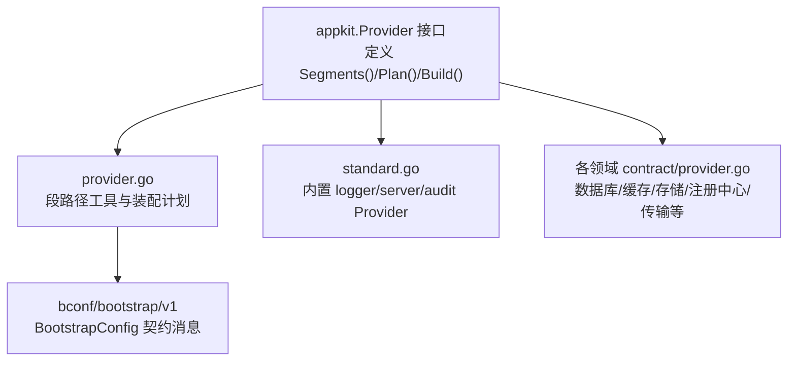
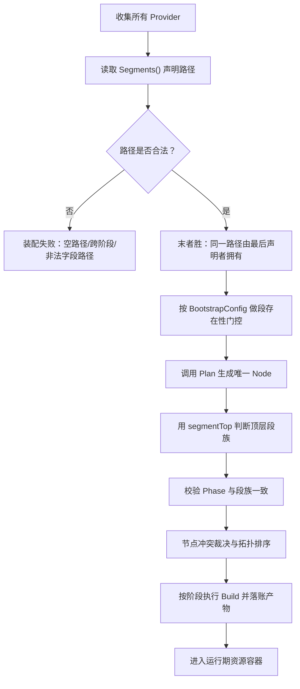
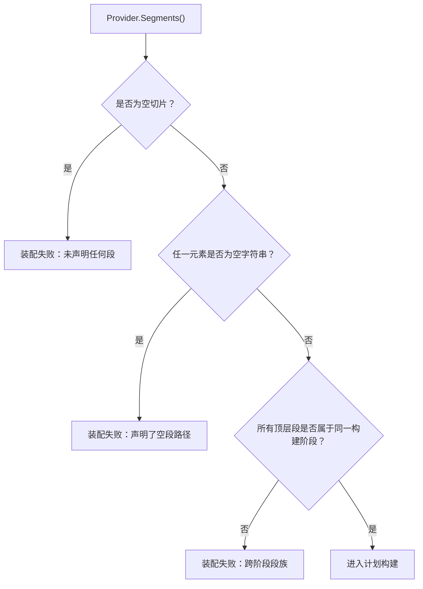
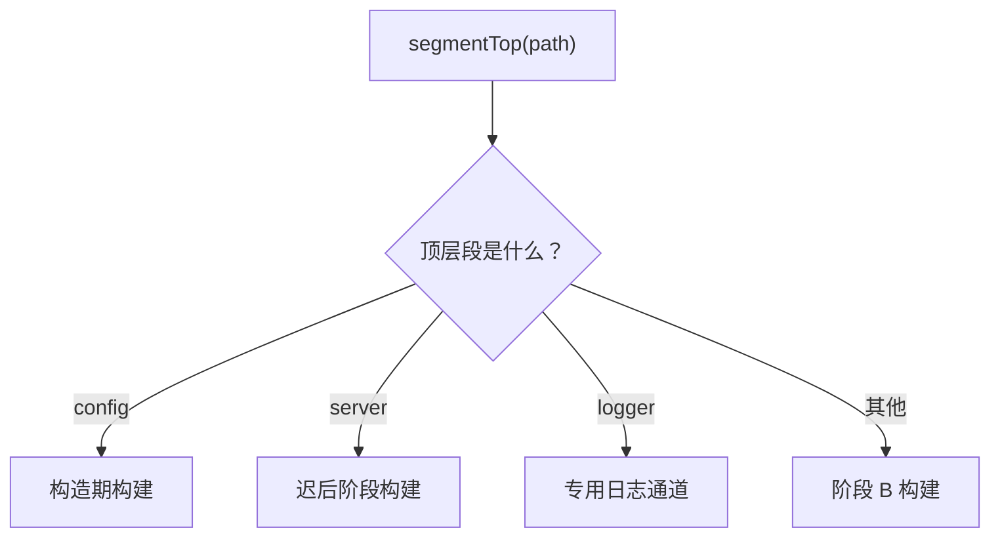
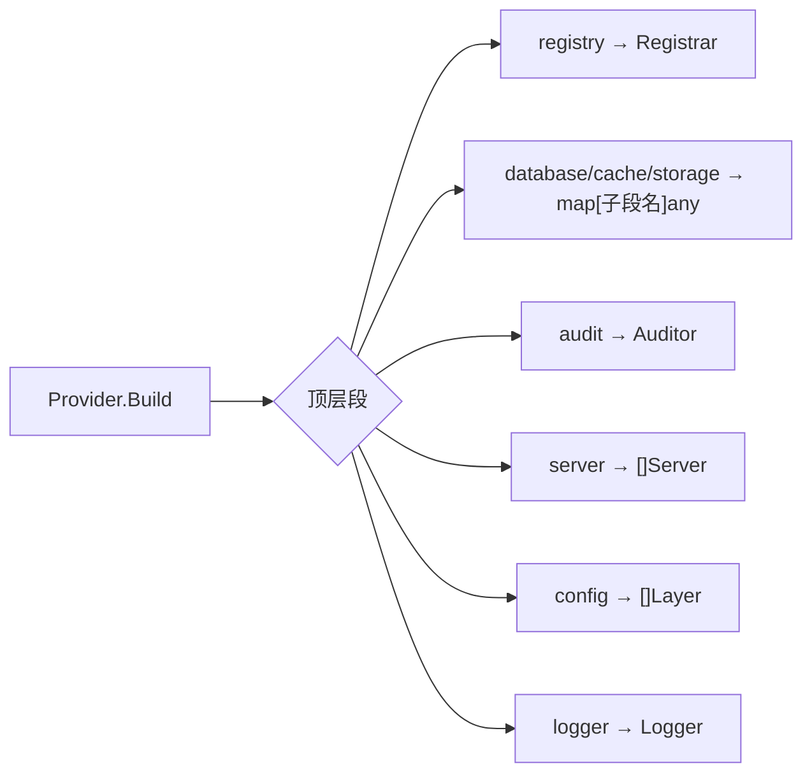
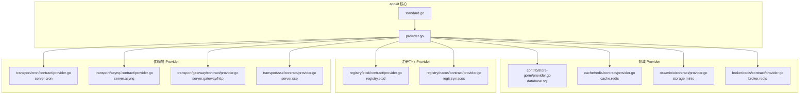

# 段路径解析与顶层段提取

<cite>
**本文引用的文件**
- [pkg/appkit/provider.go](file://pkg/appkit/provider.go)
- [pkg/appkit/standard.go](file://pkg/appkit/standard.go)
- [pkg/appkit/provider_test.go](file://pkg/appkit/provider_test.go)
- [contrib/store-gorm/provider.go](file://contrib/store-gorm/provider.go)
- [cache/redis/contract/provider.go](file://cache/redis/contract/provider.go)
- [oss/minio/contract/provider.go](file://oss/minio/contract/provider.go)
- [transport/cron/contract/provider.go](file://transport/cron/contract/provider.go)
- [transport/asynq/contract/provider.go](file://transport/asynq/contract/provider.go)
- [transport/gateway/contract/provider.go](file://transport/gateway/contract/provider.go)
- [transport/sse/contract/provider.go](file://transport/sse/contract/provider.go)
- [registry/nacos/contract/provider.go](file://registry/nacos/contract/provider.go)
- [registry/etcd/contract/provider.go](file://registry/etcd/contract/provider.go)
- [broker/redis/contract/provider.go](file://broker/redis/contract/provider.go)
</cite>

## 目录
1. [引言](#引言)
2. [项目结构定位](#项目结构定位)
3. [核心组件](#核心组件)
4. [架构总览](#架构总览)
5. [段路径解析机制详解](#段路径解析机制详解)
6. [顶层段提取与装配语义](#顶层段提取与装配语义)
7. [Provider 段路径设计模式](#provider-段路径设计模式)
8. [依赖关系分析](#依赖关系分析)
9. [性能与正确性特征](#性能与正确性特征)
10. [故障排查指南](#故障排查指南)
11. [结论](#结论)

## 引言
本文聚焦 Bald 应用框架中 Provider 的**段路径解析机制**，重点解释：

- `Segments()` 返回的字符串切片如何表示配置归属层级，例如 `database.sql`、`server.http`、`audit.log`。
- `segmentTop` 函数如何从完整段路径中提取顶层段名（如 `database`）。
- 为什么“顶层段”是后续阶段分类、排序、冲突裁决、覆盖检查的关键抽象。
- 空路径与非法路径的处理规则。
- 点号分隔符的语义：第一段为顶层段族，后续段构成子段路径。
- 标准库 Provider、业务 Provider 与自定义基础设施 Provider 的路径设计模式。
- 段路径与最终装配到 bconf 配置树中的对应关系。

本说明面向希望理解或扩展 Provider 段的开发者，既给出代码级依据，也提供面向实践的设计建议。

## 项目结构定位
段路径解析的核心实现位于 `pkg/appkit/provider.go`；内置默认 Provider 的段声明位于 `pkg/appkit/standard.go`；各类第三方 Provider 通过各自 contract 包暴露 `Segments()`，统一遵循同一装配契约。

**图表来源**
- [pkg/appkit/provider.go:1-120](file://pkg/appkit/provider.go#L1-L120)
- [pkg/appkit/standard.go:1-60](file://pkg/appkit/standard.go#L1-L60)

**章节来源**
- [pkg/appkit/provider.go:1-120](file://pkg/appkit/provider.go#L1-L120)
- [pkg/appkit/standard.go:1-60](file://pkg/appkit/standard.go#L1-L60)

## 核心组件
本节把与段路径直接相关的类型与函数拆成可理解的小块。

| 名称 | 角色 | 关键行为 |
|---|---|---|
| `Provider` 接口 | Provider 契约 | 声明消费路径 `Segments()`，纯函数计划 `Plan()`，唯一副作用入口 `Build()` |
| `Segments()` | 路径声明 | 返回非空字符串切片，每个元素是精确匹配的段路径 |
| `segmentTop` | 顶层段提取器 | 按第一个点号切出顶层段名 |
| `segmentPresent` | 段存在性判定 | 通过 protobuf 反射沿点号路径下钻 BootstrapConfig |
| `providerPhaseFamily` | 构建阶段族校验 | 保证一个 Provider 的所有段属于同一构建阶段 |
| `phaseByTop` | 顶层段到阶段映射 | `config`→构造期、`server`→迟后阶段、`logger`→专用通道、其余→阶段 B |
| `newProviderPlan` | 装配计划构建 | 末者胜、存在性 gate、Plan 推导、节点冲突裁决、拓扑排序 |
| `normalizeNode` | 节点规范化 | 补齐 Kind/Origin/EffectName，校验 Phase 与段族一致 |

**章节来源**
- [pkg/appkit/provider.go:1-120](file://pkg/appkit/provider.go#L1-L120)
- [pkg/appkit/provider.go:190-260](file://pkg/appkit/provider.go#L190-L260)
- [pkg/appkit/provider.go:260-360](file://pkg/appkit/provider.go#L260-L360)
- [pkg/appkit/provider.go:520-610](file://pkg/appkit/provider.go#L520-L610)

## 架构总览
Provider 装配不是“调用某个工厂”，而是以**段路径 + Plan 节点**为中心的声明式装配流程。

**图表来源**
- [pkg/appkit/provider.go:360-480](file://pkg/appkit/provider.go#L360-L480)
- [pkg/appkit/provider.go:520-610](file://pkg/appkit/provider.go#L520-L610)

## 段路径解析机制详解

### 段路径的基本形态
`Segments()` 返回的是**字符串切片**，而不是单个字符串。这允许一个 Provider 同时声明多个段路径，但框架对这类多段 Provider 有严格约束：

1. 每个元素必须是非空字符串。
2. 所有元素的顶层段必须属于同一构建阶段。
3. 引擎按“精确匹配 + 末者胜”决定谁最终拥有该路径。
4. 一个 Provider 在计划期只能产出一个 Node。

典型形态包括：

| 路径示例 | 含义 |
|---|---|
| `logger` | 顶层段，消费整个 logger 段 |
| `server.http` | server 下的 http 子段 |
| `database.sql` | database 下的 sql 子段 |
| `cache.redis` | cache 下的 redis 子段 |
| `storage.minio` | storage 下的 minio 子段 |
| `registry.etcd` | registry 下的 etcd 子段 |
| `audit` | 顶层 audit 段 |
| `broker.redis` | broker 下的 redis 子段 |

点号分隔符的语义是：**路径按点号逐级映射到 BootstrapConfig 的消息型字段**。因此，只有当某条路径在配置树中存在时，对应的 Provider 才会被触发（config 段例外）。

**章节来源**
- [pkg/appkit/provider.go:190-260](file://pkg/appkit/provider.go#L190-L260)
- [pkg/appkit/provider.go:360-430](file://pkg/appkit/provider.go#L360-L430)

### `segmentTop` 的实现语义
`segmentTop` 的职责非常集中：从完整段路径中提取第一个点号之前的部分作为顶层段名。其核心逻辑如下：

- 如果路径包含点号，则返回点号前的子串。
- 如果路径不含点号，则整条路径就是顶层段。

这意味着：

| 输入 | 输出 | 说明 |
|---|---|---|
| `database.sql` | `database` | 顶层段族是 database |
| `server.http` | `server` | 顶层段族是 server |
| `audit.log` | `audit` | 顶层段族是 audit |
| `logger` | `logger` | 没有子段，顶层段即自身 |
| `` | `` | 空路径仍返回空字符串，但空路径会在更高层被拒绝 |

这个函数之所以重要，是因为它把“具体后端选择”和“装配阶段族”解耦：无论你是 `database.sql` 还是 `database.mongo`，顶层段都是 `database`，从而共享相同的阶段、优先级约定和覆盖语义。

**章节来源**
- [pkg/appkit/provider.go:190-200](file://pkg/appkit/provider.go#L190-L200)

### 空路径与非法路径处理
框架对段路径的校验集中在计划构建阶段。

#### 空路径
- Provider 必须至少声明一个段路径。
- 任一声明路径不能为空字符串。
- 若违反，装配直接报错，错误信息会带上 Provider 类型。

#### 非法路径
- `WithUnimplementedSegments` 接受的白名单路径必须是 `BootstrapConfig` 的真实字段路径。
- 空路径会被拒绝。
- 逐级反射找不到消息型字段会被判为未知路径，同样报错。
- 段存在性判定要求路径上每一层都是消息型字段，标量字段不构成段路径。

#### 跨阶段段族
- 如果一个 Provider 同时声明 `server.http` 和 `database.sql`，`providerPhaseFamily` 会检测到不同顶层段对应不同构建阶段，并报错。
- 这是有意为之：一个 Provider 不能同时承担构造期、阶段 B 和迟后阶段的职责。

**图表来源**
- [pkg/appkit/provider.go:360-430](file://pkg/appkit/provider.go#L360-L430)
- [pkg/appkit/provider.go:610-683](file://pkg/appkit/provider.go#L610-L683)

**章节来源**
- [pkg/appkit/provider.go:360-430](file://pkg/appkit/provider.go#L360-L430)
- [pkg/appkit/provider.go:610-683](file://pkg/appkit/provider.go#L610-L683)

### 点号分隔符与配置树映射
点号不是任意语法糖，而是与 `bootstrap/v1` 的 protobuf 消息字段一一对应。

`segmentPresent` 的工作方式是：

1. 取 `BootstrapConfig` 的 proto 反射消息。
2. 按点号拆分路径。
3. 逐段查找字段名。
4. 只接受消息型字段。
5. 若中途字段不存在或不是消息型，判定为不存在。
6. 仅当整条路径都有效且末端消息非 nil，才认为段出现。

因此，`database.sql` 意味着：

- 顶层字段 `database` 必须是消息型。
- 其子字段 `sql` 也必须存在且为消息型。
- 运行时配置对象中这两个字段都必须非 nil。

这种设计让“段是否存在”可以直接复用 bconf 生成的配置结构，而不需要手写路径枚举表。

**章节来源**
- [pkg/appkit/provider.go:201-260](file://pkg/appkit/provider.go#L201-L260)

## 顶层段提取与装配语义

### 顶层段如何影响装配
`segmentTop` 的结果用于以下关键决策：

| 使用位置 | 作用 |
|---|---|
| `phaseByTop` | 把 `config`、`server`、`logger` 归类到特殊构建时机 |
| `providerPhaseFamily` | 校验 Provider 所有段的顶层段是否一致 |
| `normalizeNode` | 默认填充 Node.Kind |
| `providerAllTop` | 判断 Provider 是否完全属于某一段族，例如 registry |
| `planFrom` / 覆盖检查 | 根据顶层段识别 logger、server、registry 等特殊域 |

特别地：

- `config` 段在构造期构建，因为它的产出要进入 kitOpts，早于 `NewApp`。
- `server` 段在迟后阶段构建，以便消费业务已建好的运行期资源。
- `logger` 段走专用通道，不参与普通 Provider 循环，支持两阶段引导与热更新。
- 其他段默认在阶段 B 构建。

**图表来源**
- [pkg/appkit/provider.go:260-320](file://pkg/appkit/provider.go#L260-L320)
- [pkg/appkit/provider.go:520-560](file://pkg/appkit/provider.go#L520-L560)

**章节来源**
- [pkg/appkit/provider.go:260-320](file://pkg/appkit/provider.go#L260-L320)
- [pkg/appkit/provider.go:520-560](file://pkg/appkit/provider.go#L520-L560)

### 段路径与最终装配结果的对应关系
Provider 的 `Build` 返回值并非随意类型，而是受顶层段约束：

| 顶层段 | 产物类型 | 装配去向 |
|---|---|---|
| `registry` | `registry.Registrar` | 注册中心实例 |
| `database`、`cache`、`storage`、`ai`、`workflow`、`broker` | `map[string]any`，键为子段名 | 注入 App 资源容器 |
| `audit` | `audit.Auditor` | 全局审计器 |
| `server` | `[]transport.Server` | 服务器列表 |
| `config` | `[]config.Layer` | 配置层 |
| `logger` | `log.Logger` | 日志通道（专用） |
| 无产物 | `nil` | 跳过该节点产物 |

对于数据库、缓存、存储等业务域，常见模式是：Provider 返回 `map[string]any{子段名: 实例}`。例如 `database.sql` 的 Provider 返回 `{sql: *gorm.DB}`，然后引擎把该 map 挂到对应资源槽位。

**图表来源**
- [pkg/appkit/provider.go:80-120](file://pkg/appkit/provider.go#L80-L120)
- [pkg/appkit/provider_test.go:80-128](file://pkg/appkit/provider_test.go#L80-L128)

**章节来源**
- [pkg/appkit/provider.go:80-120](file://pkg/appkit/provider.go#L80-L120)
- [pkg/appkit/provider_test.go:80-128](file://pkg/appkit/provider_test.go#L80-L128)

## Provider 段路径设计模式

### 标准库 Provider
内置 Provider 展示了最基础的三段路径范式：

| Provider | 段路径 | 设计要点 |
|---|---|---|
| 标准日志 Provider | `logger` | 顶层段，两阶段引导，独占 logger 段 |
| 标准 HTTP Provider | `server.http` | server 子段，迟后阶段 |
| 标准 gRPC Provider | `server.grpc` | server 子段，与 HTTP 面分离，避免第三方转码面挤掉 gRPC |
| 标准审计 Provider | `audit` | 顶层段，依赖 database/cache 就绪，停机最后回收 |

这些实现位于 `pkg/appkit/standard.go`，并由 `std.Standard()` 打包导出。用户可通过追加 Provider 实现“末者胜”覆盖。

**章节来源**
- [pkg/appkit/standard.go:1-60](file://pkg/appkit/standard.go#L1-L60)
- [pkg/appkit/standard.go:50-100](file://pkg/appkit/standard.go#L50-L100)
- [pkg/appkit/standard.go:130-220](file://pkg/appkit/standard.go#L130-L220)
- [pkg/appkit/standard.go:250-280](file://pkg/appkit/standard.go#L250-L280)

### 业务 Provider
业务 Provider 通常绑定具体技术栈的子段。仓库中的典型例子包括：

| Provider | 段路径 | 用途 |
|---|---|---|
| GORM 数据库 Provider | `database.sql` | 装配 SQL 数据库客户端 |
| Redis 缓存 Provider | `cache.redis` | 装配 Redis 缓存客户端 |
| MinIO 存储 Provider | `storage.minio` | 装配对象存储客户端 |
| Nacos 注册中心 Provider | `registry.nacos` | 接入 Nacos 服务发现 |
| Etcd 注册中心 Provider | `registry.etcd` | 接入 Etcd 服务发现 |
| Redis Broker Provider | `broker.redis` | 装配消息总线客户端 |

这些 Provider 的 `Segments()` 直接声明目标段路径，并把实际构建逻辑放在 `Plan` 与 `Build` 中。

**章节来源**
- [contrib/store-gorm/provider.go:50-70](file://contrib/store-gorm/provider.go#L50-L70)
- [cache/redis/contract/provider.go:60-80](file://cache/redis/contract/provider.go#L60-L80)
- [oss/minio/contract/provider.go:30-50](file://oss/minio/contract/provider.go#L30-L50)
- [registry/nacos/contract/provider.go:30-50](file://registry/nacos/contract/provider.go#L30-L50)
- [registry/etcd/contract/provider.go:30-50](file://registry/etcd/contract/provider.go#L30-L50)
- [broker/redis/contract/provider.go:30-50](file://broker/redis/contract/provider.go#L30-L50)

### 自定义基础设施 Provider
基础设施 Provider 一般遵循以下模式：

1. 在 contract 包中定义 Provider 类型与 `Segments()`。
2. 将 `Segments()` 固定为稳定的段路径，例如 `server.cron`、`server.asynq`、`server.gateway`、`server.sse`。
3. 将配置绑定逻辑放入 `Plan` 与 `Build`。
4. 通过 `Option` 接口把 Provider 加入 Decl。
5. 如果需要替换内置 Provider，只需声明相同段路径，利用“末者胜”语义接管。

例如：

| Provider | 段路径 | 说明 |
|---|---|---|
| Cron 任务 Provider | `server.cron` | 基于 server 段族的定时任务基础设施 |
| Asynq 任务 Provider | `server.asynq` | 基于 server 段族的任务队列基础设施 |
| Gateway 转码 Provider | `server.gateway` | 基于 server 段族的外部网关 |
| SSE 流 Provider | `server.sse` | 基于 server 段族的 Server-Sent Events 基础设施 |

这些 Provider 共同体现了“基础设施按 server 子段划分”的设计思路：它们不争夺业务数据段，也不混入 config/logger/audit 生命周期。

**章节来源**
- [transport/cron/contract/provider.go:40-60](file://transport/cron/contract/provider.go#L40-L60)
- [transport/asynq/contract/provider.go:40-60](file://transport/asynq/contract/provider.go#L40-L60)
- [transport/gateway/contract/provider.go:50-80](file://transport/gateway/contract/provider.go#L50-L80)
- [transport/gateway/contract/provider.go:110-140](file://transport/gateway/contract/provider.go#L110-L140)
- [transport/sse/contract/provider.go:40-60](file://transport/sse/contract/provider.go#L40-L60)

## 依赖关系分析

**图表来源**
- [pkg/appkit/provider.go:1-120](file://pkg/appkit/provider.go#L1-L120)
- [pkg/appkit/standard.go:1-60](file://pkg/appkit/standard.go#L1-L60)
- [contrib/store-gorm/provider.go:50-70](file://contrib/store-gorm/provider.go#L50-L70)
- [cache/redis/contract/provider.go:60-80](file://cache/redis/contract/provider.go#L60-L80)
- [oss/minio/contract/provider.go:30-50](file://oss/minio/contract/provider.go#L30-L50)
- [broker/redis/contract/provider.go:30-50](file://broker/redis/contract/provider.go#L30-L50)
- [registry/etcd/contract/provider.go:30-50](file://registry/etcd/contract/provider.go#L30-L50)
- [registry/nacos/contract/provider.go:30-50](file://registry/nacos/contract/provider.go#L30-L50)
- [transport/cron/contract/provider.go:40-60](file://transport/cron/contract/provider.go#L40-L60)
- [transport/asynq/contract/provider.go:40-60](file://transport/asynq/contract/provider.go#L40-L60)
- [transport/gateway/contract/provider.go:50-80](file://transport/gateway/contract/provider.go#L50-L80)
- [transport/sse/contract/provider.go:40-60](file://transport/sse/contract/provider.go#L40-L60)

## 性能与正确性特征

### 时间复杂度
- `segmentTop`：对每个路径只做一次字节扫描，时间复杂度近似 O(n)，n 为路径长度。
- `segmentPresent`：按点号拆分路径后逐段反射查找字段，复杂度与路径深度线性相关。
- `providerPhaseFamily`：遍历 Provider 声明的所有段，比较顶层段对应阶段。
- `newProviderPlan`：主要开销来自 Provider 数量、段数量、Plan 节点数及拓扑排序。

### 正确性保障
- 空段路径直接报错，避免隐式空匹配。
- 段族跨阶段直接报错，防止单 Provider 承担矛盾生命周期。
- 每个 Provider 必须恰好返回一个 Node。
- Node 的 Phase 必须与其段族一致。
- registry 段是单选域，同时激活多个 registry Provider 会报错。
- logger 段最多一个 Provider。
- 白名单路径必须是真实 BootstrapConfig 字段路径，拼错会显式报错。

这些约束使段路径不仅是“字符串约定”，而是装配期的强类型边界。

**章节来源**
- [pkg/appkit/provider.go:360-480](file://pkg/appkit/provider.go#L360-L480)
- [pkg/appkit/provider.go:520-610](file://pkg/appkit/provider.go#L520-L610)

## 故障排查指南

### 症状：Provider 未被构建
可能原因：

1. 配置中缺少对应段，`segmentPresent` 判定为不存在。
2. Provider 声明了多个段，但其中没有任何一个出现在配置中。
3. Provider 被“程序化 Registrar”接管，纯 registry Provider 整体跳过。
4. Provider 被另一个同名段路径的 Provider 覆盖，而后者未触发。

排查步骤：

1. 确认 `Segments()` 返回的路径确实存在于 `BootstrapConfig`。
2. 检查是否有后声明的 Provider 覆盖了同一路径。
3. 对 registry 段，确认是否使用了程序化注册器。
4. 打印装配警告，查看“末者胜”最终归属。

**章节来源**
- [pkg/appkit/provider.go:360-430](file://pkg/appkit/provider.go#L360-L430)
- [pkg/appkit/provider.go:640-683](file://pkg/appkit/provider.go#L640-L683)

### 症状：装配期报“未声明任何段”或“空段路径”
可能原因：

- `Segments()` 返回空切片。
- `Segments()` 返回包含空字符串的切片。

修复方式：

- 确保至少声明一个非空段路径。
- 不要把空字符串当作占位符。

**章节来源**
- [pkg/appkit/provider.go:360-430](file://pkg/appkit/provider.go#L360-L430)

### 症状：装配期报“跨阶段段族”
可能原因：

- 一个 Provider 同时声明 `server.http` 和 `database.sql`。
- 一个 Provider 同时声明 `config` 和 `audit`。

修复方式：

- 按顶层段族拆分 Provider。
- 每个 Provider 只负责一个构建阶段族。

**章节来源**
- [pkg/appkit/provider.go:610-683](file://pkg/appkit/provider.go#L610-L683)

### 症状：白名单路径报错“未知 bootstrap 段路径”
可能原因：

- `WithUnimplementedSegments` 传入的路径拼写错误。
- 路径不是 `BootstrapConfig` 的真实消息型字段路径。

修复方式：

- 使用 `script` 或 `server.asynq` 这类真实字段路径格式。
- 只在确实存在契约字段时使用白名单豁免。

**章节来源**
- [pkg/appkit/provider.go:120-190](file://pkg/appkit/provider.go#L120-L190)

## 结论
段路径解析是 Bald Provider 装配系统的中枢机制。`Segments()` 不仅描述 Provider 消费的配置片段，还决定了：

- 路径是否触发。
- 哪个 Provider 最终拥有该路径。
- Provider 在哪个阶段构建。
- 节点 Kind、阶段族、冲突裁决与停机顺序。
- 产物如何落入 bconf 配置树与应用资源容器。

`segmentTop` 虽然只是按点号截取顶层段，但它把“具体实现段”与“装配阶段族”解耦，使 framework 能稳定识别 `database`、`server`、`logger`、`audit`、`registry` 等关键域，同时允许第三方通过稳定路径扩展新子段。

在实践中，推荐遵循以下原则：

- 使用点号表达层级，首段为顶层段族，后续段标识具体后端。
- 保持 `Segments()` 稳定，不要随版本漂移。
- 一个 Provider 只声明同一构建阶段的段。
- 替换内置 Provider 时使用相同段路径，而不是新增路径。
- 把配置存在性与构建逻辑分开：`Segments()` 声明意图，`Plan`/`Build` 实现意图。

这样，段路径就能既是人类可读的配置契约，也是机器可验证的装配边界。