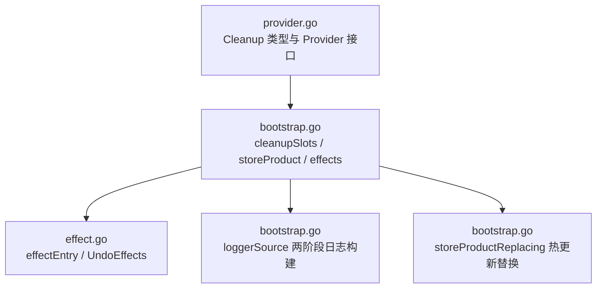
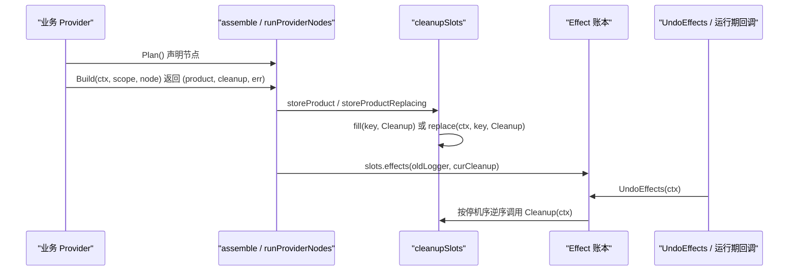
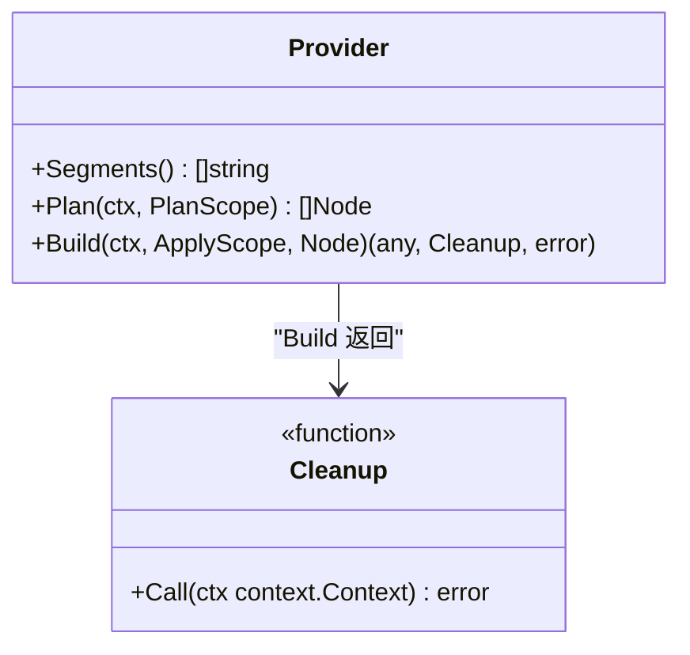
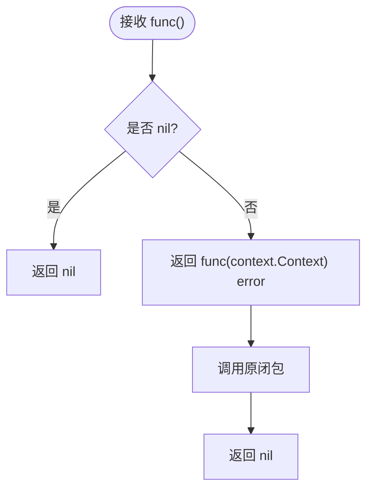
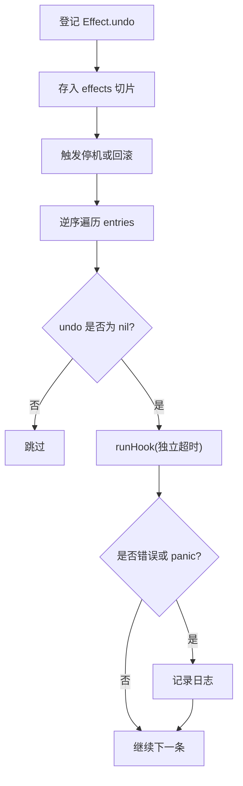
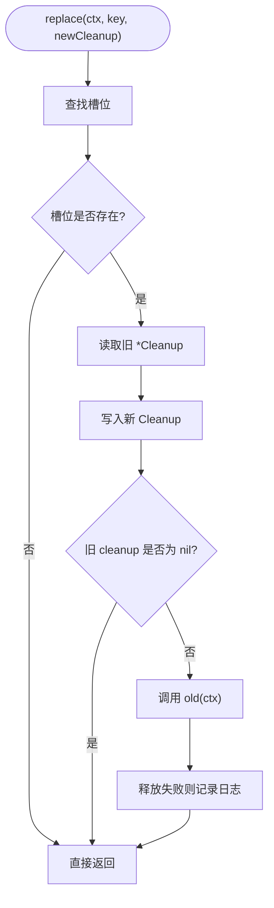
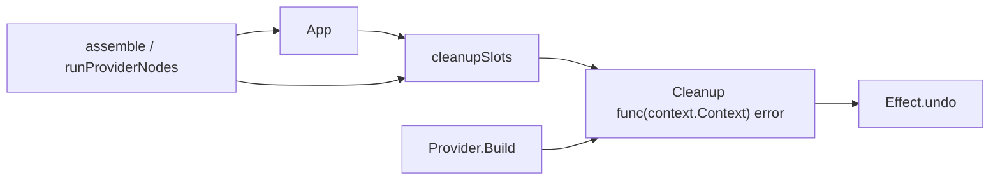

# Cleanup 函数设计与适配

<cite>
**本文引用的文件**   
- [effect.go](file://pkg/appkit/effect.go)
- [provider.go](file://pkg/appkit/provider.go)
- [bootstrap.go](file://pkg/appkit/bootstrap.go)
</cite>

## 目录
1. [引言](#引言)
2. [项目结构定位](#项目结构定位)
3. [核心概念](#核心概念)
4. [架构总览](#架构总览)
5. [Cleanup 类型与 noopCleanup 适配器](#cleanup-类型与-noopcleanup-适配器)
6. [Effect 账本与停机回放路径](#effect-账本与停机回放路径)
7. [Provider.Build 返回 cleanup 的正确写法](#providerbuild-返回-cleanup-的正确写法)
8. [热更新路径上的原子替换语义](#热更新路径上的原子替换语义)
9. [设计取舍：为何统一为 Effect.undo 同构签名](#设计取舍为何统一为-effectundo-同构签名)
10. [依赖关系分析](#依赖关系分析)
11. [故障排查](#故障排查)
12. [结论](#结论)

## 引言
本文聚焦 `pkg/appkit` 中用于资源生命周期的 `Cleanup` 函数类型及其配套适配机制。它回答三个问题：

- 为什么 Provider 产物释放钩子被定义为 `Cleanup func(context.Context) error`，而不是保留旧式 `func()`？
- `noopCleanup` 如何把无参清理闭包安全地转成统一签名，以及它的 nil 检查与错误约定是什么？
- 这个统一签名如何让 Effect 账本的 undo 回放、Provider 装配的 Build/协调、以及热更新中的原子替换保持简单可靠？

## 项目结构定位
Cleanup 不是独立包，而是 `pkg/appkit` 装配框架的核心契约之一。它与三类实现面紧密耦合：

| 角色 | 所在文件 | 职责 |
|---|---|---|
| 类型定义与适配器 | [provider.go:40-75](file://pkg/appkit/provider.go#L40-L75) | 定义 `Cleanup`、`noopCleanup`、`Provider` 接口 |
| 停机槽位与回放 | [bootstrap.go:559-739](file://pkg/appkit/bootstrap.go#L559-L739) | 填充槽位、合成 Effect、热更替换、阶段 A/B 聚合 |
| Effect 账本引擎 | [effect.go:1-91](file://pkg/appkit/effect.go#L1-L91) | 记录可逆效应、逆序回放、超时与 panic 隔离 |

**图表来源**
- [provider.go:40-75](file://pkg/appkit/provider.go#L40-L75)
- [bootstrap.go:559-739](file://pkg/appkit/bootstrap.go#L559-L739)
- [effect.go:1-91](file://pkg/appkit/effect.go#L1-L91)

**章节来源**
- [provider.go:1-75](file://pkg/appkit/provider.go#L1-L75)
- [bootstrap.go:200-360](file://pkg/appkit/bootstrap.go#L200-L360)
- [effect.go:1-91](file://pkg/appkit/effect.go#L1-L91)

## 核心概念
- **Cleanup**：Provider 产物的停机释放钩子，统一签名为 `func(context.Context) error`。nil 表示该节点没有需要回收的资源。
- **Effect.undo**：进程级全局状态的可逆操作，同样使用 `func(context.Context) error`，在停机或启动失败回滚时逆序执行。
- **cleanupSlots**：按节点的“停机序”维护槽位映射，Build 成功后写入，运行时可能被热更新覆盖。
- **noopCleanup / noopCleanupFn**：两类适配器，分别面向 Provider 实现侧和装配器内部聚合场景。

**章节来源**
- [provider.go:40-75](file://pkg/appkit/provider.go#L40-L75)
- [bootstrap.go:559-644](file://pkg/appkit/bootstrap.go#L559-L644)
- [effect.go:20-91](file://pkg/appkit/effect.go#L20-L91)

## 架构总览
Provider 的生命周期由 `Plan → Build → 落账 → 回放` 构成；Cleanup 贯穿后三段：

**图表来源**
- [bootstrap.go:333-360](file://pkg/appkit/bootstrap.go#L333-L360)
- [bootstrap.go:655-739](file://pkg/appkit/bootstrap.go#L655-L739)
- [effect.go:54-91](file://pkg/appkit/effect.go#L54-L91)

## Cleanup 类型与 noopCleanup 适配器

### Cleanup 类型
`Cleanup` 是 `Provider` 接口中 `Build` 方法返回的第二项：

| 字段 | 含义 |
|---|---|
| `context.Context` | 支持超时、取消、追踪上下文，与 Effect 账本一致 |
| `error` | 释放失败时返回错误；由 Effect 回放路径记录日志，不中断其余清理 |
| nil | 表示“无资源需要释放”，不是错误 |

**图表来源**
- [provider.go:40-75](file://pkg/appkit/provider.go#L40-L75)

### noopCleanup 适配器
`noopCleanup` 把旧式无参清理闭包 `func()` 适配为 `Cleanup`：

1. **nil 检查**：若传入的闭包是 nil，直接返回 nil，表示没有清理逻辑。
2. **闭包包装**：若非 nil，返回一个带上下文的函数，内部调用原闭包并返回 nil。
3. **错误约定**：它不捕获原闭包的 panic，也不转换返回值；因为原闭包无返回值，所以始终返回 nil。

这使历史代码不必立即改写所有 Provider；但新实现应优先直接返回 `func(context.Context) error`。

**图表来源**
- [provider.go:40-75](file://pkg/appkit/provider.go#L40-L75)

### 另一个方向：noopCleanupFn
装配器内部还需要把 `Cleanup` 转成普通无参闭包，用于配置层聚合。`noopCleanupFn` 的行为与 `noopCleanup` 相反：

- 输入 `Cleanup`；
- 若为 nil，返回 nil；
- 否则返回 `func(){ _ = c(context.Background()) }`，忽略错误。

这与 `noopCleanup` 配合，形成“外部统一、内部兼容”的双向桥接。

**章节来源**
- [provider.go:40-75](file://pkg/appkit/provider.go#L40-L75)
- [bootstrap.go:647-653](file://pkg/appkit/bootstrap.go#L647-L653)

## Effect 账本与停机回放路径
Effect 账本的设计目标是让进程级注册（如全局 logger、审计器）具备可逆性：任何写入都登记一条 undo，停机或启动失败时按逆序回放。

| 行为 | 实现位置 | 说明 |
|---|---|---|
| 登记 undo | [effect.go:33-53](file://pkg/appkit/effect.go#L33-L53) | `effectOpt` 追加到 `Decl.Effects` |
| 运行期登记 | [effect.go:54-65](file://pkg/appkit/effect.go#L54-L65) | `addEffect` 供 Run 期钩子登记 |
| 逆序回放 | [effect.go:66-91](file://pkg/appkit/effect.go#L66-L91) | `UndoEffects` 清空账本后从尾到头执行 |
| 单条隔离 | [effect.go:66-91](file://pkg/appkit/effect.go#L66-L91) | 每条 undo 走 `runHook`，panic 与超时不拖垮其他条目 |
| Provider cleanup 进入账本 | [bootstrap.go:618-644](file://pkg/appkit/bootstrap.go#L618-L644) | `cleanupSlots.effects` 生成 Effect |

**图表来源**
- [effect.go:20-91](file://pkg/appkit/effect.go#L20-L91)

**章节来源**
- [effect.go:1-91](file://pkg/appkit/effect.go#L1-L91)
- [bootstrap.go:618-644](file://pkg/appkit/bootstrap.go#L618-L644)

## Provider.Build 返回 cleanup 的正确写法
Provider 的 `Build` 是唯一允许副作用的入口。返回的 `Cleanup` 必须满足以下原则：

1. **nil 表示无资源**：如果构造失败，直接返回 error，不要返回非 nil 且会泄漏资源的 cleanup。
2. **成功才登记**：资源创建成功后再返回 cleanup，避免“构造成功但注册失败”的窗口泄漏。
3. **携带 context**：用上层传入的 ctx，而不是自创无上下文的环境。
4. **释放失败返回 error**：让 Effect 回放路径记录错误，但不要吞掉导致后续清理无法判断真实状态。
5. **幂等释放**：同一 cleanup 可能被多次回放或热更新覆盖前调用，应能安全重复执行。
6. **先停暴露面，再关连接池**：例如 metrics 暴露端停止在前，flush 在后，由槽位合成保证顺序。

正确写法示例（以伪代码描述，不粘贴源码）：

- **数据库连接池**：  
  构造连接成功后返回 cleanup，cleanup 内调用连接池关闭，返回错误给调用方。
- **HTTP/gRPC 服务器**：  
  返回 cleanup，cleanup 调用服务器的 Shutdown 或 Stop，并把 ctx 传给底层网络关闭流程。
- **缓存客户端**：  
  cleanup 关闭连接或断开订阅，若关闭失败返回 error。
- **metrics 暴露端**：  
  由框架在 `storeProductWith` 中把暴露端停止与 flush 合成为 slot cleanup，Provider 只需返回 flush 钩子。

关键约束来自：

- Provider 接口签名：[provider.go:40-75](file://pkg/appkit/provider.go#L40-L75)
- 阶段 B 产物落账：[bootstrap.go:655-739](file://pkg/appkit/bootstrap.go#L655-L739)
- 日志 Provider 的错误处理：[bootstrap.go:120-170](file://pkg/appkit/bootstrap.go#L120-L170)

**章节来源**
- [provider.go:40-75](file://pkg/appkit/provider.go#L40-L75)
- [bootstrap.go:120-170](file://pkg/appkit/bootstrap.go#L120-L170)
- [bootstrap.go:655-739](file://pkg/appkit/bootstrap.go#L655-L739)

## 热更新路径上的原子替换语义
热更新时，同一个 Provider 节点可能重新 Build。此时不能简单追加 cleanup，而必须替换并同步释放旧资源，否则会出现“旧连接池仍持有句柄”的问题。

`cleanupSlots.replace` 的流程如下：

1. 查找目标 Key 对应的槽位。
2. 读取旧 `*Cleanup`。
3. 将槽位写为新 `Cleanup`。
4. 若旧值非 nil，立即用当前协调上下文调用旧 cleanup。
5. 释放失败只记日志，由调用方决定是否继续。

**图表来源**
- [bootstrap.go:584-602](file://pkg/appkit/bootstrap.go#L584-L602)

同时，`cleanupSlots.fill` 处理首次 Build 成功的情况：如果槽位已有值，新 cleanup 会包裹旧 cleanup，形成“新资源先释放、旧资源后释放”的链式清理。这是防御性重复落账时的保护。

**章节来源**
- [bootstrap.go:584-602](file://pkg/appkit/bootstrap.go#L584-L602)
- [bootstrap.go:604-617](file://pkg/appkit/bootstrap.go#L604-L617)
- [bootstrap.go:661-665](file://pkg/appkit/bootstrap.go#L661-L665)

## 设计取舍：为何统一为 Effect.undo 同构签名
选择 `Cleanup func(context.Context) error` 而非保留两套签名，主要动机有三：

1. **消除回放分支的形状判断**  
   Effect 账本统一调用 `undo(ctx)`。如果 Provider cleanup 是 `func()`，回放路径就需要判断“这是 Effect.undo 还是 Provider.cleanup”，再决定传不传 context、怎么包装。统一签名后，回放逻辑完全同构。

2. **支持超时与取消**  
   停机序列推导越来越复杂：配置协调、BeforeStop、AfterStop、Effect 逆序、logger 恢复、metrics flush、stream 尾批收集。每个清理都可能涉及网络 I/O 或外部后端，需要继承上层 context 的 deadline 和 cancel。无参 `func()` 天然丢失这些信息。

3. **简化停机序推导**  
   文档明确说明，Effect 与 Provider cleanup 共享统一的停机回放语义。停机槽位按计划期的 `teardownOrder` 逆序注册 Effect，回放即停机序。统一签名让这一推导不需要根据“哪一类 cleanup”做分支。

代价也很清楚：历史 Provider 需要逐步迁移到带 context 的清理函数。但迁移成本集中在 `Build` 返回处，而收益是整个装配、回放、热更新路径共享同一清理模型。

**章节来源**
- [provider.go:40-75](file://pkg/appkit/provider.go#L40-L75)
- [bootstrap.go:294-360](file://pkg/appkit/bootstrap.go#L294-L360)
- [bootstrap.go:618-644](file://pkg/appkit/bootstrap.go#L618-L644)
- [effect.go:20-91](file://pkg/appkit/effect.go#L20-L91)

## 依赖关系分析

- `App` 通过 `cleanupSlots` 管理各节点的 cleanup。
- `cleanupSlots` 存储 `*Cleanup` 指针，便于热更新原地替换。
- `Cleanup` 与 `Effect.undo` 同构，因此 `effects` 可直接把它们都注册为 Effect。
- `assemble` 与 `runProviderNodes` 负责把 Provider 产物写入资源面并填入槽位。

**图表来源**
- [bootstrap.go:294-360](file://pkg/appkit/bootstrap.go#L294-L360)
- [bootstrap.go:559-739](file://pkg/appkit/bootstrap.go#L559-L739)
- [effect.go:20-91](file://pkg/appkit/effect.go#L20-L91)

**章节来源**
- [bootstrap.go:294-360](file://pkg/appkit/bootstrap.go#L294-L360)
- [bootstrap.go:559-739](file://pkg/appkit/bootstrap.go#L559-L739)

## 故障排查
| 现象 | 可能原因 | 处理建议 |
|---|---|---|
| 热更新后旧连接未释放 | 使用了 `fill` 语义但未覆盖槽位，或旧 cleanup 没有幂等 | 确认走的是 `storeProductReplacing`，并确保 cleanup 对重复调用安全 |
| 停机时 cleanup 被调用两次 | 多个 Provider 节点写入相同 Key，或手动重复登记 | 检查段路径与 Node.Key，避免重复落账 |
| cleanup 中 panic 导致整机停机异常 | 单个 undo 的 panic 应被隔离，但若包装层未走 `runHook` 会逃逸 | 确保 cleanup 通过 Effect 回放路径执行 |
| 资源释放卡住 | 未继承 ctx，或未设置超时 | 在 cleanup 中使用传入的 context，必要时派生带超时 context |
| 旧 Provider 资源与新 Provider 资源共存 | 热更新路径未同步释放旧 cleanup | 检查 `cleanupSlots.replace` 调用点及日志 |
| 配置层 cleanup 聚合为空 | 某个 Provider 返回 nil cleanup，但外层期望聚合 | 使用 `noopCleanupFn` 或显式跳过 nil |

重点参考：

- 槽位 fill 的幂等与链式清理：[bootstrap.go:604-617](file://pkg/appkit/bootstrap.go#L604-L617)
- 槽位 replace 的旧值同步释放：[bootstrap.go:584-602](file://pkg/appkit/bootstrap.go#L584-L602)
- Effect 回放中对 nil undo 的跳过与错误日志：[effect.go:66-91](file://pkg/appkit/effect.go#L66-L91)
- logger 两阶段构建中对 cleanup 的归一化：[bootstrap.go:120-170](file://pkg/appkit/bootstrap.go#L120-L170)

**章节来源**
- [bootstrap.go:584-617](file://pkg/appkit/bootstrap.go#L584-L617)
- [bootstrap.go:120-170](file://pkg/appkit/bootstrap.go#L120-L170)
- [effect.go:66-91](file://pkg/appkit/effect.go#L66-L91)

## 结论
`Cleanup func(context.Context) error` 是 `pkg/appkit` 生命周期管理的统一抽象。它把旧式无参清理闭包和新式带上下文清理函数收敛到同一形状，使 Effect 账本的 undo 回放、Provider 装配的 Build 落账、以及热更新中的原子替换不再需要针对清理函数形态做分支。

`noopCleanup` 提供向后兼容的轻量适配器；`noopCleanupFn` 则在装配器内部完成反向适配。两者的共同点是：nil 代表“无资源”，错误由上层记录，真正释放逻辑由 Provider 自行实现。

最终效果是：停机序列推导更简单可靠，资源释放路径更可预测，热更新不会泄漏旧连接，并且所有清理都能继承上下文以实现超时与取消。