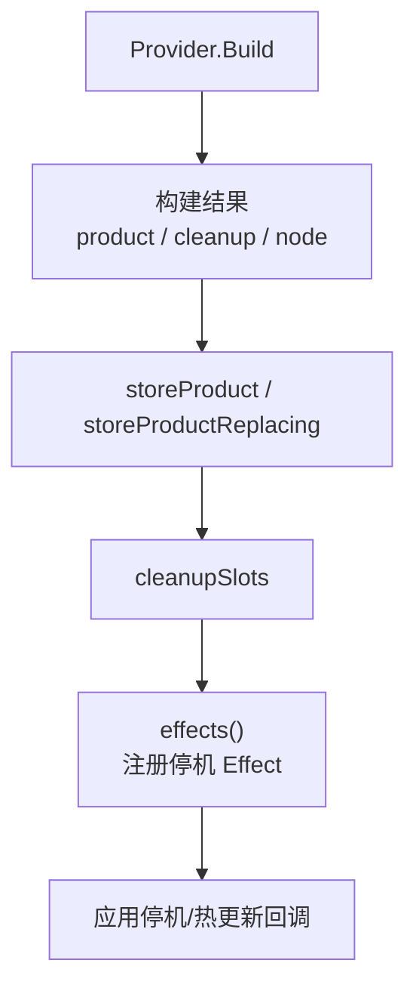
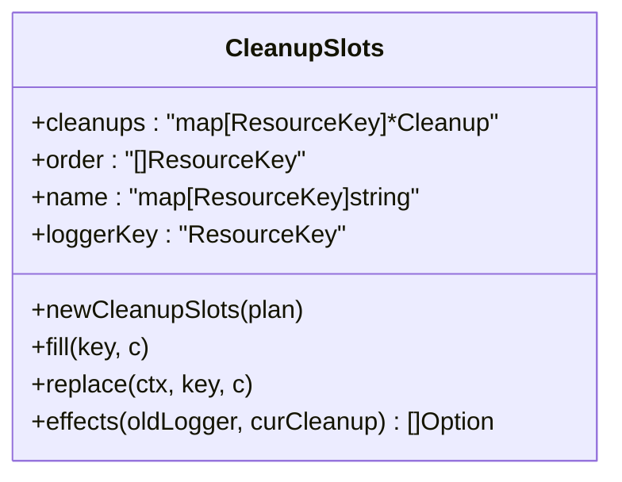
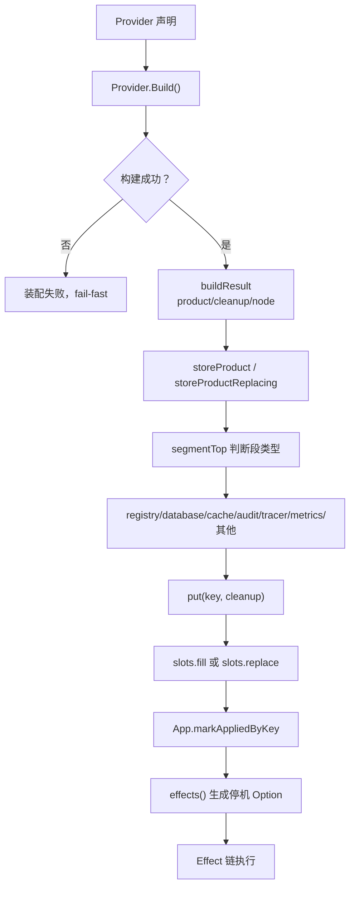
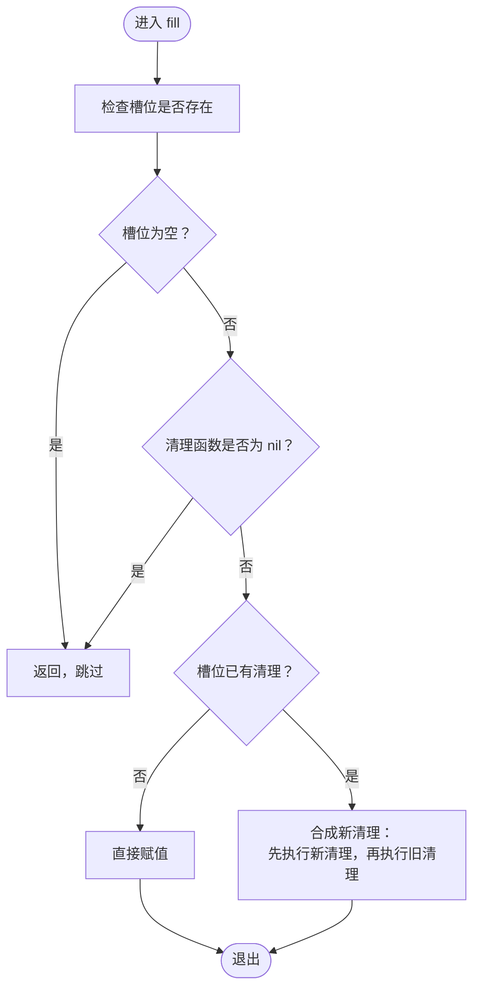
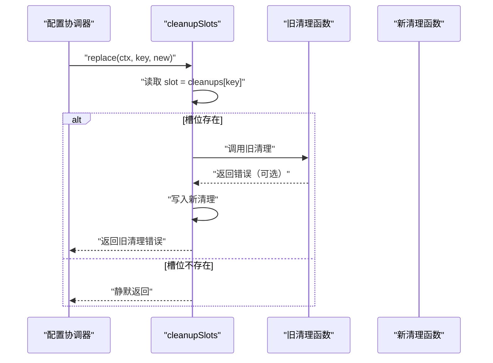
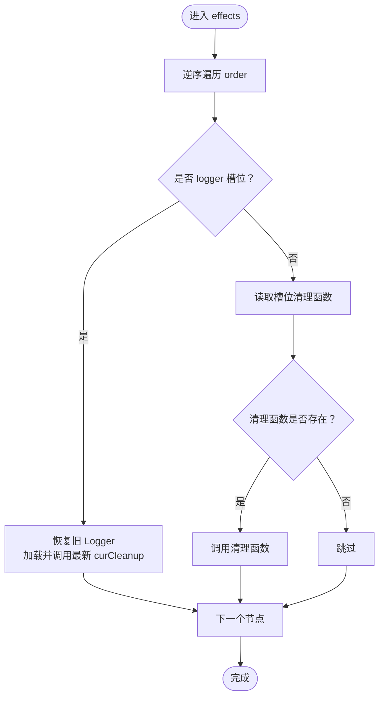
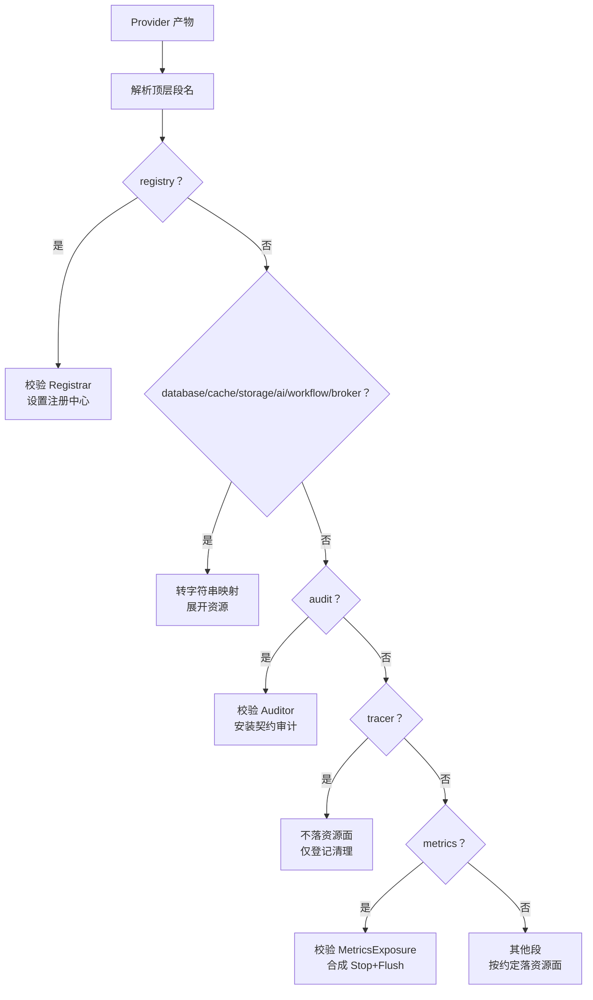
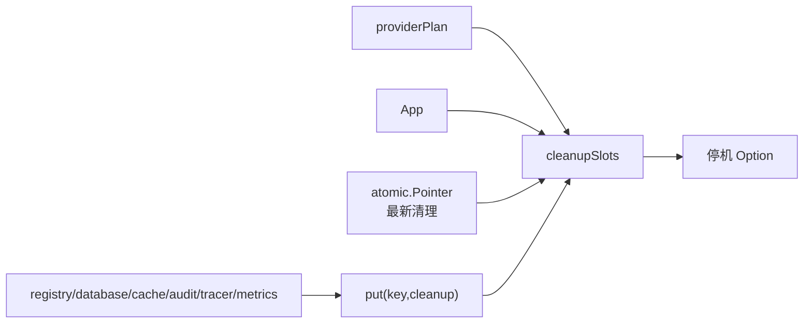
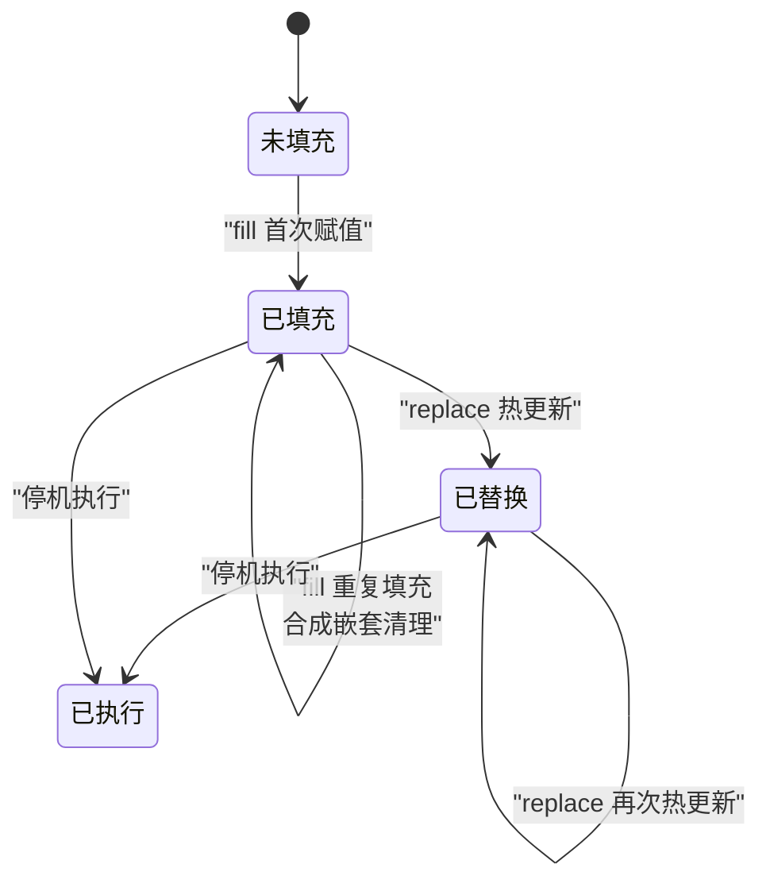

# 清理槽位机制

<cite>
**本文引用的文件**   
- [bootstrap.go](file://pkg/appkit/bootstrap.go)
</cite>

## 目录
1. [简介](#简介)
2. [项目结构定位](#项目结构定位)
3. [核心组件：清理槽位](#核心组件清理槽位)
4. [架构总览](#架构总览)
5. [关键方法详解](#关键方法详解)
6. [段类型与资源落盘逻辑](#段类型与资源落盘逻辑)
7. [依赖关系分析](#依赖关系分析)
8. [热更新行为示例](#热更新行为示例)
9. [性能与并发特性](#性能与并发特性)
10. [故障排查指南](#故障排查指南)
11. [结论](#结论)

## 简介
清理槽位机制是 Bald 应用启动与停机生命周期中的“资源回收基础设施”。它负责把 Provider 构建阶段产生的清理函数按确定性顺序保存，并在停机或配置热更新时按序执行。其设计目标是：

- 对每个资源节点维护一个清理槽，避免重复释放；
- 在热更新路径中先兑现旧清理、再挂入新清理，防止连接池泄漏或端点暴露；
- 将不同段的特殊清理语义（如 tracer、metrics）收敛到统一的槽位模型；
- 通过停机序数组保证反向释放，使下游依赖先于上游被回收。

## 项目结构定位
清理槽位代码集中在 `pkg/appkit` 包的引导装配实现中，由 Provider 装配引擎在阶段 B 调用。其输入来自计划期产出的 teardown 序列与 Effect 名称映射，输出则注入 App 的停机 Effect 链。

**图示来源**
- [bootstrap.go:559-680](file://pkg/appkit/bootstrap.go#L559-L680)
- [bootstrap.go:657-749](file://pkg/appkit/bootstrap.go#L657-L749)

**章节来源**
- [bootstrap.go:559-680](file://pkg/appkit/bootstrap.go#L559-L680)

## 核心组件：清理槽位
`cleanupSlots` 是槽位机制的核心数据结构，包含三个关键字段：

| 字段 | 类型 | 含义 |
|---|---|---|
| `cleanups` | `map[ResourceKey]*Cleanup` | 节点 Key 到清理函数指针的映射。每个 Key 对应一个可替换的槽位，初始化为指向 nil 的指针，以便后续原子式替换。 |
| `order` | `[]ResourceKey` | 停机序。由计划期 `teardownOrder` 推导，索引越小表示越晚停止，因此 `effects()` 按逆序注册，让真正需要先停的资源排在 Effect 链前部。 |
| `name` | `map[ResourceKey]string` | 节点对应的 Effect 名称，用于诊断日志和错误信息，标识具体是哪个 Provider 节点的清理失败。 |
| `loggerKey` | `ResourceKey` | logger 专用槽位 Key，用于在停机时恢复全局 Logger 并兑现最新后端清理。 |

槽位在构造时预分配 map 容量为 teardown 长度，并为每个节点 Key 初始化一个 nil 清理指针，从而把首次填充、重复填充、未填充三类状态统一在同一个指针上。

**图示来源**
- [bootstrap.go:559-607](file://pkg/appkit/bootstrap.go#L559-L607)

**章节来源**
- [bootstrap.go:559-582](file://pkg/appkit/bootstrap.go#L559-L582)

## 架构总览
清理槽位处于 Provider 装配与 App 停机之间的中间层。其上下游关系如下：

**图示来源**
- [bootstrap.go:559-680](file://pkg/appkit/bootstrap.go#L559-L680)
- [bootstrap.go:657-749](file://pkg/appkit/bootstrap.go#L657-L749)

## 关键方法详解

### fill：首次填充与嵌套清理合成
`fill` 是正常启动路径中把 Provider 清理函数写入槽位的入口。其行为分三种情况：

1. **槽位不存在或清理函数为 nil**：直接返回。nil 清理函数被视为无副作用，不污染槽位。
2. **槽位尚未填充**：直接赋值，完成首次注册。
3. **槽位已填充**：合成新的闭包，新清理在前、旧清理在后，形成“后填者先执行”的栈式组合。

**图示来源**
- [bootstrap.go:600-618](file://pkg/appkit/bootstrap.go#L600-L618)

该设计的要点是：同 Key 只允许一次有效填充；若框架或业务出现防御性重复调用，第二次及之后的清理会包裹在更外层，确保先执行最新资源、再回退到旧资源。

**章节来源**
- [bootstrap.go:600-618](file://pkg/appkit/bootstrap.go#L600-L618)

### replace：配置协调路径的原子替换
`replace` 专用于热更新场景。它不是简单覆盖，而是：

1. 读取当前槽位指针；
2. 用新清理指针原子替换；
3. 立即同步调用旧清理函数；
4. 若旧清理报错，记录节点 Key 与错误，但不向上抛出——调用方决定降级策略。

**图示来源**
- [bootstrap.go:584-598](file://pkg/appkit/bootstrap.go#L584-L598)

这一语义保证热更新不会泄漏旧连接池、监听器或暴露端点，因为旧资源在被新资源接管前就被主动关闭。

**章节来源**
- [bootstrap.go:584-598](file://pkg/appkit/bootstrap.go#L584-L598)

### effects：停机序与 logger 特例
`effects` 把槽位转换为 App 的停机 Option 列表。它遍历 `order` 的逆序，为每个节点注册一个 Effect。

对于普通节点：
- 从槽位读取当前清理函数；
- 若存在则调用；
- 若为 nil 则视为未生效资源，跳过。

对于 logger 节点：
- 先恢复装配前的全局 Logger；
- 再从 `curCleanup` 原子指针中加载最新后端清理；
- 调用最新清理以释放热更新期间重建的后端。

**图示来源**
- [bootstrap.go:621-654](file://pkg/appkit/bootstrap.go#L621-L654)

**章节来源**
- [bootstrap.go:621-654](file://pkg/appkit/bootstrap.go#L621-L654)

## 段类型与资源落盘逻辑
`storeProductWith` 根据 Provider 所属顶层段决定产物如何落盘以及清理函数如何处理。主要段类型如下：

| 段类型 | 产物校验 | 资源落盘方式 | 清理处理 |
|---|---|---|---|
| `registry` | 必须实现 `registry.Registrar` | 调用 `SetRegistrar` 并写入资源面 | 原样传入槽位 |
| `database` / `cache` / `storage` / `ai` / `workflow` / `broker` | 产物转为字符串键值映射 | 展开为 `<顶层>.<子段>` 资源 | 原样传入槽位 |
| `audit` | 必须实现 `audit.Auditor` | 安装为契约审计 sink，并写入资源面 | 原样传入槽位 |
| `tracer` | 不落资源面 | 仅保留清理函数 | 原样传入槽位 |
| `metrics` | 必须实现 `MetricsExposure`（nil 表示不暴露） | 暴露端归 metricshttp 能力包 | 合成“先停暴露端，再 flush”的组合清理 |
| 其他段 | 无强类型校验 | 非 map 产物整体落入 `<顶层段>`，map 产物展开 | 原样传入槽位 |

**图示来源**
- [bootstrap.go:657-749](file://pkg/appkit/bootstrap.go#L657-L749)

**章节来源**
- [bootstrap.go:657-749](file://pkg/appkit/bootstrap.go#L657-L749)

## 依赖关系分析
清理槽位本身不直接依赖外部后端，但它的生命周期与以下组件耦合：

- `providerPlan`：提供 teardown 序列、Effect 名称映射和 logger 节点 Key；
- `App`：接收产物落盘、标记节点已应用、持有 resources 资源面；
- `atomic.Pointer[func()]`：承载 logger 热更新期间的最新清理函数；
- 各段 Provider：产出 product 和 cleanup，但槽位只消费 cleanup 指针；
- 日志系统：仅在 logger 槽位和 metrics 暴露端失败时记录错误。

**图示来源**
- [bootstrap.go:559-680](file://pkg/appkit/bootstrap.go#L559-L680)
- [bootstrap.go:657-749](file://pkg/appkit/bootstrap.go#L657-L749)

**章节来源**
- [bootstrap.go:559-680](file://pkg/appkit/bootstrap.go#L559-L680)
- [bootstrap.go:657-749](file://pkg/appkit/bootstrap.go#L657-L749)

## 热更新行为示例
考虑一个数据库 Provider 的热更新场景：

1. 初次启动：Provider 创建连接池，返回 `(db, cleanup)`。`storeProduct` 调用 `slots.fill`，槽位首次赋值为旧清理。
2. 配置变更：框架构建候选 Provider，得到新连接池和新清理。`storeProductReplacing` 调用 `slots.replace`。
3. 替换过程：
   - 槽位中原有清理函数被读取；
   - 槽位指针更新为新清理；
   - 旧清理被同步调用，关闭旧连接池；
   - 新清理成为当前槽位值，供下次停机使用。
4. 停机时：`effects()` 按停机序逆序读取槽位，调用当前清理函数。由于热更新已经替换，实际执行的是最新清理。

**图示来源**
- [bootstrap.go:584-618](file://pkg/appkit/bootstrap.go#L584-L618)
- [bootstrap.go:621-654](file://pkg/appkit/bootstrap.go#L621-L654)

需要注意：`replace` 返回的是旧清理的错误，而不是新清理的错误。这意味着热更新路径的健壮性依赖调用方对旧清理失败的容忍策略——通常记录日志并继续推进新配置。

**章节来源**
- [bootstrap.go:584-618](file://pkg/appkit/bootstrap.go#L584-L618)
- [bootstrap.go:621-654](file://pkg/appkit/bootstrap.go#L621-L654)

## 性能与并发特性
- map 初始化时使用 teardown 长度作为容量，避免扩容开销；
- 槽位指针读写在单 goroutine 内通常是安全的：`fill` 只在装配路径调用，`replace` 在配置协调路径调用；
- logger 槽位额外依赖 `atomic.Pointer`，因为 `curCleanup` 可能由热更新 goroutine 与主循环共享；
- 嵌套清理合成是 O(1) 指针操作，但多次热更新会产生闭包链，深度等于热更新次数；
- `effects()` 每次生成完整 Option 切片，时间复杂度为 O(n)，n 为 teardown 长度；
- logger 特例在停机时先恢复全局 Logger，再调用最新清理，避免日志系统在资源释放后仍写入已关闭后端。

**章节来源**
- [bootstrap.go:568-582](file://pkg/appkit/bootstrap.go#L568-L582)
- [bootstrap.go:621-654](file://pkg/appkit/bootstrap.go#L621-L654)

## 故障排查指南
常见问题和定位方向：

| 现象 | 可能原因 | 排查建议 |
|---|---|---|
| 某个资源未释放 | 槽位未被填充，或 Provider 返回 nil cleanup | 检查对应段 Provider 是否返回清理函数，确认 `storeProductWith` 是否走到该分支 |
| 热更新后旧连接仍占用 | 旧清理未执行或执行失败 | 查看热更新日志中是否出现节点清理失败错误；确认 `replace` 调用路径 |
| metrics 端口未关闭 | `MetricsExposure.Stop` 失败 | 检查 metrics 段 Provider 是否正确实现暴露接口，关注日志中的暴露端停止错误 |
| tracer 资源泄漏 | tracer 清理未在槽位登记 | 确认 tracer 段走“不落资源面但登记清理”分支 |
| logger 在停机时写不到日志 | 全局 Logger 恢复顺序或最新清理异常 | 检查 logger 槽位特例逻辑，确认 `oldLogger` 与 `curCleanup` 状态 |

**章节来源**
- [bootstrap.go:584-654](file://pkg/appkit/bootstrap.go#L584-L654)
- [bootstrap.go:657-749](file://pkg/appkit/bootstrap.go#L657-L749)

## 结论
清理槽位机制通过三个字段——清理函数指针 map、停机序数组、Effect 名称映射——把 Provider 的生命周期管理抽象为一个可替换、可组合、可诊断的槽位模型。`fill` 负责首次注册和嵌套组合，`replace` 负责热更新时的旧资源回收与新资源接管，`effects` 负责按停机序逆序回放。不同段的特殊语义在 `storeProductWith` 中收敛，使槽位保持轻量，同时保证 registry、database、cache、audit、tracer、metrics 等关键资源在停机与热更新路径下都能正确释放。