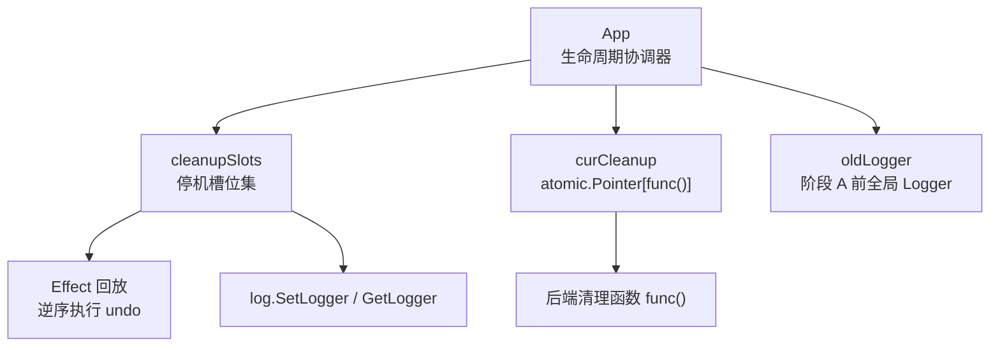
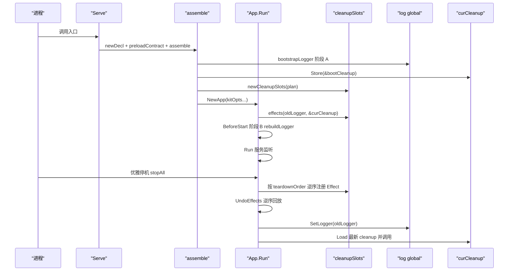
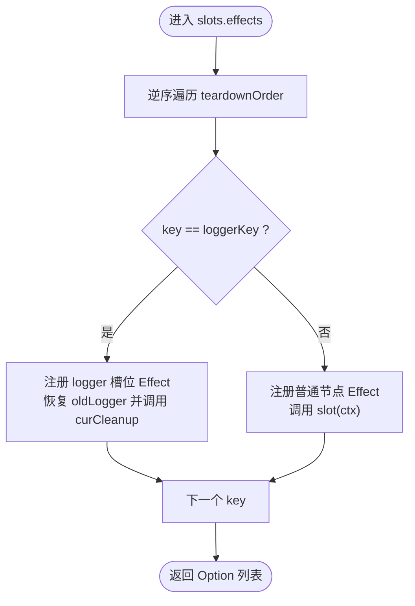
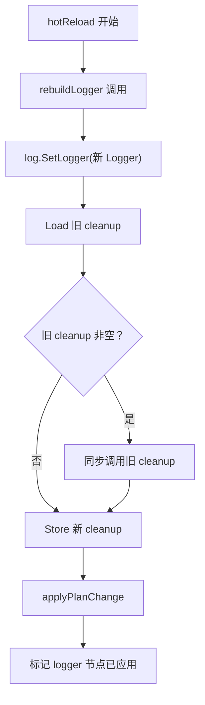
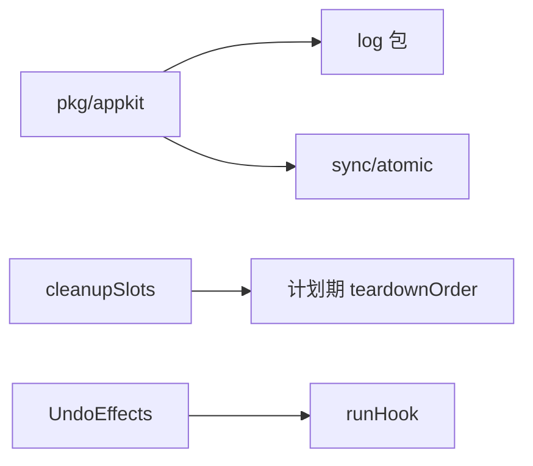
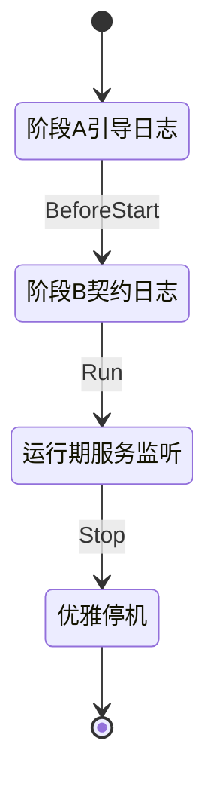

# Effect 回放与停机执行

<cite>
**本文引用的文件**   
- [effect.go](file://pkg/appkit/effect.go)
- [bootstrap.go](file://pkg/appkit/bootstrap.go)
- [types.go](file://pkg/appkit/types.go)
- [serve.go](file://pkg/appkit/serve.go)
- [global.go](file://log/global.go)
</cite>

## 目录
1. [引言](#引言)
2. [项目结构定位](#项目结构定位)
3. [核心组件](#核心组件)
4. [架构总览](#架构总览)
5. [详细组件分析](#详细组件分析)
6. [依赖关系分析](#依赖关系分析)
7. [性能与并发特性](#性能与并发特性)
8. [故障排查指南](#故障排查指南)
9. [结论](#结论)
10. [附录：应用生命周期示例](#附录应用生命周期示例)

## 引言
本文围绕 Effect 回放与停机执行机制，解释以下关键问题：
- `slots.effects` 如何按 `teardownOrder` 的逆序注册 Effect，使回放顺序恰好等于停机顺序。
- logger 槽位的特殊处理：恢复装配前的全局 Logger，并调用当前生效的后端清理函数。
- `curCleanup` 使用 `atomic.Pointer[func()]` 的设计目的：在热更新路径中安全地原子替换当前生效的清理函数，避免竞态。
- `effects(oldLogger, &curCleanup)` 的调用时机、参数含义，以及为什么 `oldLogger` 作为参数传递而非从全局读取。
- 完整的应用生命周期示例，展示阶段 A 引导日志到阶段 B 契约日志切换，以及停机时各层资源释放顺序。
- 热更新路径上清理函数的切换安全性，包括旧清理函数同步兑现与新清理函数原子注册。

## 项目结构定位
Effect 回放与停机逻辑集中在 `pkg/appkit` 包内：
- `pkg/appkit/effect.go`：效应账本数据结构、登记 API、逆序回放实现。
- `pkg/appkit/bootstrap.go`：约定装配、阶段 A/B 日志重建、`cleanupSlots`、`teardownOrder` 语义来源、热更新路径。
- `pkg/appkit/types.go`：停机预算派生（`phaseBudgetFor`），影响每条 undo 的超时。
- `pkg/appkit/serve.go`：`Serve` 入口，驱动 `assemble` 与 `Run`。
- `log/global.go`：全局 Logger 读写接口，被框架在引导和回放阶段复用。

**图表来源**
- [bootstrap.go:290-358](file://pkg/appkit/bootstrap.go#L290-L358)
- [bootstrap.go:621-649](file://pkg/appkit/bootstrap.go#L621-L649)
- [effect.go:48-91](file://pkg/appkit/effect.go#L48-L91)
- [global.go:1-28](file://log/global.go#L1-L28)

**章节来源**
- [effect.go:1-91](file://pkg/appkit/effect.go#L1-L91)
- [bootstrap.go:200-358](file://pkg/appkit/bootstrap.go#L200-L358)
- [bootstrap.go:621-649](file://pkg/appkit/bootstrap.go#L621-L649)
- [bootstrap.go:882-916](file://pkg/appkit/bootstrap.go#L882-L916)
- [types.go:1-22](file://pkg/appkit/types.go#L1-L22)
- [serve.go:1-180](file://pkg/appkit/serve.go#L1-L180)
- [global.go:1-28](file://log/global.go#L1-L28)

## 核心组件
- **Effect 账本**：每条可逆效应包含名称与 `undo` 函数；`UndoEffects` 在停机或启动失败回滚时逆序执行，清空账本，单条超时或 panic 旁路隔离。
- **cleanupSlots**：维护节点 Key 到 cleanup 的映射、停机序 `order`、Effect 名映射、logger 槽位 Key；生成按停机序逆序注册的 Effect 列表。
- **curCleanup**：`atomic.Pointer[func()]`，跟踪当前生效 Logger 后端清理函数；热更新时先同步兑现旧清理函数，再原子存储新清理函数。
- **阶段 A/B 日志源**：`loggerSource` 提供 `bootstrapLogger` 与 `contractLogger`；阶段 A 用默认 Logger 保证装配前日志可见，阶段 B 按契约重建 Logger。

**章节来源**
- [effect.go:19-46](file://pkg/appkit/effect.go#L19-L46)
- [effect.go:48-91](file://pkg/appkit/effect.go#L48-L91)
- [bootstrap.go:560-649](file://pkg/appkit/bootstrap.go#L560-L649)
- [bootstrap.go:882-916](file://pkg/appkit/bootstrap.go#L882-L916)

## 架构总览
Effect 回放与停机执行的总体流程如下：

**图表来源**
- [serve.go:40-80](file://pkg/appkit/serve.go#L40-L80)
- [bootstrap.go:230-358](file://pkg/appkit/bootstrap.go#L230-L358)
- [bootstrap.go:621-649](file://pkg/appkit/bootstrap.go#L621-L649)
- [effect.go:48-91](file://pkg/appkit/effect.go#L48-L91)

## 详细组件分析

### slots.effects 与 teardownOrder 的逆序注册
`cleanupSlots` 的 `order` 字段来自计划期的 `plan.teardown`，即由 `teardownOrder` 推导出的停机序（先执行者在前）。`effects` 方法遍历 `s.order` 的逆序，为每个节点生成一个 Effect，其中 logger 槽位走特殊分支。

关键点：
- 逆序注册：`for i := len(s.order) - 1; i >= 0; i--`。
- 回放幂等：`UndoEffects` 取出快照后清空 `a.effects`，重复调用无副作用。
- 超时隔离：每条 undo 通过 `runHook` 独立超时，panic 不拖垮其余撤销。

**图表来源**
- [bootstrap.go:560-649](file://pkg/appkit/bootstrap.go#L560-L649)
- [effect.go:48-91](file://pkg/appkit/effect.go#L48-L91)

**章节来源**
- [bootstrap.go:560-649](file://pkg/appkit/bootstrap.go#L560-L649)
- [effect.go:48-91](file://pkg/appkit/effect.go#L48-L91)

### logger 槽位的特殊处理
logger 槽位在回放时做两件事：
1. 恢复装配前的全局 Logger：`log.SetLogger(oldLogger)`。
2. 调用当前生效的后端清理函数：`if c := curCleanup.Load(); c != nil { (*c)() }`。

这确保：
- 进程级全局 Logger 回到装配前状态，避免 e2e 测试污染。
- 带缓冲的后端（如远端日志）在热更新或停机时完成尾批冲刷，不丢日志。

**章节来源**
- [bootstrap.go:621-649](file://pkg/appkit/bootstrap.go#L621-L649)
- [global.go:1-28](file://log/global.go#L1-L28)

### curCleanup 原子指针的设计目的
`curCleanup` 是 `atomic.Pointer[func()]`，用于在热更新路径中安全地替换当前生效的清理函数：
- 初始值指向阶段 A 的 `bootCleanup`。
- `rebuildLogger` 中先调用旧清理函数，再原子存储新清理函数。
- 避免热更新期间多个 goroutine 同时访问 cleanup 导致的竞态。

设计要点：
- 原子替换：`curCleanup.Store(&cleanup)`。
- 旧清理函数同步兑现：`(*c)()`，确保缓冲后端尾批日志不丢失。
- 停机时取最新值：`curCleanup.Load()` 获取最后生效的清理函数。

**章节来源**
- [bootstrap.go:290-358](file://pkg/appkit/bootstrap.go#L290-L358)
- [bootstrap.go:882-916](file://pkg/appkit/bootstrap.go#L882-L916)

### effects(oldLogger, &curCleanup) 的调用时机与参数含义
`effects(oldLogger, &curCleanup)` 在 `assemble` 末尾调用，作为 `kitOpts` 的一部分注入 `NewApp`。参数含义：
- `oldLogger`：阶段 A 之前的全局 Logger，用于回放时恢复。
- `&curCleanup`：当前生效 Logger 后端清理函数的原子指针，用于回放时调用最新清理函数。

为什么 `oldLogger` 作为参数传递而不是从全局读取：
- 避免在回放时从全局读取可能已被热更新修改的值。
- 明确绑定装配前状态，保证回放确定性。

**章节来源**
- [bootstrap.go:329-358](file://pkg/appkit/bootstrap.go#L329-L358)
- [bootstrap.go:621-649](file://pkg/appkit/bootstrap.go#L621-L649)

### 热更新路径上清理函数的切换安全性
热更新路径如下：
1. `hotReload` 解析候选配置并校验。
2. `rebuildLogger` 重建 Logger。
3. `log.SetLogger(lg)` 切换到新全局 Logger。
4. 如果存在旧清理函数，同步调用 `(*c)()`。
5. `curCleanup.Store(&cleanup)` 原子存储新清理函数。

安全性保证：
- 旧清理函数同步兑现，确保缓冲后端尾批日志不丢失。
- 新清理函数原子注册，避免热更新期间的竞态。
- 若重建失败，旧 Logger 与旧清理函数保持不变。

**图表来源**
- [bootstrap.go:850-916](file://pkg/appkit/bootstrap.go#L850-L916)

**章节来源**
- [bootstrap.go:850-916](file://pkg/appkit/bootstrap.go#L850-L916)

## 依赖关系分析
- `pkg/appkit` 依赖 `log` 包的全局 Logger 接口。
- `cleanupSlots` 依赖计划期的 `teardownOrder` 输出。
- `curCleanup` 依赖 `sync/atomic` 提供原子操作。
- `UndoEffects` 依赖 `runHook` 提供超时与 panic 隔离。

**图表来源**
- [effect.go:48-91](file://pkg/appkit/effect.go#L48-L91)
- [bootstrap.go:560-649](file://pkg/appkit/bootstrap.go#L560-L649)

**章节来源**
- [effect.go:48-91](file://pkg/appkit/effect.go#L48-L91)
- [bootstrap.go:560-649](file://pkg/appkit/bootstrap.go#L560-L649)

## 性能与并发特性
- 每条 undo 独立超时，由 `phaseBudgetFor(stopTimeout)` 派生，避免慢卸载阻塞整机停机。
- `UndoEffects` 并发安全：加锁复制快照后清空原切片，后续重复调用无副作用。
- `curCleanup` 使用原子指针，避免热更新期间的竞态。
- logger 槽位特殊处理确保缓冲后端尾批日志不丢失。

**章节来源**
- [types.go:1-22](file://pkg/appkit/types.go#L1-L22)
- [effect.go:48-91](file://pkg/appkit/effect.go#L48-L91)
- [bootstrap.go:882-916](file://pkg/appkit/bootstrap.go#L882-L916)

## 故障排查指南
- 如果日志在热更新后丢失，检查 `rebuildLogger` 是否成功，确认旧清理函数是否被调用。
- 如果停机时资源未释放，检查 `cleanupSlots.fill` 是否正确填充槽位，确认 `teardownOrder` 是否包含该节点。
- 如果全局 Logger 未恢复，检查 `effects` 中 logger 槽位是否被正确注册。

**章节来源**
- [bootstrap.go:621-649](file://pkg/appkit/bootstrap.go#L621-L649)
- [bootstrap.go:882-916](file://pkg/appkit/bootstrap.go#L882-L916)

## 结论
Effect 回放与停机执行机制通过 `cleanupSlots` 与 `curCleanup` 的配合，实现了：
- 按 `teardownOrder` 逆序注册 Effect，确保回放顺序等于停机顺序。
- logger 槽位特殊处理，恢复装配前全局 Logger 并调用最新清理函数。
- 热更新路径上清理函数的安全切换，避免竞态与日志丢失。
- 完整的应用生命周期支持，从阶段 A 引导日志到阶段 B 契约日志切换，再到停机资源释放。

## 附录：应用生命周期示例
以下是一个完整的应用生命周期示例，展示从阶段 A 引导日志到阶段 B 契约日志的切换过程，以及停机时各层资源的正确释放顺序：

1. **阶段 A 引导日志**：
   - `assemble` 调用 `logSrc.bootstrapLogger` 获取默认 Logger。
   - 设置全局 Logger 为阶段 A Logger。
   - 初始化 `curCleanup` 指向阶段 A 清理函数。

2. **阶段 B 契约日志**：
   - `BeforeStart` 钩子调用 `syncBootstrap`。
   - `rebuildLogger` 重建 Logger，切换全局句柄，同步调用旧清理函数，原子存储新清理函数。

3. **运行期服务监听**：
   - `Run` 启动 HTTP/gRPC 服务器。
   - 业务逻辑处理请求。

4. **优雅停机**：
   - `stopAll` 触发 `UndoEffects`。
   - 按 `teardownOrder` 逆序回放 Effect。
   - logger 槽位恢复 `oldLogger` 并调用 `curCleanup`。
   - 其他节点槽位调用对应 cleanup。

**图表来源**
- [bootstrap.go:230-358](file://pkg/appkit/bootstrap.go#L230-L358)
- [bootstrap.go:850-916](file://pkg/appkit/bootstrap.go#L850-L916)
- [effect.go:48-91](file://pkg/appkit/effect.go#L48-L91)