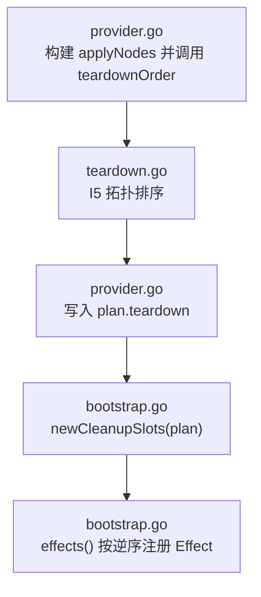
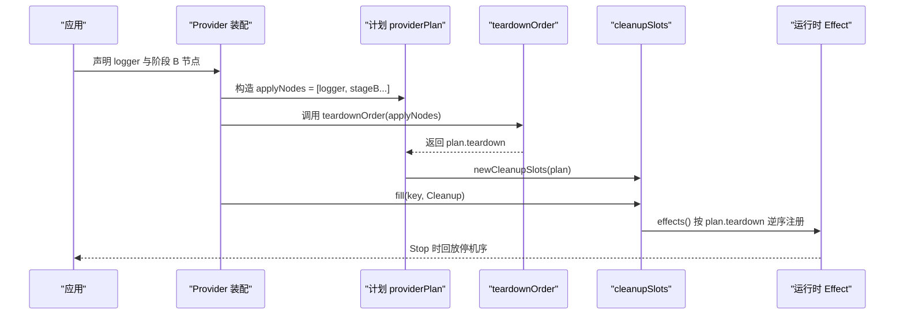
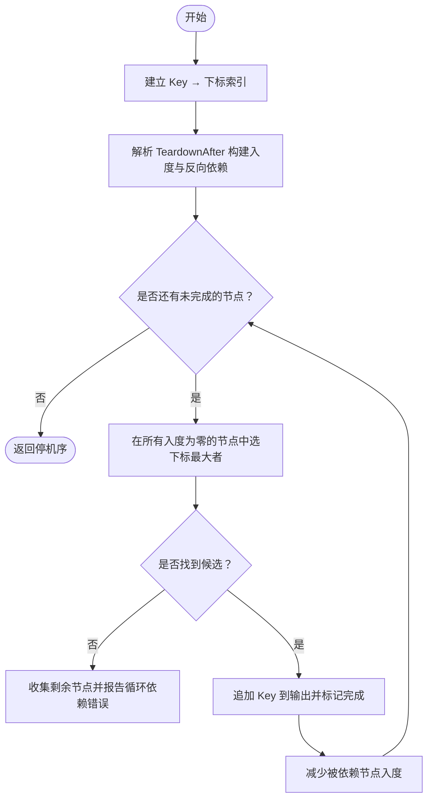
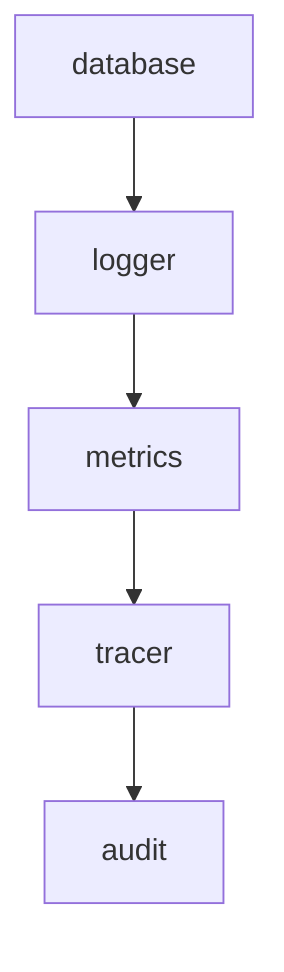
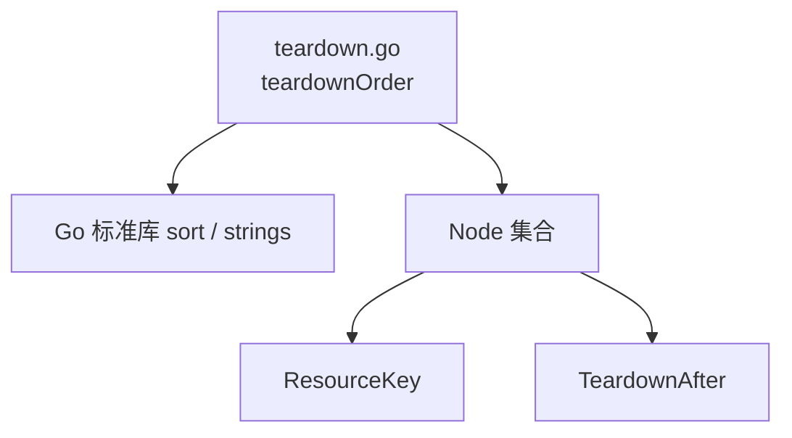
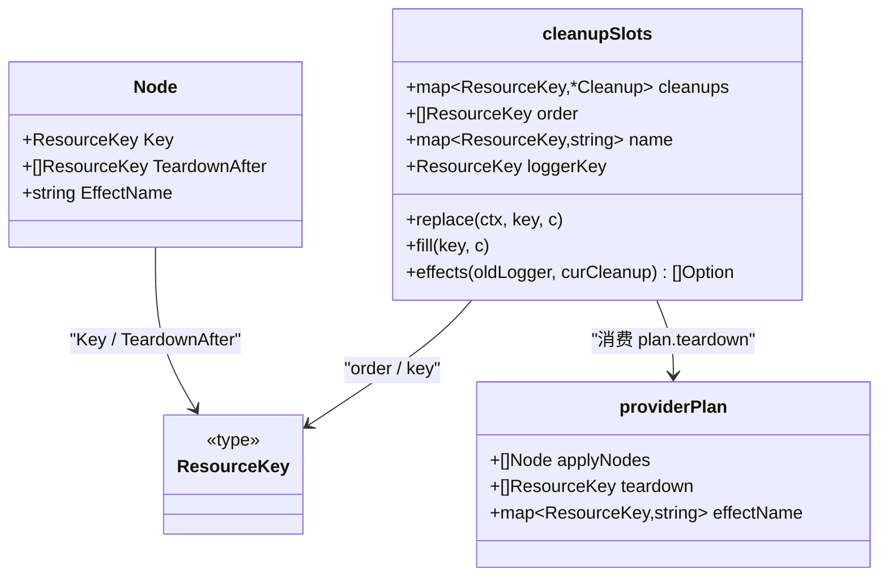

# 停机序推导算法

<cite>
**本文引用的文件**   
- [pkg/appkit/teardown.go](file://pkg/appkit/teardown.go)
- [pkg/appkit/provider.go](file://pkg/appkit/provider.go)
- [pkg/appkit/bootstrap.go](file://pkg/appkit/bootstrap.go)
- [pkg/appkit/plan_invariants_test.go](file://pkg/appkit/plan_invariants_test.go)
</cite>

## 目录
1. [引言](#引言)
2. [项目结构](#项目结构)
3. [核心组件](#核心组件)
4. [架构总览](#架构总览)
5. [详细组件分析](#详细组件分析)
6. [依赖关系分析](#依赖关系分析)
7. [性能考量](#性能考量)
8. [故障排查指南](#故障排查指南)
9. [结论](#结论)
10. [附录](#附录)

## 引言
本技术文档聚焦于 Bald 框架中资源停机顺序的推导算法 `teardownOrder`。该算法实现 I5 约束：以 Apply 逆序为基础语义，再叠加 `TeardownAfter` 声明式约束，生成最终停机序。它替代了早期版本中的手工 `cleanupOrder` 表，使“最后创建、最先销毁”的栈式语义与审计/指标/追踪等跨阶段协作成为可验证的计划数据。

## 项目结构
停机序相关代码集中在 `pkg/appkit`：
- `teardown.go`：I5 拓扑排序实现。
- `provider.go`：组装应用节点序列并调用 `teardownOrder`，把结果写入计划 `plan.teardown`。
- `bootstrap.go`：根据 `plan.teardown` 初始化槽位 `newCleanupSlots`，并在运行时按逆序注册 Effect，回放即停机序。
- `plan_invariants_test.go`：断言标准 Provider 组合下的停机序与历史手工回放序一致。

**图表来源**
- [pkg/appkit/provider.go:480-510](file://pkg/appkit/provider.go#L480-L510)
- [pkg/appkit/teardown.go:1-90](file://pkg/appkit/teardown.go#L1-L90)
- [pkg/appkit/bootstrap.go:559-650](file://pkg/appkit/bootstrap.go#L559-L650)

**章节来源**
- [pkg/appkit/teardown.go:1-90](file://pkg/appkit/teardown.go#L1-L90)
- [pkg/appkit/provider.go:480-510](file://pkg/appkit/provider.go#L480-L510)
- [pkg/appkit/bootstrap.go:559-650](file://pkg/appkit/bootstrap.go#L559-L650)

## 核心组件
- **`teardownOrder(nodes []Node)`**：输入为已排好 `Apply` 序的节点切片；输出为“先执行者在前”的停机 Key 列表。
- **`applyNodes`**：由 `provider.go` 构造，顺序为 `[logger, stageB...]`，是 I5 的基础排序依据。
- **`plan.teardown`**：最终停机序，作为计划数据被 `bootstrap.go` 消费。
- **`cleanupSlots`**：按 `plan.teardown` 初始化槽位映射，并把每个节点的 `Cleanup` 函数挂到对应 Key 上。
- **`effects()`**：按 `plan.teardown` 的逆序注册 Effect，保证实际运行时的回收顺序等于理论停机序。

**章节来源**
- [pkg/appkit/teardown.go:1-90](file://pkg/appkit/teardown.go#L1-L90)
- [pkg/appkit/provider.go:480-510](file://pkg/appkit/provider.go#L480-L510)
- [pkg/appkit/bootstrap.go:559-650](file://pkg/appkit/bootstrap.go#L559-L650)

## 架构总览
I5 的设计目标是让停机顺序从装配计划推导出来，而不是靠硬编码表维护。整体流程如下：

1. 装配期收集 logger 与阶段 B 节点，形成 `applyNodes`。
2. `teardownOrder` 基于 `Apply` 逆序 + `TeardownAfter` 拓扑排序，得到 `plan.teardown`。
3. `newCleanupSlots` 用 `plan.teardown` 初始化槽位。
4. 各 Provider Build 成功后把 `Cleanup` 填入对应槽位。
5. 运行时通过 `effects()` 按停机序逆序注册 Effect，从而回放出正确的停机序。

**图表来源**
- [pkg/appkit/provider.go:480-510](file://pkg/appkit/provider.go#L480-L510)
- [pkg/appkit/teardown.go:1-90](file://pkg/appkit/teardown.go#L1-L90)
- [pkg/appkit/bootstrap.go:559-650](file://pkg/appkit/bootstrap.go#L559-L650)

## 详细组件分析

### I5 约束与 `teardownOrder` 算法
`teardownOrder` 的核心思想是：
- 基础语义：后 `Apply` 的资源先销毁。
- 扩展语义：`TeardownAfter` 声明自身必须在指定节点之后释放。
- 未知键视为已满足，允许跨阶段或框架外资源参与。
- `*` 展开为全部其它节点，用于强制排在末尾。

算法步骤：
1. 建立 Key 到节点下标的索引。
2. 遍历所有节点及其 `TeardownAfter` 列表，构建入度表与反向依赖图。
3. 重复选择“入度为零且下标最大”的候选节点加入结果，模拟“同层按 Apply 逆序选取”。
4. 若无法推进，则报告循环依赖。

**图表来源**
- [pkg/appkit/teardown.go:1-90](file://pkg/appkit/teardown.go#L1-L90)

**章节来源**
- [pkg/appkit/teardown.go:1-90](file://pkg/appkit/teardown.go#L1-L90)

### 节点声明的应用顺序如何映射到资源创建顺序
`provider.go` 在计划末期构造 `applyNodes`：
- 首先放入 logger 节点。
- 然后追加阶段 B 的所有节点。
- 调用 `teardownOrder` 得到停机序。
- 同时记录每个节点的 `EffectName`，供运行时日志定位。

这意味着：
- 声明顺序就是 `Apply` 顺序。
- logger 总是第一个应用。
- 其他资源按声明顺序依次应用。
- 停机序默认是应用逆序，再通过 `TeardownAfter` 调整。

**章节来源**
- [pkg/appkit/provider.go:480-510](file://pkg/appkit/provider.go#L480-L510)

### 为什么停机必须按应用逆序进行
I5 的基础语义是“栈式生命周期”：
- 后创建的资源可能依赖先创建的资源。
- 因此必须先销毁后创建的资源，再逐步回退到更早创建的资源。
- 这恰好对应 `Apply` 切片的逆序。

如果打破这个顺序，可能出现：
- 某个资源已被销毁，而另一个仍持有其引用。
- 指标 flush 完成后才停止审计流，导致尾批事件丢失。
- 全局 Logger 恢复发生在业务资源释放之前，造成日志不可写。

**章节来源**
- [pkg/appkit/teardown.go:1-12](file://pkg/appkit/teardown.go#L1-L12)
- [pkg/appkit/bootstrap.go:340-360](file://pkg/appkit/bootstrap.go#L340-L360)

### 审计等特殊节点如何通过 `TeardownAfter["*"]` 被强制排到最后
审计后端使用 `TeardownAfter["*"]`，表示它必须在所有其它节点之后释放。这样能确保：
- 指标和追踪先 flush。
- 审计在指标/span 刷新之后收集尾批事件。
- 不会漏掉生命周期末期的观测数据。

对 `teardownOrder` 而言，`*` 会展开为除自身之外的全部节点 Key，相当于给审计节点增加一个指向所有其它节点的依赖边，使其只能排在拓扑排序的最后。

**章节来源**
- [pkg/appkit/teardown.go:1-12](file://pkg/appkit/teardown.go#L1-L12)
- [pkg/appkit/teardown.go:25-55](file://pkg/appkit/teardown.go#L25-L55)

### 停机列表的构建过程
停机列表来自计划字段 `plan.teardown`，构建路径如下：

1. `provider.go` 构造 `applyNodes`。
2. 调用 `teardownOrder(applyNodes)`。
3. 把返回结果写入 `plan.teardown`。
4. 同时填充 `plan.effectName`，记录每个 Key 对应的 Effect 名。
5. `bootstrap.go` 调用 `newCleanupSlots(plan)`，用 `plan.teardown` 初始化槽位。

**图表来源**
- [pkg/appkit/provider.go:480-510](file://pkg/appkit/provider.go#L480-L510)
- [pkg/appkit/bootstrap.go:559-580](file://pkg/appkit/bootstrap.go#L559-L580)

**章节来源**
- [pkg/appkit/provider.go:480-510](file://pkg/appkit/provider.go#L480-L510)
- [pkg/appkit/bootstrap.go:559-580](file://pkg/appkit/bootstrap.go#L559-L580)

### `newCleanupSlots` 如何初始化槽位
`newCleanupSlots` 做四件事：
1. 分配 `cleanups` 映射，容量等于 `plan.teardown` 长度。
2. 保存 `order` 为 `plan.teardown`。
3. 保存 `name` 为 `plan.effectName`。
4. 记住 logger 节点 Key，供 `effects()` 特殊处理。
5. 遍历 `plan.teardown`，为每个 Key 预置空 `Cleanup` 槽位。

槽位设计的关键点：
- 按 Key 定位，避免线性扫描。
- 后续 `fill()` 允许聚合分支重复填充，但保留“后填者先执行”的语义。
- `replace()` 用于热更新路径中原子替换 logger 清理钩子。

**章节来源**
- [pkg/appkit/bootstrap.go:559-615](file://pkg/appkit/bootstrap.go#L559-L615)

### 复杂依赖场景下的停机序推导示例
考虑以下标准 Provider 组合：
- `StandardLoggerProvider()`
- `StandardAuditProvider()`
- metrics 段 Provider
- tracer 段 Provider
- database 段 Provider

它们的预期停机序是：
`database → logger → metrics → tracer → audit`

推导过程：
1. `applyNodes` 初始顺序大致为：logger、audit、metrics、tracer、database。
2. 默认停机序是应用逆序：database、tracer、metrics、audit、logger。
3. metrics 声明 `TeardownAfter["logger"]`，所以 logger 必须在 metrics 之前释放。
4. tracer 声明 `TeardownAfter["logger","metrics"]`，所以 logger 和 metrics 都必须在 tracer 之前释放。
5. audit 声明 `TeardownAfter["*"]`，所以它必须在所有其它节点之后释放。
6. 最终得到：database、logger、metrics、tracer、audit。

**图表来源**
- [pkg/appkit/plan_invariants_test.go:200-231](file://pkg/appkit/plan_invariants_test.go#L200-L231)

**章节来源**
- [pkg/appkit/plan_invariants_test.go:200-231](file://pkg/appkit/plan_invariants_test.go#L200-L231)

### 为什么这个设计替代了早期手工 `cleanupOrder` 表
早期版本需要维护一张手工 `cleanupOrder` 表来固定停机顺序，容易随 Provider 变更而失配。新设计改为：
- 用 `TeardownAfter` 表达局部依赖。
- 用 `Apply` 逆序表达基础栈式语义。
- 用 `teardownOrder` 推导出完整停机序。
- 用测试断言标准组合的停机序与历史回放序一致。

好处包括：
- 新增 Provider 时只需声明依赖，不再改全局表。
- 冲突或遗漏依赖会在计划期发现。
- 停机行为由计划数据驱动，更可追溯、可测试。

**章节来源**
- [pkg/appkit/teardown.go:1-12](file://pkg/appkit/teardown.go#L1-L12)
- [pkg/appkit/plan_invariants_test.go:200-231](file://pkg/appkit/plan_invariants_test.go#L200-L231)

## 依赖关系分析
`teardownOrder` 只依赖 Go 标准库中的排序与字符串工具，不引入外部包；它读取 `Node.TeardownAfter` 中的 `ResourceKey`，并通过拓扑排序保证依赖约束。

**图表来源**
- [pkg/appkit/teardown.go:1-90](file://pkg/appkit/teardown.go#L1-L90)

**章节来源**
- [pkg/appkit/teardown.go:1-90](file://pkg/appkit/teardown.go#L1-L90)

## 性能考量
- `teardownOrder` 的时间复杂度约为 O(n²) 级别：每次选择候选节点都要扫描未完成节点；对 n 个节点，最多做 n 轮扫描。
- 空间复杂度主要是 Key 索引、入度表和反向依赖图，总体 O(n)。
- 对于框架内的 logger、metrics、tracer、database、audit 等有限数量节点，开销很小。
- 瓶颈不在排序本身，而在更多 Provider 声明和更复杂的 `TeardownAfter` 图。

优化方向：
- 当节点规模增大时，可使用优先队列按索引维护候选集，降低每轮扫描成本。
- 当前实现适合启动/停机阶段的轻量级计划，暂不需要过度优化。

[本节为通用性能讨论，不直接分析具体代码行]

## 故障排查指南
常见问题和诊断方式：

1. **循环依赖错误**
   - 现象：`teardownOrder` 报出 `TeardownAfter cycle among nodes`。
   - 原因：多个节点互相要求对方先释放。
   - 解决：检查 `TeardownAfter` 声明，消除环状依赖。

2. **审计事件丢失**
   - 现象：指标 flush 后审计尾批事件未出现。
   - 原因：审计没有正确使用 `TeardownAfter["*"]`，或被错误地排在指标之前。
   - 解决：确认审计节点声明将其它节点作为前置依赖。

3. **日志在资源释放后仍可被误用**
   - 现象：业务资源释放过程中日志不可写。
   - 原因：logger 释放太早，或全局 Logger 恢复顺序错误。
   - 解决：确认 logger 槽位在 `effects()` 中特殊处理，并确保业务资源在 logger 之前释放。

4. **计划停机序与历史不一致**
   - 现象：标准 Provider 组合的 `plan.teardown` 不符合预期。
   - 原因：新增 Provider 改变了声明顺序或缺少必要依赖。
   - 解决：参考 `TestProviderPlan_StdTeardownOrder` 的预期序 `database → logger → metrics → tracer → audit` 进行调整。

**章节来源**
- [pkg/appkit/teardown.go:55-90](file://pkg/appkit/teardown.go#L55-L90)
- [pkg/appkit/bootstrap.go:618-650](file://pkg/appkit/bootstrap.go#L618-L650)
- [pkg/appkit/plan_invariants_test.go:200-231](file://pkg/appkit/plan_invariants_test.go#L200-L231)

## 结论
`teardownOrder` 实现了 I5 约束：以 `Apply` 逆序为基础，叠加 `TeardownAfter` 声明式依赖，生成可验证的停机序。它把原本易错的手工 `cleanupOrder` 表转化为计划数据驱动的拓扑排序，既保留了“后创建先销毁”的栈式语义，又支持审计、指标、追踪等跨阶段协作。通过 `newCleanupSlots` 与 `effects()`，运行时按逆序注册 Effect，确保实际回收顺序与推导停机序一致。

## 附录

### 关键数据结构关系

**图表来源**
- [pkg/appkit/teardown.go:1-90](file://pkg/appkit/teardown.go#L1-L90)
- [pkg/appkit/bootstrap.go:559-650](file://pkg/appkit/bootstrap.go#L559-L650)
- [pkg/appkit/provider.go:480-510](file://pkg/appkit/provider.go#L480-L510)