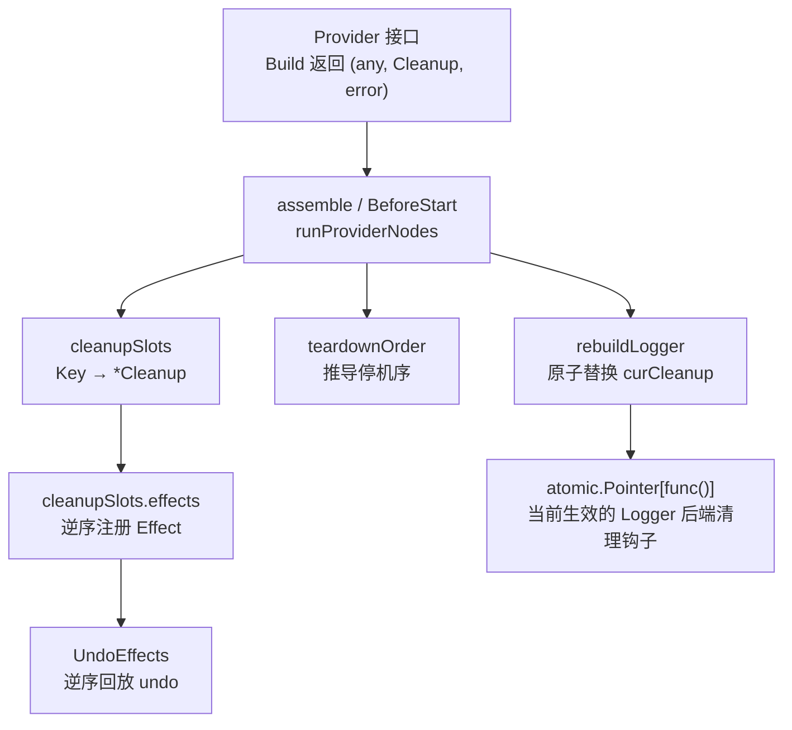
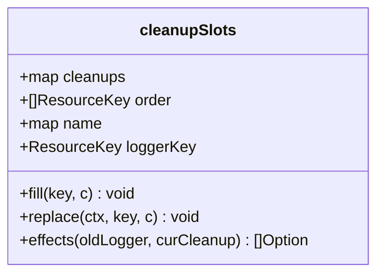
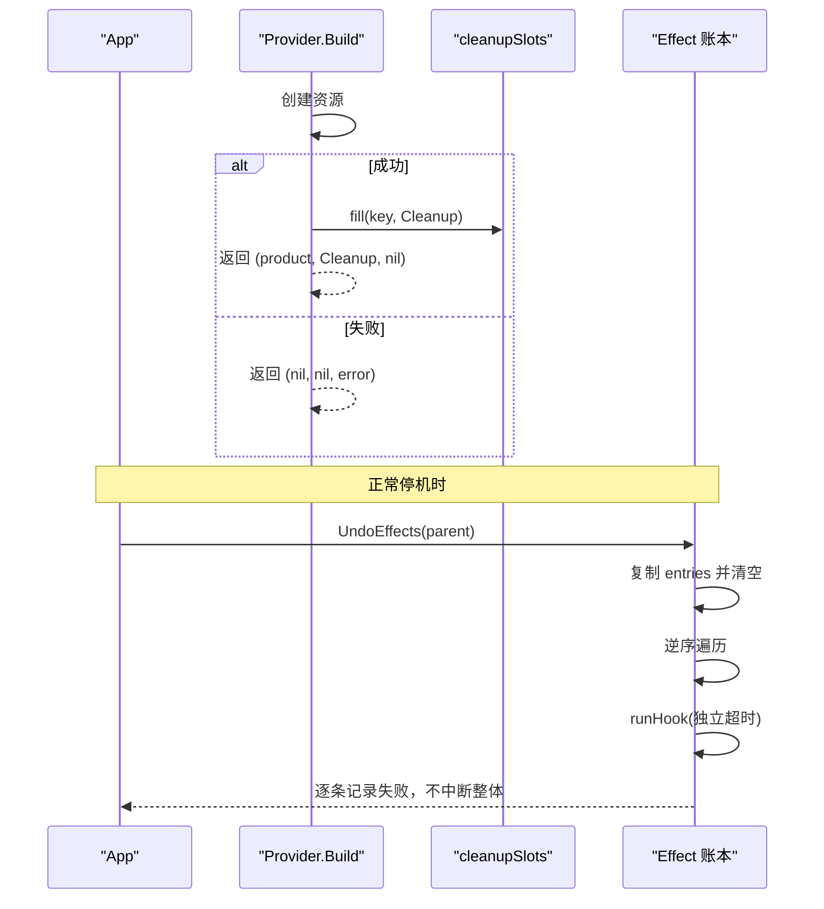
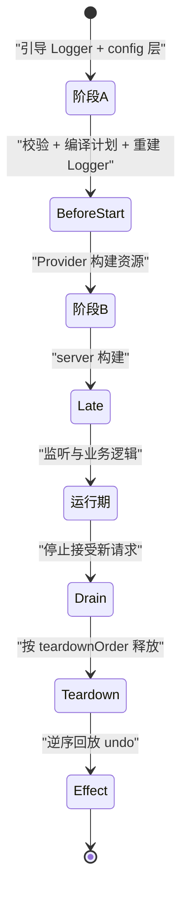
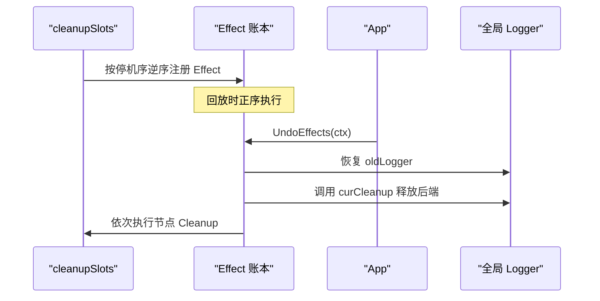
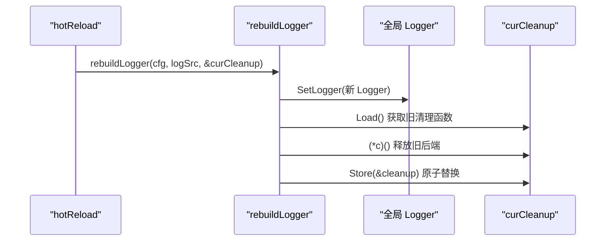
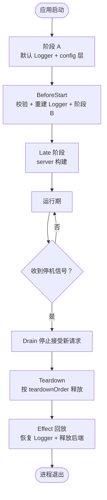
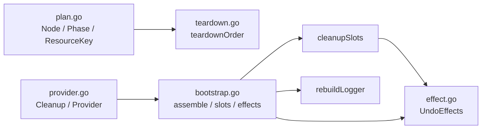

# 清理机制与停机序列

<cite>
**本文引用的文件**   
- [effect.go](file://pkg/appkit/effect.go)
- [teardown.go](file://pkg/appkit/teardown.go)
- [provider.go](file://pkg/appkit/provider.go)
- [bootstrap.go](file://pkg/appkit/bootstrap.go)
- [plan.go](file://pkg/appkit/plan.go)
</cite>

## 目录

1. [引言](#引言)
2. [项目结构](#项目结构)
3. [核心组件](#核心组件)
4. [架构总览](#架构总览)
5. [详细组件分析](#详细组件分析)
6. [依赖关系分析](#依赖关系分析)
7. [性能与正确性考量](#性能与正确性考量)
8. [故障排查指南](#故障排查指南)
9. [结论](#结论)

## 引言

本文聚焦 bald 应用框架中「清理机制」和「停机序列」的统一设计。围绕五个目标展开：

- `Cleanup` 函数类型的统一形态，把旧式无参清理闭包适配为带 `context.Context` 参数的形态，使 Provider 产物清理与 Effect 账本 `undo` 签名同构。
- `teardownOrder` 的推导算法：以 Apply 逆序为基础，叠加 `TeardownAfter` 约束（I5），并解释审计等节点如何通过 `[\"*\"]` 排到最后。
- `cleanupSlots` 槽位机制如何按节点 Key 存储、替换与聚合清理函数。
- `effects(oldLogger, &curCleanup)` 如何按停机序逆序注册 Effect，以及热更新路径上 `rebuildLogger` 原子替换 `curCleanup` 的安全性保证。
- 复杂应用生命周期示例，展示多阶段资源的创建与销毁顺序。

这些机制共同回答一个问题：当服务启动失败需要回滚、配置热更新需要切换后端、进程优雅停机需要释放资源时，bald 如何保证“先建的后释放”，并且不丢失缓冲日志、不泄漏连接池、不污染全局状态。

## 项目结构

清理与停机相关代码集中在 `pkg/appkit` 包内，由以下文件协同：

| 文件 | 职责 |
| --- | --- |
| [provider.go](file://pkg/appkit/provider.go) | 定义 `Provider`、`PlanScope`、`ApplyScope` 及统一的 `Cleanup(context.Context) error` 类型与旧式闭包适配器。 |
| [teardown.go](file://pkg/appkit/teardown.go) | 实现 I5 停机序推导算法 `teardownOrder`。 |
| [bootstrap.go](file://pkg/appkit/bootstrap.go) | 装配入口、阶段 A/B 日志重建、`cleanupSlots`、`rebuildLogger`、热更新流程、Effect 注入。 |
| [effect.go](file://pkg/appkit/effect.go) | 实现 Effect 账本，负责逆序回放 undo。 |
| [plan.go](file://pkg/appkit/plan.go) | 定义 Node、Phase、ResourceKey 等计划数据模型，其中 `TeardownAfter` 是停机序扩展语义的来源。 |



**图表来源**   
- [provider.go:60-140](file://pkg/appkit/provider.go#L60-L140)
- [teardown.go:12-90](file://pkg/appkit/teardown.go#L12-L90)
- [bootstrap.go:280-360](file://pkg/appkit/bootstrap.go#L280-L360)
- [bootstrap.go:559-656](file://pkg/appkit/bootstrap.go#L559-L656)
- [bootstrap.go:899-918](file://pkg/appkit/bootstrap.go#L899-L918)
- [effect.go:1-91](file://pkg/appkit/effect.go#L1-L91)

**章节来源**   
- [provider.go:1-200](file://pkg/appkit/provider.go#L1-L200)
- [teardown.go:1-90](file://pkg/appkit/teardown.go#L1-L90)
- [bootstrap.go:200-500](file://pkg/appkit/bootstrap.go#L200-L500)
- [bootstrap.go:559-932](file://pkg/appkit/bootstrap.go#L559-L932)
- [effect.go:1-91](file://pkg/appkit/effect.go#L1-L91)
- [plan.go:1-200](file://pkg/appkit/plan.go#L1-L200)

## 核心组件

### 统一的 `Cleanup` 类型

`Cleanup` 被定义为 `func(context.Context) error`。它既是 Provider 产物构建后的停机释放钩子，也是 Effect 账本中 `undo` 的形态。二者签名完全一致，因此回放路径不需要再做运行时适配。

对仍返回无参 `func()` 的旧式清理闭包，框架提供 `noopCleanup` 适配器：

- 若传入 `nil`，返回 `nil`；
- 否则包装成 `func(context.Context) error { cleanup(); return nil }`。

这个适配发生在 Provider 实现侧或框架内部聚合点，对外暴露面始终是 `Cleanup`。这样，无论是阶段 A 的配置层清理、阶段 B 的资源清理，还是 Effect 的 undo，都走同一执行路径。

| 清理形态 | 含义 | 使用位置 |
| --- | --- | --- |
| `Cleanup(context.Context) error` | 统一清理函数，可携带上下文、返回错误 | Provider.Build、Effect.undo |
| 旧式 `func()` | 历史兼容形态 | Provider 实现侧或内部聚合 |
| `noopCleanup` | 将旧式闭包适配为 `Cleanup` | config 层清理聚合、logger 源封装 |
| `noopCleanupFn` | 将 `Cleanup` 转为无参聚合闭包 | config 层 cleanup 链式聚合 |

**章节来源**   
- [provider.go:60-95](file://pkg/appkit/provider.go#L60-L95)
- [bootstrap.go:230-250](file://pkg/appkit/bootstrap.go#L230-L250)
- [bootstrap.go:640-656](file://pkg/appkit/bootstrap.go#L640-L656)

### `teardownOrder` 停机序推导

`teardownOrder` 是 I5 的核心：它接收一组 Node，输出“先执行者在前”的 ResourceKey 序列。其输入来自 provider 计划中的 teardown 节点集合。

推导规则如下：

1. **基础语义是栈式**：最后应用的资源最先释放，即默认按 Apply 逆序选取。
2. **`TeardownAfter` 是拓扑约束**：Node 在自身列出的每个节点之后释放。
3. **未知键视为已满足**：跨阶段或框架外资源名不会导致报错。
4. **通配符 `[\"*\"]` 展开为全部其它节点**：常用于审计后端，使其排在所有其他资源释放之后。
5. **同层候选按 Apply 逆序选择**：遍历时从大到小取最大下标，保证后应用者优先释放。
6. **环检测**：如果无法选出下一个可释放节点，会收集卡住节点并报错。

```mermaid
flowchart TD
    Start(["开始"]) --> BuildIndex["构建 Key → 下标索引"]
    BuildIndex --> ExpandDeps["展开 TeardownAfter<br/>未知键跳过<br/>\"*\" 展开为其它节点"]
    ExpandDeps --> ComputeIndeg["计算入度与依赖反向图"]
    ComputeIndeg --> Pick{"是否存在入度为零的节点？"}
    Pick -->|否| CycleError["报 TeardownAfter 环错误"]
    Pick -->|是| SelectMaxIdx["在所有候选中选择下标最大者<br/>即 Apply 逆序优先"]
    SelectMaxIdx --> Append["加入停机序输出"]
    Append --> Reduce["减少被依赖节点的入度"]
    Reduce --> Pick
    CycleError --> End(["结束"])
    Append --> End
```

**图表来源**   
- [teardown.go:12-90](file://pkg/appkit/teardown.go#L12-L90)

审计节点通过 `TeardownAfter: [\"*\"]` 把自己推到最晚释放的位置，从而让流式审计的尾批事件在指标与追踪 flush 之后收集。相反，指标与追踪节点可以通过声明 `[\"logger\"]` 系列保持“先停暴露端、再 flush、最后恢复日志”的顺序。

**章节来源**   
- [teardown.go:1-90](file://pkg/appkit/teardown.go#L1-L90)
- [plan.go:120-180](file://pkg/appkit/plan.go#L120-L180)

### `cleanupSlots` 槽位机制

`cleanupSlots` 维护三件事：

| 字段 | 含义 |
| --- | --- |
| `cleanups` | `map[ResourceKey]*Cleanup`，每个节点一个槽位指针 |
| `order` | 由 `teardownOrder` 推导出的停机序 |
| `name` | 节点对应的 Effect 名称 |
| `loggerKey` | logger 节点 Key，用于特殊处理 |

构造时，框架会为 teardown 计划中的每个 Key 预分配槽位，初始值为 `nil`。后续在 Build 成功后填充。

槽位有两个写入方式：

| 方法 | 语义 |
| --- | --- |
| `fill(key, c)` | 首次填充直接写入；重复填充时包裹成新清理函数，新清理先执行、旧清理后执行，形成栈式聚合。 |
| `replace(ctx, key, c)` | 配置协调路径：同步兑现旧清理函数，再替换为新清理。 |



**图表来源**   
- [bootstrap.go:559-656](file://pkg/appkit/bootstrap.go#L559-L656)

**章节来源**   
- [bootstrap.go:559-656](file://pkg/appkit/bootstrap.go#L559-L656)

### Effect 账本与回放

Effect 账本由 `effectEntry` 组成，每条记录包含：

- `name`：用于日志定位；
- `undo`：带 `context.Context` 的可逆操作。

关键行为：

- `addEffect` 并发安全追加；
- `UndoEffects` 复制条目后立即清空账本，确保幂等；
- 回放按逆序执行，即“后注册的先撤销”；
- 单条 undo 超时或 panic 仅记日志，不影响其余回放。



**图表来源**   
- [effect.go:1-91](file://pkg/appkit/effect.go#L1-L91)

**章节来源**   
- [effect.go:1-91](file://pkg/appkit/effect.go#L1-L91)

## 架构总览

bald 的生命周期可以简化为以下阶段：

1. **阶段 A**：用默认 Logger 保证契约装载前可见日志；构造 config 段 Provider 产出配置层。
2. **BeforeStart 前置**：校验契约、编译计划、重建 Logger。
3. **阶段 B**：按计划构建资源，产物落 App 资源面，cleanup 落入 `cleanupSlots`。
4. **Late 阶段**：server 段 Provider 构建。
5. **运行期**：接受请求、处理订阅、协调资源。
6. **Drain**：停止接受新请求。
7. **Teardown**：按停机序释放资源。
8. **Effect 回放**：逆序执行 undo，包括恢复全局 Logger 和释放后端。



**图表来源**   
- [plan.go:18-60](file://pkg/appkit/plan.go#L18-L60)
- [bootstrap.go:200-360](file://pkg/appkit/bootstrap.go#L200-L360)
- [bootstrap.go:559-656](file://pkg/appkit/bootstrap.go#L559-L656)

**章节来源**   
- [plan.go:1-100](file://pkg/appkit/plan.go#L1-L100)
- [bootstrap.go:200-360](file://pkg/appkit/bootstrap.go#L200-L360)

## 详细组件分析

### 清理函数统一化：从旧式闭包到 `Cleanup`

Provider 的 `Build` 返回 `(any, Cleanup, error)`。这里的关键是：

- `Cleanup` 与 Effect 的 `undo` 同构，都是 `func(context.Context) error`。
- 旧式无参清理闭包通过 `noopCleanup` 适配，不改变 Provider 外部契约。
- config 层 cleanup 聚合通过 `noopCleanupFn` 把 `Cleanup` 转成无参闭包，便于链式组合。

这种统一带来的好处是：

- 回放路径只有一种调用方式；
- 错误语义一致：都返回 error；
- 上下文传播一致：都可以携带请求级或阶段级 context；
- 测试与诊断更容易：清理函数不再分多种签名。

**章节来源**   
- [provider.go:60-95](file://pkg/appkit/provider.go#L60-L95)
- [bootstrap.go:230-250](file://pkg/appkit/bootstrap.go#L230-L250)
- [bootstrap.go:640-656](file://pkg/appkit/bootstrap.go#L640-L656)

### 停机序推导：I5 的 Apply 逆序与 `TeardownAfter`

`teardownOrder` 不是手工维护的 `cleanupOrder` 表，而是基于 Node 数据的拓扑排序。其设计要点：

| 语义 | 实现方式 |
| --- | --- |
| 默认栈式释放 | 选择候选时取下标最大者 |
| 延迟释放 | `TeardownAfter` 增加入度 |
| 审计后置 | `[\"*\"]` 展开为全部其它节点 |
| 框架外资源 | 未知键跳过，不报错 |
| 死锁保护 | 无法推进时报环错误并列出卡住节点 |

这保证了：

- 普通资源按“后建先释放”；
- 需要延后释放的资源显式声明依赖；
- 审计、日志、追踪等横切关注点可以通过 `TeardownAfter` 表达时序意图；
- 引擎不再手写各域清理顺序。

**章节来源**   
- [teardown.go:1-90](file://pkg/appkit/teardown.go#L1-L90)
- [plan.go:120-180](file://pkg/appkit/plan.go#L120-L180)

### `cleanupSlots`：节点清理函数的容器

`cleanupSlots` 是连接 Provider Build 结果与 Effect 回放的中间层。它的职责是：

1. 在计划期预分配槽位；
2. 在阶段 B Build 成功后填充清理函数；
3. 在配置协调路径上替换清理函数；
4. 生成按停机序逆序注册的 Effect。

`fill` 的聚合语义很重要：如果同一个 Key 被多次填充，新清理函数会先执行，再调用旧清理函数。这意味着“后填者先释放”，符合栈式语义。

`replace` 则用于热更新：旧清理函数立即执行，避免连接池、监听器、缓存句柄泄漏。

**章节来源**   
- [bootstrap.go:559-656](file://pkg/appkit/bootstrap.go#L559-L656)

### `effects(oldLogger, &curCleanup)`：按停机序逆序注册 Effect

`cleanupSlots.effects` 遍历 `s.order` 的逆序，为每个节点生成一个 Effect：

- 对 logger 节点：恢复装配前的全局 Logger，并调用最新 `curCleanup` 释放当前 Logger 后端。
- 对其他节点：读取槽位中的 `Cleanup` 并执行。

这里的关键是：**回放顺序等于停机序**。因为 Effect 是按停机序逆序注册的，所以 `UndoEffects` 正序回放时，实际执行顺序就是停机序。



**图表来源**   
- [bootstrap.go:621-656](file://pkg/appkit/bootstrap.go#L621-L656)
- [effect.go:60-91](file://pkg/appkit/effect.go#L60-L91)

**章节来源**   
- [bootstrap.go:621-656](file://pkg/appkit/bootstrap.go#L621-L656)
- [effect.go:1-91](file://pkg/appkit/effect.go#L1-L91)

### `rebuildLogger` 与 `curCleanup` 原子替换

`rebuildLogger` 是热更新路径上的关键函数。它的作用：

1. 调用 `logSrc.contractLogger` 重建 Logger；
2. 若 cleanup 为 nil，归一化为空函数；
3. 先设置全局 Logger；
4. 再兑现旧 `curCleanup`；
5. 最后原子替换 `curCleanup`。

这个顺序不能颠倒：

- 如果先替换 `curCleanup` 再设全局 Logger，可能出现短暂的全局 Logger 指向新对象但旧后端尚未释放的状态；
- 如果先释放旧后端再设全局 Logger，可能在新 Logger 写日志时旧后端已被关闭；
- 当前实现先切全局句柄，再冲刷旧后端，能确保带缓冲的后端（如 loki）不丢尾批日志。

`curCleanup` 是 `atomic.Pointer[func()]`，保证阶段 A、阶段 B、热更新三条路径并发访问时的安全性。



**图表来源**   
- [bootstrap.go:899-918](file://pkg/appkit/bootstrap.go#L899-L918)

**章节来源**   
- [bootstrap.go:899-918](file://pkg/appkit/bootstrap.go#L899-L918)

### 复杂应用生命周期示例

下面用一个典型多阶段应用说明清理与停机序列的正确顺序。

#### 假设资源

| 阶段 | 资源 | 创建时机 | 清理职责 |
| --- | --- | --- | --- |
| 阶段 A | 默认 Logger | assemble 初始化 | 无或 noop |
| 阶段 A | config 层 Provider | assemble 构造期 | 释放配置层持有的连接或临时资源 |
| 阶段 B | registry | BeforeStart 阶段 B | 注销服务实例 |
| 阶段 B | database | BeforeStart 阶段 B | 关闭连接池 |
| 阶段 B | cache | BeforeStart 阶段 B | 断开 Redis 连接 |
| 阶段 B | audit | BeforeStart 阶段 B | 刷新尾批审计事件 |
| Late | server.http | Late 阶段 | 停止 HTTP 监听 |
| Late | server.grpc | Late 阶段 | 停止 gRPC 监听 |

#### 创建顺序

1. 阶段 A：默认 Logger；config 层 Provider。
2. BeforeStart：校验契约；重建 Logger；阶段 B Provider 构建。
3. Late：HTTP/gRPC server 构建。
4. 运行期：接受请求。

#### 停机顺序

按照 I5，默认是 Apply 逆序：

1. server.grpc
2. server.http
3. audit
4. cache
5. database
6. registry
7. config 层 Provider
8. Logger 后端

审计节点可通过 `TeardownAfter: [\"*\"]` 排到最后，确保在指标、追踪 flush 之后收集尾批事件。

#### 热更新路径

当 logger 配置变化时：

1. hotReload 重新加载并校验候选配置；
2. 编译新计划；
3. 原子落盘整个配置；
4. rebuildLogger 切换到新 Logger；
5. 释放旧 Logger 后端；
6. 替换 `curCleanup`；
7. 按计划差异协调可重建节点。

#### 完整流程图



**图表来源**   
- [plan.go:18-60](file://pkg/appkit/plan.go#L18-L60)
- [bootstrap.go:200-360](file://pkg/appkit/bootstrap.go#L200-L360)
- [bootstrap.go:559-656](file://pkg/appkit/bootstrap.go#L559-L656)
- [bootstrap.go:852-918](file://pkg/appkit/bootstrap.go#L852-L918)

**章节来源**   
- [plan.go:18-60](file://pkg/appkit/plan.go#L18-L60)
- [bootstrap.go:200-360](file://pkg/appkit/bootstrap.go#L200-L360)
- [bootstrap.go:852-918](file://pkg/appkit/bootstrap.go#L852-L918)

## 依赖关系分析

清理机制涉及的模块依赖如下：



**图表来源**   
- [plan.go:1-200](file://pkg/appkit/plan.go#L1-L200)
- [teardown.go:1-90](file://pkg/appkit/teardown.go#L1-L90)
- [provider.go:1-200](file://pkg/appkit/provider.go#L1-L200)
- [bootstrap.go:200-932](file://pkg/appkit/bootstrap.go#L200-L932)
- [effect.go:1-91](file://pkg/appkit/effect.go#L1-L91)

耦合关系说明：

- `bootstrap.go` 是中心协调者，串联 Provider、slots、teardownOrder、Effect 和 Logger。
- `teardown.go` 是纯函数，只依赖 Node 数据，不持有运行时状态。
- `effect.go` 是副作用回放层，隔离全局状态变更。
- `provider.go` 定义对外契约，不关心内部清理实现。
- `plan.go` 提供计划数据模型，是所有顺序推导的输入。

**章节来源**   
- [plan.go:1-200](file://pkg/appkit/plan.go#L1-L200)
- [teardown.go:1-90](file://pkg/appkit/teardown.go#L1-L90)
- [provider.go:1-200](file://pkg/appkit/provider.go#L1-L200)
- [bootstrap.go:200-932](file://pkg/appkit/bootstrap.go#L200-L932)
- [effect.go:1-91](file://pkg/appkit/effect.go#L1-L91)

## 性能与正确性考量

### 时间复杂度

- `teardownOrder`：对 N 个节点进行拓扑排序，时间复杂度约为 O(N + E)，E 为 `TeardownAfter` 边数；通配符 `[\"*\"]` 最多展开为 N-1 条边。
- `cleanupSlots.fill`：O(1) 写入；聚合时包装一次闭包。
- `cleanupSlots.replace`：O(1) 读取旧值并执行。
- `cleanupSlots.effects`：O(N) 生成 Option。
- `UndoEffects`：O(M) 回放 M 条 effect。

### 内存占用

- `cleanupSlots.cleanups` 是每个节点一个指针槽位；
- Effect 账本在 `UndoEffects` 调用后会清空，避免长期持有；
- `curCleanup` 只保存一个原子指针。

### 正确性保障

| 场景 | 保障机制 |
| --- | --- |
| 启动失败回滚 | Effect 逆序回放 undo |
| 热更新切换 Logger | 先切全局句柄，再释放旧后端，最后原子替换 |
| 多个 Provider 产出同 Key | 槽位聚合，后填者先释放 |
| 审计后置 | `TeardownAfter: [\"*\"]` |
| 日志缓冲不丢失 | 热更新时旧后端 cleanup 在切全局句柄后同步执行 |
| 清理函数 panic | Effect 回放逐条隔离，不拖垮整机停机 |
| 清理函数阻塞 | 受阶段预算或后端 flush 超时保护 |

**章节来源**   
- [teardown.go:12-90](file://pkg/appkit/teardown.go#L12-L90)
- [bootstrap.go:559-656](file://pkg/appkit/bootstrap.go#L559-L656)
- [bootstrap.go:899-918](file://pkg/appkit/bootstrap.go#L899-L918)
- [effect.go:60-91](file://pkg/appkit/effect.go#L60-L91)

## 故障排查指南

### 现象：热更新后旧后端未释放

检查 `rebuildLogger` 是否被调用，确认：

1. 新 Logger 构建是否成功；
2. 旧 `curCleanup` 是否非 nil；
3. 旧后端 cleanup 是否被同步执行；
4. 新 cleanup 是否原子替换。

常见原因是 logger Provider 返回的 cleanup 为 nil，但框架已归一化为空函数，因此不应视为异常。

**章节来源**   
- [bootstrap.go:899-918](file://pkg/appkit/bootstrap.go#L899-L918)

### 现象：审计事件在指标 flush 前丢失

确认审计 Provider 的 Node 是否声明 `TeardownAfter: [\"*\"]`。如果没有，审计可能早于指标或追踪释放。

**章节来源**   
- [teardown.go:12-90](file://pkg/appkit/teardown.go#L12-L90)
- [plan.go:120-180](file://pkg/appkit/plan.go#L120-L180)

### 现象：停机时报 `TeardownAfter` 环

检查是否有循环依赖，例如 A 要求 B 之后释放，B 又要求 A 之后释放。`teardownOrder` 会在无法推进时报告卡住节点列表。

**章节来源**   
- [teardown.go:50-90](file://pkg/appkit/teardown.go#L50-L90)

### 现象：Effect 回放部分失败但进程仍退出

这是预期行为。Effect 回放对单条 undo 采用旁路语义：失败仅记日志，不中断其余回放。若需要强一致性，应在 undo 内部自行重试或上报监控。

**章节来源**   
- [effect.go:60-91](file://pkg/appkit/effect.go#L60-L91)

### 现象：Logger 热更新后仍有日志写入旧后端

确认 `rebuildLogger` 的执行顺序是否为：

1. 设置新全局 Logger；
2. 执行旧 cleanup；
3. 原子替换 `curCleanup`。

如果顺序颠倒，可能出现竞态。框架当前实现是先切全局句柄，再释放旧后端，因此理论上不会出现新日志写旧后端的问题。

**章节来源**   
- [bootstrap.go:899-918](file://pkg/appkit/bootstrap.go#L899-L918)

## 结论

bald 的清理机制与停机序列围绕三个设计原则构建：

1. **统一签名**：`Cleanup` 与 Effect undo 同构，消除运行时适配成本。
2. **数据驱动顺序**：`teardownOrder` 以 Node 的 `TeardownAfter` 推导停机序，替代手工维护的清理表。
3. **原子替换与槽位隔离**：`cleanupSlots` 与 `curCleanup` 保证热更新路径上 Logger 与资源清理的安全切换。

这套机制使得：

- 多阶段资源可按“后建先释放”自然回收；
- 审计、日志、追踪等横切关注点可显式表达时序意图；
- 热更新不会泄漏连接、监听器或缓冲日志；
- 启动失败可逆序回滚全局状态；
- 进程优雅停机具有确定且可诊断的顺序。

对于使用者而言，最重要的实践是：

- Provider.Build 始终返回匹配的 `Cleanup`；
- 需要延后释放的资源使用 `TeardownAfter` 声明；
- 不要假设某个资源一定比另一个资源先释放，除非有明确约束；
- 把副作用放在 Build，把清理放在 Cleanup，把全局状态恢复交给 Effect。