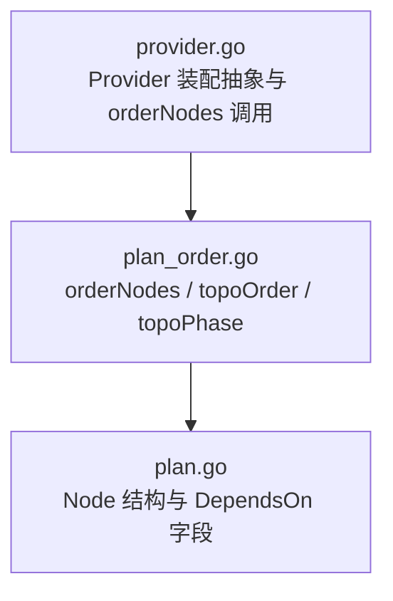
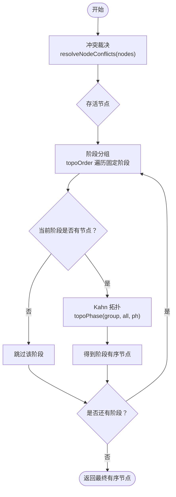
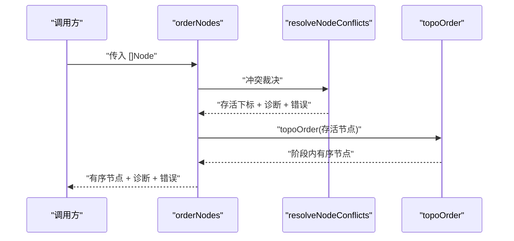
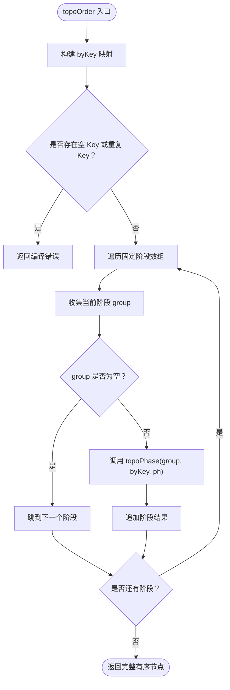
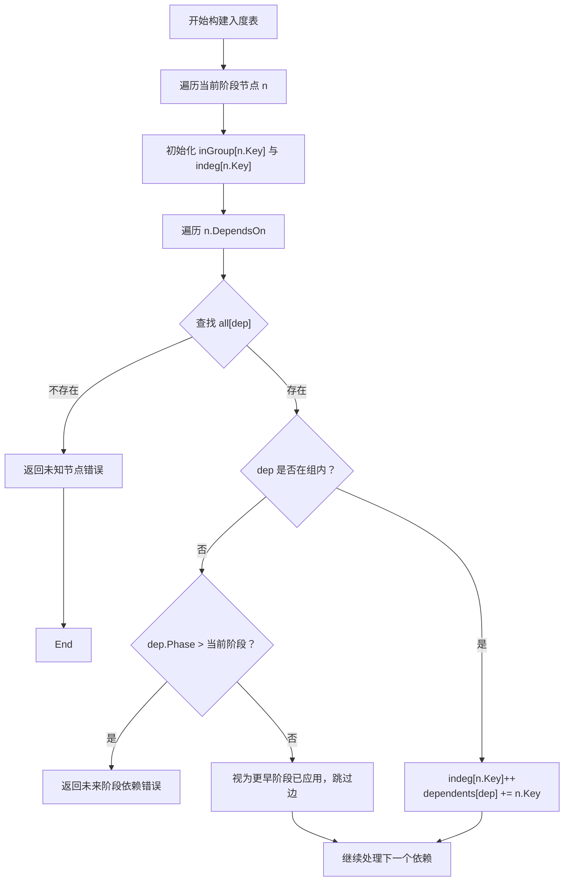
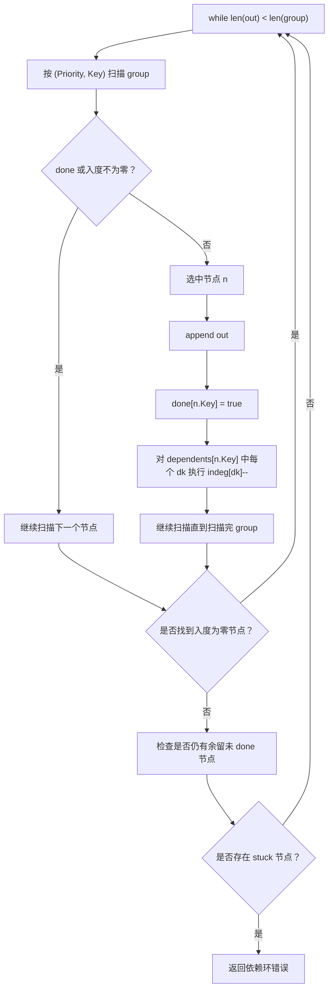
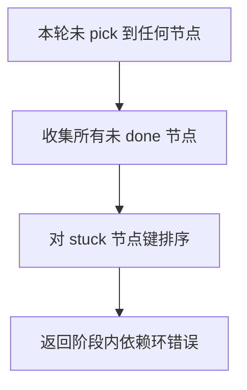
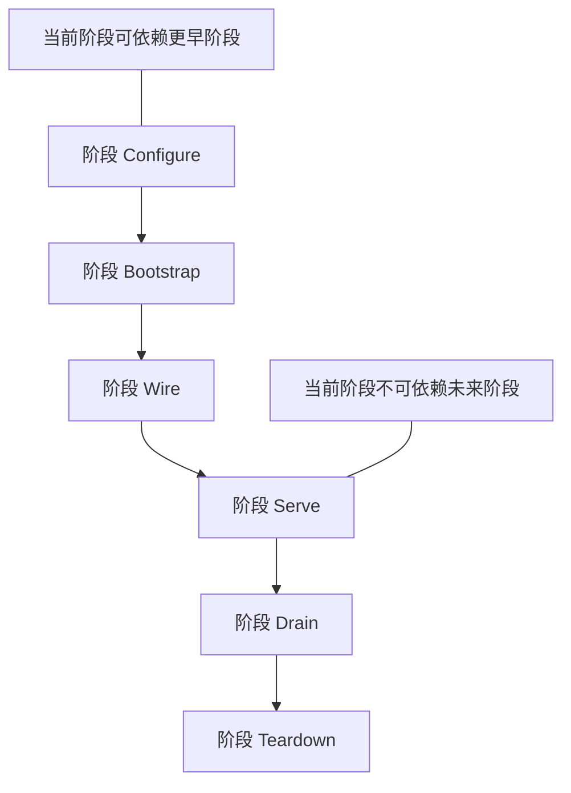
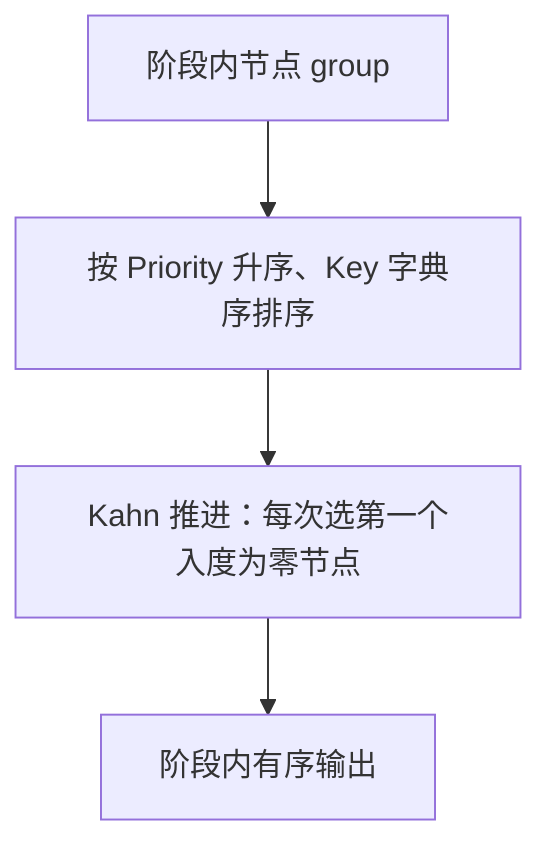
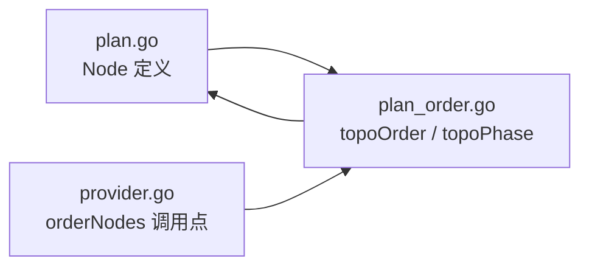

# Kahn 拓扑排序与依赖解析

<cite>
**本文引用的文件**   
- [pkg/appkit/plan_order.go](file://pkg/appkit/plan_order.go)
- [pkg/appkit/provider.go](file://pkg/appkit/provider.go)
- [pkg/appkit/plan.go](file://pkg/appkit/plan.go)
</cite>

## 目录
1. [简介](#简介)
2. [项目结构定位](#项目结构定位)
3. [核心组件](#核心组件)
4. [架构总览](#架构总览)
5. [详细组件分析](#详细组件分析)
6. [依赖关系分析](#依赖关系分析)
7. [性能与复杂度](#性能与复杂度)
8. [故障排查指南](#故障排查指南)
9. [结论](#结论)

## 简介
本文聚焦 `pkg/appkit` 中的 Kahn 拓扑排序实现，解释它如何对 `Node.DependsOn` 依赖图进行阶段内排序：先构建入度表，再以入度为零的节点为种子推进；当所有剩余节点入度均不为零时判定存在环，并输出具体依赖链。同时说明为什么只做「同阶段」拓扑排序、如何处理空依赖和重复依赖，以及拓扑序与后续 `(Priority, Key)` 稳定排序的组合语义。

## 项目结构定位
Kahn 拓扑排序及相关装配顺序逻辑集中在 `pkg/appkit` 包中：

- `Node` 类型定义在 `plan.go`，声明 `DependsOn []ResourceKey` 作为依赖边来源。
- `topoOrder` / `topoPhase` / `orderNodes` 等排序函数在 `plan_order.go` 中实现。
- `provider.go` 是 Provider 装配抽象文档与入口，明确把 `orderNodes`（阶段 → Kahn 拓扑 → `(Priority, Key)`）描述为「唯一计划排序实现」。

**图示来源**
- [provider.go:1-70](file://pkg/appkit/provider.go#L1-L70)
- [plan_order.go:1-194](file://pkg/appkit/plan_order.go#L1-L194)
- [plan.go:136-145](file://pkg/appkit/plan.go#L136-L145)

**章节来源**
- [provider.go:1-70](file://pkg/appkit/provider.go#L1-L70)
- [plan_order.go:1-194](file://pkg/appkit/plan_order.go#L1-L194)
- [plan.go:136-145](file://pkg/appkit/plan.go#L136-L145)

## 核心组件
本节给出与 Kahn 拓扑排序直接相关的数据结构和流程接口。

| 组件 | 职责 | 关键行为 |
|---|---|---|
| `Node` | 计划中的一个资源节点 | 包含 `Key`、`Phase`、`Priority`、`DependsOn` 等；`DependsOn` 决定 Apply 拓扑序 |
| `orderNodes` | 计划排序入口 | 冲突裁决 → 阶段分组 → 阶段内 Kahn 拓扑 → `(Priority, Key)` 选取 |
| `topoOrder` | 键唯一节点的阶段级拓扑 | 按固定阶段顺序遍历，每阶段调用 `topoPhase` |
| `topoPhase` | 单阶段 Kahn 拓扑 | 构建入度表、依赖反向索引，逐步释放入度为零的节点 |
| `resolveNodeConflicts` | 同 `Key` 冲突裁决 | 仅在此处处理同键冲突；进入 `topoOrder` 前已保证键唯一 |

**章节来源**
- [plan.go:136-175](file://pkg/appkit/plan.go#L136-L175)
- [plan_order.go:1-194](file://pkg/appkit/plan_order.go#L1-L194)
- [provider.go:1-70](file://pkg/appkit/provider.go#L1-L70)

## 架构总览
`orderNodes` 是唯一的计划排序实现，其主流程如下：

1. **冲突裁决**：先用 `resolveNodeConflicts` 解决同 `Key` 节点；只有恰好一个带 `Override` 且带 `Reason` 的节点胜出，否则报错或产生诊断。
2. **阶段分组**：`topoOrder` 按固定阶段数组 `[Configure, Bootstrap, Wire, Serve, Drain, Teardown]` 遍历。
3. **阶段内拓扑**：每个非空阶段交给 `topoPhase` 做 Kahn 拓扑。
4. **结果拼接**：各阶段有序节点依次追加到最终输出。

**图示来源**
- [plan_order.go:93-115](file://pkg/appkit/plan_order.go#L93-L115)
- [plan_order.go:117-160](file://pkg/appkit/plan_order.go#L117-L160)
- [plan_order.go:162-194](file://pkg/appkit/plan_order.go#L162-L194)

## 详细组件分析

### Node 与 DependsOn 数据模型
`Node` 是装配计划的原子单位。`DependsOn` 是一个资源键切片，表示「本节点在 Apply 时依赖哪些其他节点已经构建完成」。

| 字段 | 含义 | 对拓扑的影响 |
|---|---|---|
| `Key` | 资源唯一标识 | 作为图的顶点；重复键在进入 `topoOrder` 前已被拒绝 |
| `Phase` | 生命周期阶段 | 决定节点归属哪个阶段的子图 |
| `Priority` | 同阶段显式优先级 | 影响 ready 集合中节点的选取顺序 |
| `DependsOn` | 依赖的资源键列表 | 构成有向边：被依赖者必须先于依赖者出队 |
| `TeardownAfter` | 停机序约束 | 不参与 `topoOrder`，由停机路径单独处理 |
| `Override` / `Reason` | 同键覆盖声明 | 在 `resolveNodeConflicts` 中使用，不进入拓扑图 |

**章节来源**
- [plan.go:136-175](file://pkg/appkit/plan.go#L136-L175)

### orderNodes：阶段 → 拓扑 → 稳定选取
`orderNodes` 是上层入口，负责把原始 `[]Node` 转换成最终的有序节点序列。它的三个关键阶段是：

1. 调用 `resolveNodeConflicts` 处理同 `Key` 冲突。
2. 用存活下标重建键唯一的 `[]Node`。
3. 调用 `topoOrder` 执行阶段级拓扑。

**图示来源**
- [plan_order.go:93-115](file://pkg/appkit/plan_order.go#L93-L115)

**章节来源**
- [plan_order.go:93-115](file://pkg/appkit/plan_order.go#L93-L115)

### topoOrder：分阶段拓扑
`topoOrder` 接收键唯一的节点切片，并按固定阶段数组逐阶段调用 `topoPhase`。固定阶段顺序是：

1. `PhaseConfigure`
2. `PhaseBootstrap`
3. `PhaseWire`
4. `PhaseServe`
5. `PhaseDrain`
6. `PhaseTeardown`

关键点：

- 如果某个阶段没有节点，直接跳过。
- 同一阶段内的节点才参与该阶段的拓扑排序。
- 跨阶段依赖不作为图边加入当前阶段拓扑，而是通过「已应用 / 未来阶段」语义处理。

**图示来源**
- [plan_order.go:117-160](file://pkg/appkit/plan_order.go#L117-L160)

**章节来源**
- [plan_order.go:117-160](file://pkg/appkit/plan_order.go#L117-L160)

### topoPhase：Kahn 拓扑的核心
`topoPhase` 是对单阶段节点执行 Kahn 算法的实现。它维护三个核心数据结构：

| 结构 | 类型 | 作用 |
|---|---|---|
| `inGroup` | `map[ResourceKey]bool` | 标记当前阶段中的节点，用于判断依赖是否跨阶段 |
| `indeg` | `map[ResourceKey]int` | 记录每个节点在当前阶段子图中的入度 |
| `dependents` | `map[ResourceKey][]ResourceKey` | 反向索引：某节点完成后，需要减少哪些下游节点的入度 |

#### 入度表构建
对于当前阶段的每个节点：

1. 初始化 `inGroup` 和 `indeg`。
2. 遍历 `n.DependsOn`。
3. 若依赖不在 `all` 中，报「未知节点」错误。
4. 若依赖不在当前阶段但属于更早阶段，视为「已应用」，不计入入度。
5. 若依赖属于当前阶段，则当前节点入度加一，并把当前节点加入依赖者的 `dependents` 列表。

**图示来源**
- [plan_order.go:162-194](file://pkg/appkit/plan_order.go#L162-L194)

#### 种子队列与推进过程
Kahn 推进的关键在于每次从「入度为零且未被 done」的节点中选择下一个。这里不是使用标准库优先队列，而是在已按 `(Priority, Key)` 排序的 `group` 上线性扫描，找到第一个满足条件的节点就取出。

选择规则：

1. 先按 `Priority` 升序比较。
2. 再按 `Key` 字符串比较。
3. 扫描时遇到 `done[n.Key]` 或 `indeg[n.Key] != 0` 就跳过。
4. 找到首个可用节点后，立即加入输出、标记 `done`、并减少其依赖者的入度。
5. 一旦取走一个节点就 `break`，下一轮再从头扫描。

**图示来源**
- [plan_order.go:162-194](file://pkg/appkit/plan_order.go#L162-L194)

#### 循环依赖检测
当某一轮扫描结束后，如果没有选出任何节点，说明当前阶段剩余的所有节点入度都不为零，即形成环。此时算法会：

1. 收集所有尚未 `done` 的节点。
2. 对这些节点键名排序，保证错误信息稳定。
3. 返回包含阶段信息和节点列表的错误。

**图示来源**
- [plan_order.go:162-194](file://pkg/appkit/plan_order.go#L162-L194)

**章节来源**
- [plan_order.go:162-194](file://pkg/appkit/plan_order.go#L162-L194)

### 为什么只做「同阶段」拓扑排序
`topoOrder` 先把节点按 `Phase` 分组，再对每个阶段调用 `topoPhase`。这意味着：

- 不同阶段的节点不会互相成为 Kahn 图的边。
- 当前阶段只能依赖「已应用」的更早阶段节点。
- 当前阶段不能依赖未来阶段节点，否则直接报错。

这种设计保证了：不同阶段的节点不应互相依赖；阶段边界本身就是依赖方向约束。`normalizeNode` 的 phase 校验进一步保证节点归一到合理阶段，从而让拓扑排序只在阶段内部发生。

**图示来源**
- [plan_order.go:117-160](file://pkg/appkit/plan_order.go#L117-L160)
- [plan_order.go:162-194](file://pkg/appkit/plan_order.go#L162-L194)

**章节来源**
- [plan_order.go:117-160](file://pkg/appkit/plan_order.go#L117-L160)
- [plan_order.go:162-194](file://pkg/appkit/plan_order.go#L162-L194)

### DependsOn 为空时的处理
当 `Node.DependsOn` 为空时：

- `topoPhase` 的依赖遍历不会添加任何边。
- 该节点入度保持为零。
- 只要它在当前阶段，并且 `(Priority, Key)` 顺序允许，就会尽早被选出。

因此，空依赖等价于「无入边」的独立节点。

**章节来源**
- [plan_order.go:162-194](file://pkg/appkit/plan_order.go#L162-L194)

### 重复依赖的去重策略
在 `topoPhase` 中，`DependsOn` 只是用来遍历依赖；代码没有对 `DependsOn` 去重。也就是说：

- 如果同一个依赖出现多次，对应依赖者的入度会被多次增加。
- 每个重复边也会写入 `dependents`。
- 拓扑推进时，上游节点完成一次后，下游入度减一的次数等于重复次数。

因此，这里的语义不是「集合去重」，而是「多重边」；最终拓扑结果通常仍正确，因为入度最终会归零，但错误信息和执行细节可能受重复条目影响。若需要严格集合语义，应在更上游对 `DependsOn` 去重。

**章节来源**
- [plan_order.go:162-194](file://pkg/appkit/plan_order.go#L162-L194)

### 拓扑排序与 `(Priority, Key)` 稳定排序的关系
`topoPhase` 先对 `group` 按 `(Priority, Key)` 排序，然后在每一轮 Kahn 推进中，从头扫描这个已排序切片，选择第一个入度为零且未完成节点。

组合语义是：

1. 拓扑约束保证依赖方向。
2. 在同层入度为零的候选集中，`(Priority, Key)` 越小越先。
3. 由于扫描顺序固定，相同 `(Priority, Key)` 情况下，稳定性由输入切片的顺序和 `Key` 字符串比较共同保证。
4. 这不是传统意义上的「全局稳定排序」，而是「每轮局部选择受 `(Priority, Key)` 控制」的稳定选择。

**图示来源**
- [plan_order.go:162-194](file://pkg/appkit/plan_order.go#L162-L194)

**章节来源**
- [plan_order.go:162-194](file://pkg/appkit/plan_order.go#L162-L194)

### 复杂依赖图示例
考虑以下节点集合：

| 节点 | 阶段 | 优先级 | 依赖 |
|---|---|---|---|
| A | 假设同阶段 | 较低 | 无 |
| B | 假设同阶段 | 较低 | A |
| C | 假设同阶段 | 较低 | B |
| D | 假设同阶段 | 较低 | B |
| E | 假设同阶段 | 较低 | 无 |

根据实现：

1. 初始入度：A 为 0，E 为 0；B 为 1，D 为 1；C 为 1。
2. 第一轮可选节点是 A 和 E。由于它们都依赖为空，实际谁先取决于 `(Priority, Key)` 排序后的扫描位置。
3. 选走 A 后，B 入度从 1 降为 0。
4. 下一轮 B 变为候选。
5. B 选走后，C 和 D 入度同时变为 0。
6. C 和 D 的顺序取决于它们的 `(Priority, Key)`。

典型输出形式可能是：

- 第一层：A、E（顺序由 `(Priority, Key)` 决定）
- 第二层：B
- 第三层：C、D（顺序由 `(Priority, Key)` 决定）

注意：A→B→C、D→B 意味着 B 必须排在 A 之后、C 之前；D 也依赖 B，所以 D 必须在 B 之后。E 无依赖，可以在第一阶段与其他无依赖节点一起推进。

**章节来源**
- [plan_order.go:162-194](file://pkg/appkit/plan_order.go#L162-L194)

## 依赖关系分析
`pkg/appkit` 内部与拓扑排序相关的依赖关系如下：

**图示来源**
- [plan.go:136-145](file://pkg/appkit/plan.go#L136-L145)
- [plan_order.go:93-194](file://pkg/appkit/plan_order.go#L93-L194)
- [provider.go:1-70](file://pkg/appkit/provider.go#L1-L70)

**章节来源**
- [plan.go:136-145](file://pkg/appkit/plan.go#L136-L145)
- [plan_order.go:93-194](file://pkg/appkit/plan_order.go#L93-L194)
- [provider.go:1-70](file://pkg/appkit/provider.go#L1-L70)

## 性能与复杂度
设当前阶段有 `V` 个节点，`E` 条依赖边。

| 步骤 | 时间复杂度 | 空间复杂度 | 说明 |
|---|---:|---:|---|
| 构建 `byKey` | O(V) | O(V) | 阶段内键唯一性检查 |
| 构建入度表和反向依赖 | O(V + Σ|DependsOn|) | O(V + E) | 每条依赖最多写入一次反向边 |
| 阶段内排序 | O(V log V) | O(log V) | Go 的 sort.Slice 使用快速排序变体 |
| Kahn 推进 | O(V²) 最坏情况 | O(V) | 实现是每轮扫描整个 group，而非优先队列 |
| 环检测 | O(V log V) | O(V) | 收集 stuck 节点后排序输出 |

主要瓶颈是 Kahn 推进采用线性扫描而非优先队列：每轮都要遍历 `group` 找第一个入度为零的节点，最坏情况下为 O(V²)。优点是实现简单、内存分配少，且天然配合 `(Priority, Key)` 的排序语义。

**章节来源**
- [plan_order.go:162-194](file://pkg/appkit/plan_order.go#L162-L194)

## 故障排查指南

### 未知依赖
现象：编译期报告节点依赖了不存在的资源键。

原因：`topoPhase` 在 `all[dep]` 查找失败。

排查建议：

1. 检查 `DependsOn` 中的 `ResourceKey` 是否与目标节点 `Key` 完全一致。
2. 确认目标节点确实存在于当前阶段或更早阶段。
3. 不要依赖隐式命名约定，应使用明确的 `Key`。

**章节来源**
- [plan_order.go:162-194](file://pkg/appkit/plan_order.go#L162-L194)

### 未来阶段依赖
现象：当前阶段节点依赖了更高阶段节点。

原因：`topoPhase` 发现依赖节点 `Phase > 当前阶段`。

排查建议：

1. 将依赖方移到更晚阶段。
2. 或将被依赖方提前到更早阶段。
3. 不要把「启动顺序」误写成「依赖方向」：只有真正需要产物时才写 `DependsOn`。

**章节来源**
- [plan_order.go:162-194](file://pkg/appkit/plan_order.go#L162-L194)

### 阶段内依赖环
现象：报告阶段内存在依赖环，并列出卡在拓扑中的节点键。

原因：Kahn 推进找不到入度为零的节点，说明剩余节点形成环。

排查建议：

1. 查看错误信息中的 stuck 节点列表。
2. 画出这些节点之间的 `DependsOn` 边。
3. 删除多余依赖，或引入中间层打破环。
4. 注意重复依赖虽不一定破坏拓扑结果，但会让调试困难。

**章节来源**
- [plan_order.go:162-194](file://pkg/appkit/plan_order.go#L162-L194)

### 空 Key 或重复 Key
现象：编译期报空 Key 或重复 Key 错误。

原因：

- `resolveNodeConflicts` 会拒绝空 `Key`。
- `topoOrder` 再次检查空 `Key` 和重复 `Key`。

排查建议：

1. 确保每个 `Node` 都有稳定的 `Key`。
2. 避免多个 Provider 产出相同 `Key`；如需覆盖，使用 `Override` 和 `Reason`。
3. 不要在 `DependsOn` 之外依赖未声明的节点。

**章节来源**
- [plan_order.go:22-91](file://pkg/appkit/plan_order.go#L22-L91)
- [plan_order.go:117-160](file://pkg/appkit/plan_order.go#L117-L160)

### 排序不稳定或不符合预期
现象：相同优先级节点顺序变化，或期望顺序与实际不一致。

原因：

- Kahn 选择的是「扫描到的第一个入度为零节点」。
- 扫描顺序由 `(Priority, Key)` 排序后的 `group` 决定。
- 这不是纯稳定排序，而是受拓扑约束的选择。

排查建议：

1. 给关键节点设置明确的 `Priority`。
2. 确保 `Key` 具有稳定、可读的排序语义。
3. 如果需要强确定性，尽量消除同层多候选竞争，使依赖关系唯一决定顺序。

**章节来源**
- [plan_order.go:162-194](file://pkg/appkit/plan_order.go#L162-L194)

## 结论
`pkg/appkit` 的 Kahn 拓扑排序以阶段为边界、以 `Node.DependsOn` 为边，实现了装配计划的可分析排序。其核心特点是：

- 先构建入度表和反向依赖，再用入度为零的节点推进拓扑。
- 同阶段内通过 `(Priority, Key)` 控制候选选择，而不是简单保留声明顺序。
- 跨阶段依赖通过「已应用」和「未来阶段」语义处理，不允许未来阶段依赖。
- 环检测发生在 Kahn 无法推进时，并输出 stuck 节点集合以便定位。
- 空依赖节点作为独立顶点尽早推进；重复依赖不做集合去重，语义为多重边。
- 整体实现简洁，但 Kahn 推进为 O(V²)，适合装配规模有限、强调可解释性的场景。