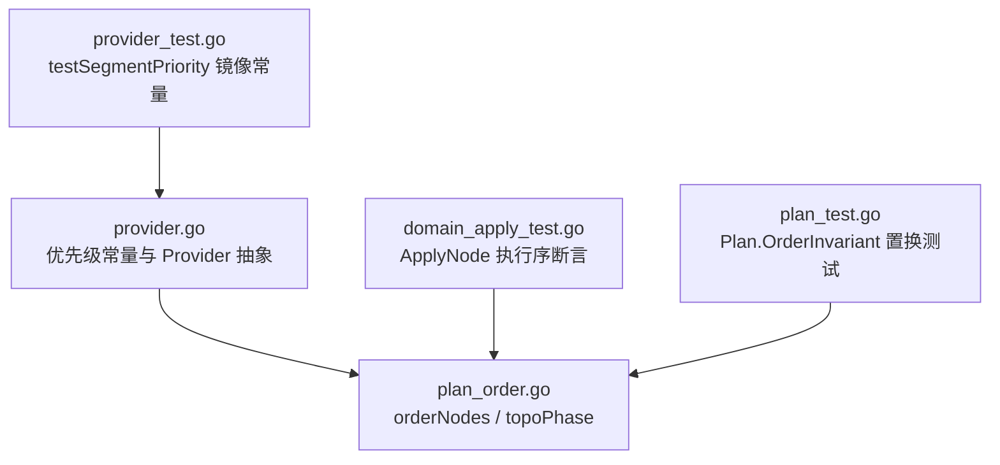
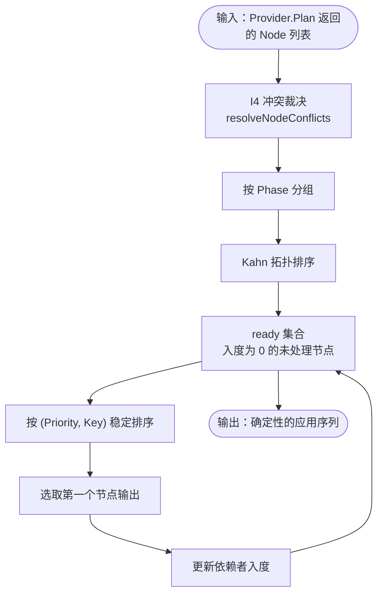
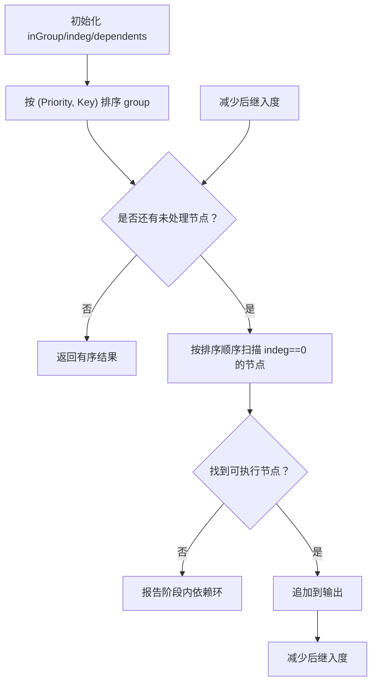
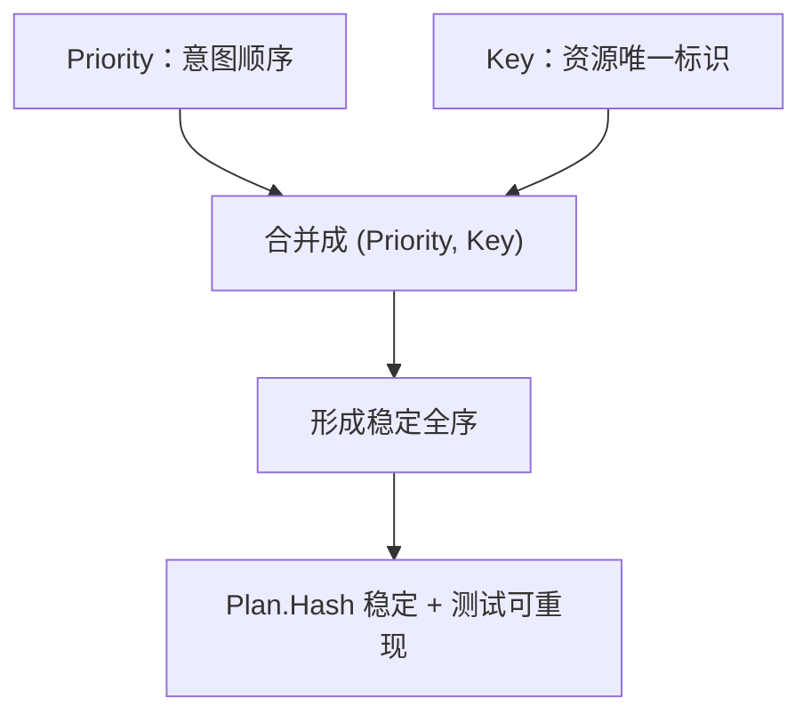
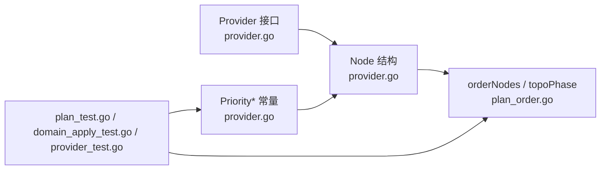

# 优先级稳定排序与确定性保证

<cite>
**本文引用的文件**
- [pkg/appkit/provider.go](file://pkg/appkit/provider.go)
- [pkg/appkit/plan_order.go](file://pkg/appkit/plan_order.go)
- [pkg/appkit/domain_apply_test.go](file://pkg/appkit/domain_apply_test.go)
- [pkg/appkit/plan_test.go](file://pkg/appkit/plan_test.go)
- [pkg/appkit/provider_test.go](file://pkg/appkit/provider_test.go)
</cite>

## 目录
1. [引言](#引言)
2. [项目结构](#项目结构)
3. [核心组件](#核心组件)
4. [架构总览](#架构总览)
5. [详细组件分析](#详细组件分析)
6. [依赖关系分析](#依赖关系分析)
7. [性能考量](#性能考量)
8. [故障排查指南](#故障排查指南)
9. [结论](#结论)
10. [附录：最佳实践与常见陷阱](#附录最佳实践与常见陷阱)

## 引言
本文聚焦 Bald 框架中 Provider 装配的「优先级稳定排序机制」：在 Kahn 拓扑排序完成之后，对同一阶段内具备相同拓扑层、且当前入度为零的可执行节点，按 `(Priority, Key)` 进行稳定选择。该机制把「意图顺序」与「确定性」从手写调用表迁移到声明数据——`Priority` 表达同阶段资源就绪的先后意图，`Key` 作为第二关键字消除 Go map 遍历无序带来的非确定性，使计划可哈希、可回放、可置换。

## 项目结构
与优先级稳定排序直接相关的代码集中在 `pkg/appkit`：

- `provider.go`：定义 `Provider` 接口、`Node` 字段语义，以及 `PriorityLogger` 到 `PriorityBroker` 等优先级常量。
- `plan_order.go`：实现唯一的计划排序流程 `orderNodes → topoOrder → topoPhase`，并在阶段内使用 `(Priority, Key)` 排序 ready 集合。
- `domain_apply_test.go`：断言 ApplyNode 的执行序等于计划序（Phase → Priority → Key），而非声明序。
- `plan_test.go`：通过随机打乱 Option 顺序并比较 Plan.Hash，验证排序键不依赖声明下标。
- `provider_test.go`：用测试侧的 `testSegmentPriority` 镜像生产优先级常量，钉住各段期望值。

**图表来源**
- [pkg/appkit/provider.go:130-150](file://pkg/appkit/provider.go#L130-L150)
- [pkg/appkit/plan_order.go:1-194](file://pkg/appkit/plan_order.go#L1-L194)
- [pkg/appkit/domain_apply_test.go:187-217](file://pkg/appkit/domain_apply_test.go#L187-L217)
- [pkg/appkit/plan_test.go:188-238](file://pkg/appkit/plan_test.go#L188-L238)
- [pkg/appkit/provider_test.go:61-98](file://pkg/appkit/provider_test.go#L61-L98)

**章节来源**
- [pkg/appkit/provider.go:1-50](file://pkg/appkit/provider.go#L1-L50)
- [pkg/appkit/plan_order.go:1-40](file://pkg/appkit/plan_order.go#L1-L40)

## 核心组件
### Node 与排序入口
每个 Provider 的 `Plan` 返回一个 `Node`，其中关键字段包括：

| 字段 | 含义 | 对排序的影响 |
|---|---|---|
| `Key` | 资源唯一标识 | 冲突裁决与第二阶段排序关键字 |
| `Phase` | 生命周期阶段 | 第一级排序维度，跨阶段严格递增 |
| `Priority` | 同阶段内的显式意图顺序 | 第二级排序关键字 |
| `DependsOn` | 依赖的其他节点 Key | 决定 Kahn 拓扑约束 |
| `TeardownAfter` | 停机阶段依赖 | 用于停机序推导，不影响启动拓扑 |

排序入口是 `orderNodes`：先做 I4 冲突裁决，再按 Phase 分组，最后对每个阶段执行 `topoPhase`。

**章节来源**
- [pkg/appkit/plan_order.go:1-40](file://pkg/appkit/plan_order.go#L1-L40)
- [pkg/appkit/provider.go:1-50](file://pkg/appkit/provider.go#L1-L50)

## 架构总览

**图表来源**
- [pkg/appkit/plan_order.go:80-194](file://pkg/appkit/plan_order.go#L80-L194)

## 详细组件分析

### 一、Kahn 拓扑排序与稳定 ready 集合选择
`topoPhase` 对单阶段节点构建有向图：

1. 初始化 `inGroup`、`indeg`、`dependents`。
2. 对每个节点的 `DependsOn` 计算入度；跨阶段依赖允许指向更早阶段，但禁止指向未来阶段。
3. 先把组内节点按 `(Priority, Key)` 排序。
4. 循环扫描：只选 `indeg == 0` 且未完成的节点；为保证稳定，扫描顺序就是已排序的 `(Priority, Key)` 序。
5. 每选出一个节点，更新其后继入度；若一轮没有可选节点，则报告环。

关键点：`sort.Slice` 使用的是 `(Priority, Key)` 比较器，随后按该顺序线性扫描取第一个可用节点，因此 ready 集合的选择不是“任意”而是稳定的。

**图表来源**
- [pkg/appkit/plan_order.go:120-194](file://pkg/appkit/plan_order.go#L120-L194)

**章节来源**
- [pkg/appkit/plan_order.go:80-194](file://pkg/appkit/plan_order.go#L80-L194)

### 二、Priority 常量体系与设计语义
优先级常量定义在 `provider.go`，数值越小越先启动。其设计语义如下：

| 常量 | 值 | 语义 |
|---|---:|---|
| `PriorityLogger` | 10 | 日志引导优先，先于其它阶段 B 资源，确保后续资源 Build 期能记录日志 |
| `PriorityRegistry` | 20 | 注册中心优先，便于服务发现类组件尽早就绪 |
| `PriorityTracer` | 30 | 追踪系统早于指标系统 |
| `PriorityMetrics` | 40 | 指标系统紧随追踪系统 |
| `PriorityDatabase` | 50 | 数据库客户端在观测与业务之前就绪 |
| `PriorityCache` | 60 | 缓存客户端晚于数据库，避免缓存层先于存储层 |
| `PriorityStorage` | 70 | 对象存储/持久化层位于缓存之后 |
| `PriorityAudit` | 80 | 审计依赖 database/cache/storage 客户端就绪，故排在 50/60/70 之后 |
| `PriorityAI` | 90 | AI 能力属于业务增强层 |
| `PriorityWorkflow` | 100 | 工作流引擎依赖上层基础设施 |
| `PriorityBroker` | 110 | 消息队列最后启动，符合 Broker 订阅者生命周期的典型启动次序 |

注释明确指出：这些值是 Provider 声明的一部分，不再是引擎内部手工排序表；第三方 Provider 可以自选任意整数，但推荐复用常量以保持一致性。

**章节来源**
- [pkg/appkit/provider.go:130-150](file://pkg/appkit/provider.go#L130-L150)

### 三、为什么使用 `(Priority, Key)` 作为排序键
#### 1. Priority 表达意图顺序
`Priority` 是显式的设计契约：它让开发者声明“哪个资源应该更早就绪”，而不是隐式依赖 import 顺序或函数参数顺序。例如，审计必须等待数据库、缓存、存储就绪，因此使用 `PriorityAudit=80`。

#### 2. Key 提供确定性
Go 的 map 遍历和某些中间数据结构是无序的。仅按 `Priority` 排序时，同优先级的多个节点可能因底层迭代顺序不同而交换位置。引入 `Key` 作为第二关键字后，`(Priority, Key)` 构成全序键，即使两个节点优先级相同，也能得到固定顺序。

这直接服务于以下工程目标：

- **Plan 可哈希**：`TestPlan_OrderInvariant` 随机打乱 Option 顺序 100 次，要求每次 `Compile` 得到的 Plan Hash 一致。
- **可重现测试**：`TestDomain_ApplyNodeExecutesInPlanOrder` 断言 ApplyNode 的执行顺序等于计划顺序，而不是 Declare 的声明顺序。
- **消除手写排序表**：文档明确说明“绝不使用声明下标（I2）”。

#### 3. 与 Kahn 拓扑的关系
`(Priority, Key)` 并不替代拓扑约束，而是在拓扑允许的范围内决定“谁先被 pick”。如果 A 依赖 B，则无论优先级如何，B 必须先输出；只有当多个节点都满足入度为零时，才用 `(Priority, Key)` 挑选下一个。

**图表来源**
- [pkg/appkit/plan_test.go:188-238](file://pkg/appkit/plan_test.go#L188-L238)
- [pkg/appkit/domain_apply_test.go:187-217](file://pkg/appkit/domain_apply_test.go#L187-L217)
- [pkg/appkit/plan_order.go:80-194](file://pkg/appkit/plan_order.go#L80-L194)

**章节来源**
- [pkg/appkit/plan_order.go:80-194](file://pkg/appkit/plan_order.go#L80-L194)
- [pkg/appkit/plan_test.go:188-238](file://pkg/appkit/plan_test.go#L188-L238)
- [pkg/appkit/domain_apply_test.go:187-217](file://pkg/appkit/domain_apply_test.go#L187-L217)

### 四、自定义 Provider 设置 Priority 的最佳实践
1. **优先复用常量**  
   使用 `appkit.Priority*` 常量，不要随意写魔法数字。这样新加入的基础设施仍能与现有标准 Provider 保持相对顺序。

2. **同阶段内使用不同 Priority 表示真实就绪依赖**  
   如果 A 需要在 B 之前就绪，应给 A 更小的 Priority。例如数据库、缓存、存储、审计之间已有明确梯度。

3. **同 Priority 时使用 Key 保证稳定性**  
   如果两个节点确实没有逻辑先后，可以共享同一个 Priority，但必须保证 Key 不同。Key 的唯一性是排序结果可重现的前提。

4. **不要把 Priority 当成全局绝对时间戳**  
   Priority 只在同 Phase 内参与排序。跨阶段的顺序由 Phase 决定，不要在 Phase 之外过度依赖 Priority 的绝对大小。

5. **对业务节点也显式声明 Priority**  
   测试中的业务节点会显式传入 Priority，例如路由节点和业务节点分别处于 `PhaseServe` 与 `PhaseWire`，并通过 Priority 控制同阶段内的相对顺序。

6. **避免用 Priority 模拟 DependsOn**  
   如果 A 真正依赖 B 的数据或实例，应使用 `DependsOn` 表达拓扑约束；Priority 只能表达“无拓扑约束时的偏好顺序”。

7. **测试侧镜像生产常量**  
   测试 Provider 应通过 `testSegmentPriority` 等映射函数返回与生产一致的 Priority，避免测试环境与生产行为漂移。

### 五、常见陷阱
1. **同 Key 重复声明**  
   `topoOrder` 会拒绝重复 Key，并提示域名和组件名必须唯一。重复 Key 不仅影响排序，还会触发编译错误。

2. **空 Key**  
   `resolveNodeConflicts` 和 `topoOrder` 都会检查空 Key 并报错。Provider 的 `Plan` 必须返回非空 Key。

3. **依赖未来阶段节点**  
   `topoPhase` 对不在本阶段但存在于计划中的依赖，若其 Phase 大于当前阶段，直接报错。这是防止反向依赖的设计。

4. **误以为 Priority 能绕过 DependsOn**  
   如果 A 依赖 B，即使 A 的 Priority 更小，B 仍必须先输出。Priority 只在入度为零的候选集中起作用。

5. **把声明顺序当作排序依据**  
   框架明确禁止使用声明下标。`TestPlan_OrderInvariant` 通过随机打乱 Option 顺序并断言 Plan Hash 不变来验证这一点。

6. **用 Priority 表达跨阶段顺序**  
   Priority 只在同阶段有效；跨阶段顺序由 Phase 决定。

7. **忘记 Key 的唯一性导致非确定性**  
   如果同 Priority 的多个节点 Key 相同，会在冲突裁决阶段失败；如果 Key 不同但未按预期区分，可能掩盖逻辑依赖问题。

**章节来源**
- [pkg/appkit/plan_order.go:1-194](file://pkg/appkit/plan_order.go#L1-L194)
- [pkg/appkit/provider.go:130-150](file://pkg/appkit/provider.go#L130-L150)
- [pkg/appkit/plan_test.go:188-238](file://pkg/appkit/plan_test.go#L188-L238)
- [pkg/appkit/provider_test.go:61-98](file://pkg/appkit/provider_test.go#L61-L98)

## 依赖关系分析

**图表来源**
- [pkg/appkit/provider.go:130-150](file://pkg/appkit/provider.go#L130-L150)
- [pkg/appkit/plan_order.go:80-194](file://pkg/appkit/plan_order.go#L80-L194)
- [pkg/appkit/plan_test.go:188-238](file://pkg/appkit/plan_test.go#L188-L238)
- [pkg/appkit/domain_apply_test.go:187-217](file://pkg/appkit/domain_apply_test.go#L187-L217)
- [pkg/appkit/provider_test.go:61-98](file://pkg/appkit/provider_test.go#L61-L98)

**章节来源**
- [pkg/appkit/provider.go:1-50](file://pkg/appkit/provider.go#L1-L50)
- [pkg/appkit/plan_order.go:1-40](file://pkg/appkit/plan_order.go#L1-L40)

## 性能考量
- 阶段内排序使用 `sort.Slice`，复杂度约为 O(n log n)，其中 n 是该阶段节点数。
- Kahn 拓扑扫描是线性过程，整体复杂度主要受排序主导。
- 由于排序键是 `(Priority, Key)` 这种简单比较，常数开销很低。
- 实际瓶颈通常不在排序本身，而在 Provider 的 `Build` 副作用、网络 I/O 和外部依赖连接。

[本节为通用性能讨论，不直接分析具体文件]

## 故障排查指南
当出现启动顺序异常或测试不稳定时，可按以下路径排查：

1. **确认 Phase 是否正确**  
   跨阶段依赖由 Phase 决定，不应通过 Priority 强行跨阶段排序。

2. **检查 Priority 是否符合资源就绪语义**  
   审计应在数据库、缓存、存储之后；Broker 通常最后启动。

3. **检查 Key 是否唯一**  
   重复 Key 会触发编译错误；空 Key 也会报错。

4. **检查 DependsOn 是否遗漏**  
   如果 A 需要 B 的实例，应使用 `DependsOn`；Priority 不能替代真实依赖。

5. **运行置换测试思路**  
   如果怀疑顺序不稳定，可参考 `TestPlan_OrderInvariant` 的思路：随机打乱 Option 顺序，断言 Plan Hash 不变。

6. **对照测试断言**  
   `TestDomain_ApplyNodeExecutesInPlanOrder` 明确断言执行序等于计划序，可作为自定义 Provider 的顺序校验模板。

**章节来源**
- [pkg/appkit/plan_order.go:1-194](file://pkg/appkit/plan_order.go#L1-L194)
- [pkg/appkit/plan_test.go:188-238](file://pkg/appkit/plan_test.go#L188-L238)
- [pkg/appkit/domain_apply_test.go:187-217](file://pkg/appkit/domain_apply_test.go#L187-L217)

## 结论
Bald 的优先级稳定排序机制将 Provider 启动顺序从“手写调用表 + import 顺序”迁移到“声明式 `Phase` + `DependsOn` + `Priority` + `Key`”。Kahn 拓扑保证真实依赖不被违反，`(Priority, Key)` 在同阶段内提供稳定、可重现的全序。`Priority` 表达资源就绪意图，`Key` 消除 Go 容器无序性；两者共同支撑 Plan Hash 稳定、测试可置换、启动顺序可审计。对于自定义 Provider，最佳实践是复用常量、显式声明优先级、保证 Key 唯一，并用拓扑表达真实依赖，用优先级表达同拓扑下的意图顺序。

[本节为总结性内容，不直接分析具体文件]

## 附录：最佳实践与常见陷阱

### 最佳实践清单
- 使用 `appkit.Priority*` 常量，避免魔法数字。
- 同阶段内，真正有就绪依赖的资源使用不同 Priority。
- 无逻辑先后关系的节点可共享 Priority，但 Key 必须不同。
- 真实依赖使用 `DependsOn`，不要用 Priority 伪装。
- 测试中镜像生产 Priority，例如通过 `testSegmentPriority`。
- 对关键 Provider 增加顺序断言，仿照 `TestDomain_ApplyNodeExecutesInPlanOrder`。
- 如需证明顺序稳定，仿照 `TestPlan_OrderInvariant` 做随机置换。

### 常见陷阱清单
- 空 Key 或重复 Key。
- 依赖未来阶段节点。
- 用 Priority 代替 DependsOn。
- 依赖声明顺序或 import 顺序。
- 同 Priority 下 Key 不唯一。
- 测试环境 Priority 与生产不一致。
- 把 Priority 当成全局绝对启动时间。

**章节来源**
- [pkg/appkit/provider.go:130-150](file://pkg/appkit/provider.go#L130-L150)
- [pkg/appkit/plan_order.go:1-194](file://pkg/appkit/plan_order.go#L1-L194)
- [pkg/appkit/plan_test.go:188-238](file://pkg/appkit/plan_test.go#L188-L238)
- [pkg/appkit/domain_apply_test.go:187-217](file://pkg/appkit/domain_apply_test.go#L187-L217)
- [pkg/appkit/provider_test.go:61-98](file://pkg/appkit/provider_test.go#L61-L98)