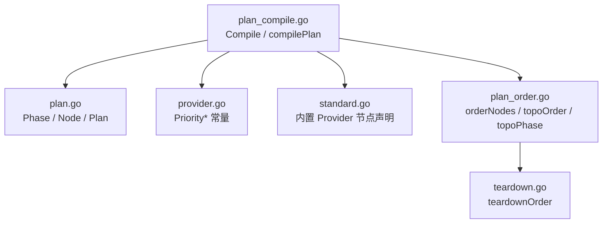
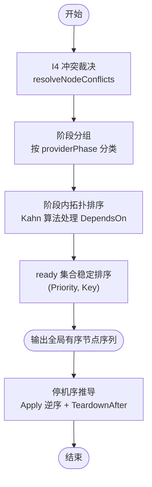
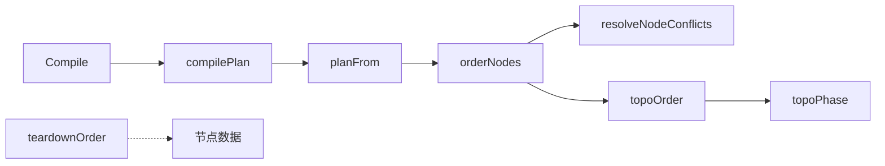

# 节点排序与拓扑调度

<cite>
**本文引用的文件**   
- [plan_order.go](file://pkg/appkit/plan_order.go)
- [provider.go](file://pkg/appkit/provider.go)
- [standard.go](file://pkg/appkit/standard.go)
- [teardown.go](file://pkg/appkit/teardown.go)
- [plan_compile.go](file://pkg/appkit/plan_compile.go)
- [plan.go](file://pkg/appkit/plan.go)
</cite>

## 目录
1. [引言](#引言)
2. [项目结构](#项目结构)
3. [核心组件](#核心组件)
4. [架构总览](#架构总览)
5. [详细组件分析](#详细组件分析)
6. [依赖关系分析](#依赖关系分析)
7. [性能考量](#性能考量)
8. [故障排查指南](#故障排查指南)
9. [结论](#结论)

## 引言
本文聚焦 Bald 应用框架的 **节点排序与拓扑调度** 机制，围绕 `orderNodes` 的多阶段策略展开：先按 `providerPhase` 分组，再在每个阶段内执行 Kahn 拓扑排序处理 `DependsOn`，最后在同一阶段内按 `(Priority, Key)` 稳定排序。文档同时覆盖以下主题：
- `phaseByTop` 的阶段分类规则（config → 构造期；server → 迟后期；logger → 专用通道；其余段默认阶段 B）。
- `Priority` 常量体系语义及扩展原则。
- `resolveNodeConflicts` 对同 Key 节点的 I4 裁决逻辑。
- `TeardownAfter` 如何影响停机序推导。
- `(Priority, Key)` 排序如何保证确定性。
- 复杂依赖图与循环依赖检测示例。

## 项目结构
节点排序相关代码集中在 `pkg/appkit` 包中，按关注点拆分：
- `plan.go`：计划类型、阶段枚举、节点字段定义。
- `provider.go`：优先级常量与 Provider 选项。
- `standard.go`：内置 Provider（日志、审计、HTTP/gRPC 服务器）如何声明节点。
- `plan_order.go`：冲突裁决、阶段划分、Kahn 拓扑排序。
- `teardown.go`：基于 `TeardownAfter` 的停机序推导。
- `plan_compile.go`：装配计划编译入口，把 Provider 声明投影为可检视 `Plan`。

**图表来源**
- [plan_compile.go:1-80](file://pkg/appkit/plan_compile.go#L1-L80)
- [plan.go:1-80](file://pkg/appkit/plan.go#L1-L80)
- [provider.go:130-148](file://pkg/appkit/provider.go#L130-L148)
- [standard.go:50-90](file://pkg/appkit/standard.go#L50-L90)
- [plan_order.go:1-60](file://pkg/appkit/plan_order.go#L1-L60)
- [teardown.go:1-30](file://pkg/appkit/teardown.go#L1-L30)

**章节来源**
- [plan_compile.go:1-80](file://pkg/appkit/plan_compile.go#L1-L80)
- [plan.go:1-80](file://pkg/appkit/plan.go#L1-L80)

## 核心组件
- **Phase**：装配阶段枚举，包含构造期、引导期、接线期、服务期、排空期、拆除期。
- **Node**：计划节点，携带 Key、Kind、Segments、DependsOn、TeardownAfter、Phase、Priority、Override、Reason、Opaque 等字段。
- **Priority\***：同阶段就绪集合的显式排序键，越小越先。
- **orderNodes**：唯一计划排序实现，顺序为 I4 冲突裁决 → 阶段序 → 阶段内 Kahn 拓扑 → ready 集合按 (Priority, Key) 选取。
- **resolveNodeConflicts**：同 Key 节点的 I4 裁决器。
- **topoOrder / topoPhase**：阶段划分与阶段内拓扑排序。
- **teardownOrder**：基于 Apply 逆序 + TeardownAfter 约束的停机序推导。

**章节来源**
- [plan.go:10-120](file://pkg/appkit/plan.go#L10-L120)
- [plan_order.go:1-60](file://pkg/appkit/plan_order.go#L1-L60)
- [provider.go:130-148](file://pkg/appkit/provider.go#L130-L148)
- [teardown.go:1-30](file://pkg/appkit/teardown.go#L1-L30)

## 架构总览
节点生命周期分为两个主要调度面：
1. **启动/构建调度**：由 `orderNodes` 驱动，依次完成冲突裁决、阶段分组、阶段内拓扑排序，并产出全局有序节点序列。
2. **停机调度**：由 `teardownOrder` 驱动，以 Apply 逆序为基础，叠加 `TeardownAfter` 约束，形成安全释放序列。

**图表来源**
- [plan_order.go:60-194](file://pkg/appkit/plan_order.go#L60-L194)
- [teardown.go:1-90](file://pkg/appkit/teardown.go#L1-L90)

**章节来源**
- [plan_order.go:60-194](file://pkg/appkit/plan_order.go#L60-L194)
- [teardown.go:1-90](file://pkg/appkit/teardown.go#L1-L90)

## 详细组件分析

### resolveNodeConflicts：同 Key 节点的 I4 裁决
该函数对相同 Key 的节点执行严格裁决：
- 若只有一个节点，直接保留。
- 若有多个节点，统计其中标记 `Override=true` 的候选。
- 无 Override 或超过一个 Override，返回错误。
- 唯一 Override 必须附带非空 `Reason`，否则报错。
- 胜出者保留，其余节点生成 `override` 诊断警告。

此机制确保同一资源键在计划中唯一，且覆盖行为显式可审计。

**章节来源**
- [plan_order.go:10-58](file://pkg/appkit/plan_order.go#L10-L58)

### orderNodes 与 topoOrder：多阶段排序主流程
`orderNodes` 是唯一的计划排序实现，其步骤如下：
1. 调用 `resolveNodeConflicts` 做 I4 冲突裁决。
2. 过滤出存活节点，交给 `topoOrder`。
3. `topoOrder` 遍历六个阶段：configure → bootstrap → wire → serve → drain → teardown。
4. 每个阶段内调用 `topoPhase` 做 Kahn 拓扑排序。
5. 最终拼接各阶段结果，得到全局有序节点列表。

关键点：
- 绝不使用声明下标（I2），所有顺序来自 Phase/Priority/DependsOn。
- 跨阶段依赖视为“已应用”或“未来依赖”，后者直接报错。

**章节来源**
- [plan_order.go:60-120](file://pkg/appkit/plan_order.go#L60-L120)

### topoPhase：阶段内 Kahn 拓扑排序
对单阶段节点执行拓扑排序：
- 仅考虑本阶段内的 `DependsOn`。
- 若依赖不在本阶段：
  - 依赖更早阶段：视为已应用，忽略入度。
  - 依赖更晚阶段：编译错误。
- 计算每个节点的入度，并按 `(Priority, Key)` 预排序 ready 集合。
- 每次从 ready 集合中选第一个未完成的节点加入输出，更新其后继入度。
- 若无法推进，说明存在环，报告循环依赖。

确定性保证：
- ready 集合按 `(Priority, Key)` 排序，优先取 Priority 小者；若 Priority 相同，按 Key 字典序。
- 这使同一输入始终产生相同输出，避免并发或非确定选择。

**章节来源**
- [plan_order.go:120-194](file://pkg/appkit/plan_order.go#L120-L194)

### phaseByTop：阶段分类规则
`phaseByTop` 按声明路径的顶层段做一次 switch，得到四个内部 `providerPhase`，再由 `phaseFor` 换成公开 `Phase`，阶段分类规则如下：
- **config 段**：进入构造期（PhaseConfigure）。
- **server 段**：进入迟后期（PhaseServe）。
- **logger 段**：走专用通道，由内置 logger Provider 注入，阶段为 Bootstrap，但通过独立路径处理。
- **其余段**：默认阶段 B（PhaseBootstrap）。

这些规则决定 Provider 生成的节点进入哪个阶段，进而影响拓扑排序范围。

**章节来源**
- [provider.go:249-276](file://pkg/appkit/provider.go#L249-L276)
- [plan_hash.go:111-122](file://pkg/appkit/plan_hash.go#L111-L122)

### Priority 常量体系与扩展原则
优先级常量定义在 `provider.go`，用于同阶段就绪集合的稳定排序：
- `PriorityLogger = 10`：日志引导，先于其它阶段 B 资源。
- `PriorityRegistry = 20`
- `PriorityTracer = 30`
- `PriorityMetrics = 40`
- `PriorityDatabase = 50`
- `PriorityCache = 60`
- `PriorityStorage = 70`
- `PriorityAudit = 80`：审计依赖 database/cache/storage 客户端就绪。
- `PriorityAI = 90`
- `PriorityWorkflow = 100`
- `PriorityBroker = 110`

扩展原则：
- 数值越小越先执行。
- 新增 Provider 应选择合适的优先级，避免破坏既有依赖链。
- 第三方 Provider 可自选任意值，默认 0。
- 建议遵循现有语义区间，保持可读性与可维护性。

**章节来源**
- [provider.go:130-148](file://pkg/appkit/provider.go#L130-L148)

### TeardownAfter：停机序推导
`teardownOrder` 负责推导停机顺序：
- 基础语义：最后应用的资源最先释放（栈式）。
- `TeardownAfter` 允许节点声明自身应在哪些节点之后释放。
- `"*"` 表示全部其它节点。
- 未知键视为已满足（跨阶段或框架外资源）。
- 同层候选按 Apply 逆序选取（后应用者先释放）。
- 若出现循环约束，报告错误。

典型用例：
- 审计后端使用 `["*"]`，确保指标/span flush 后再收集尾批事件。
- 指标/追踪使用 `["logger"]`，保持“先停暴露端、再 flush、最后恢复日志”。

**章节来源**
- [teardown.go:1-90](file://pkg/appkit/teardown.go#L1-L90)
- [standard.go:230-260](file://pkg/appkit/standard.go#L230-L260)

### 复杂依赖图与循环依赖检测示例
假设某阶段内有以下节点：
- A: DependsOn=[]
- B: DependsOn=[A]
- C: DependsOn=[B]
- D: DependsOn=[C, A]

拓扑过程：
1. 初始入度：A=0, B=1, C=1, D=2。
2. 第一次选择 A（入度 0，Priority 最小或 Key 最小）。
3. 更新后继：B 入度减至 0。
4. 第二次选择 B。
5. 更新后继：C 入度减至 0。
6. 第三次选择 C。
7. 更新后继：D 入度减至 1。
8. 第四次选择 D。

若存在环，例如：
- X: DependsOn=[Y]
- Y: DependsOn=[X]

则入度永远不为 0，Kahn 算法无法推进，报告循环依赖错误。

**章节来源**
- [plan_order.go:120-194](file://pkg/appkit/plan_order.go#L120-L194)

## 依赖关系分析
节点排序的核心依赖链如下：
- `Compile` → `compilePlan` → `newProviderPlan` → `planFrom` → `orderNodes`。
- `orderNodes` → `resolveNodeConflicts` → `topoOrder` → `topoPhase`。
- 停机序由 `teardownOrder` 独立推导，不依赖启动排序。

**图表来源**
- [plan_compile.go:1-80](file://pkg/appkit/plan_compile.go#L1-L80)
- [plan_order.go:60-194](file://pkg/appkit/plan_order.go#L60-L194)
- [teardown.go:1-90](file://pkg/appkit/teardown.go#L1-L90)

**章节来源**
- [plan_compile.go:1-80](file://pkg/appkit/plan_compile.go#L1-L80)
- [plan_order.go:60-194](file://pkg/appkit/plan_order.go#L60-L194)
- [teardown.go:1-90](file://pkg/appkit/teardown.go#L1-L90)

## 性能考量
- 阶段内 Kahn 拓扑排序时间复杂度为 O(V+E)，V 为阶段内节点数，E 为阶段内依赖边数。
- `(Priority, Key)` 排序在每阶段内进行一次，额外开销为 O(V log V)。
- 冲突裁决使用哈希表分组，平均 O(V)。
- 整体复杂度可控，适合中等规模装配计划。

[本节为通用性能讨论，不直接分析具体文件]

## 故障排查指南
常见错误与定位方式：
- **重复 Key 且无 Override**：检查 `resolveNodeConflicts` 报错信息，确认是否遗漏 `Override=true` 和 `Reason`。
- **重复 Key 且多个 Override**：检查是否只有一个节点标记 `Override`。
- **依赖未知节点**：检查 `DependsOn` 中的 Key 是否存在。
- **依赖更晚阶段**：检查 `DependsOn` 是否指向未来阶段，违反阶段边界。
- **阶段内循环依赖**：查看 `topoPhase` 报告的循环节点列表。
- **停机序循环**：检查 `TeardownAfter` 是否形成环。

**章节来源**
- [plan_order.go:10-58](file://pkg/appkit/plan_order.go#L10-L58)
- [plan_order.go:120-194](file://pkg/appkit/plan_order.go#L120-L194)
- [teardown.go:60-90](file://pkg/appkit/teardown.go#L60-L90)

## 结论
Bald 的节点排序与拓扑调度机制通过明确的阶段划分、严格的冲突裁决、稳定的优先级排序和健壮的 Kahn 拓扑算法，确保了装配计划的确定性和可预测性。`Priority` 常量体系为扩展提供了清晰语义空间，`TeardownAfter` 则为停机序提供了灵活而安全的约束能力。在实际使用中，应遵循阶段分类规则、合理设置优先级、显式声明覆盖关系，并通过计划输出验证依赖图的合理性。