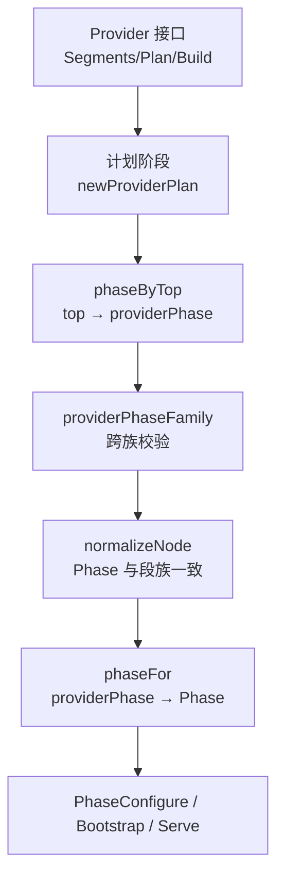
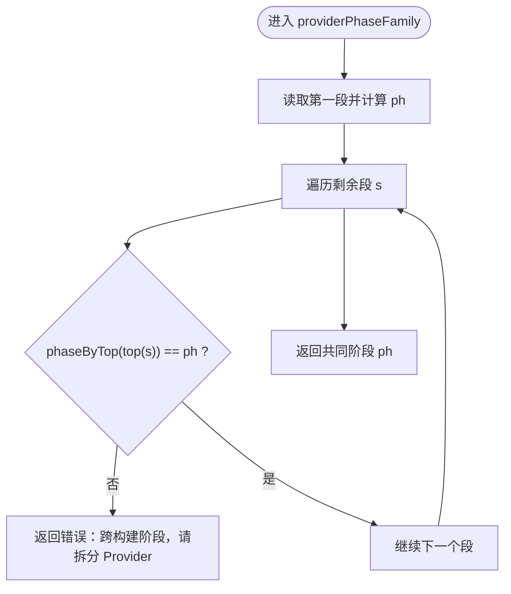
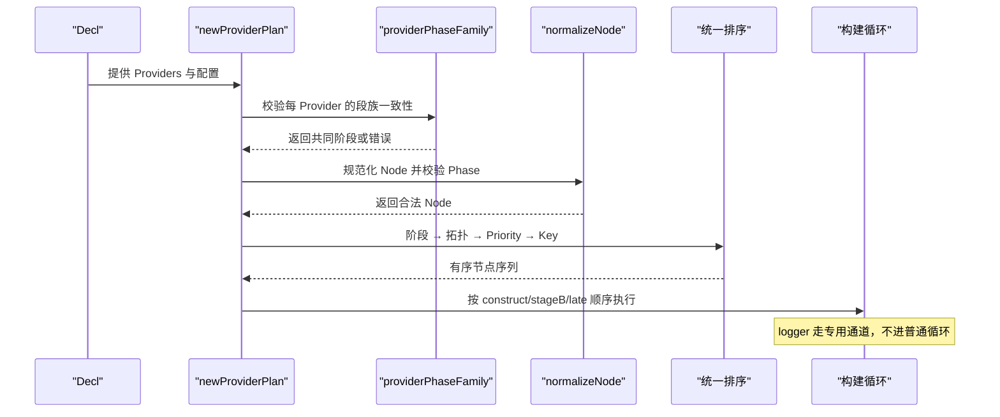
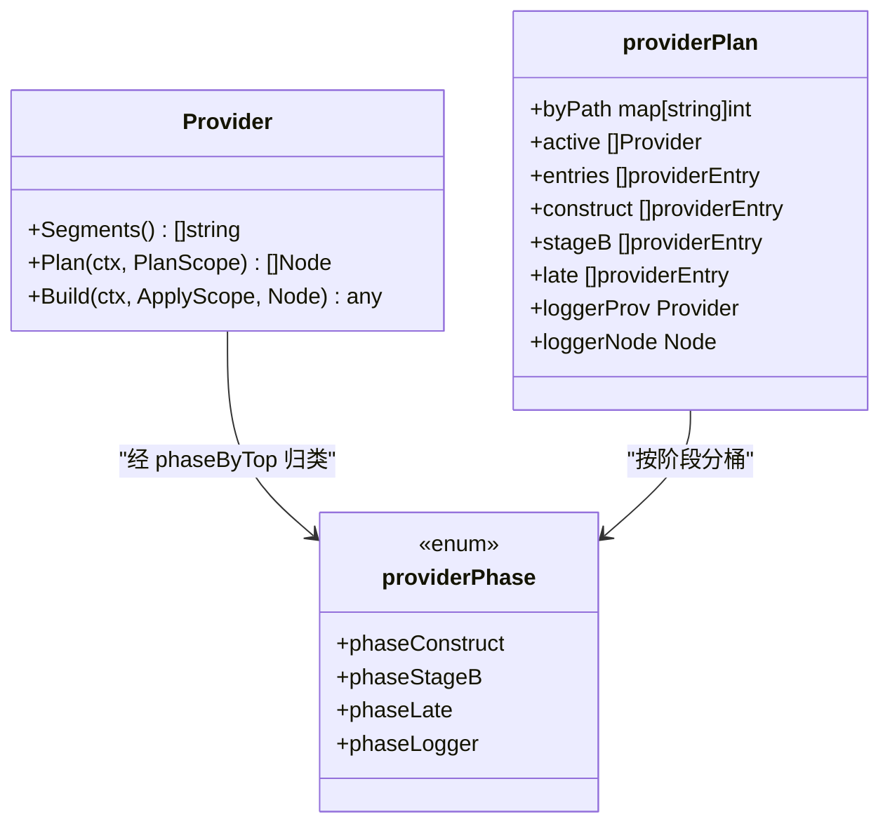

# 阶段分组与 phaseByTop 分类

<cite>
**本文引用的文件**
- [pkg/appkit/provider.go](file://pkg/appkit/provider.go)
- [pkg/appkit/plan_hash.go](file://pkg/appkit/plan_hash.go)
- [pkg/appkit/plan.go](file://pkg/appkit/plan.go)
</cite>

## 目录
1. [引言](#引言)
2. [项目结构](#项目结构)
3. [核心组件](#核心组件)
4. [架构总览](#架构总览)
5. [详细组件分析](#详细组件分析)
6. [依赖关系分析](#依赖关系分析)
7. [性能考量](#性能考量)
8. [故障排查指南](#故障排查指南)
9. [结论](#结论)

## 引言
本文聚焦 Provider 装配机制中的“阶段分组”与 `phaseByTop` 分类规则，解释以下设计要点：
- `providerPhase` 枚举的四种语义及生命周期位置。
- `phaseByTop` 如何把顶层段名映射到构建时机，以及新增第三方段的扩展原则。
- `providerPhaseFamily` 如何校验单个 Provider 声明的所有段路径必须属于同一构建阶段。
- `config`、`database`、`server`、`logger` 等典型段的映射表，以及违反规则的失败用例。

## 项目结构
本主题的实现集中在应用装配层：
- `pkg/appkit/provider.go`：定义 `providerPhase`、`phaseByTop`、`providerPhaseFamily`、节点归一化、计划解析与阶段分组。
- `pkg/appkit/plan_hash.go`：把内部 `providerPhase` 映射为对外 `Phase`（`PhaseConfigure` / `PhaseBootstrap` / `PhaseServe`）。
- `pkg/appkit/plan.go`：暴露 `Phase` 常量及其字符串表示，是 `normalizeNode` 中 Phase 合法性校验的目标。



**图表来源**
- [pkg/appkit/provider.go:248-305](file://pkg/appkit/provider.go#L248-L305)
- [pkg/appkit/provider.go:450-563](file://pkg/appkit/provider.go#L450-L563)
- [pkg/appkit/plan_hash.go:111-122](file://pkg/appkit/plan_hash.go#L111-L122)
- [pkg/appkit/plan.go:24-40](file://pkg/appkit/plan.go#L24-L40)

**章节来源**
- [pkg/appkit/provider.go:1-120](file://pkg/appkit/provider.go#L1-L120)
- [pkg/appkit/provider.go:248-305](file://pkg/appkit/provider.go#L248-L305)
- [pkg/appkit/plan_hash.go:111-122](file://pkg/appkit/plan_hash.go#L111-L122)
- [pkg/appkit/plan.go:24-40](file://pkg/appkit/plan.go#L24-L40)

## 核心组件
### `providerPhase` 枚举
| 枚举值 | 语义 | 生命周期位置 |
|---|---|---|
| `phaseConstruct` | 构造期 | `config` 段进入；在 `NewApp` 之前，用于产出要注入 `kitOpts` 的配置层。 |
| `phaseStageB` | 阶段 B | Run 的 BeforeStart 钩子内执行，早于业务 BeforeStart 钩子；默认承载除 config/server/logger 之外的所有段。 |
| `phaseLate` | 迟后期 | 业务 BeforeStart 钩子之后；`server` 段在此阶段构建，以便消费业务已建好的运行期资源。 |
| `phaseLogger` | logger 专用通道 | 不走普通构建循环；由引擎通过两阶段与热更协议调用，不进入 `entries` 的阶段视图。 |

**章节来源**
- [pkg/appkit/provider.go:248-284](file://pkg/appkit/provider.go#L248-L284)

### `phaseByTop` 分类函数
`phaseByTop` 以顶层段名为键，返回对应 `providerPhase`：
- `config` → `phaseConstruct`
- `server` → `phaseLate`
- `logger` → `phaseLogger`
- 其他所有顶层段 → `phaseStageB`

这一设计保证新增第三方段自动落入阶段 B，无需修改引擎代码。

```mermaid
flowchart TD
    Start(["输入顶层段 top"]) --> CheckConfig{"top == \"config\"?"}
    CheckConfig -->|是| Construct["返回 phaseConstruct"]
    CheckConfig -->|否| CheckServer{"top == \"server\"?"}
    CheckServer -->|是| Late["返回 phaseLate"]
    CheckServer -->|否| CheckLogger{"top == \"logger\"?"}
    CheckLogger -->|是| Logger["返回 phaseLogger"]
    CheckLogger -->|否| Default["返回 phaseStageB"]
```

**图表来源**
- [pkg/appkit/provider.go:285-305](file://pkg/appkit/provider.go#L285-L305)

**章节来源**
- [pkg/appkit/provider.go:285-305](file://pkg/appkit/provider.go#L285-L305)

### `providerPhaseFamily` 跨族校验
`providerPhaseFamily` 检查 Provider 声明的所有段路径是否属于同一构建阶段：
1. 取第一条段路径的顶层段，计算其 `providerPhase`。
2. 遍历其余段路径，若任一顶层段的 `phaseByTop` 结果不同，则报错。
3. 错误信息要求将 Provider 拆分为“每个阶段一个 Provider”。

该约束的动机是：不同阶段的 Build 具有不同的 scope、启动时序和资源可用性，一次 Build 无法同时满足多种调用时机。



**图表来源**
- [pkg/appkit/provider.go:547-563](file://pkg/appkit/provider.go#L547-L563)

**章节来源**
- [pkg/appkit/provider.go:547-563](file://pkg/appkit/provider.go#L547-L563)

### 内部阶段到外部 `Phase` 的映射
`phaseFor` 把内部 `providerPhase` 映射到公开的 `Phase`：
- `phaseConstruct` → `PhaseConfigure`
- `phaseStageB`、`phaseLogger` → `PhaseBootstrap`
- `phaseLate` → `PhaseServe`

注意：`phaseLogger` 虽然映射为 `PhaseBootstrap`，但它在计划与执行层面走专用通道，并不参与普通节点排序与构建循环。

**章节来源**
- [pkg/appkit/plan_hash.go:111-122](file://pkg/appkit/plan_hash.go#L111-L122)
- [pkg/appkit/plan.go:24-40](file://pkg/appkit/plan.go#L24-L40)

## 架构总览
Provider 装配的关键流程如下：
1. Provider 通过 `Segments()` 声明契约段路径。
2. `newProviderPlan` 收集活跃 Provider，按精确段路径做末者胜。
3. 对每个 Provider 调用 `providerPhaseFamily`，校验所有段属于同一阶段。
4. 对每个 Provider 调用 `Plan`，得到恰好一个 Node。
5. `normalizeNode` 校验 Node 的 Phase 与段族一致，并把 Node 加入全局排序。
6. 按阶段分桶：`construct`、`stageB`、`late`；`logger` 单独抽出。
7. 构建时先构造期，再阶段 B，最后迟后期；logger 走两阶段与热更协议。



**图表来源**
- [pkg/appkit/provider.go:306-546](file://pkg/appkit/provider.go#L306-L546)
- [pkg/appkit/provider.go:565-683](file://pkg/appkit/provider.go#L565-L683)

## 详细组件分析

### 典型段的 `phaseByTop` 映射表
| 顶层段 | `phaseByTop` 返回值 | 公开 Phase | 生命周期说明 |
|---|---|---|---|
| `config` | `phaseConstruct` | `PhaseConfigure` | 构造期，产物进入 `kitOpts`，先于 `NewApp`。 |
| `database` | `phaseStageB` | `PhaseBootstrap` | 默认阶段 B，Run 的 BeforeStart 内执行。 |
| `server` | `phaseLate` | `PhaseServe` | 迟后期，业务 BeforeStart 钩子之后。 |
| `logger` | `phaseLogger` | `PhaseBootstrap`（专用通道） | 两阶段 + 热更协议，不进构建循环。 |
| 任意第三方段（如 `audit`、`metrics`、`broker`、`script`） | `phaseStageB` | `PhaseBootstrap` | 新增段自动落入阶段 B，无需改动引擎。 |

**章节来源**
- [pkg/appkit/provider.go:285-305](file://pkg/appkit/provider.go#L285-L305)
- [pkg/appkit/plan_hash.go:111-122](file://pkg/appkit/plan_hash.go#L111-L122)

### 验证失败用例

#### 1. 跨构建阶段声明
若 Provider 同时声明 `config` 和 `server`：
- `segmentTop("config")` 映射为 `phaseConstruct`。
- `segmentTop("server")` 映射为 `phaseLate`。
- `providerPhaseFamily` 发现两者不一致，直接返回错误。

预期错误语义：
- 提示 Provider 声明了跨构建阶段的段。
- 建议拆分为两个 Provider：一个处理 `config`，另一个处理 `server`。

**章节来源**
- [pkg/appkit/provider.go:547-563](file://pkg/appkit/provider.go#L547-L563)

#### 2. 节点 Phase 与段族不一致
若某个 Provider 声明 `database.sql`，却在 `Plan` 中返回 `PhaseServe`：
- `phaseByTop("database")` 得到 `phaseStageB`。
- `phaseFor(phaseStageB)` 期望 `PhaseBootstrap`。
- `normalizeNode` 比较 Node.Phase 与期望 Phase，不相等时报错。

预期错误语义：
- 指出 Provider 的 Node 声明了不支持的 Phase。
- 明确指出该段族期望的 Phase。

**章节来源**
- [pkg/appkit/provider.go:450-546](file://pkg/appkit/provider.go#L450-L546)
- [pkg/appkit/plan_hash.go:111-122](file://pkg/appkit/plan_hash.go#L111-L122)

#### 3. 未知顶层段的行为
若新增第三方顶层段 `payment`：
- `phaseByTop("payment")` 命中 default 分支。
- 返回 `phaseStageB`。
- 该 Provider 会在阶段 B 构建，无需修改 `phaseByTop`。

这是作者强调的扩展原则：第三方段默认进入阶段 B，保持引擎稳定。

**章节来源**
- [pkg/appkit/provider.go:285-305](file://pkg/appkit/provider.go#L285-L305)

### 生命周期位置对照
| Provider 类型 | 所属阶段 | 构建入口 | 关键约束 |
|---|---|---|---|
| `config` 段 Provider | `phaseConstruct` | 构造期 | 产物用于装配 `kitOpts`，先于 `NewApp`。 |
| `database` 等默认段 Provider | `phaseStageB` | 阶段 B | Run 的 BeforeStart 内执行，早于业务钩子。 |
| `server` 段 Provider | `phaseLate` | 迟后期 | 业务 BeforeStart 钩子之后。 |
| `logger` 段 Provider | `phaseLogger` | 专用通道 | 两阶段 + 热更协议，不参与普通节点排序。 |

**章节来源**
- [pkg/appkit/provider.go:248-305](file://pkg/appkit/provider.go#L248-L305)
- [pkg/appkit/provider.go:450-546](file://pkg/appkit/provider.go#L450-L546)

## 依赖关系分析


**图表来源**
- [pkg/appkit/provider.go:248-305](file://pkg/appkit/provider.go#L248-L305)
- [pkg/appkit/provider.go:306-546](file://pkg/appkit/provider.go#L306-L546)

**章节来源**
- [pkg/appkit/provider.go:248-546](file://pkg/appkit/provider.go#L248-L546)

## 性能考量
- `phaseByTop` 是常数时间查找，仅做一次顶层段切分与 switch。
- `providerPhaseFamily` 线性扫描 Provider 的段列表，通常段数量很小。
- 阶段分组发生在计划阶段，实际构建循环只按已经排好序的 `construct`、`stageB`、`late` 列表执行，避免运行时重新分类。

[本节为通用性能讨论，不直接分析具体代码行]

## 故障排查指南
常见错误及定位方式：

| 现象 | 可能原因 | 排查步骤 |
|---|---|---|
| 启动期报“跨构建阶段” | Provider 同时声明多个顶层段，且它们属于不同阶段 | 检查 `Segments()` 返回的路径；把 `config` 与 `server` 等拆成独立 Provider。 |
| 启动期报“Phase 与段族不一致” | `Plan` 返回的 Node.Phase 不符合段族约定 | 确认 `database` 应使用 `PhaseBootstrap`，`server` 应使用 `PhaseServe`，`config` 应使用 `PhaseConfigure`。 |
| 新增段未生效 | 段路径拼写错误或未被契约声明 | 检查 `segmentPresent` 使用的 protobuf 反射路径；确保 BootstrapConfig 中存在该字段。 |
| logger 行为异常 | 误以为 logger 走普通构建循环 | 确认 logger 由专用通道驱动，不参与普通节点排序与 teardown 常规路径。 |

**章节来源**
- [pkg/appkit/provider.go:450-563](file://pkg/appkit/provider.go#L450-L563)
- [pkg/appkit/provider.go:248-305](file://pkg/appkit/provider.go#L248-L305)

## 结论
`providerPhase` 与 `phaseByTop` 构成 Provider 装配的阶段分层基础：
- `config` 在构造期，服务于应用初始化前的配置装配。
- `server` 在迟后期，等待业务资源就绪后再构造服务面。
- `logger` 走专用通道，承担两阶段与热更语义。
- 其余段默认进入阶段 B，新增第三方段无需修改引擎即可获得合理生命周期。
- `providerPhaseFamily` 保证单个 Provider 的生命周期语义一致，跨阶段声明会被明确拒绝。

这套设计把“段路径 → 构建阶段 → 公开 Phase → 构建时序”形成清晰闭环，既约束了 Provider 的正确写法，又保留了向第三方扩展的稳定性。